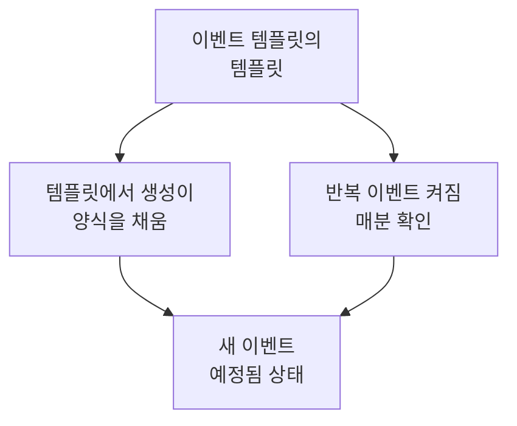

# 템플릿 및 반복 이벤트

예정된 유지 관리 템플릿은 자주 계획하는 이벤트를 저장합니다. 제목과 설명, 일시 중지하는 모니터, 표시되는 상태 페이지, 알림을 받는 사람입니다. 템플릿을 사용하면 클릭 한 번으로 양식을 채울 수 있고, 반복으로 설정하면 OneUptime이 매주, 매월 또는 원하는 간격으로 이벤트를 대신 예약합니다.

:::cards
- [템플릿 만들기](#템플릿-만들기): 앞에는 이름, 끝에는 일정이 있는 양식 단계.
- [템플릿 사용하기](#템플릿-사용하기): 템플릿으로 새 이벤트를 채웁니다.
- [반복 이벤트](#반복-이벤트): OneUptime이 이벤트를 스스로 예약하게 합니다.
- [템플릿 변경 또는 중지하기](#템플릿-변경-또는-중지하기): 편집, 일정 일시 중지, 삭제.
:::

## 작동 방식

템플릿은 출발점입니다. 템플릿으로 만든 이벤트는 고유한 값을 가진 사본이므로, 나중에 템플릿을 바꾸면 그 이후에 만들어지는 이벤트만 바뀝니다.

## 시작하기 전에

- **요금제.** OneUptime Cloud에서 템플릿을 사용하려면 **Growth** 이상의 요금제가 필요합니다.
- **역할.** 템플릿을 만들려면 **프로젝트 소유자**, **프로젝트 관리자**, **프로젝트 구성원**, **예정된 유지 관리 관리자**, **예정된 유지 관리 구성원** 중 하나이거나 예정된 유지 관리 템플릿을 만들 수 있는 사용자 지정 역할이 필요합니다.

## 템플릿 만들기

:::steps
### 템플릿 열기

**예정된 유지 관리 → 설정 → 이벤트 템플릿** 으로 이동합니다. 사이드 메뉴의 **설정** 은 처음에 접혀 있으니 먼저 펼치세요. **예정된 유지보수 템플릿 만들기** 를 클릭합니다.

### 템플릿 이름 지정하기

**템플릿 정보** 에서 **템플릿 이름** 과 **템플릿 설명** 을 입력하여 팀이 언제 사용할지 알 수 있게 합니다. 둘 다 필수입니다.

### 이벤트 설명하기

**이벤트** 에서 템플릿으로 만드는 모든 이벤트가 처음 가질 **제목** 과 **설명** 을 입력합니다. **소유자** 와 **레이블** 은 **추가 필드** 아래에 있습니다.

### 영향을 주는 대상 선택하기

**영향받는 리소스** 에서 **모니터**, 그 모니터의 **모니터 상태를 다음으로 변경**, 필요하면 **기타 영향받는 리소스**, **이 상태 페이지에 이벤트 표시** 의 상태 페이지, **구독자 알림** 을 선택합니다.

### 반복 여부 정하기

**반복** 에서 직접 사용할 템플릿이라면 **반복 이벤트** 를 끈 채로 두고, 반복하려면 켜고 일정을 입력합니다. **다음** 을 클릭하여 검토 화면을 확인한 다음 템플릿을 만듭니다.
:::

템플릿은 모니터를 지정하지 않아도 **모니터 상태를 다음으로 변경** 을 묻습니다. 이 상태는 템플릿으로 이벤트를 예약할 때 추가하는 모니터에도 적용됩니다. **기타 영향받는 리소스** 에서 템플릿이 받는 것은 호스트, Kubernetes 클러스터, Docker 호스트, Podman 호스트, 서비스입니다.

## 템플릿이 채우는 것

| 이벤트의 부분                                     | 템플릿에서 생성                      | 반복 이벤트                     |
| ------------------------------------------------- | ------------------------------------ | ------------------------------- |
| **제목** 과 **설명**                              | 채워지며 변경 가능                   | 복사됨                          |
| **모니터** 와 **모니터 상태를 다음으로 변경**     | 채워짐                               | 복사됨                          |
| **기타 영향받는 리소스**                          | 채워짐                               | 복사됨                          |
| 상태 페이지와 **구독자 알림**                     | 채워짐                               | 복사됨                          |
| **소유자** 와 **레이블**                          | 채워짐                               | 복사됨                          |
| **시작** 과 **종료**                              | 다음 정시부터 한 시간                | 일정에 따라 계산됨              |

## 템플릿 사용하기

:::steps
### 템플릿 선택하기

**예정된 유지 관리 → 모든 이벤트** 에서 **템플릿에서 생성** 을 클릭하고 **예정된 유지 관리 템플릿 선택** 에서 템플릿을 고릅니다.

### 양식 확인하기

**템플릿에서 생성** 을 클릭합니다. 템플릿의 답변이 채워진 상태로 만들기 양식이 열립니다. 기간을 설정하고 이 이벤트에 필요한 것을 바꿉니다.

### 이벤트 만들기

**다음** 으로 단계를 진행한 다음 검토 화면에서 **예정된 유지 관리 이벤트 만들기** 를 클릭합니다.
:::

프로젝트에 아직 템플릿이 없으면 **템플릿에서 생성** 이 그렇다고 알려 주고 **이벤트 템플릿** 으로 연결합니다.

## 반복 이벤트

반복 템플릿은 일정에 따라 이벤트를 만듭니다. 첫 번째 이벤트가 언제 만들어지고, 언제 시작하고, 언제 끝나는지 설정하면, 이후의 각 이벤트는 같은 간격을 유지하면서 한 주기씩 뒤에 옵니다.

| 필드                                                     | 의미                                                                                               |
| -------------------------------------------------------- | -------------------------------------------------------------------------------------------------- |
| **반복 이벤트**                                          | 일정을 켭니다.                                                                                     |
| **첫 번째 이벤트 예약 시각**                             | OneUptime이 첫 번째 이벤트를 만드는 시각이며, 구독자가 예약 소식을 듣는 시각이기도 합니다.          |
| **첫 번째 이벤트 시작 시각**                             | 첫 번째 이벤트가 시작하는 시각입니다.                                                              |
| **첫 번째 이벤트 종료 시각**                             | 첫 번째 이벤트가 종료하는 시각입니다.                                                              |
| **이 이벤트가 얼마나 자주 반복되기를 원하십니까?**       | 숫자와 단위입니다. 단위는 시간, 일, 주, 월, 년입니다.                                              |

예를 들어 첫 번째 이벤트를 월요일에 만들고 그 주 토요일에 진행하는 매주 기간은 다음과 같습니다.

| 이벤트       | 만들어짐           | 시작               | 종료               |
| ------------ | ------------------ | ------------------ | ------------------ |
| 첫 번째      | `2030-06-03 09:00` | `2030-06-08 02:00` | `2030-06-08 04:00` |
| 두 번째      | `2030-06-10 09:00` | `2030-06-15 02:00` | `2030-06-15 04:00` |

**첫 번째 이벤트 예약 시각** 은 고객이 작업 소식을 듣기를 원하는 만큼 시작보다 앞서 설정하세요. 템플릿을 만들 때 세 시각은 모두 미래여야 하고, 이벤트는 시작과 종료 전에 만들어져야 하며, 종료 전에 시작해야 합니다. 어떤 규칙을 어겼는지는 양식이 알려 줍니다.

작업이 매분 반복 템플릿을 확인합니다. 템플릿의 다음 시각이 되면 그 시각을 한 주기 뒤로 옮기고 이벤트를 만듭니다. 템플릿 목록은 그 시각을 **반복 이벤트** 열에 표시하고, 반복하지 않는 템플릿에는 **아니오** 를 표시합니다. 일정으로 만들어진 이벤트도 다른 이벤트와 같습니다. 규칙이 실행되고, 소유자가 추가되며, 구독자는 이벤트가 예약되었다는 알림을 받습니다.

## 템플릿 변경 또는 중지하기

목록에서 템플릿을 열면 그 페이지가 표시됩니다.

- **예정된 유지 관리 템플릿 세부 정보** 는 새 이벤트가 무엇으로 시작하는지 보여 줍니다. 그 **편집** 은 **템플릿 정보**, **이벤트**, **상태 페이지**, **반복** 을 차례로 거칩니다.
- **영향받는 리소스** 에는 **모니터**, 그 **모니터 상태를 다음으로 변경**, **기타 영향받는 리소스** 가 있으며, 자체 **편집** 이 있습니다.
- **소유자** 에는 템플릿으로 예약되는 모든 이벤트를 소유하는 사람과 팀이 나열됩니다.

변경 사항은 저장한 뒤에 만들어지는 이벤트에 적용되고, 이미 만들어진 이벤트는 고유한 값을 유지합니다. 일정을 멈추려면 **편집** 에서 **반복 이벤트** 를 끄거나 템플릿을 삭제하세요. 끈 템플릿은 일정을 유지합니다. 다시 켜면 일정의 다음 시각부터 이어지며, 꺼져 있던 동안의 시각은 건너뜁니다. 템플릿을 삭제해도 그 템플릿이 만든 이벤트는 남습니다.

## 문제 해결

:::details 반복 템플릿을 만들 때 시각이 미래여야 한다고 표시됩니다
만들 때 세 개의 첫 시각이 모두 현재보다 뒤여야 합니다. 시각을 앞으로 옮기세요. 그러면 일정은 첫 번째 이벤트부터 이어집니다.
:::

:::details 반복 템플릿이 이벤트를 만들지 않았습니다
**반복 이벤트** 가 아직 켜져 있는지 확인하고, 목록의 **반복 이벤트** 열에 있는 시각을 보세요. 이벤트는 시작 시각이 아니라 그 시각에 만들어집니다. 작업은 매분 실행되므로 1분 정도 기다리세요.
:::

:::details 템플릿으로 만든 이벤트에 선택한 리소스가 없습니다
템플릿의 **기타 영향받는 리소스** 가 받는 것은 호스트, Kubernetes 클러스터, Docker 호스트, Podman 호스트, 서비스입니다. 다른 종류의 리소스는 이벤트의 **영향받는 리소스** 카드에 있는 **편집** 으로 이벤트 자체에 추가하세요.
:::

## 다음 단계

:::cards
- [유지 관리 이벤트 만들기](/docs/scheduled-maintenance/creating-events): 템플릿이 채우는 양식.
- [유지 관리 상태](/docs/scheduled-maintenance/states): 만들어진 뒤 각 이벤트가 어떻게 진행되는지.
- [유지 관리 규칙 및 설정](/docs/scheduled-maintenance/settings): 모든 새 이벤트에 소유자와 레이블을 자동으로 추가합니다.
- [예정된 유지 관리 개요](/docs/scheduled-maintenance/index): 유지 관리 전체에서 템플릿이 차지하는 자리.
:::
