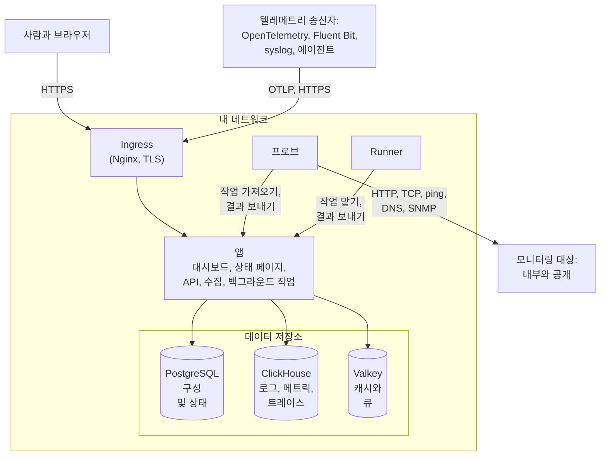

# 아키텍처

자체 호스팅한 OneUptime 설치는 몇 개의 컨테이너로 이루어집니다. 모든 요청이 들어오는 ingress 하나, 일을 처리하는 앱 이미지 하나, 모니터의 검사를 실행하는 프로브, 그리고 세 개의 데이터 저장소입니다. 이 페이지는 이들이 어떻게 맞물리는지, 각각 무엇을 하는지, 어떤 연결이 네트워크 경계를 넘는지 보여 줍니다.

## 이 그림이 보여 주는 것

- 사람들은 **ingress**를 통해 OneUptime에 접근합니다. ingress는 TLS를 종료하고 각 요청을 앱으로 보냅니다. Dashboard, 상태 페이지, API, 그리고 텔레메트리가 전송되는 모든 수집 엔드포인트가 그 대상입니다.
- **앱**은 상태를 PostgreSQL에 읽고 쓰며, 텔레메트리를 ClickHouse에 보관하고, 캐시와 백그라운드 작업이 처리하는 큐에 Valkey(Redis 7.2의 BSD 라이선스 포크)를 사용합니다.
- **프로브**는 클러스터 안(권장) 및/또는 네트워크의 다른 곳에서 실행할 수 있습니다. 프로브가 모니터링할 수 있는 것은 다음과 같습니다.
  - 방화벽 뒤의 내부/비공개 서비스.
  - 인터넷의 외부/공개 리소스.
- 프로브 결과는 앱으로 보내져 Valkey의 큐에 들어가고, 백그라운드 작업이 처리해 데이터 저장소에 기록합니다. 네트워크의 다른 곳에 있는 프로브는 ingress를 거쳐 OneUptime URL로 앱에 닿습니다.
- 텔레메트리(메트릭, 트레이스, 로그 등)는 같은 앱이 수집해 ClickHouse에 저장합니다.

> [!NOTE]
> 기본 제공되는 것 대신 외부 PostgreSQL, Valkey(또는 Redis), ClickHouse를 사용하면 앱은 대신 외부 엔드포인트에 연결합니다. 논리적인 흐름은 같습니다.

## 구성 요소

| 구성 요소 | Docker Compose 서비스 | Helm 차트 | 하는 일 |
| --- | --- | --- | --- |
| Ingress | `ingress` | `nginx` | TLS를 종료하고, 호스트 이름과 상태 페이지 도메인을 제공하며, 모든 요청을 앱으로 보냅니다. |
| 앱 | `app` | `app` | Dashboard, 상태 페이지, API와 수집 엔드포인트, 그리고 따로 분리하지 않는 한 백그라운드 작업까지 맡습니다. |
| Worker | `app`의 일부 | `worker`(기본값은 꺼짐) | 백그라운드 작업을 별도의 파드에서 실행해, 무거운 큐 처리가 API 요청과 경쟁하지 않게 합니다. |
| Telemetry writer | `app`의 일부 | `telemetryWriter`(기본값은 꺼짐) | 모든 ClickHouse 삽입을 수행하는 고정 크기 계층으로, 워커가 얼마나 확장되든 삽입이 일정한 한도에 머물게 합니다. |
| 프로브 | `probe-1` | `probes` | 모니터 검사를 실행하고 결과를 돌려보냅니다. 기본 제공되는 프로브는 모두 모든 프로젝트가 쓸 수 있는 글로벌 프로브입니다. |
| Runner | `runner` | `runner` | 인스턴스 자체의 Runner로, 모든 프로젝트의 AI 코드 수정을 실행할 수 있습니다. Runbook 단계는 실행되어야 할 곳에 설치한 [Runner](/docs/runbooks/agents)에서 실행됩니다. |
| PostgreSQL | `postgres` | `postgresql` 또는 `postgresOperator.cnpg` | 프로젝트, 모니터, 인시던트, 사용자와 그 밖의 모든 설정과 상태. |
| ClickHouse | `clickhouse` | `clickhouse` 또는 `clickhouseOperator.altinity` | 로그, 메트릭, 트레이스, 예외, 프로파일, 모니터 로그. |
| Valkey | `valkey` | `valkey` | 캐시, 작업 큐, 그리고 대기 중인 푸시 수신 확인 같은 수명이 짧은 상태. |

앱의 모든 역할은 같은 이미지입니다. Docker Compose는 이들을 하나의 `app` 컨테이너에서 실행하고, Helm 차트는 worker와 telemetry writer를 각각 별도의 배포로 실행할 수 있습니다. 각 계층의 크기를 정하는 방법은 [크기 산정 및 용량 계획](/docs/installation/sizing)을 참고하세요.

## 네트워크 밖으로 나가는 연결

앱은 켠 기능을 위해서만 바깥으로 연결합니다. 각 연결은 선택 사항이며, 각각 허용해야 할 정확한 주소를 알려 주는 페이지가 있습니다.

| 나가는 연결 | 용도 | 자세히 보기 |
| --- | --- | --- |
| 이메일(SMTP 또는 SendGrid의 API) | 알림과 초대 | [SMTP](/docs/emails/smtp) |
| Twilio | SMS와 전화 | [Twilio 연동](/docs/self-hosted/twilio-integration) |
| OneUptime의 푸시 릴레이 또는 Expo | 모바일 푸시 알림 | [푸시 알림](/docs/self-hosted/push-notifications) |
| Slack과 Microsoft Teams | 워크스페이스 알림과 작업 | [Slack 연동](/docs/self-hosted/slack-integration) |
| OpenAI, Anthropic, Microsoft Foundry 또는 직접 실행하는 모델 같은 LLM 공급자 | OneUptime AI | [LLM 공급자](/docs/ai/llm-provider) |
| `oneuptime.com` | Enterprise 라이선스 온라인 활성화 | [엔터프라이즈 에디션](/docs/self-hosted/enterprise) |

반대 방향의 연결, 즉 SendGrid가 수신 이메일을 전달하거나 Slack과 Microsoft Teams가 콜백하는 경우에는 인터넷에서 ingress에 접근할 수 있어야 합니다. 앱과 프로브가 어떤 사설 주소에 접근할 수 있는지는 직접 정합니다. [프라이빗 네트워크 접근](/docs/self-hosted/private-network-access)을 참고하세요.

## 다음 단계

:::cards
- [Docker Compose](/docs/installation/docker-compose): 모든 구성 요소를 한 대의 머신에 설치합니다.
- [크기 산정 및 용량 계획](/docs/installation/sizing): 각 계층에 필요한 CPU, 메모리, 디스크의 양.
- [사용자 지정 프로브](/docs/probe/custom-probe): 다른 네트워크 안에서 프로브를 실행합니다.
- [엔터프라이즈 에디션](/docs/self-hosted/enterprise): Enterprise 이미지가 더하는 것과 라이선스가 동작하는 방식.
:::
