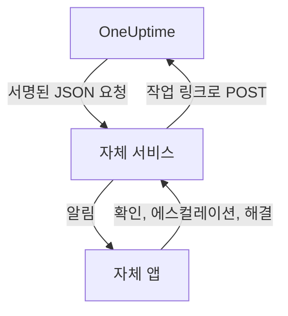

# 사용자 지정 알림 채널

사용자 지정 채널은 온콜 호출을 직접 운영하는 서비스로 보냅니다. 회사 자체 앱, 무선 호출 시스템, 네트워크 밖으로 나가는 것을 검사하는 게이트웨이 등이 그 예입니다. 서버 전체에 한 번만 추가하면, 아무것도 설정하지 않아도 누구나 이 채널로 호출을 받을 수 있습니다. Admin Dashboard에서는 **Custom Channels**라고 부릅니다.

> [!NOTE]
> 사용자 지정 채널은 [OneUptime Enterprise Edition](/docs/self-hosted/enterprise)의 일부이며, 이를 포함하는 Enterprise 라이선스가 필요합니다. Community Edition에는 **Custom Channels** 페이지가 없고, 어떤 채널로도 아무것도 보내지 않습니다. [라이선스가 없을 때](#라이선스가-없을-때)를 참고하세요.

:::cards
- [채널 추가하기](#채널-추가하기): 이름, URL, 서명 비밀 값.
- [서비스가 받는 내용](#서비스가-받는-내용): 호출마다, 사람마다 서명된 JSON 요청 하나.
- [호출에 대응하기](#호출에-대응하기): 자체 앱에서 확인, 에스컬레이션, 해결을 합니다.
- [전송과 재시도](#전송과-재시도): 서비스가 중단되었을 때 일어나는 일.
- [기타 알림](#기타-알림): 소유자 알림, 메모, 근무 알림을 원하는 사람에게 보냅니다.
- [라이선스가 없을 때](#라이선스가-없을-때): 멈추는 것과 보존되는 것.
:::

## 작동 방식



온콜 정책이 누군가를 호출하고 그 사람의 온콜 규칙이 이 채널을 사용하면, OneUptime은 채널의 URL로 요청을 보냅니다. 요청에는 호출 대상(이름과 이메일)과 호출 내용이 담기고, 그 사람이 앱에서 호출을 확인, 에스컬레이션, 해결할 때 서비스가 호출하는 링크도 들어 있습니다.

## 채널 추가하기

1. Admin Dashboard에서 **설정**, **Custom Channels** 순서로 열고 **Add**를 선택합니다.
2. **Channel** 단계에서 다음을 입력합니다.
   - **이름**: 사람들이 알림 방법과 온콜 규칙에서 보는 이름입니다. 예: `CorpoApp`.
   - **Webhook URL**: OneUptime이 각 호출을 보내는 곳입니다. 사설 네트워크에 있어도 됩니다.
   - **Signing Secret**: OneUptime이 대신 만들어 줍니다. 서비스에 복사해 두면 서비스가 이 값으로 모든 요청을 검사합니다. 채널을 편집하면 다시 볼 수 있습니다.
3. **Delivery** 단계에서 저장한 다음 **Send test**를 선택해 서비스에 [테스트 요청](#테스트-요청)을 보냅니다.

**Delivery** 단계에서 **Page everyone through this channel**은 켜져 있습니다. 그러면 OneUptime은 모든 프로젝트에 있는 모든 사람의 온콜 규칙과, 나중에 프로젝트에 합류하는 모든 사람의 규칙에 채널을 추가하고, 발생한 일에 대한 규칙이 없는 응답자에게 연락할 때도 이 채널을 사용합니다. 사람들이 직접 자기 규칙에 채널을 추가하게 하려면 끄세요.

사람들은 **사용자 설정**, **알림 방법**, **Custom Channels** 순서로 열어 **Send test** 버튼과 함께 채널을 보고, 온콜 규칙에서는 `Custom Channel: CorpoApp`으로 고릅니다. 따로 설정할 것은 없습니다. 각 호출이 누구를 위한 것인지는 서비스에 전달됩니다.

누구의 규칙도 바꾸지 않고 전송을 멈추려면 채널을 편집해 **켜짐**을 끄세요. 이 채널로 갔을 호출은 온콜 로그에 전송되지 않음으로 기록됩니다. 채널을 삭제하면 그 채널을 사용하는 온콜 규칙이 모두 삭제됩니다.

## 서비스가 받는 내용

호출마다 JSON 본문이 담긴 `POST` 요청이 하나씩 옵니다.

| 헤더 | 담긴 내용 |
| --- | --- |
| `Content-Type` | `application/json` |
| `X-OneUptime-Event` | 이벤트. 예: `on-call.incident.created` |
| `X-OneUptime-Signature` | `sha256=`와, 채널의 서명 비밀 값으로 만든 원본 본문의 16진수 HMAC-SHA256 |

```json title="An incident page"
{
  "version": 1,
  "event": "on-call.incident.created",
  "notificationId": "5f2c8a1e-6b1d-4c3a-9e7f-2a4b6c8d0e1f",
  "sentAt": "2026-10-27T03:14:15.000Z",
  "channel": { "id": "0b7e…", "name": "CorpoApp" },
  "title": "New Incident INC-42: API latency high",
  "message": "A new incident has been created: INC-42 (API latency high) in Agency A. Click to view details.",
  "project": { "id": "8d1f…", "name": "Agency A" },
  "team": { "id": "2c9a…", "name": "SRE" },
  "user": { "id": "4e6b…", "name": "Jane Tan", "email": "jane@example.com" },
  "recordType": "incident",
  "record": {
    "id": "9a3c…",
    "number": "INC-42",
    "title": "API latency high",
    "description": "p95 latency above 2 seconds for 5 minutes.",
    "severity": "Critical",
    "state": "Created",
    "url": "https://oneuptime.example.com/dashboard/8d1f…/incidents/9a3c…"
  },
  "onCallPolicy": { "id": "1d4e…", "name": "Primary" },
  "escalationRule": { "id": "7b2f…", "name": "Level 1" },
  "isPageAgain": false,
  "actions": {
    "acknowledge": "https://oneuptime.example.com/api/custom-notification-channel/page/5f2c…/acknowledge?token=…",
    "escalate": "https://oneuptime.example.com/api/custom-notification-channel/page/5f2c…/escalate?token=…",
    "resolve": "https://oneuptime.example.com/api/custom-notification-channel/page/5f2c…/resolve?token=…"
  }
}
```

| 필드 | 의미 |
| --- | --- |
| `version` | `1`. 이 버전에는 필드가 추가되기만 합니다. |
| `event` | `on-call.incident.created`, `on-call.alert.created`, `on-call.incidentEpisode.created`, `on-call.alertEpisode.created`, [기타 알림](#기타-알림)의 경우 `notification`, 또는 `test` |
| `notificationId` | 호출마다, 사람마다 하나. 이미 처리한 요청을 버리는 데 사용하세요. |
| `title`, `message` | 푸시 알림처럼 그대로 보여 줄 수 있는 문구 |
| `user` | 호출 대상. 앱에서 `email` 또는 `id`로 계정을 찾으세요. |
| `team` | 호출에 사용된 팀. 직접 호출된 경우 `null` |
| `recordType`, `record` | 호출 대상이 되는 항목: `incident`, `alert`, `incidentEpisode`, `alertEpisode` 중 하나 |
| `onCallPolicy`, `escalationRule` | 호출한 정책과 단계 |
| `isPageAgain` | 레코드가 얼마 전에 확인되었지만 아직 해결되지 않았을 때 `true` |
| `actions` | 서비스가 [호출에 대응](#호출에-대응하기)하기 위해 호출하는 링크 |

여러 사람에게 가는 호출은 사람마다 요청 하나이며, 각 요청에는 그 사람만의 링크가 들어 있어 OneUptime이 누가 응답했는지 알 수 있습니다. 제목, 메시지, 설명을 합쳐 16,384자로 제한되며, 더 긴 설명은 잘리고 끝에 "… (truncated — see OneUptime for the full text)"가 붙습니다.

### 서명 확인하기

요청의 원본 본문을 파싱하기 전에 HMAC을 계산하고, 헤더와 비교하세요.

```javascript title="Node.js"
const crypto = require("crypto");

function isFromOneUptime(rawBody, signatureHeader, secret) {
  const expected =
    "sha256=" + crypto.createHmac("sha256", secret).update(rawBody).digest("hex");
  const received = String(signatureHeader || "");

  return (
    received.length === expected.length &&
    crypto.timingSafeEqual(Buffer.from(received), Buffer.from(expected))
  );
}
```

## 호출에 대응하기

그 사람이 앱에서 버튼을 누르면 서비스는 `actions`의 해당 링크로 `POST` 요청을 보냅니다. API 키는 필요 없습니다. 각 링크에는 그 호출 하나에만 쓰이는 토큰이 들어 있고, 7일 동안 유효하며, 작업은 호출을 받은 사람이 한 것으로 기록됩니다.

| 작업 | 하는 일 |
| --- | --- |
| `acknowledge` | 그 사람의 호출을 확인하고, 함께 인시던트, 경고 또는 에피소드를 확인합니다 |
| `escalate` | 그 사람이 맡을 수 없을 때입니다. 온콜 정책의 다음 단계를 즉시 호출하고 그 사람에 대한 호출을 멈춥니다 |
| `resolve` | 그 사람의 권한이 허용하면 인시던트, 경고 또는 에피소드를 해결합니다 |

```bash title="Acknowledge a page"
curl -X POST "https://oneuptime.example.com/api/custom-notification-channel/page/5f2c…/acknowledge?token=…"
```

응답은 무슨 일이 있었는지 앱에서 그대로 보여 줄 수 있는 문구로 알려 줍니다.

```json title="The answer"
{
  "action": "acknowledge",
  "result": "acknowledged",
  "message": "Acknowledged."
}
```

`result`는 `acknowledged`, `alreadyAcknowledged`, `escalated`, `notEscalated`, `resolved`, `alreadyResolved` 중 하나입니다. 만료되었거나 잘못된 링크는 4xx 상태와 메시지로 거부됩니다.

## 기타 알림

사람들이 받는 알림은 호출만이 아닙니다. OneUptime은 자신이 소유한 인시던트의 상태가 바뀔 때, 메모가 게시될 때, 온콜 근무가 시작될 때 등에도 알려 줍니다. 각자 **사용자 설정 > 알림 설정**에서 이 알림들을 어디로 받을지 고르며, 채널이 켜져 있는 동안 이곳에 **Custom Channels** 열이 있습니다. 이 열은 각자 켜기 전까지 모두에게 꺼져 있습니다.

알림은 켜져 있는 모든 채널로 가며, 채널마다 요청 하나씩 `event`가 `notification`으로 설정되어 전송됩니다.

```json title="A notification"
{
  "version": 1,
  "event": "notification",
  "notificationId": null,
  "sentAt": "2026-10-27T03:20:00.000Z",
  "channel": { "id": "0b7e…", "name": "CorpoApp" },
  "title": "Incident INC-42 acknowledged",
  "message": "Incident INC-42 (API latency high) was acknowledged in Agency A.",
  "project": { "id": "8d1f…", "name": "Agency A" },
  "team": null,
  "user": { "id": "4e6b…", "name": "Jane Tan", "email": "jane@example.com" },
  "recordType": null,
  "record": null,
  "onCallPolicy": null,
  "escalationRule": null,
  "isPageAgain": false,
  "actions": null,
  "notificationType": "Send incident state changed notification when I am the owner of the incident",
  "url": "https://oneuptime.example.com/dashboard/8d1f…/incidents/9a3c…"
}
```

`title`과 `message`는 그 사람의 푸시 알림에 표시될 내용입니다. `notificationType`은 알림을 보낸 근거가 된 설정의 이름이고, `url`은 알림 대상으로 가는 링크이거나 `null`입니다. 대응할 것이 없으므로 `actions`는 `null`입니다.

## 전송과 재시도

서비스가 10초 안에 2xx 상태로 응답하면 요청은 전달된 것으로 봅니다. 응답이 없었거나 408, 429 또는 5xx 상태로 응답한 요청은 1초 후, 그리고 다시 4초 후에 재전송됩니다. 시도는 모두 세 번입니다. 그 밖의 4xx 상태에서는 재전송하지 않습니다.

각 시도의 결과는 채널 이름과 서비스가 응답한 상태와 함께 그 사람의 온콜 로그에 남으며, URL은 남지 않습니다. 전달되지 않은 호출이 온콜 정책을 멈추지는 않습니다. 아무도 확인하지 않으면 평소처럼 에스컬레이션됩니다. 서비스가 사람들에게 연락하는 유일한 방법이라면 규칙 뒤쪽에 이메일이나 SMS 규칙을 남겨 두세요.

## 테스트 요청

Admin Dashboard의 페이지나 각자의 알림 방법에 있는 **Send test**는 `event`를 `test`로, 버튼을 누른 사람을 `user`로, `notificationId`, `record`, `actions`를 `null`로 설정한 요청을 보냅니다. 실제 호출이 오기 전에 서비스를 시험해 보는 데 사용하세요.

## 라이선스가 없을 때

사용자 지정 채널은 Enterprise Edition의 14일 평가판 기간과, 라이선스가 만료된 뒤 30일 유예 기간 동안 동작합니다. 그 후에는, 또는 이 기능을 포함하지 않는 라이선스에서는 다음과 같습니다.

- **사용자 지정 채널로는 아무것도 보내지 않습니다.** 채널로 갔을 호출은 그 사람의 온콜 로그에 전송되지 않음으로 기록되며, 테스트도 마찬가지입니다.
- **채널이 더 이상 제공되지 않습니다.** 사람들의 알림 방법, 온콜 규칙, 알림 설정에서 사라지고, 준비 상태와 대체 전송에서도 더 이상 계산되지 않습니다.
- **페이지는 읽기 전용이 됩니다.** 채널을 보고 삭제할 수는 있지만 추가하거나 변경할 수는 없으며, 누구도 규칙이나 알림 설정이 채널을 가리키게 할 수 없습니다.
- **아무것도 삭제되지 않습니다.** 채널과, 채널을 사용하는 온콜 규칙과 설정은 보존됩니다.

라이선스가 활성화되면 다시 시작하지 않아도 모든 것이 바로 재개됩니다. 사용자 지정 채널이 멈춰 있던 동안 프로젝트에 합류한 사람의 규칙에는 모두를 호출하는 채널이 추가되지 않으므로, 필요하면 직접 추가할 수 있습니다.
