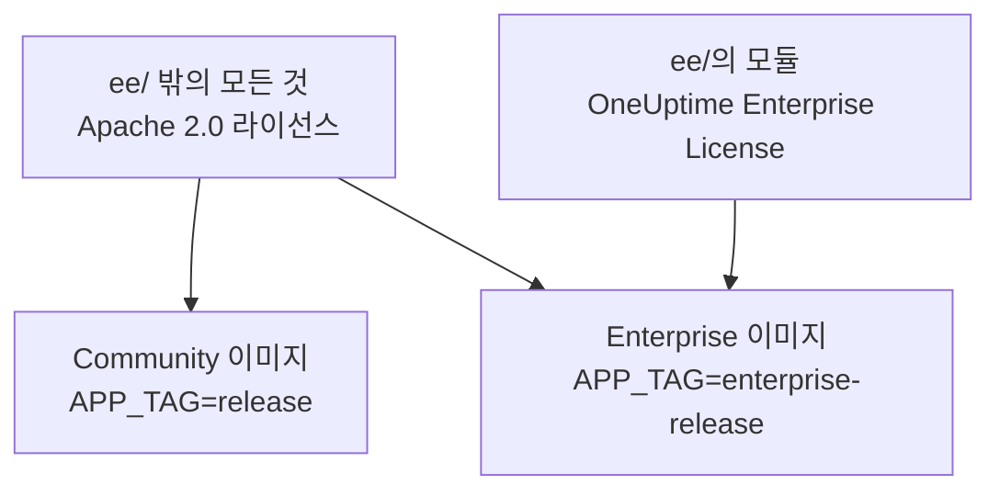
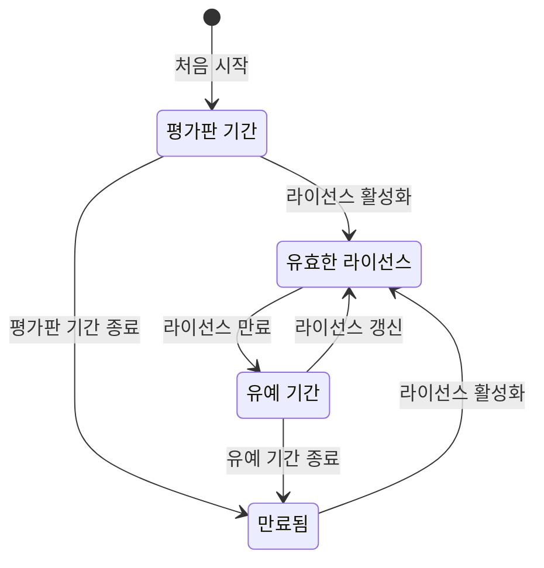

# 엔터프라이즈 에디션

OneUptime은 하나의 저장소에서 빌드되며 두 가지 에디션으로 제공됩니다.

- **Community Edition**: 모니터링, 인시던트, 관측성을 아우르는 플랫폼 전체로, SAML과 OpenID Connect 싱글 사인온을 포함합니다. Apache 2.0 라이선스의 오픈 소스이며, 어떤 규모에서든 무료로 자체 호스팅할 수 있습니다.
- **Enterprise Edition**: Community Edition에 저장소의 [`ee/`](https://github.com/OneUptime/oneuptime/tree/master/ee) 디렉터리에 있는 엔터프라이즈 모듈을 더한 것입니다. 이 모듈은 SCIM 프로비저닝과 거버넌스 및 인스턴스 관리 기능을 추가합니다. 모듈은 [OneUptime Enterprise License](https://github.com/OneUptime/oneuptime/blob/master/ee/LICENSE)에 따라 제공되며, 프로덕션에서 사용하려면 사용자 수에 맞는 Enterprise 라이선스가 필요합니다.

두 에디션은 별도의 컨테이너 이미지입니다. Community 이미지에는 `ee/`의 코드가 들어 있지 않습니다. OneUptime Cloud는 Enterprise Edition으로 실행되며, 클라우드에서는 요금제가 이 기능 중 무엇을 받을지 결정합니다.



> [!NOTE]
> **싱글 사인온은 모든 에디션에 있습니다.** 프로젝트와 상태 페이지의 SAML 및 OIDC 로그인, 전역 SSO, "Require SSO for login"은 Community Edition의 일부이며, 어떤 라이선스 상태도 이를 끄지 않습니다.

이 페이지에서는 각 에디션에 포함된 것, Enterprise Edition을 실행하는 방법, 라이선스가 동작하는 방식, 에디션을 전환할 때 일어나는 일을 설명합니다.

:::cards
- [에디션 비교](#각-에디션에-포함된-것): Enterprise Edition이 추가하는 것.
- [Enterprise 이미지 실행](#enterprise-edition-실행하기): Kubernetes나 Docker Compose에서 설정 하나만 바꾸면 됩니다.
- [라이선스 활성화](#라이선싱): 키로 온라인에서, 또는 서명된 토큰으로 오프라인에서.
- [라이선스가 만료되면](#라이선스가-만료되었거나-없을-때): 멈추는 것, 절대 멈추지 않는 것, 다시 돌아오는 방법.
:::

## 각 에디션에 포함된 것

| 기능 | Community | Enterprise | OneUptime Cloud |
| --- | --- | --- | --- |
| 모니터링, 알림, 인시던트, 온콜, 상태 페이지, 로그, 메트릭, 트레이스, 예외, 대시보드, 워크플로, AI 기능, API, Terraform | 예 | 예 | 모든 요금제 |
| 비밀번호 로그인, 이중 인증, 팀, 역할, API 키 | 예 | 예 | 모든 요금제 |
| 프로젝트 로그인을 위한 [SAML SSO와 OpenID Connect](/docs/identity/sso) | 예 | 예 | Scale 요금제 이상 |
| 비공개 상태 페이지 로그인을 위한 SAML SSO와 OpenID Connect | 예 | 예 | Scale 요금제 이상 |
| [전역(인스턴스 전체) SSO와 OIDC](/docs/identity/global-sso) | 예 | 예 | 해당 없음 |
| 프로젝트와 상태 페이지를 위한 [SCIM 프로비저닝](/docs/identity/scim) | 아니요 | 예 | Scale 요금제 이상 |
| 팀 규정 준수 설정 | 아니요 | 예 | Scale 요금제 이상 |
| 감사 로그 | 아니요 | 예 | Enterprise 요금제 |
| 보존 재정의: 텔레메트리 유형별 보존(로그, 트레이스, 메트릭, 프로필, 로그 심각도와 트레이스 상태별 규칙 포함)과 서비스별·리소스별 보존 | 아니요 | 예 | Scale 요금제 이상 |
| 관리 화면의 **Health** 대시보드: 인스턴스 개요, 백그라운드 큐, 인스턴스 로그, PostgreSQL, Valkey, ClickHouse 클러스터, 진단 로그, 텔레메트리 수집 | 아니요 | 예 | 해당 없음 |
| 관리 화면의 **Query Console** | 아니요 | 예 | 사용할 수 없음 |
| PostgreSQL 및 Valkey(Redis) 상태 알림 | 아니요 | 예 | 해당 없음 |
| ClickHouse 용량 보기, 용량 알림, 디스크 자동 정리 | 예 | 예 | 해당 없음 |
| 관리자 대시보드의 마이그레이션 상태, 지원 번들, 전역 프로브 | 예 | 예 | 해당 없음 |
| Enterprise 라이선스, 좌석, 인스턴스 관리 | 아니요 | 예 | 해당 없음 |

두 에디션 모두에서 싱글 사인온에는 프로젝트, 비공개 상태 페이지, 인스턴스 전체에 대한 "Require SSO for login"이 포함됩니다.

모든 에디션에는 프로젝트의 기본 텔레메트리 보존 기간이 있으며, **프로젝트 설정 > 텔레메트리 및 APM > 데이터 보존** 에서 설정합니다. 보존 재정의는 Enterprise Edition이 그 위에 더하는 기능입니다.

OneUptime Cloud에서는 유료 기능을 어떤 요금제에서든 언제든지 끌 수 있습니다. 평가판(또는 하위 요금제로의 변경)이 설정된 채로 남긴 보존 재정의는 새 텔레메트리에 계속 적용되므로, Scale 요금제 미만에서는 보존 페이지가 업그레이드 카드 아래에 **재정의 제거** 버튼과 함께 이를 표시합니다. 제거는 모든 요금제에서 할 수 있고, 다시 설정하려면 Scale 요금제가 필요합니다. 이미 저장된 텔레메트리는 저장될 때의 보존 기간을 유지합니다. 마찬가지로 프로젝트가 아직 SSO를 요구하는 동안에는 **프로젝트 설정 > 보안 > SSO** 의 업그레이드 카드 아래에 **로그인에 SSO 필수** 스위치가 표시되어 이를 끌 수 있습니다.

"해당 없음" 행은 인스턴스 관리 기능입니다. OneUptime Cloud에서는 OneUptime이 인스턴스를 대신 운영합니다.

## Enterprise Edition 실행하기

두 에디션은 같은 구성, 같은 데이터베이스, 같은 데이터를 사용합니다. 에디션을 전환하면 실행하는 이미지만 바뀌고 다른 것은 바뀌지 않습니다. 어느 방향이든 마이그레이션이 필요 없습니다.

:::tabs
@tab Kubernetes
`values.yaml`에서 이미지 유형을 설정합니다.

```yaml title="values.yaml"
image:
  type: enterprise-edition
```

그런 다음 평소처럼 업그레이드합니다.

```bash
helm upgrade my-oneuptime oneuptime/oneuptime -f values.yaml
```

그러면 차트가 모든 이미지 태그의 `enterprise-` 변형을 가져옵니다. 예를 들어 `oneuptime/app:enterprise-release`이고, `image.tag`를 고정했다면 `enterprise-<version>`입니다. Community Edition을 실행하려면 `image.type: community-edition`(기본값)을 설정합니다.
@tab Docker Compose
`config.env`에서 `APP_TAG`를 설정합니다.

```bash title="config.env"
APP_TAG=enterprise-release
```

릴리스를 고정하려면 `enterprise-<version>`을 사용합니다. 그런 다음 이미지를 받고 다시 시작합니다.

```bash
npm run update
```

Community Edition으로 돌아가려면 `APP_TAG=release` **와** `IS_ENTERPRISE_EDITION=false`를 설정합니다. `IS_ENTERPRISE_EDITION=true`가 설정되어 있는 동안에는 `npm run update`가 `APP_TAG`를 `enterprise-release`로 되돌리고, Community 이미지는 시작을 거부합니다.
:::

### `IS_ENTERPRISE_EDITION`은 더 이상 사용되지 않음

에디션은 실행하는 이미지가 결정합니다. `IS_ENTERPRISE_EDITION`은 더 이상 엔터프라이즈 기능을 켜지 않으며, 향후 릴리스에서 제거됩니다. 설정하지 않은 채로 두어도 됩니다.

Community 이미지에서 `IS_ENTERPRISE_EDITION=true`를 설정해도 엔터프라이즈 기능은 켜지지 **않습니다**. 대신 앱이 **시작을 거부합니다**. 그래서 Community 이미지에 도착한 업그레이드가 SCIM 프로비저닝(디프로비저닝 포함)과 감사 로깅을 조용히 멈추는 일은 결코 없습니다. 오류는 무엇을 설정해야 하는지 알려 줍니다. Enterprise Edition을 유지하려면 `APP_TAG=enterprise-<version>`을, Community Edition을 실행하려면 `IS_ENTERPRISE_EDITION=false`를 설정합니다. Helm에서는 이런 일이 일어나지 않습니다. 차트가 이 변수를 `image.type`에서 도출하기 때문입니다.

`ONEUPTIME_EDITION=community`는 Enterprise 이미지를 Community Edition처럼 실행합니다. 다운그레이드를 실제로 하기 전에 시험해 볼 때 유용합니다. Enterprise 이미지는 `ONEUPTIME_EDITION=enterprise`를 스스로 설정합니다. `community` 외의 값으로 덮어쓰지 마십시오.

## 라이선싱

저장소 루트의 [`LICENSE`](https://github.com/OneUptime/oneuptime/blob/master/LICENSE) 파일은 어떤 라이선스가 무엇에 적용되는지 정합니다. `ee/` 디렉터리의 모든 것은 [OneUptime Enterprise License](https://github.com/OneUptime/oneuptime/blob/master/ee/LICENSE)에 따르고, 서드파티 구성 요소는 소유자가 제공하는 라이선스를 유지하며, 나머지는 모두 Apache 2.0 라이선스에 따릅니다.

새로운 Enterprise Edition 설치는 그 설치가 처음 Enterprise Edition을 시작한 때부터 세어 **14일 평가판 기간**으로 실행됩니다. 평가판 기간은 평가용입니다. Enterprise Edition을 프로덕션에서 사용하려면 OneUptime Enterprise License에 따른 구독이 필요합니다. 평가판 기간이 끝나기 전에 라이선스를 활성화하십시오. 그 후에는 SCIM, 감사 로깅, 보존 재정의가 멈추고 엔터프라이즈 구성이 읽기 전용이 됩니다([라이선스가 만료되었거나 없을 때](#라이선스가-만료되었거나-없을-때) 참조). 라이선스를 받으려면 [sales@oneuptime.com](mailto:sales@oneuptime.com)으로 문의하십시오.

라이선스는 **에디션 라벨** 에서 관리합니다. 마스터 관리자는 관리자 대시보드 헤더와 Dashboard 바닥글에서 이 라벨을 봅니다. 라벨은 라이선스 상태와 좌석 사용량을 보여 주고, 마스터 관리자에게는 인스턴스 ID도 보여 줍니다.

### 온라인 활성화(라이선스 키)

:::steps
1. 마스터 관리자로 로그인하고 에디션 라벨을 엽니다.
2. 라이선스 키를 입력하고 검증합니다.
:::

설치는 OneUptime에서 키를 확인하고 받은 라이선스를 저장합니다. 그 뒤로는 매일 동기화하여 라이선스를 최신 상태로 유지합니다. 추가 좌석이나 갱신 같은 변경 사항을 바로 가져오려면 에디션 라벨의 **Refresh license** 를 사용하십시오.

온라인 활성화에는 OneUptime 서버에서 `https://oneuptime.com`으로 나가는 HTTPS가 필요합니다. 서버가 중계 서버를 통해서만 인터넷에 접속한다면 `ENTERPRISE_LICENSE_SERVER_URL`을 중계 서버의 `https://` 주소로 설정하십시오. 중계 서버는 `/api/enterprise-license/`를 oneuptime.com으로 전달해야 합니다.

### 오프라인 활성화(네트워크와 분리된 설치)

인터넷으로 가는 경로가 없는 설치는 키 대신 **서명된 라이선스 토큰** 을 사용할 수 있습니다.

:::steps
1. 마스터 관리자로 로그인하고 에디션 라벨을 연 다음 **인스턴스 ID** 를 적어 둡니다.
2. OneUptime([sales@oneuptime.com](mailto:sales@oneuptime.com))에 그 인스턴스 ID용 오프라인 라이선스 토큰을 요청합니다.
3. 토큰을 에디션 라벨의 토큰 필드에 붙여 넣고 활성화합니다.
:::

설치는 릴리스에 내장된 OneUptime 서명 키로 토큰을 직접 검증합니다. OneUptime에 연결하는 일은 없습니다. 한 인스턴스 ID용으로 발급된 토큰은 다른 모든 설치에서 거부되고, 인스턴스 ID 없이 발급된 토큰(온라인으로 활성화한 설치가 받는 토큰 등)도 거부됩니다. 갱신하거나 좌석을 추가하려면 현재 토큰이 만료되기 전에 새 토큰을 활성화하십시오.

> [!IMPORTANT]
> **오프라인 활성화에는 OneUptime의 라이선스 서명 키를 신뢰하는 릴리스가 필요합니다.** 릴리스에 아직 그 키가 없으면 활성화가 "this build does not trust the key that signed this token"과 함께 실패합니다. 이 경우 온라인으로 활성화하거나 키가 포함된 릴리스로 업그레이드하십시오.

### 매일 라이선스 동기화가 보내는 것

온라인으로 활성화된 설치는 하루에 한 번 OneUptime에 보고서를 보냅니다. 보고서에는 다음이 들어 있습니다.

- 라이선스 키
- 인스턴스 ID(설치가 생성하는 무작위 식별자)와 설치에 구성된 호스트 이름(`HOST`)
- 설치가 실행하는 OneUptime 버전
- 설치의 사용자 수
- 각 사용자의 이메일 주소를 소문자로 바꾼 **SHA-256 해시**. OneUptime은 이 해시를 사용해, 여러 설치에 계정이 있는 사람을 좌석 하나로 셉니다. 일반 사용자의 이메일 주소 원문은 절대 전송되지 않습니다
- 설치의 **마스터 관리자** 이메일 주소. OneUptime이 갱신과 좌석 한도에 대해 연락할 수 있도록 하기 위함입니다

응답에는 그날 OneUptime이 알고 있는 라이선스가 담겨 있습니다. 회사 이름, 만료일, 좌석 한도, 모든 설치를 합친 사용자 수, 라이선스에 등록된 설치입니다. 설치의 다른 복제본은 약 1분 안에 변경 사항을 반영합니다.

라이선스를 활성화하거나 새로 고칠 때 설치는 라이선스 키, 인스턴스 ID, 호스트 이름, 버전만 보냅니다.

그 밖에는 아무것도 보내지 않습니다. 모니터링 데이터, 텔레메트리, 로그, 구성은 설치 밖으로 나가지 않습니다. Community Edition은 이 중 아무것도 보내지 않으며, 오프라인으로 활성화한 설치도 마찬가지입니다.

### 라이선스가 만료되었거나 없을 때

모든 엔터프라이즈 기능은 14일 평가판 기간 동안, 그리고 라이선스가 만료된 뒤 30일 동안(유예 기간) 동작합니다. 둘 중 하나가 끝나기 전에 에디션 라벨이 경고합니다. 그 후에는 라이선스가 활성화될 때까지 **SCIM, 감사 로깅, 보존 재정의가 멈추고**, Community Edition과 같은 상태가 되며, 엔터프라이즈 구성은 읽기 전용이 됩니다. 싱글 사인온은 엔터프라이즈 기능이 아닙니다. SAML 및 OIDC 로그인, 전역 SSO, "Require SSO for login"은 모든 라이선스 상태에서 똑같이 동작합니다.



| 상태 | 일어나는 일 |
| --- | --- |
| **유효한 라이선스** | 모든 엔터프라이즈 기능이 동작합니다. 라이선스를 받은 좌석 수를 넘어 새 사용자를 추가할 수 없습니다. 기존 사용자는 절대 제거되지 않습니다. |
| **평가판 기간 또는 유예 기간**(라이선스가 없는 설치의 처음 14일, 또는 라이선스가 만료된 뒤 30일), 또는 만료일이 기록된 적 없는 라이선스를 가진 설치 | 모든 엔터프라이즈 기능이 동작하고, 에디션 라벨에 경고가 표시됩니다. 만료 후 유예 기간에도 좌석 한도는 계속 적용됩니다. 만료일이 기록되지 않은 라이선스를 가진 설치는 라이선스가 없는 설치와 같은 14일 평가판 기간으로 실행되며, 좌석 한도는 적용되지 않습니다. 보유한 라이선스 기록이 이미 불완전하기 때문입니다. |
| **평가판 기간 또는 유예 기간 이후**(만료되었거나, 없거나, 유효하지 않은 라이선스, 또는 해당 기능을 포함하지 않는 라이선스) | SCIM 프로비저닝, 감사 로깅, 보존 재정의가 **멈춥니다**(아래 참조). 엔터프라이즈 구성은 **읽기 전용** 이 됩니다. 보고 삭제할 수는 있지만 만들거나 바꿀 수는 없습니다. 인시던트에 대응할 수 있도록 한 가지 변경은 항상 가능합니다. 바로 SCIM 베어러 토큰 교체입니다. 다른 모든 것이 읽기 전용인 동안에도 SCIM 설정 페이지는 이 작업을 제공합니다. SCIM 구성의 **Bearer 토큰 재설정** 으로, 새 토큰을 한 번만 보여 줍니다. API로는 `bearerToken`만 보냅니다(최소 32자). 감사 로깅은 켜거나 범위를 넓힐 수 없습니다. 엔터프라이즈 Health 대시보드와 Query Console은 잠깁니다. 좌석 한도는 더 이상 적용되지 않습니다. |

라이선스가 만료되면 멈추는 것:

- **SCIM 프로비저닝이 멈춥니다.** ID 공급자의 SCIM 요청은 디프로비저닝을 포함해 거부되고, SCIM 팀 잠금이 해제되므로 SCIM 푸시 그룹이 관리하는 팀을 직접 편집할 수 있습니다.
- **감사 로깅이 기록을 멈춥니다.** 지금까지 기록된 감사 로그는 보존됩니다.
- **보존 재정의가 더 이상 적용되지 않습니다.** 새 텔레메트리는 프로젝트의 기본 보존 기간 동안 보존됩니다. 이미 저장된 텔레메트리는 기록될 때의 보존 기간을 유지합니다. API로 재정의를 지울 수는 있지만 설정할 수는 없습니다.

멈추지 **않는** 것:

- **싱글 사인온.** 프로젝트, 비공개 상태 페이지, 인스턴스 전체(전역 SSO), 모바일 앱의 SAML 및 OIDC 로그인과 "Require SSO for login"은 모든 에디션의 일부입니다. 라이선스가 만료되어도 이 중 어느 것도 바뀌지 않으며, 싱글 사인온 구성은 계속 편집할 수 있습니다.
- **핵심 모니터링은 절대 영향을 받지 않습니다**. 모니터, 알림, 인시던트, 온콜, 상태 페이지, 텔레메트리는 모두 계속 동작합니다.
- **마스터 관리자는 언제나 자신의 비밀번호로 로그인할 수 있습니다.**
- **아무것도 삭제되지 않습니다.** SCIM 구성, 감사 로그, 보존 재정의는 그대로 남습니다.

**라이선스가 활성화되는 즉시 모든 것이 재개됩니다**. 다시 시작할 필요 없이 SCIM 프로비저닝, 감사 로깅, 보존 재정의가 지금의 구성 그대로 돌아옵니다. OneUptime은 라이선스가 만료되었음을 알 때만 이들을 끕니다. 서버가 시작되는 잠깐 동안처럼 라이선스 상태를 읽을 수 없는 동안에는 SCIM, 감사 로깅, 보존 재정의가 켜진 상태로 유지됩니다.

> [!WARNING]
> **ID 공급자가 SCIM으로 사용자를 디프로비저닝한다면 평가판 기간이나 유예 기간이 끝나기 전에 라이선스를 활성화하십시오.** 그 후에는 ID 공급자에서 제거한 사람을 SCIM이 더 이상 디프로비저닝하지 않습니다. 그 사람들의 OneUptime 계정은 남아 있고, "Require SSO for login"이 적용되지 않는 한 그런 계정의 이메일 받은편지함에 아직 접근할 수 있는 사람은 누구나 비밀번호를 설정하고 로그인할 수 있습니다. 라이선스가 만료되도록 둔다면 그 사용자들을 OneUptime에서 직접 제거하십시오.

## Enterprise에서 Community로 전환

구성은 데이터베이스에 남습니다. 설치에 유효한 라이선스가 있거나 아직 평가판 기간 또는 유예 기간 중이라면, Enterprise 이미지로 다시 전환할 때 모든 것이 그대로 복원됩니다. 싱글 사인온은 바뀌지 않습니다. SAML 및 OIDC 로그인, 전역 SSO, "Require SSO for login"은 두 이미지에서 똑같이 동작합니다. Community 이미지에서는 다음과 같습니다.

- **SCIM이 멈춥니다.** 프로비저닝 엔드포인트가 더 이상 존재하지 않으므로 IdP가 보내는 SCIM 호출은 실패합니다. SCIM 디프로비저닝도 마찬가지입니다.
- **SCIM 팀 잠금이 해제되므로**, SCIM 푸시 그룹이 관리하던 팀을 직접 편집할 수 있습니다. 서버는 시작할 때 SCIM 팀 잠금이 해제된 프로젝트를 로그에 남깁니다.
- **감사 로깅이 멈춥니다.** 지금까지 기록된 감사 로그는 보존되지만, 감사 로그 페이지에는 업그레이드 안내가 표시됩니다.
- **보존 재정의가 더 이상 적용되지 않습니다.** 새 텔레메트리는 프로젝트의 기본 보존 기간 동안 보존되며, **프로젝트 설정 > 텔레메트리 및 APM > 데이터 보존** 과 각 서비스·리소스의 설정 페이지에 있는 보존 카드에는 업그레이드 안내가 표시됩니다. 재정의는 데이터베이스에 남아 있다가 다시 전환하면 다시 적용됩니다.
- **엔터프라이즈 설정 페이지에는 업그레이드 안내가 표시됩니다.** API로는 엔터프라이즈 구성을 읽고 삭제하고 SCIM 베어러 토큰을 재설정할 수 있지만, 그 밖의 것은 만들거나 바꿀 수 없습니다. 감사 로깅은 켤 수 없습니다.
- **엔터프라이즈 Health 대시보드, Query Console, PostgreSQL 및 Valkey 상태 알림이 멈춥니다.** ClickHouse 용량 모니터링과 정리, 마이그레이션 상태, 지원 번들은 계속 동작합니다.

> [!CAUTION]
> **ID 공급자가 SCIM으로 사용자를 디프로비저닝하는 설치를 Community 이미지로 전환하기 전에, 누가 접근할 수 있는지 검토하십시오.** SCIM이 없으면 ID 공급자에서 제거한 사람도 OneUptime 계정을 그대로 가지며, "Require SSO for login"이 적용되지 않는 한 그런 계정의 이메일 받은편지함에 아직 접근할 수 있는 사람은 누구나 비밀번호를 설정하고 로그인할 수 있습니다. 먼저 그 사용자들을 제거하십시오.

## 문제 해결

:::details 업그레이드 후 앱이 시작을 거부합니다
Community 이미지에 `IS_ENTERPRISE_EDITION=true`가 설정되어 있습니다. Enterprise Edition을 유지하려면 `APP_TAG=enterprise-<version>`을, Community Edition을 실행하려면 `IS_ENTERPRISE_EDITION=false`를 설정한 뒤 `npm run update`를 다시 실행하십시오.
:::

:::details 오프라인 활성화가 "this build does not trust the key that signed this token"과 함께 실패합니다
사용 중인 릴리스는 OneUptime의 라이선스 서명 키를 신뢰하기 전에 빌드되었습니다. 온라인으로 활성화하거나 키가 포함된 릴리스로 업그레이드하십시오.
:::

:::details ID 공급자의 SCIM 요청이 거부됩니다
Enterprise 이미지에서는 라이선스가 만료된 것입니다. 라이선스를 활성화하면 다시 시작하지 않아도 프로비저닝이 재개됩니다. Community 이미지에는 SCIM 엔드포인트가 아예 없습니다.
:::

## 다음 단계

:::cards
- [업그레이드](/docs/installation/upgrading): 새 릴리스로 옮기고, 에디션 이미지 사이를 전환합니다.
- [SSO](/docs/identity/sso): 모든 에디션에 있는 싱글 사인온.
- [글로벌 SSO](/docs/identity/global-sso): 인스턴스 전체를 위한 하나의 ID 공급자.
- [SCIM](/docs/identity/scim): ID 공급자에서 사용자와 팀을 프로비저닝합니다.
:::
