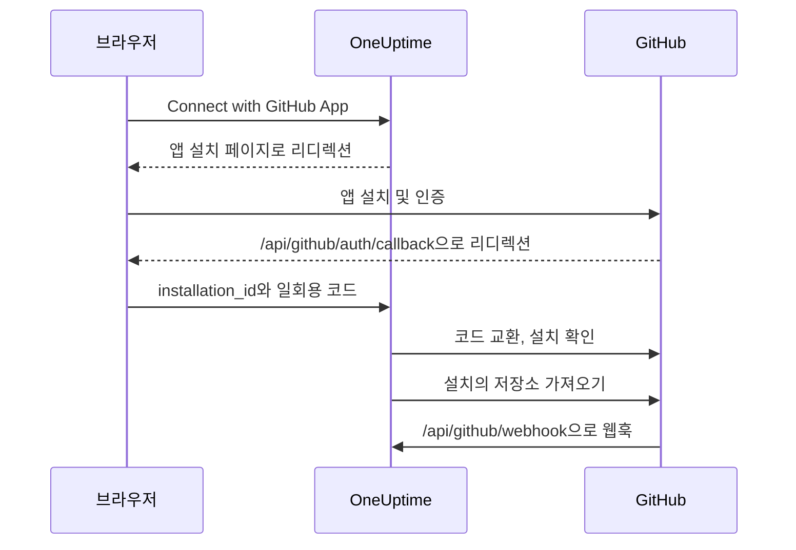

# GitHub 통합

직접 소유한 GitHub App으로 자체 호스팅 OneUptime을 GitHub에 연결합니다. OneUptime에서 앱을 설치하면 설치에 포함된 저장소가 프로젝트로 가져와져 계속 동기화되고, AI 수정 작업이 pull request를 열며, 팀은 GitHub에서 앱을 멘션해 작업을 맡길 수 있습니다.

이 페이지는 OneUptime 서버를 운영하는 사람을 위한 것입니다. 앱은 한 번만 만들고, 이후 각 프로젝트가 **코드 저장소**에서 연결합니다.

:::cards
- [GitHub App 만들기](#github-app-만들기): 올바른 URL, 권한, 이벤트로 앱을 등록합니다.
- [OneUptime 구성](#oneuptime-구성): 앱의 값 여섯 개를 서버에 넣습니다.
- [저장소 연결](#저장소-연결): OneUptime에서 앱을 설치합니다.
- [문제 해결](#문제-해결): 코드 저장소에 표시되는 메시지의 뜻입니다.
:::

## 작동 방식

설치는 GitHub가 아니라 OneUptime에서 시작합니다. OneUptime이 GitHub로 보낼 때 쓰는 링크가 설치를 프로젝트에 묶어 줍니다.



- 브라우저 리디렉션에는 설치 정보와 일회용 OAuth 코드가 담겨 있습니다. OneUptime은 이 코드를 교환해 앱을 설치한 GitHub 계정이 그 설치를 관리하는지 확인한 다음, 설치의 저장소를 가져옵니다.
- 웹훅은 저장소 목록을 동기화하고 앱에 작업을 넘깁니다. 멘션, 할당, 트리거 레이블, 리뷰 요청입니다. GitHub는 웹훅마다 webhook secret으로 서명하며, OneUptime은 검증할 수 없는 웹훅을 거부합니다.

## 시작하기 전에

- 앱을 설치할 조직이나 사용자에 대해 GitHub App을 만들 수 있는 GitHub 계정. 조직에 설치하려면 그 조직의 소유자이거나 소유자의 요청 승인을 받아야 합니다.
- GitHub가 웹훅을 보낼 수 있는 OneUptime의 공개 HTTPS 호스트 이름. [네트워크 접근](#자체-호스팅-배포의-네트워크-접근)을 참고하세요.
- 서버 구성에 대한 접근 권한: Docker Compose는 `config.env`, Kubernetes는 Helm values.

## GitHub App 만들기

:::steps
### GitHub App 설정 열기

- **조직의 경우:** `https://github.com/organizations/YOUR_ORG/settings/apps`
- **개인 계정의 경우:** `https://github.com/settings/apps`

**New GitHub App**을 선택합니다.

### 등록 양식 작성

| 필드 | 값 |
| --- | --- |
| **GitHub App name** | 고유한 아무 이름, 예를 들어 `OneUptime`. 정확히 적어 두세요. 이것이 `GITHUB_APP_NAME`입니다. |
| **Homepage URL** | `https://your-oneuptime-domain.com` |
| **Callback URL** | `https://your-oneuptime-domain.com/api/github/auth/callback` |
| **Request user authorization (OAuth) during installation** | 켬. **필수입니다**. 아래 참고 사항을 보세요. |
| **Setup URL** | GitHub가 입력을 허용하면 `https://your-oneuptime-domain.com/api/github/auth/callback`(아래 참고). |
| **Redirect on update** | 선택 사항. 누군가 GitHub에서 설치를 변경하면 OneUptime이 그 사람을 **코드 저장소**로 안내합니다. |
| **Webhook URL** | `https://your-oneuptime-domain.com/api/github/webhook`, 웹훅은 **Active**로 둡니다. |
| **Webhook secret** | 긴 임의 문자열. 적어 두세요. 이것이 `GITHUB_APP_WEBHOOK_SECRET`입니다. **필수**: OneUptime은 서명되지 않은 웹훅을 거부하므로, `GITHUB_APP_WEBHOOK_SECRET`을 설정하지 않으면 검증되지 않은 페이로드를 받아들이는 대신 저장소 동기화가 멈춥니다. |

GitHub 문서에 따르면 **Request user authorization (OAuth) during installation**을 켜면 [Setup URL을 입력할 수 없습니다](https://docs.github.com/en/apps/creating-github-apps/registering-a-github-app/about-the-setup-url). 대신 사용자는 앱을 설치한 뒤 Callback URL로 보내집니다. 둘 다 같은 OneUptime 주소를 가리키므로 어느 쪽이든 리디렉션은 올바른 곳에 도착합니다.

> [!IMPORTANT]
> **"Request user authorization (OAuth) during installation"이 필수인 이유.** 설치가 끝나면 GitHub는 URL에 `installation_id`를 붙여 리디렉션합니다. 이 번호만으로는 설치의 소유자가 누구인지 아무것도 증명하지 못합니다. 누구나 다른 번호를 입력할 수 있기 때문입니다. 이 옵션을 켜면 GitHub는 설치를 수행한 GitHub 계정에 묶인 일회용 OAuth `code`도 돌려주며, OneUptime은 이를 교환해 그 계정이 실제로 설치를 관리하는지 확인한 뒤에야 프로젝트에 연결합니다.
>
> 이 옵션이 없으면 OneUptime은 설치 연결을 거부하고, 대시보드에는 이 설정을 켜 달라는 오류가 표시됩니다. 의도된 동작입니다. 설치 ID를 검증 없이 받아들이면 한 OneUptime 프로젝트가 다른 조직의 저장소를 가로챌 수 있습니다.

### 권한 설정

**Permissions & events**에서 다음 **Repository permissions**를 설정합니다.

| 권한 | 접근 | OneUptime의 사용처 |
| --- | --- | --- |
| Contents | Read and write | 저장소 파일을 읽고 AI 수정 pull request의 브랜치를 push |
| Pull requests | Read and write | pull request를 열고 업데이트하며 리뷰를 게시 |
| Issues | Read and write | 앱의 댓글 게시. **pull request에서도 마찬가지**이며, GitHub는 pull request 대화를 issues API로 처리합니다 |
| Checks | Read-only | 선택 사항. 수정 pull request의 CI 결과를 읽습니다. 이 권한이 없으면 CI 상태는 검증되지 않은 채로 남습니다 |
| Metadata | Read-only | 저장소의 기본 메타데이터(GitHub 필수) |

**앱을 대화형으로 만드는 것은 Issues: Read and write입니다.** 이 권한이 없으면 멘션은 수신되지만 앱이 답하려는 순간 조용히 실패합니다. GitHub는 pull request 대화의 댓글을 issues API로 제공하므로, 앱이 쓰는 모든 답장이 이 권한 하나에 달려 있습니다. [GitHub에서 OneUptime 사용하기](/docs/ai/github-app)를 참고하세요.

OneUptime에는 조직이나 계정 권한이 필요하지 않습니다.

### 웹훅 이벤트 구독

OneUptime은 두 묶음의 이벤트를 사용하며, 각각 하는 일이 다릅니다.

**저장소 동기화**: `installation`과 `installation_repositories`. GitHub App은 이 이벤트를 자동으로 받으며, 연결된 저장소 집합을 앱이 설치된 곳과 일치시킵니다.

**대화형 앱**: 이 이벤트들은 명시적으로 구독해야 하며, 각각이 앱에 작업을 넘기는 특정 방법을 켭니다.

| 이벤트 | 가능해지는 것 |
| --- | --- |
| **Issue comment** | issue **및** pull request에서의 `@mention` 명령 |
| **Issues** | issue를 앱에 할당하기, 그리고 저장소의 트리거 레이블 |
| **Pull request** | 앱에 리뷰 요청하기 |
| **Pull request review** | 제출된 리뷰 본문에 쓴 멘션 |
| **Pull request review comment** | diff의 인라인 댓글에 쓴 멘션 |

이 중 아무것도 구독하지 않아도 GitHub App은 저장소를 연결하고 OneUptime에서 수정 pull request를 엽니다. 다만 GitHub에 쓴 어떤 것에도 응답하지 않습니다. "봇이 나를 무시한다"는 문제의 가장 흔한 원인입니다. 어떤 명령이 있고 누가 쓸 수 있는지는 [GitHub에서 OneUptime 사용하기](/docs/ai/github-app)를 참고하세요.

다른 이벤트(**Push**, **Workflow run**)는 수신 확인 후 무시됩니다. 이를 구독해도 알림이나 CI/CD 자동화가 켜지지 않습니다.

### 앱을 설치할 수 있는 곳 선택

**Where can this GitHub App be installed?** 항목에서 다음 중 하나를 선택합니다.

- **Only on this account** - 비공개/내부용
- **Any account** - 다른 사람도 앱을 설치하게 하려는 경우

### 앱을 만들고 ID 적어 두기

**Create GitHub App**을 선택합니다. GitHub가 앱의 설정 페이지를 엽니다. 페이지 상단의 **App ID**와 **About** 섹션의 **Client ID**를 적어 둡니다.

### client secret 생성

**Client secrets**에서 **Generate a new client secret**을 선택합니다. 바로 복사하세요. GitHub는 한 번만 보여 줍니다.

### 개인 키 생성

**Private keys**에서 **Generate a private key**를 선택합니다. GitHub가 `.pem` 파일을 내려받습니다. 안전하게 보관하세요. OneUptime은 이 파일로 앱으로서 인증합니다.
:::

## OneUptime 구성

:::tabs
@tab Docker Compose
`config.env`는 한 줄에 값 하나를 담으므로, 개인 키는 base64로 인코딩해 한 줄로 넣습니다. OneUptime이 디코딩합니다.

```bash
base64 < private-key.pem | tr -d '\n'
```

```bash title="config.env"
GITHUB_APP_ID=YOUR_APP_ID
GITHUB_APP_NAME=YOUR_APP_NAME
GITHUB_APP_CLIENT_ID=YOUR_CLIENT_ID
GITHUB_APP_CLIENT_SECRET=YOUR_CLIENT_SECRET
GITHUB_APP_PRIVATE_KEY=YOUR_BASE64_ENCODED_PRIVATE_KEY
GITHUB_APP_WEBHOOK_SECRET=YOUR_WEBHOOK_SECRET
```

변경 사항은 컨테이너를 다시 만드는 `npm run start`로 적용합니다. `docker compose restart`는 `config.env`를 다시 읽지 않습니다.
@tab Kubernetes
```yaml title="values.yaml"
gitHubApp:
  id: "YOUR_APP_ID"
  name: "YOUR_APP_NAME" # The exact name of your GitHub App
  clientId: "YOUR_CLIENT_ID"
  clientSecret: "YOUR_CLIENT_SECRET"
  privateKey: "<BASE64_ENCODED_PRIVATE_KEY_CONTENT>"
  webhookSecret: "YOUR_WEBHOOK_SECRET"
```

`privateKey`는 PEM 자체를 여러 줄 블록(`privateKey: |`)으로 받을 수도 있습니다. 변경 사항은 `helm upgrade`로 적용합니다.
:::

OneUptime이 다시 실행되면 **코드 저장소**에 **GitHub App is not configured on this server** 대신 **Connect with GitHub App**이 표시됩니다.

### 환경 변수 참조

| Docker Compose (`config.env`) | Helm (`values.yaml`) | 값 |
| --- | --- | --- |
| `GITHUB_APP_ID` | `gitHubApp.id` | **App ID**. 앱으로서 인증하는 데 쓰입니다. |
| `GITHUB_APP_NAME` | `gitHubApp.name` | 앱의 정확한 이름. 설치 링크와 앱의 `@mention` 핸들(소문자, 공백은 하이픈)이 이 값으로 만들어집니다. 이 값이 없으면 **코드 저장소**가 연결할 수 없습니다. |
| `GITHUB_APP_CLIENT_ID` | `gitHubApp.clientId` | **Client ID**. 누가 앱을 설치했는지 확인하는 데 필요합니다. |
| `GITHUB_APP_CLIENT_SECRET` | `gitHubApp.clientSecret` | 생성한 client secret. client ID와 함께 필요합니다. |
| `GITHUB_APP_PRIVATE_KEY` | `gitHubApp.privateKey` | 개인 키. PEM이나 base64로 인코딩한 PEM입니다. |
| `GITHUB_APP_WEBHOOK_SECRET` | `gitHubApp.webhookSecret` | webhook secret. 모든 웹훅이 이 값으로 검증되며, 이 값이 없으면 어떤 웹훅도 받아들이지 않습니다. |

여섯 개 모두 필수입니다.

## 저장소 연결

연결은 GitHub의 앱 페이지가 아니라 OneUptime에서 시작하세요. OneUptime이 GitHub로 보낼 때 쓰는 링크가 설치를 프로젝트에 묶어 줍니다.

:::steps
1. OneUptime 대시보드에 로그인합니다
2. **제품** > **작업** > **코드 저장소**로 이동합니다
3. **Connect with GitHub App**을 클릭합니다. OneUptime이 GitHub로 안내합니다
4. 앱을 설치할 조직이나 계정을 선택하고, 앱이 접근할 저장소를 고릅니다. **All repositories**(현재와 향후의 모든 저장소) 또는 **Only select repositories**입니다
5. **Install**을 클릭합니다(이미 그곳에 앱이 설치되어 있다면 **Save**)
6. GitHub가 **코드 저장소**로 돌려보내고, 설치의 모든 저장소를 가져옵니다. 나중에 설치에 추가되거나 제거된 저장소도 자동으로 동기화됩니다.
:::

**연결할 수 있는 사람.** 연결하면 설치의 저장소를 프로젝트로 가져오므로 코드 저장소를 추가할 권한이 필요합니다. **Project Owner**, **Project Admin**, **Project Member**, **Settings Admin**, **Settings Member**, 또는 **Create Code Repository**가 있는 팀입니다. 이 권한을 차단하는 팀은 권한을 빼앗습니다. OneUptime Cloud에서 코드 저장소는 Growth 요금제 이상이 필요합니다. 그 밖의 사람에게는 카드가 잠기고 무엇이 필요한지 표시됩니다.

**같은 브라우저에서 15분 안에 마치세요.** 링크는 시작한 브라우저에서 15분 동안 한 번만 작동합니다. GitHub가 돌려보내면 OneUptime은 무엇이든 가져오기 전에 권한을 다시 확인합니다.

## 자체 호스팅 배포의 네트워크 접근

### 트래픽 방향과 엔드포인트

| 트래픽 | 필요한 접근 |
| --- | --- |
| OneUptime에서 GitHub로 | DNS와, GitHub App 토큰과 저장소 API 호출을 위한 `api.github.com`, OAuth 토큰 교환과 HTTPS Git 작업을 위한 `github.com`으로의 TCP 443 아웃바운드 HTTPS |
| GitHub에서 OneUptime으로 | 설치와 저장소 접근 동기화, 그리고 대화형 앱을 위한 `POST /api/github/webhook`으로의 TCP 443 공개 HTTPS |
| 사용자 브라우저에서 OneUptime으로 | 대시보드 접근과, 설치/인증 리디렉션을 위한 `GET /api/github/auth/callback`. 이 경로들은 사용자의 VPN을 통해서만 접근 가능해도 됩니다 |

callback은 [브라우저 리디렉션](https://docs.github.com/en/apps/creating-github-apps/registering-a-github-app/about-the-user-authorization-callback-url)인 반면, 웹훅은 GitHub 서버에서 오는 요청입니다. 사용자의 VPN 연결은 GitHub에 웹훅 접근을 주지 않습니다. 위 도메인은 통합의 핵심 요청을 다룹니다. 추가 저장소 도구, 다운로드, LFS, 패키지에는 다른 목적지가 필요할 수 있습니다. 이 설정은 GitHub.com 기준입니다. 방화벽을 바꾼다고 GitHub Enterprise Server 호스트 이름 지원이 구성되지는 않습니다.

### 비공개 배포와 콜백 보안

공개 DNS, 완전한 체인을 갖춘 공개적으로 신뢰되는 HTTPS 인증서, OneUptime ingress로 가는 비공개 경로를 갖춘 공개 게이트웨이를 통해 `/api/github/webhook`을 노출하세요. 게이트웨이로의 인바운드 TCP 443을 허용하고, 공개 전달은 이 POST 경로로 제한합니다. 사용자가 VPN으로 접근한다면 대시보드와 브라우저 callback은 비공개 ingress에 두세요. 분할 DNS로 같은 호스트 이름을 내부와 외부에서 모두 제공할 수 있습니다.

`config.env`에 `HOST=oneuptime.example.com`과 `HTTP_PROTOCOL=https`를, 또는 Helm에 `host: oneuptime.example.com`과 `httpProtocol: https`를 설정합니다. 구성을 적용하고 OneUptime이 다시 시작될 때까지 기다리세요. 이 값들은 URL을 생성할 뿐, DNS, TLS, 네트워크 접근을 마련하지 않습니다. 호스트 이름이 바뀌면 GitHub App의 webhook, callback, setup, 홈페이지 URL을 업데이트하세요.

메서드, 원래 경로, 쿼리 문자열, 본문, `Content-Type`, `X-Hub-Signature-256`, `X-GitHub-Event`, `X-GitHub-Delivery`를 유지합니다. 공개 호스트와 HTTPS 스킴은 신뢰할 수 있는 프록시 헤더로 유지합니다. 웹훅은 브라우저 SSO, CAPTCHA, 프록시 로그인 페이지에서 제외하세요. GitHub의 SSL 검증은 켜 두고, 두 시스템에 같은 `GITHUB_APP_WEBHOOK_SECRET`을 구성하세요. OneUptime은 서명되지 않은 요청을 거부하며 이 비밀 값 없이는 웹훅을 검증할 수 없습니다. GitHub의 [웹훅 검증 안내](https://docs.github.com/en/webhooks/using-webhooks/validating-webhook-deliveries)를 참고하세요.

웹훅 원본 IP도 제한한다면 GitHub Meta API의 현재 `hooks` 범위를 사용하고 정기적으로 갱신하세요. GitHub Actions 러너 범위로 대신하거나 서명 검증을 생략하지 마세요. GitHub는 [주소가 바뀌며 공개된 목록이 완전하지 않다](https://docs.github.com/en/authentication/keeping-your-account-and-data-secure/about-githubs-ip-addresses)고 경고합니다.

### 접근 확인과 제한 사항

:::steps
1. **코드 저장소**에서 설치를 연결합니다.
2. GitHub App 설정에서 **Advanced**를 열고 **Recent Deliveries**를 확인합니다. 전송 하나를 다시 보내고, 게이트웨이가 전달하며 OneUptime이 받아들이는지 확인합니다.
3. 설치에 테스트 저장소를 추가하거나 제거하고, OneUptime의 저장소 목록이 따라 바뀌는지 확인합니다.
:::

GitHub는 [전송 진단](https://docs.github.com/en/webhooks/testing-and-troubleshooting-webhooks/viewing-webhook-deliveries)을 문서화하고 있으며, [10초 안에 2xx로 응답](https://docs.github.com/en/webhooks/using-webhooks/best-practices-for-using-webhooks)할 것을 요구합니다. 브라우저에서 웹훅으로 보내는 GET은 서명된 POST를 테스트하지 않습니다.

> [!WARNING]
> 인바운드 접근이 없으면 브라우저 인증과 아웃바운드 API 및 Git 작업은 동작할 수 있지만, 웹훅은 OneUptime에 도달하지 못합니다. 삭제된 설치와 저장소 접근 변경이 동기화되지 않으며, 앱은 멘션, 할당, 리뷰 요청에 전혀 응답하지 않습니다.

[프라이빗 네트워크 접근 설정](/docs/self-hosted/private-network-access)은 비공개 대상으로 가는 아웃바운드 요청을 제어하며, GitHub가 웹훅에 도달할 수 있게 만들지는 않습니다.

## 문제 해결

### 연결이 완료되지 않음

GitHub가 돌려보냈는데 설치가 연결되지 않았다면, **코드 저장소**에 **GitHub가 연결되지 않았습니다**와 함께 그 이유를 설명하는 한 문장이 여러분의 언어로 표시됩니다. 페이지의 나머지 부분은 평소처럼 로드되므로 그 자리에서 다시 연결할 수 있습니다. GitHub 자체의 응답은 표시되지 않으며, 그 내용은 이유와 함께 OneUptime 서버 로그에 있습니다.

| 페이지 표시 | 해야 할 일 |
| --- | --- |
| **"이 연결 링크가 잘못되었거나 만료되었거나 이미 사용되었습니다. 처음부터 다시 시작하세요."** | 링크는 시작한 브라우저에서 15분 동안 한 번만 작동합니다. **코드 저장소**에서 다시 시작하고 같은 브라우저에서 15분 안에 GitHub에서 마무리하세요. GitHub의 앱 페이지에서 설치하면 어떤 프로젝트에도 연결되지 않습니다. |
| **"이 프로젝트에 코드 저장소를 추가할 권한이 없습니다."** | 연결하려면 코드 저장소를 추가할 권한이 필요합니다([저장소 연결](#저장소-연결) 참고). 프로젝트 관리자에게 권한을 요청하세요. GitHub가 돌려보낼 때 다시 확인하므로, 그사이에 권한을 잃었다면 여기서도 연결이 끝납니다. |
| **"GitHub를 연결하려면 ... 요금제가 필요합니다."** | OneUptime Cloud에서 코드 저장소는 문장에 적힌 요금제가 필요합니다. 프로젝트의 요금제를 업그레이드한 뒤 다시 연결하세요. |
| **"GitHub가 앱을 설치한 사용자를 확인하지 않아 설치를 검증할 수 없었습니다."** | GitHub App 설정에서 **Request user authorization (OAuth) during installation**을 켜고([GitHub App 만들기](#github-app-만들기) 참고) 다시 연결하세요. |
| **"OneUptime이 회원님의 GitHub 계정이 이 설치를 관리할 수 있는지 확인하지 못했습니다."** | 설치를 마친 GitHub 계정은 그 설치를 관리하지 않습니다. 앱이 설치되는 조직이나 사용자를 소유한 계정으로 설치하거나, 소유자에게 요청하세요. |
| **"GitHub가 설치 정보를 돌려보내지 않았습니다."** | 조직 구성원이 앱을 설치하는 대신 요청한 경우, 조직 소유자가 먼저 요청을 승인해야 합니다. 승인된 뒤 다시 연결하세요. |
| **"이 OneUptime 서버에는 GitHub App이 설정되어 있지 않습니다."** | `GITHUB_APP_CLIENT_ID`와 `GITHUB_APP_CLIENT_SECRET`을 모두 설정하고([OneUptime 구성](#oneuptime-구성) 참고) OneUptime을 다시 시작하세요. |
| **"OneUptime이 연결을 완료하지 못했습니다. 다시 시도하세요."** | GitHub가 오류로 응답했거나, 마무리하는 동안 요청이나 쓰기가 실패했습니다. 어느 쪽인지는 OneUptime 서버 로그에 나옵니다. 다시 시도하고, 계속 발생하면 로그와 GitHub App 설정을 확인하세요. |

### 기타 문제

:::details 코드 저장소에 "GitHub App is not configured on this server"라고 표시됨
`GITHUB_APP_NAME`이 설정되지 않았습니다. 나머지 다섯 값과 함께 앱의 정확한 이름으로 설정하고 OneUptime을 다시 시작하세요.
:::

:::details 앱을 설치한 뒤 OneUptime으로 돌아가지 않음
앱의 **Callback URL**이 `https://your-oneuptime-domain.com/api/github/auth/callback`인지, 그리고 설정되어 있다면 **Setup URL**도 같은지 확인하세요. 둘 다 `HOST`의 호스트 이름에 있는 같은 `/api/github/auth/callback` 엔드포인트를 가리켜야 합니다.
:::

:::details GitHub의 Recent Deliveries에 "Invalid webhook signature"가 표시됨
GitHub App의 webhook secret과 `GITHUB_APP_WEBHOOK_SECRET`이 다르거나, `GITHUB_APP_WEBHOOK_SECRET`이 설정되지 않았거나, 프록시가 요청 본문을 바꿨습니다. 양쪽에 같은 비밀 값을 설정하고, OneUptime을 다시 시작한 다음, 게이트웨이가 본문을 바꾸지 않고 전달하는지 확인하세요.
:::

:::details 웹훅 이벤트가 수신되지 않음
웹훅 URL에 HTTPS로 공개적으로 도달할 수 있는지 확인한 다음, GitHub App 설정의 **Advanced > Recent Deliveries**에서 각 시도와 그 응답을 확인하세요. `GITHUB_APP_WEBHOOK_SECRET`이 설정되지 않은 동안에는 웹훅이 거부됩니다.
:::

:::details 저장소나 수정 작업이 인증 오류로 실패함
OneUptime은 `GITHUB_APP_ID`와 `GITHUB_APP_PRIVATE_KEY`로 앱으로서 인증합니다. App ID가 맞는지, 그리고 키가 `BEGIN`과 `END` 줄을 포함한 완전한 PEM이거나 그 PEM을 base64로 인코딩한 것인지 확인하세요. GitHub에서 앱이 제거되었다면 **코드 저장소**에서 다시 연결하세요.
:::

:::details 설치 후 저장소가 빠져 있음
GitHub의 설치 설정에서 설치가 접근할 수 있는 저장소를 확인하세요. 그곳에 추가한 저장소는 웹훅이 OneUptime에 도달하는 한 자동으로 가져와집니다.
:::

:::details 앱이 GitHub의 멘션을 무시함
앱에 **Issues: Read and write**를 주고, [웹훅 이벤트 구독](#웹훅-이벤트-구독)의 대화형 이벤트를 구독하게 하세요. 또한 멘션은 `GITHUB_APP_NAME`으로 만든 핸들과만 일치하므로, 이 값을 앱의 실제 이름으로 설정하세요.
:::

## 보안 모범 사례

- **비밀 값을 정기적으로 교체하세요.** 새 client secret과 개인 키를 주기적으로 생성합니다.
- **webhook secret은 설정된 상태로 두세요.** OneUptime은 검증할 수 없는 웹훅을 거부합니다.
- **저장소 접근을 제한하세요.** 연결해야 하는 저장소만 설치에 허용합니다.
- **웹훅 전송을 지켜보세요.** 실패한 전송이나 의심스러운 활동이 있는지 정기적으로 확인합니다.
- **개인 키를 버전 관리에 넣지 마세요.**

## 다음 단계

:::cards
- [GitHub에서 OneUptime 사용하기](/docs/ai/github-app): 앱에 내릴 수 있는 명령과 그 명령을 내릴 수 있는 사람입니다.
- [수정 작업](/docs/ai/ai-agent): AI 에이전트가 수정 pull request를 여는 방식입니다.
- [프라이빗 네트워크 접근](/docs/self-hosted/private-network-access): 워크플로와 웹훅이 내부 도구에 도달하게 합니다.
:::
