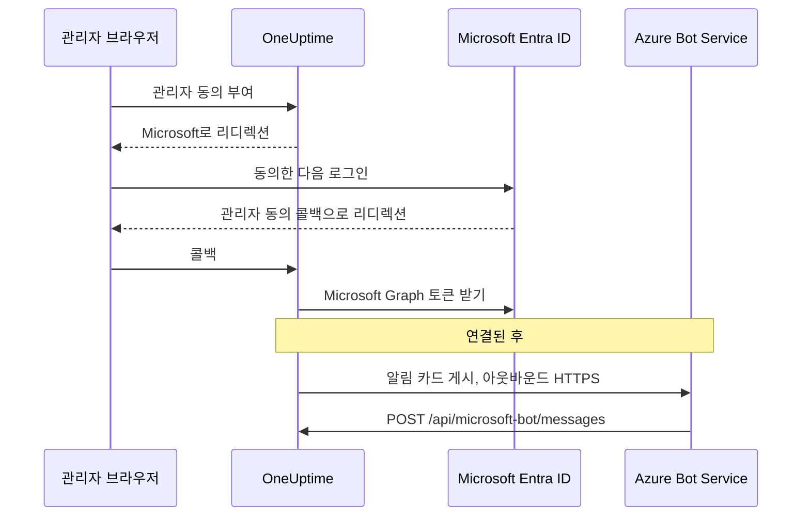
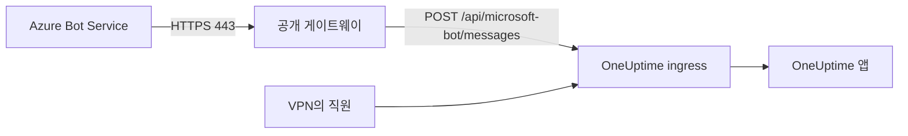

# Microsoft Teams 통합

자체 호스팅 OneUptime을 Microsoft Teams에 연결합니다. Microsoft Entra ID에 앱을 등록하고, 그 앱용 Azure Bot을 만들고, 앱의 자격 증명을 OneUptime에 넣은 다음, 서버가 생성하는 Teams 앱 패키지를 설치합니다. 그러면 OneUptime이 알림과 인시던트를 채널과 채팅에 게시하고, 팀은 Teams에서 바로 대응할 수 있습니다.

이 페이지는 OneUptime 서버를 운영하는 사람을 위한 것입니다. Teams를 연결한 뒤 알림 규칙은 프로젝트별로 설정합니다. [Microsoft Teams](/docs/workspace-connections/microsoft-teams)를 참고하세요.

:::cards
- [통합 설정](#통합-설정): Azure 포털부터 첫 번째 팀까지 9단계.
- [환경 변수](#환경-변수): OneUptime이 앱 등록에서 가져와야 하는 세 가지 값.
- [네트워크 액세스](#네트워크-액세스): Microsoft가 도달할 수 있어야 하는 봇 엔드포인트.
- [문제 해결](#문제-해결): 도달할 수 없는 엔드포인트, 누락된 설치, 실패한 연결.
:::

## 작동 방식

OneUptime은 Teams 통합에 Azure Bot을 사용합니다. 트래픽은 양방향으로 흐르며, 두 방향은 서로 독립적입니다. OneUptime은 메시지를 게시하려고 Microsoft를 호출하고, Azure Bot Service는 누군가 버튼을 누르거나, 봇에 메시지를 보내거나, 봇을 채팅에 추가할 때 서버를 호출합니다.



Incoming Webhook이나 Teams 워크플로 URL은 이 봇의 메시징 엔드포인트를 대신하지 못합니다.

화상 통화(인시던트용 Teams 모임)는 이 봇을 사용하지 않습니다. 화상 통화에는 별도의 앱 등록이 필요하며, [화상 통화](/docs/workspace-connections/video-calls#one-click-connect-on-a-self-hosted-server)에서 설명합니다.

## 시작하기 전에

- Azure Bot 리소스용 Azure 구독.
- Microsoft Entra ID에서 앱 등록을 만들 수 있는 계정과, 관리자 동의를 부여할 Microsoft 365 관리자.
- Azure Bot Service가 도달할 수 있는 OneUptime용 공개 HTTPS 호스트 이름. [네트워크 액세스](#네트워크-액세스)를 참고하세요.
- 서버 구성에 대한 액세스: Docker Compose에서는 `config.env`, Kubernetes에서는 Helm values.
- 프로젝트를 연결하려면 그 프로젝트의 **Project Owner**, **Project Admin**, **Project Member** 중 하나의 역할.

## 통합 설정

:::steps
### 1단계: Azure 앱 등록 만들기

[Azure 포털](https://portal.azure.com)에서 **App registrations**를 열고 **New registration**을 선택합니다. 양식을 다음과 같이 채웁니다.

- **Name:** oneuptime
- **Supported account types:** Accounts in this organizational directory only (Single tenant)
- **Redirect URI:** Web - `https://your-oneuptime-domain.com/api/microsoft-teams/auth`

**Register**를 선택한 다음 두 번째 Web 리디렉션 URI로 `https://your-oneuptime-domain.com/api/microsoft-teams/admin-consent/callback`을 추가합니다. **Application (client) ID**와 **Directory (tenant) ID**를 적어 두세요. 둘 다 나중에 필요합니다.

> [!NOTE]
> **단일 테넌트인 이유:** 자체 호스팅 OneUptime 배포는 하나의 조직을 위해 동작하며, 그 봇은 `MICROSOFT_TEAMS_APP_TENANT_ID`(6단계)에 설정한 단일 테넌트용으로 등록됩니다. 앱을 다중 테넌트로 등록해도 범위가 넓어지지 않고, 실패할 경로만 하나 늘어납니다. 홈 Microsoft 테넌트가 여러분의 테넌트와 다른 게스트 / B2B 사용자는 자신의 테넌트 ID로 봇에 접근하며, OneUptime은 이를 여러분의 프로젝트와 연결할 수 없습니다. 이미 다중 테넌트 앱을 등록했다면 그대로 계속 동작합니다. `MICROSOFT_TEAMS_APP_TENANT_ID`가 여러분의 테넌트인지만 확인하고, 게스트 계정이 봇을 사용하려면 여러분의 테넌트에 계정이 있어야 한다는 점을 염두에 두세요.

### 2단계: 앱 권한 구성

앱 등록에서 **API permissions**를 열고 **Add a permission**을 선택한 뒤 **Microsoft Graph**를 고릅니다.

**위임된 권한 추가**(로그인한 사용자를 대신해 동작할 때):

- **User.Read** - OAuth 흐름 중에 인증된 사용자의 프로필 정보(표시 이름, 이메일)를 가져오는 데 필요
- **Team.ReadBasic.All** - 연결할 팀을 고를 때 사용자가 속한 팀을 나열하는 데 필요
- **Channel.ReadBasic.All** - 채널 정보를 읽고 알림을 전달할 팀의 채널을 나열하는 데 필요
- **ChannelMessage.Send** - 알림과 인시던트 알림을 Teams 채널로 보내는 데 필요

**애플리케이션 권한 추가**(로그인한 사용자 없이 앱 자체로 동작할 때):

- **Team.ReadBasic.All** - 관리자 동의가 부여된 뒤 조직의 모든 팀을 나열하는 데 필요
- **Channel.ReadBasic.All** - 채널이 존재하는지 확인하고 세부 정보를 가져오는 데 필요
- **TeamsAppInstallation.ReadForTeam.All** - 진단에 필요. 팀에 실제로 설치된 앱 패키지를 OneUptime이 읽고 이 배포의 클라이언트 ID와 비교할 수 있게 해 주므로, 전송이 실패했을 때 가능한 원인 중 *어느 것*인지 알려 줄 수 있습니다. 이 권한이 없으면 OneUptime은 "설치되지 않음"과 "설치되었지만 다른 사람의 패키지"를 구분하지 못하고 Microsoft가 한 말만 전달합니다. 이 통합을 디버깅하는 데 몇 분이 아니라 며칠이 걸리는 가장 큰 이유가 바로 이것입니다. 부여하세요.
- **Chat.ReadBasic.WhereInstalled** - 선택 사항. OneUptime 앱이 들어 있는 각 채팅의 이름을 OneUptime이 읽을 수 있게 합니다. 이 권한이 없으면 각 채팅이 매니페스트의 **ChatSettings.Read.Chat** 권한(아래)으로 이를 부여하는데, 이전 매니페스트로 추가된 채팅은 그 채팅에서 앱이 업데이트된 뒤에야 이 권한을 갖습니다.

`ChannelMessage.Send`는 위임된 권한으로만 존재하며, [Microsoft Graph 권한 참조](https://learn.microsoft.com/en-us/graph/permissions-reference#channelmessagesend)에는 애플리케이션 권한 버전이 없습니다. 위의 위임된 권한 목록에 그대로 두세요.

그런 다음 조직에 대해 **Grant admin consent**를 선택합니다.

봇 자체는 Teams 앱 매니페스트에 정의된 리소스별 동의(RSC) 권한을 사용합니다. 이 권한은 Entra ID가 아니라, 앱이 팀이나 채팅에 설치되거나 업데이트될 때 부여됩니다.

- **ChannelMessage.Send.Group** - 봇이 팀 채널에 메시지를 보낼 수 있게 합니다
- **ChannelMessage.Read.Group** - 대화형 명령을 위해 봇이 채널 메시지를 읽을 수 있게 합니다
- **Channel.Create.Group** - 필요할 때 봇이 채널을 만들 수 있게 합니다
- **ChatMessage.Read.Chat** - 봇이 추가된 채팅의 메시지를 읽을 수 있게 합니다(대화형 명령용)
- **ChatMember.Read.Chat** - 봇이 추가된 채팅의 구성원을 읽을 수 있게 합니다(OneUptime에서 채팅 이름을 붙이기 위해)
- **ChatSettings.Read.Chat** - 앱이 추가된 그룹 채팅의 이름을 OneUptime이 읽을 수 있게 합니다. Teams는 그룹 채팅의 이름을 봇에 안정적으로 보내지 않으므로, 이 권한이 없으면 이름이 있는 그룹 채팅이 구성원 이름으로 표시됩니다
- **TeamsAppInstallation.Read.Group** - 게시하려는 팀에 앱이 설치되어 있는지 OneUptime이 확인할 수 있게 합니다

이 권한들이 생기기 전에 앱 매니페스트를 업로드했다면 **프로젝트 설정 > 워크스페이스 > Microsoft Teams**에서 다시 다운로드해 OneUptime 앱의 업데이트로 Teams에 업로드하세요. Teams는 앱이 해당 팀이나 채팅에 설치되거나 업데이트될 때 팀과 채팅 권한을 부여하므로, 이미 앱이 있는 모든 팀과 채팅에서 업데이트를 수락하세요. 채팅에 대해서는 [그룹 채팅이 구성원 이름으로 표시됨](#그룹-채팅이-구성원-이름으로-표시됨)을 참고하세요.

### 3단계: 클라이언트 비밀 만들기

앱 등록에서 **Certificates & secrets**를 열고 **New client secret**을 선택합니다. 설명을 추가하고 만료 기간을 고른 뒤(24개월이 무난합니다) **Add**를 선택합니다. 비밀 값은 바로 복사하세요. Azure는 한 번만 보여 줍니다.

> [!IMPORTANT]
> 비밀의 **Secret ID**가 아니라 **Value**를 복사하세요. 값이 더 긴 문자열입니다.

### 4단계: Bot Service 만들기

Azure 포털에서 **Azure Bot** 리소스를 만듭니다.

- **Bot handle:** oneuptime-bot
- **Subscription**과 **Resource group:** 본인의 것
- **Pricing tier:** 테스트에는 F0 (Free)로 충분
- **Type of App:** Single Tenant, 기존 앱 등록 사용: 1단계의 **Application (client) ID**와 **Directory (tenant) ID**

**Review + create**를 선택한 다음 **Create**를 선택합니다. 봇이 배포되면 **Configuration** 페이지를 열고 **Messaging endpoint**를 `https://your-oneuptime-domain.com/api/microsoft-bot/messages`로 설정한 뒤 저장합니다.

**다음으로 넘어가기 전에 엔드포인트를 확인하세요.** Azure Bot Service는 공용 인터넷에서 이 URL을 호출하므로, 네트워크 바깥 어딘가에서 확인해야 합니다. 클러스터 내부나, Azure는 보지 못하는 호스트를 볼 수 있는 VPN을 통해 확인해서는 안 됩니다.

```bash
curl -sS -i https://your-oneuptime-domain.com/api/microsoft-bot/messages
```

상태 코드만 보지 말고 `-i`를 사용하세요. 404일 때 **누가 그 응답을 만들었는지 알려 주는 것은 본문뿐**이며, 그 구분이 진단의 전부입니다.

- **405**가 올바른 응답이며, 이 응답이 오면 끝난 것입니다. 엔드포인트는 POST만 받으므로 GET에는 `Allow: POST`와 엔드포인트 설명이 담긴 `405 Method Not Allowed`가 돌아옵니다. 여기까지 도달하는 것 자체가 테스트 대상입니다.
- **JSON 본문 `{"message":"Page not found - /api/microsoft-bot/messages"}`가 담긴 404**는 OneUptime이 보낸 것이므로 요청이 *도달한* 것입니다. 이 배포가 위의 405 응답보다 오래되었거나(이전 버전은 이 경로를 POST에만 제공했기 때문에 GET은 일반 "not found" 핸들러로 들어갔습니다), OneUptime 앞단의 무언가가 경로를 다시 써서 앱이 보기 전에 `/api` 접두사를 떼어 내는 경우입니다(흔한 원인은 `rewrite-target: /`가 설정된 Kubernetes ingress입니다).
- nginx, ingress, 로드 밸런서가 보낸 **HTML 오류 페이지가 담긴 404**는 그 반대입니다. 요청이 OneUptime에 도달하지 못했고, 앞단에 있는 것이 `/api`를 앱으로 라우팅하지 않습니다.
- **TLS 오류, 시간 초과, 연결 거부**는 Azure도 도달하지 못한다는 뜻입니다. 아래의 [메시징 엔드포인트 문제 해결](#카드-버튼에-unable-to-reach-app이-표시되고-채팅이-나타나지-않음)을 참고하세요.

### 5단계: 봇에 Microsoft Teams 채널 추가

Azure Bot 리소스에서 **Channels**를 열고 **Microsoft Teams**를 추가합니다. 특별한 요구 사항이 없다면 기본 메시징 옵션을 그대로 두고 저장합니다. 이 채널이 없으면 봇이 Teams 대화에 프로비저닝되지 않습니다.

### 6단계: OneUptime 환경 변수 구성

앱의 자격 증명을 OneUptime에 넣습니다.

:::tabs
@tab Docker Compose
```bash title="config.env"
MICROSOFT_TEAMS_APP_CLIENT_ID=YOUR_TEAMS_APP_CLIENT_ID
MICROSOFT_TEAMS_APP_CLIENT_SECRET=YOUR_TEAMS_APP_CLIENT_SECRET
MICROSOFT_TEAMS_APP_TENANT_ID=YOUR_MICROSOFT_TENANT_ID
```

컨테이너를 다시 만드는 `npm run start`로 변경 사항을 적용합니다. `docker compose restart`는 `config.env`를 다시 읽지 않습니다.
@tab Kubernetes
```yaml title="values.yaml"
microsoftTeamsApp:
  clientId: YOUR_TEAMS_APP_CLIENT_ID
  clientSecret: YOUR_TEAMS_APP_CLIENT_SECRET
  tenantId: YOUR_MICROSOFT_TENANT_ID
```

직접 관리하는 Kubernetes Secret에 값을 보관하려면 대신 `microsoftTeamsApp.existingSecret`에 그 `name`과 키 `clientIdKey`, `clientSecretKey`, `tenantIdKey`를 설정합니다. `helm upgrade`로 변경 사항을 적용합니다.
:::

OneUptime이 다시 올라오면 **프로젝트 설정 > 워크스페이스 > Microsoft Teams**에 설정 가이드 대신 **관리자 동의 부여** 카드가 표시됩니다.

### 7단계: OneUptime에서 관리자 동의 부여

**프로젝트 설정 > 워크스페이스 > Microsoft Teams**를 열고 **관리자 동의 부여**를 선택합니다. Microsoft 365 관리자로 Microsoft에 로그인하고 권한을 수락합니다. Microsoft가 같은 페이지로 돌려보내면 카드에 **Admin Consent Completed**가 표시됩니다. 이제 프로젝트가 테넌트에 연결되었습니다.

그런 다음 **Connect my account with Microsoft Teams**를 선택해 자신의 계정을 연결합니다. 다른 프로젝트 구성원도 **사용자 설정 > 워크스페이스 > Microsoft Teams**에서 같은 작업을 합니다.

### 8단계: Teams 앱 매니페스트 업로드

관리자 동의 후 **프로젝트 설정 > 워크스페이스 > Microsoft Teams**에 **Action Required: Install This Deployment's App on Microsoft Teams** 카드가 표시됩니다. **앱 매니페스트 Zip 다운로드**를 선택합니다. 패키지에는 이 배포의 봇 ID가 들어 있습니다.

Microsoft Teams에서 **Apps > Manage your apps**를 열고 **Upload an app**, 이어서 **Upload a custom app**을 선택한 뒤 다운로드한 zip을 고릅니다.

> [!WARNING]
> 자체 호스팅 배포에는 Microsoft Teams 스토어의 "OneUptime"을 설치하지 마세요. 스토어 앱은 OneUptime Cloud의 봇을 가리키므로, Teams는 앱을 받아들인 뒤 이 배포가 보내는 모든 메시지를 거부합니다.

### 9단계: 모든 팀에 OneUptime 추가(필수)

매니페스트를 업로드하면 앱이 **본인**용으로 설치됩니다. 그것만으로는 봇이 어떤 팀의 채널에도 접근할 수 **없습니다**. Microsoft는 앱이 추가된 팀의 메시지만 받으므로, 알림을 받으려는 모든 팀에서 이 작업을 해야 합니다.

1. Microsoft Teams에서 **팀 이름**(채널 이름이 아님) 옆의 "..."를 클릭합니다
2. **Manage team** > **Apps** > **More apps**를 선택합니다
3. **OneUptime**을 검색하고 **Add**를 클릭합니다

참고:

- OneUptime을 자신용으로 설치하거나 채팅에 추가하는 것은 **별개의** 설치입니다. 어느 쪽도 팀의 채널에 게시할 수 있게 해 주지 않습니다.
- **비공개 채널**에는 채널 자체에 앱을 설치해야 합니다. 채널을 열고 "..." > **Manage channel** > **Apps** > **Add an app**을 선택하세요. 팀 수준 설치는 비공개 채널에 적용되지 않습니다.
- **공유 채널**은 알림을 전혀 받을 수 없습니다. Microsoft Teams는 공유 채널에서 봇을 지원하지 않습니다. OneUptime은 채널 선택기에서 공유 채널을 숨깁니다.
- **Manage team > Apps > More apps**가 비어 있거나 회색으로 표시되면 Teams 앱 설정 정책이 사용자 지정 앱을 차단하고 있는 것입니다. Teams 관리 센터의 **Teams apps > Manage apps**와 **Setup policies**에서 수정하세요.
:::

## 환경 변수

| Docker Compose (`config.env`) | Helm (`values.yaml`) | 값 |
| --- | --- | --- |
| `MICROSOFT_TEAMS_APP_CLIENT_ID` | `microsoftTeamsApp.clientId` | **Application (client) ID**. Teams 앱 패키지의 봇 ID이기도 하므로 GUID여야 합니다. |
| `MICROSOFT_TEAMS_APP_CLIENT_SECRET` | `microsoftTeamsApp.clientSecret` | 클라이언트 비밀의 ID가 아니라 **Value**. |
| `MICROSOFT_TEAMS_APP_TENANT_ID` | `microsoftTeamsApp.tenantId` | **Directory (tenant) ID**. 봇은 이 테넌트에서 단일 테넌트 앱으로 인증합니다. |
| `HOST` | `host` | 공개 호스트 이름. 리디렉션 URI, 메시징 엔드포인트, Teams 앱 패키지가 이 값으로 만들어집니다. |
| `HTTP_PROTOCOL` | `httpProtocol` | `https`. Azure Bot Service는 HTTPS 엔드포인트만 호출합니다. |

세 가지 `MICROSOFT_TEAMS_APP_*` 값은 모두 필수입니다.

- 클라이언트 ID가 없으면 Microsoft Teams 페이지에 **관리자 동의 부여** 대신 설정 가이드가 표시됩니다.
- 클라이언트 ID나 비밀이 없으면 연결이 **"이 OneUptime 서버에는 Microsoft Teams가 설정되어 있지 않습니다."** 메시지와 함께 끝납니다.
- 테넌트 ID가 없으면 봇이 인증할 수 없으므로 게시와 봇 엔드포인트가 모두 실패합니다.

## 네트워크 액세스

Microsoft는 [자체 호스팅 봇에 공개적으로 접근 가능한 HTTPS 엔드포인트](https://learn.microsoft.com/en-us/azure/bot-service/bot-service-resources-faq-security?view=azure-bot-service-4.0)를 요구합니다. 사설 IP 주소, 내부 DNS 이름, 직원의 VPN 연결로는 Azure Bot Service가 OneUptime에 접근할 수 없습니다.

| 방향 | 대상 | 목적 |
| --- | --- | --- |
| OneUptime에서 Microsoft로 | TCP 443을 통한 HTTPS로 Microsoft Graph, Microsoft ID, Bot Framework 서비스에 | 토큰 교환, 팀과 채널 조회, 알림 전달 |
| Microsoft에서 OneUptime으로 | `POST /api/microsoft-bot/messages` | 봇 메시지, 대화 설치 이벤트, 카드 작업 |
| 사용자 브라우저에서 OneUptime으로 | `/api/microsoft-teams/auth` 및 `/api/microsoft-teams/admin-consent/callback` | 로그인 및 관리자 동의 리디렉션 |

앱 등록이 `/api/microsoft-teams/auth`와 `/api/microsoft-teams/admin-consent/callback`으로 보내는 리디렉션은 사용자의 브라우저를 거쳐 돌아옵니다. 그 브라우저는 예를 들어 회사 네트워크나 VPN을 통해 OneUptime에 도달할 수 있어야 합니다. 봇 메시지와 카드 작업은 Microsoft 서버에서 오므로 별도로 도달 가능한 ingress가 필요합니다. 아웃바운드 알림 전달만으로는 인바운드 연결이 확인되지 않습니다.

### 비공개 배포에서 봇 엔드포인트 게시하기



:::steps
1. OneUptime 호스트 이름의 공개 DNS가 인터넷에 노출된 리버스 프록시나 로드 밸런서를 가리키게 합니다. 인바운드 TCP 443을 허용하고, 공개적으로 신뢰되는 TLS 인증서를 전체 체인과 함께 제공합니다.
2. 게이트웨이를 OneUptime의 비공개 ingress에 직접 또는 자체 사이트 간 VPN / 프라이빗 링크로 연결하고, 오리진의 서비스 포트를 허용합니다. Kubernetes `ClusterIP` 서비스에는 게이트웨이에서 도달할 수 있는 ingress나 다른 경로가 필요합니다. 데이터베이스와 기타 내부 서비스는 비공개로 유지합니다.
3. 그 게이트웨이를 통해 `/api/microsoft-bot/messages`를 게시하고, 4단계 Azure Bot의 **Messaging endpoint**를 전체 공개 HTTPS URL로 설정합니다. 메서드, `/api` 접두사, 쿼리 문자열, 본문, `Authorization` 헤더를 그대로 보존합니다. 공개 `Host`를 보존하고, 공개 호스트와 HTTPS 스킴을 나타내는 신뢰할 수 있는 전달 헤더를 설정합니다. 이 경로에는 리디렉션, 브라우저 SSO, CAPTCHA, 프록시 로그인을 추가하지 마세요. OneUptime의 Bot Framework 어댑터가 요청을 받아 인증해야 합니다.
4. 필요하면 다른 경로는 비공개로 유지합니다. 분할 DNS를 사용하면 직원은 회사 네트워크나 VPN을 통해 같은 호스트 이름을 비공개 ingress로 확인할 수 있습니다. 그 ingress도 호스트 이름에 유효한 인증서로 HTTPS를 제공하고, 위 표의 브라우저 리디렉션을 허용해야 합니다. 오리진에 대한 액세스는 게이트웨이와 허가된 내부 클라이언트로 제한합니다.
5. Docker Compose `config.env`에는 `HOST=oneuptime.example.com`과 `HTTP_PROTOCOL=https`를, Helm values에는 `host: oneuptime.example.com`과 `httpProtocol: https`를 설정합니다. 예시를 실제 도메인으로 바꾸고, 배포 업데이트를 적용한 뒤 앱이 다시 시작될 때까지 기다립니다. 이 값들은 URL을 생성할 뿐이며 DNS, TLS, 네트워크 액세스를 프로비저닝하지 않습니다. 호스트 이름이 바뀌면 Azure Bot 엔드포인트와 앱 등록 리디렉션을 업데이트하고, Teams 매니페스트를 다시 다운로드해 업로드합니다.
:::

OneUptime의 [사설 네트워크 액세스 설정](/docs/self-hosted/private-network-access)은 내부 서비스로 나가는 요청을 제어합니다. `ALLOW_PRIVATE_NETWORK_WEBHOOKS`를 켠다고 해서 Microsoft가 봇 엔드포인트에 도달할 수 있게 되지는 않습니다.

### 아웃바운드 액세스와 IP 제한

OneUptime 앱에서 DNS 확인과 아웃바운드 HTTPS를 허용합니다. `graph.microsoft.com`, `login.microsoftonline.com`, Bot Framework의 인증 및 채널 엔드포인트, 그리고 대화마다 제공되는 커넥터 서비스 URL을 사용합니다. 상용 클라우드의 대체 커넥터는 `https://smba.trafficmanager.net/teams/`이며, 대화의 서비스 URL은 이와 다를 수 있습니다. [Microsoft의 방화벽 지침](https://learn.microsoft.com/en-us/azure/bot-service/bot-service-resources-faq-security?view=azure-bot-service-4.0)을 적용하고 테스트 중에 차단된 트래픽을 살펴보세요. 이것은 호스트 이름의 전체 목록이 아닙니다.

Microsoft는 Bot Framework 인바운드 트래픽에 대한 고정 IP 허용 목록을 지원하지 않습니다. 원본 주소가 바뀌기 때문입니다. Teams 클라이언트의 미디어 IP 범위는 봇 웹후크의 원본을 나타내지 않습니다. 원본 IP를 신원의 증거로 취급하지 말고 Bot Framework 인증을 켜 두세요.

### 인바운드 액세스 없는 테스트와 배포

4단계를 사용해 네트워크와 VPN 바깥에서 공개 DNS, TLS, 라우팅을 확인합니다. 그런 다음 Teams를 연결하고, 테스트 알림을 보내고, 봇에 메시지를 보내고, 카드의 버튼을 누릅니다. OneUptime에서 작업을 확인하고, Microsoft의 전달 진단을 게이트웨이와 앱 로그와 대조합니다. 도달 가능한 GET 경로나 전달된 알림만으로는 인증된 인바운드 봇 POST가 확인되지 않습니다.

개발용으로는 [Teams 봇을 로컬에서 테스트하는 Microsoft 가이드](https://learn.microsoft.com/en-us/microsoftteams/platform/bots/how-to/authentication/add-authentication#testing-the-bot-locally-in-teams)가 터널로 로컬 서비스를 노출하는 방법을 설명합니다. 봇 엔드포인트를 허용하는 프록시로 전달하고, Microsoft 예시 경로 `/api/messages` 대신 `/api/microsoft-bot/messages`를 사용하세요. 터널의 공개 URL이 바뀔 때마다 구성된 호스트 이름과 Azure Bot 엔드포인트를 업데이트하고, 테스트 후에는 터널을 중지하며, 프로덕션에서는 안정적인 ingress를 사용합니다. 터널도 인바운드 액세스를 여는 것입니다.

> [!WARNING]
> 정책이 인바운드 연결을 금지한다면 Teams 봇 통합 전체가 동작할 수 없습니다. 명령, 카드 작업, 대화 검색은 Microsoft가 OneUptime에 도달하는 것에 달려 있습니다. Azure Bot Private Endpoint로는 이 요구 사항이 해결되지 않습니다. Microsoft의 [네트워크 격리 지침](https://learn.microsoft.com/en-us/azure/bot-service/dl-network-isolation-how-to?view=azure-bot-service-4.0)은 Direct Line 격리를 설명하며, 공용 네트워크 액세스를 끄면 Teams 채널 구성이 깨진다고 명시합니다. 완전히 분리된 설치에서는 Teams를 사용할 수 없습니다.

## 문제 해결

먼저 다음을 확인하세요.

- 앱 등록에 위의 권한이 있고 관리자 동의가 부여되어 있습니다.
- 리디렉션 URI가 정확히 일치합니다(`your-oneuptime-domain.com`을 실제 도메인으로 바꾸세요).
- 환경 변수가 설정되어 있고, 설정한 뒤 OneUptime을 다시 시작했습니다.
- 봇의 메시징 엔드포인트에 인터넷에서 도달할 수 있고, 봇에 Microsoft Teams 채널이 있습니다.
- 업로드한 Teams 앱 패키지가 이 배포에서 다운로드한 것입니다.

### 카드 버튼에 "Unable to reach app"이 표시되고 채팅이 나타나지 않음

이런 증상은 대개 **Azure Bot Service가 인증된 활동을 메시징 엔드포인트로 전달하지 못한다**는 뜻입니다. 라우팅, 봇 인증, 프로젝트 구성을 확인하세요.

헷갈리는 점은 알림 카드는 여전히 Teams에 도착하기 때문에 통합이 거의 정상처럼 보인다는 것입니다. 실제로는 그렇지 않습니다. 두 방향은 독립적이며 그중 하나만 동작하고 있습니다.

| 방향 | 이동 방식 | Azure가 여러분에게 도달해야 하나요? |
| --- | --- | --- |
| OneUptime이 채널에 알림 카드를 게시 | OneUptime이 클라이언트 비밀로 인증해 Microsoft를 호출 | **아니요** |
| 그 카드의 버튼을 누름 | Azure Bot Service가 `/api/microsoft-bot/messages`로 POST | **예** |
| 봇에 `help`를 보냄 | Azure Bot Service가 `/api/microsoft-bot/messages`로 POST | **예** |
| 채팅이 **Microsoft Teams Chats**에 등록됨 | Azure Bot Service가 봇 활동을 `/api/microsoft-bot/messages`로 POST | **예** |

따라서 알림이 도착한다는 사실은 그 아웃바운드 전송만 확인해 줄 뿐, 모든 Graph 권한이나 인바운드 봇 엔드포인트를 확인해 주지는 않습니다. 대화형 기능은 인바운드 봇 활동이 성공적으로 처리되어야 동작합니다.

OneUptime은 앱 설치, 대화에 봇 추가, 그 채팅에서 봇에 보낸 메시지 같은 봇 활동으로 채팅을 등록합니다. 이 활동은 모두 같은 인바운드 엔드포인트로 들어옵니다. 앱을 추가하고 메시지를 보낸 뒤에도 **Microsoft Teams Chats** 목록이 비어 있다면 그 프로젝트에 등록된 채팅이 없다는 뜻입니다. 인바운드 요청, 인증 오류, 테넌트와 프로젝트의 매핑을 확인하세요. **Refresh Chats**를 클릭하면 OneUptime이 저장한 채팅을 다시 읽고, 저장된 각 그룹 채팅의 이름을 Microsoft에서 다시 읽습니다.

**다음 순서로 진단하세요:**

1. **404가 아니라 POST를 찾으세요.** 대부분의 조사가 여기서 길을 잃습니다.

   ```bash
   grep 'POST /api/microsoft-bot/messages' <your access log>
   ```

   POST 줄이 없다면 올바른 액세스 로그가 요청을 기록하고 있는지 확인한 다음, Azure에 구성된 엔드포인트와 네트워크 경로를 확인하세요. POST가 들어오고 있다면 그 응답과 OneUptime의 인증 또는 프로젝트 매핑 오류를 살펴보세요. 404를 반환하는 `GET` 줄은 별개의 확인 사항입니다. 아래 참고를 보세요.

2. **4단계처럼 네트워크 바깥에서 엔드포인트를 호출하세요.** 본문을 볼 수 있도록 `curl -i`를 사용합니다. `405`가 오면 경로가 살아 있고 명령을 실행한 곳에서 도달할 수 있다는 것이 증명됩니다. TLS 오류, 시간 초과, 연결 거부가 오면 그것이 답입니다.

3. **인증서 체인을 확인하세요.** Azure는 공개적으로 신뢰되는 인증서를 전체 체인과 함께 제공하는 HTTPS를 요구합니다. 자체 서명 인증서, 내부 CA, 누락된 중간 인증서가 있으면 OneUptime이 요청을 보기 전에 TLS 핸드셰이크가 실패하므로, 액세스 로그는 비어 있고 Azure가 한 번도 시도하지 않은 것처럼 보입니다.

   ```bash
   openssl s_client -connect your-oneuptime-domain.com:443 -servername your-oneuptime-domain.com -verify_return_error </dev/null
   ```

4. **호스트를 공개적으로 확인할 수 있는지 점검하세요.** 사설 DNS 이름, 스플릿 호라이즌 레코드, 내부 전용 ingress는 여러분과 VPN에서는 도달할 수 있지만 Azure에는 보이지 않습니다. 여러분의 네트워크에 접근할 수 없는 네트워크에서 이름을 확인해 보세요.

5. **Azure Bot 리소스의 엔드포인트를 확인하세요.** 스킴과 경로를 포함해 이 배포와 정확히 일치해야 합니다: `https://your-oneuptime-domain.com/api/microsoft-bot/messages`.

**`GET /api/microsoft-bot/messages`에 대한 404는 장애가 아니며, Azure가 도달하지 못했다는 증거도 아닙니다.** 이 엔드포인트는 항상 POST만 받아 왔기 때문에, 이 버전 이전에는 브라우저의 GET이 OneUptime의 일반 "not found" 핸들러로 들어가 `{"message":"Page not found - /api/microsoft-bot/messages"}`로 돌아왔습니다. 경로가 없는 것처럼 보여서 존재하지도 않는 회귀를 찾아 헤맨 관리자가 한둘이 아닙니다. 하지만 이것이 실제로 증명하는 것을 보세요. OneUptime이 그 응답을 만들었으니 요청은 앱에 도달한 것입니다. 크기가 58바이트라서 액세스 로그에는 `"GET /api/microsoft-bot/messages HTTP/1.1" 404 58`로 남습니다.

이 버전은 GET에 `405 Method Not Allowed`와 자신에 대한 설명으로 응답하므로 이제 이 구분에 설명이 필요 없습니다. 아직 이전 버전을 쓰고 있다면 404를 본문으로 판단하세요. OneUptime의 JSON이면 요청이 도달한 것이고, 프록시의 HTML 오류 페이지면 도달하지 못한 것입니다.

### 그룹 채팅이 구성원 이름으로 표시됨

Teams는 그룹 채팅의 이름을 봇에 안정적으로 보내지 않으므로 OneUptime은 Microsoft Graph에서 이름을 읽습니다. 그러려면 매니페스트의 **ChatSettings.Read.Chat** 권한이 필요하며, 각 채팅은 OneUptime 앱이 그 채팅에 설치되거나 업데이트될 때 이 권한을 부여합니다. 이전 매니페스트로 앱이 추가된 채팅에는 이 권한이 없고, **Refresh Chats**가 그런 채팅을 표시해 줍니다. 다음 두 가지 중 한 방법으로 해결하세요.

1. **프로젝트 설정 > 워크스페이스 > Microsoft Teams**에서 매니페스트를 다시 다운로드해 OneUptime 앱의 업데이트로 Teams에 업로드하고, 해당 채팅마다 업데이트를 수락한 뒤 **Refresh Chats**를 클릭합니다.
   - Teams는 버전이 설치된 것보다 높을 때만 업로드를 업데이트로 받아들입니다. 릴리스 이미지는 `APP_VERSION`에서 버전을 설정합니다. `APP_VERSION` 없이 만든 빌드는 OneUptime이 매니페스트를 바꿀 때만 달라지는 고정 대체 값을 사용합니다. Teams가 패키지가 더 새롭지 않다고 하면 업로드하기 전에 매니페스트의 `version`을 올리세요.
   - 테넌트가 사전 승인된 앱에만 채팅 권한을 허용한다면, 먼저 OneUptime의 사전 승인 정책에 **ChatSettings.Read.Chat**을 추가하세요(예: `Update-MgBetaTeamAppPreapproval -TeamsAppId <app id> -ResourceSpecificApplicationPermissionsAllowedForChats @('ChatMember.Read.Chat','ChatMessage.Read.Chat','ChatSettings.Read.Chat')`). 그렇지 않으면 업데이트된 앱을 채팅에 추가할 수 없습니다.
2. 또는 앱 등록에 애플리케이션 권한 **Chat.ReadBasic.WhereInstalled**(2단계)를 관리자 동의와 함께 부여한 뒤 **Refresh Chats**를 클릭합니다. 그러면 채팅마다 업데이트하지 않고도 앱이 있는 모든 채팅이 한 번에 처리됩니다. OneUptime은 현재 Microsoft Graph 토큰을 만료될 때까지 계속 사용하므로, 새로 부여한 권한이 적용되기까지 최대 한 시간이 걸릴 수 있습니다.

Teams에서 이름이 없는 그룹 채팅은 설계상 구성원 이름으로 표시됩니다. Teams에서 이름을 바꾼 채팅은 다음에 누군가 **Refresh Chats**를 클릭할 때 새 이름을 가져옵니다.

### 이 배포의 봇 구성 확인

```bash
curl -sS https://your-oneuptime-domain.com/api/microsoft-bot/test | jq
```

이 명령은 OneUptime이 로컬에서 볼 수 있는 것을 알려 줍니다. `MICROSOFT_TEAMS_APP_CLIENT_ID`와 `MICROSOFT_TEAMS_APP_CLIENT_SECRET`가 설정되어 있는지, 이 배포가 기대하는 메시징 엔드포인트, 그리고 가장 유용한 것으로 Teams 앱 패키지에 들어 있어야 하는 **봇 ID**입니다.

이 명령은 환경 변수만 읽습니다. Azure를 호출하지 않으므로 Azure Bot 리소스가 존재하는지, 그 메시징 엔드포인트가 이곳을 가리키는지, Teams 채널이 켜져 있는지, 비밀이 아직 유효한지, Azure가 여러분에게 도달할 수 있는지는 알 수 없습니다. 응답이 스스로 확인한 것과 확인하지 않은 것을 나열해 이 점을 알려 주므로, 청신호로 오해할 일이 없습니다.

이 명령으로 할 수 있는 결정적인 확인은 하나뿐입니다. 반환된 `botId`를 Teams에 설치된 OneUptime 앱의 봇 ID와 비교하세요. 둘이 다르면 그 패키지는 이 배포의 메시지를 받을 수 없습니다. 8단계를 참고하세요.

### "The OneUptime app is not installed in the Microsoft Teams team ..."

OneUptime이 Microsoft Graph로 확인했고, 앱이 실제로 그 팀(비공개 채널이라면 그 채널)에 없습니다. 위의 **9단계**를 완료하세요. OneUptime은 Graph 애플리케이션 권한으로 테넌트의 모든 채널을 나열할 수 있지만, *게시*는 앱이 구성원인 팀에서만 할 수 있습니다.

### "Microsoft Teams refused the message ... because the OneUptime bot is not a member of that conversation"

Microsoft가 게시를 거부했고(Microsoft의 표현으로는 `BotNotInConversationRoster`), OneUptime은 앱이 없다는 것을 확인할 수 **없었습니다**. 그러니 앱이 없다고 단정하지 마세요. 아래 순서대로 원인을 확인하세요. 처음 두 가지는 Teams에서 보면 올바른 설정과 똑같아 보입니다.

1. **팀의 앱이 다른 패키지입니다.** **Manage team > Apps**에 "OneUptime"이라는 아이콘이 보인다고 충분한 것이 아닙니다. 중요한 것은 그 패키지의 봇 ID가 *이* 배포의 `MICROSOFT_TEAMS_APP_CLIENT_ID`인지입니다. Teams 스토어의 공개 OneUptime 앱은 OneUptime Cloud의 봇을 가리키므로 자체 호스팅 배포의 게시를 절대 받아들이지 않습니다. 여러분의 배포용으로 만들어진 것은 **프로젝트 설정 > 워크스페이스 > Microsoft Teams**(8단계)에서 다운로드한 매니페스트뿐입니다. 확실하지 않다면 팀에서 앱을 제거하고, 자신의 매니페스트를 다시 업로드해 그것을 추가하세요.
2. **Azure Bot에 Microsoft Teams 채널이 없습니다.** **5단계**를 완료하세요. 이 채널이 없으면 봇이 Teams 대화에 프로비저닝되지 않으므로, 앱이 문제없이 설치되고 앱 목록이 정상으로 보여도 봇은 어떤 채널의 구성원 목록에도 없습니다.
3. **앱이 본인용이나 채팅에는 설치되어 있지만 팀에는 없습니다.** **9단계**를 완료하세요.
4. **채널이 비공개입니다.** 팀 수준 설치는 비공개 채널에 적용되지 않습니다. 9단계의 참고를 보세요.

**TeamsAppInstallation.ReadForTeam.All**(2단계)을 부여하면 OneUptime이 이 원인들을 나열하는 대신 어느 것인지 알려 줍니다.

### 알림이 한 팀에서는 동작하지만 다른 팀에서는 동작하지 않음

설치는 팀 단위입니다. 한 팀에 OneUptime을 추가해도 다른 팀에는 아무 영향이 없고, 통합을 연결하는 것도 마찬가지입니다. 연결은 테넌트 전체에 대한 Graph *읽기* 액세스를 부여하므로, 채널 선택기에는 봇이 게시할 수 없는 팀의 채널도 나타날 수 있습니다. 알림을 받으려는 모든 팀에서 **9단계**를 완료하세요.

### "테스트 규칙"은 성공하지만 실제 알림이 도착하지 않음

규칙에서 실제로 켜져 있는 대상을 확인하세요. 규칙은 설정된 것만 시험합니다. **Create Microsoft Teams Channel**이 켜져 있으면 테스트가 채널을 만들어 거기에 게시하는데, 이것으로 증명되는 것은 봇이 *그 채널이 만들어진 팀*에 게시할 수 있다는 사실뿐이고 다른 팀에 대해서는 아무것도 알 수 없습니다. **프로젝트 설정 > 알림 > 알림 로그**에는 모든 테스트 전송이 기록되며, 실패하면 Microsoft의 오류가 그대로 남습니다.

### "Sorry, I couldn't find your project configuration"

봇 활동이 온 Microsoft 테넌트가 어떤 OneUptime 프로젝트에도 연결된 테넌트가 아닙니다. 서버 로그에서 테넌트 ID를 확인하세요.

```bash
grep "Project auth not found for tenant ID" <your app logs>
```

그 값을 프로젝트에 저장된 테넌트와 비교하세요.

```sql
SELECT "projectId", "workspaceProjectId"
FROM "WorkspaceProjectAuthToken"
WHERE "workspaceType" = 'MicrosoftTeams';
```

일치하지 않는다면 봇에 메시지를 보내는 사용자가 다른 Microsoft 테넌트에 로그인한 것입니다(홈 테넌트가 여러분의 테넌트가 아닌 게스트 / B2B 계정인 경우가 많습니다). 연결된 테넌트의 계정을 사용하거나, 1:1 채팅 대신 연결된 팀의 채널에서 봇을 @멘션하도록 요청하세요.

### "This Microsoft 365 organization is connected to more than one OneUptime project"

둘 이상의 OneUptime 프로젝트가 같은 Microsoft 테넌트를 연결했습니다. 봇 메시지에는 테넌트 ID만 들어 있으므로 OneUptime은 어느 프로젝트를 말하는지 알 수 없고, 추측하는 대신 거부합니다. 하나를 제외한 모든 프로젝트에서 Microsoft Teams 연결을 해제하세요.

### "Microsoft Teams App Client ID must be a valid GUID"

`MICROSOFT_TEAMS_APP_CLIENT_ID`가 GUID가 아니면 **앱 매니페스트 Zip 다운로드**는 패키지 생성을 거부합니다. Teams는 앱과 봇 ID로 GUID를 요구하기 때문입니다. 앱 등록의 개요 페이지에서 **Application (client) ID**를 다시 복사해 설정하고 구성을 적용하세요.

### 연결이 완료되지 않음

Microsoft가 여러분을 돌려보냈는데 연결이 이루어지지 않았다면(관리자 동의를 부여할 때나 Microsoft로 로그인할 때), 시작했던 Microsoft Teams 페이지(**프로젝트 설정 > 워크스페이스 > Microsoft Teams**, 또는 자신의 계정을 연결하던 중이었다면 본인의 **사용자 설정 > 워크스페이스 > Microsoft Teams**)에 **Microsoft Teams가 연결되지 않았습니다**라는 문구와 그 이유를 설명하는 여러분 언어의 문장이 표시됩니다. 페이지의 나머지 부분은 평소처럼 로드되므로 그 자리에서 다시 시도할 수 있습니다. Microsoft 자체의 응답(예: `AADSTS` 코드)은 절대 표시되지 않으며, 그 내용은 이유와 함께 OneUptime 서버 로그에 있습니다.

| 페이지 표시 | 해야 할 일 |
| --- | --- |
| **"이 연결 링크가 잘못되었거나 만료되었거나 이미 사용되었습니다. 처음부터 다시 시작하세요."** | 링크는 그것을 시작한 브라우저에서 15분 동안 한 번만 동작합니다. Microsoft Teams 페이지에서 다시 시작해 같은 브라우저에서 15분 안에 마치세요. |
| **"이 프로젝트를 Microsoft Teams에 연결할 권한이 없습니다."** | 프로젝트에 관리자 동의를 부여하려면 **Project Owner**, **Project Admin**, **Project Member** 중 하나가 필요합니다. Microsoft가 여러분을 돌려보낼 때 다시 확인합니다. |
| **"더 이상 이 프로젝트의 구성원이 아닙니다."** | 자신의 Microsoft 계정을 연결하려면 Microsoft가 여러분을 돌려보내는 시점에 프로젝트의 구성원이어야 합니다. |
| **"이 연결 대상과 다른 Microsoft 365 조직에 로그인했습니다."** | 관리자 동의를 부여한 Microsoft 365 조직, 또는 프로젝트가 연결된 조직의 계정으로 로그인하세요. |
| **"Microsoft 365 조직에 아직 팀이 없습니다."** | Microsoft Teams에서 팀을 만든 다음 관리자 동의를 다시 부여하세요. |
| **"연결이 취소되어 아무것도 변경되지 않았습니다."** | Microsoft에서 동의가 부여되지 않았습니다. 처음부터 다시 시작해 동의를 수락하세요. |
| **"이 OneUptime 서버에는 Microsoft Teams가 설정되어 있지 않습니다."** | Microsoft Teams 앱의 클라이언트 ID와 비밀을 설정하고([6단계](#6단계-oneuptime-환경-변수-구성) 참고) OneUptime을 다시 시작하세요. |
| **"OneUptime이 연결을 완료하지 못했습니다. 다시 시도하세요."** | Microsoft가 오류로 응답했거나, 마무리 중에 요청이나 쓰기가 실패했습니다. 어느 쪽인지는 OneUptime 서버 로그에 나옵니다. 다시 시도하고, 계속 발생하면 로그와 앱 등록 설정을 확인하세요. |

이 통합을 더 좋게 만들고 싶습니다. 의견은 [hello@oneuptime.com](mailto:hello@oneuptime.com)으로 보내 주세요.

## 다음 단계

:::cards
- [Microsoft Teams](/docs/workspace-connections/microsoft-teams): 프로젝트의 알림 규칙과 요약을 만듭니다.
- [Slack 통합](/docs/self-hosted/slack-integration): 서버에 Slack 앱도 설정합니다.
- [프라이빗 네트워크 접근](/docs/self-hosted/private-network-access): 워크플로와 웹후크가 내부 도구에 도달하게 합니다.
:::
