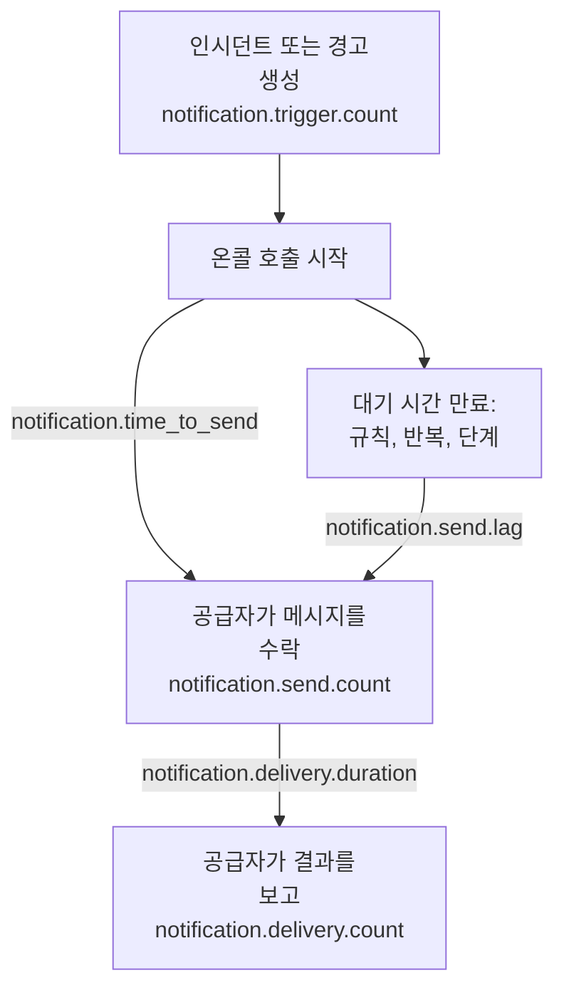

# 알림 전달 메트릭

OneUptime은 자신이 보내는 알림이 어떻게 되었는지 기록합니다. 얼마나 많은 인시던트와 경고가 알림을 필요로 했는지, 각 메시지가 공급자에 도달했는지, 온콜 호출이 나가기까지 얼마나 걸렸는지, 그리고 전화에 도달했는지입니다. OneUptime 자체의 텔레메트리를 OneUptime 프로젝트나 임의의 OpenTelemetry 백엔드로 보내, 설치가 서비스하는 사람들을 위한 전달 목표를 정하고 그 목표를 지키는지 확인하세요.

:::cards
- [켜기](#켜기): 두 가지 설정이며, 이것이 없으면 아무것도 기록되지 않습니다.
- [메트릭](#메트릭): 트리거부터 전화까지, 일곱 가지 메트릭.
- [호출 시간을 재는 방법](#호출-시간을-재는-방법): 전송까지의 시간과 전송 지연이 무엇부터 세어지는지.
- [시작용 SLO](#시작용-slo): 네 가지 목표를 쿼리별로.
:::

## 작동 방식



모든 메시지는 온콜 호출뿐 아니라 모든 채널에서 `notification.send.count`에 집계됩니다. 두 가지 시간인 `notification.time_to_send`와 `notification.send.lag`는 온콜 호출만 다룹니다.

## 켜기

OneUptime에 OpenTelemetry 내보내기가 설정될 때까지는 아무것도 기록되지 않습니다. 내보내기가 없으면 메트릭은 비용이 들지 않고 어디에도 보관되지 않습니다. 내보내기는 해당 프로젝트의 Server [수집 키](/docs/telemetry/ingestion-keys)로 OneUptime 프로젝트를 가리키거나, HTTP를 통한 OTLP를 받는 임의의 백엔드를 가리키게 하세요.

:::tabs
@tab Kubernetes
```yaml
openTelemetryExporter:
  endpoint: https://oneuptime.example.com/otlp
  headers: x-oneuptime-token=YOUR_INGESTION_KEY
```
`app`과 `worker` 배포가 이것들을 보냅니다. `app.disableTelemetryCollection`과 `worker.disableTelemetryCollection`은 기본값인 `false`로 두세요.
@tab Docker Compose
```bash
OPENTELEMETRY_EXPORTER_OTLP_ENDPOINT=https://oneuptime.example.com/otlp
OPENTELEMETRY_EXPORTER_OTLP_HEADERS=x-oneuptime-token=YOUR_INGESTION_KEY
DISABLE_TELEMETRY_FOR_APP=false
```
이것들을 `config.env`에 설정한 다음 `npm start`를 실행하세요. `DISABLE_TELEMETRY_FOR_APP`는 기본값이 `true`이며, 그러면 아무것도 보내지 않습니다.
:::

OneUptime에는 엔드포인트와 헤더가 모두 필요합니다. 헤더가 없으면 아무것도 보내지 않습니다. 각 헤더는 `name=value` 형식으로 쓰고, 여러 헤더는 `;`로 구분하세요. 값에 `=`가 들어가도 됩니다. OneUptime은 엔드포인트에 `/v1/metrics`를 직접 덧붙이며, 같은 설정으로 자체 트레이스와 로그도 보냅니다. 각 메트릭은 OneUptime이 처음 기록하는 순간 나타납니다. `notification.send.count`는 첫 메시지를 보낼 때입니다.

### OneUptime 프로젝트로 델타 보내기

OneUptime은 OpenTelemetry의 기본 방식대로 카운터와 히스토그램을 보냅니다. 각 포인트는 그 서버 프로세스가 시작된 이후의 누적 합계를 담습니다. 메트릭 탐색기는 차트의 각 단계 안에 있는 포인트를 더하므로, 시간 범위의 건수와 백분위수를 정확히 읽는 것은 델타, 즉 이전 포인트 이후에 일어난 일을 담은 포인트에서만 가능합니다. 메트릭을 OneUptime 프로젝트로 보낼 때는 델타를 보내세요.

:::tabs
@tab Kubernetes
```yaml
extraEnv:
  - name: OTEL_EXPORTER_OTLP_METRICS_TEMPORALITY_PREFERENCE
    value: delta
```
서비스 자체의 목록은 차트 전체의 목록을 대체합니다. `app.extraEnv`나 `worker.extraEnv`를 설정한다면 거기에도 추가하세요.
@tab Docker Compose
```yaml title="docker-compose.override.yml"
services:
  app:
    environment:
      OTEL_EXPORTER_OTLP_METRICS_TEMPORALITY_PREFERENCE: delta
```
이 파일을 `docker-compose.yml` 옆에 만들거나 이미 있는 파일에 이 내용을 추가한 다음 `npm start`를 실행하세요.
:::

이는 OneUptime이 자신에 대해 보내는 모든 메트릭에 적용됩니다. Prometheus처럼 누적 합계를 스스로 읽는 백엔드는 바꿀 것이 없습니다.

## 메트릭

| 메트릭 | 유형 | 단위 | 답하는 질문 |
| --- | --- | --- | --- |
| `notification.trigger.count` | 카운터 | `1` | 알림을 필요로 한 레코드의 수 |
| `notification.send.count` | 카운터 | `1` | 공급자에 넘겨진 각 메시지가 어떻게 되었는지 |
| `notification.send.duration` | 히스토그램 | `ms` | 공급자가 그것을 받기까지 걸린 시간 |
| `notification.time_to_send` | 히스토그램 | `ms` | 트리거 후 호출이 공급자에 도달하기까지 걸린 시간 |
| `notification.send.lag` | 히스토그램 | `ms` | 나중에 보내는 알림이 예정 시각 후 공급자에 도달하기까지 걸린 시간 |
| `notification.delivery.count` | 카운터 | `1` | 공급자가 수락한 메시지가 어떻게 끝났는지 |
| `notification.delivery.duration` | 히스토그램 | `ms` | 공급자가 수락한 후 메시지가 끝나기까지 걸린 시간 |

모든 속성은 몇 가지 고정 값 중 하나를 담으며, 프로젝트, 사람, 전화번호, 레코드를 담는 일은 없습니다. 유일한 예외는 사용자 지정 채널의 ID와 이름입니다. 설치에는 몇 개뿐이며, 그것들을 구별하는 것이 바로 목적입니다.

### 사람에게 알리는 레코드

`notification.trigger.count`는 각 인시던트, 경고, 인시던트 에피소드, 경고 에피소드를 생성될 때마다 셉니다.

| 속성 | 값 |
| --- | --- |
| `notification.trigger.type` | `incident`, `alert`, `incident_episode`, `alert_episode` |
| `notification.trigger.source` | OneUptime이 모니터나 규칙에서 만들었으면 `automatic`, 사람이나 API가 만들었으면 `manual` |
| `monitor.type` | 인시던트나 경고를 만든 모니터의 유형, 예: `Incoming Request`, `Logs`, `Metrics`. 모니터가 만들지 않았으면 생략됩니다 |

### 공급자에 넘겨진 메시지

`notification.send.count`는 공급자에 넘겨진 모든 메시지를 세고, `notification.send.duration`은 공급자 호출에 걸린 시간을 잽니다. 둘 다 다음 속성을 담습니다.

| 속성 | 값 |
| --- | --- |
| `notification.channel` | `email`, `sms`, `call`, `whatsapp`, `telegram`, `push`, `webhook`, `slack`, `microsoft_teams`, `mattermost`, `custom_channel` |
| `notification.provider` | `twilio`, `sms_and_call_gateway`, `smtp`, `sendgrid`, `amazon_ses`, `mailgun`, `postmark`, `resend`, `microsoft_graph`, `expo`, `push_relay`, `web_push`, `meta_whatsapp`, `telegram_bot_api`, `slack`, `microsoft_teams`, `mattermost`, `webhook`, `custom_channel`, 또는 아무것도 넘기지 않았으면 `none` |
| `notification.provider.config` | 설치 자체의 계정과 설정이면 `global`, 프로젝트 자체의 Twilio 계정, SMTP 서버, 웹훅, 워크스페이스 연결이면 `project`이며, 그 실패는 프로젝트가 고칠 일입니다 |
| `notification.on_call_page` | 온콜 호출의 알림이면 `true`, 아니면 `false` |
| `outcome` | 아래와 같이 `success`, `failure`, `not_sent` |
| `notification.destination` | Slack, Microsoft Teams, Mattermost: 한 사람에게 보내는 `direct_message`, 채널이나 Teams 그룹 채팅에 올리는 글은 `channel`, 상태 페이지 구독자의 것 같은 수신 웹훅은 `incoming_webhook`. 웹훅: 상태 페이지 구독자 자신의 웹훅은 `status_page_subscriber`. 사람의 웹훅과 다른 모든 채널에는 붙지 않습니다 |
| `notification.custom_channel.id`, `notification.custom_channel.name` | 사용자 지정 채널만: 채널의 ID와, 100자로 자른 이름 |

- `success`: 공급자가 메시지를 수락했습니다.
- `failure`: 공급자가 거부했거나 연결할 수 없었거나, 보내기가 실패했습니다. 찾을 수 없는 채팅 채널은 소요 시간이 없는 실패입니다.
- `not_sent`: 의도적으로 보내지 않았습니다. 프로젝트가 채널을 껐거나, 잔액이 부족하거나 차단되었거나, 이 서버에서 푸시가 꺼져 있거나, 사용자 지정 채널이 꺼졌거나 삭제되었거나 라이선스에 포함되지 않습니다. 성공률은 이것들을 제외합니다. 플랫폼의 실패가 아니라 설정이 작동한 것이기 때문입니다.

상태 페이지 구독자 자신의 웹훅으로 보낸 메시지는 몇 번 시도했든 한 번으로 셉니다. 엔드포인트가 2xx 상태로 응답하면 `success`, 다른 상태로 응답했거나 닿을 수 없었거나 주소가 허용되지 않으면 `failure`입니다.

### 전화에 도달한 것

`notification.delivery.count`는 공급자가 수락한 각 메시지가 어떻게 끝났는지를, 공급자가 나중에 보고하는 대로 메시지당 한 번 셉니다. `notification.delivery.duration`은 공급자가 수락한 후 얼마나 걸렸는지 잽니다. 둘 다 `notification.channel`, `notification.provider`, `notification.provider.config`, `notification.on_call_page`, 그리고 최종 상태인 `outcome`을 담습니다.

| 채널 | 공급자 | `outcome` | 소요 시간 |
| --- | --- | --- | --- |
| `sms` | `twilio` | `delivered`, `undelivered`, `failed` | Twilio가 상태를 보고할 때까지 |
| `call` | `twilio` | `answered`, `not_answered`, `failed` | 전화를 받을 때까지, 그렇지 않으면 끝날 때까지 |
| `push` | `expo`, `push_relay` | `delivered`, `undelivered`, `failed` | 재지 않음: 영수증은 Apple이나 Google이 푸시를 받았는지 알려 줄 뿐, 언제인지는 알려 주지 않습니다 |
| `whatsapp` | `meta_whatsapp` | `delivered`, `failed` | Meta가 상태를 보고할 때까지 |

벨이 울리다 끊겼거나, 통화 중이었거나, 거절된 전화는 `not_answered`입니다. 더 이상 없는 앱으로 보낸 푸시는 `undelivered`이며, 읽은 WhatsApp 메시지는 전달된 것으로 셉니다. `notification.provider.config`가 `project`인 것은 프로젝트 자체의 Twilio 계정으로 보낸 SMS와 전화뿐입니다.

상태는 공급자가 보고할 수 있는 곳에서만 도착합니다.

- SMS와 전화: Twilio를 통해, Twilio가 서버의 `HOST`에 도달할 수 있을 때([Twilio 통합](/docs/self-hosted/twilio-integration#3-네트워크-액세스-설정) 참조). SMS 및 전화 게이트웨이는 아무것도 보고하지 않습니다.
- WhatsApp: Meta의 웹훅이 설치에 맞게 설정되어 있을 때.
- 푸시: Expo의 영수증에서. OneUptime은 푸시 약 15분 후에 이를 읽으며, 푸시 릴레이를 거친 경우도 마찬가지입니다. 푸시를 보낸 설치가 이를 셉니다.
- 이메일, Telegram, 웹훅, 채팅, 사용자 지정 채널은 최종 상태를 보고하지 않습니다.

## 호출 시간을 재는 방법

### 전송까지의 시간

`notification.time_to_send`는 호출의 트리거부터 공급자가 알림을 수락할 때까지를 잽니다. 재는 것은 호출이 시작될 때 보낼 알림뿐입니다. 첫 번째 에스컬레이션 규칙의 사람들에게 아무것도 기다리지 않는 온콜 규칙으로 보내는 알림과, 아무에게도 닿지 않아 호출이 곧바로 넘어가는 모든 단계입니다. 온콜 구성이 요구하는 대기는 플랫폼의 지연이 아니므로 제외합니다. 그것은 [전송 지연](#전송-지연)에 들어갑니다. 공급자가 수락한 알림만 재며, 실패는 `notification.send.count`에 나타납니다.

| 속성 | 값 |
| --- | --- |
| `notification.channel` | `notification.send.count`와 같음 |
| `notification.page.start` | 시간이 무엇부터 흐르는지, 아래와 같음 |
| `notification.trigger.type` | 호출의 대상 레코드: `incident`, `alert`, `incident_episode`, `alert_episode` |
| `notification.custom_channel.id`, `notification.custom_channel.name` | 사용자 지정 채널만 |

| `notification.page.start` | 시간이 흐르기 시작하는 때 |
| --- | --- |
| `monitor_data_received` | 모니터를 작동시킨 데이터를 OneUptime이 받은 때: 수신 요청, 서버 에이전트의 보고, 수신 이메일, 프로브의 검사, SNMP 트랩 또는 네트워크 장치 폴링. 데이터가 평가를 위해 큐에서 기다린 시간이 포함됩니다. |
| `record_created` | 인시던트, 경고 또는 에피소드가 만들어진 때: 텔레메트리 모니터, 규칙 또는 사람이 만든 경우와, 멈춘 하트비트처럼 부재를 검사하는 경우. |
| `page_started` | 호출이 나중에 시작된 때: 사람, 워크플로 또는 이제 일치하는 규칙이 시작한 경우, 또는 직접 호출. 온콜 규칙이나 OneUptime AI가 보류한 호출은 보류가 끝난 때, 그보다 먼저 시작했다면 시작된 때. 다시 호출은 인지 후 타임아웃이 끝난 때. 그래서 어느 쪽이든 늦게 처리한 워커가 이 시간에 드러납니다. |

수신 요청의 경우 시간은 엔드포인트가 받은 마지막 요청부터 흐르므로, 조금 짧게 나올 수 있습니다.

### 전송 지연

`notification.send.lag`는 나중에 보내는 알림의 예정 시각부터 공급자가 그것을 수락할 때까지를 잽니다. 이것은 두 워커가 각각 매분 한 번씩 보내므로, 제때 도는 워커는 최대 일 분 정도를 보이고, 뒤처진 워커는 얼마나 뒤처졌는지를 보입니다.

| `notification.schedule` | 예정 시각 |
| --- | --- |
| `rule_wait` | "10분 후에 전화해 줘"처럼 기다리는 사람의 온콜 규칙: 그 사람이 호출된 후 그만큼 지난 때. 워커가 그 사람의 규칙을 마지막으로 처리한 때보다 이르지 않으므로, 나중에 추가되거나 바뀐 규칙은 그때부터 셉니다. |
| `repeat` | 누군가 확인할 때까지 반복되는 푸시: 간격이 끝날 때마다. |
| `escalation` | 나중의 에스컬레이션 단계: 앞 단계가 대기를 마친 때, 또는 사람이 호출을 넘기면 곧바로. |
| `policy_repeat` | 첫 단계부터 다시 시작하는 정책: 마지막 단계의 대기가 끝난 때. |

이것도 `notification.channel`, `notification.trigger.type`, 그리고 사용자 지정 채널이면 `notification.custom_channel.id`와 `notification.custom_channel.name`을 담습니다. 호출이 시작될 때 보낼 알림은 여기에 들어가지 않습니다. 워커가 보류 뒤에 또는 다시 호출로 호출을 늦게 시작했을 때도 마찬가지입니다. 그것은 전송까지의 시간에 들어갑니다.

### 히스토그램 버킷

각 히스토그램에는 목표를 경계에서 읽을 수 있도록 정한 자체 버킷 경계가 있으며, 단위는 밀리초입니다.

| 히스토그램 | 버킷 경계(밀리초) |
| --- | --- |
| `notification.send.duration` | `5, 10, 25, 50, 100, 250, 500, 1000, 2500, 5000, 10000, 30000, 60000, 120000` |
| `notification.time_to_send` | `250, 500, 1000, 2000, 5000, 10000, 15000, 30000, 60000, 120000, 300000, 600000, 1800000, 3600000` |
| `notification.send.lag` | `1000, 5000, 10000, 15000, 30000, 45000, 60000, 75000, 90000, 120000, 180000, 300000, 600000, 1800000, 3600000` |
| `notification.delivery.duration` | `500, 1000, 2000, 5000, 10000, 15000, 30000, 60000, 120000, 300000, 600000, 1800000, 3600000, 14400000, 86400000` |

백분위수는 버킷에서 계산되며, 그것이 속한 버킷의 가운데로 그려집니다. 그러니 버킷의 경계와 비교하세요. `notification.time_to_send`의 P95가 30000 이하라면 호출의 95%가 30초 이내에 나갔다는 뜻입니다.

## 시작용 SLO

대부분의 설치가 약속할 수 있는 네 가지 목표이며, 각각 메트릭을 받는 프로젝트의 메트릭 탐색기에서 한두 개의 쿼리로 만듭니다. 메트릭이 델타로 도착하면 시간 범위를 정확히 읽습니다. [OneUptime 프로젝트로 델타 보내기](#oneuptime-프로젝트로-델타-보내기)를 참조하세요.

### 메트릭 탐색기에서 만들기

:::steps
1. 프로젝트의 [메트릭 탐색기](/docs/telemetry/metrics-explorer)를 열고 목표의 첫 번째 메트릭을 클릭하세요. 그 쿼리는 `a`입니다.
2. **Aggregate by**에서 집계를 고르세요. 그런 다음 **Filters & grouping**을 열고 각 조건을 **Filter by attributes**에 추가하세요.
3. 두 번째 쿼리는 **메트릭 추가**를 클릭하고 `b`를 같은 방식으로 설정하세요.
4. 수식은 **수식 추가**를 클릭하고 **수식**에 입력하세요.
5. 목표를 놓쳤을 때 알림을 받으려면 **작업 → 이 보기에서 모니터 만들기**를 클릭하고, 값이 목표를 넘으면 경고하게 하세요. [메트릭 모니터](/docs/monitor/metrics-monitor)를 참조하세요.
:::

오류 예산과 함께 30일 동안 목표를 추적하려면 그 모니터를 [SLO](/docs/slo/introduction)에 연결하세요. SLO는 목표를 놓친 시간을 셉니다.

### 온콜 SMS가 Twilio에 도달

설치 자체의 Twilio 계정으로 보내는 온콜 SMS 중 실패는 최대 1%이므로, 99%가 수락됩니다.

| 쿼리 | 메트릭 | 집계 | 조건 |
| --- | --- | --- | --- |
| `a` | `notification.send.count` | **합계** | `notification.channel = sms`, `notification.on_call_page = true`, `notification.provider.config = global`, `outcome != not_sent` |
| `b` | `notification.send.count` | **합계** | 같은 조건에 `outcome = failure` 추가 |

수식 `$b / $a * 100`은 실패한 비율이며, 그 값이 1 이하로 유지되는 동안 목표가 지켜집니다. 실패가 없는 단계는 `b`에 포인트가 없으므로 포인트를 그리지 않습니다. `outcome != not_sent`는 프로젝트 자체 설정이 막은 것을 제외하고, `global`은 프로젝트 자체의 Twilio 계정을 제외합니다. SMS를 자체 SMS 및 통화 게이트웨이로 보내는 설치에서는 같은 쿼리가 게이트웨이를 측정합니다. 다른 채널은 `sms`를 `call`, `push` 또는 `email`로 바꾸세요.

### 호출이 30초 안에 나감

온콜 호출의 95%가 트리거 후 30초 안에 공급자에 도달합니다.

| 쿼리 | 메트릭 | 집계 | 조건 |
| --- | --- | --- | --- |
| `a` | `notification.time_to_send` | **P95** | `notification.page.start != page_started` |

`a`가 30000 이하로 유지되는 동안 목표가 지켜집니다. 나중에 시작된 호출은 트리거가 아니라 시작되거나 예정된 때부터 재므로 제외합니다. `notification.page.start`로 그룹화하면 모니터의 큐(`monitor_data_received`)를 나머지와 따로 볼 수 있고, `notification.channel`로 그룹화하면 느린 채널을 찾을 수 있습니다.

### 나중에 보내는 알림이 90초 안에 나감

대기 후에 보내는 알림의 99%가 예정 시각 후 90초 안에 공급자에 도달합니다.

| 쿼리 | 메트릭 | 집계 | 조건 |
| --- | --- | --- | --- |
| `a` | `notification.send.lag` | **P99** | — |

`a`가 90000 이하로 유지되는 동안 목표가 지켜집니다. `notification.schedule`로 그룹화하면 어느 워커가 뒤처졌는지 볼 수 있습니다. `rule_wait`와 `repeat`는 한 워커의 것이고, `escalation`과 `policy_repeat`는 다른 워커의 것입니다.

### 온콜 SMS가 전화에 도달

설치 자체의 계정으로 Twilio가 수락한 온콜 SMS 중 전달되지 않는 것은 최대 5%입니다.

| 쿼리 | 메트릭 | 집계 | 조건 |
| --- | --- | --- | --- |
| `a` | `notification.delivery.count` | **합계** | `notification.channel = sms`, `notification.on_call_page = true`, `notification.provider.config = global` |
| `b` | `notification.delivery.count` | **합계** | 같은 조건에 `outcome != delivered` 추가 |

수식 `$b / $a * 100`은 전달되지 않은 비율입니다. 그 일부는 통신사와 꺼진 전화가 결정하므로, 몇 주 동안 보이는 값을 바탕으로 목표를 정하세요. 전화에는 `call`과 `outcome != answered`를 쓰세요. Twilio가 서버에 도달할 수 있어야 합니다. [전화에 도달한 것](#전화에-도달한-것)을 참조하세요.

## 문제 해결

:::details 알림 메트릭이 도착하지 않음
`OPENTELEMETRY_EXPORTER_OTLP_ENDPOINT`와 `OPENTELEMETRY_EXPORTER_OTLP_HEADERS`가 모두 설정되었는지, Docker Compose에서는 `DISABLE_TELEMETRY_FOR_APP`가 `false`인지 확인한 다음 OneUptime을 다시 시작하세요. OneUptime은 시작할 때 읽을 수 없는 헤더가 있거나 아무것도 보내지 않으면 경고를 로그에 남깁니다. 메트릭은 무언가가 기록된 후에야 나타나므로, 먼저 알림을 보내세요.
:::

:::details 건수가 계속 늘기만 하거나 백분위수가 거의 움직이지 않음
메트릭이 누적 합계로 도착하고 있습니다. 델타를 보내세요. [OneUptime 프로젝트로 델타 보내기](#oneuptime-프로젝트로-델타-보내기)를 참조하세요.
:::

:::details 최종 상태가 도착하지 않음
최종 상태는 공급자에게서 나중에, 공급자가 보고할 수 있는 곳에서만 옵니다. [전화에 도달한 것](#전화에-도달한-것)을 참조하세요. Twilio가 도달할 수 없는 설치에서는 SMS와 전화가 보낸 것으로는 집계되지만 전달된 것으로는 집계되지 않습니다.
:::

## 다음 단계

:::cards
- [메트릭 탐색기](/docs/telemetry/metrics-explorer): 어떤 메트릭이든 차트로 그리고, 결합하고, 비교합니다.
- [메트릭 모니터](/docs/monitor/metrics-monitor): 목표를 놓쳤을 때 경고합니다.
- [Twilio 통합](/docs/self-hosted/twilio-integration): 전화에 도달한 것을 Twilio가 보고하게 합니다.
- [에스컬레이션 규칙](/docs/on-call/escalation-rules): 전송 지연이 세어지기 시작하는 대기.
:::
