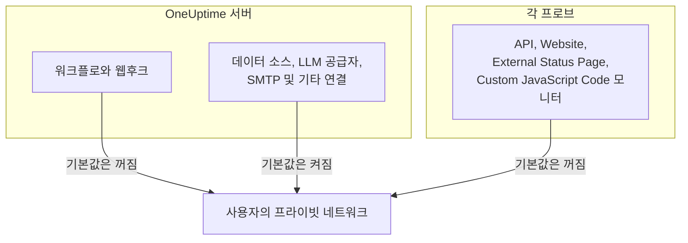

# 프라이빗 네트워크 접근

OneUptime은 프라이빗, 루프백 또는 링크 로컬 범위로 확인되는 호스트로 보내는 일부 아웃바운드 요청을 거부합니다. 워크플로를 내부 도구로 향하게 해 본 적이 있다면 다음 메시지를 보았을 것입니다.

> Webhook URL resolves to a private, loopback, or link-local address and is not allowed

이 기본값은 누구나 가입할 수 있고 웹후크 대상이 신뢰할 수 없는 입력인 호스팅 제품에는 올바릅니다. 하지만 자체 호스팅 인스턴스에서는 아주 평범한 일, 즉 자체 네트워크에만 있는 자체 호스팅 Mattermost, Jira 또는 티켓 시스템에 알림을 보내는 일을 방해합니다.

이 페이지에서는 이를 의도적으로, 좁은 범위로 허용하는 방법을 설명합니다. 세 개의 스위치가 이를 결정하며, 각 스위치는 자기 종류의 연결을 맡고 서로 다른 머신에서 구성됩니다.

| 내부에서 접근하려는 대상 | 설정 위치 | 자체 호스팅 설치의 기본값 |
| --- | --- | --- |
| 워크플로, 프로젝트 웹후크, 온콜 사용자 웹후크 | **API 서버**의 환경 | 프라이빗 주소 거부 |
| 데이터 소스, LLM 공급자, SMTP 서버, OIDC 검색 및 기타 연결 | **API 서버**의 환경 | 프라이빗 주소 허용 |
| API, Website, External Status Page, Custom JavaScript Code **모니터** | **프로브** 자체의 환경 | 프라이빗 주소 거부 |



Ping, Port, SSL 인증서, DNS, DNSSEC, SNMP / 네트워크 장치, SQL 쿼리, 데이터베이스 상태, Synthetic, Network Path 같은 네트워크 기반 모니터 유형은 자체 전송 방식을 사용합니다. 이 페이지의 설정은 임의의 응답 내용을 프로젝트에 돌려주는 HTTP 전송, 즉 API, Website, External Status Page, Custom JavaScript Code 모니터를 관리합니다.

:::cards
- [웹후크와 워크플로](#웹후크와-워크플로): 웹후크가 네트워크 안으로 요청을 보낼 수 있게 합니다.
- [기타 아웃바운드 연결](#기타-아웃바운드-연결): 데이터 소스, LLM 공급자, 메일 서버.
- [프로브와 모니터](#프로브와-모니터): 프로브가 프라이빗 사이트를 확인하게 합니다.
- [작동 확인](#작동-확인): 거부 메시지가 어떤 스위치를 가리키는지 읽습니다.
:::

## 차단되는 것과 차단을 해제할 수 있는 것

차단되는 대상은 두 단계로 나뉩니다.

| 단계 | 범위 | 허용할 수 있나요? |
| --- | --- | --- |
| **프라이빗** | RFC-1918 (`10.0.0.0/8`, `172.16.0.0/12`, `192.168.0.0/16`), CGNAT (`100.64.0.0/10`), IPv6 고유 로컬 (`fc00::/7`) 및 사이트 로컬 (`fec0::/10`) | 예 |
| **금지** | 루프백 (`127.0.0.0/8`, `::1`), 지정되지 않은 주소, 링크 로컬 (`169.254.0.0/16`, `fe80::/10`), 멀티캐스트, 예약됨, 브로드캐스트, 그리고 이름 `localhost` 및 `metadata.google.internal` | 웹후크 허용 목록에 정확한 호스트나 CIDR을 지정할 때만 가능합니다. 모니터에는 절대 허용되지 않습니다. |

클라우드 메타데이터 엔드포인트 `169.254.169.254`가 금지 단계에 있는 데에는 이유가 있습니다. 클라우드 VM에서 이 엔드포인트는 머신에서 HTTP 요청을 보낼 수 있는 모든 것에 인스턴스의 IAM 자격 증명을 건네주므로, 어떤 일괄 설정으로도 절대 열리지 않습니다.

내부에 IPv4 대상을 담은 IPv6 표기(IPv4 매핑 (`::ffff:10.0.0.5`), NAT64, 6to4, Teredo)는 실제로 도달하는 IPv4 주소를 기준으로 분류되므로, 이를 이용해 프라이빗 단계 허용을 우회하여 금지된 주소를 몰래 들여올 수 없습니다.

## 웹후크와 워크플로

다음 대상이 적용 범위에 포함됩니다. 대상이 프로젝트의 인증된 멤버가 작성한 URL이기 때문입니다.

- 워크플로 **API** 구성 요소(GET / POST / PUT / PATCH / DELETE)
- 워크플로 **Custom JavaScript** 구성 요소가 보내는 HTTP 요청
- 프로젝트 웹후크 알림(인시던트, 알림, 모니터, 온콜, 예약된 유지 관리, 상태 페이지 이벤트)
- 온콜 **사용자 웹후크**

적용 범위에 포함되지 **않으며** 앞으로도 포함되지 않을 대상은 **상태 페이지 구독자 웹후크**입니다. 공개 상태 페이지의 방문자라면 누구나 이를 등록할 수 있으므로, 이 대상을 완화하면 인터넷의 누구든 서버가 프라이빗 네트워크 안으로 POST 요청을 보내게 할 수 있습니다. 이는 구성할 수 없습니다.

웹후크가 아닌 아웃바운드 연결(외부 데이터 소스, LLM 공급자, SMTP 서버(프로젝트의 SMTP 설정과 워크플로 **Email** 구성 요소), SMTP OAuth 토큰 엔드포인트, OIDC 검색, 런북 HTTP 단계)은 `DATA_SOURCE_BLOCK_PRIVATE_ADDRESSES`로 별도로 관리되며, 자체 호스팅 설치에서는 이미 프라이빗 범위를 허용합니다. [기타 아웃바운드 연결](#기타-아웃바운드-연결)을 참조하세요.

### API 서버 구성

API 서버에서 다음 중 하나 또는 둘 다를 설정하고 다시 시작하세요. 둘 다 기본값이 꺼짐이므로, 둘 중 어느 것도 설정하지 않은 인스턴스는 이전과 똑같이 동작합니다.

| 변수 | Helm 값 | 허용하는 대상 |
| --- | --- | --- |
| `ALLOW_PRIVATE_NETWORK_WEBHOOKS` | `webhooks.allowPrivateNetwork` | `true`로 설정하면 프라이빗 단계 전체. |
| `PRIVATE_NETWORK_WEBHOOK_ALLOWLIST` | `webhooks.privateNetworkAllowlist` | 단계와 관계없이 여기에 지정한 호스트와 CIDR. |

:::tabs
@tab Docker Compose
```bash title="config.env"
ALLOW_PRIVATE_NETWORK_WEBHOOKS=true
PRIVATE_NETWORK_WEBHOOK_ALLOWLIST=mattermost.internal,*.svc.cluster.local,10.20.0.0/16
```
@tab Kubernetes
```yaml title="values.yaml"
webhooks:
  allowPrivateNetwork: true
  privateNetworkAllowlist: "mattermost.internal,10.20.0.0/16"
```
:::

Docker Compose에서는 `config.env`에 `ALLOW_PRIVATE_NETWORK_WEBHOOKS=false` 줄이 있습니다. 줄을 하나 더 추가하지 말고 그 줄을 바꾼 다음 `npm run start`를 실행하세요. Kubernetes에서는 릴리스를 업그레이드하세요.

허용 목록 항목은 쉼표, 공백 또는 줄 바꿈으로 구분할 수 있으며, 각 항목은 다음 중 하나일 수 있습니다.

- 호스트 이름 — `mattermost.internal`
- 와일드카드 — `*.svc.cluster.local`(하위 도메인과 일치하며, 접미사 자체와는 일치하지 않음)
- IPv4 또는 IPv6 주소 — `10.20.30.40`, `fd00::1`
- CIDR — `10.20.0.0/16`, `fd12:3456::/32`

항목에 포함된 스킴, 포트, 경로 또는 사용자 정보는 제거되므로, 이미 가지고 있는 웹후크 URL을 그대로 붙여 넣어도 됩니다.

허용 목록에 지정한 호스트 이름은 **DNS 확인 없이** 신뢰됩니다. 그것이 바로 이름을 지정하는 목적이며, 차단 목록이 거부할 주소로 확인될 것으로 예상되기 때문입니다. 주소 항목은 URL에 적힌 리터럴과, DNS가 그 이름에 대해 반환하는 모든 주소와 비교됩니다.

> [!CAUTION]
> **`169.254.169.254` 또는 이를 포함하는 범위를 절대 허용 목록에 넣지 마세요.** 클라우드 VM에서는 모든 프로젝트 멤버에게 인스턴스의 IAM 자격 증명을 주는 것과 같습니다.

## 기타 아웃바운드 연결

두 번째 보호 장치는 프로젝트 멤버가 대상을 고르지만 웹후크는 아닌 아웃바운드 연결을 다룹니다.

- 외부 데이터 소스(PostgreSQL, MySQL, SQL Server, ClickHouse, Elasticsearch, REST API 연결), Splunk 같은 보안 이벤트 연결, 위협 인텔리전스 피드
- 자체 호스팅 Ollama나 vLLM을 포함한 LLM 공급자
- SMTP 서버(프로젝트의 SMTP 설정과 워크플로 **Email** 구성 요소), 그리고 SMTP 및 워크플로 OAuth 토큰 URL
- Single Sign-On을 위한 OIDC 검색
- 상태 페이지 및 대시보드 사용자 지정 도메인 확인
- 런북 HTTP 단계
- 가져오기가 읽어 오는 Grafana OnCall API URL(**프로젝트 설정** > **기본** > **다른 도구에서 가져오기**)

이 보호 장치는 웹후크 설정과 반대로 동작합니다. 자체 호스팅 설치에서는 기본적으로 프라이빗 단계를 **허용**합니다. 이러한 연결이 접속하는 데이터베이스, 메일 서버, 모델 서버는 보통 자체 네트워크에 있기 때문입니다. 금지 단계(루프백, 링크 로컬, 클라우드 메타데이터 엔드포인트)는 어느 경우든 거부되며, 이를 위한 허용 목록은 없습니다.

`DATA_SOURCE_BLOCK_PRIVATE_ADDRESSES`는 이를 더 엄격하게 만듭니다. 예를 들어 인스턴스의 프로젝트가 내부 네트워크에 접근해서는 안 되는 사람들의 것이라면, `true`로 설정해 이러한 연결에도 프라이빗 단계를 거부하세요.

:::tabs
@tab Docker Compose
```bash title="config.env"
DATA_SOURCE_BLOCK_PRIVATE_ADDRESSES=true
```
@tab Kubernetes
```yaml title="values.yaml"
outboundConnections:
  blockPrivateNetwork: true
```
:::

이 설정은 프로젝트가 아니라 관리자가 구성하는 글로벌 LLM 공급자에는 적용되지 않습니다(`GLOBAL_LLM_PROVIDER_*` 변수, Helm 차트의 `vllm.globalProvider`, 또는 관리자 대시보드의 **설정** > **글로벌 LLM 공급자**에서 구성). 그러한 공급자는 여전히 프라이빗 주소에 접근할 수 있지만, 루프백과 링크 로컬은 그 공급자에게도 계속 거부됩니다.

정확한 값 `true`만 이 설정을 켭니다. `BILLING_ENABLED=true`인 인스턴스에서는 무엇을 설정하든 항상 켜져 있습니다. 위의 웹후크 설정이나 아래의 프로브 설정이 어떤 대상을 허용하는지는 바뀌지 않습니다. 각 관문은 따로 구성됩니다. 다만 웹후크와 워크플로 요청을 포함해 거부 메시지가 표시되는 방식은 바뀝니다. 이 설정이 켜져 있으면 거부된 호스트 이름은 무엇으로 확인되었는지 밝히지 않고 보고됩니다([작동 확인](#작동-확인) 참조).

Docker Compose에서는 `config.env`에 `DATA_SOURCE_BLOCK_PRIVATE_ADDRESSES=false` 줄이 있습니다(`config.env`가 그보다 오래되었다면 추가하세요). 줄을 하나 더 추가하지 말고 그 줄을 `true`로 바꾼 다음 `npm run start`를 실행해 새 값으로 컨테이너를 다시 만드세요. `docker compose restart`는 `config.env`를 다시 읽지 않습니다. Kubernetes에서는 values 파일에 설정하고 릴리스를 업그레이드하세요. 차트가 이를 app 및 worker 파드에 전달합니다.

이 설정이 켜져 있으면 거부된 호스트 이름은 무엇으로 확인되었는지 밝히지 않고 보고됩니다. 예를 들면 _"LLM provider host ollama.internal could not be reached."_ 와 같습니다. 전혀 확인되지 않는 이름도 같은 메시지를 받으므로, 프로젝트 멤버는 이 필드를 이용해 어떤 내부 이름이 존재하는지 알아낼 수 없습니다. IP로 입력한 주소는 여전히 이유와 함께 표시됩니다. 예를 들면 _"LLM provider host 10.0.4.12 is not allowed: private network address."_ 와 같습니다. `LOG_LEVEL=DEBUG`에서는 앱이 거부된 각 이름이 확인된 주소를 로그에 기록합니다.

## 프로브와 모니터

영향을 받는 모니터 유형은 **API**, **웹사이트**, **External Status Page**, **Custom JavaScript Code**의 네 가지입니다. 기본 프로브에서 이들은 공개 HTTP(S) 대상에는 접근할 수 있지만 프라이빗 주소 공간은 거부합니다. API, Website, External Status Page 모니터는 연결마다 DNS 결과를 검증하고 고정하며, 리디렉션마다 다시 검증합니다. Custom JavaScript Code는 샌드박스 브리지에서 같은 주소 정책을 적용합니다.

스위치는 API 서버의 환경이 아니라 **프로브 프로세스가 자체 환경에서** 읽으며, 모든 프로브가 이를 읽습니다. Docker Compose에 번들로 포함된 프로브, Helm 차트가 배포하는 프로브, 그리고 직접 실행하는 모든 [사용자 지정 프로브](/docs/probe/custom-probe)가 그렇습니다. 프로브를 배포하는 사람이 그 환경을 관리하며, 그 프로브가 어떤 네트워크를 볼 수 있는지 아는 당사자입니다. 사용자 지정 프로브는 보통 다른 머신이고, 다른 사람이 운영하는 경우가 많으며, API 서버의 구성을 절대 읽지 않습니다.

:::tabs
@tab Docker Compose
`config.env`에는 이미 `PROBE_ALLOW_PRIVATE_NETWORK_MONITORS=false` 줄이 있습니다. 줄을 하나 더 추가하지 말고 그 줄을 `true`로 바꾸세요. 같은 변수가 두 번 나오면 나중 줄이 우선하기 때문입니다. 그런 다음 `npm run start`를 실행하면 새 값으로 컨테이너가 다시 만들어집니다. `docker compose restart`는 `config.env`를 다시 읽지 않습니다. 번들로 포함된 모든 프로브가 이 한 줄을 읽으므로 `probe-1`에, 그리고 스택에서 두 번째 프로브를 실행한다면 `probe-2`에도 적용됩니다.

```bash title="config.env"
PROBE_ALLOW_PRIVATE_NETWORK_MONITORS=true
```
@tab Kubernetes
values 파일에서 프로브별로 설정하고 릴리스를 업그레이드하세요. `probes:` 아래의 각 항목은 별개의 프로브이므로, 프라이빗 주소에 접근해야 하는 모든 프로브에 설정하세요.

```yaml title="values.yaml"
probes:
  one:
    allowPrivateNetworkMonitors: true
```
:::

사용자 지정 프로브에서는 그 프로브 자체의 환경에 `PROBE_ALLOW_PRIVATE_NETWORK_MONITORS=true`를 설정하고 다시 시작하세요. 값은 정확히 `true`여야 합니다. `TRUE`나 `1` 같은 다른 값은 스위치를 꺼진 상태로 두며, `LOG_LEVEL`이 무엇으로 설정되어 있든 프로브가 시작 경고로 이를 알립니다.

번들로 포함된 프로브는 **글로벌 프로브**입니다. 인스턴스의 `REGISTER_PROBE_KEY`로 스스로 등록하며, 인스턴스의 모든 프로젝트가 이를 선택할 수 있습니다. 따라서 번들 프로브에서 스위치를 켜면 **인스턴스의 모든 프로젝트**의 모니터가 그 프로브를 통해 프라이빗 주소에 접근할 수 있습니다. 단일 팀 설치라면 보통 이것이 원하는 바입니다. 프로젝트끼리 그 접근 범위를 공유해서는 안 되는 경우(별개의 팀이나 호스팅하는 고객)에는 번들 프로브에서는 꺼 두고, 대신 각 네트워크 안에 프라이빗(사용자 지정) 프로브를 배포해 그곳에서만 켜세요.

예외가 하나 있습니다. `REGISTER_PROBE_KEY`로 스스로 등록하고 자체 환경에 `BILLING_ENABLED=true`가 있는 프로브, 즉 누구나 가입할 수 있고 모든 프로젝트가 글로벌 프로브를 공유하는 공개 가입형 호스팅 제품의 글로벌 프로브는 스위치가 켜져 있어도 공개 전용으로 남으며, 스위치를 무시한다는 시작 경고를 로그에 남깁니다. Docker Compose와 Helm 차트에 번들로 포함된 프로브는 인스턴스의 `BILLING_ENABLED`를 자동으로 받습니다. 그러한 인스턴스를 위해 실행하는 다른 `REGISTER_PROBE_KEY` 프로브에도 이를 전달하세요. 프로브는 다른 방법으로는 자신이 글로벌인지 알 수 없으므로, 관리자 대시보드에서 만들고 `PROBE_ID`와 `PROBE_KEY`로 실행하는 글로벌 프로브는 프라이빗 프로브처럼 스위치를 따릅니다. 프로젝트끼리 그 프로브의 네트워크를 공유해서는 안 된다면 그곳에서 켜지 마세요. 프라이빗 프로브는 어떤 인스턴스에서든 스위치를 따릅니다.

모든 프로브는 시작할 때 적용되는 프라이빗 네트워크 정책, 즉 프라이빗 네트워크 모니터링이 켜져 있는지 꺼져 있는지와 그 이유를 로그에 남깁니다. 무시되는 값과, 스위치가 모든 프로젝트에 열어 주는 글로벌 프로브는 어떤 `LOG_LEVEL`에서든 경고로 기록됩니다. 일상적인 켜짐/꺼짐 줄과, 같은 결정을 `privateNetworkMonitors` 아래에 기록하는 "Probe environment" JSON은 Helm 차트의 기본값인 `LOG_LEVEL=INFO`에서 기록됩니다. Docker Compose는 `LOG_LEVEL=ERROR`로 제공되므로, 그곳에서 보려면 `LOG_LEVEL=INFO`를 설정하세요. 방금 변경한 프로브의 모니터가 여전히 거부된다면 그 로그부터 확인하세요.

스위치를 켜도 루프백, 링크 로컬, 클라우드 메타데이터 엔드포인트는 열리지 **않습니다**. 이들은 모든 프로브에서 계속 거부되며, 이는 모니터 작성자가 소유하지 않은 네트워크에서 실행되는 프로브에 가장 중요합니다.

> [!WARNING]
> 다른 사람을 대신해 운영하는 프로브에서는 꺼 두세요.

## 작동 확인

워크플로나 모니터를 다시 실행하세요. 여전히 거부된다면 오류 메시지가 어떤 관문이 닫혀 있는지 알려 줍니다.

- _"...points to a private network address and is not allowed. Self-hosted instances can allow this by setting `ALLOW_PRIVATE_NETWORK_WEBHOOKS`..."_ — API 서버 설정이 빠져 있습니다.
- _"...private network address... Set PROBE_ALLOW_PRIVATE_NETWORK_MONITORS=true on the probe running this monitor to allow it."_ — 프라이빗(사용자 지정) 프로브가 모니터를 실행했고, 그 프로브의 스위치가 꺼져 있습니다. 이 설정은 API 서버가 아니라 프로브에 한다는 점에 유의하세요.
- _"...private network address... Set PROBE_ALLOW_PRIVATE_NETWORK_MONITORS=true on the probe running this monitor to allow it (probes.<name>.allowPrivateNetworkMonitors in the Helm chart). This is a global probe, so that allows it for every project on this instance; otherwise, select a private probe deployed on that network."_ — 번들(글로벌) 프로브가 모니터를 실행했고, 그 프로브의 스위치가 꺼져 있습니다. 인스턴스의 모든 프로젝트가 그 네트워크에 접근해도 된다면 위에서 설명한 대로 그 프로브에서 켜세요. 그렇지 않다면 모니터에서 프라이빗 프로브를 선택하세요.
- _"...Global probes cannot monitor private network addresses. Deploy and select a private probe for this target."_ — 환경에 `BILLING_ENABLED=true`가 있는 글로벌 프로브가 모니터를 실행했습니다. 그곳에서 자동 등록된 글로벌 프로브는 스위치가 무엇이든 공개 전용으로 남습니다. 대상 네트워크 안에 프라이빗 프로브를 배포하고 모니터에서 그 프로브를 선택하세요.
- _"Monitor target host ... could not be reached."_ — 대상이 **호스트 이름**인 API, Website 또는 External Status Page 모니터는 이름이 거부된 주소로 확인될 때와 DNS가 실패할 때 모두 이 메시지를 보고하므로, 모니터로 어떤 내부 이름이 존재하는지 알아낼 수 없습니다. 함께 표시되는 오류 세부 정보는 어느 경우든 `PROBE_ALLOW_PRIVATE_NETWORK_MONITORS`를 언급하며, 어느 경우에 해당하는지는 말하지 않습니다. 이름이 프라이빗 주소를 가리킨다면 프로브의 시작 로그에서 프라이빗 네트워크 정책을 확인하세요. 꺼져 있다면 해결 방법은 위의 메시지와 같습니다. `LOG_LEVEL=DEBUG`에서는 프로브가 거부된 각 이름의 정확한 이유도 로그에 기록합니다.
- _"Request URL could not be reached."_ — **Custom JavaScript Code** 모니터에도 같은 규칙이 적용됩니다. **호스트 이름**을 요청하는 스크립트는 이름이 거부된 주소로 확인될 때와 DNS가 실패할 때 모두 이 메시지를 받습니다. `LOG_LEVEL=DEBUG`에서는 프로브가 정확한 이유를 로그에 기록합니다.
- _"Webhook URL could not be reached."_ 또는 워크플로에서는 _"Request URL could not be reached."_ — 인스턴스가 `DATA_SOURCE_BLOCK_PRIVATE_ADDRESSES=true`(또는 `BILLING_ENABLED=true`)로 실행되므로 거부된 **호스트 이름**은 설명되지 않습니다. 거부된 주소로 확인되었거나 전혀 확인되지 않았거나 둘 중 하나입니다. `LOG_LEVEL=DEBUG`에서는 app 또는 worker가 어느 쪽인지와 그 주소를 로그에 기록합니다.
- _"...points to a private, loopback, or link-local address and is not allowed."_ — 대상이 금지 단계에 있습니다. 웹후크라면, 정말 필요한 경우 `PRIVATE_NETWORK_WEBHOOK_ALLOWLIST`에 정확한 호스트나 CIDR을 지정하세요. 모니터에는 예외가 없습니다.
- _"...hostname could not be resolved via DNS."_ — 컨테이너가 이름을 확인할 수 없습니다. 컨테이너가 대상과 네트워크를 공유하는지 확인하세요.

## 보안 참고 사항

이를 여는 것은 OneUptime 인스턴스가 접근하도록 만들 수 있는 범위를 실제로 바꾸는 일이므로, 신중하게 결정할 가치가 있습니다.

- **일괄 불리언보다 허용 목록을 우선하세요.** `mattermost.internal`을 지정하는 것은 모든 RFC-1918 주소를 여는 것보다 훨씬 작은 권한입니다.
- **워크플로나 API, Website, External Status Page, Custom JavaScript Code 모니터를 작성할 수 있는 사람은 누구나 허용한 모든 것에 접근할 수 있습니다.** 해당 프로젝트의 멤버십을 그에 맞게 다루세요.
- **응답 본문이 돌아옵니다.** 워크플로 API 구성 요소는 상태, 헤더, 본문을 워크플로 로그로 돌려주므로, 허용된 호스트는 쓰기뿐 아니라 읽기도 가능합니다.
- **웹후크 요청에서는 리디렉션을 절대 따르지 않습니다.** 따라서 허용된 공개 호스트가 두 번째 홉에서 서버를 내부 호스트로 튕겨 보낼 수 없습니다.
- **가능하면 인스턴스 전체가 아니라 프로브 단위로 범위를 정하세요.** 하나의 네트워크 안에 배포한 프로브는 API 서버의 송신 트래픽을 여는 것보다 좁은 권한입니다.

## 다음 단계

:::cards
- [사용자 지정 프로브](/docs/probe/custom-probe): 확인해야 할 네트워크 안에서 프로브를 실행합니다.
- [워크플로 구성](/docs/workflows/configuration): 워크플로 단계가 접근하고 수행할 수 있는 것.
- [LLM 공급자](/docs/ai/llm-provider): OneUptime AI를 네트워크의 모델에 연결합니다.
- [아키텍처](/docs/self-hosted/architecture): 자체 호스팅 설치의 어느 부분이 각 연결을 만드는지.
:::
