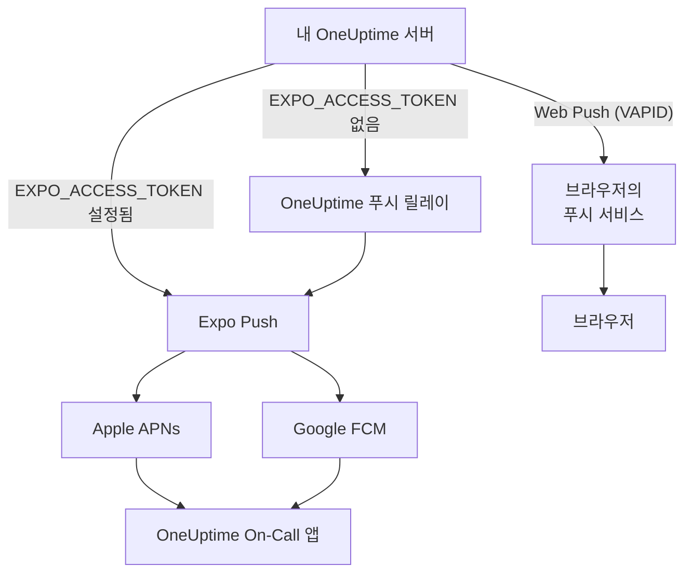
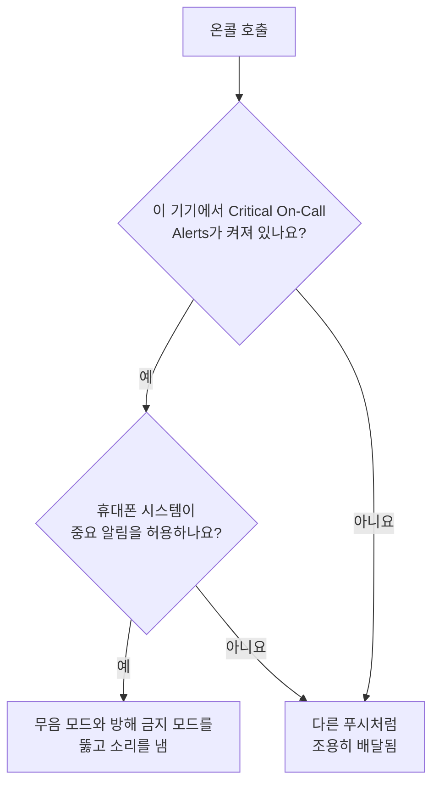

# 푸시 알림

OneUptime은 휴대폰에서는 **OneUptime On-Call** 모바일 앱을 통해, 브라우저에서는 Web Push를 통해 사람을 호출합니다. 모바일 푸시는 **Expo Push**로 전달됩니다. 자체 호스팅 인스턴스는 기본적으로 OneUptime의 푸시 릴레이를 거쳐 보내므로, 릴레이로 나가는 네트워크 접근만 있으면 되고 자체 Expo, Apple, Google 자격 증명은 필요 없습니다.

:::cards
- [푸시 전송 방식 선택하기](#자체-호스팅-설정): 푸시 릴레이 또는 직접 발급한 Expo 액세스 토큰.
- [방화벽 열기](#네트워크-접근): 서버와 사용자 기기가 닿는 주소.
- [무음 모드에서도 울리기](#중요-온콜-알림무음-모드-무시): 음소거된 휴대폰에서도 온콜 호출이 울리게 합니다.
- [도착하지 않는 푸시 해결하기](#문제-해결): Expo의 각 오류가 뜻하는 것.
:::

## 작동 방식



OneUptime 모바일 앱은 백엔드에 Expo Push 토큰을 등록합니다. 백엔드는 OneUptime의 푸시 릴레이를 통해 알림을 보내고, `EXPO_ACCESS_TOKEN`이 구성되어 있으면 Expo로 직접 보냅니다. Expo는 메시지를 Apple APNs나 Google FCM으로 전달해 기기에 배달합니다.

웹 푸시 알림은 계속 VAPID 키와 Web Push 프로토콜을 사용합니다.

## 자체 호스팅 설정

공식 모바일 앱과 기본 릴레이를 사용하면 서버에 Expo 자격 증명이 필요 없습니다. Expo로 직접 배달하려면 앱의 Expo 프로젝트에 맞는 자격 증명으로 `EXPO_ACCESS_TOKEN`을 구성하세요. Web Push에는 `VAPID_PUBLIC_KEY`, `VAPID_PRIVATE_KEY`, `VAPID_SUBJECT`가 필요합니다.

| 변수 | Helm 값 | 기본값 | 하는 일 |
| --- | --- | --- | --- |
| `PUSH_NOTIFICATION_RELAY_URL` | `pushNotification.relayUrl` | `https://oneuptime.com/api/notification/push-relay/send` | `EXPO_ACCESS_TOKEN`이 설정되지 않은 동안 모바일 푸시를 보내는 곳. |
| `EXPO_ACCESS_TOKEN` | `expo.accessToken` | 비어 있음 | Expo 프로젝트의 토큰으로 모바일 푸시를 Expo에 직접 보냅니다. |
| `VAPID_PUBLIC_KEY` | `vapid.publicKey` | 비어 있음 | 브라우저가 구독할 때 쓰는 키 쌍의 공개 키. |
| `VAPID_PRIVATE_KEY` | `vapid.privateKey` | 비어 있음 | 모든 웹 푸시에 서명하는 비공개 키. |
| `VAPID_SUBJECT` | `vapid.subject` | `mailto:support@oneuptime.com` | 브라우저 푸시 서비스가 연락할 수 있는 연락처 주소. |

VAPID 키 쌍은 `npx web-push generate-vapid-keys`로 한 번만 생성하고 보관하세요. 한 키 쌍으로 구독한 브라우저는 키 쌍이 바뀌면 푸시를 받지 못합니다.

:::tabs
@tab Docker Compose
```bash title="config.env"
VAPID_PUBLIC_KEY=your-public-key
VAPID_PRIVATE_KEY=your-private-key
VAPID_SUBJECT=mailto:oncall@example.com
# Leave unset to send mobile pushes through the push relay.
EXPO_ACCESS_TOKEN=
```
@tab Kubernetes
```yaml title="values.yaml"
vapid:
  publicKey: your-public-key
  privateKey: your-private-key
  subject: mailto:oncall@example.com
# Leave empty to send mobile pushes through the push relay.
expo:
  accessToken:
```
:::

## 네트워크 접근

| 방향 | 대상 | 프로토콜 / 포트 | 필요한 경우 |
| --- | --- | --- | --- |
| OneUptime → 기본 푸시 릴레이 | `https://oneuptime.com/api/notification/push-relay/send`, `https://oneuptime.com/api/notification/push-relay/receipts` | HTTPS / TCP 443 | `EXPO_ACCESS_TOKEN`이 설정되지 않았을 때의 모바일 푸시. |
| OneUptime → Expo | `https://exp.host/--/api/v2/push/send`, `https://exp.host/--/api/v2/push/getReceipts` | HTTPS / TCP 443 | `EXPO_ACCESS_TOKEN`이 설정되었을 때의 직접 모바일 푸시. |
| OneUptime → 브라우저 푸시 서비스 | 브라우저의 푸시 구독에 저장된 HTTPS 엔드포인트 | HTTPS / 보통 TCP 443 | Web Push. |
| 모바일 앱 또는 브라우저 → OneUptime | 내 OneUptime 호스트 이름 | HTTPS / TCP 443 | 로그인, 기기 등록, 알림 링크 열기. |

`PUSH_NOTIFICATION_RELAY_URL`을 바꾸면 그 대상 호스트 이름과 구성한 포트를 허용하세요. 사용자 지정 릴레이는 OneUptime의 릴레이 API를 구현해야 합니다. 이 기본값들과 릴레이와 직접 배달 사이의 전환은 [OneUptime 구성](https://github.com/OneUptime/oneuptime/blob/master/config.example.env)과 [푸시 서비스](https://github.com/OneUptime/oneuptime/blob/master/packages/Common/Server/Services/PushNotificationService.ts)에 정의되어 있습니다. Expo로 가는 직접 요청은 [Expo의 전송 가이드](https://docs.expo.dev/push-notifications/sending-notifications/)에 문서화된 엔드포인트를 사용합니다. OneUptime은 `/send` 대신 `/receipts`를 붙인 같은 주소에서 릴레이로부터 배달 수신 확인을 읽습니다. 이 라우트가 없는 릴레이도 푸시는 배달하지만, 그러면 앱이 삭제된 기기는 이후 그 기기로 가는 푸시가 거부될 때에야 알아차리게 됩니다.

Web Push의 경우 팀이 쓰는 브라우저의 실제 구독 엔드포인트 호스트를 허용하세요. OneUptime은 `fcm.googleapis.com`, `android.googleapis.com`, `push.services.mozilla.com`, `notify.windows.com`, `push.apple.com`을 하위 도메인까지 포함해 허용합니다. 대표적인 예는 `updates.push.services.mozilla.com`과 `web.push.apple.com`입니다. 대상은 [브라우저의 푸시 구독](https://developer.mozilla.org/en-US/docs/Web/API/PushSubscription)이 제공하며, Expo나 OneUptime 릴레이만 허용해서는 Web Push가 동작하지 않습니다.

알림을 보내는 OneUptime 프로세스에서 DNS 조회와 나가는 TLS를 허용하세요. 그 신뢰 저장소는 대상의 인증서를 검증할 수 있어야 하고, 프록시는 대화형 인증 없이 API 요청을 통과시켜야 합니다. 푸시 공급자는 OneUptime 서버의 웹훅을 호출하지 않으므로, 사용자 기기가 VPN이나 다른 사설 연결로 접근할 수 있다면 서버를 비공개로 둘 수 있습니다. 릴레이나 외부 푸시 서비스에 접근할 수 없는 서버는 이 알림을 배달할 수 없습니다.

기기의 연결은 별도의 요구 사항입니다. iOS 기기는 APNs에 접근해야 하며, 보통 TCP 5223을 쓰고 TCP 443으로 대체합니다. 대상 범위는 [Apple의 최신 네트워크 요구 사항](https://support.apple.com/en-us/102266)을 참고하세요. Android 기기는 TCP 5228–5230과 443으로 FCM에 접근해야 하며, [Google의 최신 호스트 및 방화벽 안내](https://firebase.google.com/docs/cloud-messaging/network-configuration)를 따르세요. 이 기기 포트는 OneUptime에서 들어오는 방향으로 열 필요가 없으며, 서버 쪽 모바일 흐름은 APNs/FCM에 직접 연결하지 않고 릴레이나 Expo를 사용합니다.

:::steps
1. 알림을 보내는 컨테이너나 파드에서 배달 방식의 대상(릴레이, Expo, 브라우저의 푸시 서비스)으로 가는 DNS와 HTTPS를 확인하세요.
2. **사용자 설정 > 알림 방법 > Push Notifications**에서 **테스트 알림**으로 테스트를 보내고, 등록된 기기에 도착하는지 확인하세요. Web Push는 브라우저마다 따로 테스트하세요.
3. OneUptime 로그에서 릴레이, Expo, 웹 푸시 오류를 확인하세요. API 제출에 성공한 것만으로는 기기 배달이 확인되지 않습니다.
:::

모바일 푸시의 경우 OneUptime은 각 푸시 후 약 15분이 지나면 Expo의 배달 수신 확인도 읽습니다. 기기에 도달하지 못한 푸시는 그때 푸시 로그에 배달되지 않음으로 표시되고, 온콜 호출이라면 온콜 타임라인에도 표시됩니다.

## 중요 온콜 알림(무음 모드 무시)

기본적으로 푸시 알림은 기기 설정을 따릅니다. 무음 상태의 휴대폰은 조용히 있고, 방해 금지 모드는 알림을 붙잡아 둡니다. 온콜 담당자에게 새벽 3시에 이것은 잘못된 기본값이므로, 모바일 앱은 기기별 설정인 **Settings > Notifications > Critical On-Call Alerts**를 제공해 *온콜 호출만* 둘 다를 뚫고 소리를 내게 합니다.

범위는 일부러 좁게 잡았습니다. 온콜 알림 규칙이 만든 호출만 해당됩니다. 소유자 구독, 메모 게시 알림, 상태 변경 업데이트, 모니터 알림은 이 설정이 무엇이든 절대 격상되지 않습니다.



호출이 무음 모드를 무시하려면 세 가지가 모두 참이어야 합니다. 하나라도 빠지면 호출은 그래도 배달되지만, 조용히 배달됩니다.

1. **담당자가 그 기기에서 켰다.** 기기별로 `UserPush.isCriticalAlertEnabled`에 저장되며 기본값은 꺼짐입니다. 같은 사람의 휴대폰과 태블릿은 따로 결정합니다.
2. **서버가 호출을 중요로 표시한다.** iOS에는 APNs의 중요 사운드 페이로드와 `interruptionLevel: critical`을 보내고, Android에는 `oncall_critical` 알림 채널을 지정합니다.
3. **운영 체제가 허용한다**, 그리고 바로 여기서 두 플랫폼이 다릅니다.

:::tabs
@tab iOS
iOS의 중요 알림에는 `com.apple.developer.usernotifications.critical-alerts` 권한(entitlement)이 필요합니다. Apple은 긴급한 일을 사람들에게 알리는 앱에 대해 요청을 받아 개발자 계정별로 이를 부여합니다. [Apple의 Critical Alerts 요청 양식](https://developer.apple.com/contact/request/notifications-critical-alerts-entitlement/)에서 요청하세요.

App Store의 공식 **OneUptime On-Call** 앱은 **버전 1.5.0**부터 이 권한을 가지고 있습니다. 그 이전 버전에는 없으며 iOS는 그런 버전에 중요 알림을 절대 제공하지 않으므로, 설정을 켜기 전에 앱을 업데이트하세요.

앱을 직접 빌드한다면 이 권한은 선택 사항입니다. 프로비저닝 프로필은 팀에 부여되지 않은 권한을 담을 수 없고, 담을 수 없는 권한을 선언한 빌드는 **서명에 실패합니다**. `packages/MobileApp/eas.json`의 `production` 프로필만 이를 켜는데, Apple이 공식 앱을 게시하는 팀에 부여했기 때문입니다. 자체 Apple 팀으로 서명하는 포크는 Apple이 그 팀에도 권한을 부여할 때까지 그 `env` 항목을 제거해야 합니다. 부여받은 뒤에는 빌드할 때 켜세요.

```bash
EXPO_IOS_CRITICAL_ALERTS_ENTITLEMENT=true npx expo prebuild
```

또는 `packages/MobileApp/eas.json`의 빌드 프로필 `env` 블록에 `EXPO_IOS_CRITICAL_ALERTS_ENTITLEMENT: "true"`를 추가하세요.

기기에서는 앱의 **Settings > Notifications > Critical On-Call Alerts**를 켜고, iOS가 물어보면 중요 알림을 허용하세요. iOS는 앱이 권한을 요청한 뒤에야 iOS 설정의 **Settings > Notifications > OneUptime On-Call** 아래에 앱용 **Critical Alerts** 스위치를 추가하므로, 앱에서 설정을 켜기 전에는 그 스위치가 없습니다. 요청을 거절했다면 나중에 iOS 설정의 그 스위치로 중요 알림을 허용할 수 있습니다.

권한이 없는 빌드에서는 iOS가 요청도 스위치도 보여 주지 않으며, 앱의 설정 화면은 이 버전의 앱이 중요 알림을 받을 수 없다고 알려 줍니다. iOS가 보여 주지 않는 스위치를 찾으러 담당자를 보내지 않습니다.
@tab Android
Android에는 공급업체 승인 단계가 없지만, 방해 금지 모드 우회는 앱 안의 요청이 아니라 시스템 화면에서 사용자가 허용합니다. 담당자가 설정을 켜면 앱이 **Settings > Notifications > Do Not Disturb access**를 열어 주고, 돌아오면 다시 확인합니다.

두 가지 메커니즘이 작동하며, 서로 다른 경우를 다룹니다.

- `oncall_critical` 알림 채널은 `bypassDnd`를 요청합니다. 이는 방해 금지 모드를 다루며 위에서 설명한 접근이 필요합니다.
- 같은 채널은 **알람** 오디오 스트림을 사용합니다. 벨소리만 음소거된 휴대폰에서도 들립니다. 이 부분에는 권한이 전혀 필요 없습니다.

Android는 채널을 처음 만들 때 그 설정을 고정하므로, 앱 업데이트로는 바꿀 수 없고 새 채널 ID를 배포해야만 바꿀 수 있습니다.
:::

동작을 확인하려면 **사용자 설정 > 알림 방법 > Push Notifications**에서 기기로 테스트 알림을 보내세요. 기기에서 중요 알림이 켜져 있으면 테스트도 중요 알림으로 보내집니다. 그러니 먼저 휴대폰을 무음으로 해 두면, 실제 호출이 닿을지 귀로 확인할 수 있습니다.

## 문제 해결

### 푸시 알림이 도착하지 않음

- 모바일 앱이 EAS Build로 빌드되었는지 확인하세요(Expo Go는 푸시 알림을 지원하지 않습니다)
- 기기가 데이터베이스의 `UserPush` 테이블에 등록되어 있는지 확인하세요
- OneUptime 서버 로그에서 Expo Push API 오류를 확인하세요
- 기기가 인터넷에 연결되어 있고 알림 권한이 켜져 있는지 확인하세요
- **사용자 설정 > 알림 방법 > Push Notifications**를 확인하세요. **알림을 받지 못하고 있습니다**로 표시된 기기는 알림 수신이 중단되었으며 다시 등록해야 합니다(아래 참고)

### iOS 설정에 Critical Alerts 스위치가 없음

- App Store에서 OneUptime On-Call을 업데이트하세요. 1.5.0 이전 버전은 Apple의 중요 알림 권한 없이 빌드되었으며, iOS는 그런 버전에 Critical Alerts 스위치를 전혀 보여 주지 않습니다
- 앱에서 **Settings > Notifications > Critical On-Call Alerts**를 켜세요. iOS는 앱이 권한을 요청한 뒤에야 자체 설정에 스위치를 추가하며, 앱은 이 설정이 켜질 때 권한을 요청합니다
- 온콜 알림 규칙이나 푸시 기기를 삭제했다가 다시 추가해도 달라지지 않습니다. 이 설정은 규칙이 아니라 기기의 앱에 속합니다

### 중요 알림이 무음 모드를 무시하지 않음

- **그** 기기에서 스위치가 켜져 있는지 확인하세요. 설정은 기기별이며, 재설치나 처음부터 설정한 새 휴대폰은 새 기기 등록을 만듭니다(이전 휴대폰의 백업에서 설정한 휴대폰은 이전 휴대폰이 더 이상 알림을 받지 않게 되는 즉시, 앱에 있던 설정과 함께 이전 휴대폰의 등록을 이어받습니다)
- **iOS**: 빌드에 Apple의 중요 알림 권한이 있는지(위 참고), 그리고 iOS Settings > Notifications > OneUptime On-Call에서 Critical Alerts가 허용되어 있는지 확인하세요
- **Android**: Settings > Notifications > Do Not Disturb access에서 앱에 방해 금지 모드 접근 권한이 있는지 확인하세요
- 설정 화면은 이 중 무엇이 빠졌는지 알려 줍니다. 앱이 마지막으로 요청한 것을 믿지 않고 OS에서 현재 상태를 다시 읽어 옵니다

### "배달되지 않음"으로 표시된 푸시

Expo가 푸시를 받아들였다고 해서 기기에 도달한 것은 아닙니다. Apple이나 Google이 여전히 거부할 수 있습니다. OneUptime은 각 모바일 푸시의 배달 수신 확인을 보낸 지 약 15분 뒤에 읽으며, `EXPO_ACCESS_TOKEN`이 설정되지 않았으면 푸시 릴레이를 거칩니다. 수신 확인이 오류를 보고하면 푸시 로그와 호출의 온콜 타임라인이 보냄에서 **Push notification not delivered**로 바뀌며, Expo의 오류 코드가 함께 표시됩니다.

- `DeviceNotRegistered`: 모바일 앱이 기기에서 삭제되었거나, 그 푸시 토큰이 더 이상 유효하지 않습니다. 다음 섹션을 참고하세요.
- `MessageRateExceeded`: 짧은 시간에 너무 많은 알림이 기기로 보내졌습니다. 이후의 푸시는 평소처럼 보내집니다.
- `MessageTooBig`: 알림이 푸시 서비스가 받아들이는 크기보다 컸습니다. OneUptime은 알림을 맞게 줄이므로 이런 일은 없어야 하며, 발생하면 알려 주세요.
- `InvalidCredentials` 또는 `MismatchSenderId`: 푸시를 보낸 Expo 프로젝트의 푸시 자격 증명이 유효하지 않습니다. `EXPO_ACCESS_TOKEN`을 쓴다면 Expo 프로젝트의 푸시 자격 증명을 확인하고, 기본 릴레이를 쓴다면 OneUptime 지원팀에 문의하세요.

Expo가 푸시를 즉시 거부하면 푸시 로그에 바로 이유가 표시됩니다. 푸시 릴레이를 거쳐도 마찬가지입니다. 릴레이는 서버 오류로 응답하지 않고 Expo의 오류 코드를 그대로 전달합니다.

### 로그의 "DeviceNotRegistered" 오류

Expo는 모바일 앱이 기기에서 삭제되었거나 기기의 푸시 토큰이 더 이상 유효하지 않을 때 `DeviceNotRegistered`를 보고합니다. 보통은 푸시의 배달 수신 확인에서 알려 주며, OneUptime은 이를 푸시 후 약 15분 뒤에 읽습니다. 때로는 푸시를 즉시 거부하기도 합니다. 어느 경우든 OneUptime은 그 기기로 보내는 것을 멈춥니다. 기기는 삭제되지 않고 알림을 받지 않는 것으로 표시되므로 알림 규칙은 남아 있고, 도착하지 않은 호출의 푸시 로그와 온콜 타임라인에 그 이유가 표시됩니다. **사용자 설정 > 알림 방법 > Push Notifications**에는 **알림을 받지 못하고 있습니다**로 표시됩니다. 소유자의 다른 기기와 알림 방법은 계속 호출을 받습니다.

기기를 되살리려면 로그인한 상태로 그 기기의 모바일 앱을 여세요. 앱이 다시 등록되면서 Expo의 푸시 토큰이 갱신되고, 기기는 자신의 규칙대로 다시 알림을 받습니다. 앱이 삭제되었다면 다시 설치하고 로그인하세요. 앱이 다시 등록되기 전에 보낸 푸시의 수신 확인은 기기를 표시하지 않습니다. 최신 모바일 앱을 이전 휴대폰의 백업으로 새 휴대폰에 설정하면, 앱은 전에 가지고 있던 푸시 토큰을 OneUptime에 알려 줍니다. 이전 휴대폰의 기기가 더 이상 알림을 받지 않으면 새 휴대폰이 그 규칙과 함께 이를 이어받습니다.

푸시 릴레이를 거치는 경우(`EXPO_ACCESS_TOKEN` 없음)에도 똑같이 동작합니다. 릴레이는 푸시를 보낼 때 `DeviceNotRegistered`를 보고하고, 인스턴스가 묻는 배달 수신 확인을 읽습니다.

이 중 어느 것도 도움이 되지 않으면 OneUptime 로그의 오류와 함께 [hello@oneuptime.com](mailto:hello@oneuptime.com)으로 연락해 주세요.

## 다음 단계

:::cards
- [모바일 앱](/docs/mobile-desktop-apps/index): OneUptime On-Call 앱을 설치하고 로그인합니다.
- [모바일 앱 문제 해결](/docs/mobile-desktop-apps/faq-troubleshooting): 휴대폰의 로그인 및 알림 문제를 해결합니다.
- [에스컬레이션 규칙](/docs/on-call/escalation-rules): 누구를 언제 호출할지 정합니다.
- [프라이빗 네트워크 접근](/docs/self-hosted/private-network-access): 서버가 자체 네트워크에서 닿을 수 있는 범위.
:::
