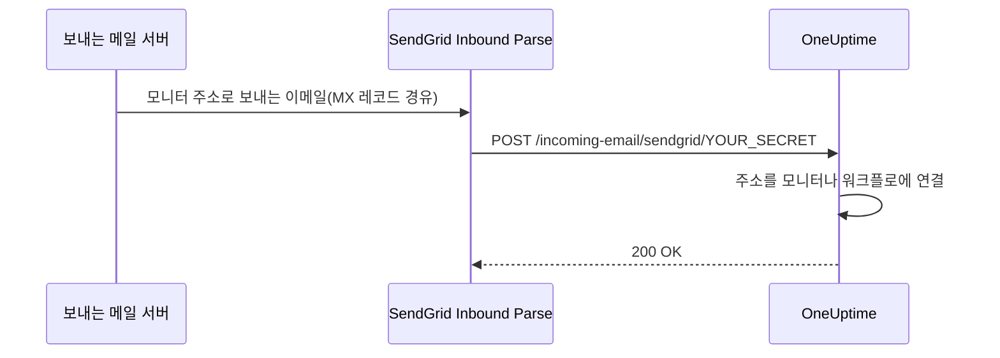

# SendGrid 수신 이메일

OneUptime의 **Incoming Email Monitor**를 사용하면 모니터마다 고유한 이메일 주소로 보낸 이메일을 바탕으로 알림을 만들고 해결할 수 있습니다. 레거시 시스템, 알림 도구, 이메일을 보낼 수 있는 모든 서비스와 연동할 때 유용합니다.

같은 설정으로 워크플로도 이메일을 받을 수 있습니다. **Incoming Email** 트리거가 있는 워크플로는 같은 도메인에 자체 주소를 받고, 그 주소로 온 이메일마다 워크플로가 시작됩니다. [트리거](/docs/workflows/triggers#incoming-email)를 참고하세요.

이 가이드는 수신 이메일을 자체 호스팅한 OneUptime 인스턴스로 전달하도록 SendGrid Inbound Parse를 설정하는 방법을 설명합니다. OneUptime Cloud에는 이런 설정이 필요 없으며, 주소가 바로 동작합니다.

:::cards
- [시작하기 전에](#사전-요구-사항): SendGrid 계정, 도메인, 공개 HTTPS 주소.
- [설정하기](#설정-방법): MX 레코드부터 테스트 이메일까지 일곱 단계.
- [환경 변수](#환경-변수-참조): 세 가지 설정과 기본값.
- [문제 해결](#문제-해결): 도착하지 않는 이메일과 실패하는 웹훅.
:::

## 작동 방식



1. OneUptime에서 **Incoming Email Monitor**를 만듭니다
2. OneUptime이 그 모니터를 위한 고유한 이메일 주소를 생성합니다(예: `monitor-abc123@inbound.yourdomain.com`)
3. 그 주소로 이메일이 오면 SendGrid가 이를 받아 웹훅으로 OneUptime에 전달합니다
4. OneUptime은 설정한 기준에 따라 이메일을 평가해 알림을 만들거나 해결합니다

## 사전 요구 사항

- Inbound Parse를 사용할 수 있는 SendGrid 계정
- DNS 설정에 접근할 수 있는, 직접 관리하는 도메인
- SendGrid 웹훅을 OneUptime 인스턴스로 전달하는 공개 HTTPS 엔드포인트

## 네트워크 접근

Inbound Parse에서는 SendGrid가 OneUptime으로 연결을 시작합니다. OneUptime에서 나가는 인터넷 접근만 허용해서는 충분하지 않습니다.

| 방향 | 대상 | 프로토콜 / 포트 | 목적 |
| --- | --- | --- | --- |
| SendGrid → OneUptime | `https://your-oneuptime-domain.com/incoming-email/sendgrid/YOUR_SECRET` | HTTPS / TCP 443 | 파싱한 이메일을 multipart POST로 전달합니다. |
| 보내는 메일 서버 → SendGrid | `mx.sendgrid.net`(수신 도메인의 공개 MX 레코드로 선택됨) | SMTP / TCP 25 | SendGrid에서 이메일을 받습니다. 이 연결은 OneUptime 서버로 가지 않습니다. |
| OneUptime → SendGrid(SendGrid 공급자로 이메일 발송을 따로 설정한 경우에만) | `api.sendgrid.com` | HTTPS / TCP 443 | Mail Send API로 알림 이메일을 보냅니다. |

웹훅 호스트 이름의 DNS를 공개하고, 공개 클라이언트가 신뢰하는 인증서를 제공하세요. 비공개 OneUptime 배포라면 내부에서 OneUptime에 닿을 수 있는 공개 리버스 프록시나 게이트웨이를 통해 웹훅 경로만 노출할 수 있습니다. 경로, 시크릿, 콘텐츠 유형, multipart 요청 본문을 유지하고, 대화형 로그인이나 브라우저 챌린지 없이 POST가 통과하게 하세요. OneUptime 서버에는 수신용 SMTP 리스너가 필요 없습니다. [SendGrid의 Inbound Parse 설정](https://www.twilio.com/docs/sendgrid/for-developers/parsing-email/setting-up-the-inbound-parse-webhook)을 참고하세요.

`INBOUND_EMAIL_WEBHOOK_SECRET`을 강력한 무작위 값으로 설정하고 URL의 `YOUR_SECRET`을 그 값으로 바꾸세요. 라우트에는 마지막 경로 세그먼트가 필요합니다. 시크릿이 설정되어 있으면 OneUptime이 그 값을 확인하며, 변수를 비워 두면 이 확인이 꺼집니다. 전체 URL과 모니터 이메일 주소는 프록시 로그를 포함해 비공개로 유지하세요. OneUptime은 현재 SendGrid의 서명된 Inbound Parse 헤더나 OAuth 토큰을 검증하지 않습니다. 이런 메커니즘이 필요하다면 [SendGrid의 웹훅 보안 문서](https://www.twilio.com/docs/sendgrid/for-developers/parsing-email/securing-your-parse-webhooks)에 따라, OneUptime으로 전달하기 전에 이를 검증하는 게이트웨이를 구성하세요.

SendGrid는 Inbound Parse에 대해 믿을 수 있는 고정 출발지 IP 목록을 제공하지 않습니다. SendGrid의 이메일 발송 IP와 `mx.sendgrid.net`에 대해 조회되는 주소는 웹훅 허용 목록이 아닙니다. 현재 DNS 결과를 고정하는 대신 [SendGrid의 방화벽 안내](https://support.sendgrid.com/hc/en-us/articles/44375457225371-How-to-Configure-Firewall-Settings-for-SendGrid-Webhook-and-Inbound-Parse-IPs)를 따르세요.

Inbound Parse는 나가는 이메일 발송과 별개입니다. 모니터 이메일을 받기 위해 OneUptime이 SendGrid API를 호출할 필요는 없습니다. 알림 발송에도 SendGrid를 선택한다면 DNS 조회와 `api.sendgrid.com`으로 나가는 HTTPS를 허용하세요. [Mail Send](https://www.twilio.com/docs/sendgrid/api-reference/mail-send/mail-send)는 제출을 위해 들어오는 콜백이 필요 없습니다. 대신 SMTP를 사용한다면 OneUptime에 설정한 SMTP 서버와 포트를 허용하세요.

## 설정 방법

:::steps
### 수신 이메일 도메인 선택하기

`inbound.yourdomain.com`, `email.yourdomain.com`, `monitor.yourdomain.com`처럼 OneUptime용 이메일 수신 전용 하위 도메인을 고르세요. OneUptime 모니터와 워크플로로 가는 이메일에만 쓰이므로, 여러분의 메일함이 그곳에 있지 않습니다.

### MX 레코드가 SendGrid를 가리키게 하기

하위 도메인의 이메일을 SendGrid로 보내는 MX 레코드를 추가하세요.

| 유형 | 호스트/이름 | 우선순위 | 값 |
| --- | --- | --- | --- |
| MX | inbound | 10 | mx.sendgrid.net |

도메인이 `example.com`이고 `inbound.example.com`을 사용한다면 레코드는 다음과 같습니다.

```text
inbound.example.com.  IN  MX  10  mx.sendgrid.net.
```

DNS 변경이 전파되는 데 최대 48시간이 걸릴 수 있지만, 보통 몇 시간 안에 끝납니다.

### SendGrid에서 도메인 인증하기

수신 도메인은 [SendGrid에서 인증한 도메인](https://www.twilio.com/docs/sendgrid/ui/account-and-settings/inbound-parse) 중 하나에 속해야 합니다. [SendGrid 대시보드](https://app.sendgrid.com)에서 **Settings** > **Sender Authentication**으로 이동해 **Authenticate Your Domain**을 클릭하고, 요청하는 DNS 레코드(DKIM용 CNAME 레코드)를 추가하세요.

### Inbound Parse 웹훅 추가하기

SendGrid 대시보드에서 **Settings** > **Inbound Parse**로 이동해 **Add Host & URL**을 클릭하세요. 아래와 같이 입력한 다음 **Add**를 클릭합니다.

| 필드 | 값 |
| --- | --- |
| **Receiving Domain** | 수신용 하위 도메인(예: `inbound.yourdomain.com`) |
| **Destination URL** | `https://your-oneuptime-domain.com/incoming-email/sendgrid/YOUR_SECRET` |
| **Check incoming emails for spam** | 선택 사항 - 원하면 켜세요 |
| **Send raw, full MIME message** | 선택하지 않은 채로 두세요(필요 없음) |
| **POST the raw, full MIME message** | 선택하지 않은 채로 두세요(필요 없음) |

### OneUptime 구성하기

Destination URL과 같은 시크릿으로 수신 이메일 변수를 설정하세요.

:::tabs
@tab Docker Compose
```bash title="config.env"
INBOUND_EMAIL_PROVIDER=SendGrid
INBOUND_EMAIL_DOMAIN=inbound.yourdomain.com
INBOUND_EMAIL_WEBHOOK_SECRET=replace-with-a-strong-random-secret
```
@tab Kubernetes
```yaml title="values.yaml"
inboundEmail:
  provider: "SendGrid"
  domain: "inbound.yourdomain.com"
  webhookSecret: "replace-with-a-strong-random-secret"
```
:::

그런 다음 적용하세요. Docker Compose에서는 `npm run start`를 실행하면 새 값으로 컨테이너를 다시 만들고, Kubernetes에서는 Helm 릴리스를 업그레이드합니다.

### Incoming Email 모니터 만들기

[Incoming Email 모니터를 만드세요](/docs/monitor/incoming-email-monitor#수신-이메일-모니터-만들기). 그 **개요** 페이지에는 `monitor-abc123def456@inbound.yourdomain.com` 같은 주소가 표시되고, 기준에 따라 어떤 이메일이 알림을 만들고 어떤 이메일이 해결하는지가 정해집니다.

워크플로도 같은 도메인을 사용합니다. 워크플로에 **Incoming Email** 트리거를 추가하고 클릭하면, 그 주소(`workflow-…@inbound.yourdomain.com`)가 설정 맨 위에 있습니다. 위의 수신 이메일 변수가 설정될 때까지 트리거는 서버가 이메일을 받도록 설정되지 않았다고 알려 줍니다.

### 테스트 이메일 보내기

모니터 주소로 기준에 맞는 제목의 이메일을 보내세요. 모니터 요약에 그 이메일이 표시되고, 기준이 일치하면 알림이 만들어집니다.
:::

## 환경 변수 참조

| 변수 | Helm 값 | 설명 | 필수 | 기본값 |
| --- | --- | --- | --- | --- |
| `INBOUND_EMAIL_PROVIDER` | `inboundEmail.provider` | 수신 이메일 공급자. SendGrid만 지원합니다. | 아니요 | `SendGrid` |
| `INBOUND_EMAIL_DOMAIN` | `inboundEmail.domain` | 수신 이메일용으로 설정한 하위 도메인. 설정하기 전까지 수신 이메일은 꺼져 있습니다. | 예 | 비어 있음 |
| `INBOUND_EMAIL_WEBHOOK_SECRET` | `inboundEmail.webhookSecret` | 웹훅 URL의 마지막 세그먼트 `/incoming-email/sendgrid/YOUR_SECRET`과 비교하는 시크릿. 공개 엔드포인트에는 설정하세요. 빈 값이면 검증이 꺼집니다. | 권장 | 비어 있음 |

Incoming Email 모니터가 기준으로 삼을 수 있는 것 - 제목, 보낸 사람, 본문, 받는 사람, 그리고 이메일이 제시간에 도착했는지 여부 - 은 [사용 가능한 필터 유형](/docs/monitor/incoming-email-monitor#사용할-수-있는-필터-유형)에 있습니다.

## 문제 해결

:::details 이메일이 수신되지 않음
1. **DNS 전파 확인하기:** `dig MX inbound.yourdomain.com`이 `mx.sendgrid.net`을 반환해야 합니다.
2. **SendGrid Inbound Parse 설정 확인하기:** SendGrid 대시보드의 **Settings** > **Inbound Parse**에서 도메인과 웹훅 URL을 확인하세요.
3. **OneUptime 로그 확인하기:** OneUptime `app` 서비스 로그에서 수신 이메일 웹훅 요청과 오류를 찾으세요. SendGrid는 Inbound Parse에 대한 자세한 로그를 남기지 않으므로, 이 로그가 도착한 내용의 기록입니다.
:::

:::details 웹훅이 실패함
1. **공개 웹훅 라우트 확인하기:** 시크릿을 포함한 전체 URL이 인터넷에서 OneUptime에 닿아야 합니다. 마지막 시크릿 세그먼트가 없는 URL은 라우트와 일치하지 않습니다.
2. **방화벽 규칙 확인하기:** 로그인 리디렉션이나 브라우저 챌린지 없이 웹훅 경로로 가는 HTTPS POST 요청을 허용하고, SendGrid의 이메일 발송 IP를 웹훅 출발지 허용 목록으로 쓰지 마세요.
3. **SSL 인증서 확인하기:** 웹훅 호스트 이름에는 공개적으로 신뢰되는 유효한 인증서를 사용하고 인증서 체인을 포함하세요.
:::

:::details 모니터가 알림을 만들지 않음
1. **기준 확인하기:** 알림 생성 기준이 이메일 내용과 일치하는지 확인하고, 패턴을 쓰기 전에 먼저 정확한 문자열로 테스트하세요.
2. **모니터 확인하기:** 비활성화되어 있지 않은지, 유형이 Incoming Email인지 확인하세요.
3. **모니터 요약 살펴보기:** 이메일이 수신되어 처리되었는지 확인하고, 평가 로그에서 기준이 어떻게 일치했는지 읽어 보세요.
:::

:::details 트리거가 서버가 이메일을 받도록 설정되지 않았다고 알려 줌
서버에서 `INBOUND_EMAIL_DOMAIN`이 비어 있습니다. 값을 설정하고 변경을 적용한 다음 워크플로의 트리거를 다시 여세요.
:::

## 보안 모범 사례

1. **HTTPS 사용:** 웹훅 엔드포인트에는 항상 HTTPS를 사용하세요
2. **웹훅 시크릿:** `INBOUND_EMAIL_WEBHOOK_SECRET`을 설정하고 추가 검증을 위해 웹훅 URL에 포함하세요(예: `/incoming-email/sendgrid/your-secret`)
3. **도메인 검증:** 이메일 보안을 높이기 위해 SendGrid에서 도메인을 검증하세요
4. **접근 제한:** 신뢰할 수 있는 이메일 출처에 대해서만 모니터를 만드세요
5. **로그 모니터링:** 수신 이메일 로그를 정기적으로 검토해 의심스러운 활동을 찾으세요

## 다음 단계

:::cards
- [Incoming Email Monitor](/docs/monitor/incoming-email-monitor): 기준, 주소 형식, 예시.
- [워크플로 트리거](/docs/workflows/triggers): 이메일로 워크플로를 시작합니다.
- [프라이빗 네트워크 접근](/docs/self-hosted/private-network-access): 서버가 자체 네트워크에서 닿을 수 있는 범위.
- [아키텍처](/docs/self-hosted/architecture): 자체 호스팅 설치에서 웹훅이 도착하는 곳.
:::
