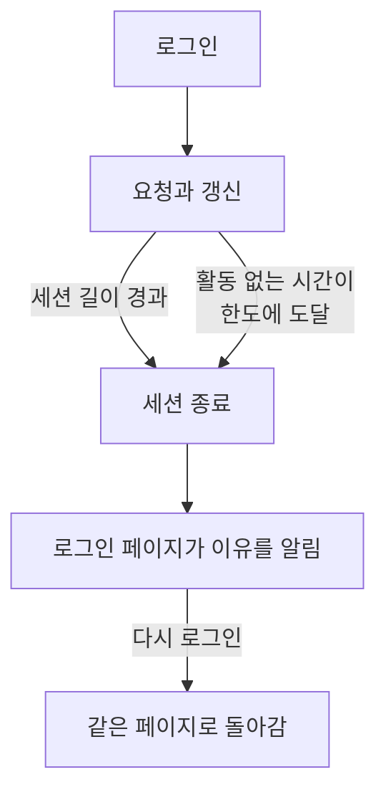

# 세션 길이

사람들이 다시 로그인하기 전까지 OneUptime에 로그인 상태로 머무는 시간을 정합니다. 로그인한 뒤 정해진 시간, 사용하지 않은 시간, 또는 둘 다입니다. 대시보드, Admin Dashboard, 모바일 앱에 대한 모든 로그인에 적용되며, 비밀번호, 패스키, Google로 로그인, Microsoft로 로그인, 싱글 사인온 모두 마찬가지입니다. SSO 로그인에는 별도의 길이를 둘 수 있습니다.

> [!NOTE]
> 세션 길이는 [OneUptime Enterprise Edition](/docs/self-hosted/enterprise)의 일부입니다. Community Edition에는 **세션 길이** 페이지가 없으며, 모든 로그인은 [제한 없음](#제한-없음)에서 설명한 대로 유지됩니다.

:::cards
- [세션 길이 설정하기](#세션-길이-설정하기): Admin Dashboard의 설정 두 가지.
- [세션이 끝나는 방식](#세션이-끝나는-방식): 서버가 무엇을 언제 세는지.
- [SSO 로그인](#sso-로그인): 싱글 사인온만의 길이.
- [로그인이 아닌 것](#로그인이-아닌-것): API 키, MCP 연결, 상태 페이지 열람자.
:::

## 제한 없음

길이를 설정하기 전까지 로그인에는 길이 제한이 없습니다. 액세스 토큰은 15분 동안 유효하고 새로 고침 토큰으로 백그라운드에서 갱신되며, 새로 고침 토큰은 30일 동안 유효하고 사용할 때마다 다시 시작됩니다. 30일에 한 번 이상 OneUptime을 여는 사람은 로그인 상태가 유지되고, 그렇지 않은 사람은 다시 로그인합니다.

## 세션 길이 설정하기

:::steps
### 세션 길이 열기
Admin Dashboard에서 **설정**을 열고 사이드 메뉴의 **세션 길이**를 엽니다.

### 길이 선택하기
- **자동 로그아웃 시간**: 로그인한 순간부터 활동 여부와 관계없이 로그인이 유지되는 시간입니다.
- **활동이 없을 때 자동 로그아웃 시간**: OneUptime에서 클릭, 입력, 스크롤을 하지 않고 지낼 수 있는 시간입니다.

선택하는 즉시 저장됩니다.

### 로그아웃될 사람 확인하기
더 짧은 길이는 지금 로그인되어 있는 모든 사람에게 적용됩니다. 바로 로그아웃되는 사람이 있으면 OneUptime이 먼저 몇 명인지, 그리고 회원님도 포함되는지 알려 줍니다. 계속하려면 **저장하고 로그아웃**을 선택합니다.
:::

| 설정 | 선택 범위 | 기본값 |
| --- | --- | --- |
| **자동 로그아웃 시간** | 1시간부터 90일까지 | **제한 없음** |
| **활동이 없을 때 자동 로그아웃 시간** | 15분부터 14일까지 | 30일, 가장 긴 값 |

API에서는 서버의 전역 구성에서 `sessionLengthInMinutes`가 15부터 525600(1년)까지의 정수 분을, `sessionIdleTimeoutInMinutes`가 15부터 43200(30일)까지를 받습니다. 비워 두면 기본값입니다.

## 세션이 끝나는 방식

- 서버는 두 길이 모두 세션 자체를 기준으로 셉니다. 로그인한 시각과 그 사람이 마지막으로 활동한 시각입니다. 모든 요청, 모든 갱신, 모든 실시간 업데이트에서 확인하며, 로그아웃을 브라우저에 맡기지 않습니다.
- 활동 없는 시간은 대시보드나 Admin Dashboard의 어느 탭에서든 마지막 클릭, 키 입력, 스크롤부터 셉니다. 열어 두기만 한 탭은 세션을 유지하지 않습니다.
- 모바일 앱은 사용할 때마다 활동한 것으로 셉니다.
- 세션이 끝나면 브라우저는 로그인 페이지로 이동하고, 그 페이지에 이유가 표시됩니다. 다시 로그인하면 있던 페이지로 돌아갑니다.

| 변경 | 지금 로그인되어 있는 사람에게 일어나는 일 |
| --- | --- |
| 더 짧은 세션 길이나 활동 없는 시간 | 이미 넘긴 사람은 바로 로그아웃되고, 나머지는 도달할 때 로그아웃됩니다 |
| 더 긴 값, 또는 제한 없음 | 아무도 로그아웃되지 않으며, 다음 갱신부터 세션이 더 오래 유지됩니다 |

## SSO 로그인

싱글 사인온을 통한 로그인에도 같은 두 설정이 적용됩니다. 별도의 길이를 두려면 **세션 길이** 페이지에서 **추가 설정**을 열고 **SSO 로그인에 별도 길이 사용**을 켭니다. 그러면 그 아래의 두 설정이 프로젝트의 SAML 또는 OpenID Connect 공급자나 서버 자체의 [전역 SSO](/docs/identity/global-sso)를 통한 로그인에 적용되고, 페이지 맨 위의 두 설정은 그 밖의 모든 로그인에 적용됩니다. 처음에는 다른 모든 로그인과 같은 길이로 시작하므로, 다른 길이를 고를 때까지 켜도 달라지는 것이 없습니다.

또한 SSO를 요구하는 프로젝트는 SSO 로그인이 유지되는 동안에만 세션을 받아들이며, 그 시간은 SSO 로그인에 적용되는 길이보다 길지 않습니다.

API에서 스위치는 `useSeparateSsoSessionLengths`이고, SSO 로그인의 길이는 `ssoSessionLengthInMinutes`와 `ssoSessionIdleTimeoutInMinutes`이며, 범위는 같습니다.

## 로그인이 아닌 것

- **API 키**는 지정한 만료 기간을 그대로 유지합니다.
- **MCP 연결**, 즉 OAuth로 연결한 AI 어시스턴트는 자체 수명을 유지합니다. SSO를 요구하는 프로젝트에서는 연결이 승인에 쓰인 SSO 로그인보다 오래 유지되지 않습니다.
- **비공개 상태 페이지**에는 열람자를 위한 별도의 길이가 있습니다. [비공개 사용자](/docs/status-pages/index#비공개-사용자)를 참고하세요.

## 라이선스가 없을 때

평가판 또는 유예 기간이 지난 뒤 유효한 라이선스가 없거나 세션 길이를 포함하지 않는 라이선스라면, 길이를 설정하거나 변경할 수 없습니다. 이미 설정된 길이는 계속 사람들을 로그아웃시키며, 여전히 제거할 수 있습니다. Community Edition 이미지에서는 어떤 길이도 적용되지 않습니다. 값은 데이터베이스에 남아 있으며 다시 전환하면 다시 적용됩니다.

## 다음 단계

:::cards
- [SSO](/docs/identity/sso): ID 공급자로 사람들을 로그인시킵니다.
- [전역 SSO](/docs/identity/global-sso): 서버 전체에 하나의 ID 공급자를 씁니다.
- [Enterprise Edition](/docs/self-hosted/enterprise): Enterprise Edition이 더하는 것과 그 라이선스.
:::
