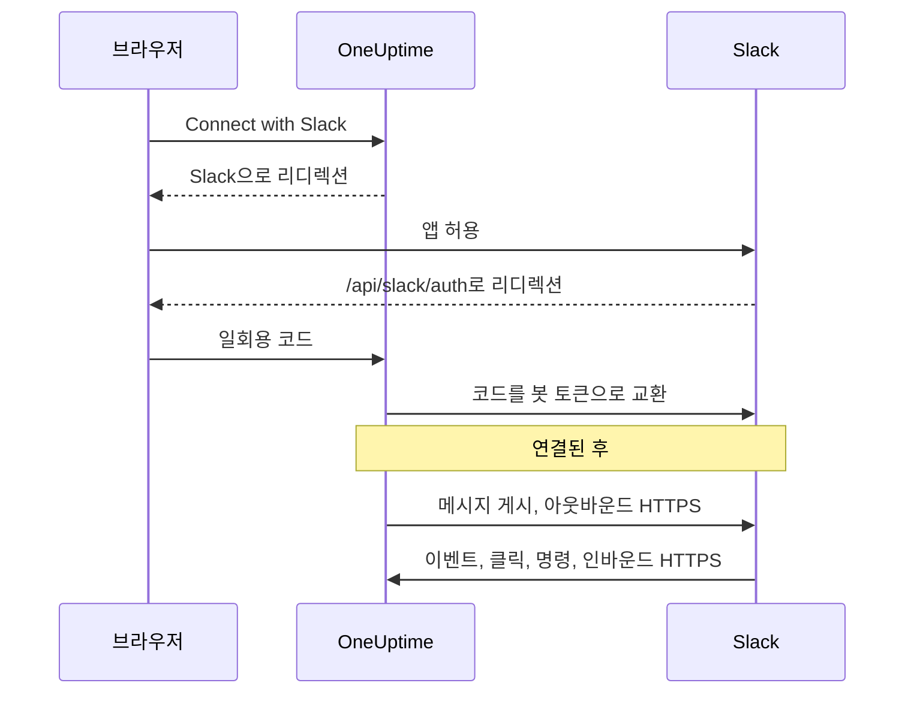
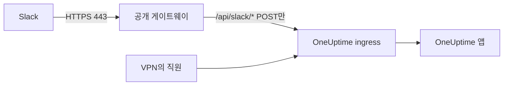

# Slack 통합

자체 호스팅 OneUptime을 Slack에 연결합니다. 서버가 생성하는 매니페스트로 Slack 앱을 만들고, 앱의 자격 증명을 OneUptime에 넣은 뒤, 각 프로젝트를 워크스페이스에 연결합니다. 그러면 OneUptime이 인시던트, 알림, 예약된 유지 관리를 채널에 게시하고, 팀은 Slack에서 바로 대응할 수 있습니다.

이 페이지는 OneUptime 서버를 운영하는 사람을 위한 것입니다. Slack이 연결되면 알림 규칙은 프로젝트별로 설정합니다. [Slack](/docs/workspace-connections/slack)을 참고하세요.

:::cards
- [Slack 앱 설정](#slack-앱-설정): 매니페스트로 앱을 만들고 프로젝트를 연결합니다.
- [환경 변수](#환경-변수): OneUptime이 앱에서 받아야 하는 세 가지 값입니다.
- [네트워크 접근](#자체-호스팅-배포의-네트워크-접근): Slack이 도달할 수 있어야 하는 콜백입니다.
- [문제 해결](#문제-해결): Slack 페이지의 메시지가 뜻하는 것과 해야 할 일입니다.
:::

## 작동 방식

Slack 앱은 여러분의 것입니다. 여러분의 워크스페이스에 설치되고 여러분의 서버와만 통신합니다. 트래픽은 양방향으로 흐르며, 방향마다 별도의 네트워크 접근이 필요합니다.



- **아웃바운드**: OneUptime은 Slack의 Web API를 호출해 메시지를 게시하고, 채널을 만들고, 이미지를 업로드합니다.
- **인바운드**: Slack은 이벤트, 버튼 클릭, 메뉴, 슬래시 명령을 위해 서버의 경로 네 개를 호출합니다. 모든 요청은 앱의 signing secret으로 서명됩니다. OneUptime은 서명이 일치하지 않거나 타임스탬프가 5분보다 오래된 요청을 거부합니다.

## 시작하기 전에

- 앱을 만들고 설치할 수 있는 Slack 워크스페이스.
- Slack이 도달할 수 있는 OneUptime의 공개 HTTPS 호스트 이름. [네트워크 접근](#자체-호스팅-배포의-네트워크-접근)을 참고하세요.
- 서버 구성에 대한 접근 권한: Docker Compose는 `config.env`, Kubernetes는 Helm values.
- 프로젝트를 연결하려면 해당 프로젝트의 **Project Owner**, **Project Admin** 또는 **Project Member** 역할.

## Slack 앱 설정

:::steps
### 공개 URL 설정

OneUptime은 앱 매니페스트와 모든 콜백 URL을 `HOST`와 `HTTP_PROTOCOL`로 만듭니다. Slack이 HTTPS로 호출할 호스트 이름으로 설정하세요.

:::tabs
@tab Docker Compose
```bash title="config.env"
HOST=oneuptime.example.com
HTTP_PROTOCOL=https
```
@tab Kubernetes
```yaml title="values.yaml"
host: oneuptime.example.com
httpProtocol: https
```
:::

이 값들은 URL을 생성할 뿐입니다. DNS 레코드, 인증서, 방화벽 규칙은 만들지 않습니다.

### 앱 매니페스트 복사

**프로젝트 설정 > 워크스페이스 > Slack**을 엽니다. 서버에 Slack이 설정되기 전까지 이 페이지는 호스트 이름에 맞게 생성된 매니페스트와 함께 **Integrating Slack with your OneUptime Project**를 표시합니다. 매니페스트는 `https://oneuptime.example.com/api/slack/app-manifest`에서도 제공됩니다.

매니페스트의 모든 URL이 공개 호스트 이름으로 시작하는지 확인하세요. 그렇지 않다면 먼저 `HOST`와 `HTTP_PROTOCOL`을 고치고 변경 사항을 적용합니다.

### Slack 앱 만들기

[api.slack.com/apps](https://api.slack.com/apps)에서 매니페스트로 새 앱을 만들고, 워크스페이스를 선택한 다음 매니페스트를 붙여 넣습니다. URL이 호스트 이름과 일치하도록 항상 자신의 서버가 생성한 매니페스트를 사용하세요.

### 앱 자격 증명 복사

앱의 **Basic Information** 페이지에서 **App Credentials** 아래의 **Client ID**, **Client Secret**, **Signing Secret**을 복사합니다.

### OneUptime에 자격 증명 추가

:::tabs
@tab Docker Compose
```bash title="config.env"
SLACK_APP_CLIENT_ID=YOUR_SLACK_APP_CLIENT_ID
SLACK_APP_CLIENT_SECRET=YOUR_SLACK_APP_CLIENT_SECRET
SLACK_APP_SIGNING_SECRET=YOUR_SLACK_APP_SIGNING_SECRET
```
@tab Kubernetes
```yaml title="values.yaml"
slackApp:
  clientId: "YOUR_SLACK_APP_CLIENT_ID"
  clientSecret: "YOUR_SLACK_APP_CLIENT_SECRET"
  signingSecret: "YOUR_SLACK_APP_SIGNING_SECRET"
```

직접 관리하는 Kubernetes Secret에 값을 보관하려면 대신 `slackApp.existingSecret`을 설정합니다. 그 `name`과 키 `clientIdKey`, `clientSecretKey`, `signingSecretKey`입니다.
:::

### 구성 적용

:::tabs
@tab Docker Compose
```bash
npm run start
```

이 명령은 새 `config.env`로 컨테이너를 다시 만듭니다. `docker compose restart`는 이 파일을 다시 읽지 않습니다.
@tab Kubernetes
```bash
helm upgrade my-oneuptime oneuptime/oneuptime -f values.yaml
```
:::

OneUptime이 다시 실행되면 **프로젝트 설정 > 워크스페이스 > Slack**에 매니페스트 대신 **Connect with Slack** 버튼이 표시됩니다.

### 이벤트 요청 URL 확인

Slack 앱의 **Event Subscriptions**에서 요청 URL을 확인합니다. OneUptime은 signing secret이 설정된 뒤에만 Slack의 challenge에 응답하므로, 앱을 만드는 동안 실패했다면 다시 시도하세요.

### 프로젝트 연결

**프로젝트 설정 > 워크스페이스 > Slack**에서 **Connect with Slack**을 선택하고 Slack에서 앱을 허용합니다. Slack이 같은 페이지로 돌려보내며, 이제 그 페이지에 워크스페이스 이름이 표시됩니다.

### 자신의 Slack 계정 연결

버튼, 양식, 명령은 그것을 사용하는 Slack 계정에 연결된 OneUptime 사용자로서 동작합니다. 각자 **사용자 설정 > 워크스페이스 > Slack**을 열고 **Connect my account with Slack**을 선택합니다. 계정을 연결하지 않은 사람은 연결을 요청하는 다이렉트 메시지를 앱에서 받습니다.
:::

## 환경 변수

| Docker Compose (`config.env`) | Helm (`values.yaml`) | 필수 | 값 |
| --- | --- | --- | --- |
| `SLACK_APP_CLIENT_ID` | `slackApp.clientId` | 예 | 앱의 **Client ID**. 이 값이 없으면 Slack 페이지에 **Connect with Slack** 대신 설정 안내가 표시됩니다. |
| `SLACK_APP_CLIENT_SECRET` | `slackApp.clientSecret` | 예 | 앱의 **Client Secret**. Slack이 돌려준 코드를 토큰으로 교환하는 데 쓰입니다. |
| `SLACK_APP_SIGNING_SECRET` | `slackApp.signingSecret` | 예 | 앱의 **Signing Secret**. Slack에서 오는 모든 요청을 이 값으로 검사합니다. |
| `HOST` | `host` | 예 | 스킴을 뺀 공개 호스트 이름. |
| `HTTP_PROTOCOL` | `httpProtocol` | 예 | `https`. Slack은 HTTPS URL만 호출합니다. |

## 앱으로 할 수 있는 일

매니페스트는 다음 기능을 설정합니다. 각 기능은 표시된 경로로 서버에 도달하므로, Slack이 그 경로에 도달할 수 있을 때만 동작합니다.

| 기능 | 하는 일 | 경로 |
| --- | --- | --- |
| `/incident`와 **Create New Incident** 바로 가기 | Slack에서 인시던트 선언 | `POST /api/slack/interactive` |
| `/maintenance`와 **Create Scheduled Event** 바로 가기 | Slack에서 유지 관리 예약 | `POST /api/slack/interactive` |
| `/oneuptime` | 로그, 트레이스, 메트릭, 인시던트, 모니터에 대해 OneUptime AI에 질문 | `POST /api/slack/command` |
| OneUptime 메시지의 버튼과 양식 | 확인, 해결, 메모 추가, 상태 변경, 온콜 정책 실행 | `POST /api/slack/interactive` 및 `POST /api/slack/options-load` |
| 이벤트 | 멘션, 메시지, 반응, 고정. 예를 들어 메시지를 메모로 저장 | `POST /api/slack/events` |

### 메시지의 이미지

인시던트와 알림의 설명에는 스크린샷이 들어갈 수 있습니다. 예를 들어 합성 모니터의 스크린샷입니다([합성 모니터](/docs/monitor/incident-alert-templating#합성-모니터) 참고). OneUptime은 각 스크린샷을 비공개 파일로 워크스페이스에 업로드해 Slack 메시지에 표시하며, 이를 위해 봇 스코프 `files:write`가 필요합니다. 생성된 매니페스트에는 이 스코프가 포함되어 있습니다.

이전 매니페스트로 Slack 앱을 만들었다면 **OAuth & Permissions > Bot Token Scopes**에 `files:write`를 추가하세요(또는 현재 매니페스트로 앱을 업데이트하세요). 그런 다음 **프로젝트 설정 > 워크스페이스 > Slack**에서 **Connect with Slack**을 다시 선택해 새 스코프가 부여되게 합니다. 그때까지 각 스크린샷은 대체 텍스트로 표시됩니다.

## 자체 호스팅 배포의 네트워크 접근

### 트래픽 방향과 엔드포인트

| 트래픽 | 필요한 접근 |
| --- | --- |
| OneUptime에서 Slack으로 | Web API 호출과 OAuth 토큰 교환을 위한 DNS 및 `slack.com`으로의 TCP 443 아웃바운드 HTTPS. 사용하는 경우 명령 응답 URL과 수신 웹훅 알림을 위한 `hooks.slack.com` |
| Slack에서 OneUptime으로 | 통합 전체를 위한, 아래 네 POST 경로로의 TCP 443 공개 HTTPS |
| 사용자 브라우저에서 OneUptime으로 | 대시보드 접근과 `/api/slack/auth/:projectId/:userId` 및 `/api/slack/auth/:projectId/:userId/user`로의 OAuth 리디렉션. 이 경로들은 사용자의 VPN을 통해서만 접근 가능해도 됩니다 |

아웃바운드 도메인은 OneUptime의 Slack 통합을 설명할 뿐, Slack 클라이언트나 모든 Slack 기능을 위한 완전한 허용 목록이 아닙니다. Slack *수신 웹훅*은 Slack이 호스팅합니다. OneUptime이 거기로 보내므로 서버의 인바운드 엔드포인트가 아닙니다. Slack의 [수신 웹훅 가이드](https://docs.slack.dev/messaging/sending-messages-using-incoming-webhooks/)를 참고하세요.

다음 콜백을 ingress를 통해 OneUptime으로 전달합니다.

| 메서드와 경로 | 용도 |
| --- | --- |
| `POST /api/slack/events` | Events API 확인, 반응, 고정, 멘션, 메시지 |
| `POST /api/slack/interactive` | 버튼, 바로 가기, 모달 제출, `/incident`와 `/maintenance` |
| `POST /api/slack/options-load` | 인터랙티브 메뉴의 옵션 요청 |
| `POST /api/slack/command` | `/oneuptime` 명령 |

OAuth는 [브라우저 리디렉션 뒤에 서버 측 토큰 교환이 이어지는 방식](https://docs.slack.dev/authentication/installing-with-oauth/)입니다. 매니페스트는 `/api/slack/auth`를 리디렉션 URL 접두사로 등록하고, OneUptime은 인증을 시작할 때 프로젝트와 사용자 경로를 덧붙입니다. 브라우저 접근만으로는 Slack이 이벤트나 버튼 클릭을 전달할 수 없습니다.

### 비공개 배포와 콜백 보안



공개 DNS와, 공개적으로 신뢰되는 HTTPS 인증서, 완전한 인증서 체인, OneUptime ingress로 가는 비공개 경로를 갖춘 게이트웨이를 사용하세요. 게이트웨이로의 인바운드 TCP 443을 허용하고 위의 콜백 경로 네 개만 전달합니다. 비공개 `ClusterIP`, 내부 DNS 이름, 직원의 VPN 연결에는 Slack이 도달할 수 없습니다. 분할 DNS를 쓰면 같은 호스트 이름에서도 대시보드와 OAuth 경로를 비공개로 유지할 수 있습니다.

호스트 이름을 바꾼 뒤에는 매니페스트를 다시 생성하고 Slack 앱을 업데이트하세요.

게이트웨이를 거치면서 다음을 유지합니다.

- 메서드, 경로, 쿼리 문자열, 원래 본문
- `Content-Type`, `X-Slack-Signature`, `X-Slack-Request-Timestamp`
- 신뢰할 수 있는 프록시 헤더를 통한 공개 호스트와 HTTPS 스킴

콜백 경로는 브라우저 SSO, CAPTCHA, 프록시 로그인 페이지에서 제외하고, OneUptime의 signing secret 및 타임스탬프 검사는 유지하세요. 서버 시계를 동기화해 두세요. 5분 넘게 어긋난 요청은 거부됩니다. Slack은 [요청 서명 확인](https://docs.slack.dev/authentication/verifying-requests-from-slack/)을 문서화하고 있으며, 원본 IP 검사가 이를 대신하지 않습니다.

### 접근 확인과 제한 사항

:::steps
1. Slack 앱의 **Event Subscriptions**에서 요청 URL을 확인합니다. Slack은 [POST challenge를 보내고 TLS를 확인합니다](https://docs.slack.dev/apis/events-api/using-http-request-urls/).
2. 테스트 알림을 보내고, 슬래시 명령을 실행하고, 인시던트 메시지의 버튼을 누르고, 구독한 이벤트를 발생시킵니다.
3. 비밀 값을 로그에 남기지 않고 게이트웨이와 OneUptime 로그에서 실패한 전달을 확인합니다.
:::

Slack은 빠른 확인 응답을 기대하며, [인터랙션에는 3초 안에 응답](https://docs.slack.dev/interactivity/handling-user-interaction/)해야 합니다. 브라우저의 GET이나 아웃바운드 메시지 전송 성공으로는 이 POST 콜백을 확인할 수 없습니다.

> [!WARNING]
> 인바운드 연결이 모두 금지되어 있으면, 이미 인증된 앱은 아웃바운드 HTTPS로 메시지를 계속 보낼 수 있지만 이벤트, 버튼, 바로 가기, 명령은 동작하지 않습니다. OneUptime의 매니페스트는 HTTP 콜백을 사용하고 Socket Mode를 끕니다. Slack의 Socket Mode를 켜는 것은 이 경로들을 대신하는 지원되는 방법이 아닙니다.

[프라이빗 네트워크 접근 설정](/docs/self-hosted/private-network-access)은 비공개 대상으로 가는 아웃바운드 요청을 제어합니다. 콜백을 Slack에 노출하지는 않습니다.

## 문제 해결

### 연결이 완료되지 않음

Slack이 돌려보냈는데 연결이 되지 않았다면, 시작한 Slack 페이지(**프로젝트 설정 > 워크스페이스 > Slack**, 또는 계정을 연결하던 중이었다면 자신의 **사용자 설정 > 워크스페이스 > Slack**)에 **Slack이 연결되지 않았습니다**와 함께 그 이유를 설명하는 한 문장이 여러분의 언어로 표시됩니다. 페이지의 나머지 부분은 평소처럼 로드되므로 그 자리에서 다시 연결할 수 있습니다. Slack 자체의 응답은 표시되지 않으며, 그 내용은 이유와 함께 OneUptime 서버 로그에 있습니다.

| 페이지 표시 | 해야 할 일 |
| --- | --- |
| **"이 연결 링크가 잘못되었거나 만료되었거나 이미 사용되었습니다. 처음부터 다시 시작하세요."** | 링크는 시작한 브라우저에서 15분 동안 한 번만 작동합니다. Slack 페이지에서 다시 시작하고 같은 브라우저에서 15분 안에 Slack에서 마무리하세요. |
| **"이 프로젝트를 Slack에 연결할 권한이 없습니다."** | OneUptime을 Slack에 설치하려면 **Project Owner**, **Project Admin** 또는 **Project Member**가 필요합니다. Slack이 돌려보낼 때 다시 확인하므로, 그사이에 역할을 잃었다면 여기서도 연결이 끝납니다. |
| **"더 이상 이 프로젝트의 구성원이 아닙니다."** | 자신의 Slack 계정을 연결하려면 Slack이 돌려보낼 때 프로젝트 구성원이어야 합니다. |
| **"이 프로젝트는 아직 Slack 워크스페이스에 연결되어 있지 않습니다."** | 먼저 **프로젝트 설정 > 워크스페이스 > Slack**에서 OneUptime을 Slack에 설치한 다음 자신의 계정을 연결하세요. |
| **"이 프로젝트가 연결된 것과 다른 Slack 워크스페이스에 로그인했습니다."** | 프로젝트가 설치된 Slack 워크스페이스에 로그인한 상태에서 계정을 연결하세요. |
| **"연결이 취소되어 아무것도 변경되지 않았습니다."** | Slack에서 요청이 허용되지 않았습니다. 다시 시작해서 허용하세요. |
| **"이 OneUptime 서버에는 Slack이 설정되어 있지 않습니다."** | `SLACK_APP_CLIENT_ID`와 `SLACK_APP_CLIENT_SECRET`을 설정하고([환경 변수](#환경-변수) 참고) OneUptime을 다시 시작하세요. |
| **"OneUptime이 연결을 완료하지 못했습니다. 다시 시도하세요."** | Slack이 오류로 응답했거나, 마무리하는 동안 요청이나 쓰기가 실패했습니다. 어느 쪽인지는 OneUptime 서버 로그에 나옵니다. 다시 시도하고, 계속 발생하면 로그와 Slack 앱 설정을 확인하세요. |

### 기타 문제

:::details Slack이 이벤트 요청 URL을 확인하지 못함
OneUptime은 `SLACK_APP_SIGNING_SECRET`이 설정되어 있고 요청이 도달할 때만 Slack의 challenge에 응답합니다. signing secret을 설정하고 구성을 적용한 뒤 확인을 다시 시도하세요. 그래도 실패하면 공개적으로 신뢰되는 인증서로 인터넷에서 `POST /api/slack/events`에 도달할 수 있는지 확인하세요.
:::

:::details 버튼과 슬래시 명령은 아무 동작도 하지 않지만 알림은 도착함
알림은 아웃바운드이므로 인바운드 접근 없이도 동작합니다. 버튼, 바로 가기, 명령은 인바운드입니다. Slack이 `POST /api/slack/interactive`와 `POST /api/slack/command`에 도달할 수 있는지, 그리고 게이트웨이가 본문과 `X-Slack-Signature` 및 `X-Slack-Request-Timestamp` 헤더를 유지하는지 확인하세요.
:::

:::details 앱이 내 Slack 계정이 OneUptime에 연결되지 않았다고 함
버튼, 양식, 명령을 쓰려면 Slack 계정이 OneUptime 사용자에 연결되어 있어야 합니다. **사용자 설정 > 워크스페이스 > Slack**을 열고 **Connect my account with Slack**을 선택하세요. 프로젝트에서 제거되었다면 앱이 대신 그 사실을 알려 주며, Slack에서 하는 작업은 거부됩니다.
:::

:::details 스크린샷이 텍스트로 표시됨
Slack 앱에 `files:write` 스코프가 없습니다. [메시지의 이미지](#메시지의-이미지)를 참고하세요.
:::

## 다음 단계

:::cards
- [Slack](/docs/workspace-connections/slack): 프로젝트의 알림 규칙과 요약을 만듭니다.
- [Microsoft Teams 통합](/docs/self-hosted/microsoft-teams-integration): 서버에 Teams 봇도 설정합니다.
- [프라이빗 네트워크 접근](/docs/self-hosted/private-network-access): 워크플로와 웹훅이 내부 도구에 도달하게 합니다.
:::
