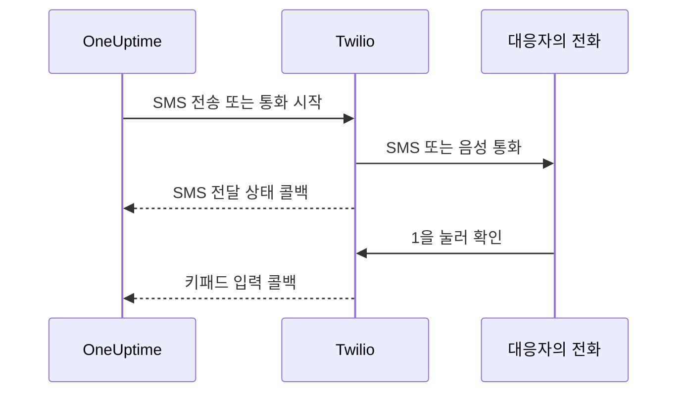

# Twilio 통합

자체 호스팅 OneUptime은 자신의 Twilio 계정을 통해 SMS와 음성 알림을 보내며, 요금은 Twilio에 직접 냅니다. Twilio 자격 증명은 환경 변수가 아니라 OneUptime 대시보드에 저장합니다. 알림 전송은 저장된 구성을 읽으며, Helm 차트에는 Twilio 자격 증명 값이 없습니다.

> [!NOTE]
> 예전 마이그레이션이 `TWILIO_ACCOUNT_SID`, `TWILIO_AUTH_TOKEN`, `TWILIO_PHONE_NUMBER`를 가져왔습니다. 이 변수들을 바꿔도 기존 설치의 자격 증명은 업데이트되지 않습니다.

:::cards
- [Twilio 계정 준비](#1-twilio-계정-준비): 자격 증명, 전화번호, 계정의 제한.
- [자격 증명 저장](#2-oneuptime에-자격-증명-저장): 프로젝트 하나 또는 설치 전체에 저장합니다.
- [네트워크 액세스 설정](#3-네트워크-액세스-설정): Twilio가 언제 서버의 어디에 도달해야 하는지.
- [전화번호 인증](#5-팀원의-전화번호-인증): 팀원의 번호를 인증하는 방식.
:::

## 1. Twilio 계정 준비

:::steps
### 자격 증명 복사하기

[Twilio Console](https://console.twilio.com/)을 열고 **Account SID**와 **Auth Token**을 복사합니다.

### 전화번호 받기

필요한 SMS 및/또는 음성 기능이 있는 Twilio 전화번호를 받습니다. 발신 번호와 수신 번호에는 국가 코드를 포함한 E.164 형식을 사용하세요.

### 계정 제한 확인하기

계정 잔액, 목적지 국가 권한, 적용되는 발신자 등록 요구 사항을 확인합니다. 체험 계정에는 수신자, 지역 등의 제한이 있어 실제 OneUptime 알림이 동작하지 않을 수 있습니다. 테스트하기 전에 [Twilio의 계정 및 체험판 문서](https://www.twilio.com/docs/usage/tutorials/how-to-use-your-free-trial-account)를 확인하세요. 프로덕션에서는 업그레이드한 계정을 사용합니다.
:::

## 2. OneUptime에 자격 증명 저장

자격 증명은 프로젝트 하나에 저장하거나, 설치 전체에 한 번 저장합니다.

| | 프로젝트 구성 | 설치 전체 구성 |
| --- | --- | --- |
| 위치 | **프로젝트 설정 > 알림 > 알림 설정**의 **Twilio 구성** 카드 | **Admin Dashboard > 설정 > 통화 및 SMS** |
| 설정할 수 있는 사람 | **Project Owner**, **Project Admin**, 또는 사용자 지정 역할의 **Create Call and SMS** | 마스터 관리자 |
| 사용처 | 프로젝트 기본값인 동안 프로젝트 구성원에게 보내는 SMS와 통화, 이 구성이 할당된 상태 페이지, 이 구성을 쓰는 수신 전화 정책 | 기본 구성이 없는 모든 프로젝트의 구성원에게 보내는 SMS와 통화 |

프로젝트 구성을 추가하려면:

:::steps
1. **프로젝트 설정 > 알림 > 알림 설정**으로 이동합니다.
2. **Twilio 구성**에서 **Twilio 구성 만들기**를 선택합니다.
3. 이름, **Twilio 계정 SID**, **Twilio 인증 토큰**, **Twilio 기본 전화번호**를 입력합니다. 필요하면 다른 국가용 **Twilio 보조 전화번호**를 쉼표로 구분해 입력합니다.
4. **프로젝트 기본값으로 설정**은 프로젝트의 첫 번째 구성에서 켜져 있으므로, 온콜 알림을 포함해 프로젝트 구성원에게 가는 SMS와 통화가 저장하는 즉시 이 구성을 거칩니다. 이 계정을 상태 페이지나 수신 전화에만 쓴다면 끄세요. 그다음 구성은 스위치가 꺼진 상태로 시작합니다. 해당 메시지를 그 구성으로 옮기려면 스위치를 켜거나, 구성 행 메뉴에서 **프로젝트 기본값으로 설정**을 선택하세요. `isProjectDefault`를 생략한 API 요청도 같은 방식으로 처리됩니다.
5. 저장합니다. 프로젝트 기본값은 하나의 구성만 될 수 있습니다. 상태 페이지는 각 상태 페이지에 명시적으로 할당된 구성을 사용합니다.

> [!IMPORTANT]
> **SMS**와 **음성 전화**는 모든 프로젝트에서 처음에는 꺼져 있으며, 켜지기 전까지 프로젝트의 누구도 전화번호를 추가할 수 없습니다. 같은 페이지의 **알림 채널** 카드에서 이를 켤 수 있는 사람은 프로젝트 소유자, **Billing Admin**, 또는 **Manage Billing** 권한이 있는 사람입니다.
:::

설치 전체의 기본값을 쓰려면, 관리자가 대신 **Admin Dashboard > 설정 > 통화 및 SMS**를 열어 Twilio 자격 증명과 전화번호를 편집하고 저장합니다. 구성원 알림은 프로젝트에 기본값이 없을 때 이 전역 구성을 사용합니다. Auth Token은 기밀로 유지하세요.

## 3. 네트워크 액세스 설정

전송은 아웃바운드 액세스만으로 동작합니다. 전달 상태 업데이트, 키패드 확인, 수신 전화에는 Twilio가 서버에 도달해야 합니다.

프라이빗 배포에서 SMS와 통화를 보내려면 DNS 확인과 Twilio로 향하는 TCP 443 아웃바운드 HTTPS가 필요합니다. Twilio는 API 주소가 동적이므로 `*.twilio.com`으로의 아웃바운드 HTTPS를 허용하라고 권장합니다. [Twilio IP 주소](https://help.twilio.com/articles/115015934048-All-About-Twilio-IP-Addresses)를 참고하세요. Kubernetes NetworkPolicy와 외부 방화벽을 포함해 OneUptime 애플리케이션 워크로드의 아웃바운드 트래픽에 적용합니다.

인바운드 액세스가 필요한지는 기능에 따라 다릅니다.

| 기능 | Twilio가 OneUptime에 도달해야 하나요? |
| --- | --- |
| SMS 전송 | 아니요. 다만 전달 상태 업데이트에는 콜백이 필요합니다. |
| 간단한 테스트 음성 통화 | 아니요. OneUptime이 음성 안내를 아웃바운드 API 요청에 함께 보냅니다. |
| 1을 눌러 온콜 알림 확인 | 예. Twilio가 키패드 입력을 OneUptime에 보냅니다. |
| 수신 전화 정책 | 예. Twilio가 통화 지침을 요청하고 다이얼 결과를 보고합니다. |

다음은 OneUptime의 Nginx 게이트웨이를 거치는 외부 경로입니다. 자리 표시자는 알림마다 다릅니다.

| 메서드 | 경로 | 용도 |
| --- | --- | --- |
| POST | `/notification/sms/status-callback/:smsLogId/:token` | SMS 전달 상태 |
| POST | `/api/user-notification-log-timeline/call/gather-input/:itemId?token=...` | 키패드 확인 |
| POST | `/notification/incoming-call/voice` | 선택: 수신 전화 지침 |
| POST | `/notification/incoming-call/dial-status/:callLogId/:callLogItemId` | 선택: 수신 전화 라우팅 결과 |

SMS와 확인 URL은 OneUptime이 자동으로 만듭니다. 그 토큰을 고정된 웹훅 URL로 바꾸지 마세요. 수신 전화는 [수신 전화 정책](/docs/on-call/incoming-call-policy)을 따르세요. 번호를 연결하면 그 번호의 웹훅이 구성됩니다.

Twilio는 [공개적으로 접근할 수 있는 웹훅 URL](https://www.twilio.com/docs/usage/webhooks/webhooks-overview)이 필요합니다. 공개적으로 신뢰되는 TLS 인증서를 사용하고, 프록시를 거쳐도 원래의 호스트, 프로토콜, 경로, 쿼리 매개변수, 본문, `X-Twilio-Signature` 헤더를 유지하세요. 수신 전화 핸들러는 Twilio 서명을 검증합니다. SMS 전달은 메시지마다 URL 토큰을, 키패드 확인은 서명된 쿼리 토큰을 사용합니다. 토큰을 공유 로그나 스크린샷에 노출하지 마세요. [Twilio 웹훅 보안](https://www.twilio.com/docs/usage/webhooks/webhooks-security)을 참고하세요.

### 프라이빗 배포에서 콜백 공개하기

:::steps
1. OneUptime 호스트 이름(예: `oneuptime.example.com`)의 DNS를 공개해, 인터넷에 노출된 리버스 프록시나 로드 밸런서를 가리키게 합니다. 인바운드 TCP 443을 허용하고 전체 체인을 갖춘 공개 신뢰 인증서를 구성합니다. 프라이빗 IP, 내부 전용 DNS, 관리자의 VPN 연결로는 Twilio가 연결할 수 없습니다.
2. 그 게이트웨이에 OneUptime 프라이빗 ingress로 가는 네트워크 경로를 만들어 줍니다. 직접 연결하거나 자체 사이트 간 VPN 또는 프라이빗 링크를 거칩니다. 업스트림 서비스 포트를 허용합니다. Kubernetes `ClusterIP` 서비스에는 접근 가능한 ingress나 게이트웨이에서 오는 다른 경로가 필요합니다. 데이터베이스와 그 밖의 내부 서비스는 비공개로 유지합니다.
3. 위 표에서 사용하는 콜백 경로만 공개합니다. 외부 `/notification` 접두사를 애플리케이션에 매핑하는 OneUptime의 Nginx 게이트웨이를 거쳐 전달하세요. 키패드 경로에는 `/api`를 유지합니다. HTTP 메서드와 요청 데이터를 유지하고, 다른 URL로 리디렉션하지 마세요. 공개 `Host`를 유지하고, 프록시에서 공개 호스트와 HTTPS 스킴에 대한 신뢰할 수 있는 전달 헤더를 설정합니다.
4. 이 경로들을 브라우저 SSO, CAPTCHA, 프록시 로그인 페이지에서 제외합니다. OneUptime의 콜백 인증은 켜 둡니다. 프라이빗 원본에 대한 접근은 게이트웨이와 승인된 내부 클라이언트로 제한합니다.
5. Docker Compose의 `config.env`에는 `HOST=oneuptime.example.com`과 `HTTP_PROTOCOL=https`를, Helm values에는 `host: oneuptime.example.com`과 `httpProtocol: https`를 설정합니다. 배포 변경을 적용하고 애플리케이션이 다시 시작될 때까지 기다립니다. 이 설정은 URL을 만들 뿐, DNS, 인증서, 방화벽 규칙을 만들지 않습니다. OneUptime에는 Twilio 콜백 전용 호스트 이름 설정이 따로 없습니다. 호스트 이름이 바뀌면 기존 Twilio 전화번호의 웹훅도 업데이트하세요.
:::

대시보드는 프라이빗 ingress에 둘 수 있습니다. 분할 DNS를 쓰면 직원은 회사 네트워크나 VPN에서 같은 호스트 이름을 그 ingress로 확인하고, Twilio는 게이트웨이로 확인합니다. 두 경로 모두에서 그 호스트 이름에 유효한 인증서를 제공하세요. OneUptime의 [프라이빗 네트워크 액세스 설정](/docs/self-hosted/private-network-access)은 내부 서비스로 가는 아웃바운드 요청을 제어하며, `ALLOW_PRIVATE_NETWORK_WEBHOOKS`는 인바운드 엔드포인트를 공개하지 않습니다.

### IP 제한과 인바운드 액세스가 없는 배포

Twilio의 일반적인 웹훅 출발지 주소는 바뀌므로, SIP나 미디어 IP 범위를 콜백 허용 목록으로 쓰지 마세요. 자격을 갖춘 Twilio 에디션은 [Static Proxy for Webhooks](https://www.twilio.com/docs/iam/twilio-editions/twilio-static-proxy)를 제공합니다. 사용 중인 에디션이 대상인지와 지원 제품을 확인하고, Twilio가 현재 공개한 범위로 방화벽을 구성하세요. 이를 쓰더라도 콜백 검증은 계속합니다.

> [!WARNING]
> 정책상 인바운드 연결이 금지되어 있다면, SMS 전송과 간단한 인라인 음성 재생은 아웃바운드 HTTPS로 동작할 수 있습니다. SMS 전달 업데이트, 키패드 확인, 수신 전화 라우팅은 접근 가능한 콜백 없이는 동작하지 않습니다. 완전히 단절된 설치에서는 Twilio를 사용할 수 없습니다.

개발용으로는 Twilio의 [웹훅 테스트 가이드](https://www.twilio.com/docs/usage/webhooks/webhook-testing)가 공개 터널 사용법을 설명합니다. 필요한 경로만 허용하는 프록시로 터널을 전달하고, 얻은 호스트 이름을 위와 같이 구성한 뒤, 테스트가 끝나면 멈추세요. 터널도 인바운드 액세스를 엽니다.

## 4. 전달과 콜백을 별도로 테스트

:::steps
1. 회사 네트워크와 VPN 밖에서, 콜백 호스트 이름이 공개 게이트웨이로 확인되고 유효한 TLS 인증서를 제공하는지 확인합니다. 브라우저의 GET으로는 이 POST 콜백을 시험할 수 없습니다.
2. 프로젝트의 Twilio 구성에서 **테스트 SMS 보내기**와 **테스트 전화 보내기**를 사용하고, 대상 전화에서 수신을 확인합니다. 둘 다 Twilio 구성을 추가할 권한이 필요합니다. **Project Owner**, **Project Admin**, 또는 사용자 지정 역할의 **Create Call and SMS**와 **Read Call and SMS**입니다.
3. 사용자의 인증된 SMS 또는 통화 연락처와 알림 규칙을 구성한 뒤, 통제된 온콜 알림을 발생시킵니다. 1을 누르고 OneUptime에서 확인 처리를 확인합니다. 수신 전화 정책을 쓴다면 구성한 번호로 전화해 라우팅과 통화 로그를 확인합니다.
4. OneUptime과 Twilio의 메시지 로그에서 SMS 전달 상태를 확인합니다. 전송이 수락되었다고 전달이 증명되지는 않습니다. [Twilio는 이후의 상태 변경을 콜백으로 보고합니다](https://www.twilio.com/docs/messaging/guides/track-outbound-message-status).
:::

| 증상 | 확인할 곳 |
| --- | --- |
| 아무것도 전송되지 않음 | 자격 증명, 번호의 기능, 계정 제한, 아웃바운드 연결. |
| SMS나 통화는 도착하지만 상태나 확인이 업데이트되지 않음 | 콜백 URL과 공개 ingress 로그. Twilio의 [HTTP 가져오기 실패 안내](https://www.twilio.com/docs/api/errors/11200)는 도달할 수 없는 콜백, TLS 문제, HTTP 오류를 진단하는 데 도움이 됩니다. |

테스트 통화가 성공했다는 것만으로는 콜백 접근이 확인되지 않습니다.

## 5. 팀원의 전화번호 인증

SMS나 통화용 전화번호를 추가하면 인증 코드가 바로 전송되고 인증 대화 상자가 열립니다. 대화 상자는 코드를 보낸 시각과 유효 기한을 보여 주며, 요청하면 새 코드를 보내지만 1분에 한 번까지입니다. 인증하기 전에 다시 보낼 것은 없습니다.

코드를 보낼 수 없으면 대화 상자는 보냈다고 하는 대신 그 이유를 알려 줍니다. 예를 들어 프로젝트 기본 구성이나 위의 설치 전체 구성이 생기기 전까지는 Twilio 계정이 설정되지 않았다고 알려 줍니다. 첫 코드를 보낼 수 없는 번호는 추가되지 않으며, Twilio가 목적지 국가를 거부한 경우처럼 그 이유가 양식에 표시됩니다.

SMS로 인증한 번호는 두 번째 코드 없이 통화용으로도 인증됩니다. 통화로 인증해도 SMS는 인증되지 않습니다. 유선 전화처럼 통화를 받는 번호가 항상 문자 메시지를 받을 수 있는 것은 아니기 때문입니다. Twilio가 받아들인 코드가 끝내 도착하지 않으면, 프로젝트의 SMS 로그에 그 전달 상태가 표시됩니다.

## 다음 단계

:::cards
- [수신 전화 정책](/docs/on-call/incoming-call-policy): Twilio 번호를 통해 발신자가 온콜 엔지니어와 연결되게 합니다.
- [에스컬레이션 규칙](/docs/on-call/escalation-rules): 단계마다 누구에게 SMS, 통화 등 어떤 방법으로 알릴지 정합니다.
- [SMTP](/docs/emails/smtp): 이메일도 자체 메일 서버로 보냅니다.
- [프라이빗 네트워크 액세스](/docs/self-hosted/private-network-access): 워크플로와 웹훅이 내부 도구에 도달하게 합니다.
:::
