# 소진율 경고 및 인시던트

오류 예산은 현재 위치를 알려 주고, 소진율 규칙은 언제 침대에서 일어나야 하는지 알려 줍니다. SLO가 문제가 될 만큼 빠르게 오류 예산을 쓰면, 소진율 규칙이 경고를 발생시키거나 인시던트를 선언하거나 둘 다 합니다. 제목과 설명, 심각도, 소유자, 레이블, 온콜 에스컬레이션, 워크스페이스 알림은 직접 정할 수 있습니다.

:::cards
- [규칙이 발동을 결정하는 방식](#규칙이-발동을-결정하는-방식): 두 기간이 모두 임계값을 넘을 때.
- [기본 규칙](#기본-규칙): SLO의 기간에 맞춘 Fast burn과 Slow burn.
- [규칙 만들기](#규칙-만들기-또는-편집하기): SLO의 Burn Rate Rules 페이지에서 다섯 단계.
- [템플릿 변수](#각-경고와-인시던트의-내용): 제목과 설명을 직접 작성합니다.
:::

## 소진율의 의미

소진율은 일정한 속도와 비교해 오류 예산을 얼마나 빨리 쓰는지 나타냅니다:

```text
burn rate = (share of time that was bad) ÷ (share of time the target allows to be bad)
```

소진율이 1이면 기간 동안 예산을 정확히 다 쓰고, 남김없이 목표를 달성합니다. 값이 클수록 더 일찍 바닥납니다. 30일 동안 99.9%인 SLO의 경우:

| 지속될 경우의 소진율 | 예산이 바닥나기까지 |
| --- | --- |
| 1 | 30일 |
| 2 | 15일 |
| 6 | 5일 |
| 14.4 | 약 2일(50시간) |

소진율은 예산이 얼마나 남았는지와 관계가 없습니다. "지금 얼마나 나쁜가?"에 답하며, 누군가를 호출할지 결정하는 데 필요한 것이 바로 이것입니다.

## 규칙이 발동을 결정하는 방식

OneUptime은 5분마다 SLO를 평가할 때마다 활성화된 각 소진율 규칙을 확인합니다. 각 규칙은 두 기간에서 소진율을 측정하고, 둘 다 임계값 이상일 때만 발동합니다:

- **긴 기간** (예: 1시간)은 소진이 지속적이고 의미 있는 수준이며, 한 번의 검사 실패가 아니라는 것을 보여 줍니다.
- **짧은 기간** (예: 5분)은 그것이 아직 진행 중이라는 것을 보여 줍니다. 이것이 없으면 한 시간 전의 급증이 회복된 뒤에도 오래도록 경고를 계속 보냅니다.

이는 Google SRE Workbook의 다중 기간, 다중 소진율 패턴이며, OneUptime이 이를 대신 설정합니다.

```mermaid title="소진율 규칙이 평가할 때마다 하는 일"
flowchart TB
    start["SLO 평가"] --> long(["긴 기간이<br/>임계값 이상?"])
    long -->|"아니요"| recover["자동 해결이 켜져 있으면<br/>열린 항목 해결"]
    long -->|"예"| short(["짧은 기간이<br/>임계값 이상?"])
    short -->|"아니요"| hold["열린 항목은<br/>그대로 유지"]
    short -->|"예"| fire["경고 발생,<br/>인시던트 선언,<br/>또는 둘 다"]
```



SLO에 긴 기간 하나만큼의 모니터링 기록이 쌓이기 전에는 규칙이 발동할 수 없습니다. 그렇지 않으면 모니터의 첫 검사 실패를 몇 분의 기록으로 나누어 엄청난 소진율이 나오기 때문입니다. 따라서 새 SLO는 첫 1시간 동안 **Fast burn** 규칙을, 첫 6시간 동안 **Slow burn** 규칙을 발동할 수 없습니다. 나중에 SLO에 그만큼의 기록이 없게 되면(예: 모니터를 새것으로 교체한 후) 규칙은 연 항목을 방치하지 않고 해결합니다. SLO의 모니터 중 하나라도 예약된 유지 관리 중일 때도 규칙은 발동하지 않습니다. [예약된 유지 관리](#예약된-유지-관리)를 참고하세요.

## 기본 규칙

새 SLO마다 소진율 규칙 두 개가 생깁니다. 30일 기간의 경우:

| 규칙 | 임계값 | 긴 기간 | 짧은 기간 | 발동 조건 |
| --- | --- | --- | --- | --- |
| **Fast burn** | 14.4× | 1시간 | 5분 | 예산의 약 2%가 1시간에 소진됨: 약 2일 만에 바닥나는 속도입니다. |
| **Slow burn** | 6× | 6시간 | 30분 | 예산의 약 5%가 6시간에 소진됨: 약 5일 만에 바닥나는 속도입니다. |

14.4×와 6×라는 임계값은 30일 예산을 기준으로 계산된 것이므로, OneUptime은 이를 SLO의 기간에 맞게 조정합니다. 각 규칙은 항상 "1시간에 예산의 2%" 또는 "6시간에 예산의 5%"를 뜻합니다:

| SLO의 기간 | Fast burn 임계값 | Slow burn 임계값 |
| --- | --- | --- |
| 7일 | 3.36× | 1.4× |
| 28일 | 13.44× | 5.6× |
| 30일 | 14.4× | 6× |
| 90일 | 43.2× | 18× |

달력 월 SLO는 30일 값을 사용합니다. 두 규칙 모두 프로젝트의 가장 높은 경고 심각도로 기본 제목과 설명을 사용해 경고를 발생시키고, 이를 자동으로 해결하며, 소유자나 레이블은 추가하지 않습니다. 인시던트는 선언하지 않으므로, OneUptime을 업그레이드해도 인시던트를 대신 선언하기 시작하지 않습니다. 규칙을 편집하거나, 삭제하거나, 직접 추가할 수 있습니다.

## 규칙 만들기 또는 편집하기

SLO 소진율 규칙을 만들 권한이 필요합니다.

:::steps
### Burn Rate Rules 열기

SLO를 열고 **Burn Rate Rules** 로 이동한 다음 **SLO Burn Rate Rule 만들기** 를 클릭하거나, 기본 규칙 중 하나를 편집합니다.

### 규칙 이름 정하기

**Rule** 에서 "Fast burn" 같은 **이름** 을 입력합니다. **활성화됨** 은 켜져 있습니다.

### 소진 기간 설정하기

**Burn Window** 에서 **Burn Rate Threshold** (예: `14.4`), **Long Window (Minutes)**, **Short Window (Minutes)** 를 설정하고, 원하면 **Re-fire Suppression (Minutes)** 도 설정합니다.

### 선언할 내용 고르기

**What It Declares** 에서 **알림 생성**, **인시던트 선언**, 또는 둘 다를 켭니다. **Add SLO Owners as Owners** 를 켜면 SLO의 소유자도 규칙이 만드는 모든 항목의 소유자가 됩니다.

### 경고와 인시던트 설명하기

**경고** 와 **인시던트** 단계는 규칙이 선언하는 항목에 대해서만 나타납니다. 각각 제목과 심각도가 있고, 접힌 섹션으로 **설명**, **소유권 및 레이블**, **온콜**, 그리고 자동 해결, 개인 정보, 해결 메모가 들어 있는 **추가 필드** 가 있습니다. 새 규칙은 바로 편집할 수 있는 기본 제목과 설명으로 시작합니다. 마지막 단계에서 **SLO Burn Rate Rule 만들기** 를 클릭합니다.
:::

OneUptime은 규칙을 저장할 때 숫자를 확인합니다:

| 설정 | 조건 |
| --- | --- |
| **Burn Rate Threshold** | 0보다 커야 합니다. |
| **Short Window (Minutes)** | 0보다 커야 합니다. |
| **Long Window (Minutes)** | 짧은 기간보다 길어야 합니다. |
| **Re-fire Suppression (Minutes)** | 0 이상이어야 합니다. 비워 두면 긴 기간의 길이를 뜻합니다. |

규칙은 경고를 만들거나, 인시던트를 선언하거나, 둘 다 해야 합니다. 둘 다 꺼진 규칙은 거부됩니다. 평가할 때마다 확인되면서 아무것도 선언하지 않기 때문입니다.

규칙 표에는 각 규칙의 임계값, 기간과 억제, 선언하는 내용(경고나 인시던트를 직접만 해결하는지, 비공개인지 포함), 심각도, 온콜 정책, 소유자, 레이블이 표시됩니다.

> [!TIP]
> 좋은 출발점: 기본 규칙 두 개를 유지하고, 빠른 소진 규칙은 높은 심각도로 사람을 호출하는 온콜 정책에 보내고, 느린 소진 규칙은 업무 시간용으로 더 낮은 심각도의 경고를 발생시키게 하세요. 팀이 인시던트로 운영한다면 빠른 소진 규칙에서 **인시던트 선언** 을 켜고, 둘 다 받고 싶지 않다면 거기서 **알림 생성** 을 끄세요.

## 규칙이 선언하는 것

|  | **알림 생성** | **인시던트 선언** |
| --- | --- | --- |
| 처음 상태 | 켜짐 | 꺼짐 |
| 성격 | 가벼운 신호: 경고 목록에 들어갑니다. | 무거운 신호: 인시던트 번호를 받고 전체 대응 워크플로를 시작합니다. |
| 제목과 설명 | 직접 작성하거나 기본 텍스트 | 직접 작성하거나 기본 텍스트 |
| 심각도 | **알림 심각도**: 비어 있으면 프로젝트에서 가장 높은 것 | **인시던트 심각도**: 비어 있으면 프로젝트에서 가장 높은 것 |
| 에스컬레이션 | **Alert On-Call Duty Policies** | **Incident On-Call Duty Policies** |
| 소유자와 레이블 | **경고 소유자** 와 **경고 레이블** | **인시던트 소유자** 와 **인시던트 레이블** |
| 비공개 | 꺼짐 | 꺼짐 |
| 자동 해결 | 켜짐 | 켜짐 |
| 상태 페이지 | 게시 안 함 | 게시 안 함 |

각각 따로 설정하므로, 짧은 경고는 담당 팀의 순번으로 보내고 자세한 인시던트는 주요 인시던트 순번으로 보낼 수 있습니다. 둘은 따로 동작하기도 합니다. 각각 독립적으로 중복 제거, 해결, 억제되므로, 인시던트를 해결해도 경고의 억제는 초기화되지 않고 그 반대도 마찬가지입니다.

### SLO는 영향받는 리소스

소진율 규칙이 만드는 각 경고와 인시던트는 **영향받는 리소스** 에 SLO를 표시하고 SLO로 연결됩니다. 경고와 인시던트 목록의 **영향받는 리소스** 필터로 하나의 SLO로 좁힐 수 있고, SLO의 **알림** 과 **인시던트** 페이지에 해당 항목이 나열되며, 사이드 메뉴의 배지가 열린 항목 수를 셉니다. OneUptime이 이 연결을 직접 만들며, 경고나 인시던트를 편집해도 제거되지 않습니다.

### 소진율 인시던트는 내부에 머뭅니다

빠르게 소진되는 오류 예산은 엔지니어링을 위한 신호이지, 선언된 장애가 아닙니다. 소진율 인시던트는 상태 페이지에 표시되지 않으며 상태 페이지 구독자에게 알리지도 않습니다. 모니터에도 연결되지 않습니다. 그렇게 하면 인시던트를 해결할 때 SLO가 측정의 기반으로 삼는 모니터 상태 기록 자체를 다시 쓰게 되기 때문입니다.

이런 인시던트를 직접 해결하면, 소진이 회복되고 규칙이 실제로 다시 발동하기 전까지는 아무것도 다시 선언하지 않습니다. 그래서 인시던트를 처리하는 동안 규칙과 싸울 일이 없습니다.

## 각 경고와 인시던트의 내용

새 규칙은 경고와 인시던트 모두 기본 제목과 설명으로 시작합니다. 제목이나 설명을 비우면 기본 텍스트로 돌아갑니다. 기본 제목은 다음과 같습니다:

```text
SLO burn rate: {{sloName}} — {{ruleName}}
```

기본 설명은 규칙 이름, 임계값 대비 두 기간의 소진율, 남은 오류 예산을 알려 줍니다.

직접 작성하려면 제목, 설명, 해결 메모에서 템플릿 변수를 사용하세요. 각 필드의 **템플릿 변수** 에 변수가 나열됩니다. 클릭하면 커서 위치에 삽입되며, 필드에 `{{` 를 입력해 고를 수도 있습니다. 설명과 해결 메모의 도구 모음에는 **변수 삽입** 도 있습니다. 변수는 규칙이 발동할 때 채워집니다:

| 변수 | 담는 내용 | 예시 |
| --- | --- | --- |
| `{{sloName}}` | SLO 이름. | `Checkout availability` |
| `{{sloId}}` | SLO ID. | `b7f4c2d8-1f3e-4a5b-9c6d-7e8f9a0b1c2d` |
| `{{sloLink}}` | OneUptime 대시보드의 SLO 링크. | `https://oneuptime.com/dashboard/project-id/slos/slo-id` |
| `{{sloStatus}}` | 이번 평가 후의 SLO 상태. | `At Risk` |
| `{{ruleName}}` | 발동한 소진율 규칙의 이름. | `Fast burn` |
| `{{burnRateThreshold}}` | 규칙의 소진율 임계값(지속 가능한 속도의 배수). | `14.4` |
| `{{longWindowBurnRate}}` | 규칙의 긴 기간에서 측정한 소진율. | `21.5` |
| `{{shortWindowBurnRate}}` | 규칙의 짧은 기간에서 측정한 소진율. | `36` |
| `{{longWindowInMinutes}}` | 규칙의 긴 기간 길이(분). | `60` |
| `{{shortWindowInMinutes}}` | 규칙의 짧은 기간 길이(분). | `5` |
| `{{targetPercentage}}` | SLO의 목표(퍼센트). | `99.9` |
| `{{currentSliPercentage}}` | SLO의 준수 기간에서 측정한 SLI(퍼센트). | `99.87` |
| `{{errorBudgetRemainingPercentage}}` | 아직 쓸 수 있는 오류 예산의 비율(퍼센트). 예산을 초과하면 음수입니다. | `42.5` |
| `{{errorBudgetRemaining}}` | 아직 쓸 수 있는 오류 예산(기간). 예산을 초과하면 빼기 기호로 시작합니다. | `18m 22s` |
| `{{errorBudgetRemainingMinutes}}` | 아직 쓸 수 있는 오류 예산(분). | `18.37` |
| `{{windowDescription}}` | SLO의 준수 기간을 말로 표현한 것. | `rolling 30-day window` |

예를 들어 제목 `{{ruleName}}: {{sloName}} is burning {{longWindowBurnRate}}x` 는 `Fast burn: Checkout availability is burning 21.5x` 가 됩니다.

:::details 변수가 채워지는 방식
- 숫자는 소수점 둘째 자리까지 반올림합니다.
- 중괄호 안의 공백은 괜찮습니다. `{{ sloName }}` 도 작동합니다.
- 철자가 틀린 변수는 그대로 남으므로, 오타가 조용히 사라지지 않고 경고에 드러납니다.
- 제목은 500자, 설명과 해결 메모는 50,000자까지 쓸 수 있습니다. 변수를 채운 뒤 500자를 넘는 제목은 한 줄로 합쳐지고 줄임표로 줄여지므로, 경고나 인시던트는 그대로 만들어집니다.
- 규칙이 발동할 때 SLO 링크를 만들 수 없으면 `{{sloLink}}` 는 비어 있고, 경고나 인시던트는 그대로 만들어집니다.
:::

## 소유자, 레이블, 개인 정보

- **경고 소유자** 와 **인시던트 소유자** 는 **소유자 추가** 로 하나의 목록에서 고른 사람과 팀입니다. 경고나 인시던트가 만들어지는 즉시 추가되고 알림을 받습니다. 사람은 프로젝트 구성원이어야 합니다.
- **Add SLO Owners as Owners** 는 SLO의 소유자, 즉 소유자 사용자와 소유자 팀의 구성원도 규칙이 만드는 모든 항목에 추가합니다. SLO의 소유자는 SLO 자체의 상태 변화를 이미 알림받으므로 두 번 알림을 받을 수 있습니다. 기본적으로 꺼져 있습니다.
- 각 소유자는 한 번만 추가됩니다. 프로젝트의 소유자 규칙 등으로 이미 경고나 인시던트의 소유자인 사용자나, 추가된 소유자 팀에 속한 사용자는 다시 추가되지 않습니다.
- **경고 레이블** 과 **인시던트 레이블** 은 경고나 인시던트에 추가되므로, 필터, 소유자 규칙, 워크스페이스 알림 규칙이 이를 기준으로 일치시킬 수 있습니다.
- 비공개 경고나 인시던트는 소유자, 프로젝트 관리자, 프로젝트 소유자에게만 보입니다.

레이블, 소유자 팀, 온콜 정책은 SLO의 프로젝트에 속해야 합니다.

## 해결과 재발동 억제

- **해결은 긴 기간을 따릅니다.** 자동 해결이 켜져 있으면(기본값) 긴 기간의 소진율이 임계값 아래로 떨어지는 즉시 OneUptime이 규칙의 경고와 인시던트를 해결합니다. 짧은 기간으로 해결하면 상태가 오락가락합니다. 간헐적인 장애가 조용한 5분 뒤에 해결되었다가 밤새 다시 사람을 호출하게 됩니다.
- **자동 해결이 꺼져 있을 때.** **경고 자동 해결** 또는 **인시던트 자동 해결** 을 끄면, 소진이 회복된 뒤에도 누군가 해결할 때까지 그 기록은 열려 있습니다. 규칙은 그 위에 새 기록을 열지 않으며, 직접 해결되고 긴 기간이 임계값 아래에 있으면 억제 기간이 지난 뒤 다시 발동할 수 있습니다.
- **재발동 억제.** 기록이 해결된 뒤 규칙은 억제 기간(기본값은 긴 기간의 길이) 동안 그 종류의 기록을 다시 선언하지 않습니다. 그래서 회복 중인 시스템은 남은 잡음 때문에 누군가를 호출하지 않고 회복할 시간을 얻습니다.

다음 변경은 자동 해결 설정과 관계없이 규칙이 연 항목을 항상 해결합니다. 더 이상 근거가 없는 규칙 때문에 에스컬레이션이 계속되지 않도록 하기 위해서입니다:

- **알림 생성** 이나 **인시던트 선언** 을 끄면 그 출력이 열었던 항목이 닫힙니다.
- 규칙을 끄거나 삭제하는 경우.
- SLO의 평가를 끄거나, SLO를 보관하거나, 삭제하는 경우.
- SLO가 **일시 중지됨** 또는 **Misconfigured** 로 바뀌는 경우. 그때는 아무것도 측정하지 않기 때문입니다.
- 규칙의 임계값이나 기간이 없어지거나, SLO에 긴 기간 하나만큼의 기록이 더 이상 없는 경우.

## 예약된 유지 관리

SLO의 모니터가 진행 중인 예약된 유지 관리 이벤트에 있는 동안, 그 SLO의 소진율 규칙은 경고를 발생시키지 않고 인시던트도 선언하지 않습니다. 계획된 작업 때문에 누군가를 호출해서는 안 되기 때문입니다. 규칙이 이미 연 항목은 평소처럼 해결됩니다. 그 시간은 SLO의 다운타임 상태에 따라 여전히 오류 예산에 포함됩니다.

## SLO 피드

SLO의 **Feed** 에는 규칙이 발생시킨 모든 경고와 선언한 모든 인시던트가 링크와 이를 설명하는 소진율과 함께 게시되고, 각각이 자동으로 또는 직접 해결될 때도 게시됩니다. 아직 열려 있어서 규칙이 다시 이어받은 기록은 두 번 게시되지 않습니다. 규칙의 생성, 편집, 삭제도 게시되며 SLO의 **감사 로그** 에 기록됩니다. [SLO 피드 및 감사 로그](/docs/slo/feed-and-audit-logs)를 참고하세요.

## 문제 해결

:::details SLO를 만든 직후 규칙이 발동하지 않음
규칙은 SLO에 긴 기간 하나만큼의 모니터링 기록이 쌓여야 발동합니다. 기본 빠른 소진 규칙은 1시간, 느린 소진 규칙은 6시간입니다.
:::

:::details 장애가 계속되는데 경고가 해결됨
자동 해결은 긴 기간을 따릅니다. 긴 기간의 소진율이 임계값 아래로 떨어지는 즉시 경고가 해결됩니다. 규칙의 긴 기간을 더 길게 하거나, **경고 자동 해결** 을 끄고 경고를 직접 해결하세요.
:::

:::details 예약된 유지 관리 중에 아무것도 발동하지 않음
SLO의 모니터 중 하나라도 진행 중인 예약된 유지 관리 이벤트에 있으면 소진율 규칙은 조용합니다. 다운타임은 여전히 예산에 포함됩니다.
:::

:::details 최소 샘플 수가 있나요?
모니터 가용성으로 측정하는 SLO에는 없습니다. 가용성은 초 단위로 측정되므로 기간의 1초 1초가 샘플이며, 트래픽이 적은 경우를 대비할 필요가 없습니다. 최소 샘플 수는 이벤트 기반 SLI에만 의미가 있으며, 이는 아직 제공되지 않습니다.
:::

## 다음 단계

:::cards
- [오류 예산](/docs/slo/error-budget): 예산이 무엇이고 얼마나 버티는지.
- [에스컬레이션 규칙](/docs/on-call/escalation-rules): 누구를 어떤 순서로 호출하는지.
- [SLO 피드 및 감사 로그](/docs/slo/feed-and-audit-logs): 규칙이 발생시킨 모든 경고와 인시던트.
:::
