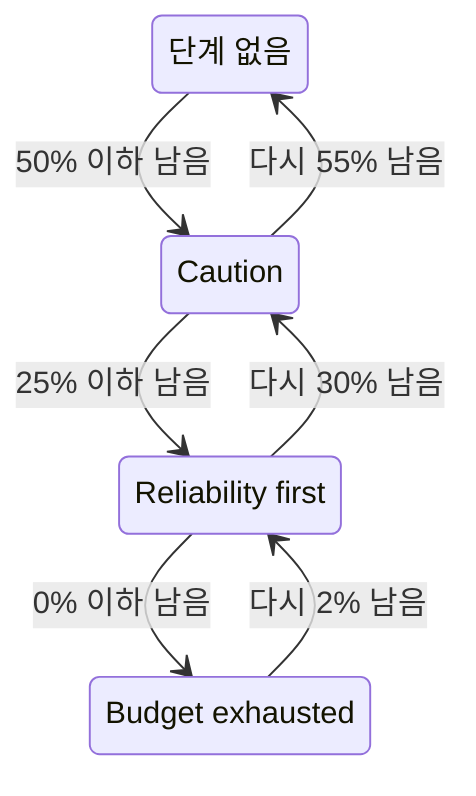

# 오류 예산 정책

오류 예산 정책은 SLO의 오류 예산이 줄어들 때 팀이 하기로 합의한 일을 적어 둔 것입니다. 예를 들어 절반을 쓰면 위험한 변경을 검토하고, 모두 쓰면 릴리스를 동결하는 식입니다. OneUptime은 예산이 도달한 정책 단계에 SLO를 두고, 그 단계에 대한 팀의 합의를 SLO의 페이지에 보여 주며, SLO가 단계에 들어갈 때 경고를 발생시키거나 인시던트를 선언할 수 있고, 단계가 바뀔 때마다 선택한 Slack, Microsoft Teams 또는 Mattermost 채널에 게시하며, CI/CD 파이프라인에 릴리스를 보류할지 여부를 알려 줍니다. 이것은 [Google SRE Workbook](https://sre.google/workbook/error-budget-policy/)의 오류 예산 정책 방식입니다.

:::cards
- [단계의 작동 방식](#단계의-작동-방식): 어떤 단계가 적용되는지, SLO가 언제 그 단계를 벗어나는지.
- [정책 설정](#정책-설정): 권장 정책에서 시작하거나 직접 단계를 작성합니다.
- [경고와 인시던트](#경고와-인시던트): SLO가 단계에 들어가면 팀에 알립니다.
- [Slack, Microsoft Teams, Mattermost에 게시하기](#slack-microsoft-teams-mattermost에-게시하기): 아무도 호출하지 않고, SLO가 단계에 들어가면 채널에 알립니다.
- [배포 게이트](#배포-게이트): 단계가 배포를 동결하는 동안 CI/CD에서 릴리스를 보류합니다.
- [API로 단계 읽기](#api로-단계-읽기): CI와 스크립트에서 단계를 확인합니다.
:::

## 단계의 작동 방식

정책은 단계의 모음입니다. 각 단계에는 세 개의 필드가 있습니다.

| 필드 | 내용 |
| --- | --- |
| **이름** | 팀이 단계를 부르는 이름. 예를 들어 "Reliability first"입니다. |
| **남은 예산 임계값 (%)** | 남은 오류 예산의 비율이 이 값 이하일 때 단계가 적용됩니다. 0에서 100 사이이며 소수도 쓸 수 있습니다. SLO의 단계마다 임계값이 서로 달라야 합니다. |
| **우리가 할 일** | SLO가 그 단계에 있는 동안 팀이 하기로 합의한 일(Markdown). 필수이며 최대 10,000자입니다. |

단계는 남은 예산이 그 임계값 이하인 동안 적용되므로, 0% 단계는 예산이 소진된 상태의 단계입니다. 여러 단계가 적용되면 SLO는 임계값이 가장 낮은 단계, 즉 가장 심각한 단계에 있습니다. 적용되는 단계가 없으면 SLO는 어떤 단계에도 없습니다. 50%, 25%, 0% 단계가 있으면 예산이 30% 남은 SLO는 50% 단계에, 10% 남은 SLO는 25% 단계에 있습니다.

단계는 SLO가 그 단계에 있는 동안 배포를 동결할 수도 있습니다. [배포 게이트](#배포-게이트)를 참고하세요.

### 단계에 들어가고 벗어나기

단계는 SLO의 상태와 같은 방식으로 남은 예산을 따릅니다.

- 단계에는 바로 들어갑니다. 예산이 단계의 임계값 이하라는 것을 발견한 평가에서 SLO가 그 단계에 들어갑니다. 한 번에 여러 임계값 아래로 떨어진 예산은 가장 심각한 단계로 바로 갑니다.
- 덜 심각한 단계로 벗어나는 것은 예산이 확실히 돌아올 때까지 기다립니다. 0% 단계는 예산이 다시 2% 남으면 벗어납니다. 그 밖의 단계는 예산이 임계값보다 5포인트 높아지면 벗어납니다.

따라서 0% 단계는 **예산 소진** 상태와 함께 움직이고, SLO의 위험 임계값에 있는 단계는 **위험** 상태와 함께 움직입니다. [상태 변화와 위험 임계값](/docs/slo/error-budget#상태-변화와-위험-임계값)을 참고하세요. 임계값 근처를 오가는 롤링 기간도 단계를 왔다 갔다 하게 만들지 않습니다.



## 정책 설정

SLO 오류 예산 정책 단계를 만들 권한이 필요합니다.

:::steps
### 오류 예산 정책 열기

SLO를 열고 사이드 메뉴의 **규칙** 섹션에서 **오류 예산 정책** 으로 이동합니다. 이 페이지에는 SLO의 단계가 나열되며, 각 단계의 이름, 적용되는 남은 예산, 팀이 하는 일이 표시됩니다.

### 권장 정책에서 시작하기

SLO에 단계가 없는 동안에는 페이지에 **추천 정책 사용** 이 표시됩니다. 클릭하고, 나열된 세 단계를 확인한 뒤 확정합니다. 그런 다음 각 단계의 문구를 팀의 합의에 맞게 고칩니다.

### 또는 직접 단계 추가하기

**SLO 오류 예산 정책 단계 만들기** 를 클릭합니다. **이름** 과 **남은 예산 임계값 (%)** 를 입력하고, 팀의 합의를 **우리가 할 일** 에 씁니다. SLO가 그 단계에 있는 동안 파이프라인이 릴리스를 보류해야 한다면 **배포 동결** 을 켭니다.

### 단계가 발생시킬 것 선택하기

단계는 합의를 기록하고 보여 줍니다. SLO가 단계에 들어갈 때 누군가에게 알리려면 접혀 있는 경고와 인시던트 설정을 열고 경고, 인시던트 또는 둘 다를 켭니다. 둘 다 기본적으로 꺼져 있습니다. [경고와 인시던트](#경고와-인시던트)를 참고하세요.
:::

단계를 추가, 편집 또는 삭제하면 바로 적용됩니다. OneUptime은 약 1분 안에 SLO를 다시 평가합니다. 예산이 이미 단계의 임계값 이하라면 그때 SLO가 그 단계에 들어가고, 단계는 설정된 대로 발생시킵니다. 단계를 끄거나 삭제하면 그 단계가 발생시킨 것이 해결되고, SLO는 예산에 맞는 단계로 옮겨 갑니다. 단계의 경고나 인시던트를 끄면 그 경고나 인시던트가 해결됩니다.

### 권장 정책

**추천 정책 사용** 은 예산의 절반, 4분의 1, 0에 세 단계를 다음 영어 문구로 추가합니다.

| 단계 | 적용 조건 | 팀이 하는 일 | 배포 |
| --- | --- | --- | --- |
| **Caution** | 50% 이하 남음 | Half of the error budget is spent. Review risky changes before they ship, and find out what has been spending the budget. | 허용 |
| **Reliability first** | 25% 이하 남음 | Reliability comes first. Only reliability improvements and critical fixes ship until the budget recovers. | 허용 |
| **Budget exhausted** | 0% 이하 남음 | The error budget is spent. Freeze non-critical releases: only fixes for this SLO's reliability and security fixes ship until the budget is back. | 동결 |

어떤 단계도 켜기 전까지는 경고를 발생시키거나 인시던트를 선언하지 않습니다. **Budget exhausted** 는 그 합의대로 배포를 동결하며, 확인 화면에도 그렇게 표시됩니다. [배포 게이트](#배포-게이트)를 참고하세요. 배포 게이트가 생기기 전에 추가된 단계는 동결을 켜기 전까지 아무것도 동결하지 않습니다. SLO에 없는 단계만 추가됩니다. 이름이 같거나 임계값이 같은 단계는 켜져 있든 꺼져 있든 이미 있는 것으로 봅니다. 따라서 두 번째 탭이나 API에서 두 번 요청해도 아무것도 두 번 추가되지 않습니다. 단계 중 하나라도 추가할 수 없으면 아무 단계도 추가되지 않으며, SLO는 그대로 남으므로 다시 시도할 수 있습니다. 이렇게 추가된 각 단계는 SLO의 감사 로그에 사용자가 추가한 것으로 기록됩니다.

## 단계가 표시되는 곳

- SLO의 **개요** 에는 SLO가 있는 단계와 팀이 그 단계에서 하기로 합의한 일이 표시되므로, SLO를 여는 사람은 누구나 지금 적용되는 합의를 볼 수 있습니다. 단계가 배포를 동결하는 동안에는 단계 이름 아래의 빨간 배지에 언제부터 동결되었는지 표시됩니다.
- **오류 예산 소진 추이** 차트는 위험 임계값 선 옆에 각 단계의 임계값마다 레이블이 붙은 선을 그립니다.
- SLO의 **피드** 에는 단계가 바뀔 때마다 게시됩니다. SLO가 벗어난 단계와 들어간 단계, 남은 예산, 새 단계에서 팀이 하기로 합의한 일, 그리고 그 변화로 배포가 동결되었는지 다시 허용되었는지입니다.
- 규칙이 지정한 Slack, Microsoft Teams, Mattermost 채널도 같은 게시물을 받습니다. [Slack, Microsoft Teams, Mattermost에 게시하기](#slack-microsoft-teams-mattermost에-게시하기)를 참고하세요.
- SLO의 **감사 로그** 는 각 단계 변화와 배포가 동결되거나 다시 허용된 각 경우를 OneUptime이 직접 한 변경으로 기록하므로, **시스템 이벤트 저장** 이 켜져 있을 때만 보여 줍니다. [감사 로그 켜기](/docs/slo/feed-and-audit-logs#감사-로그-켜기)를 참고하세요. 단계 추가, 편집, 제거는 그 작업을 한 사람의 이름으로 기록됩니다.
- SLO의 읽기 API는 단계와 배포 허용 여부를 반환합니다. [API로 단계 읽기](#api로-단계-읽기)와 [배포 게이트](#배포-게이트)를 참고하세요.

## 경고와 인시던트

각 단계는 SLO가 들어갈 때 경고를 발생시키거나, 인시던트를 선언하거나, 둘 다 할 수 있습니다. 옵션은 소진율 규칙의 경고와 인시던트와 같습니다. 심각도, 온콜 정책, 제목·설명·조치 메모 템플릿, 비공개, 자동 해결, 레이블, 소유자 팀과 소유자 사용자, SLO 소유자를 소유자로 추가하는 설정입니다. [규칙이 선언하는 것](/docs/slo/burn-rate-alerts#규칙이-선언하는-것)을 참고하세요. 둘 다 기본적으로 꺼져 있으므로, 하나를 켜기 전까지 단계는 아무에게도 알리지 않습니다.

- 더 심각한 단계에 들어가면 이전 단계가 발생시킨 것은 자동 해결 설정과 관계없이 해결됩니다. 새 단계가 그것을 대체하기 때문입니다. 따라서 한 번에 열려 있는 것은 많아야 한 단계의 경고와 인시던트이며, 그것은 SLO가 있는 단계의 것입니다.
- 덜 심각한 단계로 회복하거나 모든 단계에서 벗어나면, 단계의 자동 해결이 켜져 있을 때(기본값) 해결됩니다. 자동 해결이 꺼져 있으면 누군가 해결할 때까지 열려 있습니다.
- 재발동 억제는 없습니다. 단계는 SLO가 그 단계를 확실히 벗어났다가 다시 들어간 뒤에만 다시 발생시키므로 깜빡이지 않습니다. SLO가 아직 그 단계에 있는 동안 누군가 단계가 발생시킨 것을 수동으로 해결하면, 해결된 상태로 남습니다.
- SLO의 모니터 중 하나라도 예약된 유지 관리 중인 동안에는 단계가 아무것도 발생시키지 않습니다. 그래도 단계 자체는 바뀌고, 열려 있는 것은 계속 해결됩니다. 유지 관리가 끝날 때 SLO가 아직 그 단계에 있으면 그때 단계가 설정된 대로 발생시킵니다.

소진율 규칙과 마찬가지로, 단계가 발생시킨 경고나 인시던트는 **영향받는 리소스** 에 SLO를 표시하며, 인시던트는 상태 페이지에 표시되지 않습니다. SLO의 피드는 각 경고와 인시던트, 그리고 해결된 시점을 게시합니다.

### 내용

단계의 제목, 설명, 조치 메모에는 규칙과 마찬가지로 템플릿 변수를 쓸 수 있습니다. [각 경고와 인시던트의 내용](/docs/slo/burn-rate-alerts#각-경고와-인시던트의-내용)을 참고하세요. 단계의 필드는 SLO와 그 예산의 변수, 그리고 단계 고유의 변수 세 개를 제공합니다. `{{sloName}}`, `{{sloId}}`, `{{sloLink}}`, `{{sloStatus}}`, `{{policyTier}}`, `{{policyTierThresholdPercentage}}`, `{{policyTierWhatWeDo}}`, `{{targetPercentage}}`, `{{currentSliPercentage}}`, `{{errorBudgetRemainingPercentage}}`, `{{errorBudgetRemaining}}`, `{{errorBudgetRemainingMinutes}}`, `{{windowDescription}}` 입니다. `{{ruleName}}` 과 소진율 같은 규칙 고유의 변수는 제공되지 않으며, 단계의 템플릿에서는 비어 있습니다.

단계의 세 변수는 소진율 규칙의 템플릿에서도 쓸 수 있습니다.

| 변수 | 내용 |
| --- | --- |
| `{{policyTier}}` | 평가 후 SLO가 있는 단계의 이름. 어떤 단계에도 없으면 `None` 입니다. |
| `{{policyTierThresholdPercentage}}` | 그 단계의 임계값. 예를 들어 `25` 입니다. SLO가 어떤 단계에도 없으면 비어 있습니다. |
| `{{policyTierWhatWeDo}}` | 그 단계에서 팀이 하기로 합의한 일. SLO가 어떤 단계에도 없으면 비어 있습니다. |

제목을 비워 둔 단계는 기본 제목을 씁니다.

```text
SLO error budget policy: {{sloName}} — {{policyTier}}
```

기본 설명은 단계의 이름을 밝히고, 남은 예산을 단계의 임계값과 비교하며, 팀이 그 단계에서 하기로 합의한 일을 알려 줍니다.

## Slack, Microsoft Teams, Mattermost에 게시하기

규칙은 SLO의 오류 예산 정책에서 일어나는 각 변화를 팀이 읽는 Slack, Microsoft Teams 또는 Mattermost 채널에 아무도 호출하지 않고 게시할 수 있습니다. SLO가 단계에 들어갈 때, 덜 심각한 단계로 회복하거나 모든 단계에서 벗어날 때, 그리고 배포가 동결되거나 다시 허용될 때입니다. 각 규칙은 어떤 SLO의 어떤 변화를 게시할지 고릅니다. 먼저 워크스페이스를 프로젝트에 연결하세요. [Slack](/docs/workspace-connections/slack), [Microsoft Teams](/docs/workspace-connections/microsoft-teams) 또는 [Mattermost](/docs/workspace-connections/mattermost)를 참고하세요.

:::steps
### SLO의 워크스페이스 섹션 열기

**SLOs** → **워크스페이스** → **Slack**, **Microsoft Teams** 또는 **Mattermost** 로 이동합니다. **워크스페이스** 섹션에는 프로젝트가 연결한 채팅 워크스페이스만 표시됩니다.

### 규칙 만들기

**SLO 알림 규칙 만들기** 를 클릭하고 **규칙 이름** 을 지정합니다. **대상 SLO** 에서 **모든 SLO** 를 그대로 두거나, **조건과 일치하는 SLO만** 을 선택하고 조건을 추가합니다. [규칙과 일치하는 대상](#규칙과-일치하는-대상)을 참고하세요.

### 게시할 곳 선택하기

**그다음 Slack에서** 항목에 규칙이 게시할 채널을 지정합니다. Microsoft Teams에서는 팀과 그 채널, 또는 OneUptime 앱이 추가된 채팅을 선택합니다. SLO에는 자체 채널이 없으므로, 규칙은 이미 있는 채널과 채팅에만 게시합니다.
:::

메시지는 SLO의 **피드** 와 같은 말로 변화를 알립니다. SLO가 벗어난 단계와 들어간 단계, 배포가 어떻게 바뀌었는지, 남은 오류 예산, 새 단계의 임계값, 그리고 팀이 그 단계에서 하기로 합의한 일을 팀이 쓴 그대로 담습니다. 그 합의에 들어 있는 `<!channel>` 같은 멘션은 텍스트로 게시되며 아무에게도 알리지 않습니다.

- 변화는 그 변화를 만든 평가가 저장된 뒤 한 번 게시됩니다. 저장되지 않은 평가는 아무것도 게시하지 않으며, 다음 평가가 그 변화를 게시합니다.
- SLO가 같은 단계에 머무는 동안에는 예산이 임계값 근처에서 아무리 오래 오가도 아무것도 게시되지 않습니다. [단계에 들어가고 벗어나기](#단계에-들어가고-벗어나기)를 참고하세요.
- SLO가 있는 단계의 **배포 동결** 을 켜거나 끄면 그에 대한 메시지가 따로 게시됩니다.
- 일시 중지되었거나 잘못 구성된 SLO, 비활성화되었거나 보관된 SLO는 단계를 유지하며 아무것도 게시하지 않습니다.
- 보내지 못한 메시지는 로그에 기록되며, 평가, SLO의 피드, 단계가 발생시키는 것은 그와 관계없이 계속됩니다.

### 규칙과 일치하는 대상

| 조건 | 일치하는 대상 |
| --- | --- |
| **SLOs** | 선택한 SLO, 또는 그 SLO를 뺀 모든 SLO. |
| **SLO 레이블** | SLO의 레이블. 선택한 레이블 중 하나라도 있는 경우, 모두 있는 경우, 또는 하나도 없는 경우. |
| **SLO 이름** | SLO의 이름. 입력한 텍스트와 같거나 같지 않은 경우, 포함하거나 포함하지 않는 경우, 그 텍스트로 시작하거나 끝나는 경우. |
| **오류 예산 정책 변경** | 바뀐 내용. **더 심각한 단계 진입**, **덜 심각한 단계로 회복**, **모든 단계에서 이탈**, **배포 동결됨** 또는 **배포 다시 허용** 입니다. |

배포를 동결했거나 다시 허용한 단계 변화는 두 변화를 모두 담은 메시지 하나입니다. 따라서 **배포 동결됨** 에 대한 규칙은 배포를 동결하는 단계에 들어간 변화도 게시합니다. 릴리스 채널은 모든 동결 소식을 받습니다.

## 예산이 측정되지 않을 때

- **일시 중지됨** 또는 **잘못 구성됨** 상태인 SLO는 예산을 측정하지 않으므로, 단계는 그대로 남고 단계가 발생시킨 것도 측정이 다시 시작될 때까지 열려 있습니다. 반면 소진율 규칙은 이때 열려 있는 것을 해결합니다.
- SLO의 평가를 끄거나 SLO를 보관하면 그 단계들이 발생시킨 것이 해결됩니다. SLO가 있는 단계는 그대로 남습니다.
- SLO를 삭제하면 그 단계도 삭제되고, 단계들이 발생시킨 것이 해결됩니다.
- 이 모든 경우에 SLO는 단계를 유지하므로, 배포에 대해 주던 응답도 그대로 유지합니다. [배포 게이트](#배포-게이트)를 참고하세요.

## 배포 게이트

단계는 배포를 동결할 수 있습니다. SLO가 **배포 동결** 이 켜진 단계에 있는 동안 SLO의 `deploymentsAllowed` 필드는 `false` 이므로, 릴리스 전에 이 필드를 확인하는 CI/CD 파이프라인은 릴리스를 보류합니다. 그 밖의 경우에는 `true` 입니다. SLO에 정책이 없을 때, 예산이 모든 단계보다 위에 있는 동안, 그리고 배포를 동결하지 않는 단계에 있을 때입니다. 권장 정책의 **Budget exhausted** 단계는 배포를 동결합니다.

:::steps
### 배포 동결 켜기

SLO의 **오류 예산 정책** 을 열고 단계를 편집해 **배포 동결** 을 켠 뒤 저장합니다. 표에서 그 단계의 **배포** 열에 **동결** 이 표시됩니다.

### 파이프라인에 키 주기

SLO를 읽을 수 있는 프로젝트의 [API 키](/docs/api-reference/api-reference)를 만들고, 파이프라인의 시크릿에 `ONEUPTIME_API_KEY` 라는 이름으로 저장합니다.

### 릴리스 전에 SLO 확인하기

배포하는 스텝 앞에 아래 검사를 스텝으로 추가하고, `<slo-id>` 자리에 SLO의 ID를 넣습니다.
:::

:::tabs
@tab Shell
```bash
ALLOWED=$(curl -sS -X POST 'https://oneuptime.com/api/service-level-objective/<slo-id>/get-item' \
  -H "ApiKey: $ONEUPTIME_API_KEY" \
  -H 'Content-Type: application/json' \
  -d '{ "select": { "deploymentsAllowed": true } }' | jq -r '.deploymentsAllowed')
[ "$ALLOWED" = "true" ]
```
@tab GitHub Actions
```yaml title=".github/workflows/deploy.yml"
name: Deploy
on:
  push:
    branches: [main]

jobs:
  deploy:
    runs-on: ubuntu-latest
    steps:
      - uses: actions/checkout@v4
      - name: Stop while the error budget policy freezes deployments
        env:
          ONEUPTIME_API_KEY: ${{ secrets.ONEUPTIME_API_KEY }}
          SLO_ID: <slo-id>
        run: |
          SLO=$(curl -sS -X POST "https://oneuptime.com/api/service-level-objective/$SLO_ID/get-item" \
            -H "ApiKey: $ONEUPTIME_API_KEY" \
            -H 'Content-Type: application/json' \
            -d '{ "select": { "deploymentsAllowed": true, "currentErrorBudgetPolicyTierName": true } }')
          if [ "$(echo "$SLO" | jq -r '.deploymentsAllowed')" != "true" ]; then
            echo "Not deploying: $SLO"
            exit 1
          fi
      - name: Deploy
        run: ./deploy.sh
```
@tab GitLab CI
```yaml title=".gitlab-ci.yml"
error-budget-gate:
  stage: test
  image: alpine:3.20
  variables:
    SLO_ID: <slo-id>
  before_script:
    - apk add --no-cache curl jq
  script:
    - >
      SLO=$(curl -sS -X POST "https://oneuptime.com/api/service-level-objective/$SLO_ID/get-item"
      -H "ApiKey: $ONEUPTIME_API_KEY"
      -H 'Content-Type: application/json'
      -d '{ "select": { "deploymentsAllowed": true, "currentErrorBudgetPolicyTierName": true } }')
    - echo "$SLO"
    - test "$(echo "$SLO" | jq -r '.deploymentsAllowed')" = "true"
```
:::

검사는 응답이 `true` 일 때만 통과합니다. 동결된 SLO, 필드가 없는 응답(키가 SLO를 읽을 수 없거나 ID가 잘못된 경우), 응답이 아예 없는 경우는 모두 스텝을 멈추므로, 파이프라인은 받지 못한 응답으로 릴리스하는 일이 없습니다. GitLab CI에서는 작업이 test 스테이지에서 실행되므로, 동결된 SLO는 그 뒤의 deploy 스테이지를 멈춥니다. `ONEUPTIME_API_KEY` 는 마스킹된 CI/CD 변수로 추가하세요. 자체 호스팅 설치에서는 oneuptime.com 대신 그 설치의 주소를 사용하세요.

SLO는 두 필드로 응답하며, 이 필드들은 SLO 자체의 읽기 권한으로 읽습니다.

| 필드 | 내용 |
| --- | --- |
| `deploymentsAllowed` | SLO가 배포를 동결하는 단계에 있는 동안에는 `false`, 그 밖에는 `true` 입니다. |
| `deploymentsFrozenAt` | 배포가 동결된 시각. 허용되는 동안에는 비어 있습니다. |

응답은 다음과 같이 바뀝니다.

- 배포는 배포를 동결하는 단계에 SLO를 넣는 평가에서 동결되고, SLO를 그 단계에서 빼내는 평가에서 다시 허용되며, 이때 단계 자체의 회복 여유가 적용됩니다. [단계에 들어가고 벗어나기](#단계에-들어가고-벗어나기)를 참고하세요. 동결하는 한 단계에서 동결하는 다른 단계로 옮겨 가면 계속 동결된 상태이며, `deploymentsFrozenAt` 도 그 시각을 유지합니다.
- SLO가 있는 단계의 **배포 동결** 을 켜거나 끄면 약 1분 안에 적용됩니다. 예산이 회복되기 전에 릴리스하려면 이를 끄세요. 이 변경은 SLO의 감사 로그에 사용자가 한 것으로 기록됩니다.
- **일시 중지됨** 또는 **잘못 구성됨** 상태인 SLO는 단계를 유지하는 것처럼 이전 응답도 유지합니다. 모든 모니터를 일시 중지하는 유지 관리 기간은 동결을 풀지도, 새로 시작하지도 않습니다. 비활성화되거나 보관된 SLO는 아예 평가되지 않으므로 역시 응답을 유지합니다.
- 배포가 동결된 동안 SLO의 **개요** 에는 언제부터 동결되었는지 표시되고, **피드** 에는 배포가 동결된 시점과 다시 허용된 시점이 게시됩니다.

## API로 단계 읽기

SLO 자체의 읽기 API는 SLO가 있는 단계를 반환하므로, CI 작업이나 스크립트가 릴리스 전처럼 무언가를 하기 전에 단계를 확인할 수 있습니다. SLO가 어떤 단계에도 없는 동안에는 세 필드 모두 비어 있습니다.

| 필드 | 내용 |
| --- | --- |
| `currentErrorBudgetPolicyTierId` | 단계의 ID. |
| `currentErrorBudgetPolicyTierName` | 단계의 이름. |
| `currentErrorBudgetPolicyTierEnteredAt` | SLO가 그 단계에 들어간 시각. |

이 필드들은 SLO 자체의 읽기 권한으로 읽으며, SLO의 예산을 읽을 때 필요한 권한과 같습니다. 예를 들어 프로젝트의 [API 키](/docs/api-reference/api-reference)로 다음과 같이 읽습니다.

```bash
curl -X POST 'https://oneuptime.com/api/service-level-objective/<slo-id>/get-item' \
  -H "ApiKey: $ONEUPTIME_API_KEY" \
  -H 'Content-Type: application/json' \
  -d '{ "select": { "name": true, "errorBudgetRemainingPercentage": true, "currentErrorBudgetPolicyTierName": true, "currentErrorBudgetPolicyTierEnteredAt": true } }'
```

단계 자체는 별도의 리소스인 `/api/service-level-objective-error-budget-policy-tier` 이며, 모든 리소스에 있는 목록, 읽기, 만들기, 변경, 삭제 요청이 있습니다. 권장 정책용 요청이 두 개 더 있습니다. 둘 다 `{ "serviceLevelObjectiveId": "..." }` 를 받고 `tiers` 에 단계를 담아 응답합니다.

| 요청 | 하는 일 |
| --- | --- |
| `POST /api/service-level-objective-error-budget-policy-tier/recommended-policy` | SLO에 없는 권장 단계를 나열합니다. 아무것도 쓰지 않습니다. |
| `POST /api/service-level-objective-error-budget-policy-tier/recommended-policy/add` | 그 단계들을 추가하고 추가한 것을 나열합니다. 다시 요청해도 아무것도 추가되지 않습니다. |

## 권한

| 권한 | 역할이 할 수 있는 일 |
| --- | --- |
| **Read SLO Error Budget Policy Tier** | SLO의 단계 보기. |
| **Create SLO Error Budget Policy Tier** | 직접 또는 **추천 정책 사용** 으로 단계 추가하기. |
| **Edit SLO Error Budget Policy Tier** | 단계를 변경하고 켜거나 끄기. |
| **Delete SLO Error Budget Policy Tier** | 단계 제거하기. |

이 권한들은 역할의 SLO 그룹에 있습니다. Project Owner와 Project Admin 역할은 모두 가지고 있으며, Project Member와 Viewer 역할은 단계를 읽을 수 있습니다.

## 아직 제공되지 않는 기능

오류 예산 정책의 일부는 아직 제공되지 않습니다. 단계별 전용 워크플로 트리거, 여러 SLO가 함께 쓰는 정책, 단계 확인 처리나 예외 부여, 남은 예산이 아닌 예산 잔여 기간에 따른 단계입니다. OneUptime은 스스로 릴리스를 막지 않습니다. [배포 게이트](#배포-게이트)에서 보듯이 릴리스를 막는 것은 `deploymentsAllowed` 를 확인하는 파이프라인입니다.

## 다음 단계

:::cards
- [오류 예산](/docs/slo/error-budget): 예산이 무엇이고 상태가 예산을 어떻게 따르는지.
- [소진율 경고 및 인시던트](/docs/slo/burn-rate-alerts): 예산이 너무 빨리 소진될 때 팀에 알립니다.
- [SLO 피드 및 감사 로그](/docs/slo/feed-and-audit-logs): 모든 단계 변화와 단계들이 발생시킨 것.
:::
