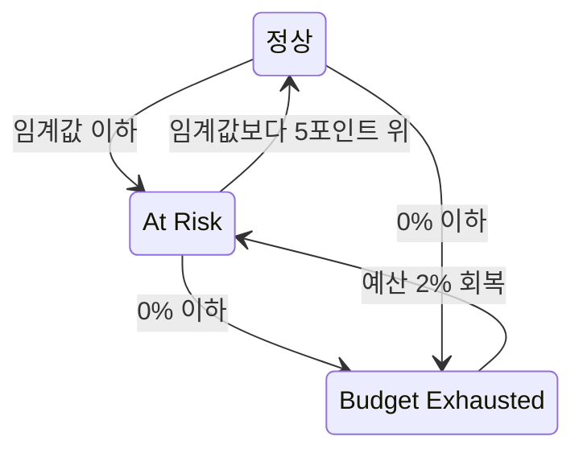

# 오류 예산

오류 예산은 SLO의 목표가 허용하는 다운타임입니다. 99.9% 목표는 "절대 다운되지 않는다"는 뜻이 아니라 "30일 동안 최대 43분까지 다운될 수 있으니 현명하게 쓰라"는 뜻입니다. 이 페이지에서는 OneUptime이 예산을 세는 방법, 예산이 얼마나 버티는지, 어떻게 돌아오는지, 누가 알림을 받는지 설명합니다.

:::cards
- [예산 계산 방법](#예산-계산-방법): 공식과 자주 쓰는 목표의 예산.
- [예산 잔여 기간](#예산-잔여-기간): 현재 속도로 예산이 얼마나 버티는지.
- [예산이 회복되는 방식](#예산이-회복되는-방식): 롤링 기간과 달력 월.
- [소유자 알림](#소유자-알림): 예산이 부족해질 때 누가 알림을 받는지.
:::

## 예산 계산 방법

전체 예산은 기간 중 목표가 약속하지 않는 부분입니다:

```text
total budget = (100% − target) × window length
```

| 목표 | 7일 기간 | 28일 기간 | 30일 기간 | 90일 기간 |
| --- | --- | --- | --- | --- |
| 99% | 1h 40m 48s | 6h 43m 12s | 7h 12m | 21h 36m |
| 99.5% | 50m 24s | 3h 21m 36s | 3h 36m | 10h 48m |
| 99.9% | 10m 5s | 40m 19s | 43m 12s | 2h 9m 36s |
| 99.95% | 5m 2s | 20m 10s | 21m 36s | 1h 4m 48s |
| 99.99% | 1m 0s | 4m 2s | 4m 19s | 12m 58s |

SLO의 **설정** 페이지에는 목표 옆에 그 목표가 허용하는 예산이 표시됩니다. 예: "30일 기간당 43m 12s 다운타임".

### 여러 모니터가 있는 SLO의 예산

**Any Monitor Down** 모드에서는 SLO가 측정하는 모니터 수와 관계없이 예산이 `(100% − target) × window` 입니다. 기간은 하나의 타임라인입니다.

**Monitor Seconds Average** 모드에서는 예산을 모니터 전체에서 합한 모니터 초로 세므로 모니터 수에 따라 커집니다. 30일 동안 99.9%인 모니터 3개짜리 SLO의 예산은 43분이 아니라 약 129분입니다. 비율(SLI, 남은 예산, 소진율)의 의미는 같고, 기간만 달라집니다.

### 달력 월의 예산

달력 월 SLO는 첫날부터 한 달 전체의 예산을 가집니다. 31일인 달의 99.9% SLO는 1일에 44m 38s를 모두 가지고 있습니다. 예산은 지난 날짜에 비례해 배분되지 않으므로, 1일 아침의 1분 장애는 그달 예산에서 1분을 씁니다.

## 남은 예산

다운타임이 쌓이면 **개요** 의 **Error budget left** 타일에 남은 예산이 표시됩니다:

- 전체 대비 비율로 표시됩니다. 이 값은 SLO의 상태도 정하고 막대를 채웁니다. 막대에는 SLO의 위험 임계값에 표시가 있습니다.
- 기간으로 표시됩니다. 예: "31m 4s left of 43m 12s".

예산이 바닥나면 타일에 **No budget left** 가 표시됩니다. 다운타임이 예산을 넘으면 타일에 **Budget exceeded** 와 초과분이 시간으로 표시됩니다. 예를 들어 "4d 23m over budget · 5m 47s allowed"는 SLO가 예산 5분 47초를 모두 쓰고 4일 23분을 더 썼다는 뜻입니다. 막대는 비어 있는 빨간색으로 남습니다.

남은 예산은 계산과 기록 차트를 위해 부호 있는 숫자로 저장되므로, 그곳에서는 초과한 예산이 음수 비율로 나타납니다. 크게 음수인 비율은 예산에 비해 초과분이 크다는 뜻이며, 서비스가 다운되었던 시간의 비율이 아닙니다.

어떤 초를 다운타임으로 셀지는 SLO의 다운타임 상태와, 여러 모니터가 있는 SLO의 경우 다중 모니터 모드가 정합니다. 둘 다 **설정** → **Downtime Calculation** 에 있습니다. [SLO 개요](/docs/slo/introduction)를 참고하세요.

## 예산 잔여 기간

**개요** 의 **Budget runway** 타일은 "이대로 가면 예산이 언제 바닥나는가?"에 답합니다. 남은 예산을 최근 60분 동안의 소진율로 나눕니다:

```text
runway = budget left ÷ (burn rate × (100% − target))
```

| 타일 표시 | 의미 |
| --- | --- |
| **~2d 5h** 같은 기간 | 현재 속도라면 예산이 대략 이 기간 뒤에 바닥납니다. 주황색이며, 하루 이하면 빨간색입니다. **Under 1m** 은 1분 미만을 뜻합니다. |
| **Not burning** | 최근 60분 동안 예산을 쓰지 않았습니다. |
| **Sustainable** | 롤링 기간에만 해당합니다. 잔여 기간이 기간 하나 이상이므로, 오래된 다운타임이 기간에서 빠지는 속도보다 예산을 빨리 쓰지 않습니다. 이 속도로는 바닥나지 않습니다. |
| **Lasts until reset** | 달력 월에만 해당합니다. 예산이 바닥나기 전에 다음 달 초에 초기화됩니다. |
| **Overspent** | 예산을 이미 다 썼습니다. 타일에 초과량이 표시됩니다. |

달력 월 SLO의 경우 타일에 예산이 초기화되는 시점도 표시됩니다.

잔여 기간은 직선 예측입니다. 롤링 기간에서는 기간에서 빠지는 오래된 다운타임이 예산을 돌려주지만 예측은 이를 무시합니다. 남은 최소 시간으로 읽으세요. 첫 평가 전에는 표시되지 않으며, 예산을 실제 시간이 아닌 모니터 초로 세는 **Monitor Seconds Average** 모드의 SLO에도 표시되지 않습니다.

## 오류 예산 번다운

**개요** 의 **Error budget burn-down** 차트는 현재 준수 기간 동안의 남은 예산을 비율로 그립니다:

- 0% 선은 예산이 바닥나는 지점을 나타내고, 점선은 SLO의 위험 임계값을 나타냅니다.
- 달력 월 SLO에는 월초의 가득 찬 예산에서 초기화 시점의 빈 예산까지 일정하게 내려가는 흐린 선이 있습니다. 그 선 아래에 있다면 그달은 예산을 너무 빨리 쓰고 있는 것입니다.
- 5분마다 평가할 때마다 점이 기록되므로, 새 SLO의 차트는 첫 평가 전까지 비어 있습니다.
- 차트를 드래그하면 기간의 일부를 확대합니다. 두 번 클릭하거나 **Reset zoom** 을 클릭하면 다시 전체 기간을 봅니다.

**Open metrics** 는 SLO의 **메트릭** 페이지를 엽니다. 그 페이지의 **Error Budget History** 탭은 최대 400일 전까지 보여 줍니다. [SLO 메트릭 및 대시보드](/docs/slo/metrics)를 참고하세요.

## 예산이 회복되는 방식

예산이 돌아오는 방식은 SLO의 기간 유형에 따라 다릅니다:

:::tabs
@tab Rolling
롤링 기간은 항상 현재부터 같은 길이만큼 되돌아보므로, 다운타임은 결국 기간에서 빠집니다. 장애는 발생하고 정확히 기간 하나가 지나면 더 이상 계산되지 않습니다. 6월 1일의 30분 장애는 30일 SLO의 계산에서 7월 1일에 빠지며, 예산은 한꺼번에가 아니라 다운타임의 1초 1초가 기간을 떠날 때마다 조금씩 돌아옵니다.

즉 회복은 예약하는 것이 아니라 쌓아서 얻는 것입니다. 작은 장애가 계속되면 오래된 다운타임이 빠지는 동안 새 다운타임이 들어오므로, 예산은 회복되지 않고 제자리에 머뭅니다.
@tab Calendar Month
달력 월 SLO는 해당 시간대로 매달 1일 자정에 초기화됩니다. 예산이 한꺼번에 모두 돌아오고 이전 달은 마감됩니다. 어느 방향으로든 다음 달로 넘어가는 것은 없습니다. 나쁜 달이 다음 달을 해치지 않고, 좋은 달이 다음 달에 여유를 주지도 않습니다.
:::

### 새 SLO

기간보다 새로운 롤링 SLO는 지금까지 존재하는 데이터로 측정되며, 전체 예산도 그에 맞춰 커집니다. 일주일 전에 만든 30일 SLO의 예산은 지금은 7일 분량입니다. 기간이 채워질 때까지 **개요** 는 **Window 23% full** 표시기와 **Error budget left** 타일의 같은 안내로 얼마나 채워졌는지 보여 줍니다. 기간이 채워지면서 수치가 안정될 것으로 예상하세요.

## 상태 변화와 위험 임계값

남은 예산이 SLO의 상태를 정합니다:

| 상태 | 조건 |
| --- | --- |
| **정상** | 위험 임계값보다 많은 예산이 남아 있습니다. |
| **At Risk** | 남은 예산이 위험 임계값 이하입니다. 기본값은 20%입니다. |
| **Budget Exhausted** | 남은 예산이 0 이하입니다. |

위험 임계값은 **설정** → **Objective** 에서 설정합니다.

롤링 기간은 1초씩 회복되므로, 경계 근처의 SLO는 두 상태 사이를 오갈 수 있습니다. 상태 변화마다 의미가 있도록, SLO는 경계를 분명히 넘었을 때만 상태를 벗어납니다:



기본 임계값 20%에서는 위험 상태의 SLO가 남은 예산 25%에서 정상으로 돌아오고, 예산이 소진된 SLO는 2%에서 위험 상태로 돌아옵니다. 각 상태 변화는 그 이유가 되는 SLI, 예산, 소진율과 함께 SLO의 **Feed** 에 나타납니다.

## 소유자 알림

SLO가 **At Risk** 또는 **Budget Exhausted** 로 바뀌면 OneUptime이 소유자에게 알립니다:

- 소유자는 SLO의 **소유자** 페이지에 있는 사용자와 팀 구성원 중 아직 프로젝트 구성원인 사람입니다. 소유자가 없는 SLO는 대신 프로젝트 소유자에게 알립니다.
- 각 소유자는 기본적으로 이메일을 받고, **사용자 설정** → **알림 설정** → **모니터링** 에서 **SLO status changed** 에 대해 켠 다른 채널로도 알림을 받습니다.
- 이메일 제목에는 상태와 SLO가 들어갑니다. 예: `[SLO At Risk] API Availability`.

경계 근처의 SLO가 계속 알리지 않도록, 소유자는 한 시간에 최대 한 번만 알림을 받습니다. **Budget Exhausted** 로의 전환은 그 한 시간 안이라도 항상 보냅니다.

> [!TIP]
> 소유자 알림은 SLO 담당자에게 예산이 위험하다는 것을 알려 줍니다. 에스컬레이션 정책으로 온콜 팀을 호출하려면 [소진율 경고 및 인시던트](/docs/slo/burn-rate-alerts)를 사용하세요. 소진율 규칙은 만드는 모든 경고와 인시던트에 SLO 소유자를 추가할 수도 있습니다.

## 다음 단계

:::cards
- [소진율 경고 및 인시던트](/docs/slo/burn-rate-alerts): 예산이 너무 빨리 소진될 때 팀에 경고합니다.
- [SLO 메트릭 및 대시보드](/docs/slo/metrics): 시간에 따른 예산을 차트로 그립니다.
- [SLO 개요](/docs/slo/introduction): 목표, 기간, 다운타임 상태.
:::
