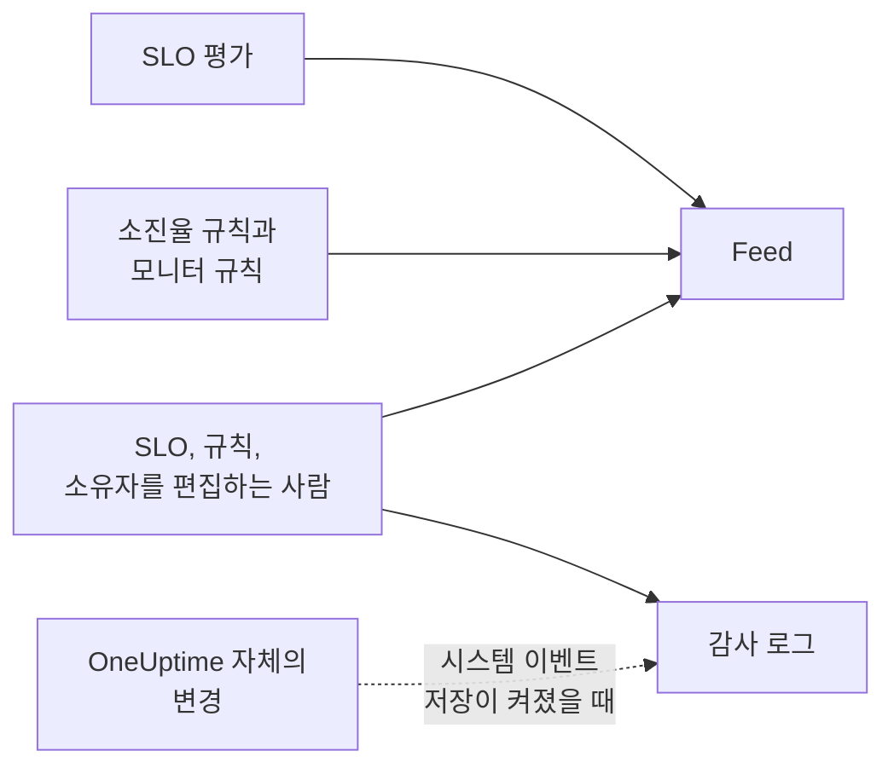

# SLO 피드 및 감사 로그

SLO에는 기록이 두 가지 있으며, 각각 다른 질문에 답합니다. **Feed** 는 "이 SLO에 무슨 일이 있었나?"에 답하며, SLO를 돌보는 사람을 위해 작성됩니다. **감사 로그** 는 "누가 정확히 무엇을 바꿨나?"에 필드 단위로 답하며, 검토와 규정 준수를 위한 것입니다.

## 피드와 감사 로그 중 무엇을 볼까?

| | **Feed** | **감사 로그** |
| --- | --- | --- |
| 답하는 질문 | SLO에 무슨 일이 있었나 | 누가 무엇을 언제 바꿨나 |
| 기록하는 내용 | 상태 변화, 소진율 경고와 인시던트, 그리고 SLO와 그 규칙, 모니터, 소유자의 변경 | 사람들이 SLO, 소진율 규칙, 모니터 규칙, 소유자에 한 모든 변경과 이전 값, 새 값 |
| OneUptime 자체 작업 포함 여부 | 포함: 평가와 모니터를 연결하는 모니터 규칙 | **시스템 이벤트 저장** 이 켜져 있을 때만 |
| 요금제 | 모든 요금제 | OneUptime Cloud의 Enterprise 요금제 또는 자체 호스팅 설치의 Enterprise Edition |
| 보관 기간 | OneUptime Cloud에서 3년 | 기본 7일, 최대 180일 |

## SLO 피드

피드는 SLO의 **Feed** 페이지에 있고, 최신 항목은 SLO **개요** 의 **Recent activity** 에 표시됩니다. 항목은 언급한 SLO, 모니터, 경고, 인시던트로 연결되며, 대부분 숫자나 이전 값과 새 값을 보여 주는 **More Information** 섹션이 있습니다.

| 이벤트 | 게시 시점 |
| --- | --- |
| SLO 생성 | SLO가 만들어질 때. 목표, 준수 기간, SLI, 위험 임계값, 설명, 처음 함께 만들어진 기본 소진율 규칙을 나열합니다. |
| SLO 업데이트 | 이름, 설명, 레이블, 목표, 준수 기간, 시간대, 위험 임계값, 다중 모니터 모드, 다운타임 상태가 바뀔 때. 각각의 이전 값과 새 값을 보여 줍니다. |
| SLO 활성화 또는 비활성화 | 평가가 켜지거나 꺼질 때. |
| SLO 보관 또는 복원 | SLO가 보관되거나 보관 취소될 때. |
| 상태 변경 | 평가로 SLO가 새 상태로 바뀔 때. 그 이유가 되는 SLI, 오류 예산, 소진율, 위험 임계값과, **일시 중지됨** 또는 **Misconfigured** 인 경우 그 원인을 보여 줍니다. |
| 소진율 경고 발생 | 소진율 규칙이 경고를 만들 때. 경고로 연결되며 발동 원인이 된 소진율을 보여 줍니다. |
| 소진율 인시던트 선언 | 소진율 규칙이 인시던트를 선언할 때. 인시던트로 연결되며 발동 원인이 된 소진율을 보여 줍니다. |
| 소진율 경고 또는 인시던트 해결 | 규칙의 경고나 인시던트가 닫힐 때. 자동으로 해결되었거나, 자동 해결이 꺼진 동안 직접 해결된 경우입니다. |
| 소진율 규칙 추가, 변경, 제거 | 누군가 소진율 규칙을 만들거나, 편집하거나, 삭제할 때. 새 SLO의 기본 규칙은 대신 "SLO 생성" 항목에 들어 있습니다. |
| 모니터 규칙 추가, 변경, 제거 | 누군가 모니터 규칙을 만들거나, 편집하거나, 삭제할 때. 의미 있는 변경이 없는 저장은 게시되지 않습니다. |
| 모니터 연결 또는 연결 해제 | 모니터가 직접 또는 모니터 규칙에 의해 SLO에 추가되거나 제거될 때. 긴 목록은 처음 몇 개의 모니터와 "외 N개"로 표시합니다. |
| 소유자 추가 또는 제거 | 사용자나 팀이 SLO의 소유자로 추가되거나 제거될 때. |
| 레이블 규칙 적용 | SLO가 만들어질 때 또는 누군가 규칙을 실행했을 때 레이블 규칙이 SLO에 레이블을 붙인 경우. 일치한 규칙을 보여 줍니다. [레이블 및 소유자 규칙](/docs/slo/label-and-owner-rules)을 참고하세요. |
| 소유자 규칙 적용 | 소유자 규칙이 SLO에 소유자를 추가한 경우. 일치한 규칙을 보여 주며, 추가된 각 소유자에게도 "소유자 추가" 항목이 따로 생깁니다. |

몇 가지 세부 사항:

- 사람이 변경했다면 항목에 누가 바꿨는지 표시됩니다. 평가나 모니터를 연결하는 모니터 규칙처럼 OneUptime이 직접 하는 변경과, API나 자동화를 통한 변경에는 사용자가 없습니다.
- 아직 열려 있어서 규칙이 다시 이어받은 경고나 인시던트는 두 번 게시되지 않습니다.
- 비공개 경고나 인시던트의 경우 항목에 제목, 번호, 링크가 빠집니다. SLO를 읽을 수 있는 사람은 누구나 피드를 읽을 수 있기 때문입니다. 그래도 비공개 기록이 만들어졌다는 사실과 발동 원인이 된 소진율은 보여 줍니다.
- 누구도 피드 항목을 편집하거나 삭제할 수 없습니다. OneUptime Cloud에서는 3년이 지난 항목이 제거됩니다.

## 감사 로그

SLO의 **감사 로그** 페이지에는 다음에 대한 변경이 나열됩니다:

- SLO 자체: 세부 정보, 설정, 레이블, 모니터, 보관
- SLO의 소진율 규칙
- SLO의 모니터 규칙
- SLO의 소유자 사용자와 소유자 팀

규칙과 소유자의 변경은 해당 규칙이나 소유자에 기록되고 SLO로 모이므로, SLO 페이지에서 전체 기록을 한곳에서 볼 수 있으며, 각 항목은 해당 페이지로 연결됩니다. 레이블과 모니터 같은 관련 항목은 ID뿐 아니라 이름과 함께 기록됩니다.

다음 두 가지는 빠집니다:

- **평가 결과.** SLI, 오류 예산, 소진율, 상태, 평가 시각은 몇 분마다 바뀝니다. 그 기록은 **개요**, **메트릭** 페이지, **Feed** 에 있습니다.
- **OneUptime이 직접 하는 변경.** 모니터 규칙이 모니터를 연결하거나 연결 해제하는 경우 등이며, 프로젝트에서 **시스템 이벤트 저장** 이 켜져 있으면 기록됩니다. **Feed** 는 모니터 연결과 연결 해제를 어느 경우든 기록합니다.

### 감사 로그 켜기

감사 로그는 Enterprise 기능입니다. OneUptime Cloud의 **Enterprise** 요금제 또는 자체 호스팅 설치의 Enterprise Edition이 필요합니다. 다른 요금제에서는 SLO의 **감사 로그** 페이지가 이를 얻는 방법을 안내합니다. 자체 호스팅 설치에서는 유효한 라이선스가 없으면 감사 로그가 기록을 멈추고(14일 체험 기간 후, 또는 라이선스가 만료된 지 30일 후), 라이선스가 활성화되는 즉시 다시 기록합니다([When a license expires or is missing](/docs/self-hosted/enterprise#라이선스가-만료되었거나-없을-때) 참고). 기록하지 않는 동안에는 **감사 로그** 페이지에 그렇게 표시됩니다.

감사 로그는 모든 프로젝트에서 기본적으로 꺼져 있습니다. 켜려면:

:::steps
### 감사 로그 설정 열기

**프로젝트 설정** 으로 이동해 사이드 메뉴에서 **감사 로그** 를 열고 **설정** 을 클릭합니다.

### 설정 편집하기

**Edit Audit Log Settings** 를 클릭하고 **감사 로그 활성화** 를 켭니다.

### 보관할 내용 고르기

**보존 기간(일)** 을 7(기본값)에서 180 사이로 설정하고, OneUptime이 직접 하는 변경도 기록하려면 **시스템 이벤트 저장** 을 켭니다. 저장합니다. 변경은 약 1분 안에 적용됩니다.
:::

감사 로그가 꺼져 있는 동안 SLO의 **감사 로그** 페이지에는 **Audit logging is off** 와 이를 켜는 링크가 표시됩니다. 끄기 전에 기록된 항목은 계속 보입니다. 모든 리소스에 걸친 프로젝트 전체 감사 로그는 **프로젝트 설정** → **감사 로그** → **감사 로그** 에 있습니다.

## 다음 단계

:::cards
- [SLO 개요](/docs/slo/introduction): SLO가 가진 모든 페이지.
- [모니터 및 모니터 규칙](/docs/slo/monitor-rules): 모니터를 연결하고 연결 해제하는 것.
- [소진율 경고 및 인시던트](/docs/slo/burn-rate-alerts): 피드의 경고와 인시던트를 발생시키고 해결하는 것.
- [레이블 및 소유자 규칙](/docs/slo/label-and-owner-rules): 레이블과 소유자를 자동으로 추가하는 것.
:::
