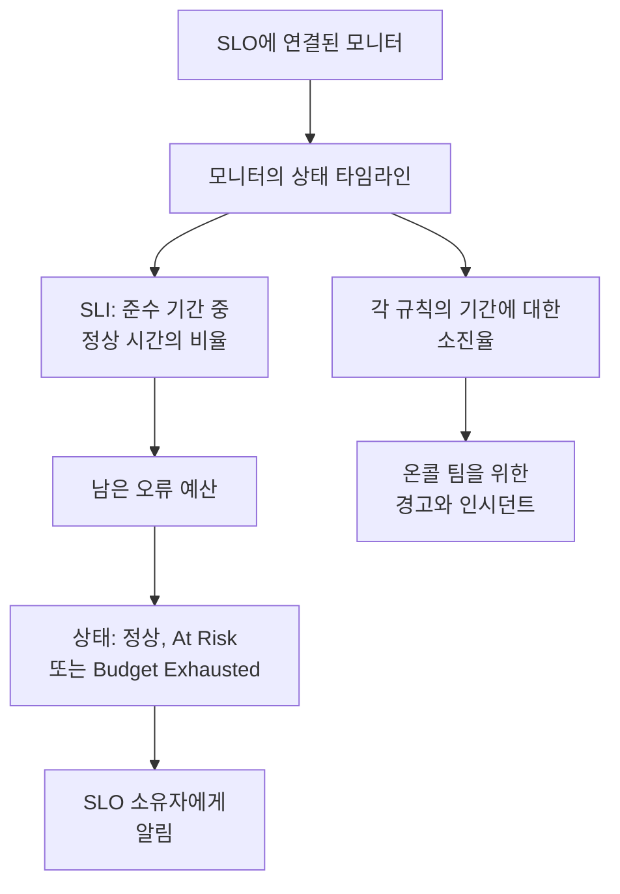

# SLO 개요

서비스 수준 목표(SLO)는 모니터링하는 대상의 안정성 목표입니다. 예를 들어 "최근 30일 롤링 기준으로 99.9%의 시간 동안 사용 가능"처럼 정합니다. OneUptime은 5분마다 각 SLO를 목표와 비교해 측정하므로, "지금 작동하는가?" 대신 "사용자에게 중요한 기간 동안 충분히 안정적이었는가, 그리고 실패할 여유가 얼마나 남았는가?"에 답할 수 있습니다.

:::cards
- [SLO 만들기](#slo-만들기): 이름과 목표만 정하면 됩니다. 나머지는 모두 기본값으로 시작합니다.
- [모니터 및 모니터 규칙](/docs/slo/monitor-rules): SLO가 측정할 모니터를 고릅니다.
- [오류 예산](/docs/slo/error-budget): 목표가 허용하는 다운타임의 양과 예산이 회복되는 방식.
- [소진율 경고 및 인시던트](/docs/slo/burn-rate-alerts): 예산이 너무 빨리 소진될 때 팀에 경고합니다.
:::

## 작동 방식

SLO는 연결된 모니터의 상태 타임라인을 읽습니다. 상태 페이지에 표시되는 것과 같은 데이터입니다. OneUptime은 이를 바탕으로 준수 기간 중 정상이었던 시간의 비율, 남은 오류 예산, 예산이 소진되는 속도를 계산합니다.

## 핵심 개념

| 용어 | 의미 |
| --- | --- |
| **SLI** (서비스 수준 지표) | 측정값입니다. 준수 기간 중 SLO의 모니터가 사용 가능했던 시간의 비율입니다. |
| **SLO** (서비스 수준 목표) | SLI의 목표입니다. 예: "최근 30일 동안 99.9% 이상". |
| **오류 예산** | 목표가 허용하는 다운타임입니다: `(100% − target) × window`. 30일 동안 99.9%라면 43분 12초입니다. |
| **소진율** | 일정한 속도와 비교해 예산이 얼마나 빨리 쓰이는지입니다. 소진율이 1이면 예산은 기간이 끝날 때 정확히 바닥납니다. |

오류 예산은 안정성을 쓸 수 있는 것으로 바꿔 줍니다. 많이 남았다면 더 빨리 배포하고 위험을 감수하고, 조금 남았다면 속도를 늦추고 안정성에 투자하세요. SLO는 그 논의에 모두가 볼 수 있는 숫자를 제공합니다.

## SLO 만들기

SLO를 만들 수 있는 역할이 필요합니다. Project Owner, Project Admin, 또는 Create Service Level Objective 권한이 있는 사용자 지정 역할입니다.

:::steps
### SLO 열기

상단 바의 **제품** 메뉴에서 **SLOs** 를 엽니다. 모니터, 인시던트와 함께 첫 번째 그룹에 있습니다. **Service Level Objective 만들기** 를 클릭합니다.

### 이름과 목표 정하기

**이름** (예: "API Availability")과 **Target (%)** 를 입력합니다. 목표는 모니터가 사용 가능해야 하는 시간의 비율입니다. 목표는 `99.9`에서 시작합니다. 0보다 크고 99.999 이하여야 합니다. 목표가 100%이면 추적할 오류 예산이 남지 않기 때문입니다.

### 추가 필드에서 기본값 확인하기

**추가 필드** 는 접혀 있고, 기본값이 하는 일을 알려 주는 한 줄이 표시됩니다. SLO는 30일 롤링 기간으로 측정되며, 오류 예산이 20% 미만으로 남으면 위험 상태가 됩니다. 아래 표의 필드를 바꾸려면 펼치세요.

### SLO 저장하기

**Service Level Objective 만들기** 를 클릭합니다. OneUptime이 새 SLO를 엽니다. 새 SLO에는 아직 모니터가 없으므로 **개요** 에 **Choose what this SLO measures** 가 표시됩니다.

### 모니터 연결하기

**Create a monitor rule** 을 클릭하면 일치하는 모든 모니터를 지금과 앞으로 연결하고, **Add monitors** 를 클릭하면 직접 고를 수 있습니다. [모니터 및 모니터 규칙](/docs/slo/monitor-rules)을 참고하세요.

### 첫 숫자가 나타나는지 확인하기

OneUptime은 활성화된 SLO를 5분마다 평가합니다. SLI, 오류 예산, 번다운 차트는 측정할 모니터가 있는 첫 평가 후에 나타납니다.
:::

**추가 필드** 의 필드:

| 필드 | 설정하는 내용 | 기본값 |
| --- | --- | --- |
| **설명** | SLO의 용도. | 비어 있음 |
| **위험 임계값 (%)** | SLO가 **At Risk** 로 바뀌는 남은 오류 예산의 비율. 0에서 100 사이의 정수입니다. | 20 |
| **Window Type** | **Rolling**: 최근 N일이며, 오래된 다운타임이 기간에서 빠지면서 회복됩니다. **Calendar Month**: 매달 독립적이며 1일에 초기화됩니다. | **Rolling** |
| **Window (Days)** | 롤링 기간에만 해당합니다. 되돌아볼 일수로 1에서 366 사이입니다. 보통 28 또는 30입니다. | 30 |
| **시간대** | 달력 월에만 해당합니다. 각 달이 시작되고 끝나는 시간대입니다. | UTC |
| **레이블** | SLO를 정리하고 필터링하는 레이블. | 없음 |

SLO의 측정 방식을 정하는 모든 것은 나중에 바꿀 수 있는 기본값으로 시작합니다:

| 설정 | 새 SLO의 시작값 | 바꾸는 곳 |
| --- | --- | --- |
| 모니터 | 없음 | **모니터** 또는 **Monitor Rules** |
| 다운타임 상태 | 프로젝트의 운영 중이 아닌 모든 상태 | **설정** → **Downtime Calculation** |
| 다중 모니터 모드 | **Any Monitor Down** | **설정** → **Downtime Calculation** |
| 평가 | 켜짐 | **설정** → **평가** |
| 소진율 규칙 | 기간에 맞춘 **Fast burn** 규칙과 **Slow burn** 규칙 | **Burn Rate Rules** |

## SLO의 구성 요소

| 요소 | 정하는 것 |
| --- | --- |
| 모니터 | SLI의 출처. 직접 연결하거나 모니터 규칙으로 연결합니다. [모니터 및 모니터 규칙](/docs/slo/monitor-rules)을 참고하세요. |
| 목표 | SLO가 약속하는 정상 시간의 비율. 0보다 크고 99.999 이하입니다. |
| 준수 기간 | SLI와 예산을 측정하는 기간. 1일에서 366일 사이의 롤링 기간 또는 달력 월입니다. |
| 위험 임계값 | SLO가 **At Risk** 로 바뀌는 남은 예산의 비율. |
| 다운타임 상태 | 어떤 모니터 상태를 다운타임으로 셀지. |
| 다중 모니터 모드 | 여러 모니터의 다운타임을 합치는 방식. |

### 다운타임으로 세는 상태

각 SLO에는 다운타임으로 세는 모니터 상태 목록이 따로 있습니다. 새 SLO는 운영 중으로 표시되지 않은 프로젝트의 모든 상태(예: Degraded, Offline)로 시작하며, 이는 상태 페이지와 같습니다. 목록은 **설정** → **Downtime Calculation** 에서 바꿉니다. 비워 두면 나중에 프로젝트에 추가되는 상태를 포함해 운영 중이 아닌 모든 상태를 셉니다.

> [!TIP]
> 두 개의 SLO로 같은 모니터를 두 가지 방식으로 측정해 보세요. Degraded와 Offline을 모두 세는 엄격한 가용성 SLO와, Offline만 세는 느슨한 전체 장애 SLO입니다.

### 준수 기간

| 기간 유형 | 동작 방식 |
| --- | --- |
| **Rolling** | 현재부터 정해진 일수만큼 되돌아봅니다. 오래된 다운타임이 기간에서 빠지므로 예산이 조금씩 돌아옵니다. |
| **Calendar Month** | SLO의 시간대(기본값 UTC)로 매달 1일부터 측정합니다. 매달 초에 예산이 모두 돌아옵니다. |

### 하나의 SLO에 여러 모니터

SLO가 두 개 이상의 모니터를 측정하면 **Multi Monitor Mode** 가 다운타임을 합치는 방식을 정합니다. 새 SLO는 **Any Monitor Down** 을 사용합니다.

| 모드 | 다운타임을 세는 방식 | 사용할 때 |
| --- | --- | --- |
| **Any Monitor Down** | 하나 이상의 모니터가 다운된 모든 순간을 SLO 전체의 다운타임으로 셉니다. 겹치는 장애는 한 번만 셉니다. | 모니터들이 함께 하나의 서비스를 이루어, 어느 하나라도 다운되면 사용자가 알아차리는 경우. |
| **Monitor Seconds Average** | 각 모니터의 다운타임을 따로 세어 모니터링한 전체 시간에 대해 평균합니다: SLI = 1 − (모든 모니터의 다운 초 ÷ 모든 모니터의 모니터링 초). | 모니터가 비슷한 리소스의 묶음이고, 부분적인 영향은 부분적으로 세야 하는 경우. |

예를 들어 모니터 A가 10:00부터 11:00까지 다운되고 모니터 B는 계속 사용 가능했다고 합시다. **Any Monitor Down** 은 60분의 다운타임을 기록하고, **Monitor Seconds Average** 는 두 모니터 중 하나가 한 시간 동안 다운되었으므로 30분에 해당하는 다운타임을 기록합니다. 이 모드에서는 예산도 모니터 초로 셉니다. [오류 예산](/docs/slo/error-budget)을 참고하세요.

## SLO 상태

OneUptime은 평가한 각 SLO에 상태를 부여합니다:

| 상태 | 의미 |
| --- | --- |
| **정상** | 위험 임계값보다 많은 예산이 남아 있습니다. |
| **At Risk** | 남은 예산이 위험 임계값 이하로 떨어졌습니다. 기본값은 20%입니다. |
| **Budget Exhausted** | 예산을 모두 썼거나 초과했습니다. |
| **Misconfigured** | SLO를 측정할 수 없습니다. 모니터가 없거나, 모니터가 더 이상 존재하지 않거나 기간 안에 아직 상태를 기록하지 않았거나, 목표가 범위를 벗어났습니다. |
| **일시 중지됨** | 측정하는 모든 모니터가 보관되었거나, 직접 또는 수동 인시던트나 예약된 유지 관리로 인해 활성 모니터링이 꺼져 있습니다. 그중 하나라도 다시 모니터링되면 자동으로 재개됩니다. |

꺼져 있거나 보관된 SLO는 평가되지 않으므로 상태가 그대로 유지됩니다. 대신 SLO 목록에 **비활성화** 또는 **보관됨** 배지가 표시됩니다. 상태가 **At Risk** 또는 **Budget Exhausted** 로 바뀌면 SLO 소유자에게 알림이 갑니다. [오류 예산](/docs/slo/error-budget)을 참고하세요.

## SLO 목록

**SLOs** 페이지에는 보관되지 않은 각 SLO가 상태, SLI, 남은 예산, 소진율, 목표, 기간, 모니터, 레이블, 소유자와 함께 표시됩니다.

- 목록 위의 타일은 상태별 SLO 수를 셉니다: **정상**, **At Risk**, **Budget Exhausted**, **Misconfigured**, **일시 중지됨**, **비활성화**. 타일을 클릭하면 해당 SLO만 보이고, 다시 클릭하면 모두 보입니다.
- SLO를 선택하면 레이블과 소유자를 한꺼번에 추가하거나 제거하고, 보관하거나 삭제할 수 있습니다.
- 사이드 메뉴의 **설정** 섹션에는 새 SLO에 레이블과 소유자를 붙이는 **레이블 규칙** 과 **소유자 규칙** 이 있습니다. [레이블 및 소유자 규칙](/docs/slo/label-and-owner-rules)을 참고하세요.
- 사이드 메뉴의 **고급** 섹션에는 보관된 SLO 목록인 **보관됨** 이 있습니다.

## SLO의 페이지

SLO를 열면 사이드 메뉴에 해당 페이지가 표시됩니다:

| 페이지 | 표시 내용 |
| --- | --- |
| **개요** | 상태, 주요 수치, 오류 예산 번다운, 최근 활동, 열린 경고와 인시던트, 소진율 규칙. |
| **메트릭** | SLO의 `oneuptime.slo.*` 메트릭, 장기 오류 예산 기록, SLO에 영향을 주는 인시던트와 경고의 메트릭. [SLO 메트릭 및 대시보드](/docs/slo/metrics)를 참고하세요. |
| **인시던트** | 소진율 규칙이 선언한 인시던트. 배지는 열린 항목 수를 셉니다. |
| **알림** | 소진율 규칙이 발생시킨 경고. 배지는 열린 항목 수를 셉니다. |
| **Feed** | SLO에 일어난 일을 시간순으로 보여 줍니다. [SLO 피드 및 감사 로그](/docs/slo/feed-and-audit-logs)를 참고하세요. |
| **모니터** | 측정하는 모니터와, 각 모니터를 사람이 연결했는지 규칙이 연결했는지. |
| **Monitor Rules** | 일치하는 모니터를 연결하는 규칙. |
| **Burn Rate Rules** | 예산이 너무 빨리 소진될 때 경고를 발생시키고 인시던트를 선언하는 규칙. |
| **소유자** | 상태 변화를 전달받는 사용자와 팀. |
| **설정** | 목표, 준수 기간, 다운타임 계산, 평가 스위치, 보관 카드. |
| **감사 로그** | 누가 언제 SLO, 규칙, 소유자를 바꿨는지. |
| **Delete SLO** | SLO를 영구 삭제하고, 열려 있던 소진율 경고와 인시던트를 해결합니다. |

**모니터**, **Monitor Rules**, **Burn Rate Rules** 는 **구성** 섹션에 있고, **소유자**, **설정**, **감사 로그**, **Delete SLO** 는 **Management** 섹션에 있습니다. 두 섹션 모두 처음에는 접혀 있으며, 코드로 SLO를 관리하는 **개발자** 섹션도 마찬가지입니다. 섹션 제목을 클릭하면 열립니다.

SLO의 측정을 막는 문제가 있으면 각 페이지 상단의 배너가 무엇이 잘못되었는지 알려 주고 해결할 페이지로 연결합니다. [문제 해결](#문제-해결)을 참고하세요.

### 개요

**개요** 는 위에서 아래로 "예산 안에 있는가?"에 답합니다:

- **요약**: 상태, 그 의미를 설명하는 한 문장, 설명. 옆에는 **새로고침** 과 SLO가 마지막으로 평가된 시각이 있습니다. 그 아래에는 목표, **Compliance window** (새 롤링 기간이 채워지는 동안에는 채움 표시기 포함. [새 SLO와 기간 채움 표시기](#새-slo와-기간-채움-표시기) 참고), 모니터 수, 소유자가 있습니다.
- **주요 수치**:
  - **SLI**: 기간 중 정상 시간의 비율과, 목표보다 얼마나 높거나 낮은지.
  - **Error budget left**: 비율, "12m 30s left of 43m 12s" 같은 기간, 위험 임계값에 표시가 있는 막대. 예산을 초과하면 **Budget exceeded** 와 초과량을 표시합니다.
  - **Burn rate**: 최근 60분 동안 예산이 쓰이는 속도로, 기본 빠른 소진 규칙이 사용하는 기간입니다. 1×를 넘으면 주황색이 되고, SLO의 활성화된 소진율 규칙 중 가장 낮은 임계값에 도달하면 **Rule threshold reached** 와 함께 빨간색이 됩니다.
  - **Budget runway**: 이 속도라면 예산이 얼마나 버티는지. [오류 예산](/docs/slo/error-budget#예산-잔여-기간)을 참고하세요.
- **Error budget burn-down**: 현재 기간 동안의 남은 예산. [오류 예산](/docs/slo/error-budget#오류-예산-번다운)을 참고하세요.
- **Recent activity**: SLO 피드의 최신 항목.
- **SLO Details**: 이름, 설명, 레이블. 개요에서 편집하는 설정은 이것뿐입니다.
- **Open alerts & incidents**: 소진율 규칙이 지금 열어 둔 항목.
- **Burn rate rules**: 활성화된 각 규칙의 임계값과 현재 소진율, 그리고 규칙이 선언하는 내용.

### 설정

**설정** 페이지에는 SLO의 측정 방식이 항목별 카드로 모여 있습니다:

| 카드 | 바꾸는 내용 | 알아 둘 점 |
| --- | --- | --- |
| **Objective** | **Target (%)** 와 **위험 임계값 (%)**, **Edit Objective** 로 변경. | 목표가 허용하는 다운타임을 표시합니다. 예: "30일 기간당 43m 12s 다운타임". |
| **Compliance Period** | **Window Type**, **Window (Days)**, **시간대**, **Edit Period** 로 변경. | 기간을 바꿔도 소진율 규칙의 임계값은 그대로이므로 나중에 검토하세요. |
| **Downtime Calculation** | **Multi Monitor Mode** 와 **다운타임 모니터 상태**, **Edit Downtime Calculation** 으로 변경. | 상태를 고르지 않으면 나중에 추가되는 것을 포함해 운영 중이 아닌 모든 상태를 셉니다. |
| **평가** | **이 SLO 평가** 스위치. 바꾸는 즉시 저장됩니다. | 끄면 SLO의 열린 소진율 경고와 인시던트도 해결되므로 확인을 요청합니다. |
| **Archive SLO** | **보관** 또는 **보관 취소**. | [SLO 보관하기](#slo-보관하기)를 참고하세요. |

목표, 기간, 다운타임 계산을 바꾸면 OneUptime은 다음 실행 때 SLO를 다시 평가합니다.

## SLO 보관하기

더 이상 측정하지 않지만 남겨 두고 싶은 SLO(종료된 서비스나 작년 목표 등)는 보관하세요. **설정** → **Archive SLO** 에서 보관하거나, 목록에서 SLO를 선택하고 **보관** 을 고릅니다.

보관된 SLO는:

- SLO 목록, 상태 타일, 대시보드의 SLO 선택기와 목록에서 숨겨집니다.
- 평가되지 않습니다. 수치는 마지막 평가 때 그대로 남고, 소진율 규칙은 발동하지 않으며, 메트릭을 보내지 않습니다.
- 열린 소진율 경고와 인시던트가 해결됩니다.
- 설정, 기록, 규칙, 소유자를 유지합니다. 모니터 규칙이 모니터 목록을 최신으로 유지하므로 올바른 모니터로 재개됩니다.

보관된 SLO는 SLO 목록 사이드 메뉴의 **고급** 아래 **보관됨** 페이지에 표시됩니다. 거기서 선택하고 **보관 취소** 를 고르면 되돌릴 수 있습니다. 다음 실행 때 다시 평가되며, SLI와 예산은 모니터 기록에서 다시 계산됩니다.

보관과 평가 끄기는 별개의 스위치입니다. 보관하기 전에 꺼져 있던 SLO는 보관을 취소해도 꺼진 상태로 남습니다. 배너의 **평가 켜기** 또는 **설정** → **평가** 의 **이 SLO 평가** 로 다시 켜세요.

| 원하는 것 | 방법 |
| --- | --- |
| 잠시 측정을 멈추고 목록에는 남기기 | 평가 끄기 |
| 사용을 종료하되 기록과 설정은 남기기 | 보관 |
| 완전히 없애기 | 삭제 |

## 경고, 인시던트, 모니터의 SLO

소진율 규칙이 만드는 각 경고와 인시던트는 해당 SLO에 연결됩니다:

- 경고나 인시던트 페이지의 **영향받는 리소스** 에 SLO가 표시되고, SLO로 가는 링크가 있습니다.
- 경고와 인시던트 목록은 영향받는 리소스 중에 SLO를 표시하며, **영향받는 리소스** 필터로 목록을 하나의 SLO로 좁힐 수 있습니다.
- SLO의 **알림** 과 **인시던트** 페이지에 해당 항목이 나열되고, 사이드 메뉴의 배지가 열린 항목 수를 셉니다.

이 연결은 규칙이 경고나 인시던트를 만들 때 OneUptime이 설정합니다. 직접 추가할 수 없으며, 경고나 인시던트를 편집해도 제거되지 않습니다.

모니터의 사이드 메뉴에도 **SLOs** 페이지가 있습니다. 해당 모니터를 측정하는 SLO가 표시되므로, 모니터를 일시 중지하거나 바꾸기 전에 어떤 목표가 영향을 받는지 알 수 있습니다.

## 새 SLO와 기간 채움 표시기

기간보다 새로운 롤링 SLO는 지금까지 존재하는 데이터로 측정됩니다. 어제 만든 30일 SLO에는 하루치 데이터만 있습니다. 오류 예산은 작게 시작해 기간이 채워지면서 커지므로, 처음 수치는 나중보다 더 크게 움직입니다.

그동안 **개요** 가 이를 알려 줍니다. 요약에 **Window 23% full** 표시기(첫날에는 **Window under 1% full**)가 나타나고, **Error budget left** 타일도 숫자 아래에 같은 내용을 표시합니다. 둘 다 기간이 채워지면 사라집니다. 달력 월 SLO는 첫날부터 한 달 전체 예산을 가지므로 이를 표시하지 않으며, 예산을 모니터 전체에 걸쳐 세는 **Monitor Seconds Average** 모드의 SLO도 마찬가지입니다.

## 문제 해결

SLO 페이지 상단의 배너가 측정을 막는 원인을 알려 줍니다:

| 배너 | 의미 | 해야 할 일 |
| --- | --- | --- |
| **No monitors attached** | SLO에 모니터가 없어 측정할 대상이 없습니다. | 모니터를 연결하거나 모니터 규칙을 만드세요. |
| **Waiting for SLO evaluation** | 모니터는 연결되었지만 마지막 평가에서 상태 데이터가 없었습니다. | 모니터가 검사되고 있는지 확인하세요. 데이터가 있는 다음 평가 후에 수치가 나타납니다. |
| **Measurement is paused** | 측정하는 모든 모니터가 보관되었거나 활성 모니터링이 꺼져 있습니다. | 하나 이상의 모니터에서 모니터링을 다시 켜거나, 유지 관리가 끝날 때까지 기다리세요. |
| **The target is out of range** | 목표가 0보다 크고 100보다 작은 범위에 있지 않습니다. | **설정** → **Objective** 에서 99.9 같은 목표를 설정하세요. |
| **This SLO is disabled** | 평가가 꺼져 있습니다. | **평가 켜기** 를 클릭하세요. |
| **This SLO is archived** | SLO가 보관되었습니다. | **설정** 에서 보관을 취소하세요. |
| **Not evaluated yet** | SLO를 방금 만들었습니다. | 첫 평가를 기다리세요. 길어야 몇 분입니다. |

## 다음 단계

:::cards
- [모니터 및 모니터 규칙](/docs/slo/monitor-rules): 모니터를 직접 또는 규칙으로 연결합니다.
- [오류 예산](/docs/slo/error-budget): 예산 계산, 남은 기간, 예산이 돌아오는 방식.
- [소진율 경고 및 인시던트](/docs/slo/burn-rate-alerts): 예산이 너무 빨리 소진될 때 온콜 팀에 경고합니다.
- [SLO 메트릭 및 대시보드](/docs/slo/metrics): SLO를 차트로 그리고 SLO 대시보드를 만듭니다.
:::
