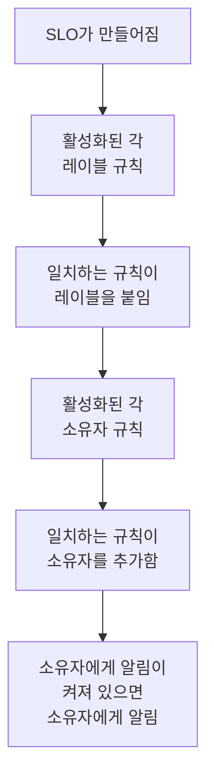

# 레이블 및 소유자 규칙

레이블 규칙과 소유자 규칙은 SLO를 대신 정리해 줍니다. **레이블 규칙** 은 일치하는 모든 새 SLO에 레이블을 붙이고, **소유자 규칙** 은 소유자 사용자와 팀을 추가합니다. 그래서 새 checkout SLO에 _Checkout_ 레이블이 붙고 checkout 팀이 소유하게 되는 일을 누군가 기억할 필요가 없습니다. 둘 다 다른 모든 제품의 레이블 및 소유자 규칙과 똑같이 작동합니다. 공통점은 [레이블 및 소유자 규칙](/docs/configuration/label-and-owner-rules)을 참고하세요.

## 작동 방식

규칙은 대시보드나 API로 SLO가 만들어질 때 실행됩니다. 레이블 규칙이 먼저 실행되므로, 소유자 규칙은 레이블 규칙이 방금 붙인 레이블과도 일치할 수 있습니다.

두 종류 모두 프로젝트 전체에 적용됩니다. SLO 목록 사이드 메뉴의 **설정** 아래에 있는 **레이블 규칙** 과 **소유자 규칙** 에서 찾을 수 있습니다. **설정** 섹션은 처음에 접혀 있으니 제목을 클릭해 여세요.

## 규칙 만들기

:::steps
### 규칙 목록 열기

**SLOs** 를 연 다음 사이드 메뉴에서 **설정** → **레이블 규칙** 또는 **설정** → **소유자 규칙** 을 열고, **SLO Label Rule 만들기** 또는 **SLO Owner Rule 만들기** 를 클릭합니다.

### 규칙이 일치할 대상 고르기

**일치** 단계에서 SLO가 충족해야 하는 조건마다 **조건 추가** 를 클릭합니다([일치 기준](#일치-기준) 참고). 조건이 두 개 이상이면 **모두 일치** 또는 **하나라도 일치** 를 고릅니다. 조건이 없는 규칙은 모든 새 SLO와 일치합니다.

### 규칙이 추가할 것 고르기

레이블 규칙의 두 번째 단계는 **레이블** 이며, 여기서 **추가할 레이블** 을 고릅니다. 소유자 규칙에서는 **소유자** 단계이며, 추가할 **소유자** 를 고릅니다. 사람과 팀을 **소유자 추가** 로 하나의 목록에서 고릅니다. 규칙은 레이블이나 소유자를 하나 이상 추가해야 합니다.

### 이름과 접힌 필드 확인하기

**이름** 은 *Checkout, Production 추가* 나 *Checkout team을(를) 소유자로 추가* 처럼 고른 내용으로 채워지며, 직접 이름을 입력할 때까지 선택에 따라 바뀝니다. **추가 필드** 에는 선택 사항인 **설명** 과, 소유자 규칙의 경우 **소유자에게 알림** 이 있습니다.

### 규칙 저장하기

마지막 단계에서 **SLO Label Rule 만들기** 또는 **SLO Owner Rule 만들기** 를 다시 클릭합니다. 규칙은 활성화된 상태로 시작합니다.
:::

**소유자에게 알림** (**추가 필드** 안)은 기본적으로 켜져 있습니다. 소유자 규칙이 추가한 소유자는 직접 추가된 소유자와 같은 "소유자로 추가되었습니다" 알림을 받습니다. 알리지 않고 소유자를 추가하려면 끄세요.

규칙을 삭제하지 않고 일시 중지하려면 편집 양식에서 **활성화됨** 을 끕니다. 편집 양식은 레이블이나 소유자를 요구하지 않습니다. 아무것도 추가하지 않는 이전 규칙도 이름을 바꾸거나, 끄거나, 삭제할 수 있으며, 목록에는 **추가하는 항목 없음** 으로 표시됩니다.

규칙이 SLO와 일치하면:

- 레이블 규칙은 **추가할 레이블** 의 모든 레이블을 붙입니다. SLO에 이미 있는 레이블은 다시 추가되지 않으며, 여러 규칙이 일치하면 SLO는 그 모든 레이블을 받습니다.
- 소유자 규칙은 규칙의 모든 사용자와 팀을 소유자로 추가합니다. SLO에 이미 있는 소유자는 건너뛰며, 여러 규칙이 일치하면 SLO는 그 모든 소유자를 받습니다. 더 이상 프로젝트 구성원이 아닌 사용자나 다른 프로젝트의 팀은 추가되지 않지만, 규칙의 다른 소유자는 추가됩니다.

SLO 소유자는 SLO의 상태 변화를 전달받는 사람입니다. [오류 예산](/docs/slo/error-budget)을 참고하세요.

## 일치 기준

각 조건은 SLO의 필드 하나를 비교합니다:

| 필드 | 비교 대상 | 연산자 |
| --- | --- | --- |
| **SLO 레이블** | SLO의 레이블. | **다음 중 하나 포함**, **모두 포함**, **모두 포함하지 않음** |
| **SLO 이름** | SLO의 이름. | **포함**, **포함하지 않음**, **같음**, **같지 않음**, **다음으로 시작**, **다음으로 끝남**, **패턴과 일치**, **패턴과 일치하지 않음** |
| **SLO 설명** | SLO의 설명. | **SLO 이름** 과 같음 |

이름이나 설명에 대한 새 조건은 **포함** 으로 시작합니다. 패턴은 `^checkout-.*` 같은 정규식이나 `*checkout*` 같은 `*` 와일드카드이며, 대소문자를 구분하지 않습니다. 둘 다 아닌 패턴(예: `checkout-(01`)은 아무것과도 일치하지 않은 채 조용히 저장되는 대신 저장할 때 거부됩니다.

| 원하는 것 | 조건 |
| --- | --- |
| checkout 서비스의 모든 SLO | **SLO 이름** 이 `checkout` 포함 |
| 모든 프로덕션 SLO | **SLO 레이블** 이 _Production_ 중 하나 포함 |
| 스테이징을 제외한 checkout SLO | **모두 일치**: **SLO 이름** 이 `checkout` 을 포함하고, **SLO 레이블** 이 _Staging_ 을 모두 포함하지 않음 |

## 규칙이 실행되는 시점

- **SLO가 만들어질 때** (대시보드 또는 API): 활성화된 각 레이블 규칙, 그다음 활성화된 각 소유자 규칙.
- **규칙을 실행할 때** (**Run Now** 사용): 아래를 참고하세요.

SLO를 편집해도 규칙이 다시 적용되지 않으며, 규칙은 아무것도 제거하지 않습니다. 누군가 직접 추가한 레이블이나 소유자도, 규칙이 직접 추가한 것도 제거하지 않습니다. 꺼진 규칙은 아무 일도 하지 않습니다.

## 기존 SLO에 규칙 실행하기

오늘 작성한 규칙은 그 뒤에 만들어지는 SLO에 적용됩니다. 이미 있는 SLO에 적용하려면 규칙 행의 **Run Now** 를 클릭하거나, **보기** 를 클릭한 다음 규칙 자체의 페이지에서 **Run Now** 를 클릭합니다. 여러 규칙을 선택해 표의 일괄 작업으로 실행할 수도 있습니다.

실행은 보관된 것을 포함해 프로젝트의 모든 SLO를 확인하고, 일치한 수와 변경한 수를 알려 줍니다. 실행으로 추가된 소유자는 실행 대화 상자에서 알리기를 선택하고 규칙의 **소유자에게 알림** 이 켜져 있을 때만 알림을 받습니다. [기존 리소스에 규칙 실행](/docs/configuration/run-rules-now)을 참고하세요.

레이블 규칙은 프로젝트 간에 복사할 수도 있습니다. [레이블 규칙 가져오기 및 내보내기](/docs/configuration/label-rule-import-export)를 참고하세요.

## 기록

규칙이 SLO를 바꿀 때마다 SLO의 **Feed** 에 어떤 규칙이 바꿨는지 기록됩니다. 규칙이 추가한 각 소유자에게도 "소유자로 추가됨" 피드 항목이 따로 생기므로, 피드에서 누가 왜 추가되었는지 알 수 있습니다. [SLO 피드 및 감사 로그](/docs/slo/feed-and-audit-logs)를 참고하세요.

## 권한

| 하려는 일 | 필요한 권한 |
| --- | --- |
| 레이블 규칙 다루기 | **Create SLO Label Rule**, **Edit SLO Label Rule**, **Delete SLO Label Rule** 또는 **Read SLO Label Rule** |
| 소유자 규칙 다루기 | **Create SLO Owner Rule**, **Edit SLO Owner Rule**, **Delete SLO Owner Rule** 또는 **Read SLO Owner Rule** |
| 레이블 규칙 실행하기 | **Edit SLO Label Rule** 과 **Edit Service Level Objective** |
| 소유자 규칙 실행하기 | **Edit SLO Owner Rule**, **Edit Service Level Objective**, **Create SLO User Owner**, **Create SLO Team Owner** |

이 권한은 역할의 SLO 그룹에 있으며, Project Owner와 Project Admin 역할은 모두 가지고 있습니다. 실행은 프로젝트의 모든 SLO를 바꾸므로, 일부 레이블이나 자신이 소유한 SLO로 제한된 권한으로는 규칙을 실행할 수 없습니다.

## 다음 단계

:::cards
- [레이블 및 소유자 규칙](/docs/configuration/label-and-owner-rules): 모든 제품의 레이블 및 소유자 규칙이 작동하는 방식.
- [기존 리소스에 규칙 실행](/docs/configuration/run-rules-now): 규칙 종류별 Run Now의 동작.
- [SLO 개요](/docs/slo/introduction): SLO가 가진 모든 페이지와 SLO 목록.
:::
