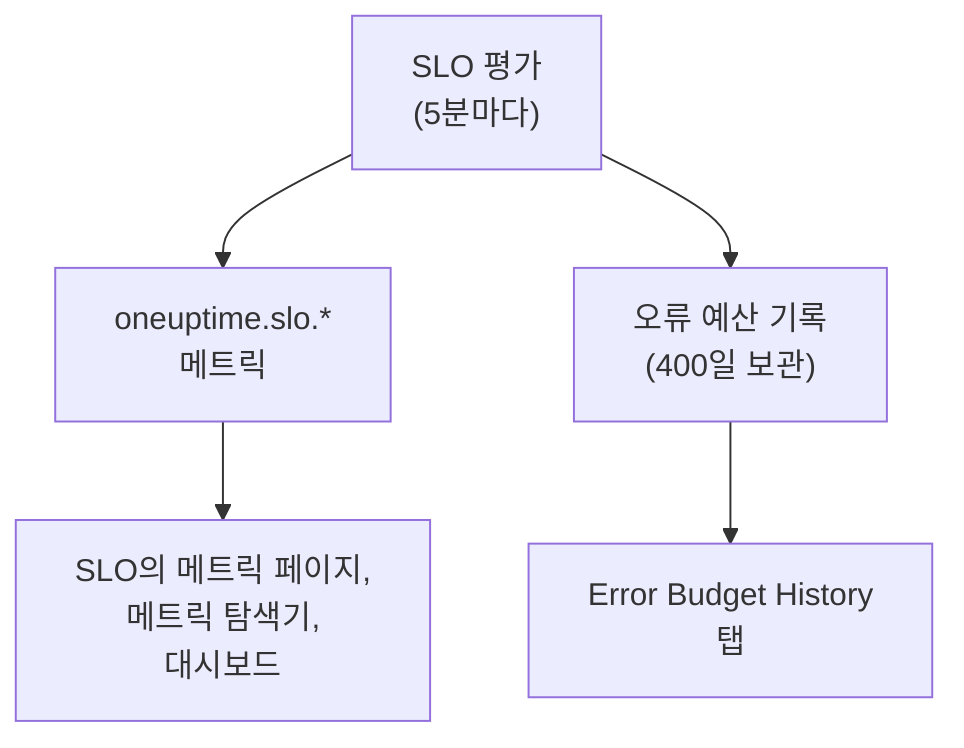

# SLO 메트릭 및 대시보드

OneUptime은 5분마다 SLO를 평가할 때마다 그 결과를 `oneuptime.slo.*` 라는 이름의 메트릭으로 기록합니다. 이 메트릭은 모니터 메트릭과 같은 메트릭 저장소에 있으므로, SLO를 **메트릭** 페이지에서 차트로 그리고, 메트릭 탐색기에서 열고, 다른 시계열처럼 필터링하고 그룹화해 어떤 대시보드에든 올릴 수 있습니다.

:::cards
- [메트릭](#메트릭): 여섯 개의 시계열, 단위, 집계 방법.
- [메트릭 페이지](#메트릭-페이지): SLO의 차트, 기록, 인시던트와 경고 메트릭.
- [대시보드의 SLO](#대시보드의-slo): SLO 위젯과 SLO Dashboard 템플릿.
:::

## 작동 방식

## 메트릭

| 메트릭 | 단위 | 집계 | 담는 내용 |
| --- | --- | --- | --- |
| `oneuptime.slo.sli.percent` | `%` | Avg | SLO의 준수 기간에 대한 SLI. 측정한 시간 중 정상이었던 비율입니다. |
| `oneuptime.slo.target.percent` | `%` | Avg | SLO의 목표. 평가할 때마다 기록되므로 차트에서 SLI 위에 그릴 수 있습니다. |
| `oneuptime.slo.error.budget.remaining.percent` | `%` | Avg | 기간 중 아직 쓰지 않은 오류 예산의 비율. 예산을 초과하면 음수입니다. |
| `oneuptime.slo.error.budget.remaining.seconds` | `seconds` | Avg | SLO가 위반되기 전까지 아직 견딜 수 있는 다운타임. 예산을 초과하면 음수입니다. |
| `oneuptime.slo.burn.rate` | `x` | Max | 최근 60분 동안 예산이 쓰이는 속도. 1x는 기간 동안 예산을 정확히 다 쓰는 속도입니다. |
| `oneuptime.slo.status` | — | Max | 평가할 때마다의 SLO 상태: `0` 은 정상, `1` 은 At Risk, `2` 는 Budget Exhausted 입니다. |

집계는 SLO 자체의 차트와 SLO Dashboard 템플릿이 차트의 한 구간에 들어오는 점을 합치는 방식입니다. 비율과 기간은 평균을 냅니다. 소진율과 상태는 최댓값을 취하므로, 짧은 소진 급증이나 잠깐의 Budget Exhausted 진입이 평균에 묻히지 않습니다.

**Monitor Seconds Average** 모드의 SLO에서 `oneuptime.slo.error.budget.remaining.seconds` 는 오류 예산과 마찬가지로 모니터 전체에서 합한 모니터 초를 셉니다. [오류 예산](/docs/slo/error-budget)을 참고하세요.

### 점이 기록되지 않는 경우

- 꺼져 있거나 보관된 SLO는 평가되지 않으므로 아무것도 기록하지 않습니다.
- **일시 중지됨** 또는 **Misconfigured** SLO는 아무것도 측정하지 않으므로, 측정값이 아닌 설정인 `oneuptime.slo.target.percent` 만 기록합니다. SLI, 예산, 소진율, 상태 차트에는 빈 구간이 생깁니다.
- 데이터가 없는 기간의 소진율처럼 실수가 아닌 값은 건너뛰며, 0으로 기록하지 않습니다.

### 속성

각 점에는 다음 속성이 붙습니다:

| 속성 | 값 |
| --- | --- |
| `sloId` | SLO의 ID. SLO 자체의 페이지가 이 값으로 필터링하므로, SLO 이름을 바꿔도 차트가 나뉘지 않습니다. |
| `sloName` | 점이 기록될 때의 SLO 이름. |
| `projectId` | 프로젝트 ID. |
| `oneuptime.label.<key>` | SLO 레이블마다 하나의 속성. `Tier 1` 이라는 레이블은 `oneuptime.label.tier_1` = `true` 가 되고, `product:checkout` 이라는 레이블은 `oneuptime.label.product` = `checkout` 이 됩니다. 키는 소문자가 되고, 공백과 문장 부호는 `_` 로 바뀝니다. |

시계열은 SLO의 모니터가 아니라 SLO에 속하며, 텔레메트리 사용량에 포함되지 않습니다.

인시던트와 경고 메트릭에는 대응하는 두 속성 `serviceLevelObjectiveIds` 와 `serviceLevelObjectiveNames` 가 붙습니다. 인시던트나 경고가 영향을 주는 SLO의 쉼표로 구분된 목록입니다.

### 보존 기간

`oneuptime.slo.*` 메트릭은 모니터 메트릭과 같은 기간 동안 보존되며, 기본값은 **30일** 입니다. 자체 호스팅 설치에서는 마스터 관리자가 Admin Dashboard의 **데이터 보존** 설정에 있는 **Monitor Metric Retention (Days)** 로 이를 바꿀 수 있습니다.

이는 SLO **메트릭** 페이지의 **Error Budget History** 탭을 제한하지 않습니다. 그 기록은 따로 저장되며 400일 동안 보관됩니다.

## 메트릭 페이지

SLO의 **메트릭** 페이지에는 탭이 네 개 있습니다:

| 탭 | 표시 내용 |
| --- | --- |
| **SLO Metrics** | 하나의 시간 범위(기본값은 최근 하루)를 공유하는 세 카드에 표시되는 `oneuptime.slo.*` 시계열: **Objective** (목표를 겹쳐 그린 SLI와 남은 예산), **Burn** (소진율과 남은 예산 시간), **상태**. |
| **Error Budget History** | 장기 기록에 대한 SLI, 남은 예산, 소진율. 목표, 위험과 소진의 경계, 활성화된 각 소진율 규칙의 임계값에 선이 그어집니다. |
| **인시던트 메트릭** | 이 SLO에 영향을 주는 인시던트의 수, 확인까지의 시간, 해결까지의 시간, 지속 시간(기본값은 최근 일주일). 소진율 규칙이 선언한 인시던트도 포함됩니다. |
| **경고 메트릭** | 경고에 대해 같은 내용. 소진율 규칙이 발생시킨 경고도 포함됩니다. |

**SLO Metrics**, **인시던트 메트릭**, **경고 메트릭** 탭은 메트릭 저장소를 읽으므로 텔레메트리를 읽을 권한이 필요합니다. SLO는 읽을 수 있지만 텔레메트리는 읽을 수 없는 사용자 지정 역할에서는 이 탭들이 비어 보이지만, **Error Budget History** 는 계속 작동합니다.

## 대시보드의 SLO

### SLO 메트릭을 차트로 그리기

:::steps
#### 차트 추가하기

대시보드의 편집 모드에서 차트 또는 값 위젯을 추가하고 `oneuptime.slo.*` 메트릭 중 하나를 고릅니다.

#### 그룹화하거나 필터링하기

`sloName` 과 `sloId` 로 그룹화하면 SLO마다 선이 하나씩 그려집니다. `sloId` 는 이름이 같은 두 SLO를 구분합니다. `sloName` 이나 `oneuptime.label.*` 속성으로 필터링할 수도 있습니다.

#### 집계 고르기

위 표의 집계를 사용하세요. 비율과 기간에는 Avg, 소진율과 상태에는 Max입니다.
:::

### SLO 위젯

[SLO 위젯](/docs/dashboards/widgets#slo)은 한 SLO의 SLI, 남은 예산, 또는 소진율을 타일이나 차트로 보여 줍니다. SLO는 다음 두 방법 중 하나로 정해집니다:

| 설정 | 동작 방식 |
| --- | --- |
| **Service Level Objective** | 위젯을 하나의 SLO에 고정합니다. 선택기에는 보관되지 않은 SLO가 나열됩니다. |
| **Follow SLO Variable** | 대시보드 변수에서 고른 SLO를 보여 줍니다. `sloName` 키의 **Telemetry Attribute** 변수입니다. SLO가 고정되어 있는 동안에는 무시됩니다. |

[공개 대시보드](/docs/dashboards/sharing)에서 변수를 따르는 위젯을 쓰면, 보는 사람이 프로젝트의 보관되지 않은 SLO를 이름으로 고를 수 있습니다. 고정된 위젯은 자신의 SLO만 보여 주며, 나중에 보관된 SLO의 마지막 숫자를 계속 보여 줍니다.

### SLO Dashboard 템플릿

대시보드를 만들 때 **SLO Dashboard** 템플릿을 고르면, 프로젝트의 모든 SLO를 세 개의 띠로 보여 주는 기성 보드가 만들어집니다:

1. **Service Level Objectives**: 보관되지 않은 모든 SLO의 목록으로, 상태, 목표 대비 SLI, 예산 막대, 소진율과 상태별 SLO 수를 보여 줍니다. 활성화된 SLO가 먼저, 예산이 적은 순서로 나오고, 꺼진 SLO는 **비활성화** 로 마지막에 나오며 마지막 숫자가 흐리게 표시됩니다.
2. **Error Budget & Burn Rate**: **Lowest Error Budget Remaining**, **Least Error Budget Time Left**, **Peak Burn Rate** 타일과, `sloName` 과 `sloId` 로 그룹화해 SLO마다 선을 하나씩 그리는 **Error Budget Remaining by SLO**, **Burn Rate by SLO** 차트.
3. **Selected SLO**: 한 SLO의 **SLI**, **Error Budget Remaining**, **Burn Rate** 타일과 **SLI History**, **Error Budget History**, **Burn Rate History** 차트.

도구 모음의 SLO 변수 하나가 보드 전체의 범위를 정합니다. `sloName` 의 Telemetry Attribute 변수이므로, 선택지는 메트릭에 있는 SLO 이름입니다. SLO를 고르면 목록이 그 SLO로 좁혀지고, 띠의 차트와 타일의 범위가 정해지며, 변수를 따르는 **Selected SLO** 위젯이 채워집니다. 고르기 전에는 도구 모음에서 SLO를 고르라고 안내합니다.

## 문제 해결

:::details 도구 모음의 SLO 선택기에 SLO가 없음
선택기에는 최근 하루 동안 기록된 SLO 이름이 나열됩니다. 새 SLO는 첫 평가 후에 나타납니다. **일시 중지됨** 또는 **Misconfigured** SLO는 목표를 계속 기록하므로 고를 수 있습니다. 꺼져 있거나 보관된 SLO는 마지막 점으로부터 약 하루 뒤에 사라집니다.
:::

:::details 이름을 고르면 SLO 두 개가 표시됨
두 SLO의 이름이 같습니다. 목록과 차트에 둘 다 표시되고, **Selected SLO** 위젯은 이름이 모호하다고 알려 줍니다. SLO에는 서로 다른 이름을 붙이세요.
:::

:::details SLO Metrics 탭이 비어 있음
역할에 텔레메트리를 읽을 권한이 없거나, SLO가 아직 평가되지 않았습니다. **Error Budget History** 는 SLO 자체를 읽으므로 계속 작동합니다.
:::

## 다음 단계

:::cards
- [대시보드 위젯](/docs/dashboards/widgets): SLO 위젯을 포함한 모든 위젯.
- [대시보드 변수](/docs/dashboards/variables): 선택기 하나로 보드 전체의 범위를 정합니다.
- [오류 예산](/docs/slo/error-budget): 예산 숫자의 의미.
:::
