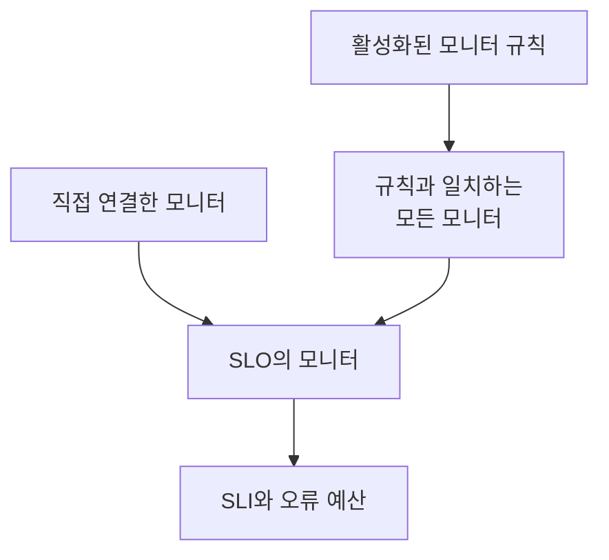

# 모니터 및 모니터 규칙

SLO는 연결된 모니터의 가용성을 측정합니다. 모니터를 직접 연결하거나, 모니터 규칙이 일치하는 모든 모니터를 연결하게 하거나, 둘 다 사용할 수 있습니다. 이 페이지에서는 SLO 사이드 메뉴의 **구성** 아래에 있는 **모니터** 페이지와 **Monitor Rules** 페이지를 다룹니다.

:::cards
- [모니터를 직접 고르기](#모니터-직접-연결하기): 작고 고정된 모니터 묶음에 가장 적합합니다.
- [규칙으로 모니터 연결하기](#규칙으로-모니터-연결하기): "Production 레이블이 붙은 모든 모니터"를 자동으로 최신 상태로 유지합니다.
- [일치 기준](#일치-기준): 규칙이 일치를 판단할 때 쓰는 필드와 연산자.
:::

## SLO가 측정하는 모니터

SLO는 직접 연결한 모니터와, 활성화된 모니터 규칙 중 하나 이상과 일치하는 모든 모니터를 합친 것을 측정합니다.

만들기 양식에서 모니터를 묻지 않으므로 새 SLO에는 모니터가 없습니다. 모니터가 하나도 없는 동안에는 평가할 수 없습니다. 페이지에 **No monitors attached** 가 표시되고, **개요** 에서 모니터를 연결하는 두 가지 방법을 모두 제공합니다.

## 모니터 직접 연결하기

SLO를 편집할 권한이 필요합니다.

:::steps
### 모니터 페이지 열기

SLO를 열고 **모니터** 로 이동합니다.

### 모니터 고르기

**Add Monitors** 를 클릭하고 프로젝트의 모니터를 고릅니다. 아직 연결되지 않은 모니터만 목록에 표시됩니다.

### 목록 저장하기

**Add Monitors** 를 클릭합니다. 모니터는 소스가 **Manual** 로 목록에 나타나고, 다음 평가부터 SLI에 포함됩니다.
:::

SLO에서 모니터를 빼려면 해당 행의 **제거** 를 클릭합니다. 모니터 자체는 바뀌지 않으며, SLO의 SLI와 오류 예산에 더 이상 포함되지 않을 뿐입니다.

**모니터** 페이지에는 모니터마다 다음이 표시됩니다:

| 열 | 표시 내용 |
| --- | --- |
| **현재 상태** | 모니터의 현재 상태. 검사되지 않거나 아직 아무것도 보고하지 않았다면 **보관됨**, **비활성화**, **프로브가 활성화되지 않음**, **프로브 연결 끊김**, **알 수 없음** 중 하나입니다. |
| **소스** | SLO의 모니터 규칙 중 하나가 연결했다면 **Rule**, 누군가 직접 연결했다면 **Manual**. |
| **레이블** | 모니터의 레이블. |

## 규칙으로 모니터 연결하기

모니터 규칙은 SLO가 측정해야 할 모니터를 설명합니다. 예를 들어 "Production 레이블이 붙은 모든 모니터"나 "이름이 api-로 시작하는 모든 모니터"입니다. 일치하는 모든 모니터는 지금은 물론 모니터가 만들어지거나 바뀔 때마다 연결되므로, 누군가 다음 달에 추가할 모니터를 기억할 필요가 없습니다.

:::steps
### Monitor Rules 열기

SLO를 열고 **Monitor Rules** 로 이동한 다음 **SLO Monitor Rule 만들기** 를 클릭합니다.

### 규칙 이름 정하기

**기본 정보** 에서 **이름** 을 입력하고, 원하면 이 모니터들이 이 SLO에 속하는 이유를 **설명** 에 적습니다.

### 일치할 대상 고르기

**일치 기준** 에서 **조건 추가** 를 클릭하고 필드와 연산자를 고른 다음 값을 입력하거나 선택합니다. 조건이 두 개 이상이면 **모두 일치** 또는 **하나라도 일치** 를 고릅니다. 모니터 규칙에는 조건이 하나 이상 필요합니다.

### 규칙 저장하기

**SLO Monitor Rule 만들기** 를 클릭합니다. 규칙은 활성화된 상태로 시작하고 SLO의 모니터가 즉시 다시 평가됩니다. 일치하는 각 모니터는 소스가 **Rule** 로 연결됩니다.
:::

규칙 표에는 각 규칙의 이름, 일치 기준에 대한 설명, 활성화 여부가 표시됩니다. 규칙을 일시 중지하려면 편집 양식에서 **활성화됨** 을 끕니다. **View Monitors** 는 SLO의 **모니터** 페이지를 엽니다.

### 일치 기준

각 조건은 모니터의 필드 하나를 비교합니다:

| 필드 | 비교 대상 | 연산자 |
| --- | --- | --- |
| **모니터 레이블** | 모니터의 레이블. | **다음 중 하나 포함**, **모두 포함**, **모두 포함하지 않음** |
| **모니터 유형** | 유형 목록에서 고른 모니터의 유형. | **같음**, **같지 않음** |
| **모니터 이름** | 모니터의 이름. | **포함**, **포함하지 않음**, **같음**, **같지 않음**, **다음으로 시작**, **다음으로 끝남**, **패턴과 일치**, **패턴과 일치하지 않음** |
| **모니터 설명** | 모니터의 설명. | **모니터 이름** 과 같음 |

패턴은 `^api-.*` 같은 정규식이나 `*checkout*` 같은 `*` 와일드카드이며, 대소문자를 구분하지 않습니다. 둘 다 아닌 패턴(예: `api-(01`)은 아무것과도 일치하지 않은 채 조용히 저장되는 대신 저장할 때 거부됩니다. 프로젝트의 모든 모니터를 연결하려면 **모니터 이름** 이 패턴 `.*` 와 일치하는 조건을 추가하세요.

| 원하는 것 | 조건 |
| --- | --- |
| 모든 프로덕션 모니터 | **모니터 레이블** 이 _Production_ 중 하나 포함 |
| 모든 API 모니터 | **모니터 유형** 이 _API_ 와 같음 |
| 수동 모니터를 제외한 모든 모니터 | **모니터 유형** 이 _Manual_ 과 같지 않음 |
| 이름이 api-로 시작하는 모든 모니터 | **모니터 이름** 이 패턴 `^api-` 와 일치 |
| 스테이징을 제외한 checkout 모니터 | **모두 일치**: **모니터 이름** 이 패턴 `*checkout*` 와 일치하고, **모니터 레이블** 이 _Staging_ 을 모두 포함하지 않음 |

### 규칙이 실행되는 시점

- 규칙을 만들거나, 편집하거나, 켜거나, 끄거나, 삭제하면 SLO의 모니터가 즉시 다시 평가됩니다.
- 모니터가 만들어지거나 레이블, 이름, 설명이 바뀌면 프로젝트의 모든 모니터 규칙이 해당 모니터를 확인합니다. 모니터 레이블 규칙이 붙이는 레이블도 포함됩니다.
- 레이블이 삭제되면, 그 레이블을 규칙에서 쓰던 SLO가 다시 평가됩니다.
- 규칙은 SLO가 꺼져 있거나 보관된 동안에도 모니터 목록을 최신으로 유지하므로, 다시 시작할 때 올바른 모니터로 측정합니다.

규칙은 저장할 때마다 다시 동기화되므로, **Run Now** 는 SLO가 놓친 것을 따라잡기 위한 것입니다. 각 행, 규칙 자체의 페이지(**보기**), 표의 일괄 작업에 있습니다. 규칙을 실행하면 SLO의 활성화된 모니터 규칙이 모두 함께 다시 평가되고, 그다음 대화 상자에 연결되고 연결 해제된 모니터 수가 표시됩니다. 규칙을 실행하려면 SLO 모니터 규칙을 편집할 권한이 필요합니다. [기존 리소스에 규칙 실행](/docs/configuration/run-rules-now)을 참고하세요.

### 규칙이 소유하는 모니터

- 모니터는 활성화된 규칙이 일치하는 동안 연결된 상태를 유지하고, 일치하는 규칙이 없어지면 즉시 연결이 해제됩니다.
- 규칙을 끄거나 삭제하면 다른 활성화된 규칙과 더 이상 일치하지 않는 모니터만 연결이 해제됩니다.
- 규칙은 규칙이 연결한 모니터만 연결을 해제합니다. 직접 연결한 모니터는 우연히 일치하는 규칙이 가져가지 않으며, 일치하지 않게 되어도 연결이 해제되지 않습니다. 소스는 **Manual** 로 유지됩니다.

## 규칙이 켜진 상태에서 직접 고르기

활성화된 규칙이 하나라도 있으면 SLO의 모니터는 규칙이 관리합니다:

- 모니터를 직접 추가할 수 없습니다. **Add Monitors** 가 비활성화되고, 배너에 **This SLO's monitors are managed by its monitor rules** 와 **Manage Monitor Rules** 링크가 표시됩니다.
- 규칙이 연결한 모니터는 규칙이 다시 연결하므로 직접 제거할 수 없습니다. **제거** 버튼이 잠기고 툴팁에 이유가 표시됩니다.
- 규칙을 켜기 전에 직접 연결한 모니터는 여전히 제거할 수 있습니다.

API에서도 마찬가지입니다. 모니터를 다시 직접 고르려면 모든 규칙을 끄세요.

## 모니터가 포함되는 SLO

모니터 페이지에는 해당 모니터를 측정하는 SLO가 나열됩니다. 모니터를 열고 사이드 메뉴의 **SLOs** 로 이동하세요. 모니터를 일시 중지하거나 바꾸기 전에 확인하면 어떤 목표가 영향을 받는지 알 수 있습니다. 보관된 SLO는 평가되지 않으므로 표시되지 않습니다.

## Auto-Add Monitors With Labels에서 넘어오기

이전 버전에서는 SLO 양식에 **Auto-Add Monitors With Labels** 설정이 있었습니다. 업그레이드하면 이 설정을 쓰던 각 SLO에 같은 레이블과 일치하는 **Auto-add monitors with labels** 라는 활성화된 모니터 규칙이 생기므로, 정확히 같은 모니터를 계속 측정합니다. SLO API의 `monitorLabels` 필드는 더 이상 사용되지 않으니 대신 SLO 모니터 규칙을 사용하세요.

:::details 무언가가 아직 이전 설정을 저장한다면?
업그레이드 전에 열어 둔 대시보드 탭이나, 이전 버전용으로 작성된 API 클라이언트 또는 워크플로는 여전히 이전 설정을 저장할 수 있습니다. 이 때문에 SLO가 조용히 모니터를 잃지 않도록 다음과 같이 동작합니다:

- **모니터 규칙이 없는 SLO** 는 저장된 레이블을 **Auto-add monitors with labels** 규칙으로 바꾸고, 모니터를 즉시 다시 평가합니다. 빈 목록을 저장하면 예전처럼 이 설정이 연결한 모니터의 연결이 해제됩니다.
- **모니터 규칙이 있는 SLO** 는 규칙이 켜져 있든 아니든 이전 설정으로 저장된 레이블을 무시합니다. 무엇을 측정할지는 규칙이 정하기 때문입니다.
- 이전 설정으로 모니터가 연결된 SLO에서 **첫 모니터 규칙을 만들면** 먼저 설정을 규칙으로 바꿉니다. 따라서 새 규칙은 이전 설정을 대체하지 않고 그 옆에 추가됩니다.

바뀐 규칙을 삭제하면, 이후에도 그 모니터가 연결되어 있지 않는 한 삭제된 상태로 남습니다. 예를 들어 이전 버전을 실행 중인 서버가 업그레이드 도중 모니터를 다시 연결했다면, 다음 모니터 변경이나 다음 새 규칙이 레이블을 다시 바꿉니다. 업그레이드가 끝나면 그 규칙을 다시 삭제하세요.
:::

## 기록

모든 연결과 연결 해제, 그리고 규칙의 생성, 편집, 삭제는 SLO의 **Feed** 에 나타납니다. 규칙 변경은 **감사 로그** 에도 기록됩니다. [SLO 피드 및 감사 로그](/docs/slo/feed-and-audit-logs)를 참고하세요.

## 문제 해결

:::details Add Monitors가 비활성화되어 있음
SLO의 모니터 규칙 중 하나 이상이 활성화되어 있어 모니터를 규칙이 관리합니다. 규칙을 바꾸거나, 모두 꺼서 모니터를 직접 고르세요.
:::

:::details 모니터의 제거 버튼이 잠겨 있음
모니터 규칙이 그 모니터를 연결했으며 다시 연결할 것입니다. 일치하는 규칙을 바꾸거나 끄세요.
:::

:::details 규칙과 일치해야 하는 모니터가 연결되지 않음
규칙이 활성화되어 있는지, 그리고 **모두 일치** 에서 모든 조건이 충족되는지 확인하세요. 모니터 레이블 규칙이 추가하는 레이블도 포함됩니다. 규칙의 **Run Now** 를 클릭해 SLO를 다시 동기화하세요.
:::

:::details 규칙을 저장할 때 패턴 오류로 실패함
값이 정규식도 `*` 와일드카드도 아닙니다. 예를 들어 닫히지 않은 괄호가 있습니다. 패턴을 고치거나 **포함** 을 사용하세요.
:::

## 다음 단계

:::cards
- [SLO 개요](/docs/slo/introduction): 여러 모니터의 다운타임을 합치는 방식.
- [오류 예산](/docs/slo/error-budget): 모니터의 다운타임이 소진하는 것.
- [기존 리소스에 규칙 실행](/docs/configuration/run-rules-now): 규칙 종류별 Run Now의 동작.
:::
