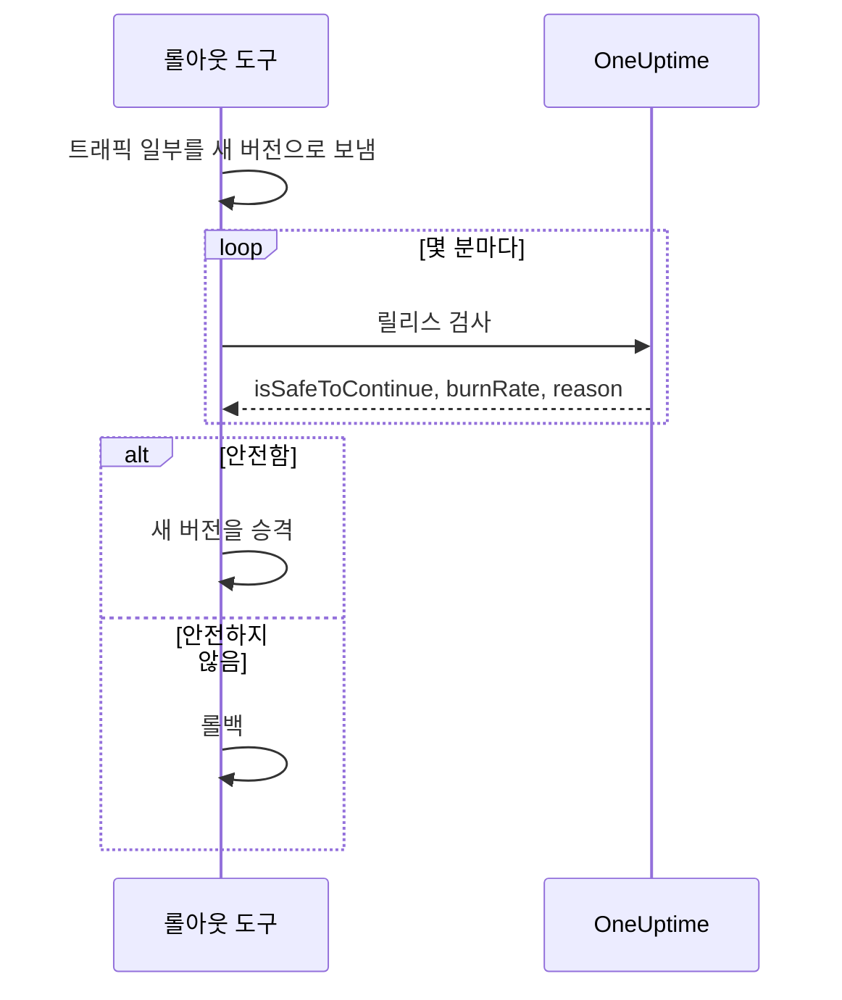

# 릴리스 검사

릴리스 검사는 릴리스가 나가는 동안 SLO에 "이 릴리스를 계속 롤아웃해도 안전한가?"라고 묻고, 최근 몇 분 동안 SLO가 오류 예산을 얼마나 빨리 소진했는지를 바탕으로 답합니다. Argo Rollouts, Flagger 또는 배포 파이프라인은 카나리가 트래픽을 받는 동안 이 검사를 요청하고, 안전하지 않다는 답을 받으면 릴리스를 롤백합니다. OneUptime이 직접 배포하는 것은 없습니다. 롤아웃은 계속 롤아웃 도구가 맡고, OneUptime은 릴리스가 어떤 상태인지 알려 줍니다.

:::cards
- [검사 요청하기](#검사-요청하기): API 키를 사용한 요청 하나와 그 응답.
- [Argo Rollouts](#argo-rollouts): 롤아웃을 중단하는 분석.
- [Flagger](#flagger): 카나리를 멈추는 웹훅.
- [GitHub Actions](#github-actions): 배포 후에 롤백하는 스텝.
:::

## 작동 방식

[배포 게이트](/docs/slo/error-budget-policy#배포-게이트)는 릴리스 전에 준수 기간 전체의 오류 예산을 바탕으로 답합니다. 무언가를 망가뜨리는 릴리스라도 처음 10분 동안에는 한 달 치 예산을 거의 쓰지 않으므로, 릴리스 검사는 릴리스가 바꾸는 것, 즉 최근 몇 분 동안의 소진율을 읽습니다.



검사는 세 가지 판정 중 하나로 답합니다:

| 판정 | 조건 | `isSafeToContinue` |
| --- | --- | --- |
| `Pass` | 기간 동안 오류 예산을 `maxBurnRate` 이하의 속도로 소진했습니다. | `true` |
| `Fail` | 그보다 빠르게 소진했거나, SLO의 오류 예산 정책이 배포를 동결하고 있습니다. | `false` |
| `NotEnoughData` | 기간 안의 요청이 `minimumRequestCount` 보다 적었거나, SLO의 모니터가 그 기간에 아무 상태도 기록하지 않았습니다. 릴리스가 안전하다고 판단하기에는 데이터가 너무 적습니다. | `false` |

소진율이 1이면 그 기간은 SLO의 목표를 정확히 맞춘 것이므로, 기본 `maxBurnRate` 값인 `1` 은 목표보다 나쁜 릴리스를 불합격시킵니다.

검사가 읽는 데이터는 SLO의 측정 대상에 따라 다릅니다:

- [요청 SLO](/docs/slo/request-slos)는 기간 동안 서비스가 처리한 요청으로 판정하며, 요청은 스팬이 도착하는 대로 스팬에서 읽습니다. 새 버전의 요청만 판정하려면 `serviceVersion` 을 추가하세요. OneUptime은 이 값을 스팬의 `service.version` 리소스 속성과 비교하며, OpenTelemetry SDK는 `OTEL_RESOURCE_ATTRIBUTES=service.version=1.4.2` 에서 이 속성을 설정합니다. 이렇게 하면 카나리는 이전 버전의 요청에 희석되지 않고 자기 요청만으로 판정됩니다.
- 모니터 가동률 SLO는 기간 동안 모니터의 상태 타임라인으로 판정합니다. `minimumRequestCount` 는 적용되지 않으며, `serviceVersion` 이 있는 검사는 거부됩니다. 모니터에는 버전이 없기 때문입니다.

## 시작하기 전에

릴리스가 영향을 주는 대상을 측정하는 SLO가 필요합니다. 카나리를 가장 잘 판정하는 것은 릴리스하는 서비스의 요청 SLO입니다. 그 서비스 자체의 요청을 읽기 때문입니다.

## 릴리스 검사 설정하기

:::steps
### 롤아웃에 키 주기

SLO를 읽을 수 있는 역할을 가진 프로젝트의 [API 키](/docs/api-reference/api-reference)를 만들고, 롤아웃 도구나 파이프라인의 시크릿으로 저장합니다.

### SLO의 ID 복사하기

SLO를 열고 주소 `/slos/<slo-id>` 에서 ID를 복사합니다.

### 직접 한 번 검사 요청하기

키와 ID를 넣어 [검사 요청하기](#검사-요청하기)의 요청을 실행합니다. `isSafeToContinue` 와 `reason` 이 담긴 응답이 옵니다.

### 롤아웃에 추가하기

[Argo Rollouts](#argo-rollouts), [Flagger](#flagger) 또는 [GitHub Actions](#github-actions)에서 검사를 요청하고, `isSafeToContinue` 가 `false` 이면 롤백합니다.
:::

## 검사 요청하기

검사는 SLO의 `release-check` 주소에 보내는 `GET` 또는 `POST` 요청입니다. 옵션은 쿼리 문자열로 보내거나, `POST` 와 함께 JSON 본문으로 보냅니다:

```bash
curl -sS "https://oneuptime.com/api/service-level-objective/<slo-id>/release-check?windowInMinutes=10&serviceVersion=1.4.2" \
  -H "ApiKey: $ONEUPTIME_API_KEY"
```

응답에는 판정이 먼저 오고, 그다음에 판정의 근거가 된 데이터가 옵니다:

```json
{
  "isSafeToContinue": false,
  "verdict": "Fail",
  "reason": "The last 10 minutes burned the error budget at 3.2x, faster than the 1x this check allows (SLI 99.68% against the 99.9% target).",
  "sloId": "<slo-id>",
  "sloName": "Checkout requests",
  "sliType": "Request Success",
  "targetPercentage": 99.9,
  "windowInMinutes": 10,
  "maxBurnRate": 1,
  "burnRate": 3.2,
  "sliPercentage": 99.68,
  "deploymentsAllowed": true,
  "errorBudgetPolicyTier": null,
  "sloStatus": "Healthy",
  "checkedAt": "2026-11-15T12:00:00.000Z",
  "goodRequestCount": 2492,
  "totalRequestCount": 2500,
  "minimumRequestCount": 1,
  "serviceVersion": "1.4.2"
}
```

옵션:

| 옵션 | 기본값 | 하는 일 |
| --- | --- | --- |
| `windowInMinutes` | `10` | 검사가 되돌아보는 시간. 1에서 360 사이의 정수(분)입니다. |
| `maxBurnRate` | `1` | 통과하는 가장 빠른 소진율. `2` 이면 기간 동안 목표가 허용하는 속도의 두 배로 예산을 소진해도 통과합니다. |
| `minimumRequestCount` | `1` | 요청 SLO 전용. 검사가 판정하는 최소 요청 수입니다. `0` 이면 요청이 없는 기간도 통과합니다. |
| `serviceVersion` | 없음 | 요청 SLO 전용. 스팬에 이 `service.version` 이 있는 요청만 판정합니다. |
| `includeDeploymentGate` | `true` | SLO의 오류 예산 정책이 배포를 동결하는 동안 불합격시킵니다. `false` 이면 소진율만으로 결정합니다. |
| `failWithStatusCode` | `false` | 상태 코드만 읽는 도구를 위해, 안전하지 않다는 응답을 200 대신 HTTP 상태 412로 보냅니다. |

응답의 필드:

| 필드 | 내용 |
| --- | --- |
| `isSafeToContinue` | 롤아웃을 계속하려면 `true`, 롤백하려면 `false` 입니다. |
| `verdict` | `Pass`, `Fail` 또는 `NotEnoughData`. |
| `reason` | 롤아웃 로그에 남길 한 문장. 무엇을 측정했고 검사가 왜 그렇게 답했는지 알려 줍니다. |
| `burnRate` 와 `sliPercentage` | 기간 동안 오류 예산이 소진된 속도와, 그 기간의 SLI. |
| `goodRequestCount` 와 `totalRequestCount` | 요청 SLO 전용. 기간 안의 요청 수와 그중 좋은 요청의 수. |
| `deploymentsAllowed` 와 `errorBudgetPolicyTier` | SLO의 오류 예산 정책이 배포를 허용하는지, 그리고 SLO가 있는 단계. |
| `checkedAt` | 검사를 측정한 시각. |

측정할 수 없는 SLO(서비스가 없는 요청 SLO, 임계값이 없는 지연 시간 SLO, 모니터가 없는 모니터 가동률 SLO)에는 HTTP 400과 고쳐야 할 내용으로 응답하므로, 롤아웃은 추측이 아니라 분명한 오류에서 멈춥니다. 자체 호스팅 설치에서는 oneuptime.com 대신 그 설치의 주소를 사용하세요.

## Argo Rollouts

`web` 메트릭을 사용하는 분석이 카나리의 각 단계에서 검사를 요청하고, 검사가 실패하면 Argo Rollouts가 롤아웃을 중단하고 카나리를 축소합니다. 먼저 API 키를 시크릿으로 저장하세요:

```bash
kubectl create secret generic oneuptime --from-literal=api-key="$ONEUPTIME_API_KEY"
```

그런 다음 템플릿을 추가하고, 카나리의 첫 단계 뒤에 실행합니다:

:::tabs
@tab AnalysisTemplate
```yaml title="oneuptime-release-check.yaml"
apiVersion: argoproj.io/v1alpha1
kind: AnalysisTemplate
metadata:
  name: oneuptime-release-check
spec:
  args:
    - name: version
    - name: api-key
      valueFrom:
        secretKeyRef:
          name: oneuptime
          key: api-key
  metrics:
    - name: slo-burn-rate
      interval: 2m
      count: 5
      failureLimit: 0
      successCondition: result == true
      provider:
        web:
          url: "https://oneuptime.com/api/service-level-objective/<slo-id>/release-check?windowInMinutes=10&serviceVersion={{args.version}}"
          headers:
            - key: ApiKey
              value: "{{args.api-key}}"
          jsonPath: "{$.isSafeToContinue}"
```
@tab Rollout
```yaml title="rollout.yaml"
apiVersion: argoproj.io/v1alpha1
kind: Rollout
metadata:
  name: checkout
spec:
  strategy:
    canary:
      steps:
        - setWeight: 10
        - analysis:
            templates:
              - templateName: oneuptime-release-check
            args:
              - name: version
                value: "1.4.2"
        - setWeight: 50
        - pause: { duration: 10m }
```
:::

분석은 2분 간격으로 다섯 번 검사를 요청하며, 처음으로 안전하지 않다는 답이 오면 롤아웃을 중단합니다. 카나리의 파드가 `OTEL_RESOURCE_ATTRIBUTES` 에 설정하는 것과 같은 버전을 전달하세요. 카나리가 첫 가중치에서 트래픽을 받지 못할 수도 있다면 주소에 `&minimumRequestCount=0` 을 추가하세요. 그렇지 않으면 트래픽이 없는 카나리는 `NotEnoughData` 로 분석에 실패합니다.

## Flagger

Flagger는 분석의 각 단계에서 `rollout` 웹훅을 호출하고, 웹훅이 계속 실패하면 카나리를 멈추고 롤백합니다. Flagger의 웹훅은 헤더를 보내지 않으므로, 웹훅에 대해 명령을 실행하는 Flagger 로드 테스터를 통해 검사를 요청하세요:

```yaml title="canary.yaml"
apiVersion: flagger.app/v1beta1
kind: Canary
metadata:
  name: checkout
spec:
  analysis:
    interval: 1m
    threshold: 2
    maxWeight: 50
    stepWeight: 10
    webhooks:
      - name: oneuptime-release-check
        type: rollout
        url: http://flagger-loadtester.test/
        timeout: 30s
        metadata:
          type: bash
          cmd: "curl -sSf -H \"ApiKey: $ONEUPTIME_API_KEY\" 'https://oneuptime.com/api/service-level-objective/<slo-id>/release-check?windowInMinutes=5&failWithStatusCode=true'"
```

`failWithStatusCode=true` 이면 안전하지 않다는 응답은 HTTP 412이므로, `curl -f` 가 오류로 종료되고 웹훅이 실패합니다. 로드 테스터의 환경에 Kubernetes 시크릿에서 가져온 키를 `ONEUPTIME_API_KEY` 로 넣어 주세요. 검사가 `threshold` 번 실패하면 Flagger가 카나리를 롤백합니다.

## GitHub Actions

한 번에 배포하는 파이프라인도 릴리스를 지켜볼 수 있습니다. 배포하고, 검사를 몇 번 요청하고, 안전하지 않다는 답이 오면 롤백합니다.

```yaml title=".github/workflows/deploy.yml"
name: Deploy
on:
  push:
    branches: [main]

jobs:
  deploy:
    runs-on: ubuntu-latest
    steps:
      - uses: actions/checkout@v4
      - name: Deploy
        run: ./deploy.sh
      - name: Watch the release against the SLO
        env:
          ONEUPTIME_API_KEY: ${{ secrets.ONEUPTIME_API_KEY }}
          SLO_ID: <slo-id>
          VERSION: ${{ github.sha }}
        run: |
          for attempt in 1 2 3 4 5; do
            sleep 120
            CHECK=$(curl -sS "https://oneuptime.com/api/service-level-objective/$SLO_ID/release-check?windowInMinutes=10&serviceVersion=$VERSION" \
              -H "ApiKey: $ONEUPTIME_API_KEY")
            echo "$CHECK" | jq -r '.reason'
            if [ "$(echo "$CHECK" | jq -r '.isSafeToContinue')" != "true" ]; then
              exit 1
            fi
          done
      - name: Roll back
        if: failure()
        run: ./rollback.sh
```

스텝은 안전하지 않다는 답이 올 때, 그리고 `isSafeToContinue: true` 가 없는 모든 응답(잘못된 ID, SLO를 읽을 수 없는 키, 응답 없음)에서 실패하므로, 파이프라인은 받지 못한 답을 믿고 계속 진행하는 일이 없습니다. 서비스가 시작될 때 `service.version` 을 커밋(`${{ github.sha }}`)으로 설정하면, 검사는 새 버전만 판정합니다.

## 다음 단계

:::cards
- [요청 및 지연 시간 SLO](/docs/slo/request-slos): 서비스의 요청을 측정합니다. 카나리를 가장 잘 판정하는 SLI입니다.
- [오류 예산 정책](/docs/slo/error-budget-policy): 예산이 적은 동안 배포를 동결합니다.
- [소진율 경고 및 인시던트](/docs/slo/burn-rate-alerts): 예산이 너무 빨리 소진될 때 팀에 경고합니다.
:::
