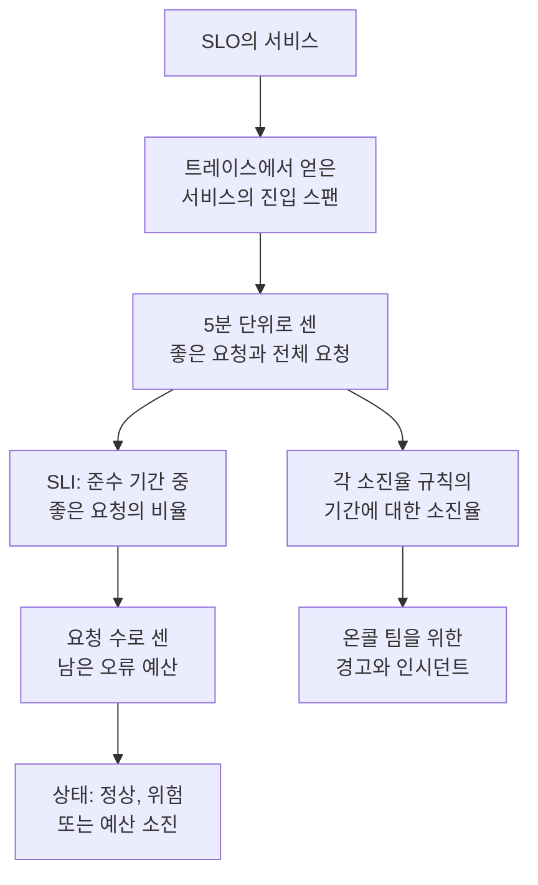

# 요청 및 지연 시간 SLO

요청 SLO는 사용자가 서비스에서 실제로 받는 것을 측정합니다. 서비스의 요청 중 성공한 요청의 비율, 또는 충분히 빠르게 처리된 요청의 비율입니다. OneUptime은 서비스가 이미 보내고 있는 트레이스에서 요청을 세므로 따로 설정할 모니터가 없습니다. 서비스와 목표를 고르면 OneUptime이 5분마다 측정합니다.

:::cards
- [요청 SLO 만들기](#요청-slo-만들기): 서비스, 지연 시간 임계값, 목표.
- [일부 요청만 세기](#일부-요청만-세기): 엔드포인트 하나, 또는 상태 확인을 뺀 모든 요청.
- [메트릭 기반 SLO](#메트릭-기반-slo): 트레이스를 보내지 않는 서비스를 위한 카운터 또는 히스토그램.
- [요청을 세는 방식](#요청을-세는-방식): 어떤 스팬을 언제 세는지.
- [릴리스 검사](/docs/slo/release-checks): 오류 예산을 소진하는 릴리스를 롤백합니다.
:::

## 요청 성공률과 요청 지연 시간

| 측정 대상 | 나쁜 요청이 되는 경우 | 오류 예산으로 세는 것 |
| --- | --- | --- |
| **요청 성공률** | 스팬의 상태가 `Error` 인 경우. 상태가 없는 스팬은 OpenTelemetry의 정의대로 좋은 요청으로 셉니다. | 실패한 요청 |
| **요청 지연 시간** | 상태와 관계없이 SLO의 **지연 시간 임계값 (ms)** 보다 오래 걸린 경우. | 느린 요청 |

SLI는 준수 기간 중 좋은 요청의 비율이고, 오류 예산은 목표가 허용하는 나쁜 요청입니다. 99.9%라면 1,000개 중 1개입니다. 지연 시간 SLO는 빠르게 실패한 요청을 좋은 요청으로 세므로, 중요한 서비스는 두 가지 방식으로 측정하세요. 하나는 작동하는지를 보는 SLO, 다른 하나는 빠른지를 보는 SLO입니다.

## 작동 방식

요청은 SLO의 서비스 중 하나의 진입 스팬입니다. 진입 스팬은 요청이나 메시지가 서비스로 들어오는 스팬으로, [트레이스](/docs/telemetry/traces-explorer#트레이스와-스팬) 목록에 기본으로 표시되는 스팬입니다. SLO의 서비스 두 개를 거치는 요청은 각 서비스에서 한 번씩 셉니다.

그다음부터 요청 SLO는 다른 SLO와 똑같이 작동합니다. 상태, 소진율 규칙, 오류 예산 정책, 소유자, 알림이 모두 같으며, 오류 예산만 분이 아니라 요청 수로 셉니다.

## 시작하기 전에

- 서비스가 OneUptime으로 트레이스를 보내고 있어야 합니다. [OpenTelemetry](/docs/telemetry/open-telemetry)를 참고하세요. 각 서비스는 `service.name` 으로 [서비스 카탈로그](/docs/telemetry/services)에 등록되어 있습니다.
- SLO를 만들 수 있는 역할이 필요합니다. 프로젝트 소유자, 프로젝트 관리자, 또는 Create Service Level Objective 권한이 있는 사용자 지정 역할입니다.

## 요청 SLO 만들기

:::steps
### SLO 열기

상단 바의 **제품** 메뉴에서 **SLOs** 를 열고 **서비스 수준 목표 만들기** 를 클릭합니다.

### 측정 대상 고르기

**측정 대상** 에서 **요청 성공률** 또는 **요청 지연 시간** 을 고른 다음, 요청을 셀 **서비스** 를 고릅니다. **요청 지연 시간** 이라면 **지연 시간 임계값 (ms)** 도 설정합니다. 이 시간 안에 처리된 요청은 충분히 빠른 것으로 셉니다. 예를 들면 `300` 입니다. 요청 중 일부만 세려면 **요청 필터** 를 입력합니다. [일부 요청만 세기](#일부-요청만-세기)를 참고하세요. **다음** 을 클릭합니다.

### 이름과 목표 정하기

**이름** (예: "Checkout requests")과 **목표(%)** 를 입력합니다. 목표는 좋은 요청이어야 하는 요청의 비율입니다. **서비스 수준 목표 만들기** 를 클릭합니다.

### 첫 숫자가 나타나는지 확인하기

첫 평가는 5분 안에 이루어지며 최근 6시간의 요청을 세므로, SLO에 바로 숫자가 나타납니다. 그 뒤의 평가는 준수 기간이 다 채워질 때까지 더 오래된 요청도 셉니다.
:::

서비스 자체의 **SLOs** 페이지에는 그 서비스를 측정하는 SLO가 표시되며, 그곳의 **서비스 수준 목표 만들기** 는 서비스가 이미 선택된 같은 양식을 엽니다. 나중에 SLO의 측정 대상, 서비스, 임계값, 필터를 바꾸려면 SLO의 **설정** 을 열고 **측정 대상 편집** 을 클릭합니다.

## 일부 요청만 세기

요청 SLO는 서비스의 모든 요청을 셉니다. **요청 필터** 를 쓰면 결제 엔드포인트처럼 중요한 요청만 세거나, 사용자가 실제로 받는 것보다 SLI를 좋아 보이게 만드는 상태 확인처럼 일부 요청을 뺄 수 있습니다. 필터는 트레이스 검색으로, 트레이스 탐색기와 같은 [검색 구문](/docs/telemetry/search-syntax#값-일치)으로 씁니다:

| 요청 필터 | 세는 요청 |
| --- | --- |
| `@http.route:/checkout*` | 경로가 `/checkout` 으로 시작하는 요청. |
| `-@http.route:/health` | 상태 확인을 제외한 모든 요청. |
| `@http.request.method:[POST, PUT]` | POST 및 PUT 요청. |
| `name:"POST /checkout"` | 스팬 이름이 `POST /checkout` 인 요청. |

모든 조건이 일치해야 하므로, `@http.route:/checkout* -@http.route:/checkout/health` 는 상태 확인을 제외한 결제 요청을 셉니다. `@` 가 붙은 조건은 요청 스팬의 속성이고, `name:` 은 스팬의 이름입니다. 자유 텍스트와 `status:`, `duration:` 같은 탐색기의 다른 필드는 여기서 필터가 되지 않습니다. 어떤 요청이 나쁘거나 느린지는 SLO가 이미 정하기 때문입니다. 필터에는 500자 안에 최대 10개의 조건을 쓸 수 있습니다.

**개요** 는 SLO의 서비스 아래에 필터를 표시하고, **설정** 은 **측정 대상** 아래에 필터를 표시합니다. 필터를 바꾸면 SLO의 요청을 처음부터 다시 셉니다.

## 메트릭 기반 SLO

서비스가 이미 요청을 메트릭으로 세고 있거나 트레이스를 보내지 않는다면, 대신 카운터나 히스토그램으로 SLO를 측정하세요. **측정 대상** 에서 **메트릭** 과 그 메트릭을 보내는 **서비스** 를 고른 다음, **메트릭** 단계에서 다음을 입력합니다:

| 필드 | 입력할 내용 |
| --- | --- |
| **메트릭** | 메트릭 이름. 프로젝트의 메트릭에서 고르거나 직접 입력합니다. 예: `http_requests_total` 또는 `http.server.request.duration`. |
| **정상 이벤트** | **카운터, 조건으로 구분** 또는 **히스토그램, 값으로 구분**. |
| **정상 조건** | 카운터의 경우: 정상인 이벤트를 속성 검색으로 지정합니다. 예: `@http.response.status_code:<500`. |
| **정상 상한값** | 히스토그램의 경우: 정상 관측값이 넘지 않아야 하는 값을 메트릭 자체의 단위로 지정합니다. 예를 들어 초 단위 히스토그램에서 300 ms는 `0.3` 입니다. 히스토그램의 버킷 경계 중 하나를 쓰세요. |
| **메트릭 필터** | 선택 사항: 셀 계열을 지정합니다. 예: `-@http.route:/health`. |

카운터의 이벤트는 5분 단위마다 카운터가 늘어난 양으로, Prometheus의 `increase()` 와 같은 방식으로 읽습니다. 다시 시작한 카운터는 0부터 다시 세며, 누적 카운터와 델타 카운터를 모두 셉니다. 히스토그램의 이벤트는 관측값이고, 정상 이벤트는 그 값 이하의 버킷에 든 관측값입니다. SLO의 서비스에서 온 해당 메트릭 자체의 포인트만 셉니다. 이름이 같은 게이지는 아무것도 세지 않습니다. 모든 클라우드 메트릭은 게이지이며, 게이지에 대한 SLO는 페이지와 메트릭 선택기에서 이를 알립니다. 클라우드 메트릭은 메트릭 모니터와 그 모니터의 가동률 SLO로 측정하세요.

그다음부터 메트릭 SLO는 요청 SLO와 똑같이 작동하며, 오류 예산, 소진율 규칙, 릴리스 검사를 이벤트 수로 셉니다. 메트릭을 바꾸면 이벤트를 처음부터 다시 셉니다.

## 요청을 세는 방식

OneUptime은 각 SLO의 좋은 요청과 전체 요청을 5분 단위로 세고 그 집계를 저장합니다. 그래서 SLO는 매번 모든 스팬을 다시 읽지 않고, 저장된 자체 집계에서 기간을 읽습니다:

- 각 단위는 끝나고 2분 뒤에 세므로 늦게 도착한 스팬도 포함되며, 다음 평가는 그보다 더 늦게 도착하는 스팬을 위해 마지막 두 단위를 다시 셉니다.
- 새 SLO는 최근 6시간부터 시작합니다. 그 뒤의 각 평가는 기간이 다 채워질 때까지 최신 것부터 거슬러 올라가며 최대 하루치의 더 오래된 요청을 셉니다.
- [텔레메트리 보존 기간](/docs/telemetry/data-retention#텔레메트리-보관-기간) 안에 남아 있는 요청만 셀 수 있습니다. 센 단위는 어떤 준수 기간보다도 긴 400일 동안 보관되므로, 보존 기간보다 긴 준수 기간은 SLO가 오래될수록 채워집니다.
- SLO의 측정 대상, 서비스, 지연 시간 임계값, 요청 필터를 바꾸면 요청을 처음부터 다시 셉니다. 준수 기간을 늘리면 더 이전까지 거슬러 세어 채웁니다.

집계가 준수 기간의 일부만 덮는 동안에는 **개요** 에 **기간의 23%에 데이터 있음** 표시기가 나타나고, **남은 오류 예산** 타일도 숫자 아래에 같은 내용을 표시합니다. 집계가 기간 전체를 덮으면 둘 다 사라집니다.

## 요청 수로 세는 오류 예산

예산은 기간 안에 센 요청 중 목표가 허용하는 나쁜 요청이므로 트래픽에 따라 커집니다. 99.9%라면 요청이 2,000,000개인 기간에서는 실패한 요청 2,000개를 허용합니다. **개요** 에서는:

- **남은 오류 예산** 은 전체 중 나쁜 요청이 몇 개 남았는지, 또는 SLO가 예산을 몇 개 초과했는지 알려 줍니다.
- **예산 지속 기간** 은 트래픽이 지금과 같다면 현재 소진율로 예산이 얼마나 버티는지 알려 줍니다.
- 요약에는 SLO의 서비스 수가 표시되고, 지연 시간 SLO는 목표 아래에 임계값이 표시됩니다.

소진율 경고, 알림, 피드도 예산을 요청 수로 표시합니다. 요청 SLO에는 `oneuptime.slo.error.budget.remaining.seconds` 메트릭이 게시되지 않으므로, 대신 `oneuptime.slo.error.budget.remaining.percent` 를 차트로 그리세요.

요청 SLO도 다른 새 SLO와 같은 **Fast burn**, **Slow burn**, **Slow leak** 규칙을 받습니다. 요청이 몇 개뿐인 한가한 시간에는 실패 하나만으로도 예산이 빠르게 소진될 수 있으므로, 규칙은 요청이 너무 적은 기간을 무시할 수 있습니다. 규칙의 **최소 요청 수** 를 설정하면, 규칙은 요청 수가 그보다 적은 긴 기간을 건너뜁니다.

## 문제 해결

:::details SLO에 요청 대기 중가 표시됩니다
아직 기간 안에 요청을 처리한 서비스가 하나도 없습니다. 서비스가 OneUptime으로 트레이스를 보내는지, 그리고 스팬에 진입 스팬이 포함되어 있는지 확인하세요. 스팬이 모두 내부 스팬인 서비스에는 셀 요청이 없습니다. SLO에 **요청 필터** 가 있다면 그 필터로 [트레이스 탐색기](/docs/telemetry/traces-explorer)에서 검색해 보세요. 그곳에서 어떤 요청과도 일치하지 않는 필터라면 SLO에는 셀 요청이 없습니다.
:::

:::details 서비스를 바꾼 뒤 SLI가 달라졌습니다
SLO의 측정 대상, 서비스, 지연 시간 임계값, 요청 필터를 바꾸면 최근 6시간부터 요청을 다시 세므로, SLI와 예산도 거기서부터 다시 시작합니다. **기간의 23%에 데이터 있음** 표시기는 지금까지 기간의 얼마만큼을 셌는지 보여 줍니다.
:::

## 다음 단계

:::cards
- [릴리스 검사](/docs/slo/release-checks): Argo Rollouts, Flagger 또는 파이프라인이 예산을 소진하는 릴리스를 롤백하게 합니다.
- [소진율 경고 및 인시던트](/docs/slo/burn-rate-alerts): 예산이 너무 빨리 소진될 때 팀에 경고합니다.
- [오류 예산 정책](/docs/slo/error-budget-policy): 예산이 줄어들 때 팀이 무엇을 할지 합의합니다.
:::
