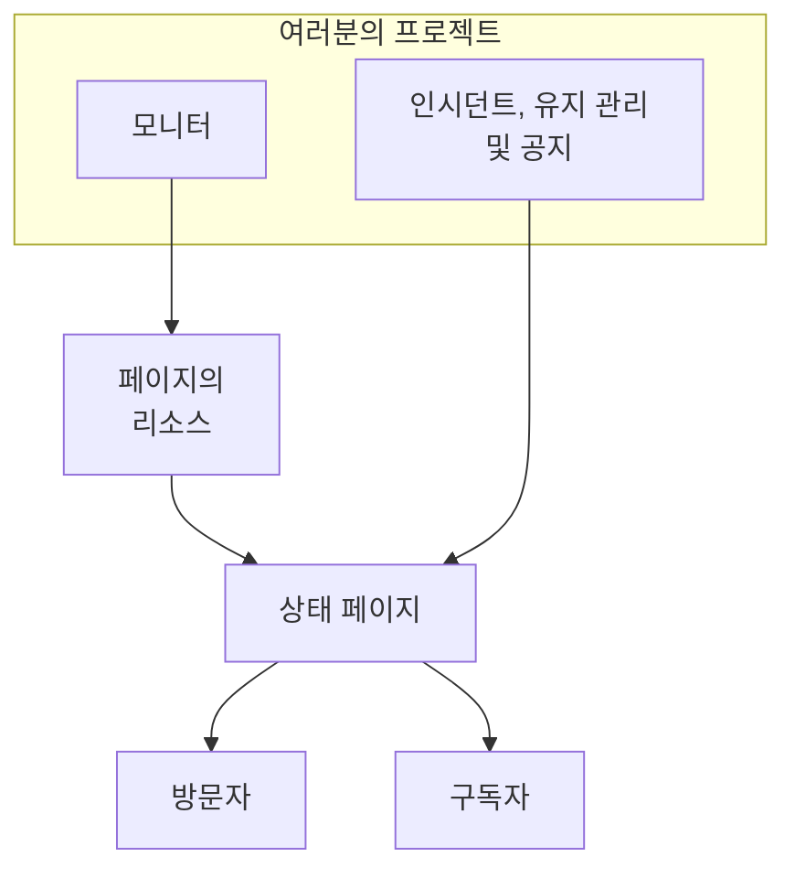

# 상태 페이지 개요

상태 페이지는 모니터링하는 모든 것의 공개된 얼굴입니다. 고객이 자기만 겪는 문제인지 이메일로 묻는 대신 열어 볼 수 있는 하나의 URL입니다. 공개하기로 고른 서비스의 현재 상태, 대응 중인 인시던트, 계획된 유지 관리, 그리고 맨 위에 고정하고 싶은 공지를 보여 줍니다.

새벽 2시에 무언가 고장 나면, 지원 창구가 가장 먼저 안내하는 곳이 상태 페이지입니다. 구독자에게 가는 알림도 여기서 나갑니다. 그러니 장애가 한창일 때가 아니라 필요해지기 전에 설정해 둘 가치가 있습니다.

:::cards
- [상태 페이지 만들기](#상태-페이지-만들기): 시작할 때는 필드 두 개, 나머지는 모두 나중에.
- [표시할 내용 고르기](#페이지에-무엇을-표시할지-고르기): 인시던트, 에피소드, 공지, 유지 관리, 가동 시간을 카드 하나에서.
- [볼 수 있는 사람 정하기](#페이지를-볼-수-있는-사람-제한하기): 링크가 있는 모든 사람, 로그인한 사람만, 또는 비밀번호를 아는 모든 사람.
- [상태 페이지 보관하기](#상태-페이지-보관하기): 삭제하지 않고 페이지를 오프라인으로 전환합니다.
:::

## 작동 방식

상태 페이지는 상단 바의 **제품** 메뉴에서 핵심 제품 사이에 있는 **상태 페이지** 아래에 있습니다. 이 페이지의 모든 내용은 상태 페이지마다 따로 적용됩니다. 프로젝트는 원하는 만큼 상태 페이지를 운영할 수 있습니다. 고객용 공개 페이지, 내부 대상용 비공개 페이지, 특정 시장을 위한 지역별 페이지 등입니다.

페이지는 여기에 올린 모니터를 리소스로 보여 줍니다. 인시던트와 예정된 유지 관리는 그 모니터를 통해 페이지에 도달하고, 공지는 페이지에 직접 게시됩니다. 방문자는 페이지를 읽고, 구독자는 고른 채널로 변경이 있을 때마다 알림을 받습니다.

## 한눈에 보기

- **필드 두 개로 생성.** 새 상태 페이지는 **이름**과 **설명**만 묻습니다. 리소스, 브랜딩, 도메인은 모두 나중에 설정합니다.
- **리소스는 방문자가 보는 것입니다.** 페이지의 각 행은 **상태 페이지 리소스**입니다. 자체 표시 이름, 툴팁, 가동 시간 옵션을 가진 모니터(또는 모니터 그룹)입니다. 그룹은 긴 페이지를 섹션으로 나누며 중첩할 수 있습니다.
- **첫날부터 미리 보기 URL.** 모든 상태 페이지에는 미리 보기 링크가 있어서, 사용자 정의 도메인이 생기기 전에도 페이지를 확인할 수 있습니다.
- **방문자용 경로는 설정에 따라 열립니다.** 인시던트, 에피소드, 공지, 예정된 이벤트는 각각 **상태 페이지에 표시되는 내용**(**고급 설정**에 있음)의 스위치가 켜져 있는 동안에만 나타나고, 구독 페이지는 **구독자 페이지 표시**가 켜져 있는 동안에만 나타납니다.
- **볼 수 있는 사람은 하나의 선택입니다.** 링크가 있는 모든 사람, 로그인한 사람만(비공개 사용자, SAML SSO 또는 OIDC), 또는 비밀번호를 아는 모든 사람 중 하나를 페이지의 **접근** 화면에서 고르며, **추가 설정** 아래에 선택 사항인 IP 허용 목록이 있습니다.
- **구독자에게 자동으로 알립니다.** 이메일, SMS, Slack, Microsoft Teams, 웹훅 구독자 모두 페이지를 팔로우할 수 있고, 채널마다 자체 토글이 있습니다.

## 주요 용어

| 용어 | 의미 |
| --- | --- |
| **상태 페이지** | 자체 브랜딩, 도메인, 리소스, 구독자를 가진 하나의 공개(또는 비공개) 페이지입니다. `StatusPage` 모델입니다. |
| **리소스** | 방문자가 보는 한 행입니다. 표시 이름과 가동 시간 옵션과 함께 페이지에 나타나는 모니터 또는 모니터 그룹입니다. |
| **그룹** | 리소스를 담는 이름 있는 섹션입니다. 그룹은 다른 그룹 안에 중첩되며, 각 수준은 그 아래 모든 것의 상태를 종합합니다. |
| **공지사항** | 하나 이상의 상태 페이지에 게시하는 메시지로, 시작 시각과 선택 사항인 종료 시각이 있습니다. |
| **구독자** | 이메일, SMS, Slack, Microsoft Teams 또는 웹훅으로 페이지를 팔로우하는 사람(또는 시스템)입니다. |
| **사용자 정의 도메인** | CNAME 레코드로 페이지를 가리키는 여러분의 도메인(`status.example.com`)입니다. OneUptime이 SSL 인증서를 무료로 발급하고 갱신합니다. |
| **비공개 사용자** | 비공개 상태 페이지에 로그인할 수 있는 계정입니다. OneUptime 프로젝트 사용자와는 별개입니다. |

## 상태 페이지 만들기

:::steps
### 생성 양식 열기

**상태 페이지 → 모든 상태 페이지**를 열고 **상태 페이지 생성**을 클릭합니다.

### 페이지 이름 짓기

**새 상태 페이지 만들기** 창에서 **이름**(필수, 2자 이상)과 선택 사항인 **설명**을 입력한 다음 **상태 페이지 생성**을 클릭합니다.

이것이 생성 양식의 전부입니다. 돌아온 목록에는 **이름**, **설명**, **레이블**, **소유자**가 표시되며, **상태 페이지 ID**, **이름**, **설명**으로 필터링할 수 있습니다.

### 새 페이지 열기

새 페이지를 열면 **개요** 화면이 나타나며, 카드 두 개가 있습니다. 페이지 자체로 가는 링크가 있는 **Status Page Preview URL**과, 방금 설정한 이름, 설명, 레이블을 편집할 수 있는 **상태 페이지 세부 정보**입니다. 프로젝트에 상태 페이지 사용자 정의 필드가 있으면 그 뒤에 **사용자 정의 필드** 카드가 이어집니다.
:::

API나 Terraform으로 만든 페이지에도 아래에 설명하는 설정과 같은 요금제가 적용됩니다. OneUptime Cloud에서 요금제에 포함되지 않은 설정을 켠 채로 페이지를 만들면(예: 비공개, 숨긴 목록, 사용자 지정 HTML·CSS·JavaScript, 이메일 보고서, SMS·Slack·Microsoft Teams·웹훅 구독자, IP 허용 목록) `402 Payment Required`로 거부되며, 메시지에 요금제 이름이 나옵니다. 각 설정의 요금제는 아래에서 해당 설정과 함께 안내합니다. 이 양식처럼 기본값으로 둔 설정은 모든 요금제에서 작동합니다.

다음으로, 대략 유용한 순서대로:

- 페이지에 무언가가 보이도록 리소스를 추가합니다. [상태 페이지 리소스 및 그룹](/docs/status-pages/resources-and-groups)을 참고하세요.
- 페이지 제목, 파비콘, 로고, 커버를 설정한 다음 사용자 정의 도메인을 연결합니다. [상태 페이지 브랜딩 및 도메인](/docs/status-pages/branding-and-domains)을 참고하세요.
- 사람들이 구독할 수 있는 채널을 정합니다. [구독자 및 공지](/docs/status-pages/subscribers)를 참고하세요.
- 페이지에 나타나는 내용은 **고급 설정**에서 조정합니다.

## 모든 것이 있는 곳

상태 페이지를 열면, 그 페이지 자체의 왼쪽 사이드 메뉴가 아홉 개의 섹션으로 묶여 있습니다. 이 문서 그룹의 나머지 부분을 읽을 때 지도로 사용하세요.

| 섹션 | 들어 있는 것 |
| --- | --- |
| **기본** | **개요**, **공지**, **소유자**. |
| **리소스** | 하나의 **리소스** 화면(왼쪽에 그룹, 오른쪽에 선택한 그룹의 모니터)과 **Monitor Rules**. |
| **구독자** | **이메일 구독자**, **SMS 구독자**, **Slack 구독자**, **MS Teams 구독자**, **Webhook 구독자**, **구독자 설정**. |
| **알림 로그** | **알림 로그**: 구독자에게 보낸 내용. |
| **브랜딩** | **브랜딩**(로고, 제목, 파비콘, 링크, 바닥글, 색상과 언어를 한 페이지에서), **사용자 정의 도메인**, **HTML, CSS 및 JavaScript**. |
| **보안** | **접근**(페이지를 볼 수 있는 사람), **비공개 사용자**, **SSO**, **OIDC**, **SCIM**. |
| **AI** | **MCP**. |
| **개발자** | **Terraform**, **API**, **AI 어시스턴트**: 코드로서의 페이지. |
| **고급** | **임베디드 상태**, **보고서**, **사용자 정의 필드**, **고급 설정**, **감사 로그**, **상태 페이지 삭제**. |

페이지가 보여 주는 것인 **기본**과 **리소스**만 처음부터 열려 있습니다. 다른 모든 섹션은 OneUptime의 모든 메뉴에서 드물게 쓰이는 섹션처럼 접힌 상태로 시작합니다. 섹션 제목을 클릭하면 그 페이지들이 나타납니다. **고급 설정**이나 **이메일 구독자**처럼 섹션의 페이지 중 하나에 있을 때는 그 섹션이 저절로 열립니다.

찾아보기 전에 알아 두면 좋은 이름의 특이점 두 가지:

- **리소스** 항목은 프로젝트에서 모니터 그룹이 활성화된 경우에만 **리소스**라는 이름입니다. 그렇지 않으면 **모니터**라고 표시됩니다. 어느 쪽이든 같은 화면입니다.
- 별도의 그룹 페이지는 없습니다. 그룹과 리소스는 합쳐졌으며, 예전의 `/groups` 경로는 이제 리소스 화면으로 리디렉션됩니다.

개별 페이지 밖에서는 **상태 페이지** 섹션 자체에 **모든 상태 페이지**가 있고, **더보기** 섹션에 **공지**가 있습니다. 접힌 **설정** 섹션에는 **공지 템플릿**, **구독자 템플릿**, **사용자 정의 필드**, **소유자 규칙**, **레이블 규칙**이 있으며, 이들은 프로젝트 전체에 적용되어 모든 상태 페이지가 공유합니다. 접힌 **고급** 섹션에는 **보관됨**이 있습니다. 오프라인으로 전환한 상태 페이지입니다([상태 페이지 보관하기](#상태-페이지-보관하기) 참고).

**레이블 규칙**과 **소유자 규칙**은 새 상태 페이지에 레이블을 붙이고 소유자를 지정합니다. 규칙은 두 단계로 이루어집니다. 상태 페이지가 충족해야 하는 조건인 **일치**, 그다음 규칙이 추가하는 것인 **레이블**(또는 **소유자**)이며, 규칙의 **이름**은 고른 내용으로 채워집니다. 새 규칙은 레이블이나 소유자를 하나 이상 추가해야 합니다. 편집할 때는 이를 강제하지 않으며, 아무것도 추가하지 않는 예전 규칙은 목록에 **추가하는 항목 없음**으로 표시됩니다. [레이블 및 소유자 규칙](/docs/configuration/label-and-owner-rules)을 참고하세요.

## 방문자가 보는 것

공개 페이지는 별도의 앱이며, 경로는 몇 개뿐입니다.

- `/`: **개요**.
- `/incidents` 및 `/incidents/:id`: 인시던트 목록과 개별 인시던트.
- `/announcements` 및 `/announcements/:id`.
- `/scheduled-events` 및 `/scheduled-events/:id`.
- `/subscribe/email`, `/subscribe/sms`, `/subscribe/slack`, `/subscribe/microsoft-teams`, `/subscribe/webhooks`.
- `/confirm-subscription/:id`, `/update-subscription/:id` 및 `/unsubscribe/:token`: 구독자가 받는 메시지 속 링크.
- `/rss`: 피드.
- `/login`, `/sso` 및 `/master-password`: 비공개 페이지에서만 의미가 있습니다.

상단 내비게이션 바에는 항상 **개요**가 표시되고, 나머지는 켜져 있을 때만 나타납니다. **사고**, **공지사항**, **예정된 이벤트**는 각각 해당 토글이 켜져 있어야 하고, **구독**은 **구독자 페이지 표시**와 하나 이상의 구독 채널이 모두 켜져 있어야 합니다. 비공개 페이지에는 **로그아웃** 항목도 있습니다.

개별 인시던트, 에피소드, 공지, 예정된 이벤트는 기록 기간과 관계없이 페이지가 목록에 표시할 때만 열립니다. 비공개 인시던트나 에피소드, 상태 페이지에서 숨긴 것, 상태 페이지에서 숨긴 예정된 이벤트, 나중에 표시하도록 예약된 공지는 링크로도 찾을 수 없습니다.

### 개요 페이지

개요는 대부분의 방문자가 보게 되는 페이지입니다. 위에서 아래로 다음을 표시합니다.

1. **진행 중인 공지**: 시작 시각이 지났고 종료 시각은 아직 지나지 않은 공지.
2. **전체 상태 배너**: 모든 리소스가 영향을 받는지, 일부만 받는지 요약하는 한 줄.
3. **전체 가동 시간 비율**(켠 경우): 모든 리소스가 정상인 동안 전체 상태 배너 끝에 표시됩니다. 기본값은 꺼짐입니다.
4. **리소스 그룹**: 각 그룹의 리소스, 현재 상태, 가동 시간 기록 막대.
5. **진행 중인 사고**(진행 중인 에피소드 포함).
6. **예정된 유지보수 이벤트**.

아무것도 없는 새 페이지는 대시보드에서 리소스를 추가하라고 안내하는 빈 상태를 표시합니다. **리소스** 화면으로 가라는 신호입니다.

방문자에게 보이는 개요는 최대 15초 전의 것이며, 페이지에서 내린 것은 1초 안에 사라집니다. 상태 페이지에서 숨기거나, 비공개로 만들거나, 다른 페이지로 제한하거나, 삭제한 인시던트, 에피소드, 예정된 이벤트, 종료하거나, 나중으로 미루거나, 삭제한 공지, 삭제한 공개 노트, 그리고 페이지에서 제거하거나 삭제한 리소스, 그룹, 모니터입니다. 새 제목 같은 다른 변경은 그 15초 안에 반영됩니다.

무엇이 처음에 인시던트를 이 페이지에 올리고 무엇이 다시 내리는지는 [인시던트 상태 및 심각도](/docs/incidents/states-and-severities)를 참고하세요.

## 페이지에 무엇을 표시할지 고르기

방문자가 보는 내용은 카드 하나에서 설정합니다. **상태 페이지 → 해당 페이지 → 고급 → 고급 설정**의 **상태 페이지에 표시되는 내용**입니다. 페이지가 표시할 수 있는 목록마다 행이 하나씩 있고, 그다음 **가동 시간 기록**(전체 가동 시간 비율과 어떤 상태를 다운타임으로 셀지 포함)과 "Powered by OneUptime" 줄이 이어집니다. 편집 버튼은 없습니다. 스위치는 전환하는 즉시, 일수는 입력란을 벗어나거나 Enter를 누를 때, 목록에서의 선택은 고르는 즉시 저장됩니다.

- **인시던트 표시**(`showIncidentsOnStatusPage`): 기본값은 켜짐입니다. 그 아래의 **최근 …일 표시**(`showIncidentHistoryInDays`, 기본값 14)는 인시던트 목록이 얼마나 과거까지 보여 줄지 정하며, **인시던트 레이블 표시**(`showIncidentLabelsOnStatusPage`)는 기본값이 꺼짐입니다.
- **이 페이지로 제한된 인시던트만 표시**(`onlyShowScopedIncidents`): 역시 인시던트 행에 있으며 기본값은 꺼짐입니다. 켜면 페이지는 **다음 상태 페이지로 제한**으로 이 페이지로 제한된 인시던트만 표시하고, 그것에 대해서만 구독자에게 알립니다. 어떤 페이지로도 제한되지 않은 인시던트는, 모니터, Slack, Microsoft Teams, API 또는 AI가 스스로 여는 인시던트를 포함해, 누군가 이 페이지를 추가하기 전까지는 이 페이지에 도달하지 않습니다. 어떤 인시던트가 에피소드를 페이지로 가져오는지도 이것으로 정해지므로, **인시던트 표시**가 꺼져 있어도 유지됩니다. 모니터를 공유하지만 서로 다른 대상에게 제공되는 페이지는 [대상별 상태 페이지](/docs/status-pages/one-status-page-per-audience)를 참고하세요.
- **에피소드 표시**(`showEpisodesOnStatusPage`): 기본값은 켜짐이며, **최근 …일 표시**(`showEpisodeHistoryInDays`, 기본값 14)와 **에피소드 레이블 표시**(`showEpisodeLabelsOnStatusPage`, 기본값 꺼짐)가 있습니다. 에피소드는 자체 엔드포인트를 가진 별도의 모델이며, 인시던트를 보여 주는 뷰가 아닙니다.
- **공지사항 표시**(`showAnnouncementsOnStatusPage`): 기본값은 켜짐이며, **최근 …일 표시**(`showAnnouncementHistoryInDays`, 기본값 14)가 있습니다.
- **예정된 유지 관리 이벤트 표시**(`showScheduledMaintenanceEventsOnStatusPage`): 기본값은 켜짐이며, **최근 …일 표시**(`showScheduledEventHistoryInDays`, 기본값 14)와 **이벤트 레이블 표시**(`showScheduledEventLabelsOnStatusPage`, 기본값 꺼짐)가 있습니다.
- **가동 시간 기록**: 페이지의 가동 시간에 관한 모든 것을 한 행에서:
  - **최근 …일 표시**(`showUptimeHistoryInDays`)는 각 리소스 옆 가동 시간 막대의 길이입니다. 기본값은 90이며 1에서 90 사이여야 합니다. 리소스나 그룹의 모든 **가동 시간 % 표시**와 **상태 기록 차트 표시** 옵션이 이 숫자를 읽으며, 전체 가동 시간 비율도 마찬가지입니다.
  - **전체 가동 시간 비율 표시**(`showOverallUptimePercentOnStatusPage`): 기본값은 꺼짐입니다. 켜면 모든 것이 정상인 동안 전체 상태 배너 끝에 페이지 전체의 가동 시간 비율 하나(리소스와 그룹의 평균)가 표시됩니다. 켜져 있는 동안 **정밀도**(`overallUptimePercentPrecision`)로 표시할 소수 자릿수를 고릅니다: `99%`, `99.9%`, `99.99%`(기본값) 또는 `99.999%`. 각 리소스와 그룹에는 자체 정밀도가 있습니다.
  - **다운타임으로 계산**(`downtimeMonitorStatuses`): 그 시간이 페이지의 모든 가동 시간 비율(각 리소스, 각 그룹, 전체)에서 다운타임으로 계산되는 모니터 상태입니다. 각 상태는 자체 색상의 칩으로 표시됩니다. 목록에서 추가하거나 **×** 버튼으로 제거하면 변경이 즉시 저장됩니다. 새 상태 페이지는 프로젝트의 정상이 아닌 모든 상태로 시작합니다. 상태는 적어도 하나 남습니다. 하나도 없으면 페이지의 모든 가동 시간이 100%로 표시되므로 마지막 하나는 제거할 수 없습니다.
- **Powered By OneUptime 브랜딩 표시**: 기본값은 켜짐이므로 방문자용 바닥글에 "Powered by OneUptime"이 표시됩니다. 끄면 그 줄이 숨겨집니다. 열은 이를 반대로 `hidePoweredByOneUptimeBranding`으로 저장합니다.

**꺼진 목록**은 내비게이션 바에 항목이 있으면 그 항목과 함께 페이지에서 사라집니다. 해당 공개 엔드포인트는 요청을 거부하며, 페이지의 구독자는 그런 종류의 이벤트에 대해 알림을 받지 않습니다. 그 행에는 스위치만 표시됩니다. 숨긴 목록이 얼마나 과거까지 보여 줄지, 레이블을 표시할지는 아무것도 바꾸지 않습니다.

**요금제.** OneUptime Cloud에서는 요금제로 바꿀 수 없는 설정 옆에 필요한 요금제가 표시됩니다. 네 개의 목록 스위치, 세 개의 레이블 스위치, 에피소드 기록에는 **Growth**가 필요하고, 전체 가동 시간 비율 표시와 "Powered by OneUptime" 줄 숨기기에는 **Scale**이 필요합니다. 다른 기록 기간, **가동 시간 기록**, **정밀도**, **다운타임으로 계산**, **이 페이지로 제한된 인시던트만 표시**는 모든 요금제에서 바꿀 수 있으며 각각 따로 저장됩니다. 전체 가동 시간 비율이 이미 켜진 페이지는 어떤 요금제에서든 정밀도를 바꿀 수 있습니다. 설정을 새 페이지의 상태로 되돌리는 것(목록 다시 표시, 레이블이나 전체 가동 시간 비율 숨기기, "Powered by OneUptime" 줄 표시, 에피소드 기록을 14일로 되돌리기)은 모든 요금제에서 작동하므로, 체험판이 바꾼 것이 요금제가 없어서 그대로 남는 일은 없습니다. 스위치는 아직 되돌릴 수 있다는 것과 다시 바꾸려면 어떤 요금제가 필요한지 알려 줍니다.

페이지에 **구독** 항목을 표시할지(**구독자 페이지 표시**, `showSubscriberPageOnStatusPage`, 기본값 켜짐)와 방문자가 어떤 채널로 구독할 수 있는지는 이 화면에서 설정하지 않습니다. 둘 다 **구독자 → 구독자 설정**의 **채널** 카드에 있습니다([구독 채널](/docs/status-pages/subscribers#구독-채널) 참고).

카드 아래에는 상태 페이지 자체의 설정을 다시 가져올 수 있는 파일로 내려받는 **상태 페이지을(를) JSON으로 내보내기**와 **Archive status page**([상태 페이지 보관하기](#상태-페이지-보관하기) 참고)가 있습니다. 전체 가동 시간 비율과 다운타임 상태는 예전에는 여기서 각각 **편집** 버튼 뒤에 있는 별도의 카드 두 개였지만, 이제는 카드의 행입니다.

**색상 위치.** 가동 시간 막대의 색상은 여기에 없습니다. **기본 막대 색상**과 막대 색상 규칙은 **상태 페이지 → 해당 페이지 → 브랜딩 → 브랜딩**의 **추가 설정** 아래에 있습니다. 테마나 브랜드 색상 설정은 어디에도 없습니다. 이 컨트롤을 넘어서는 것은 모두 **사용자 지정 CSS**로 합니다.

## 공개하기 전에 미리보기

모든 상태 페이지의 **개요** 화면에는 페이지로 바로 가는 링크가 있는 **Status Page Preview URL** 카드가 있습니다. 아직 리소스를 추가하는 중이거나 사용자 정의 도메인이 생기기 전에 사용하세요.

내부적으로 모든 공개 경로에는 `/status-page/{statusPageId}/...` 아래에 미리 보기용 쌍이 있습니다. 미리 보기 개요, 미리 보기 인시던트 목록, 미리 보기 구독 페이지 등입니다. 즉, 대시보드 미리 보기에서 가져온 URL이나 스크린샷은 사용자 정의 도메인을 연결한 뒤 고객이 보는 것과 일치하지 않으므로, 런북이나 이메일에 붙여 넣는 링크는 다시 확인하세요.

## 페이지를 볼 수 있는 사람 제한하기

모든 상태 페이지가 일반 대중을 위한 것은 아닙니다. 페이지를 볼 수 있는 사람은 하나의 선택이며, **상태 페이지 → 해당 페이지 → 보안 → 접근**의 첫 번째 카드인 **이 상태 페이지를 볼 수 있는 사람**에서 정합니다.

- **링크가 있는 모든 사람**: 페이지가 공개됩니다. 모든 새 상태 페이지는 여기서 시작합니다.
- **로그인한 사람만**: 방문자는 `/login`으로 이동해 비공개 사용자로, 또는 SSO나 OIDC 공급자로 로그인합니다(아래 참고). 선택지 아래에서 카드는 페이지에 설정된 로그인 방법(비공개 사용자 수, SSO와 OIDC가 켜져 있는지, 각각 해당 화면으로 가는 링크 포함)을 나열하며, 이것이 선택되어 있는 동안 아직 아무도 로그인할 수 없으면 그렇게 알려 줍니다.
- **비밀번호를 아는 모든 사람**: 방문자는 `/master-password`로 이동해 여러분이 공유한 비밀번호 하나로 페이지 잠금을 해제합니다. 아무도 계정이 필요하지 않습니다. 이를 고를 때 페이지에 비밀번호가 없으면 같은 대화 상자에서 비밀번호를 묻고, 이미 있으면 그대로 두거나 새로 입력할 수 있습니다. 그 뒤에는 선택지 아래의 **비밀번호 변경**으로 바꿉니다. 비밀번호는 해시로 저장되어 다시 표시할 수 없으며, 이전 비밀번호를 입력한 사람은 최대 7일 동안 계속 페이지를 볼 수 있습니다.

선택지를 고르면 방문자에게 무엇이 바뀌는지 알려 주며 확인을 요청하고, 즉시 저장됩니다. 편집 버튼은 없습니다.

**이미지.** 페이지가 보여 주는 내용(공개 노트, 공지, 설명)에 있는 이미지는 추측할 수 없는 긴 고유 주소로 열리며, 이 주소는 로그인 없이 작동하므로 구독자가 받는 이메일에도 표시될 수 있습니다. 페이지 자체는 여전히 로그인이나 비밀번호를 요구합니다.

**저장되는 것.** 이 선택은 세 개의 열이며, API와 Terraform은 이전처럼 읽고 씁니다: `isPublicStatusPage`, `enableMasterPassword`, `masterPassword`. 방문자에게 비밀번호를 묻는 것은 공개가 아니고, `enableMasterPassword`가 켜져 있고, 비밀번호가 설정된 페이지뿐입니다. 스위치는 켜져 있지만 비밀번호가 없는 비공개 페이지는 로그인 페이지입니다. **링크가 있는 모든 사람**을 고르면 `enableMasterPassword`도 꺼집니다. 공개 페이지는 비밀번호를 묻지 않기 때문입니다. **접근** 화면은 선택이 바꾸는 열만 씁니다.

**요금제.** OneUptime Cloud에서 페이지를 비공개로 만들려면 **Growth** 요금제가 필요합니다. 더 낮은 요금제에서는 두 가지 비공개 선택지에 필요한 요금제가 표시되며 고를 수 없습니다. 다시 공개로 만드는 것(**링크가 있는 모든 사람**)은 모든 요금제에서 작동하므로, 체험판이 끝났거나 더 낮은 요금제로 옮긴 뒤 비공개로 남은 페이지도 언제든 다시 열 수 있습니다. 대화 상자는 다시 비공개로 만들려면 **Growth**가 필요하다고 알려 줍니다. **로그인한 사람만**과 **비밀번호를 아는 모든 사람** 사이를 오가는 것은 모든 요금제에서 작동하며, **비밀번호 변경**도 마찬가지입니다.

### 비공개 사용자

로그인할 수 있는 사람은 **상태 페이지 → 해당 페이지 → 보안 → 비공개 사용자**에서 추가합니다. **일괄 추가** 작업이 있어서, 이메일 주소 목록을 붙여 넣으면 각 주소로 초대 이메일이 갑니다. 비공개 사용자에게는 OneUptime 프로젝트 계정과는 별도로 비밀번호 찾기와 재설정 흐름이 있습니다.

**비공개 사용자와 비밀번호는 함께 쓰이지 않습니다.** **비밀번호를 아는 모든 사람**이 선택되어 있는 동안 비공개 사용자는 로그인할 수 없으며(그들도 비밀번호를 입력합니다), **비공개 사용자** 화면은 **접근**으로 돌아가는 링크와 함께 그렇게 알려 줍니다.

### SSO와 OIDC

ID 공급자와 연결된 비공개 페이지라면, **상태 페이지 → 해당 페이지 → 보안 → SSO**에서 SAML을 구성합니다. 로그인 URL, 발급자, x509 인증서를 입력하며, 서명과 다이제스트 방식은 **추가 필드** 아래에 미리 채워져 있습니다. **상태 페이지 → 해당 페이지 → 보안 → OIDC**에서는 OpenID Connect를 구성합니다. 발급자, 클라이언트 ID와 시크릿을 입력하며, 디스커버리 URL, 범위, 클레임 이름은 **추가 필드** 아래에 미리 채워져 있습니다. **SCIM**은 IdP에서 비공개 사용자를 자동으로 프로비저닝합니다. OneUptime Cloud에서는 세 가지 모두 Scale 요금제 이상이 필요합니다. 셀프 호스팅 설치에서는 SSO와 OIDC가 모든 에디션에 포함되며, SCIM에는 [엔터프라이즈 에디션](/docs/self-hosted/enterprise)이 필요합니다.

상태 페이지의 SSO 또는 OIDC 공급자를 끄거나 삭제하면, 그 공급자로 로그인한 비공개 사용자는 로그아웃됩니다. 세션은 다음 요청에서 끝나며, 공급자를 다시 켜도 되살아나지 않습니다. 다시 그 공급자로 로그인해야 합니다. 새 인증서나 클라이언트 시크릿, 다른 URL, 새 이름은 모두를 로그인 상태로 유지합니다. SSO를 필수로 하는 페이지에서 마지막 공급자를 끄면, 공급자를 다시 켜거나 **로그인에 SSO 필수**를 끌 때까지 아무도 로그인할 수 없습니다. 다른 공급자로 옮기려면 이전 공급자를 끄기 전에 새 공급자를 설정하고 테스트하세요.

공급자 아래의 **SSO 설정** 카드에는 **로그인에 SSO 필수** 스위치(`requireSsoForLogin`, 기본값 꺼짐)가 있으며, 전환하는 즉시 저장됩니다. 켜면 먼저 확인을 요청합니다. 그때부터 비공개 사용자는 이메일과 비밀번호로 로그인할 수 없고, SSO 또는 OIDC 공급자가 들여보내는 사람만 페이지를 볼 수 있기 때문입니다. 켜기 전에 그 화면의 링크로 SSO를 테스트하세요. 이 설정은 **로그인한 사람만**이 선택되어 있을 때만 의미가 있으며, **접근** 화면은 그 선택지 아래에 **SSO 필수**로 표시합니다. 켜져 있는 동안에는 이메일과 비밀번호로 로그인한 비공개 사용자도 다음 요청에서 로그아웃됩니다. SSO 또는 OIDC 공급자가 시작한 세션만 인정됩니다. OneUptime Cloud에서는 켜려면 **Scale** 요금제가 필요하고, 끄는 것은 모든 요금제에서 작동합니다. Scale 체험판이 끝났거나 더 낮은 요금제로 옮긴 뒤에도 SSO를 필수로 하는 페이지는 누군가 끌 때까지 계속 필수로 유지됩니다. 그 페이지의 **SSO**와 **OIDC** 페이지에는 이를 위해 요금제 안내 아래에 스위치가 표시됩니다.

### IP 허용 목록

**접근**의 **추가 설정** 아래에 있는 **IP 허용 목록** 섹션(`ipWhitelist` 열)은 페이지를 알려진 네트워크로 제한합니다. 페이지를 누구에게 열었든 적용됩니다. 다른 주소에서 온 방문자는 비밀번호나 비공개 사용자 계정이 있어도 거부됩니다. 한 줄에 하나씩 입력합니다. IPv4 또는 IPv6 주소, 또는 `10.0.0.0/8` 같은 IPv4 범위입니다. 어느 쪽도 아닌 줄은 저장할 때 거부됩니다. 모든 주소를 허용하려면 비워 두세요. 목록이 적용되는 동안 접힌 **추가 설정** 머리글에 **IP 허용 목록**과 그 항목 수가 표시됩니다. OneUptime Cloud에서 이를 바꾸려면 **Scale** 요금제가 필요하고, 비우는 것은 모든 요금제에서 작동합니다.

## 임베드 배지와 RSS 피드

페이지 자체가 아닌 다른 곳에 상태를 보여 주는 두 가지 방법입니다.

**임베디드 상태 배지.** **상태 페이지 → 해당 페이지 → 고급 → 임베디드 상태**에서 **임베디드 상태 배지 활성화**(`enableEmbeddedOverallStatus`, 기본값 꺼짐)를 켠 다음, **보안 토큰** 카드에서 **토큰 재생성**을 클릭해 배지에 토큰(`embeddedOverallStatusToken`)을 부여합니다. 배지는 `/api/status-page/badge/<status-page-id>?token=<token>`에서 제공되며, 화면은 복사할 스니펫과 함께 **배지 미리보기** 아래에 배지를 보여 주므로, 현재 전체 상태를 문서, 앱의 바닥글, 마케팅 페이지에 넣을 수 있습니다.

**RSS 피드.** 모든 상태 페이지는 `/rss`를 제공합니다. **브랜딩**의 **페이지 제목**(없으면 페이지 이름)을 사용한 "{페이지 제목} Updates"라는 제목의 피드이며, 항목에는 `Incident: `, `Announcement: `, `Scheduled Maintenance: ` 접두사가 붙습니다. 이메일로 구독하기보다 업데이트를 피드 리더나 챗봇으로 받아 보고 싶은 사람에게 유용합니다.

데이터를 직접 가져오고 싶다면, 상태 페이지는 개요, 인시던트, 예정된 유지 관리 이벤트, 공지, 에피소드에 대한 공개 읽기 엔드포인트로 뒷받침됩니다. [공용 API](/docs/status-pages/public-api)를 참고하세요.

## 상태 페이지 보관하기

상태 페이지를 삭제하지 않고 오프라인으로 전환하려면 보관합니다. 보관된 상태 페이지는:

- **오프라인입니다.** URL, 사용자 정의 도메인, 임베디드 배지, 공개 API, MCP 서버가 모두 페이지가 존재하지 않는 것처럼 응답하므로("Status Page not found"), 방문자는 보관된 페이지와 처음부터 없던 페이지를 구별할 수 없습니다. 대시보드 미리 보기 링크도 작동하지 않습니다.
- **구독자에게 아무것도 보내지 않습니다.** 인시던트, 에피소드, 유지 관리, 공지 알림도, 보고서도, 구독 확인도 보내지 않습니다. 아무도 구독할 수 없습니다.
- **상태 페이지 목록에서 빠집니다.** **상태 페이지 → 고급 → 보관됨**에서 찾을 수 있습니다.
- **모든 것을 유지합니다.** 리소스, 그룹, 브랜딩, 도메인, 비공개 사용자, 구독자가 유지되므로, 보관을 취소하면 페이지가 이전 그대로 다시 온라인이 됩니다.

상태 페이지 하나를 보관하려면 페이지를 열고 **고급 → 고급 설정 → Archive status page**로 이동합니다. 여러 개를 보관하려면 **상태 페이지** 목록에서 선택하고 **보관**을 고릅니다. 되돌리려면 **상태 페이지 → 고급 → 보관됨**을 열고 선택한 다음 **보관 취소**를 고르거나, 페이지를 열고 페이지 맨 위 배너의 **보관 취소**를 클릭합니다.

## 다음 단계

:::cards
- [상태 페이지 리소스 및 그룹](/docs/status-pages/resources-and-groups): 페이지에 모니터를 올리고 섹션으로 정리합니다.
- [상태 페이지 브랜딩 및 도메인](/docs/status-pages/branding-and-domains): 로고와 색상, 그리고 자체 도메인의 페이지.
- [구독자 및 공지](/docs/status-pages/subscribers): 다섯 가지 구독 채널과 공지 게시.
- [대상별 상태 페이지](/docs/status-pages/one-status-page-per-audience): 고객, 사이트, 지역마다 하나의 페이지와, 각 인시던트를 어느 페이지에 알릴지.
:::
