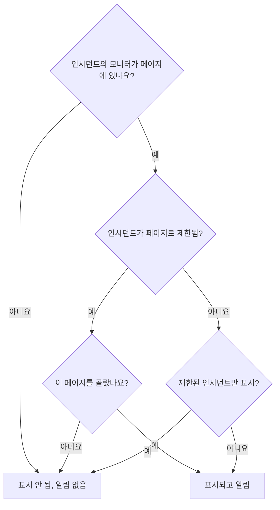

# 대상별 상태 페이지

사람마다 필요한 소식이 다릅니다. 고객은 다른 고객의 장애 소식을 듣고 싶어 하지 않고, 한 사이트의 직원은 다른 사이트의 네트워크가 끊길 때마다 이메일을 받고 싶어 하지 않습니다. OneUptime에서 대상의 단위는 상태 페이지입니다. 각 페이지에는 자체 구독자, 자체 브랜딩, 자체 공개 범위가 있습니다. 그러니 대상마다 자체 페이지를 주고, 인시던트마다 어느 페이지에 알릴지 정하세요.

예전에는 공유 인프라가 이를 어렵게 했습니다. 인시던트는 모니터를 통해 상태 페이지에 도달하므로, 열 개의 사이트 페이지가 공유하는 모니터는 두 사이트에 영향을 준 장애를 열 사이트 모두에 알렸습니다. 유일한 우회 방법은 사이트 조합마다 페이지나 모니터를 두는 것이었습니다. 이 페이지는 이를 해결하는 설정을 다룹니다.

- 인시던트의 **다음 상태 페이지로 제한**. 고른 페이지에만 표시하고 알립니다.
- 상태 페이지의 **이 페이지로 제한된 인시던트만 표시**. 아직 아무도 범위를 정하지 않은 인시던트는 누군가 정할 때까지 이 페이지들 어디에도 도달하지 않습니다. 모니터, Slack, Microsoft Teams, API 또는 AI가 스스로 여는 인시던트도 포함됩니다.
- 인시던트가 생성되었다는 것을 어느 페이지에 알렸는지에 대한 기록. 나중에 추가한 페이지는 한 번 알림을 받고, 나머지 페이지는 다시 알림을 받지 않습니다.
- 인시던트를 선언하거나 공개 노트를 게시하기 전에 누가 알림을 받을지 보여 주는 **알림 대상** 요약과, 각 페이지의 구독자가 무엇을 받을지 보여 주는 **미리 보기**.

:::cards
- [설정하기](#대상별-페이지-설정하기): 대상별 페이지와, 범위가 정해지지 않은 인시던트를 막는 스위치.
- [인시던트 제한하기](#인시던트를-상태-페이지로-제한하기): 선언할 때 또는 나중에 페이지를 고릅니다.
- [페이지 추가와 제거](#상태-페이지-추가와-제거): 추가한 페이지에 누가 알림을 받는지, 페이지를 제거하면 무엇이 취소되는지.
- [모든 메시지에 담기는 것](#모든-메시지에-담기는-것): 모든 페이지가 받는 값과, 그 값이 각 대상에게 알려 주는 것.
:::

## 사용하기 좋은 경우

- **관리형 서비스 공급자**: 고객마다 상태 페이지가 있고, 고객들이 공유하는 모니터를 쓰는 경우.
- **사이트, 공장 또는 지역이 있는 조직**: 각각 알려야 할 직원이 따로 있는 경우.
- **사내 IT**: 부서나 건물마다 페이지가 있는 경우.

대상이 스스로 고르는 것으로 충분하다면 페이지 하나로도 될 수 있습니다. 구독자가 관심 있는 리소스를 고르게 하세요([구독자 및 공지](/docs/status-pages/subscribers) 참고). 인시던트마다 대상을 대신해 고르는 경우나, 한 대상이 다른 대상의 인시던트를 전혀 보면 안 되는 경우에는 대상별 페이지를 사용하세요.

## 인시던트가 상태 페이지에 도달하는 방식

인시던트는 모니터를 통해 상태 페이지에 도달합니다. 페이지의 리소스 중 하나가 인시던트의 모니터 중 하나일 때(직접 또는 페이지의 모니터 그룹을 통해), 페이지는 인시던트를 표시하고 구독자에게 알립니다. 이를 좁히는 설정이 두 가지 있습니다.

- 인시던트의 **다음 상태 페이지로 제한**(`statusPages`). 비워 두면 인시던트는 늘 그랬듯이 그 모니터를 나열하는 모든 페이지에 도달합니다. 페이지를 고르면 모니터를 나열하는 페이지 **가운데** 고른 페이지에만 도달합니다.
- 상태 페이지의 **이 페이지로 제한된 인시던트만 표시**(`onlyShowScopedIncidents`, 기본값 꺼짐). 켜면 페이지는 특정 상태 페이지로 제한되지 않은 인시던트를 표시하지도, 누구에게 알리지도 않습니다.



인시던트의 모니터 중 하나를 나열하는 페이지의 경우:

| 인시던트 | **이 페이지로 제한된 인시던트만 표시**가 꺼진 페이지 | 켜진 페이지 |
| --- | --- | --- |
| 어떤 상태 페이지로도 제한되지 않음 | 표시되고 알림 | 표시 안 됨, 알림 없음 |
| 상태 페이지로 제한되고 이 페이지가 선택됨 | 표시되고 알림 | 표시되고 알림 |
| 상태 페이지로 제한되었지만 이 페이지는 아님 | 표시 안 됨, 알림 없음 | 표시 안 됨, 알림 없음 |

인시던트의 모니터를 하나도 나열하지 않는 페이지는 무엇을 고르든 인시던트를 표시하지 않으며, 모니터가 없는 인시던트는 상태 페이지 구독자에게 전혀 알리지 않습니다. 그 위에 평소의 규칙도 적용됩니다. 인시던트는 **상태 페이지에 표시**가 켜져 있고 비공개가 아니어야 하며, 페이지는 **인시던트 표시**가 켜져 있어야 하고, 일부 리소스나 이벤트 유형만 고른 구독자는 고른 것만 받습니다.

인시던트가 어느 페이지에 도달하는지에 따라 달라지는 모든 것도 같은 규칙으로 정해집니다.

- 공개 상태 페이지의 인시던트 목록, 개요, 인시던트 자체 페이지, 그리고 상태 페이지 [공용 API](/docs/status-pages/public-api).
- 인시던트가 생성되거나, 상태가 바뀌거나, 공개 노트나 포스트모템이 생길 때 보내는 이메일, SMS, Slack, Microsoft Teams, 웹훅 메시지.
- 이메일로 보내는 상태 페이지 보고서의 인시던트 수. 페이지가 표시하는 인시던트만 셉니다.

인시던트 에피소드는 그 인시던트 중 하나 이상이 페이지에 도달할 때 그 페이지에 도달합니다. 에피소드의 알림은 그 인시던트가 도달하는 모든 페이지로 가며, 어느 인시던트도 도달하지 않는 상태 페이지에서는 에피소드 페이지를 찾을 수 없습니다. 비공개 인시던트는 어떤 페이지에도 도달하지 않으므로 에피소드를 페이지로 가져오지 않으며, 비공개 에피소드는 어떤 페이지에도 표시되지 않습니다.

## 대상별 페이지 설정하기

:::steps
### 대상마다 상태 페이지 만들기

대상마다 페이지를 하나씩 만듭니다. 예를 들어 `Site 01`부터 `Site 10`까지입니다. 대상이 내부라면 페이지를 비공개로 하세요([페이지를 볼 수 있는 사람 제한하기](/docs/status-pages/index#페이지를-볼-수-있는-사람-제한하기) 참고). 비공개 페이지의 구독자도 모든 메시지에 있는 링크로 로그인 없이 구독을 취소할 수 있습니다([구독 관리와 해지](/docs/status-pages/subscribers#구독-관리와-해지) 참고). `Region East` 같은 레이블을 붙여 두면, 선택기에서 그 레이블이 붙은 모든 페이지를 한 번의 클릭으로 추가할 수 있습니다.

### 공유 모니터를 각 페이지에 올리기

공유 모니터를 각 페이지에 리소스로 추가합니다([상태 페이지 리소스 및 그룹](/docs/status-pages/resources-and-groups) 참고). **리소스 → Monitor Rules**의 규칙을 쓰면 모니터의 레이블에 따라 이를 자동으로 할 수 있습니다.

### 이 페이지로 제한된 인시던트만 표시 켜기

그 페이지들 각각에서 켭니다. **상태 페이지 → 해당 페이지 → 고급 → 고급 설정**의 **상태 페이지에 표시되는 내용** 카드에서 **인시던트 표시** 아래에 있으며, 전환하는 즉시 저장됩니다. 그때부터는 누군가 고르지 않는 한 사이트 페이지에 아무것도 도달하지 않습니다.

### 대상별 구독자 추가하기

직원에게는 **이메일 구독자**의 **일괄 추가**를 사용하고, `site03-all@` 같은 메일링 리스트보다 각자의 주소를 우선하세요. 리스트에 있는 누구든 리스트 전체의 구독을 취소할 수 있기 때문입니다. 추가한 구독자가 구독을 취소하면 페이지의 소유자와 그 구독자를 추가한 사람이 이메일을 받습니다([공유 주소와 메일링 리스트](/docs/status-pages/subscribers#공유-주소와-메일링-리스트) 참고).

### 대응자가 상태 페이지를 읽을 수 있게 하기

선택기는 그 사람이 읽을 수 있는 상태 페이지만 나열하며, 인시던트 역할로는 상태 페이지를 읽을 수 없습니다. 대응자에게 인시던트 역할과 함께 **Status Page Viewer** 역할을 주세요. 특정 레이블이 붙은 페이지로 제한할 수도 있습니다. 이 역할이 없으면 선택기가 비어 있습니다.

### 모든 메시지의 내용 정하기

**인시던트 → 설정 → 사용자 정의 필드**에서 팀이 매번 답하는 인시던트 사용자 정의 필드를 정의합니다. 예를 들어 `Impact`(드롭다운), `Expected Resolution`(날짜와 시간), `Acknowledgement`(예/아니요 스위치)입니다. 묻고 나열할 **순서**대로 끌어다 놓고, 선언 양식이 묻도록 **생성 시 표시**를, 답이 꼭 필요한 곳에는 **생성 시 필수**를, 모든 대상이 읽어도 되는 필드에는 **구독자 알림에 포함**을 켭니다. 그러면 그 필드가 모든 페이지의 기본 이메일에 들어갑니다. [사용자 정의 필드](/docs/incidents/settings#사용자-정의-필드)를 참고하세요.

### 페이지별 이메일 브랜딩(선택 사항)

**Scale** 요금제에서 각 페이지에 **사용자 지정 SMTP 구성**을 주고 인시던트 이벤트용 사용자 지정 템플릿을 연결합니다. 템플릿은 `{{incident.customFields.<key>}}`로 어떤 필드든 넣을 수 있습니다. 템플릿을 쓰는 동안 그 아래의 **실시간 미리 보기**가 견본 값으로 채운 모습을 보여 줍니다. [사용자 지정 템플릿에 필요한 것](/docs/status-pages/subscribers#사용자-지정-템플릿에-필요한-것)을 참고하고, `{{affectedStatusPages}}`를 쓰기 전에 [모든 메시지에 담기는 것](#모든-메시지에-담기는-것)도 확인하세요.

### 페이지를 고른 인시던트 템플릿 저장하기(선택 사항)

`Region East outage` 템플릿에 동부 사이트 페이지와 사용자 정의 필드의 기본 답을 담아 둘 수 있습니다.

### 첫 장애 전에 각 페이지의 이메일 확인하기

공유 모니터와 사이트 페이지 두 개를 고른 채 **인시던트 선언**을 시작하고, 제출하기 전 요약에서 **예** 옆의 **미리 보기**를 엽니다. 각 페이지의 구독자가 받을 이메일과, 어떤 템플릿이 왜 쓰이는지 보여 줍니다. **나에게 테스트 보내기**는 한 통을 내 받은편지함으로 보냅니다. 인시던트를 선언하기 전까지는 다른 누구에게도 아무것도 보내지지 않으므로, 끝나면 제출하지 않고 양식을 떠나세요. [누가 알림을 받는지](#누가-알림을-받는지)를 참고하세요.
:::

## 인시던트를 상태 페이지로 제한하기

### 선언할 때

**인시던트 → 모든 인시던트 → 인시던트 선언**의 **영향받는 리소스** 단계에는 모니터와 기타 리소스 다음, **추가 필드** 아래에 **다음 상태 페이지로 제한**이 있습니다. 자리 표시자인 **모니터를 표시하는 모든 상태 페이지**가 비워 두었을 때의 의미입니다. 이름으로 페이지를 고르거나, 선택기의 **레이블** 탭을 열고 레이블을 골라 그 레이블이 붙은 모든 페이지를 추가하세요.

양식은 다음과 같은 경우에 경고합니다.

- 고른 페이지가 인시던트의 모니터를 하나도 나열하지 않거나, 모니터가 전혀 연결되지 않은 경우. 인시던트는 그 페이지에 표시되지 않고 그 구독자에게도 알리지 않습니다.
- 같은 단계에서 모니터 바로 아래에 있는 **모니터 상태를 다음으로 변경**도 설정한 경우. [모니터 상태는 공유됩니다](#모니터-상태는-공유됩니다)를 참고하세요.
- **인시던트 세부 정보** 단계의 **추가 필드** 아래에 있는 **비공개 인시던트**도 체크한 경우. 비공개 인시던트는 고른 페이지를 포함해 모든 상태 페이지에서 숨겨집니다.

**영향받는 리소스** 바로 다음의 **세부 정보** 단계는 **생성 시 표시**로 표시된 인시던트 사용자 정의 필드를 묻습니다([인시던트 선언](/docs/incidents/declaring-incidents) 참고). 그 답은 인시던트가 도달하는 모든 페이지로 갑니다. 사용자 정의 필드 값은 상태 페이지가 아니라 인시던트에 속합니다.

**템플릿에서 생성**은 템플릿에서 이 필드를 채웁니다. 템플릿의 페이지는 템플릿을 만들 때는 **영향받는 리소스** 단계에서, 그 뒤에는 **상태 페이지 범위** 카드에서 설정합니다(**인시던트 → 설정 → 인시던트 템플릿**). 다른 템플릿 필드와 마찬가지로, 직접 설정한 목록이 우선합니다. 템플릿의 페이지는 상태 페이지를 읽을 수 없는 대응자에게도 채워집니다. 템플릿을 설정한 사람이 그 템플릿으로 선언하는 모든 사람을 위해 고른 것이기 때문입니다.

### 누가 알림을 받는지

**영향받는 리소스** 단계의 **추가 필드**에서 선택기 바로 아래에 있는 **상태 페이지 구독자에게 알림** 아래와, 제출하기 전 요약에서 다시 한 번, 양식은 인시던트가 누구에게 도달할지 보여 줍니다.

> 알림 대상:
>
> - Site 03 (최대 이메일 41명)
> - Site 07 (최대 이메일 18명)

그 아래 **알림 제외:** 항목에는 모니터를 나열하지만 알림을 받지 않을 페이지와 그 이유가 나열됩니다. 인시던트가 제한된 페이지 중 하나가 아니거나, 자신으로 제한된 인시던트만 표시하는 페이지이거나, 인시던트를 표시하지 않는 페이지라는 이유입니다.

아무도 알림을 받지 않을 때는 요약에 아무것도 표시되지 않습니다. 인시던트에 모니터가 없거나, 어떤 상태 페이지도 그 모니터를 나열하지 않거나, 페이지에 아직 구독자가 없거나, **상태 페이지 구독자에게 알림**이 꺼져 있거나, 인시던트가 비공개인 경우입니다. 상태 페이지 범위가 이유일 때만 경고하며, 제외되는 페이지의 이름을 알려 줍니다. 인시던트가 제한되지 않았는데 그 모니터를 나열하는 페이지가 자신으로 제한된 인시던트만 표시하는 경우, 다른 페이지로 제한된 경우, 또는 제한된 페이지가 그 모니터를 하나도 나열하지 않는 경우입니다. 요약에서 **상태 페이지 구독자에게 알림**은 다른 모든 확인란처럼 **예** 또는 **아니오**로 표시되며, **예** 옆에 **미리 보기**가 있습니다. 확인란이 꺼져 있거나, 인시던트가 비공개이거나, 모니터가 연결되지 않은 동안에는 제공되지 않습니다.

인시던트의 **공개 노트** 페이지에서 노트를 쓸 때도 현재 상태의 인시던트에 대해 **상태 페이지 구독자에게 알림** 아래에 같은 요약이 나타납니다. 그곳에서는 인시던트가 상태 페이지에서 숨겨져 있을 때도 그렇게 알려 줍니다. 그때는 아무것도 보내지지 않기 때문입니다.

개수는 "최대"입니다. 각 페이지에서 확인을 마치고 구독을 취소하지 않은 구독자를 채널별로 센 것이며, 일부 리소스나 이벤트 유형만 고른 구독자는 이 메시지를 받지 않을 수 있습니다. 읽을 수 없는 페이지는 이름이 표시되지 않습니다. 그런 페이지는 "액세스 권한이 없는 상태 페이지 …개 추가"로 셉니다.

요약의 **예** 옆과 노트 확인란 옆에 있는 **미리 보기**는 구독자가 받을 것을 보여 줍니다. 페이지를 고르면 구독자가 받을 그대로의 이메일이 제목과 함께 표시되고, 어떤 템플릿이 왜 쓰이는지도 표시됩니다. 예를 들어 페이지에 **사용자 지정 SMTP 구성**이 없어서 페이지의 사용자 지정 템플릿이 쓰이지 않는다는 것입니다. **나에게 테스트 보내기**는 그 페이지의 이메일을 본인 계정 이메일로 보내며, 다른 누구에게도 보내지 않습니다. 읽을 수 없는 페이지는 개수에 들어가지만 미리 보지는 않습니다. [보내기 전에 이메일 미리 보기](/docs/status-pages/subscribers#보내기-전에-이메일-미리-보기)를 참고하세요.

### 선언한 뒤

인시던트를 열고 **고급 → 설정**으로 이동합니다. **상태 페이지 범위** 카드에는 인시던트가 제한된 페이지가 나열되며, **상태 페이지 범위 편집**으로 바꿉니다. 인시던트의 **개요**에는 같은 목록이 읽기 전용인 **상태 페이지 범위**로 표시되며, **설정에서 변경** 링크가 있습니다.

**인시던트 → 모든 인시던트**에서는 **상태 페이지** 필터로 고른 페이지로 제한된 인시던트나, 어떤 페이지로도 제한되지 않은 인시던트를 찾을 수 있습니다.

### API로

`statusPages`는 상태 페이지 ID의 목록이며, `POST /api/incident`와 인시던트 업데이트, 그리고 인시던트 템플릿에서 씁니다. 모든 페이지는 인시던트의 프로젝트에 속해야 하며, 다른 프로젝트의 페이지는 거부됩니다. 추가하는 모든 페이지는 선택기에서처럼 읽을 수 있는 페이지여야 하며, 그렇지 않으면 요청이 거부됩니다. 인시던트나 템플릿이 이미 가진 페이지는 읽을 수 있는지와 관계없이 유지되며, 읽을 수 있는 인시던트 템플릿의 페이지는 인시던트를 선언할 때 고를 수 있습니다. 여기서 두 개의 열이 더 따라오며, 어느 것도 직접 설정하는 값이 아닙니다.

- `isScopedToStatusPages`는 `statusPages`에서 계산됩니다. 이 열에 보내는 값은 무시됩니다.
- `statusPagesNotifiedOnCreation`은 인시던트가 생성되었다는 것을 알린 페이지의 기록입니다. [상태 페이지 추가](#상태-페이지-추가)를 참고하세요.

아무것도 보내지 않고 인시던트가 누구에게 도달할지 보려면 대상 엔드포인트를 호출하세요.

```bash
curl -X POST https://oneuptime.com/api/incident/subscriber-audience \
  -H "apikey: $ONEUPTIME_API_KEY" \
  -H "Content-Type: application/json" \
  -d '{
    "monitorIds": ["<monitor-id>"],
    "statusPageIds": ["<status-page-id>"]
  }'
```

이미 있는 인시던트라면 대신 `{"incidentId": "<incident-id>"}`를 보내세요. 응답에는 알림을 받을 각 페이지와 채널별 개수(`email`, `sms`, `slack`, `microsoftTeams`, `webhook`), 제외되는 페이지와 그 이유, 그리고 호출한 쪽이 읽을 수 없는 페이지 수인 `hiddenStatusPageCount`가 나열됩니다. 주소는 절대 반환하지 않습니다.

## 아직 아무도 범위를 정하지 않은 인시던트

모니터 조건, Slack, Microsoft Teams, API, AI는 모두 스스로 인시던트를 열 수 있으며, 그중 어느 것도 공유 모니터의 장애가 어느 사이트에 영향을 주는지 알지 못합니다. 그런 인시던트는 어떤 페이지로도 제한되지 않으므로, 모니터를 나열하는 모든 페이지가 1분 정도 안에 인시던트를 표시하고 구독자에게 알립니다. 구독자에게 한 번 보낸 이메일은 되돌릴 수 없습니다.

이를 막는 것이 **이 페이지로 제한된 인시던트만 표시**입니다. 이 설정이 켜진 페이지는 범위가 정해지지 않은 모든 인시던트를 무시합니다. 인시던트는 그대로 열리고, 온콜 정책은 대응자를 호출하며, 소유자도 알림을 받지만, 이 페이지들은 아무것도 듣지 못합니다. 그다음 대응자가 누가 영향을 받는지 파악하고, 인시던트의 **설정** 탭에서 해당 페이지를 추가하며 **새로 추가한 페이지에 인시던트 생성 알림 보내기**를 체크합니다. 그 구독자들은 1분 정도 안에 알림을 받습니다.

## 상태 페이지 추가와 제거

### 상태 페이지 추가

페이지의 구독자는 인시던트가 생성되었다는 알림을 한 번 받습니다. 그래서 **상태 페이지 범위** 카드에서 페이지를 추가하면, 편집 양식에 기본으로 체크된 **새로 추가한 페이지에 인시던트 생성 알림 보내기**가 표시됩니다.

- 체크하면 인시던트의 '생성' 알림이 다시 대기열에 들어가며, 아직 알림을 받지 않은 페이지에만 갑니다. 인시던트는 알림을 받은 페이지의 기록을 유지하므로, 다른 페이지가 두 번 받지 않습니다.
- 체크를 해제하면 추가한 페이지가 인시던트를 표시하기 시작하고 이후의 모든 소식을 받지만, 인시던트가 생성되었다는 알림은 받지 않습니다.

확인란은 체크했을 때 무언가가 보내질 때만 나타납니다. 추가하는 페이지 중 하나 이상이 아직 알림을 받지 않았고, 인시던트가 **상태 페이지 구독자에게 알림**을 켠 채 선언되었으며, 상태 페이지에 표시되고 비공개가 아닌 경우입니다. 일부 경우는 자동으로 처리됩니다.

- **알림이 아직 대기열에 있거나 지금 보내지는 중.** 대기열에 있는 전송은 나갈 때 페이지를 읽고, 실행 중인 전송은 끝날 때 페이지를 다시 읽어 그 사이에 추가된 페이지에 알립니다. 그래서 확인란이 없습니다. 추가한 페이지는 어느 쪽이든 알림을 받습니다. (그 전송이 실패하면, 그 사이에 추가된 페이지는 그 전송의 **다시 시도**가 보내는 대상에 포함됩니다.)
- **추가하는 페이지가 모두 이미 알림을 받음.** 예를 들어 제거했다가 다시 추가한 페이지나, 모든 사이트에 도달했다가 이제 두 사이트로 좁힌 인시던트입니다. 아무도 다시 알림을 받지 않으므로 확인란이 없습니다.
- **인시던트가 안내된 적이 없음.** **이 인시던트가 생성되었음을 구독자에게 알림** 없이 게시되었거나 모니터 없이 선언되었다면 아무도 알림을 받지 않았습니다. 체크하면 추가하는 페이지에만 알리며, 이미 제한되어 있던 페이지에는 알리지 않습니다.
- **이 기능이 출시되기 전에 선언된 인시던트.** 그 '생성' 알림은 모니터를 나열한 모든 페이지로 나갔으며, 그 페이지들의 기록이 없습니다. 페이지를 추가해도 다시 보내지 않으므로 확인란이 제공되지 않습니다.
- **인시던트가 숨겨져 있음.** 숨겨져 있는 동안에는 아무것도 보내지지 않습니다. **상태 페이지에 표시**를 다시 켜면, **인시던트 설정** 카드가 범위 안에서 알림을 받은 적이 없는 페이지(숨겨져 있는 동안 추가된 페이지 등)에 대해 **이 인시던트가 생성되었음을 구독자에게 알림**을 제공합니다.

나중에 추가한 페이지는 그다음에 일어나는 일, 즉 이후의 공개 노트, 상태 변경, 포스트모템을 알림받습니다. 추가되기 전에 나간 노트와 상태 변경은 받지 않습니다. 따라잡아야 한다면 공개 노트를 게시하세요.

같은 기록 덕분에 실패한 '생성' 알림의 **다시 시도**는 멈춘 곳에서 이어집니다. 이미 알림을 받은 페이지는 건너뜁니다. 페이지는 그 모든 구독자에게 메시지가 보내졌을 때만 알림을 받은 것으로 칩니다. 메시지가 실패했거나 전송이 도중에 멈춘 페이지에는 처음부터 다시 보냅니다. 기록은 각 페이지가 끝날 때마다 쓰이므로, 중단된 전송에서도 이것이 유지됩니다. 기록은 구독자별이 아니라 페이지별입니다. 전송이 도중에 멈춘 페이지에서 이미 메시지를 받은 구독자는 두 번째로 받습니다.

대신 처음부터 다시 하려면(예: 템플릿이나 SMTP 설정을 고친 뒤), **다시 시도** 확인 창에서 **이미 도달한 페이지를 포함해 모든 상태 페이지에 다시 보내기**를 체크하세요. 버튼이 **모든 페이지에 다시 보내기**로 바뀌고, 기록이 비워지며, 인시던트가 지금 도달하는 모든 페이지에 다시 보냅니다. 완전히 나간 알림 뒤에는 인시던트 **개요**의 **구독자 알림 상태**에 **다시 보내기**가 있으며, 같은 일을 합니다. 두 확인 창 모두 지금 도달할 페이지를 나열하거나 아무에게도 도달하지 않는다고 알려 줍니다. 일반 **다시 시도** 확인 창은 이미 도달한 페이지를 건너뛰므로, 그 페이지들을 다시 보내지 않는 페이지로 나열합니다. 건너뛴 알림이나 아직 대기열에 있거나 보내는 중인 알림에는 둘 다 제공되지 않으며, 인시던트를 편집할 수 없는 사람에게도 제공되지 않습니다.

API에서는 `statusPages`를 바꾸는 업데이트와 함께 `"miscDataProps": {"notifyAddedStatusPagesOfIncidentCreated": true}`를 보냅니다. `subscriberNotificationStatusOnIncidentCreated`를 직접 `Pending`으로 되돌리면 늘 그랬듯이 인시던트가 도달하는 모든 페이지에 '생성' 알림을 다시 보내며, 기록도 함께 비워집니다. 실패 뒤에는 대신 실패한 전송이 멈춘 곳에서 이어집니다. 실패 뒤에도 모든 페이지에 보내려면 그 업데이트에 `"miscDataProps": {"resendIncidentCreatedToAllStatusPages": true}`를 추가하세요. 그 요청은 건너뛴 알림이나, 대기열에 있거나 보내는 중인 알림에 대해서는 거부됩니다.

`shouldStatusPageSubscribersBeNotifiedOnIncidentCreated`를 쓰는 것은 여기에 해당하지 않습니다. 이 값은 인시던트를 선언할 때 정해지며, 그 뒤에는 어떤 프로젝트 역할도 API로 바꿀 수 없습니다. 시스템으로서 쓰는 워크플로와 인스턴스의 마스터 관리자는 바꿀 수 있지만, 새 값이 저장될 뿐입니다. 인시던트 전체를 복사하는 워크플로처럼 바꾸지 않고 다시 써도 아무것도 다시 보내지 않으며, 나중에 켜도 인시던트가 그것 없이 선언된 '생성' 알림을 보내지 않습니다. 그 알림이 나가기 전에 끄면 알림은 건너뜁니다.

### 상태 페이지 제거

페이지를 제거해도 아무것도 취소되지 않습니다. 페이지는 인시던트 표시를 멈추고, 그 구독자는 인시던트에 대해 더 이상 아무것도 듣지 못합니다. 해결되었다는 소식조차 듣지 못합니다. 이미 인시던트에 대해 알림을 받은 페이지를 제거하면 편집 양식이 경고하며 마무리 공개 노트를 제안합니다. 페이지가 아직 목록에 있는 동안 그 노트를 먼저 게시한 다음 페이지를 제거하세요.

목록 전체를 비우는 것은 페이지를 제거하는 것과 다릅니다. 그러면 인시던트는 전혀 제한되지 않습니다. 자신으로 제한된 인시던트만 표시하는 페이지를 제외하고, 모니터를 나열하는 모든 페이지에 다시 표시되고 알립니다. 양식은 이에 대해서도 경고합니다.

### 고른 상태 페이지가 삭제될 때

상태 페이지를 삭제하면 그 페이지로 제한되어 있던 모든 인시던트에서 그 페이지가 빠집니다. 고른 페이지가 모두 삭제된 인시던트는 제한된 채로 남으며, 제한 대상은 아무것도 없습니다. 모니터를 나열하는 모든 페이지에 표시되는 대신 모든 상태 페이지에서 숨겨집니다. **상태 페이지 범위** 카드가 그렇게 알려 줍니다. 다시 표시하려면 다른 페이지를 고르거나 목록을 비우세요.

인시던트 템플릿도 같은 방식으로 작동합니다. 페이지가 모두 삭제된 템플릿은 제한된 채로 남습니다. 그 템플릿으로 [양식](/docs/forms/on-submit#the-incident-template)이나 워크플로의 **Create One Incident** 단계가 선언하는 인시던트는 모든 상태 페이지에서 숨겨지고, 템플릿의 **상태 페이지 범위** 카드가 경고하며, **인시던트 선언**은 선택된 페이지 없이 시작해 인시던트의 대상 페이지를 고르라고 요청합니다. 템플릿에서 다른 페이지를 고르거나, 목록을 비운 채 저장하면 그 템플릿으로 선언하는 인시던트를 더 이상 제한하지 않습니다.

## 한 사람에게 이메일 한 통

특정 상태 페이지로 제한된 인시던트에서는, 그 페이지 중 여러 곳에 구독한 이메일 주소나 전화번호가 페이지마다가 아니라 전송마다 이메일이나 문자 메시지를 한 통 받습니다. 페이지는 이름 순서로 처리되므로, 그 사람이 받는 것은 첫 번째 페이지의 템플릿, 브랜딩, 구독 취소 링크입니다.

웹훅, Slack, Microsoft Teams 메시지는 절대 합쳐지지 않습니다. 그 페이로드는 대상 상태 페이지의 이름을 담고 있으며, 페이지별로 수신하는 통합은 모든 페이지를 봐야 하기 때문입니다.

이는 한 번의 전송 안에서만 적용됩니다. `Site 03`과 `Site 05`에 구독했고 `Site 03`을 통해 '생성' 이메일을 받은 사람은, 나중에 `Site 05`가 추가되면 다시 받습니다. 어떤 페이지로도 제한되지 않은 인시던트는 늘 그랬듯이 구독마다 메시지를 한 통씩 보냅니다.

## 모든 메시지에 담기는 것

인시던트가 도달하는 모든 페이지는 같은 값을 받습니다. 그 값은 상태 페이지가 아니라 인시던트에 속하기 때문입니다.

- **기본 메시지의 사용자 정의 필드.** **구독자 알림에 포함**이 켜진 인시던트 사용자 정의 필드는 모든 페이지의 생성, 상태 변경, 공개 노트, 포스트모템 메시지에 **순서**대로 나열됩니다. 이메일, Slack, Microsoft Teams, 웹훅에 들어가며 SMS에는 들어가지 않습니다. Scale 요금제도 사용자 지정 SMTP도 필요하지 않습니다. [알림에 포함되는 인시던트 사용자 정의 필드](/docs/status-pages/subscribers#알림에-포함되는-인시던트-사용자-정의-필드)를 참고하세요.
- **업데이트.** 사용자 정의 필드만 바꿔서는 아무에게도 알리지 않습니다. 다음 공개 노트나 상태 변경이 현재 값을 전하므로, `Expected Resolution`이 바뀌었다고 사이트에 알리려면 필드를 바꾼 뒤 공개 노트를 게시하세요.
- **노트 템플릿.** 노트 템플릿을 고르면 `{{incident.title}}`이나 `{{incident.customFields.<key>}}` 같은 자리 표시자가 인시던트의 현재 값으로 채워지며, 게시하기 전에 노트를 편집할 수도 있습니다. [노트 템플릿](/docs/incidents/settings#노트-템플릿)을 참고하세요.
- **다른 대상의 이름.** 사용자 지정 구독자 템플릿의 `{{affectedStatusPages}}`와 노트 템플릿의 `{{incident.affectedStatusPages}}`는 인시던트가 도달하는 페이지를 나열하며, 메시지를 받는 모든 사람이 그 목록을 읽습니다. `Site 03`의 구독자는 `Site 07`도 영향을 받는다는 것을 알게 됩니다. 한 조직의 사이트끼리라면 그것이 원하는 바일 수 있습니다. 고객끼리라면 한 고객에게 다른 고객을 알려 주게 되므로, 그 페이지들이 받는 템플릿과 노트에서는 둘 다 빼세요.

## 예정된 유지 관리와의 차이

예정된 유지 관리 이벤트에도 **상태 페이지** 목록이 있지만, 다르게 작동합니다.

- **예정된 유지 관리는 대체합니다.** 이벤트는 모니터를 나열하는지와 관계없이 목록에 있는 페이지에만 정확히 표시됩니다.
- **인시던트는 좁힙니다.** 그 목록은 이미 모니터를 나열하는 페이지 가운데서만 고릅니다. 모니터를 하나도 나열하지 않는 페이지를 골라도 아무 일도 일어나지 않으며, 양식이 그렇게 알려 줍니다. 먼저 그 페이지에 모니터를 올리세요.

이렇게 하면 잘못 고른 페이지에 전혀 다른 것에 관한 인시던트가 올라가는 일을 막을 수 있습니다. 또한 모니터가 없는 인시던트는 몇 개의 페이지를 고르든 어떤 상태 페이지에도 도달하지 않습니다.

## 모니터 상태는 공유됩니다

모니터에는 상태가 하나뿐이며, 모니터를 나열하는 모든 상태 페이지가 그 상태를 보여 줍니다. 인시던트를 제한해도 이것은 바뀌지 않습니다. 인시던트가 **모니터 상태를 다음으로 변경**을 설정하거나 모니터가 스스로 다운되면, 인시던트가 제한되지 않은 페이지와 자신으로 제한된 인시던트만 표시하는 페이지를 포함해 모니터를 나열하는 모든 페이지에서 모니터가 빨간색으로 바뀝니다. 선언 양식은 상태 변경과 고른 페이지를 함께 쓰면 경고합니다.

**사이트마다 자체 상태가 필요하다면 사이트마다 수동 모니터를 두세요.** 사이트마다 [수동 모니터](/docs/monitor/manual-monitor)를 만들고(예: `Site 03 network`), 그 사이트의 페이지에만 나열합니다. 영향받은 사이트의 수동 모니터를 인시던트에 연결하고, 상태를 바꾸고 싶다면 **모니터 상태를 다음으로 변경**을 설정하며, 공유 모니터는 그것을 봐야 하는 페이지를 위해 남겨 두세요. 그러면 인시던트는 그 모니터를 가진 사이트에만 정확히 도달하고, 상태 변경도 그 페이지에만 표시됩니다.

## 기록되는 것

- **인시던트 피드.** 제한된 인시던트의 '생성' 항목에는 제한된 페이지가 나열됩니다. 목록이 바뀔 때마다 추가되고 제거된 페이지와, 추가된 페이지에 '생성' 알림이 보내질지를 나열하는 항목이 추가됩니다.
- **각 구독자 알림.** 인시던트 피드의 **구독자 알림 전송됨** 항목에는 **More Information** 패널이 있어, 전송이 간 각 페이지에 대해 채널마다 보내진 메시지와 실패한 메시지 수, 그리고 그 이메일이 나간 제목을 나열합니다. 또한 건너뛴 페이지와 그 이유(이미 알림을 받았거나 인시던트를 표시하지 않음), 범위에서 제외된 페이지, 이메일과 SMS가 주소마다 한 번 보내졌는지도 나열합니다. 전송이 사용자 정의 필드 값을 메시지에 넣었다면, 패널 끝의 **Custom fields sent** 아래에 그 값이 나옵니다.
- **알림 상태.** 각 알림의 상태 메시지는 페이지마다 각 채널에서 보내진 메시지와 실패한 메시지 수를 알려 주며, 실패 뒤에는 **다시 시도**가 무엇을 할지도 알려 줍니다. 서버가 다시 시작되거나 응답을 멈춰 도중에 중단된 전송은 진행 중으로 남지 않고, `Interrupted:`로 시작하는 메시지와 함께 실패로 표시됩니다. [보낸 내용 확인하기](/docs/status-pages/subscribers#보낸-내용-확인하기)를 참고하세요.
- 각 상태 페이지의 **알림 로그**에는 그 페이지가 보낸 모든 메시지가 표시됩니다.

피드 자체는 [인시던트 메모, 소유자 및 피드](/docs/incidents/notes-owners-and-feed)를 참고하세요.

## 권한

- **상태 페이지를 고르려면 그 페이지의 읽기 권한이 필요합니다.** 상태 페이지는 인시던트 역할이 아니라 상태 페이지 역할로 읽으며, 상태 페이지는 레이블로 제한될 수 있습니다. 대응자에게 **Status Page Viewer**를 주세요. 원한다면 레이블로 제한할 수 있습니다. 이 역할이 없으면 선택기가 비어 있으며, API는 호출한 쪽이 읽을 수 없는 페이지를 인시던트에서든 인시던트 템플릿에서든 거부합니다.
- **편집자가 볼 수 없는 페이지는 유지됩니다.** 인시던트의 페이지 중 일부만 읽을 수 있는 편집자는 선택기에서 그 페이지만 보며, 저장해도 볼 수 없는 페이지는 유지됩니다.
- **인시던트가 제한된 페이지는 인시던트의 일부입니다.** 모니터와 마찬가지로, 인시던트를 읽을 수 있는 사람은 그 상태 페이지를 읽을 수 있는지와 관계없이 **상태 페이지 범위** 카드, 개요, 인시던트 피드에서 그 이름을 봅니다.
- **전송이 도달한 곳도 인시던트의 일부입니다.** 알림이 나가면, 그 상태 메시지와 피드 항목은 전송이 간 모든 상태 페이지와 각 페이지에서 보내진 것과 실패한 것을 알려 주며, 인시던트를 읽을 수 있는 사람은 그 상태 페이지를 읽을 수 있는지와 관계없이 이를 봅니다. 앞일을 미리 보는 아래의 요약과 미리 보기만 그 사람이 읽을 수 있는 페이지로 한정됩니다.
- **대상 요약**은 인시던트를 선언하거나 편집하거나 인시던트에 공개 노트를 게시할 수 있는 역할에 열려 있습니다. 그 사람이 읽을 수 있는 페이지만 이름을 알려 줍니다. 인시던트가 알릴 다른 페이지는 "액세스 권한이 없는 상태 페이지 …개 추가"로 세며, 주소는 절대 보여 주지 않습니다.
- **미리 보기**는 같은 역할에 열려 있으며, 그 사람이 읽을 수 있는 페이지만 10분마다 최대 60번 미리 봅니다. 요약과 마찬가지로 주소는 절대 보여 주지 않습니다. **나에게 테스트 보내기**는 그 사람의 계정 이메일이 인증된 뒤에 그 주소로만, 15분마다 최대 10번 보냅니다.
- **알림을 다시 보내려면** '생성' 알림에는 인시던트를 편집할 권한이, 노트에는 공개 노트를 편집할 권한과 구독자에게 알리는 공개 노트를 게시할 권한이 모두 필요합니다. 노트 편집을 구독자에게 알리는 것도 마찬가지입니다. 그 알림이 보내지는 동안에는 어느 것도 받아들여지지 않습니다.

## 셀프 호스팅 서버 업그레이드

인시던트를 제한된 페이지에 머무르게 하는 것은 구독자 알림을 보내는 워커입니다. 이 기능이 있는 버전으로의 업그레이드가 배포되는 동안, 아직 이전 버전인 워커는 가져간 알림을 늘 하던 대로 보냅니다. 자신으로 제한된 인시던트만 표시하는 페이지를 포함해 인시던트의 모니터를 나열하는 모든 상태 페이지에 보냅니다. 그러니 누군가 인시던트를 상태 페이지로 제한하거나 **이 페이지로 제한된 인시던트만 표시**를 켜기 전에, 워커 배포가 끝나기를 기다리거나 이전 워커를 0으로 축소하세요. Helm에서는 `migrate.hook: true`가 새 파드가 시작되기 전에 데이터베이스 마이그레이션도 실행합니다.

## 다음 단계

:::cards
- [구독자 및 공지](/docs/status-pages/subscribers): 구독자 채널과 각 이벤트가 보내는 것.
- [인시던트 선언](/docs/incidents/declaring-incidents): 선언 양식을 단계별로.
- [인시던트 상태 및 심각도](/docs/incidents/states-and-severities): 인시던트를 상태 페이지에서 막는 다른 것들.
- [수동 모니터](/docs/monitor/manual-monitor): 상태를 직접 설정하는 모니터.
:::
