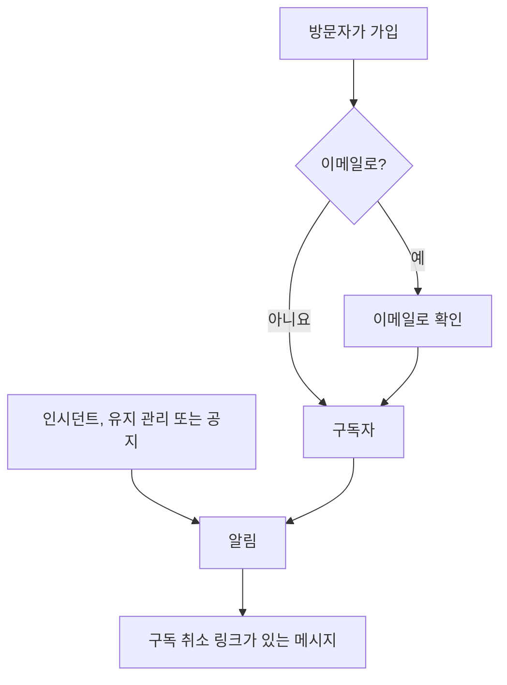

# 구독자 및 공지

상태 페이지는 사람들이 찾아가는 곳입니다. 구독자는 찾아가지 않아도 되기를 바라는 사람들입니다. 이메일 주소, 전화번호, Slack 웹훅 또는 HTTP 엔드포인트를 한 번 알려 주면, 그 뒤로는 업데이트가 그들에게 찾아갑니다.

공지는 같은 일의 나머지 절반입니다. 모니터는 방문자에게 결제가 500 오류를 반환하고 있다고 알릴 수 있지만, 토요일에 데이터베이스를 마이그레이션한다는 것, 외부 공급자에 문제가 있다는 것, 어제 읽은 인시던트가 완전히 마무리되었다는 것을 알릴 수 있는 모니터는 없습니다. 공지는 점검으로는 볼 수 없는 모든 것을 위한 자유 텍스트 채널이며, 같은 구독자 목록으로 퍼져 나갑니다.

이 페이지는 두 가지를 모두 다룹니다. 다섯 가지 구독 채널과 방문자의 가입 방법, 구독자가 무엇에 대해 알림을 받을지 고르는 방법, 이중 옵트인과 구독 취소 흐름, 구독자가 매달 받을 수 있는 이메일 보고서, 그리고 공지를 작성하고, 예약하고, 템플릿으로 만드는 방법입니다.

:::cards
- [구독 채널](#구독-채널): 방문자가 가입할 수 있는 채널과 가입하는 페이지.
- [구독자가 알림을 받는 내용](#구독자가-알림을-받는-대상): 공지, 유지 관리, 인시던트, 에피소드, 그리고 그 편집.
- [보낸 내용 확인하기](#보낸-내용-확인하기): 각 알림의 상태와 다시 시도, 다시 보내기.
- [공지](#공지): 하나 이상의 상태 페이지에 공지를 게시합니다.
:::

## 작동 방식



각 상태 페이지는 자체 구독자를 가집니다. 방문자는 페이지의 **구독** 페이지에서 가입하며, 이메일 주소는 무언가를 받기 전에 링크로 확인을 거칩니다. 또는 팀이 대시보드에서 추가합니다. 그때부터 페이지에 도달하는 모든 인시던트, 예정된 유지 관리 이벤트, 공지가 페이지의 구독자에게 각자 가입한 채널로 알려지며, 모든 메시지에는 구독을 취소하는 링크가 들어 있습니다.

## 구독 채널

상태 페이지는 다섯 가지 채널을 지원합니다. 이 채널들과 방문자가 가입하는 페이지는 한곳에서 켜고 끕니다. **상태 페이지 → 해당 페이지 → 구독자 → 구독자 설정**의 **채널** 카드입니다. 각 스위치는 전환하는 즉시 저장됩니다.

- **구독자 페이지 표시**(`showSubscriberPageOnStatusPage`): 기본값은 켜짐입니다. 상태 페이지 내비게이션 바에 **구독** 항목을 넣으며, 방문자는 거기서 아래 채널로 가입합니다.
- **이메일**(`enableEmailSubscribers`): 기본값은 켜짐입니다. 나머지는 모두 켜기 전까지 꺼져 있습니다.
- **SMS**(`enableSmsSubscribers`): 기본값은 꺼짐입니다. OneUptime Cloud에서는 페이지에 자체 **Twilio 구성**이 없으면([아래](#이메일-바닥글-사용자-지정-smtp-twilio) 참고) 문자 메시지마다 프로젝트의 SMS 및 통화 잔액에서 비용이 지불됩니다. 켜려면 **프로젝트 설정 > 알림 > 알림 설정**의 **알림 채널** 카드에서 프로젝트의 **SMS**도 켜져 있어야 하며, 이는 프로젝트 소유자, **Billing Admin** 또는 **Manage Billing** 권한이 있는 사람이 할 수 있습니다.
- **Slack**(`enableSlackSubscribers`): 기본값은 꺼짐입니다.
- **Microsoft Teams**(`enableMicrosoftTeamsSubscribers`): 기본값은 꺼짐입니다.
- **웹훅**(`enableWebhookSubscribers`): 기본값은 꺼짐입니다.

스위치는 방문자가 스스로 가입하는 방법을 정하며, 상태 페이지는 꺼진 채널로의 가입을 거부합니다. 알림을 막지는 않습니다. 팀이 대시보드에서, API로 또는 워크플로로 추가한 구독자는 어떤 채널이 켜져 있든 업데이트를 받습니다.

OneUptime Cloud에서는 요금제에 포함되지 않은 스위치 옆에 요금제 이름이 표시됩니다. **SMS**와 **구독자 페이지 표시**에는 **Growth**, **Slack**, **Microsoft Teams**, **웹훅**에는 **Scale**입니다. 채널을 끄는 것은 모든 요금제에서 작동하므로, 체험판이 켠 채널은 언제든 다시 끌 수 있습니다. 스위치 아래에 그렇게 표시됩니다.

각 채널에는 상태 페이지 사이드 메뉴의 **구독자** 아래에 자체 목록도 있습니다. **이메일 구독자**, **SMS 구독자**, **Slack 구독자**, **MS Teams 구독자**, **Webhook 구독자**입니다. 여기서 누가 가입했는지 보고, 직접 사람을 추가하거나, 특정 구독자에 대해 자신을 위한 **노트**(`internalNote`)를 남깁니다. 채널이 꺼져 있는 동안 목록 맨 위에 그렇게 표시되고 바로 옆에 채널 스위치가 있어서, 목록을 떠나지 않고 켤 수 있습니다.

**스위치 하나로는 충분하지 않습니다.** 상태 페이지 내비게이션 바의 **구독** 항목은 **구독자 페이지 표시**가 켜져 있고 *동시에* 하나 이상의 채널이 켜져 있을 때만 나타납니다. **이메일**을 켜고 **구독자 페이지 표시**를 꺼 두면, 방문자는 양식에 도달할 방법이 없습니다.

## 방문자가 구독 페이지에서 보는 것

**구독** 페이지에는 켜진 채널마다 탭이 하나씩 있는 하위 메뉴가 있습니다. 각 탭은 필요한 최소한만 묻습니다.

| 탭 | 주소 | 제목 | 묻는 것 |
| --- | --- | --- | --- |
| **이메일** | `/subscribe/email` | **이메일로 구독** | **이메일 주소**, 자리 표시자는 `subscriber@company.com`. |
| **SMS** | `/subscribe/sms` | **SMS로 구독** | **전화번호**, 자리 표시자는 `+11234567890`. |
| **Slack** | `/subscribe/slack` | **Slack으로 구독** | **Slack 워크스페이스 이름**(검증에 사용)과 **Slack 수신 웹훅 URL**, 자리 표시자는 `https://hooks.slack.com/services/...`. |
| **MS Teams** | `/subscribe/microsoft-teams` | **Microsoft Teams로 구독** | **Microsoft Teams 워크스페이스 이름**과 **Microsoft Teams 수신 웹훅 URL**, 자리 표시자는 `https://outlook.office.com/webhook/...`. |
| **Webhooks** | `/subscribe/webhooks` | **웹훅으로 구독** | **웹훅 URL**, 자리 표시자는 `https://example.com/webhook`. 상태 페이지 이벤트마다 JSON `POST` 요청이 전송됩니다. |

제출 버튼에는 **구독**이라고 쓰여 있습니다. SMS, Slack, Microsoft Teams 또는 웹훅으로 가입하면 다음과 같이 표시됩니다: *구독이 완료되었습니다.* 이메일로 가입하면 확인 링크를 보냈으며 도착하지 않으면 스팸 폴더를 확인하라고 안내합니다([이메일 이중 옵트인](#이메일-이중-옵트인) 참고). **이메일**, **SMS**, **Slack**, **MS Teams** 탭에는 **새 구독** / **기존 구독 관리** 전환도 있어서, 이미 구독한 사람이 예전 메시지를 찾지 않고도 환경설정으로 돌아갈 수 있습니다.

## 구독자가 리소스와 이벤트 유형을 고르게 하기

기본적으로 구독자는 페이지의 모든 것을 받습니다. **고급 구독자 설정** 카드의 두 토글로 이를 바꿀 수 있습니다.

- **구독자가 리소스를 선택하도록 허용**(`allowSubscribersToChooseResources`): 기본값은 꺼짐입니다. 켜면 구독 양식에 **모든 리소스 구독** 토글이 생기고, 이를 해제하면 **구독할 리소스 선택**이 나타나 방문자가 개별 리소스를 고를 수 있습니다.
- **구독자가 이벤트 유형을 선택하도록 허용**(`allowSubscribersToChooseEventTypes`): 기본값은 꺼짐입니다. 같은 형태로, **모든 이벤트 유형 구독** 토글이 있고, 해제하면 그 아래에 **구독할 이벤트 유형 선택**이 나타납니다.

둘 중 하나라도 켜져 있어도 구독 양식은 여전히 한 페이지입니다. 업데이트를 보낼 곳(이메일 주소, 전화번호, 워크스페이스 또는 웹훅) 아래에 **환경설정**이 오며, 방문자가 무엇을 받을지 알려 주는 한 줄로 접혀 있습니다. 모든 리소스와 모든 종류의 이벤트가 이미 선택되어 있으므로 처음에는 "이 상태 페이지의 모든 업데이트를 받습니다."로 시작하고, 모든 것을 원하는 방문자는 열지 않고 **구독**을 누릅니다. 그 밖의 사람은 **환경설정**을 열어 리소스나 이벤트 유형을 좁힙니다. 다시 접으면 그 줄은 고른 내용을 따릅니다("선택한 리소스에 대한 업데이트만 받습니다."). 둘 다 꺼져 있으면 **환경설정**이 없으며, 양식은 업데이트를 보낼 곳과 **구독**뿐입니다.

**구독 업데이트** 페이지(아래 참고)는 같은 선택지를 펼친 채로 보여 줍니다. 구독자가 그 페이지에 가는 이유가 바로 그것을 바꾸기 위해서이기 때문입니다.

이벤트 유형은 `Incident`, `Announcement`, `Scheduled Event`입니다.

**모니터 그룹은 그 안의 모든 모니터를 대표합니다.** 페이지의 리소스는 모니터이거나 모니터 그룹이며, 모니터 그룹을 고른 구독자는 그룹의 어느 모니터에 대한 인시던트, 예정된 유지 관리 이벤트(그 노트 포함), 공지든 그 모니터를 고른 것과 똑같이 알림을 받습니다. 상태 페이지도 그렇게 보여 줍니다. 다른 리소스만 고른 사람은 알림을 받지 않으며, 모니터와 그 모니터를 담은 그룹을 모두 고른 사람은 알림을 두 번이 아니라 한 번 받습니다.

선택은 구독자 레코드에 **Is Subscribed to All Resources**(`isSubscribedToAllResources`, 기본값 true), **Is Subscribed to All Event Types**(`isSubscribedToAllEventTypes`, 기본값 true), **Subscribed to Resources**, **Subscribed to Event Types**로 기록됩니다.

**구독자는 자기 페이지의 리소스 중에서 고릅니다.** **Subscribed to Resources**는 누가 쓰든 구독자 자신의 상태 페이지의 리소스를 가리킵니다. 페이지의 방문자, 대시보드의 팀원, API 키 또는 워크플로입니다. 방문자는 페이지가 보여 주는 것 중에서 고르므로, 모니터가 보관되어 페이지가 숨기는 리소스는 고를 수 없습니다. 다른 상태 페이지의 리소스나 페이지가 방문자에게 숨기는 리소스는, 아무것과도 일치하지 않는 ID와 마찬가지로 필드와 ID를 알려 주는 `400`으로 거부됩니다. 변경은 추가하는 리소스에 대해서만 확인하므로, 구독은 이미 가리키고 있는 리소스(고른 뒤에 모니터가 보관된 리소스 등)를 유지합니다. 구독자는 자기 페이지의 리소스를 통해서만 이벤트에 대한 알림을 받습니다.

이런 경우에 좋습니다: 여러 제품을 다루는 페이지. API만 쓰는 고객은 마케팅 사이트가 흔들릴 때마다 알림을 받고 싶지 않습니다. 고객이 구독을 아예 취소하는 것을 지켜보기보다 스스로 목록을 좁히게 하세요.

같은 카드에는 **구독자 시간대**도 있습니다.

## 이메일 이중 옵트인

이메일 구독자는 항상 확인을 거칩니다. 이메일 주소로 구독자가 생성되고 이미 확인된 상태로 생성되지 않았다면, **Is Subscription Confirmed**(`isSubscriptionConfirmed`)가 `false`로 강제되고 여섯 자리 **Subscription Confirmation Token**이 생성됩니다. 그런 다음 OneUptime이 `{statusPageUrl}/confirm-subscription/{statusPageSubscriberId}?verification-token={token}` 형태의 확인 링크를 이메일로 보냅니다. 방문자는 **구독 확인** 페이지에 도착하고, 확인이 완료되면 *구독이 확인되었습니다*가 표시됩니다.

SMS, Slack, Microsoft Teams, 웹훅 구독자는 이 과정을 건너뜁니다. `isSubscriptionConfirmed`가 이미 `true`로 설정된 채 생성되기 때문입니다. 팀이 **이메일 구독자**에서 추가하는 이메일 구독자도 마찬가지입니다. 그곳에서는 **확인 링크를 보내지 않음**이 기본으로 켜져 있습니다. 끄면 그 주소는 가입할 때처럼 확인을 거칩니다.

**미확인은 무음입니다.** 알림을 위해 구독자를 가져오는 쿼리는 `isUnsubscribed: false`와 `isSubscriptionConfirmed: true`로 걸러 냅니다. 링크를 클릭하지 않은 이메일 주소는 **이메일 구독자** 목록에 남아 있지만 아무것도 받지 않습니다. 누군가 구독했는데 아무것도 받지 못한다고 하면, 먼저 그 열을 확인하세요.

이메일 확인을 끄는 토글은 없습니다. 상태 페이지에서 가입하는 모든 사람에게 무조건 적용됩니다. 구독자별 별도 열인 **Send You Have Subscribed Message**(`sendYouHaveSubscribedMessage`, 기본값 true)는 구독자가 확인된 뒤 나가는 "구독했습니다" 이메일을 제어합니다.

## 구독 관리와 해지

구독자가 받는 모든 메시지에는 `{statusPageUrl}/unsubscribe/{statusPageSubscriberId}-{token}` 형태의 구독 취소 링크가 들어 있습니다. 이메일 맨 아래, SMS·Slack·Microsoft Teams 메시지의 본문, 웹훅 페이로드의 `unsubscribeUrl`입니다. 토큰은 그 하나의 구독에 속한 임의의 비밀 값이므로, 링크는 로그인 없이 작동합니다. 다른 모든 것에 로그인한 방문자가 필요한 비공개 상태 페이지에서도 마찬가지입니다.

유일한 예외는 **public** 상태 페이지에서 보내는 SMS로, 대신 구독자의 **구독 업데이트** 링크가 들어갑니다(아래 참고). 그 페이지는 공개 상태 페이지에서 로그인 없이 작동하며, 링크가 57자 더 짧습니다. SMS는 160자 세그먼트 단위로 요금이 부과되므로, 긴 링크는 대부분의 기본 문자를 세그먼트 하나 더로 넘기게 됩니다. 사용자 지정 SMS 템플릿의 `{{unsubscribeUrl}}`도 같은 규칙을 따릅니다. 비공개 상태 페이지에서 보내는 SMS에는 구독 취소 링크가 들어갑니다.

SMS 로그(상태 페이지와 프로젝트 설정의 **알림 로그**에 있는 **SMS** 탭)에는 모든 SMS의 본문이 보관되며, 구독자를 관리할 수 있는 사람보다 더 많은 프로젝트 구성원이 읽을 수 있습니다. 그래서 로그에는 토큰을 `[redacted]`로 바꾼 구독 취소 링크가 표시됩니다. 예: `{statusPageUrl}/unsubscribe/{statusPageSubscriberId}-[redacted]`. 작동하는 링크는 구독자 본인의 휴대폰만 받습니다. 새 구독자의 토큰은 그것을 만든 요청에 대한 응답에서조차 API가 돌려주지 않습니다.

**링크를 열어도 아무것도 바뀌지 않습니다.** 페이지에는 상태 페이지의 이름과 로고, 그리고 링크가 속한 구독이 표시됩니다. 이메일 주소는 전체, 전화번호는 마지막 네 자리만 남기고 가린 형태, Slack 또는 Microsoft Teams 워크스페이스 이름, 또는 웹훅의 호스트입니다. 페이지는 다음과 같이 묻습니다: *이 상태 페이지의 알림을 더 이상 받지 않으시겠습니까?* **구독 취소**를 눌러야만 구독이 취소되므로, 메시지 속 모든 링크를 여는 메일 스캐너와 링크 미리 보기가 누군가의 구독을 취소할 수는 없습니다. 페이지의 다른 내용은 표시되지 않으며, 사용자 지정 JavaScript도 실행되지 않습니다. 두 번 확인하거나 이미 취소된 구독의 링크를 열면 취소되었다고만 표시됩니다. 공개 상태 페이지에서는 구독 취소 페이지가 구독자의 **구독 업데이트** 페이지로도 연결되어, 대신 받을 알림을 고를 수 있습니다.

**구독 업데이트** 페이지 `{statusPageUrl}/update-subscription/{statusPageSubscriberId}`의 제목은 **구독 업데이트**이며, 방문자에게 그곳에서 환경설정을 업데이트하거나 구독을 취소할 수 있다고 알려 줍니다. 내용은 다음과 같습니다.

- 페이지가 허용하는 리소스와 이벤트 유형 선택기.
- 모든 리소스의 구독 취소로 설명되는 **구독 취소** 토글. **구독 취소 여부**(`isUnsubscribed`, 기본값 false)를 씁니다.
- **구독 업데이트**라고 쓰인 제출 버튼. 저장하면 다음과 같이 표시됩니다: *변경 사항이 저장되었습니다.*

비공개 상태 페이지에서는 페이지의 나머지 부분처럼 로그인한 방문자가 필요합니다. 링크를 잃어버린 사람은 **구독** 페이지의 **기존 구독 관리**를 사용해 **관리 링크 보내기**를 누릅니다. 링크는 구독 자체(그 이메일 주소, 전화번호, 또는 Slack이나 Microsoft Teams 채널)로 가며, 요청에 있는 주소로는 절대 가지 않습니다. 또한 구독이 일치했든 아니든 페이지는 같은 응답을 하므로, 누가 구독했는지 알아내는 데 쓸 수 없습니다. 그 메시지는 **구독 업데이트** 페이지로 연결되며, 사용자 지정 템플릿에 `manageSubscriptionUrl`과 `unsubscribeUrl` 두 링크를 모두 넘깁니다.

이 모든 것을 뒷받침하는 엔드포인트는 `POST .../subscribe/:statusPageId`, `POST .../manage-subscription/:statusPageId`, `POST .../get-subscription/:statusPageId/:subscriberId`, `PUT .../update-subscription/:statusPageId/:subscriberId`, 그리고 `GET` 및 `POST .../unsubscribe/:statusPageId/:subscriberId/:token`입니다. 구독 취소 `GET`은 링크를 설명하기만 합니다. `POST`는 원클릭 구독 취소 요청의 `List-Unsubscribe=One-Click` 본문을 포함해 본문과 관계없이 구독을 취소합니다. 둘 다 잘못된 토큰, 삭제된 구독자, 다른 상태 페이지의 구독자에 대해 같은 응답을 하므로, 누가 구독했는지 알아내는 데 쓸 수 없습니다.

구독 취소는 행을 삭제하는 대신 플래그를 바꾸므로, 레코드는 **구독 취소 여부**가 설정된 채로 채널 목록에 남습니다. 나중에 특정 주소가 메일을 받지 않게 된 이유를 설명해야 할 때 유용합니다. 누가 구독을 취소했든(링크나 **구독 업데이트** 페이지를 통한 구독자, 또는 대시보드나 API를 통한 팀원) **구독 해지일**(`unsubscribedAt`)도 기록합니다. 각 구독자 목록에는 **구독 해지일** 열과 필터가 있습니다. **구독 취소 여부**를 다시 끄면 이 값이 지워집니다. OneUptime이 이를 기록하기 전에 취소된 구독에는 날짜가 없습니다.

구독 취소 페이지가 생기기 전에 보낸 메시지의 링크도 계속 작동합니다. **구독 업데이트** 링크는 여전히 그 페이지를 엽니다. 아주 오래된 메시지에는 `/api/status-page-subscriber/unsubscribe/{statusPageSubscriberId}`가 들어 있었는데, 예전에는 열자마자 구독을 취소했습니다. 이제는 아무것도 바꾸지 않습니다. 구독 취소 페이지로 이동하며, 그 페이지는 링크가 오래되었으니 최근 메시지의 링크를 사용하라고 알려 줍니다.

### 공유 주소와 메일링 리스트

메일함을 읽을 수 있는 사람은 누구나 그 구독을 취소할 수 있습니다. 직접 가입한 주소라면 그것이 원래 의도입니다. 팀이 추가한 주소, 예를 들어 `site03-all@` 같은 사이트의 메일링 리스트라면, 독자 한 명이 다음 장애 전에 리스트의 모든 사람을 페이지에서 빼 버릴 수 있다는 뜻입니다. 그러니:

- **가능하면 각자의 주소로 추가하세요.** **일괄 추가** 양식과 이메일 구독자 양식의 이메일 필드 설명에 그렇게 안내되어 있습니다.
- **팀에 알려집니다.** 팀이 추가한 구독자란 대시보드에서, API 키(REST API, Terraform, 스크립트)로, 또는 워크플로가 추가한 구독자이며, API는 이를 **Is Added By Team**(`isAddedByTeam`)으로 읽습니다. 그런 구독자가 링크나 **구독 업데이트** 페이지를 통해 구독을 취소하면, 상태 페이지의 소유자(소유자 사용자와 소유자 팀의 구성원) 각각에게 구독자를 알려 주고 페이지의 구독자 목록으로 가는 링크가 있는 이메일이 한 통씩 갑니다. 팀원이 추가한 경우에는 추가한 팀원도 받습니다. 소유자가 없는 페이지는 그 팀원에게만 이메일을 보내므로, API 키나 워크플로가 소유자 없는 페이지에 추가한 구독자는 보고되지 않습니다. 상태 페이지에서 직접 가입한 사람은 보고되지 않습니다. OneUptime이 이를 기록하기 전에 API 키나 워크플로가 추가한 구독자는 직접 가입한 사람과 구별할 수 없어 마찬가지로 보고되지 않습니다.
- **구독자 목록에 표시됩니다.** 각 목록 위의 알림에 팀이 추가한 구독자 중 최근 30일 동안 구독을 취소한 사람이 표시됩니다.

구독 취소 페이지는 그런 구독의 독자에게 확인하기 전에 경고합니다. 공유 주소라면 구독을 취소하면 그 알림을 받는 모든 사람에게 알림이 멈추며, 팀에도 알려집니다.

## 구독자가 알림을 받는 대상

구독자는 위의 세 가지 이벤트 유형에 대해 알림을 받지만, 출처마다 자체 스위치가 있어서 실수로 무언가가 보내지는 일은 없습니다.

### 공지 알림

공지 자체에 **Should subscribers be notified?**(`shouldStatusPageSubscribersBeNotified`)가 있으며, 생성 양식에서는 **일정 및 알림** 아래의 **상태 페이지 구독자에게 알림** 확인란으로 나타나고 기본값은 켜짐입니다. 구독자는 공지가 표시되기 시작할 때 한 번 알림을 받으므로, 이 값은 공지를 만들 때 정해지며 편집으로 바꿀 수 없습니다. 나중에 이를 쓰는 워크플로는 값을 저장하기만 합니다. 바꾸지 않고 다시 써도 공지를 다시 보내지 않고, 켜도 보내지 않으며, 알림이 나가기 전에 끄면 알림을 건너뜁니다. 공지가 **영향받는 모니터**에서 모니터를 지정하면 알림은 그 모니터로 범위가 정해집니다. 구독자가 리소스를 고르는 페이지에서는 그 모니터, 그 모니터를 담은 모니터 그룹, 그리고 모든 리소스의 구독자에게 갑니다. 비워 두면 모든 구독자에게 알립니다. 그 모니터를 직접 또는 그룹을 통해 하나도 나열하지 않는 상태 페이지에서는 공지가 그 페이지를 읽는 모든 사람을 위한 것이므로, 그곳에서 공지를 받는 모든 구독자에게 알립니다.

### 예정된 유지 관리 이벤트

예정된 유지 관리 이벤트에는 자체 구독자 열이 있습니다. **Should subscribers be notified when event is created?**, **Should subscribers be notified when event is changed to ongoing?**, **Should subscribers be notified when event is changed to ended?**, 그리고 사전 경고를 위한 **Subscriber notifications before the event**와 **Next subscriber notification before the event at?** 열입니다. 이벤트의 **상태 페이지**는 어느 페이지에 나타날지 정하고, **Should be visible on status page?** 열은 아예 나타날지를 정합니다.

**예정된 유지 관리 이벤트 만들기**는 **인시던트 선언**과 같은 방식으로 두 단계와 검토를 거칩니다.

1. **이벤트**: **제목**, **설명**, **시작**, **종료**. 새 이벤트는 여러분의 시계 기준으로 다음 정각에 시작해 한 시간 동안 이어집니다. 시간이 틀린 경우에만 바꾸세요. **시작**을 옮기면 **종료**도 함께 옮겨져 기간의 길이가 유지되며, 이벤트는 시작한 뒤에 끝나야 합니다. **소유자**와 **레이블**은 **추가 필드**에 있습니다.
2. **영향받는 리소스**: 먼저 **모니터**, 모니터를 고르면 바로 아래에 **모니터 상태를 다음으로 변경**이 나타납니다. 모니터는 이벤트가 시작될 때 그 상태로 바뀌고, 끝나면 정상으로 돌아갑니다. 그다음 **기타 영향받는 리소스**: 유지 관리가 영향을 주는 호스트, 클러스터, 컨테이너 호스트, 데이터베이스, IoT 플릿, 네트워크 사이트, 서비스입니다. 그다음 **이 상태 페이지에 이벤트 표시**, 그다음 **구독자 알림**으로, 무슨 일이 일어날지 알려 주는 한 줄로 접혀 있습니다. 기본적으로 "이벤트의 상태 페이지 구독자에게 예약 시, 시작 시, 종료 시 알림이 전송됩니다."라고 쓰여 있습니다. 열면 **이벤트가 예약될 때**, **이벤트가 시작될 때**, **이벤트가 종료될 때**, **이벤트 전 리마인더**를 바꿀 수 있으며, 그 줄은 체크한 내용을 따르고 검토 단계에도 표시됩니다.

호스트, Kubernetes·Proxmox·Ceph·Docker Swarm 클러스터, Docker 또는 Podman 호스트, vCenter, 스토리지 어레이, IoT 플릿, 데이터베이스, 서비스, 네트워크 사이트의 **예정된 유지 관리** 탭에서 **예정된 유지 관리 이벤트 만들기**(그리고 **템플릿에서 생성**)를 열면, 같은 양식이 **기타 영향받는 리소스**에 그 리소스가 이미 선택된 채로 열리고, 탐색 경로는 그 탭으로 돌아갑니다. 인벤토리 항목의 **예정된 유지 관리** 탭은 항목이 가리키는 호스트, 서비스 또는 Kubernetes 클러스터를 고르며, 탐색 경로는 그 리소스의 탭을 거쳐 돌아갑니다.

입력해야 하는 것은 제목뿐입니다. 나머지는 모두 기본값이 있으므로 **다음**은 아무것도 묻지 않고 다른 단계를 지나가며, 마지막 검토에 **예정된 유지 관리 이벤트 만들기**가 있습니다. 상태 페이지를 고르기 전까지는 아무도 알림을 받지 않습니다. 세 가지 **이벤트가 …때** 설정은 이벤트를 만들 때 정해지며, 나중에 **이벤트가 예약될 때**를 쓰는 워크플로는 값을 저장하기만 합니다. 바꾸지 않고 다시 쓰거나 켜도 아무것도 보내지 않으며, '예약' 알림이 나가기 전에 끄면 그 알림은 건너뜁니다. 이벤트의 **Maintenance Details** 카드의 **편집** 버튼은 제목, 기간, 레이블(**이벤트**)과 상태 페이지, 리마인더(**상태 페이지**)를 바꿉니다. **영향받는 리소스** 카드의 **편집** 버튼은 양식과 같은 방식으로 묻습니다. **모니터**, 모니터가 있으면 **모니터 상태를 다음으로 변경**, 그다음 **기타 영향받는 리소스**이며, 카드는 모니터 아래에 상태를 보여 줍니다. 이벤트를 편집할 수 있는 사람은 이벤트가 시작될 때까지 모니터 상태를 바꿀 수 있습니다. 이벤트가 시작되면(시작 시각에, 또는 누군가 직접, Slack이나 Microsoft Teams에서, 또는 API로 진행 중 상태로 옮길 때) 그 모니터는 그 순간 이벤트가 가진 상태로 바뀌며, 진행 중에 추가된 모니터도 마찬가지입니다. **Scheduled**에서 **Ongoing**과 **Ended** 사이에 둔 사용자 상태(예: "Verifying")로 바로 옮기면 같은 방식으로 시작됩니다. 모니터는 **Ongoing**에서처럼 그 상태로 바뀌고, 끝나면 정상으로 돌아갑니다. 그때부터는 상태를 더 이상 바꿀 수 없습니다. 카드의 **편집**은 "이벤트가 시작되었으므로 더 이상 변경할 수 없습니다."와 함께 읽기 전용으로 보여 주며, API는 "Change Monitor Status to can no longer be changed: this event has already started."로 변경을 거부합니다. 이벤트가 이미 가진 상태를 다시 쓰는 것은 여전히 받아들여집니다. 예정된 유지 관리 템플릿(**설정 → 이벤트 템플릿**)도 같은 단계를 사용하며, 앞에 템플릿 이름이, 끝에 반복 일정이 붙습니다. 템플릿은 모니터를 지정하든 안 하든 **모니터 상태를 다음으로 변경**을 묻습니다. 그 상태는 템플릿에서 이벤트를 예약할 때 고른 모니터에도 적용되기 때문입니다. 기존 템플릿의 **영향받는 리소스** 카드도 같은 방식으로 묻고, 템플릿이 고른 상태를 보여 주며, 아무것도 고르지 않았으면 다음과 같이 표시합니다: **모니터는 현재 상태를 유지합니다.** 템플릿을 편집할 수 있는 사람은 거기서 바꿀 수 있습니다.

**어느 상태 페이지에?** 이벤트가 모니터를 지정하면, 그 모니터를 보여 주는 상태 페이지가 **이 상태 페이지에 이벤트 표시** 아래에 제안됩니다. "영향받는 모니터를 표시하는 상태 페이지:" 뒤에 각 페이지 이름이 이어집니다. 이름을 클릭하면 그 페이지를 추가하고, **모두 추가**를 클릭하면 모두 추가합니다. 모니터 중 하나를 직접 또는 모니터 그룹을 통해 나열하는 페이지가 해당됩니다. 볼 수 있는 상태 페이지만 제안되며, 보관된 페이지와 예정된 유지 관리 이벤트를 보여 주지 않는 페이지는 제외됩니다. 자동으로 선택되는 것은 없습니다. 고른 상태 페이지는 이벤트를 보여 주고, 기본 알림 설정에서는 그 구독자에게 알리므로 그것은 여러분의 선택으로 남습니다. 이벤트 **편집**의 **상태 페이지** 단계와 예정된 유지 관리 템플릿의 양식도 이벤트나 템플릿의 모니터로부터 같은 방식으로 제안합니다.

**사용자 상태.** 이벤트는 **Ongoing**에서, 그리고 **Ongoing**과 **Ended** 사이에 둔 모든 사용자 상태(예: "Verifying" 단계)에서 진행 중입니다. **Ongoing** 앞에 둔 사용자 상태는 아직 시작되지 않은 것이고, **Ended** 뒤에 둔 상태("Reviewing")는 끝난 것입니다. 이벤트가 진행 중인지 묻는 모든 것은 이 하나의 규칙을 따릅니다. 그런 이벤트는 상태 페이지(개요, 이벤트 자체 페이지, RSS 피드)에서 진행 중으로 표시되고, **예정된 유지 관리**와 **홈** 아래의 **Ongoing** 목록, 그 메뉴 배지, **홈**의 **진행 중인 유지 관리** 타일에도 표시되며, Microsoft Teams 앱은 진행 중인 유지 관리로 나열합니다. 모니터는 유지 관리 상태로 남고, 이벤트가 다루는 네트워크 사이트와 텔레메트리 시리즈는 계속 음소거되며, 모니터의 SLO 소진율 경고는 보류됩니다. **종료** 시각이 되면 진행 중인 이벤트처럼 종료되며, **이벤트가 종료될 때**가 켜져 있으면 구독자에게 알립니다. **Ongoing**이나 "Verifying"에서 **Ended** 뒤에 둔 사용자 상태로 바로 옮기면 **Ended**와 같은 방식으로 끝납니다. 모니터는 정상으로 돌아가고, 이벤트 헤더에 소요 시간이 표시됩니다. **Ongoing**에서 "Verifying"으로, 또는 **Ended**에서 "Reviewing"으로 옮겨도 무언가가 다시 시작되거나 끝나지는 않습니다. 상태의 위치란 **예정된 유지 관리 → 설정** 아래 **이벤트 상태** 페이지의 목록에서의 위치입니다.

**시작 대기, 종료, 완료.** 나머지도 같은 위치가 정합니다. 이벤트는 **Scheduled**와, **Scheduled**와 **Ongoing** 사이에 둔 모든 사용자 상태(예: "Confirmed" 단계)에서 **시작** 시각을 기다립니다. 시작 시각이 되면 **Scheduled**에서 시작하는 것과 같은 방식으로 거기서 시작합니다. **Ongoing**으로 옮겨지고, 모니터는 **모니터 상태를 다음으로 변경**의 상태로 바뀌며, 소유자에게 알리고, **이벤트가 시작될 때**가 켜져 있으면 구독자에게도 알립니다. 그때까지는 다가올 이벤트 사이에 나열되며(상태 페이지의 개요, 예정된 이벤트 페이지, RSS 피드, 그리고 누군가 Microsoft Teams 앱에 예정된 유지 관리를 물을 때), 이벤트 전 리마인더도 계속 구독자에게 나갑니다. 피드와 상태 페이지의 타임라인은 그런 상태를 **Scheduled**와 같은 시계와 함께 보여 줍니다. **Scheduled** 앞에 둔 사용자 상태("Draft"나 승인 단계)도 아직 시작되지 않았지만 사람을 기다립니다. 그곳에서는 시각이 되어도 이벤트가 시작되지 않으며, 다가올 이벤트로 나열되지도 않습니다. 이벤트는 **Ended**, **Completed**, 그리고 **Ended** 뒤에 둔 모든 사용자 상태에서 끝난 것이며, 이벤트의 **개요**는 헤더, **측정** 카드, 보여 주는 타임라인 등 모든 곳에서 끝난 것으로 다룹니다. **Completed**와 그 뒤에 둔 모든 사용자 상태("Archived")에서는 완료된 것입니다. 이것이 소유자 리마인더(**Remind until event is Completed**)를 멈추는 것이고, Slack과 Microsoft Teams가 **Mark as Complete**를 거부하는 이유이며, 피드와 상태 페이지의 타임라인이 완료로 표시하는 것입니다. **Ended**나 **Ended**와 **Completed** 사이의 "Reviewing"에서는 끝났지만 아직 완료되지는 않았습니다.

**네트워크 사이트는 모든 상태 변경을 따릅니다.** 이벤트가 다루는 네트워크 사이트는 이벤트가 진행 중인 동안 계획된 중단을 상위 사이트에 대해 계산하지 않습니다. 이벤트의 상태가 바뀔 때마다 그 상태는 양방향으로 즉시 다시 계산됩니다. 되돌아갈 때도 마찬가지인데, 현재 상태의 항목이 **상태 타임라인**에서 삭제될 때가 그렇습니다. "Verifying"에서 **Scheduled**로 되돌아가면, 안전망으로 여전히 5분마다 실행되는 다음 점검을 기다리지 않고 즉시 음소거를 멈춥니다.

**편집에 대해 피드가 기록하는 것.** 편집하면 이벤트의 **예정된 유지보수 피드**에 **Scheduled Maintenance was updated.** 항목이 추가되며(Slack과 Microsoft Teams 채널에도 게시됨), 바꾼 항목마다 한 줄씩 새 값과 함께 기록됩니다. 제목, **시작**, **종료**, 설명, 이벤트 전 리마인더, 이벤트가 영향을 주는 것, **모니터 상태를 다음으로 변경**, 표시되는 상태 페이지, 레이블입니다. 그대로 저장된 값에는 줄이 없으므로, 아무것도 바꾸지 않고 **Maintenance Details** 카드를 저장하거나(매번 제목, 기간, 레이블, 상태 페이지, 리마인더를 보냄) API 클라이언트, 워크플로, Terraform이 이벤트를 그대로 다시 쓰면 항목이 전혀 추가되지 않습니다. 시각은 어떻게 쓰였든 같은 순간을 가리키면 같은 것으로 보며(시간대 없이 쓴 것은 저장될 때처럼 UTC입니다), 리마인더, 상태 페이지, 영향받는 리소스, 레이블은 순서와 관계없이 같은 집합이면 같은 것으로 봅니다. 모든 리마인더, 상태 페이지 또는 레이블을 빼면 각각 "No reminders before the event.", "Not shown on any status page.", "All labels removed."로 기록되고, 모니터 외의 마지막 영향받는 리소스(예: 마지막 호스트, 클러스터, 서비스)를 빼면 "No other affected resources."로 기록됩니다. 이벤트의 리마인더 규칙이 다시 매칭되고 다음 리마인더까지의 대기가 처음부터 다시 시작되는 것은 레이블이 바뀌거나 **리마인더 보내기** 스위치를 전환할 때뿐입니다. **Remind While Event is Scheduled**가 꺼진 리마인더 규칙(**예정된 유지 관리 → 규칙 → Reminder Rules**)은 첫 리마인더를 이벤트 시작부터 세므로, 시작이 아직 앞에 있는 동안 **시작**을 다른 시각으로 옮기면 그 리마인더도 함께 옮겨집니다. 이벤트가 예약된 동안 리마인드하는 규칙의 리마인더는 그 자리에 그대로 있습니다. 모니터의 피드도 이름, 설명, 레이블의 편집을 같은 방식으로 기록합니다.

이벤트를 **이벤트가 예약될 때**를 끈 채로 만들면(생성 양식의 **영향받는 리소스** 단계에 있는 **구독자 알림** 안), 그 이벤트의 새 공개 노트는 **Notify status page subscribers**가 꺼진 채로 시작하며, 확인란 아래에 이유를 설명하는 줄이 표시됩니다. 이는 이벤트의 **공개 노트** 페이지와, 같은 노트 작성기를 여는 **예정된 유지보수 피드**의 **Add Public Note**에 적용됩니다. 명시적인 선택 없이 게시된 노트(Slack과 Microsoft Teams의 노트, 워크플로, `shouldStatusPageSubscribersBeNotifiedOnNoteCreated`를 생략한 API 요청)도 같은 **이벤트가 예약될 때** 설정을 따릅니다. 명시적인 `true` 또는 `false`는 항상 유지됩니다. **이벤트가 예약될 때**는 이벤트를 만들 때 보내는 안내만 끕니다. 리마인더(생성 양식의 **이벤트 전 리마인더**로 설정하는 **Subscriber notifications before the event**)와 **이벤트가 시작될 때**, **이벤트가 종료될 때**로 설정하는 알림은 별개의 설정이며 여전히 나갑니다. 구독자가 이미 그런 식으로(예: 리마인더나 진행 중 알림으로) 이벤트를 알고 있다면, 확인란을 체크해 노트에 대해 알리세요.

이벤트 **개요** 페이지 위쪽의 버튼에서 여는 **예정된 유지 관리를 `<state name>`(으)로 표시** 모달에는 상태 변경과 모달의 **공개 메모**(**공개 메모 추가** 아래에 접혀 있음)를 모두 다루는 **상태 페이지 구독자에게 알림** 확인란이 하나 있습니다. **이벤트가 예약될 때**를 켠 채로 만든 이벤트에서는 이전처럼 켜진 채로 시작합니다. 끈 채로 만든 이벤트에서는 같은 줄을 아래에 보여 주며 꺼진 채로 시작하지만, 자동 상태 변경이 알릴 내용에 맞춰 다음 두 경우에는 켜진 채로 시작합니다.

- 이벤트를 진행 중 상태로 옮기거나, 시작되지 않은 상태에서 **Ongoing**과 **Ended** 사이에 둔 사용자 상태로 옮기고(시작됨) **이벤트가 시작될 때**가 켜져 있는 경우.
- 이벤트를 종료 또는 완료 상태로 옮기거나, 진행 중인 상태에서 **Ended** 뒤에 둔 사용자 상태로 옮기고(종료됨) **이벤트가 종료될 때**가 켜져 있는 경우.

**상태 변경과 함께 보내는 노트가 유일한 메시지입니다.** 그 모달(또는 **상태 변경** 일괄 작업)에서 **상태 페이지 구독자에게 알림**을 켠 채 **공개 메모**를 쓰면, 구독자는 별도의 상태 변경 메시지 대신 모든 채널에서 그 노트를 받습니다. 두 통이 아니라 한 통입니다. 상태 변경에는 **전송된 알림**이 표시되고, 그 상태 메시지는 노트가 그것을 전했다고 알려 줍니다. 노트는 상태 변경이 저장된 뒤에 게시됩니다. 이벤트 피드와 Slack, Microsoft Teams에서 변경 뒤에 이어지며, 저장되지 않은 상태 변경은 노트를 게시하지 않고 아무에게도 알리지 않습니다. 공백만 있는 노트는 게시되지 않으며, 구독자는 상태 변경 메시지를 받습니다. 확인란이 꺼져 있으면 상태 변경도 그 노트도 아무에게도 알리지 않습니다. API에서는 노트가 `POST /api/scheduled-maintenance-state-timeline`의 `"miscDataProps": {"publicNote": "..."}`로 상태 변경과 함께 가며, `shouldStatusPageSubscribersBeNotified`가 둘 다 결정합니다(생략하면 상태 변경은 알리고 그 노트는 알리지 않습니다). 인시던트도 같은 방식으로 작동합니다. [인시던트 상태 및 심각도](/docs/incidents/states-and-severities#상태-변경을-상태-페이지-구독자에게-알리기)를 참고하세요.

**노트는 새 상태를 알려 줍니다.** 유일한 메시지이므로, 상태 변경과 함께 보내는 노트는 상태 변경 메시지가 그랬듯이 모든 채널에서 이벤트의 현재 상태를 말합니다. 이메일 제목은 `[Ongoing Scheduled Maintenance] <title>`이고 세부 정보에 **상태** 행이 표시되며, SMS는 `Maintenance <title> on <status page> is Ongoing.`이라고 하고, Slack과 Microsoft Teams 메시지에는 `**Status:** Ongoing` 줄이 들어가며, 웹훅의 `ScheduledMaintenanceNoteCreated` 페이로드는 `data`에 `scheduledMaintenanceState`를 담습니다. 따로 게시한 노트는 늘 그렇듯 그대로입니다. 노트를 게시하려면 **Create Scheduled Maintenance Status Page Note**가 필요합니다(기본 제공 예정된 유지 관리 역할과 프로젝트 역할에는 있습니다). 이 권한이 없는 사람에게는 **공개 메모 추가**가 제공되지 않으며, 그 사람이 노트와 함께 보낸 상태 변경은 거부되므로, 이벤트는 아무도 모르게 상태가 바뀌는 대신 원래 상태를 유지합니다.

이벤트 **상태 타임라인** 페이지의 수동 양식과 예정된 유지 관리 목록의 **상태 변경** 일괄 작업은 이 설정을 보지 않습니다. 그 **상태 페이지 구독자에게 알림** 확인란은 항상 켜진 채로 시작합니다.

템플릿에서 만든 이벤트는 다른 구독자 설정과 함께 **이벤트가 예약될 때**를 템플릿에서 가져옵니다. **템플릿에서 생성**은 템플릿의 값으로 생성 양식을 채우며, **설정 → 이벤트 템플릿** 아래의 템플릿이 예약한 반복 이벤트도 그 값을 복사합니다.

### 인시던트

`Incident`는 세 번째 이벤트 유형입니다. 애초에 무엇이 인시던트를 상태 페이지에 도달하게 하는지(어떤 리소스에 영향을 주고 어떤 상태에서 계속 보이는지)는 [인시던트 상태 및 심각도](/docs/incidents/states-and-severities)에서 다룹니다. 구독자에게 알리지 않고 선언한 인시던트의 공개 노트는 **상태 페이지 구독자에게 알림**이 꺼진 채로 시작합니다. [인시던트 메모, 소유자 및 피드](/docs/incidents/notes-owners-and-feed#공개-노트-게시하기)를 참고하세요.

인시던트의 메시지(생성, 상태 변경, 공개 노트, 포스트모템)는 그 모니터 중 하나를 나열하는 모든 상태 페이지의 구독자에게 갑니다. 이를 좁히는 설정이 두 가지 있습니다. 인시던트의 **다음 상태 페이지로 제한**은 그중에서 고른 페이지로 인시던트를 한정하고, 상태 페이지의 **이 페이지로 제한된 인시던트만 표시**는 그 페이지로 제한되지 않은 모든 인시던트를 막습니다. 특정 페이지로 제한된 인시던트에서는 여러 페이지에 구독한 이메일 주소나 전화번호가 페이지마다가 아니라 전송마다 이메일 또는 문자 메시지를 한 통 받습니다. 웹훅, Slack, Microsoft Teams 메시지는 합쳐지지 않습니다. 선언 양식과 **공개 노트** 페이지는 무언가를 보내기 전에 누가 알림을 받을지 보여 줍니다. [대상별 상태 페이지](/docs/status-pages/one-status-page-per-audience)를 참고하세요.

#### 포스트모템

구독자는 인시던트의 포스트모템에 대해 게시될 때, 즉 상태 페이지가 처음 그것을 보여 줄 때 한 번 알림을 받습니다. 상태 페이지는 **상태 페이지에 게시**가 켜져 있고 포스트모템에 노트가 있을 때 포스트모템을 보여 줍니다. 첨부 파일은 노트와 함께 표시되며, 노트 없이 표시되지 않습니다. 그래서 작성된 노트에 대해 게시를 켜면 게시되고, 켜져 있는 포스트모템의 노트를 쓰는 것도 게시입니다. 같은 양식의 **구독자에게 알림**은 애초에 알릴지 여부를 정합니다. 그 뒤로는:

- **다시 저장해도 아무에게도 알리지 않습니다.** **사후 분석 노트 편집** 양식은 저장할 때마다 포스트모템 전체를 보내며, API 클라이언트, Terraform 또는 워크플로가 인시던트 전체를 다시 쓸 수도 있습니다. 이미 게시된 것은 새 소식이 아닙니다.
- **게시된 포스트모템을 편집해도 아무에게도 알리지 않습니다.** 상태 페이지는 새 노트를 즉시 보여 주고, 인시던트 피드는 그것을 **Postmortem Note updated**로 한 번 기록하지만, 구독자는 이미 알림을 받았습니다. 노트 앞뒤의 공백은 변경으로 치지 않습니다.
- **상태 페이지에서 내려도 아무에게도 알리지 않으며, 다시 게시하면 다시 알립니다.** 구독자는 그것이 사라지는 것을 보았기 때문입니다. 게시된 포스트모템의 노트를 비워도 상태 페이지에서 내려갑니다.
- **노트 없이 켜진 포스트모템은 아무것도 보여 주지 않으므로**, 노트가 작성될 때까지 아무에게도 알리지 않습니다.
- **인시던트가 숨겨진 동안 게시된 포스트모템은 인시던트가 표시될 때 보내집니다.** 상태 페이지는 자신이 보여 주는 인시던트(**상태 페이지에 표시**가 켜져 있고 비공개가 아닌 인시던트)에서만 포스트모템을 보여 주므로, 인시던트가 숨겨진 동안에는 아무에게도 알리지 않으며 알림 상태는 **아직 보내지 않음: 인시던트가 상태 페이지에서 숨겨짐**으로 표시됩니다. **상태 페이지에 표시**를 켜면 한 번 보내지며(비공개 인시던트라면 **비공개 인시던트**를 끄는 것과 함께), 인시던트 **설정** 페이지의 스위치가 저장하기 전에 그렇게 알려 줍니다. 인시던트를 숨겼다가 다시 표시해도 더 보내지는 것은 없으며, 포스트모템이 이미 보내졌거나 게시되지 않은 인시던트를 표시해도 아무것도 보내지 않습니다. 이전 릴리스가 이런 식으로 건너뛴 포스트모템은 업그레이드할 때 인시던트가 아직 숨겨져 있었다면 같은 방식으로 보내집니다. 그 뒤로 인시던트가 표시된 것은 그때부터 상태 페이지가 보여 주었으므로 보내지지 않은 채로 남습니다.
- **구독자에게 알림은 알림이 나갈 때 읽힙니다.** 이를 끈 채로 게시한 포스트모템은 안내되지 않으며, 나중에 켜도 알림 없이 게시된 것에 대한 알림은 보내지지 않습니다.

알림 상태는 인시던트의 **포스트모템** 페이지에 있으며, 실패한 알림에는 **다시 시도**가 있습니다([다시 시도와 다시 보내기](#다시-시도와-다시-보내기) 참고). API에서 작성된 `postmortemNote`에 대해 `showPostmortemOnStatusPage`를 `true`로 쓰면, 요청이 인시던트 전체(현재 알림 상태 포함)를 다시 쓰더라도 게시되며, 숨겨진 인시던트를 표시하면(`isVisibleOnStatusPage`를 `true`로, 비공개라면 `isPrivate`를 `false`로 쓰면) 그것을 기다리던 포스트모템이 보내집니다. `subscriberNotificationStatusOnPostmortemPublished`를 `Pending`으로 쓰면 다시 보냅니다. 이미 대기 중이거나 보내는 중인 알림은 두 번 대기열에 들어가지 않으며, 알림을 준비하는 동안 게시된 포스트모템도 한 번만 안내됩니다. AI가 자동으로 만드는 포스트모템 초안은 켜져 있는 포스트모템에 기록되지 않으므로, 검토되지 않은 초안이 구독자에게 닿는 일은 없습니다.

#### 보내기 전에 이메일 미리 보기

**미리 보기**는 미리 보는 값 옆에 있는 작은 링크입니다. **새 인시던트 선언**의 마지막 단계에서 **상태 페이지 구독자에게 알림** 아래의 **예** 옆, 그리고 공개 노트를 쓰는 동안 **상태 페이지 구독자에게 알림** 확인란 옆에 있습니다. **알림 미리 보기**를 열며, 알림을 보낼 때와 같은 코드, 템플릿, 설정으로 만들고 렌더링한 각 상태 페이지 구독자가 받을 이메일을 보여 주므로, 보이는 것이 받는 것입니다.

- 상태 페이지를 고르면 제목과 채널별 "최대" 개수와 함께 그 이메일이 표시됩니다.
- 어떤 템플릿이 왜 쓰이는지 알려 주는 줄이 있습니다. 예를 들어 페이지에 **사용자 지정 SMTP 구성**이 없어서 페이지의 사용자 지정 템플릿이 쓰이지 않는다는 것입니다.
- 아무것도 보내지지 않을 때(모니터 없음, 비공개 또는 숨겨진 인시던트, **상태 페이지 구독자에게 알림** 꺼짐, 또는 인시던트를 보여 주는 상태 페이지 없음)는 이메일 대신 그렇게 알려 줍니다.

볼 수 있는 상태 페이지만 미리 보며, 나머지는 개수로 셉니다. 이메일은 스크립트를 실행하지 않는 샌드박스 프레임에 표시됩니다. 구독 취소 링크는 견본입니다. 각 구독자의 이메일에는 각자의 링크가 들어가기 때문입니다.

**나에게 테스트 보내기**는 표시된 페이지의 이메일을 제목 앞에 `[Test]`를 붙여 본인 계정 이메일로 보내며, 페이지에 **사용자 지정 SMTP 구성**이 있으면 그것을 거칩니다. 다른 주소로는 절대 보내지 않고, 계정 이메일이 인증되어 있어야 하며, 한 사람당 15분마다 테스트 이메일을 10통까지 보낼 수 있습니다.

#### 알림에 포함되는 인시던트 사용자 정의 필드

**구독자 알림에 포함**을 켠 인시던트 사용자 정의 필드(**인시던트 → 설정 → 사용자 정의 필드**)는 인시던트의 메시지(생성, 상태 변경, 공개 노트 게시 또는 업데이트, 포스트모템)와 함께 나갑니다. 사용자 정의 필드가 있는 모든 요금제에서 작동하며, 사용자 지정 템플릿도 사용자 지정 SMTP도 필요하지 않습니다.

- **이메일**은 세부 정보 상자에서 인시던트 자체 행 아래에 필드의 **순서**대로 나열합니다. 인시던트에 값이 없는 필드는 빠집니다. 예/아니요 필드는 **예** 또는 **아니오**로 표시되고, 날짜는 고른 날(UTC−10:59부터 UTC+13까지 어느 시간대에서 고른 날짜든, 어디에 있는 수신자에게나 같은 날)이며, 날짜와 시간은 상태 페이지의 구독자 시간대로 표시되고, 긴 텍스트는 줄을 유지하며, 서식 있는 텍스트는 노트와 같은 링크 규칙으로 서식이 적용되어 표시됩니다. 그 인라인 이미지는 그것을 담은 첫 메시지가 보내질 때 받는 사람이 볼 수 있게 됩니다.
- **Slack**과 **Microsoft Teams**도 같은 방식으로 한 줄에 하나씩 나열합니다.
- **웹훅** 페이로드는 각 필드의 **템플릿 변수**를 키로 하여 `data.customFields`에 담습니다: `{ "name": ..., "type": ..., "value": ... }`, 값은 저장된 그대로입니다(인시던트에 값이 없으면 `null`). 필드 이름을 바꿔도 키는 바뀌지 않습니다.
- **SMS**는 이를 빼고 보냅니다. 문자 메시지는 세그먼트 단위로 요금이 부과되며 기본 메시지는 이미 한 세그먼트에 가깝습니다. 사용자 지정 SMS 템플릿에서는 `{{incident.customFields.<key>}}`로 어떤 필드든 넣을 수 있습니다.
- **Incident episode** 알림에는 사용자 정의 필드가 들어가지 않습니다. 에피소드는 각자 고유한 값을 가진 인시던트를 묶은 것이기 때문입니다. 멤버 인시던트 각각의 알림에는 그 필드가 들어갑니다.

인시던트 피드의 **구독자 알림 전송됨** 항목은 **Custom fields sent** 아래에 각 전송이 메시지에 넣은 값을 나열합니다. 구독자는 대개 팀 밖의 사람이므로, 구독자와 공유해도 안전한 필드에만 이 설정을 켜세요.

상태 페이지 사이드 메뉴의 **알림 로그** 섹션(`{id}/notification-logs`)은 페이지가 실제로 보낸 것을 봐야 할 때 가는 곳입니다.

### 인시던트 에피소드

인시던트 에피소드는 생성되었다는 것을 구독자에게 알렸는지를 `shouldStatusPageSubscribersBeNotifiedOnEpisodeCreated`에 기록합니다. **에피소드 만들기** 버튼이나 **그룹화 규칙**으로 만든 에피소드는 이 값이 켜져 있으며, API 요청으로는 이 값을 `false`로 하여 에피소드를 만들 수 있습니다.

이 값을 `false`로 하여 만든 에피소드에서는 새 공개 노트가 **Notify status page subscribers**가 꺼진 채로 시작하며, 에피소드의 **공개 노트** 페이지와, 같은 노트 작성기를 여는 **에피소드 피드**의 **Add Public Note**에서 그 아래에 이유를 설명하는 줄이 표시됩니다. 그래도 체크할 수 있습니다. 명시적인 선택 없이 게시된 노트(Slack 노트, 워크플로, `shouldStatusPageSubscribersBeNotifiedOnNoteCreated`를 생략한 API 요청)도 같은 설정을 따릅니다. 명시적인 `true` 또는 `false`는 항상 유지됩니다. 이 설정만 반영됩니다. 인시던트와 달리, 에피소드를 비공개로 해도 확인란이 시작하는 상태는 바뀌지 않습니다.

이는 공개 노트에만 해당합니다. 에피소드의 상태 변경(**인지**, **해결**, 자동 해결)은 여전히 구독자에게 알립니다. 에피소드의 상태 변경 모달에도, **상태 타임라인** 페이지의 양식에도 **상태 페이지 구독자에게 알림** 확인란이 없기 때문입니다.

나중 상태로 만든 에피소드(**에피소드 만들기** 양식의 **초기 상태**로, 또는 API로 보낸 상태로)는 생성 알림으로 한 번 안내됩니다. 첫 상태는 어떤 상태든 별도의 상태 변경으로 보내지지 않으며, `shouldStatusPageSubscribersBeNotifiedOnEpisodeCreated`를 `false`로 하여 만든 에피소드는 이를 전혀 안내하지 않습니다. 상태 타임라인의 첫 행에는 그 알림이 건너뛰어졌다는 것이 이유와 함께 기록됩니다.

### 편집을 구독자에게 알리기

구독자는 공지나 공개 노트에 대해 게시될 때 한 번 알림을 받습니다. 그 뒤의 편집은 상태 페이지가 보여 주는 내용을 바꾸지만, 그 편집에서 요청하지 않는 한 아무에게도 알리지 않습니다.

공지의 편집 양식과 인시던트, 예정된 유지 관리 이벤트, 인시던트 에피소드의 공개 노트 편집 양식에는 **이 업데이트를 구독자에게 알림** 확인란이 있습니다. 매번 체크 해제된 채로 시작하므로 오타 수정은 조용히 끝납니다. 새 유지 관리 기간, 수정된 영향 범위, 정정된 고객 업데이트처럼 변경이 중요할 때 체크하세요. 생성 양식에는 이것이 없으며, 생성 양식에는 자체 **상태 페이지 구독자에게 알림** 선택이 있습니다. 공지에서는 **공지사항** 단계의 설명 바로 아래에 있습니다.

확인란을 체크한 채 저장하면, 구독자는 편집된 내용을 새 게시물이 아니라 업데이트로 표시된 채 받습니다.

- **이메일**은 자체 템플릿을 사용합니다. 예를 들어 제목 `[Announcement Updated] <title>`과 머리글 `Announcement Updated: <title>`, 또는 노트 이메일 세부 정보 상자의 **Updated Note**입니다.
- **SMS**, **Slack**, **Microsoft Teams**는 공지나 노트가 업데이트되었다고 알립니다.
- **웹훅** 구독자는 `eventType`으로 `AnnouncementUpdated`, `IncidentNoteUpdated`, `ScheduledMaintenanceNoteUpdated` 또는 `EpisodeNoteUpdated`를 받으며, 최신 내용은 `data`에 들어 있습니다.

업데이트는 원래 알림이 오늘 닿을 사람들과 같은 사람들에게 갑니다. 같은 채널 토글, 같은 리소스와 이벤트 유형 환경설정, 같은 표시 확인입니다(숨겨진 인시던트나 **공지사항 표시**가 꺼진 페이지는 여전히 아무것도 보내지 않습니다).

의도적으로 아무것도 보내지 않고 그 이유를 기록하는 경우가 두 가지 있습니다.

- **원래 알림이 아직 나가지 않았습니다.** 공지나 노트가 아직 안내를 기다리고 있다면, 그 알림은 보낼 때 항목을 읽어 이미 편집 내용을 담고 있으므로, 별도의 "업데이트됨" 메시지는 사람들을 혼란스럽게 할 뿐입니다. 원래 알림이 바로 그때 보내지는 중이라면, 대신 업데이트가 기다렸다가 원래 전송이 끝난 뒤에 나갑니다. 그 전송은 편집 전에 항목을 읽었으므로, 구독자에게는 편집 전의 텍스트가 보내졌을 수 있습니다.
- **공지가 나중에 표시되도록 예약되어 있습니다.** **공지사항 표시 시작 시점**이 지날 때까지는 어느 상태 페이지에도 없으며, 공개될 때 알림을 받는 사람은 편집된 버전을 봅니다.

편집된 항목에는 원래 항목 옆에 **업데이트 알림 상태**가 같은 상태(**Sending Soon**, **전송된 알림**, **실패** 등)로 표시됩니다. 실패한 업데이트 알림의 **다시 시도**는 업데이트를 다시 보내며, 원래의 "게시됨" 메시지를 보내지 않습니다. 각 상태 페이지는 **Subscriber Announcement Updated**, **Subscriber Incident Note Updated**, **Subscriber Scheduled Maintenance Note Updated**, **Subscriber Episode Note Updated** 템플릿 이벤트 유형으로 이 메시지를 사용자 지정할 수 있습니다. 사용자 지정 템플릿이 없으면 기본 제공 업데이트 문구가 쓰입니다.

API에서는 바꾸는 필드 옆에 `miscDataProps`로 선택을 보냅니다.

```json
{
  "data": {
    "description": "The maintenance now starts on Sunday at 02:00 UTC."
  },
  "miscDataProps": {
    "notifySubscribersOfUpdate": true
  }
}
```

이를 `PUT /api/status-page-announcement/<announcement-id>`(또는 `incident-public-note`, `scheduled-maintenance-public-note`, `incident-episode-public-note`)의 본문으로 보냅니다. `miscDataProps`를 생략하면 이전처럼 편집은 조용히 이루어집니다.

## 보낸 내용 확인하기

모든 구독자 알림에는 그 대상 옆에 자체 상태가 있습니다. 인시던트의 경우 인시던트 **개요**의 '생성' 알림, **상태 타임라인**의 각 행, 각 공개 노트, **포스트모템**입니다. 예정된 유지 관리 이벤트와 공지도 같은 방식으로 보여 주며, 인시던트 에피소드는 공개 노트에 보여 줍니다. 상태를 클릭하면 무슨 일이 있었는지 알려 주는 메시지를 읽을 수 있습니다. 공개 노트는 상태를 고유한 문구의 배지로 보여 줍니다.

| 상태 | 공개 노트에서 | 의미 |
| --- | --- | --- |
| **Sending Soon** | **Notifying subscribers soon** | 대기열에 있습니다. 보내는 작업은 1분마다 실행됩니다. |
| **Notifications Being Sent** | **Notifying subscribers** | 작업이 구독자를 차례로 처리하고 있습니다. |
| **전송된 알림** | **Subscribers notified** | 나갔습니다. 그 의미는 아래를 참고하세요. |
| **실패** | **Notification failed** | 모든 구독자에게 보내지지 않았거나 전송이 멈췄습니다. 메시지에 무엇이 보내졌는지와 **다시 시도**가 무엇을 하는지 나옵니다. |
| **Notifications skipped.** | **Subscribers not notified** | 보낼 것이 없었습니다. 예를 들어 인시던트가 상태 페이지에서 숨겨져 있었습니다. 메시지에 이유가 나옵니다. |

### 전송을 세는 방법

인시던트와 인시던트 에피소드의 알림(생성, 상태 변경, 공개 노트 게시 또는 업데이트, 포스트모템)은 메시지 단위로 셉니다.

- **메시지가 보내진 것으로 세어지는 때**는 메일 서버나 SMS 공급자가 받았을 때, 또는 Slack, Microsoft Teams, 웹훅 엔드포인트가 응답했을 때입니다. "보내짐"은 OneUptime이 볼 수 있는 데까지입니다. 메일 서버가 나중에 이메일을 반송할 수도 있습니다.
- **메시지가 실패로 세어지는 때**는 거부되었을 때, 보내는 중 오류가 났을 때, 또는 4분 안에 응답이 없을 때입니다. 실패가 하나라도 있으면 알림은 **실패**가 되지만, 다른 구독자에게는 계속 보내집니다.
- **모든 구독자에게 닿습니다.** 상태 페이지의 구독자는 마지막 한 명까지 10,000명씩 읽히며, 동시에 20개의 메시지가 전송됩니다. 알림은 시작하고 20분이 지나면 새 메시지를 시작하지 않습니다. 그때까지 닿지 못한 상태 페이지와 구독자는 보내지지 않은 것으로 나열되고, 알림은 **실패**로 표시됩니다.
- **개수는 상태 페이지별로 기록됩니다.** 상태 메시지는 상태 페이지마다 각 채널에서 보내지고 실패한 메시지 수를 나열합니다. 예: `Site 03: 41 email sent. Site 07: 16 email, 2 SMS sent; 2 email failed.` 인시던트 피드의 **구독자 알림 전송됨** 항목은 각 페이지의 이메일이 나간 제목과 함께 같은 개수를 나열합니다. 각 상태 페이지의 **알림 로그**는 모든 메시지를 보여 줍니다.

예정된 유지 관리와 공지 알림은 아직 이렇게 세지 않습니다. 그 메시지는 응답을 기다리지 않고 발신자에게 넘겨지므로, **전송된 알림**은 넘겨졌다는 뜻이며, 한 번의 전송은 각 상태 페이지에서 최대 10,000명의 구독자에게 닿습니다.

### 중단된 전송

도중에 서버가 다시 시작되거나 응답을 멈춘 전송은 끝날 수 없고, 달리 그것을 정리할 것도 없습니다. 그래서 어떤 전송에 허용된 시간보다도 긴 40분이 지나도 여전히 **Notifications Being Sent**인 알림은 **실패**로 표시되며, `Interrupted:`로 시작하고 **다시 시도**가 무엇을 할지 알려 주는 메시지가 붙습니다. 이는 예정된 유지 관리와 공지를 포함해 위의 모든 알림에 적용됩니다. 이 확인은 5분마다 실행됩니다.

### 다시 시도와 다시 보내기

**다시 시도**는 **실패**한 알림에 제공됩니다. 알림을 대기열에 다시 넣으며, 1분 안에 실행되는 전송 작업의 다음 실행이 다시 보냅니다. 인시던트에서는 알림이 나간 뒤 다시 보내는 것도 제공됩니다. 공개 노트의 **알림 다시 보내기**와, 인시던트 **개요**에 있는 '생성' 알림의 **다시 보내기**입니다. 둘 다 먼저 확인을 요청하며, 지금 닿을 상태 페이지를 채널별 "최대" 개수와 함께 나열합니다. 건너뛴 알림이나 아직 대기열에 있거나 보내는 중인 알림에는 이 중 어느 것도 제공되지 않습니다. [인시던트 메모, 소유자 및 피드](/docs/incidents/notes-owners-and-feed#공개-노트가-실제로-구독자에게-닿는-때)를 참고하세요.

다시 보내는 알림은 나가는 시점의 상황대로 보내집니다. 그때 닿는 상태 페이지와 그때의 구독자에게입니다. 인시던트의 경우 그 사이에 범위에 추가되거나 범위에서 제거된 페이지와, 그 사이에 구독하거나 구독을 취소한 사람이 반영된다는 뜻입니다.

**진행 상황은 구독자별이 아니라 상태 페이지별로 유지됩니다.**

- **인시던트의 '생성' 알림**은 상태 페이지의 모든 구독자에게 보내지면 그 페이지를 기록하며, **다시 시도**는 그 페이지를 건너뜁니다. 메시지가 실패했거나 전송이 도중에 멈춘 페이지에는 처음부터 다시 보내지므로, 그 페이지에서 이미 받은 구독자는 두 번째로 받습니다. 모든 페이지에 다시 보내려면 **모든 페이지에 다시 보내기**를 사용하세요([상태 페이지 추가](/docs/status-pages/one-status-page-per-audience#상태-페이지-추가) 참고).
- **그 밖의 모든 알림**(상태 변경, 공개 노트, 포스트모템, 그리고 에피소드, 예정된 유지 관리 이벤트, 공지의 알림)은 그런 기록을 유지하지 않습니다. **다시 시도**는 이미 받은 구독자를 포함해 모든 상태 페이지에 다시 보냅니다.

특정 상태 페이지로 제한된 인시던트에서는 한 사람에게 이메일이나 문자 메시지 한 통이라는 규칙이 각 전송 안에서 적용되므로, 그 자체로 하나의 전송인 다시 시도는 첫 알림을 받은 사람에게 닿을 수 있습니다. [한 사람에게 이메일 한 통](/docs/status-pages/one-status-page-per-audience#한-사람에게-이메일-한-통)을 참고하세요.

## 이메일 보고서

상태 페이지는 일정에 따라 구독자에게 보고서를 이메일로 보낼 수 있습니다. 페이지의 각 리소스에 대해 일정 기간의 가동 시간, 다운타임, 인시던트입니다. **상태 페이지 → 해당 페이지 → 고급 → 보고서**의 **이메일 보고서** 카드에서 설정합니다.

- **이메일 보고서 보내기**는 보고서를 켜고 끄며, 전환하는 즉시 저장됩니다. 어느 쪽이든 입력할 것은 없습니다.
- **보고서를 처음 켜면** 페이지에 일정이 생깁니다. 다음 달 1일부터 매달 1일 09:00에 보내는 보고서로, 각 보고서는 그 전의 한 달 전체를 다룹니다. 11월 1일에 보내는 보고서는 10월을 다룹니다. 09:00은 보고서 시간대 기준이며, 바꾸지 않으면 UTC입니다.
- **보고서가 켜져 있는 동안** 카드는 다음 보고서가 나가는 시각과 그 대상 기간, 보고서를 보내는 주기, 각 보고서가 다루는 것, 시간대를 알려 줍니다. **일정 편집**은 이를 한 페이지에서 바꿉니다. **주기**와 **첫 보고서 일시**이며, 이후 보고서는 모두 보내는 주기에 따라 같은 시각에 이어집니다. **추가 필드** 아래에는 **보고서 시간대**와 **보고 기간**이 있습니다. 직전의 달력 기간 전체(주간 보고서는 월요일부터 일요일까지) 또는 보고서를 보낼 때 끝나는 이동 일수입니다. 다음 보고서와 그 기간은 저장하기 전, 편집하는 동안 계산됩니다. 보고서가 켜져 있는데 카드에 **아직 예약되지 않았습니다**라고 표시되면 **일정 편집**으로 일정을 저장하세요. 그러면 다음 보고서가 나갈 시각이 계산됩니다.
- **보고서를 꺼도** 일정은 유지됩니다. 다시 켜면 다음 날짜부터 그 일정대로 보고서가 다시 나가므로, 한 달 동안 꺼져 있던 페이지가 놓친 보고서를 보내지는 않습니다.
- 카드 아래의 **테스트 보고서 보내기**는 지정한 주소로 보고서를 이메일로 보내므로, 보고서가 켜져 있든 아니든 구독자가 받는 것을 볼 수 있습니다. 보고서를 켜는 데 필요한 것과 같은 것이 필요합니다. 페이지를 편집할 권한과, OneUptime Cloud에서는 **Growth** 요금제입니다.

보고서는 페이지의 이메일 구독자에게 가며, SMS, Slack, Microsoft Teams, 웹훅 구독자는 받지 않습니다. 페이지에 **사용자 지정 SMTP 구성**이 있으면 페이지에 연결된 **Subscriber Report** 템플릿이 기본 제공 이메일을 대신합니다([알림 템플릿 맞춤 설정하기](#알림-템플릿-맞춤-설정하기) 참고). OneUptime Cloud에서 보고서를 켜려면 **Growth** 요금제 이상이 필요하며, 더 낮은 요금제에서는 스위치 옆에 요금제 이름이 표시됩니다. 끄는 것은 모든 요금제에서 작동하므로, 체험판이 보고서를 보내도록 남겨 둔 페이지도 언제든 멈출 수 있습니다. 스위치 아래에 그렇게 표시되며, 보고서를 다시 켜려면 **Growth**가 필요합니다.

**API나 Terraform에서는** `reportStartDateTime`이나 `reportRecurringInterval` 없이 `isReportEnabled`를 켜면, 아무 일정 없이 보고서가 켜진 상태로 남는 대신 페이지에 같은 기본 일정이 생깁니다. 함께 보낸 일정은 유지되며, 페이지가 이미 가진 일정도 유지됩니다. `reportStartDateTime` 없이 `reportRecurringInterval`을 보내면 첫 보고서는 그 간격의 다음 기간이 시작될 때 09:00에 나갑니다. 일간이면 다음 날, 주간이면 다음 월요일, 월간이면 다음 달 1일, 연간이면 1월 1일입니다. 시간별 일정은 다음 정각에 시작합니다. 서버는 다음 보고서가 나가는 시각인 `sendNextReportBy`를 계산하며, 읽을 수 없는 `reportStartDateTime`이나 `reportRecurringInterval`은 거부합니다.

## 알림 템플릿 맞춤 설정하기

**구독자 설정**의 **알림 템플릿** 탭에는 이 상태 페이지가 쓰는 템플릿이 **템플릿 이름**, **이벤트 유형**, **알림 방법** 열과 함께 나열됩니다. 모든 것에 하나의 고정된 메시지를 받아들이는 대신 이벤트 유형별, 채널별로 문구를 달리할 수 있습니다.

프로젝트 전체 템플릿은 한 단계 위인 **상태 페이지 → 설정 → 구독자 템플릿**에 있으며, **공지 템플릿** 옆에 있습니다.

### 사용자 지정 템플릿에 필요한 것

OneUptime Cloud에서 구독자 알림 템플릿은 **Scale** 요금제 기능이며, 셀프 호스팅 설치에는 요금제 제한이 없습니다. 템플릿은 그 페이지의 **알림 템플릿** 탭에서 상태 페이지에 연결된 뒤에만 쓰이며, 두 채널은 페이지가 자체 공급자를 통해 보내는 것도 필요합니다.

| 채널 | 연결된 템플릿이 쓰이는 조건 |
| --- | --- |
| **이메일** | 페이지에 **사용자 지정 SMTP 구성**이 있음([아래](#이메일-바닥글-사용자-지정-smtp-twilio) 참고) |
| **SMS** | 페이지에 **Twilio 구성**이 있음 |
| **Slack**과 **Microsoft Teams** | 더 필요한 것 없음 |

이것이 없으면 페이지는 기본 이메일이나 SMS를 보냅니다. 그런 이유로 연결된 이메일이나 SMS 템플릿을 쓸 수 없을 때는 **알림 템플릿** 탭이 **사용자 지정 템플릿은 구성이 필요합니다**로 알려 줍니다. 사용자 지정 SMTP와 Twilio 구성에는 **Growth** 요금제 이상이 필요합니다. 웹훅 구독자는 항상 표준 JSON 페이로드를 받습니다.

인시던트 사용자 정의 필드를 메시지에 넣는 데는 이 중 어느 것도 필요하지 않습니다. **구독자 알림에 포함**으로 표시한 필드는 사용자 정의 필드가 있는 모든 요금제에서 기본 이메일, Slack, Microsoft Teams, 웹훅 메시지에 들어갑니다([알림에 포함되는 인시던트 사용자 정의 필드](#알림에-포함되는-인시던트-사용자-정의-필드) 참고). 사용자 지정 템플릿은 자신의 레이아웃 어디에든 직접 배치하기 위한 것입니다.

### 인시던트 변수

다섯 가지 인시던트 이벤트 유형(**Subscriber Incident Created**, **Subscriber Incident State Changed**, **Subscriber Incident Note Created**, **Subscriber Incident Note Updated**, **Subscriber Incident Postmortem Published**)의 템플릿은 자체 변수에 더해 다음을 쓸 수 있습니다.

| 변수 | 채워지는 값 |
| --- | --- |
| `{{incidentLabels}}` | 인시던트의 레이블, 쉼표로 구분. |
| `{{affectedStatusPages}}` | 인시던트가 표시되는 모든 상태 페이지의 이름, 쉼표로 구분. |
| `{{incident.customFields.<key>}}` | 필드의 **템플릿 변수**로 지정한 인시던트 사용자 정의 필드의 값. 필드가 **구독자 알림에 포함**으로 표시되었는지와 관계없습니다. |

키는 필드의 **템플릿 변수**이며, 필드 이름을 바꿔도 바뀌지 않습니다. 템플릿 양식은 프로젝트의 인시던트 사용자 정의 필드를 각자의 변수와 함께 템플릿 본문 아래에 나열합니다([변수 넣기](#변수-넣기) 참고). 예전의 `{{customFields.<key>}}`로 저장된 템플릿도 같은 방식으로 채워집니다. 인시던트에 값이 없는 필드는 비어 있습니다. 이메일 본문에서 일반 필드는 다른 값처럼 이스케이프되지만, 서식 있는 텍스트, 긴 텍스트, 날짜와 시간 필드는 HTML로 들어갑니다. 서식이 적용된 Markdown, 그 줄, 또는 구독자 시간대별 한 줄입니다. 서식 있는 텍스트 필드의 인라인 이미지는 받는 사람이 볼 수 있게 됩니다.

**이 중 둘은 내부 데이터입니다.** `{{affectedStatusPages}}`는 인시던트가 닿는 모든 대상의 이름을 알려 줍니다. [대상별 상태 페이지](/docs/status-pages/one-status-page-per-audience)에서는 한 사이트의 구독자가 다른 어떤 사이트가 영향을 받는지 알게 되고, 한 고객이 다른 고객의 이름을 알게 됩니다. 사용자 정의 필드에는 팀을 위한 메모가 들어 있을 수 있습니다. 구독자가 봐도 되는 템플릿에만 넣으세요.

**레이블과 사용자 정의 필드를 넣으려면 인시던트 접근 권한이 필요합니다.** `{{incidentLabels}}`와 `{{incident.customFields.<key>}}`는 상태 페이지가 보여 주지 않는 팀의 인시던트 레코드를 읽습니다. 그래서 이를 넣는 템플릿은 모든 인시던트와 그 사용자 정의 필드를 읽을 수 있는 사람만 저장할 수 있습니다. **Project Owner**, **Project Admin**, **Project Member** 또는 **Viewer**, 또는 **Incident Admin**, **Incident Member** 또는 **Incident Viewer**이며, 일부 레이블이나 자신이 소유한 인시던트로 제한되지 않아야 합니다. **Status Page Admin**과 **Status Page Member**만으로는 템플릿을 쓸 수 있지만 이 자리 표시자를 추가할 수는 없습니다. 이미 그것을 담은 템플릿의 나머지 부분은 계속 편집할 수 있습니다. `{{affectedStatusPages}}`에는 템플릿 자체에 필요한 것 이상은 필요하지 않습니다.

### 노트 템플릿의 상태

**Subscriber Incident Note Created**와 **Subscriber Scheduled Maintenance Note Created** 템플릿은 `{{incidentState}}`와 `{{scheduledMaintenanceState}}`로 이벤트의 상태를 나타낼 수 있습니다. 상태 변경과 함께 게시된 노트에서는 메시지를 보낼 때 이벤트가 더 진행했더라도 그 변경이 옮긴 상태이며, 그 밖의 노트에서는 메시지를 보낼 때의 이벤트 상태입니다. **Note Updated** 템플릿은 업데이트를 보낼 때의 이벤트 상태를 받습니다. 자체 제목이 없는 사용자 지정 이메일 템플릿은 상태 변경과 함께 게시된 노트에 대해 상태 변경의 제목인 `[Incident Resolved] <title>` 또는 `[Scheduled Maintenance Ongoing] <title>`을 사용합니다.

### 변수 넣기

변수 이름을 입력할 필요는 없습니다. 템플릿 본문 아래(그리고 이메일 템플릿의 제목 아래)에서 **템플릿 변수**가 템플릿의 이벤트가 쓸 수 있는 모든 변수를 채워지는 값과 함께 나열합니다. 상태 페이지의 변수, 이벤트 자체의 변수, 그리고 인시던트 이벤트라면 프로젝트의 인시던트 사용자 정의 필드를 이름으로 보여 줍니다. 열기 전까지는 접혀 있으며, 변수를 클릭하면 커서 위치에 넣습니다. 이메일 템플릿의 HTML 편집기 도구 모음에는 **변수 삽입**도 있으며, 이 필드들 어디서든 `{{`를 입력하면 커서 아래에 목록이 열립니다. 계속 입력하면 좁혀지고, 화살표 키로 고른 뒤 Enter나 Tab을 누릅니다. 보고서 템플릿에서는 목록 끝에 `{{#each report.resources}}` 안의 `{{this.resourceName}}`처럼 반복문이 닿는 것이 나옵니다. 템플릿 자체 페이지에는 전체 **템플릿 변수 참조**가 있습니다.

### 템플릿의 값

**이메일** 템플릿의 본문은 HTML로 보내지므로, OneUptime이 넣는 값은 이스케이프됩니다. 제목, 이름, 심각도나 상태, URL은 담긴 문자 그대로 읽히며, 그 안의 마크업(예: 제목이 `<a href="...">`인 인시던트)은 링크가 되지 않고 텍스트로 표시됩니다. 설명, 노트, 포스트모템, `{{resourcesAffected}}`는 이미 HTML이므로 그대로 들어갑니다. 템플릿 자체의 HTML은 작성한 그대로 보내집니다. 제목과 SMS는 텍스트를 쓰인 그대로 보여 주므로, 일반 값은 모두 바뀌지 않은 채 받고, 설명, 노트, 포스트모템, 서식 있는 텍스트 필드는 일반 텍스트로 받습니다. Markdown 서식은 빠지고, `<b>`, `</p>`, `<!-- draft -->` 같은 HTML 태그와 주석도 빠집니다. `p99 < 200 ms`처럼 그런 것을 시작하지 않는 `<`는 남습니다. 꺾쇠괄호를 남기려면 텍스트를 인라인 코드 스팬에 넣으세요. `Map<String, Integer>`를 백틱 하나씩으로 감싸는 식입니다. 펜스 코드 블록은 빠지며, 주석 안의 것도 모두 빠집니다. Slack이나 Microsoft Teams 메시지는 Markdown이므로, 모든 구독자 메시지(인시던트, 인시던트 에피소드, 예정된 유지 관리 이벤트, 공지의 메시지, 그리고 환영 메시지와 테스트 메시지)에서 각 일반 값(제목, 상태 페이지 이름, 심각도나 상태, 영향받는 리소스, 사용자 정의 필드의 텍스트)은 기본 메시지에서든 자체 템플릿에서든 Markdown용으로 이스케이프됩니다. 담긴 문자 그대로 한 줄로 읽히며, 그 안의 대괄호, `<`, `<!channel>` 같은 멘션은 링크, 이미지, 알림이 되지 않고 텍스트로 표시됩니다. 설명과 노트는 이미 Markdown이므로 그대로 들어갑니다.

Markdown이 이메일에 닿을 때(설명, 노트, 공지) 그 안의 링크와 이미지는 `http`, `https`, `mailto` 주소일 때만 유지됩니다(이미지는 `http`와 `https`). 그 밖의 링크는 텍스트로 표시됩니다.

### 실시간 미리 보기

템플릿을 쓰는 동안 템플릿 본문 아래의 **실시간 미리 보기**가 각 알림이 실제 값으로 채워지는 것과 같은 방식으로 견본 값으로 템플릿을 채웁니다. 이메일 템플릿은 샌드박스 프레임 안에서 이메일이 보일 모습 그대로, HTML 값은 HTML로, 그 밖의 값은 모두 이스케이프하여 보여 줍니다. 다른 채널은 보낼 텍스트를 보여 줍니다. 템플릿의 이벤트가 제공하지 않는 자리 표시자는 미리 보기 아래에 나열되며, 쓰인 그대로 보내집니다. 보고서 템플릿에는 미리 보기가 없습니다. 보고서를 보낼 때 보고서 자체의 데이터로 채워지기 때문입니다.

## 이메일 바닥글, 사용자 지정 SMTP, Twilio

**구독자 설정**의 다른 세 카드가 구독자 메시지가 프로젝트에서 어떻게 나가는지 제어합니다.

- **이메일 바닥글 설정**: **사용자 지정 이메일 바닥글 텍스트 활성화**와 **구독자 이메일 알림 바닥글 텍스트**로 구독자 이메일에 자체 바닥글을 붙입니다.
- **사용자 지정 SMTP**: **사용자 지정 SMTP 구성**으로 구독자 이메일을 기본 서버 대신 자체 메일 서버를 통해 보냅니다.
- **Twilio 구성**: **Twilio 구성**은 SMS 구독자에게 쓰는 Twilio 계정입니다.

이메일 구독자가 있다면 사용자 지정 SMTP는 일찍 설정할 가치가 있습니다. 자신의 도메인에서 오는 메일은 필터링될 가능성이 훨씬 낮고, 새벽 2시에 그것을 읽는 고객이 신뢰할 가능성이 훨씬 높습니다.

## 공지

공지는 하나 이상의 상태 페이지로 퍼뜨리는 프로젝트 수준 레코드(`StatusPageAnnouncement` 모델)이며, 필요하면 특정 모니터로 범위를 정할 수 있고, 표시되는 기간이 있습니다.

**상태 페이지 → 더보기 → 공지**에서, 또는 개별 상태 페이지 사이드 메뉴의 **공지**에서 만듭니다. 상태 페이지에서 만들면 그 페이지가 이미 선택되어 있으므로 제목과 설명만 묻습니다. **다음**이 나머지를 지나가고, 검토의 **공지사항 만들기**는 페이지의 **공지** 목록으로(도중에 그 페이지 선택을 해제했다면 프로젝트의 목록으로) 돌아갑니다. 생성 양식은 두 단계와 검토로 이루어집니다.

1. **공지사항**: **제목**(필수, 2자 이상)과 **설명**(Markdown, 필수: 사람들이 상태 페이지에서 읽는 본문). 상태 페이지에서 공지와 함께 제공할 파일을 위한 **첨부 파일**은 **추가 필드**에 있습니다.
2. **상태 페이지**: 필수 다중 선택인 **이 상태 페이지에 공지사항 표시**(공지 하나로 여러 페이지를 한꺼번에 대상으로 할 수 있음)와 **영향받는 모니터**. 아무것도 고르지 않으면 모든 구독자에게 알립니다. 모니터를 고르면 그 모니터를 보여 주는 상태 페이지가 상태 페이지 선택기 아래에 제안됩니다("영향받는 모니터를 표시하는 상태 페이지:" 뒤에 각 페이지 이름). 이름을 클릭하면 그 페이지를 추가하며, **모두 추가**도 됩니다. 자동으로 선택되는 것은 없습니다. 그 아래의 **일정 및 알림**은 무슨 일이 일어날지 알려 주는 한 줄로 접혀 있습니다: "지금 표시되며 직접 종료할 때까지 계속 표시됩니다. 표시가 시작되면 구독자에게 알립니다." 열면 **공지사항 표시 시작 시점**(기본값은 지금), **공지사항 표시 종료 시점**(비어 있으면 종료를 설정할 때까지 계속 표시됨), **상태 페이지 구독자에게 알림**(기본값 켜짐)을 바꿀 수 있습니다. 그 줄은 답에 따라 바뀝니다. 종료는 시작보다 뒤여야 하며, 새 공지에서는 아직 오지 않은 시각이어야 합니다. 이미 끝난 공지는 표시될 일이 없기 때문입니다.

검토 단계에도 같은 줄이 표시됩니다. **템플릿에서 생성**은 템플릿으로 양식을 채웁니다. 상태 페이지에서 만들면 템플릿 자체의 상태 페이지가 그 페이지 옆에 유지됩니다.

공지 자체의 페이지에서는 같은 두 단계로 편집합니다. **이 업데이트를 구독자에게 알림**은 설명 아래에 있으며([편집을 구독자에게 알리기](#편집을-구독자에게-알리기) 참고), **일정**에는 시작과 종료가 있습니다. 지난 종료 시각을 설정하는 것이 공지를 내리는 방법입니다.

방문자는 `/announcements`에서 공지를 읽습니다. **활성 공지사항**과 **지난 공지사항**으로 나뉘며, 각각에 **공지 시각:** 표시가 붙습니다. 현재 게시 중인 공지는 개요 페이지 맨 위에도 고정됩니다. 표시할 것이 없으면 페이지에 *공지사항 없음*과 아직 게시된 것이 없다는 안내가 표시됩니다.

첨부 파일은 상태 페이지 자체와 같은 읽기 확인 뒤에서 `GET {statusPageCrudPath}/status-page-announcement/attachment/:statusPageId/:announcementId/:fileId`로 제공되므로, 비공개 페이지의 첨부 파일은 비공개로 유지됩니다.

## 공지 예약이 동작하는 방식

**Show At**(`showAnnouncementAt`)과 **End At**(`endAnnouncementAt`)이 모든 것을 좌우하지만, 개요 페이지와 공지 목록은 서로 다른 질문을 하므로 그 차이가 사람들을 헷갈리게 합니다.

- **개요 페이지**는 `showAnnouncementAt`이 과거이고 `endAnnouncementAt`이 미래이거나 비어 있을 때 공지를 보여 줍니다.
- **`/announcements` 목록**은 `showAnnouncementAt`이 공지 기록 기간(`showAnnouncementHistoryInDays`, 기본값 14) 안에 드는 공지를 보여 주며, 클라이언트 측에서 활성과 지난 것으로 나눕니다.

계획할 때 염두에 둘 두 가지 결과:

- **종료 날짜가 없는 공지는 만료되지 않습니다.** **공지사항 표시 종료 시점**을 비워 두면 개요 페이지에 무기한 고정된 채로 남습니다. 기한이 있는 것에는 꼭 종료 날짜를 설정하세요.
- **오래되었지만 여전히 활성인 공지가 목록에서 사라질 수 있습니다.** `showAnnouncementHistoryInDays`일보다 전에 시작했다면 개요에는 남은 채 `/announcements`에서 빠집니다. 오래 이어지는 공지가 있다면 기록 기간을 늘리세요.

**이미지는 공지를 따릅니다.** 공지 설명 속 이미지는 **공지사항 표시 시작 시점**부터 모든 사람에게 열리며, 그 전에는 열리지 않습니다. 공지가 나중에 표시되도록 예약된 동안에는, 공지 자체가 대시보드에서만 보이는 것과 마찬가지로 그 이미지도 프로젝트 구성원에게만 열립니다. 표시되기 시작하면 상태 페이지에서도 구독자가 받는 이메일에서도 그 이미지는 모든 사람에게 열립니다. 끝난 뒤에도 그대로입니다. 상태 페이지가 여전히 **지난 공지사항** 아래에 나열하고 그 링크도 계속 작동하기 때문입니다. 공지를 나중 시각으로 옮기면 그때까지 이미지는 다시 비공개가 됩니다.

공지가 아예 나타날지는 **고급 설정**의 **상태 페이지에 표시되는 내용** 카드에서 설정합니다. **공지사항 표시**(`showAnnouncementsOnStatusPage`, 기본값 true)와 그 아래의 **최근 …일 표시**(`showAnnouncementHistoryInDays`, 기본값 14)입니다. **공지사항 표시**가 꺼져 있으면 공지 엔드포인트는 요청을 곧바로 거부합니다.

## 공지 템플릿

같은 종류의 공지(매달 유지 관리 예고, 반복되는 외부 서비스 저하 등)를 반복해서 게시한다면 미리 만들어 두세요. **상태 페이지 → 설정 → 공지 템플릿**은 `StatusPageAnnouncementTemplate` 모델을 저장합니다. 그 양식은 **템플릿 정보**(**템플릿 이름**, **템플릿 설명**), 그다음 공지 자체의 단계인 **공지사항**(**제목**, **설명**)과 **상태 페이지**(**이 상태 페이지에 공지사항 표시**, **영향받는 모니터**, 기본값이 켜짐인 **상태 페이지 구독자에게 알림**)를 거치므로, 배포 대상과 알릴지의 결정을 매번이 아니라 한 번에 정합니다. 템플릿은 일정을 담지 않습니다. 템플릿으로 만든 공지는 **일정 및 알림**에서 바꾸지 않는 한 만들어질 때 표시되기 시작합니다.

## 웹훅 구독자와 SSRF 방어

웹훅 구독자는 상태 페이지 이벤트마다 JSON `POST` 요청을 받으므로, 상태 페이지 업데이트를 챗봇, 내부 대시보드, 티켓 대기열 같은 자체 시스템으로 흘려보내는 가장 쉬운 방법입니다. 인시던트 페이로드에는 **구독자 알림에 포함**으로 표시한 인시던트 사용자 정의 필드인 `data.customFields`가 들어 있습니다([알림에 포함되는 인시던트 사용자 정의 필드](#알림에-포함되는-인시던트-사용자-정의-필드) 참고).

구독은 공개 페이지에서의 공개 작업이므로, OneUptime은 대상을 보호합니다.

- 일반 **웹훅 URL**은 받아들이기 전에 검증되며, 사설, 루프백, 링크 로컬, 클라우드 메타데이터 주소는 거부됩니다. OneUptime 배포 자체의 네트워크 안에 있는 것으로 구독을 향하게 할 수 없습니다.
- **Slack 수신 웹훅 URL**은 `https://hooks.slack.com/services/`로 시작해야 합니다.
- **Microsoft Teams 수신 웹훅 URL**은 `office.com`, `office365.com`, `logic.azure.com`, `environment.api.powerplatform.com` 중 하나 또는 그 하위 도메인의 `https` 주소여야 합니다.

가입할 때 웹훅 구독이 거부되면, 먼저 내부 URL이나 형식이 잘못된 URL인지 확인하세요.

## 다음 단계

:::cards
- [상태 페이지 개요](/docs/status-pages/index): 상태 페이지란 무엇이며 어떻게 구성되는지.
- [상태 페이지 리소스 및 그룹](/docs/status-pages/resources-and-groups): 구독자가 고르는 모니터와 그룹.
- [대상별 상태 페이지](/docs/status-pages/one-status-page-per-audience): 구독자가 알아야 할 페이지로 인시던트를 제한합니다.
- [상태 페이지 브랜딩 및 도메인](/docs/status-pages/branding-and-domains): 메시지가 연결하는 페이지의 모습.
:::
