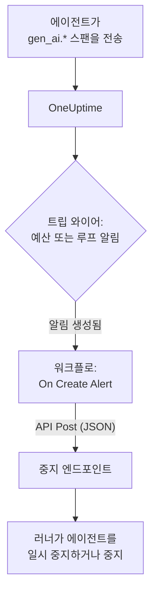

# AI 에이전트 서킷 브레이커

AI 에이전트는 충돌해서 실패하는 경우가 드뭅니다. 계속 움직이면서 실패합니다. 고장 난 도구를 다시 시도하고, 같은 단계를 또 계획하고, 하위 에이전트를 더 띄우는 동안 매 턴마다 토큰 비용이 쌓입니다. 이 페이지에서는 OneUptime에 이미 있는 부품으로 이를 위한 서킷 브레이커를 만듭니다. 폭주하는 에이전트를 알아차리는 알림과, 에이전트를 멈추기 위해 직접 운영하는 엔드포인트를 호출하는 워크플로입니다.

:::cards
- [트립 와이어 고르기](#트립-와이어-고르기): 지출이나, 계속 반복해서 호출되는 도구 하나에 대해 알림을 받습니다.
- [중지 엔드포인트 만들기](#중지-엔드포인트-만들기): 에이전트를 일시 중지하는 작은 서비스입니다.
- [워크플로 만들기](#워크플로-만들기): 새 알림부터 엔드포인트 호출까지.
- [브레이커 테스트하기](#브레이커-테스트하기): 먼저 직접 작동시키고, 다음에 실제 조건에서 작동시킵니다.
:::

## 작동 방식



브레이커는 에이전트가 직접 또는 [게이트웨이를 통해](/docs/telemetry/ai-gateways) 이미 보내고 있는 OpenTelemetry를 지켜보며, 요청 경로 안이 아니라 그 옆에서 동작합니다. 모델 호출마다 추가되는 것이 없고, 공급자, SDK, 게이트웨이를 바꿔도 망가지지 않습니다.

그 대가는 속도입니다. 폭주하는 에이전트를 밀리초가 아니라 분 단위로 멈춥니다. 단계 수 제한과 타임아웃은 에이전트 자체에 두고, 그것을 빠져나간 것을 브레이커가 잡게 하세요.

| 트립 와이어 | 잡아내는 것 | 알림까지 걸리는 시간 |
| --- | --- | --- |
| 메트릭 모니터의 예산 알림 | 원인이 무엇이든 계속 늘어나는 지출 | 최대 15분, 여기에 모니터 몫으로 일 분 정도 |
| 트레이스 모니터의 루프 알림 | 반복해서 호출되는 같은 도구 | 1~5분 |

## 시작하기 전에

- 에이전트가 GenAI 스팬을 OneUptime으로 보내고 있어야 합니다. [AI / LLM 옵저버빌리티](/docs/telemetry/ai-llm-observability) 를 참고하세요.
- 에이전트 러너를 일시 중지하거나 중지할 수 있고 OneUptime에서 접근할 수 있는 HTTPS 엔드포인트. [중지 엔드포인트 만들기](#중지-엔드포인트-만들기) 에서 만듭니다.
- 프로젝트에서 모니터와 워크플로를 만들 수 있는 권한.

## 트립 와이어 고르기

두 트립 와이어 모두 끝은 같습니다. 모니터가 알림을 만들고, 새 알림이 워크플로를 시작합니다. 둘 다 설정해도 됩니다. 워크플로는 어느 쪽이 작동했는지 신경 쓰지 않습니다.

### 예산 알림

지출은 폭주하는 에이전트의 가장 확실한 신호입니다. 예산은 15분마다 그날의 AI 지출을 합산해 `oneuptime.llm.budget.spend.usd` 와 `oneuptime.llm.budget.percent.used` 라는 두 메트릭으로 게시하며, 둘 다 `oneuptime.llm.budget.id` 에 예산의 ID를 담습니다.

:::steps
1. **제품 → AI / LLM → 예산** 을 열고 **LLM Cost Budget 만들기** 를 클릭합니다. **일일 예산(USD)** 을 설정하고, 예산이 그 에이전트만 지켜보도록 **서비스(선택 사항)** 에서 에이전트의 서비스를 고릅니다.
2. 새 예산의 행 메뉴에서 **ID 표시** 를 골라 ID를 복사합니다.
3. `oneuptime.llm.budget.percent.used` 에 대한 [메트릭 모니터](/docs/monitor/metrics-monitor) 를 만들고, 속성 `oneuptime.llm.budget.id` 를 복사한 ID로 필터링한 뒤, **시간 범위** 를 **Past 30 Minutes** 로 설정합니다.
4. 알림을 만드는 조건 **Greater Than Or Equal To** `100` 을 추가하고, 에이전트 이름이 들어간 **경고 제목** 을 붙입니다. 예를 들면 `LLM budget exceeded: support-bot` 입니다. 워크플로와 엔드포인트 모두 이 제목을 읽습니다.
:::

이름이 아니라 ID로 필터링하세요. 예산 이름을 바꾸면 그 계열의 이름도 바뀌어, 예전 이름으로 필터링한 모니터는 아무 말 없이 일치하지 않게 됩니다. 시간 범위는 30분으로 유지하세요. 예산은 15분마다 점 하나를 게시하므로, 범위가 더 짧으면 두 점 사이에서 아무것도 찾지 못해 알림이 열렸다 해결되기를 반복합니다.

`80` 에 심각도가 낮은 두 번째 조건을 두면, 브레이커가 `100` 에서 작동하기 전에 알림의 온콜 정책을 통해 먼저 사람에게 경고가 갑니다.

### 루프 알림

막힌 에이전트는 알아볼 수 있는 흔적을 남깁니다. 같은 도구 스팬이 반복해서 나타납니다. 정상적인 실행은 몇 분 동안 한 도구를 수십 번 호출하지 않으므로, 개수를 세면 예산보다 훨씬 먼저 루프를 잡아냅니다.

:::steps
1. **모니터** 를 열고 **모니터 생성** 을 클릭한 뒤, **더 많은 모니터 유형** 아래에서 **트레이스** 를 고릅니다.
2. **추가 필드** 아래에서 **텔레메트리 서비스로 필터링** 을 에이전트의 서비스로, **속성으로 필터링** 을 루프에 빠질 것으로 예상하는 도구와 같은 `gen_ai.tool.name` 으로 설정합니다. 예를 들면 `search_web` 입니다. 계측에서 도구마다 스팬 이름을 붙인다면, 대신 그 이름을 **스팬 이름** 에 넣습니다.
3. **(시간) 동안의 모니터 트레이스** 를 **지난 5분** 으로 설정합니다.
4. 정상적인 실행이 5분 동안 절대 도달하지 않는 수, 예를 들어 `50` 으로 **Span Count** **Greater Than** 조건을 추가하고, `Agent loop: support-bot` 같은 제목의 알림을 만들게 합니다.
:::

**스팬 상태로 필터링** 을 **오류** 로 설정하고 개수를 낮춘 두 번째 트레이스 모니터는 재시도 폭풍을 잡아냅니다. 계속 실패하는 도구와 그것을 계속 다시 시도하는 에이전트입니다.

## 중지 엔드포인트 만들기

워크플로는 직접 운영하는 엔드포인트로 JSON 본문을 담은 `POST` 를 보냅니다. "중지"가 무엇을 뜻할지는 직접 정합니다. 영향이 가장 작은 것부터 가장 큰 것까지:

| 동작 | 효과 |
| --- | --- |
| 새 작업 중지 | 러너가 그 에이전트의 새 실행을 시작하지 않음 |
| 실행 취소 | 진행 중인 그 에이전트의 실행이 취소됨 |
| 풀 일시 중지 | 누군가 브레이커를 재설정할 때까지 모든 워커가 작업을 마치고 멈춤 |

에이전트별로 브레이커를 작동시키는 Express 기반의 최소 엔드포인트:

```typescript title="circuit-breaker.ts"
import express from "express";

const app = express();
app.use(express.json());

const tripped = new Set<string>(); // agents whose breaker is open

app.post("/circuit-breaker", (req, res) => {
  if (req.headers["authorization"] !== `Bearer ${process.env.KILL_TOKEN}`) {
    return res.status(401).end();
  }

  const alertTitle: string = req.body.alertTitle ?? "";

  // "LLM budget exceeded: support-bot" -> "support-bot"
  const agent: string = alertTitle.split(": ").pop() ?? "unknown";

  tripped.add(agent); // your run loop checks this set
  abortActiveRuns(agent); // cancel that agent's runs in flight

  // Answer fast; do the slow cleanup in the background.
  return res.status(200).json({ tripped: agent });
});
```

다음 규칙에 따라 만드세요.

- 작동을 멱등적으로 만드세요. 경고와 초과, 또는 예산 알림과 루프 알림이 함께 오면 여러 번 작동할 수 있으며, 두 번째 작동은 아무것도 바꾸지 않아야 합니다.
- 1~2초 안에 응답하고 정리는 백그라운드에서 하세요. 워크플로는 모든 2xx 응답을 성공으로 봅니다.
- 시크릿을 요구하세요. 엔드포인트를 호출할 수 있는 사람은 누구나 에이전트를 멈출 수 있으므로, 워크플로가 시크릿 전역 변수에서 보내는 bearer 토큰을 확인하세요.
- 재설정은 직접 하세요. 작동한 브레이커는 누군가 실행을 살펴볼 때까지 작동한 상태로 남습니다. **제품 → AI / LLM → 대화** 에서 에이전트의 대화를 열면 무엇을 했는지 읽거나 다시 재생할 수 있습니다.

요청은 OneUptime에서 나갑니다. OneUptime Cloud에서는 엔드포인트에 인터넷에서 접근할 수 있어야 합니다. 자체 호스팅 설치는 관리자가 허용하지 않는 한 사설 네트워크 주소를 거부합니다. [아웃바운드 네트워크 액세스](/docs/workflows/configuration#아웃바운드-네트워크-접근) 를 참고하세요.

## 워크플로 만들기

먼저 엔드포인트의 토큰을 워크플로가 보여 주지 않고 쓸 수 있는 곳에 저장합니다. **워크플로 → 전역 변수** 를 열고 **워크플로 변수 만들기** 를 클릭한 뒤, 이름을 `AGENT_KILL_TOKEN` 으로 하고 토큰을 **콘텐츠** 에 넣고 **시크릿** 을 켭니다. 시크릿 값은 실행 로그와 단계 트레이스에서 지워집니다.

:::steps
### 워크플로 생성하기

**제품 → 워크플로** 를 열고 **워크플로 생성** 을 클릭합니다. **처음부터 시작** 을 클릭하고 이름을 `AI agent circuit breaker` 로 정한 뒤 **워크플로 생성** 을 클릭합니다. 워크플로는 꺼진 상태로 **빌더** 에서 열립니다.

### 트리거 추가하기

점선 블록 **Choose what starts this workflow** 를 클릭하고 **Add Trigger** 패널에서 **On Create Alert** 를 고릅니다. 트리거를 클릭하고 **Select Fields** 에서 제목과 설명을 체크한 뒤 **저장** 을 클릭합니다. 블록에 표시된 ID `alert-on-create-1` 은 이후 블록이 이 블록을 참조할 때 쓰입니다.

### 제목 확인하기

**구성 요소 추가** 를 클릭하고 **If / Else** 를 고른 뒤, 트리거의 **Success** 점을 거기에 연결합니다. **Value to check** 를 알림 제목으로( **{ }** 를 클릭해 고릅니다), **Comparison** 을 **포함** 으로, **Compare with** 를 트립 와이어 제목들이 공통으로 시작하는 문구, 예를 들어 `LLM budget exceeded` 로 설정합니다.

### 엔드포인트 호출하기

**API Post (JSON)** 를 추가하고 **If / Else** 의 **Yes** 점을 거기에 연결합니다. **URL** 을 엔드포인트, 예를 들어 `https://agents.example.com/circuit-breaker` 로 설정하고, 아래의 헤더와 본문을 채웁니다.

### 실패 알리기

**Send Message to Slack** 또는 **Send Email** 을 추가하고 API 블록의 **Error** 점을 거기에 연결합니다. 작동에 실패한 브레이커야말로 사람이 반드시 봐야 하는 알림입니다.

### 켜기

**빌더** 상단에서 **활성화됨** 을 켭니다.
:::

API 블록의 **Request Headers**:

```json title="Request Headers"
{
  "Authorization": "Bearer {{global.variables.AGENT_KILL_TOKEN}}",
  "Content-Type": "application/json"
}
```

그리고 **Request Body**:

```json title="Request Body"
{
  "source": "oneuptime-circuit-breaker",
  "alertId": "{{local.components.alert-on-create-1.returnValues.model._id}}",
  "alertTitle": "{{local.components.alert-on-create-1.returnValues.model.title}}",
  "alertDescription": "{{local.components.alert-on-create-1.returnValues.model.description}}"
}
```

여러 트립 와이어에 반응하려면 모든 제목을 같은 방식으로 시작하거나, **No** 점에서 **If / Else** 블록을 더 이어 붙이세요. 캔버스는 [워크플로 작성](/docs/workflows/authoring) 을, `{{…}}` 참조는 [변수](/docs/workflows/variables) 를 참고하세요.

## 브레이커 테스트하기

:::steps
1. 직접 작동시킵니다. **경고** 를 열고 **알림 생성** 을 클릭해 제목이 `LLM budget exceeded: test` 인 알림을 만듭니다. 실행이 **워크플로 → 로그 → 실행 기록** 에 나타나고, 엔드포인트가 요청을 받습니다.
2. 실제 조건에서 작동시킵니다. 테스트 에이전트의 서비스에 `0.01` USD 같은 아주 작은 한도의 예산을 만들고, 예산 모니터를 그 예산에 맞춘 뒤 에이전트를 실행합니다. 비율이 100을 넘고, 알림이 열리고, 워크플로가 실행되고, 브레이커가 작동합니다. 루프 알림의 경우에는 항상 실패하는 도구를 테스트 에이전트에 줍니다.
3. 두 번 작동시킵니다. 같은 알림을 다시 만듭니다. 엔드포인트는 아무것도 바꾸지 않고 두 번째 작동을 받아들여야 합니다.
:::

## 시간에 따른 브레이커의 동작

- 워크플로는 알림이 만들어질 때 실행되므로, 트립 와이어는 평가마다가 아니라 알림마다 한 번 브레이커를 작동시킵니다.
- 예산은 UTC 기준 하루를 세므로, 비율은 UTC 자정에 0부터 다시 시작합니다. 그러면 예산 알림이 해결될 수 있고, 다음에 지출이 튀는 날 새 알림이 열려 브레이커가 다시 작동합니다.
- 모니터는 조건이 충족되는 동안 알림을 열어 둡니다. **경고 자동 해결** 을 켜면 조건이 더 이상 충족되지 않을 때 알림이 해결되고, 다음 초과 때 새 알림이 열립니다.
- 재설정은 양쪽 모두 사람이 결정합니다. OneUptime에서 알림을 해결하고, 러너에서 브레이커를 재설정합니다.
- 프로젝트의 모든 새 알림이 워크플로를 시작합니다. 다른 알림이 브레이커에 닿지 않게 막는 것은 **If / Else** 입니다. 빼지 마세요.

## 문제 해결

:::details 워크플로가 실행되지 않음
**빌더** 상단에서 **활성화됨** 이 켜져 있는지 확인하세요. 워크플로는 꺼진 상태로 만들어집니다. 그다음, 워크플로를 켠 뒤에 알림이 만들어졌는지 확인하세요. 트리거는 새 알림에 대해서만 실행을 시작합니다.
:::

:::details 워크플로는 실행되지만 항상 No 분기로 감
제목이 비어 있거나 일치하지 않습니다. 트리거의 **Select Fields** 에서 체크하지 않은 필드는 비어 있는 채로 오므로 제목을 체크하세요. 그다음 알림 제목을 **Compare with** 와 비교하세요. **포함** 은 그 텍스트를 정확히 찾아내야 합니다.
:::

:::details 엔드포인트가 401을 반환함
`Authorization` 헤더가 엔드포인트가 기대하는 토큰과 일치하지 않습니다. `{{global.variables.AGENT_KILL_TOKEN}}` 의 이름과 전역 변수에 저장한 값을 확인하세요. 시크릿 변수의 값은 다시 읽을 수 없으므로, 확실하지 않으면 **Update Content** 로 다시 입력하세요.
:::

:::details 예산 알림이 열렸다 해결되기를 반복함
모니터의 **시간 범위** 가 예산의 점 사이 간격인 15분보다 짧습니다. **Past 30 Minutes** 로 설정하세요.
:::

:::details 요청이 엔드포인트에 도달하지 않음
**워크플로 → 로그 → 실행 기록** 에서 실행을 열고 **API Post (JSON)** 단계를 확인하세요. 요청이 실패한 이유가 나와 있습니다. OneUptime Cloud에서는 엔드포인트에 인터넷에서 접근할 수 있어야 하며, 자체 호스팅 설치는 관리자가 허용하지 않는 한 사설 네트워크 주소를 거부합니다.
:::

## 다음 단계

:::cards
- [AI / LLM 옵저버빌리티](/docs/telemetry/ai-llm-observability): 예산, 비용, 브레이커가 지켜보는 스팬.
- [트레이스 모니터](/docs/monitor/traces-monitor): 스팬 필터와 조건 자세히 보기.
- [워크플로](/docs/workflows/index): 트리거, 구성 요소, 변수, 실행.
- [AI 게이트웨이](/docs/telemetry/ai-gateways): 모든 에이전트의 모델 호출을 하나의 내보내기로.
:::
