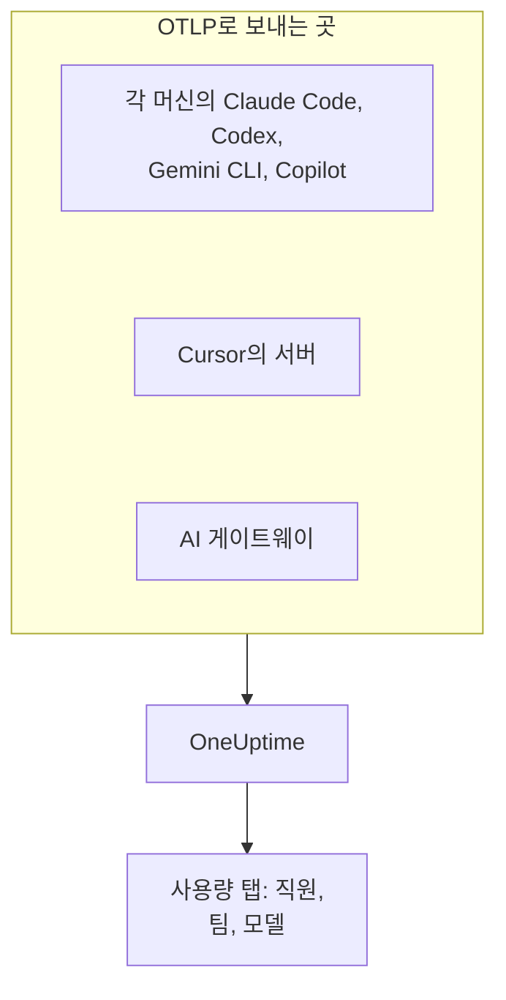

# AI 코딩 어시스턴트

엔지니어들은 Claude Code, Cursor, Codex, Gemini CLI, Copilot을 사용하고, 청구서는 계속 늘어납니다. 이 페이지는 관리자가 궁금해하는 질문에 답합니다. **누가 어떤 도구를 어떤 모델로 사용하며, 각 사람과 각 팀이 얼마를 쓰는지**입니다.

대부분의 코딩 어시스턴트는 OpenTelemetry를 직접 내보내므로, 개발자 머신에 아무것도 설치할 필요가 없습니다. 내보내기 대상을 OneUptime으로 지정하면 토큰, 비용, 도구 사용이 자체 앱의 AI 호출과 나란히 들어옵니다. 여기의 모든 데이터는 OpenTelemetry로 들어오며, OneUptime은 공급업체의 관리 API나 청구 API를 폴링하지 않습니다.

:::cards
- [지원 현황](#지원-현황): 각 도구가 무엇을 보내고, 사람을 지목하는지.
- [직원 및 팀 귀속](#직원-및-팀-귀속): 지출에 이름과 팀을 붙이는 키.
- [사용량 탭](#사용량-탭): 코딩 어시스턴트에 대해 지출 표가 보여 줄 수 있는 것과 없는 것.
- [어디서 시작할까](#어디서-시작할까): 첫날부터 결과가 보이는 도입 순서.
:::

## 작동 방식

각 도구는 수집 키와 함께 OneUptime의 OTLP 엔드포인트로 텔레메트리를 보냅니다. 보내는 곳은 각 개발자 머신, 공급업체의 서버(Cursor), 또는 모델 트래픽이 지나가는 게이트웨이입니다.



## 시작하기 전에

1. **프로젝트 설정 → 텔레메트리 및 APM → 수집 키** 에서 텔레메트리 수집 키를 만듭니다.
2. OTLP 엔드포인트는 `https://oneuptime.com/otlp`이며, OneUptime을 직접 호스팅한다면 `https://YOUR-ONEUPTIME-HOST/otlp`입니다.
3. 모든 내보내기는 `x-oneuptime-token` 헤더로 키를 보냅니다.

전체 머신에 수집 키 하나면 충분합니다. 키는 모든 개발자 머신에 놓이므로, 데이터 전송만 할 수 있는 공유 자격 증명으로 취급하고 다른 자격 증명처럼 교체하세요.

## 지원 현황

도구에서 무엇을 얻는지는 세 가지로 결정됩니다. 애초에 OpenTelemetry를 보내는지, 텔레메트리가 어떻게 OneUptime에 도달하는지, 그리고 그 안에 사람을 지목하는 정보가 있는지입니다.

| 도구 | 보내는 것 | OneUptime 도달 방식 | 지목하는 사람 | 가이드 |
| --- | --- | --- | --- | --- |
| Claude Code | 메트릭과 로그. 트레이스는 베타 | 각 머신에서. 환경 변수 또는 관리 설정 파일 | Claude 계정으로 로그인한 경우 `user.email` | [Claude Code](/docs/telemetry/claude-code) |
| Cursor | 메트릭과 로그 | Cursor의 서버에서. Cursor 대시보드에서 한 번 설정. Enterprise 요금제만 | 정수인 `cursor.user.id` | [Cursor](/docs/telemetry/cursor) |
| OpenAI Codex | 트레이스, 메트릭, 로그. 각각 `~/.codex/config.toml`에서 켬 | 각 머신에서. 신호마다 전체 URL | 스팬과 메트릭에서는 아무도 지목하지 않음. `[otel.span_attributes]`에 `user.id`와 `user.email`을 직접 설정 | [OpenAI Codex](/docs/telemetry/openai-codex) |
| Gemini CLI | 트레이스, 메트릭, 로그 | 각 머신에서. 보통 로컬 Collector를 거침 | 로그인한 경우 `user.email` | [Gemini CLI 및 GitHub Copilot](/docs/telemetry/gemini-cli-and-copilot) |
| GitHub Copilot | 트레이스, 메트릭, 로그. 에이전트 기능에서만 | 편집기 또는 에이전트 호스트에서 | 아무도 지목하지 않음. 각 머신에 `enduser.id`와 `user.email`을 직접 설정 | [Gemini CLI 및 GitHub Copilot](/docs/telemetry/gemini-cli-and-copilot) |
| Cline | 메트릭과 로그 | Cline의 조직 대시보드에서 중앙 설정 | 익명화된 `user_id` | — |
| LiteLLM과 Portkey | 게이트웨이를 거치는 모든 호출의 트레이스 | 게이트웨이 프로세스에서 | LiteLLM에서는 가상 키의 소유자 | [AI 게이트웨이](/docs/telemetry/ai-gateways) |
| 자체 앱 | GenAI 계측이 보내는 것 | 앱에서 | `user.id`로 설정한 사람 | [AI / LLM 옵저버빌리티](/docs/telemetry/ai-llm-observability) |
| Windsurf, JetBrains AI, Amazon Bedrock, Azure OpenAI | 자체 OpenTelemetry 없음 | 앞에 둔 게이트웨이를 통해서만 | 게이트웨이가 지목하는 사람 | [AI 게이트웨이](/docs/telemetry/ai-gateways) |

대시는 OneUptime에 아직 해당 도구의 가이드가 없다는 뜻입니다. 그 도구의 텔레메트리도 다른 OpenTelemetry처럼 수집됩니다.

:::details GitHub Copilot이 정확히 무엇을 내보내는지
Copilot은 에이전트 기능에서만 OpenTelemetry를 내보냅니다. VS Code 채팅과 에이전트 모드, Copilot CLI 뒤의 에이전트 호스트, Copilot SDK, 그리고 Copilot 플러그인을 통한 JetBrains IDE의 에이전트 워크플로입니다. 인라인 자동 완성, github.com의 Copilot, Copilot 코드 리뷰에 대해서는 GitHub가 내보내기를 문서화하지 않았습니다. Copilot은 어떤 사용자 속성도 보내지 않으므로, `resourceAttributes` 또는 `OTEL_RESOURCE_ATTRIBUTES`로 머신마다 `enduser.id`와 `user.email`을 설정하세요.
:::

:::details Amazon Bedrock, Azure OpenAI, Windsurf, JetBrains AI
- **Amazon Bedrock**: `InvokeModel`과 `Converse` API는 OpenTelemetry를 보내지 않습니다. Bedrock AgentCore는 다릅니다. AWS는 이에 대한 메트릭, 스팬, 로그를 문서화하며, 기본적으로 CloudWatch로 보냅니다. `DISABLE_ADOT_OBSERVABILITY=true`를 설정하면 런타임의 기본 ADOT 구성이 꺼지므로, ADOT SDK가 대신 OneUptime을 향하게 할 수 있습니다.
- **Azure OpenAI**: 서비스는 아무것도 보내지 않으며, Azure Monitor 메트릭에는 사용자 차원이 없습니다. 클라이언트를 계측하거나, 앞에 API Management 또는 다른 게이트웨이를 두세요.
- **Windsurf**: 텔레메트리 내보내기를 문서화하지 않았습니다. 사용자별 데이터는 Windsurf의 Enterprise API에 있으며, OneUptime은 이를 폴링하지 않습니다.
- **JetBrains AI Assistant와 Junie**: 사용량을 내보내지 않습니다. JetBrains의 OpenTelemetry 플러그인은 IDE 안에서 자체 앱의 텔레메트리를 받을 뿐, 밖으로는 아무것도 보내지 않습니다.
:::

## 직원 및 팀 귀속

OneUptime은 텔레메트리가 도착할 때 호출한 사람과 그 팀을 열로 복사하므로, **사용량** 탭에서 속성 필터 없이 사람과 팀의 순위를 매길 수 있습니다.

### 직원으로 읽는 속성

스팬에서는 다음 순서로 처음 발견된 키가 우선합니다.

| 열 | 키(우선순위순) |
| --- | --- |
| 직원 ID | `user.id`, `enduser.id`, `litellm.metadata.user_api_key_user_id`, `metadata.user_api_key_user_id`, `traceloop.association.properties.user_id`, `langfuse.user.id`, `user.account_uuid`, `user.account_id`, `cursor.user.id` |
| 직원 이메일 | `user.email`, `litellm.metadata.user_api_key_user_email`, `metadata.user_api_key_user_email`, `traceloop.association.properties.user_email`, `enduser.email` |
| 팀 / 비용 센터 | `team.id`, `team`, `cost_center`, `department`, `litellm.metadata.user_api_key_team_id`, `litellm.team.id`, `metadata.user_api_key_team_id`, `cursor.team.id` |

메트릭 데이터 포인트에서는 목록이 더 짧고 이메일부터 시작합니다. 메트릭을 보내는 코딩 어시스턴트는 `user.email`을 직접 보내기 때문입니다.

| 열 | 키(우선순위순) |
| --- | --- |
| 직원 | `user.email`, `user.id`, `user.account_uuid`, `user.account_id`, `cursor.user.id` |
| 팀 / 비용 센터 | `team.id`, `team`, `cost_center`, `department`, `cursor.team.id` |
| 모델 | `gen_ai.request.model`, `model`, `cursor.model.name` |

이 키를 읽는 방식은 다음과 같습니다.

- **모든 키는 `resource.` 접두사가 붙은 형태로도 읽습니다.** OTLP 수집은 리소스 속성을 이 접두사 아래에 저장하므로, `OTEL_RESOURCE_ATTRIBUTES=team.id=platform`은 `resource.team.id`로 들어옵니다. 접두사 없는 키를 먼저 시도하므로, 스팬의 값이 프로세스 전체의 값보다 우선합니다.
- **사용량 탭은 호출에 이메일이 있으면 이메일을, 없으면 ID를 표시합니다.** 같은 이메일을 표시하는 행은 합산되므로, 머신 두 대를 쓰는 엔지니어 한 명은 한 행이 됩니다.
- **신원은 AI 호출에서만 읽습니다.** `user.id`, `user.email`, `team.id`는 브라우저와 백엔드 스팬도 가지는 일반적인 키입니다. 열이 채워지는 것은 이미 AI 호출로 인식된 스팬뿐입니다.
- **로그 레코드에서는 신원을 읽지 않습니다.** 이는 `user.email`을 로그에만 넣는 Codex에 중요합니다.
- LiteLLM은 이 키를 두 가지로 표기합니다. 기본 `otel` 콜백은 `metadata.` 접두사를 쓰고, 선택형 OpenTelemetry v2 모드(`LITELLM_OTEL_V2=true`)는 `litellm.` 네임스페이스를 씁니다. OneUptime은 둘 다 읽으므로, 기본 프록시는 추가 설정 없이 작동합니다.

### 팀과 비용 센터

어떤 계측도 `team.id`, `team`, `cost_center`, `department`를 보내지 않습니다. 이 값은 조직이 설정하며, 보통 도구 프로세스의 `OTEL_RESOURCE_ATTRIBUTES`로 설정합니다.

```bash
export OTEL_RESOURCE_ATTRIBUTES="team.id=platform,team=Platform_Engineering,cost_center=eng-123,department=engineering"
```

개발자 머신을 이미 프로비저닝하는 곳에서 설정하세요. MDM 프로필, 관리 설정 파일, dotfiles의 셸 프로필 등입니다. 값에는 공백을 쓸 수 없으므로 밑줄을 쓰거나 `%20` 같은 퍼센트 인코딩을 쓰세요. Codex에는 리소스 속성이 없으므로, 같은 키를 `[otel.span_attributes]`에 대신 설정합니다.

애플리케이션별로 지출을 나누려면 서비스 이름(`OTEL_SERVICE_NAME` 또는 도구 자체의 설정)을 사용하세요. **애플리케이션 / 서비스** 분류는 GenAI 스팬을 보내는 도구만 포함합니다.

### 의도적으로 직원으로 취급하지 않는 것

호출에는 서로 다른 두 사람이 들어 있을 수 있습니다. 호출한 직원과, 그 호출의 대상인 고객입니다. 다음 키는 고객을 나타내며, OneUptime은 이를 신원 열로 읽지 않습니다.

- `gen_ai.user`와 `llm.user`: 계측이 OpenAI의 요청 매개변수 `user`를 그대로 옮긴 것으로, OpenAI는 이를 최종 사용자의 식별자라고 설명합니다.
- `litellm.metadata.user_api_key_end_user_id`, `metadata.user_api_key_end_user_id`, `litellm.end_user.id`: LiteLLM의 최종 사용자로, 직원인 키 소유자와는 다릅니다.

고객 ID를 직원으로 읽으면 고객 40,000명을 응대하는 지원 봇이 가상의 직원 40,000명이 되고, 지출의 주인인 엔지니어는 아무것도 쓰지 않은 것처럼 보입니다. 이 키는 스팬의 속성에 남아 있으며, 트레이스 뷰어의 **LLM** 탭은 이를 최종 사용자로 표시합니다.

### 개인정보 보호

직원 이메일 열에는 개인 데이터가 들어 있습니다. 트레이스의 **스크럽 규칙** 은 읽어 온 속성과 똑같이 이 열에도 적용되므로, 이메일을 마스킹하는 규칙은 이 열도 마스킹합니다. 규칙은 **트레이스 → 설정** 에 있습니다.

## OneUptime이 읽는 코딩 어시스턴트 메트릭

코딩 어시스턴트는 메트릭 이름에 `gen_ai.*` 대신 자체 접두사를 붙이므로, OneUptime은 각 메트릭을 이름으로 알아봅니다.

| 메트릭 | 도구 | 단위 |
| --- | --- | --- |
| `claude_code.token.usage` | Claude Code | 토큰 |
| `claude_code.cost.usage` | Claude Code | USD |
| `cursor.token.usage` | Cursor | 토큰 |
| `cursor.cost.usage` | Cursor | USD. Cursor 자체 기준의 추정치 |
| `codex.turn.token_usage` | OpenAI Codex | 토큰 |
| `codex.turn.cost_microusd` | OpenAI Codex | USD의 백만분의 일. OneUptime이 환산하므로 직접 환산하지 마세요 |

OneUptime은 토큰을 `gen_ai.client.token.usage`, `gen_ai.client.token.count`, `llm.token.usage`, `llm.usage.tokens`에서, 비용을 `gen_ai.client.cost`, `gen_ai.client.cost.usd`, `gen_ai.usage.cost`, `litellm_spend_metric`, `litellm.cost.total`에서도 읽습니다.

수치를 읽기 전에 알아 둘 두 가지가 있습니다.

- **`gemini_cli.token.usage`는 의도적으로 제외합니다.** Gemini CLI는 토큰을 자체 메트릭과 `gen_ai.client.token.usage`로 두 번 보내므로, 둘 다 읽으면 두 배가 됩니다. 토큰은 `gen_ai.client.token.usage`를 통해 한 번만 셉니다. Gemini CLI는 비용 메트릭을 보내지 않으므로, 각 호출에 가격을 매기려면 트레이스를 켜세요.
- **입력과 출력 토큰만 셉니다.** 토큰 종류는 `gen_ai.token.type`, `llm.token.type`, `type`, `cursor.token.type`, `token_type`에서 읽으며, `input`과 `output`(또는 이전의 `prompt`와 `completion`)만 셉니다. 캐시 읽기와 쓰기, Codex의 `total`(다른 값의 반복), `reasoning_output`(`output`의 일부)은 제외하므로, 메트릭에서 얻은 합계는 도구가 보내는 모든 값의 합보다 작습니다.

## 사용량 탭

**제품 → AI / LLM** 을 열고 **사용량** 으로 이동합니다. 다른 기간을 고르지 않으면 지난 7일 동안의 **직원** , **팀** , **모델** , **공급자** , **애플리케이션 / 서비스** 를 지출순으로 보여 줍니다. 아무도 지목하지 않는 호출은 **미지정** 으로 집계됩니다. **미지정** 행이 크다면 어떤 도구에 아직 신원 설정이 필요한지 알 수 있습니다.

### 코딩 어시스턴트 메트릭은 합산이 아니라 대체입니다

GenAI 스팬이 우선합니다. 메트릭은 스팬이 아무것도 보고하지 않은 수치에 대해서만 읽으며, 둘을 합산하지 않습니다([이유](/docs/telemetry/ai-llm-observability#스팬이-먼저-메트릭은-보충)). 코딩 어시스턴트에는 이것이 분명한 결과를 낳습니다. **같은 프로젝트가 비용이 있는 GenAI 스팬을 받으면, 코딩 어시스턴트의 지출은 표시되지 않습니다.** 코딩 어시스턴트에는 자체 수집 키가 있는 전용 프로젝트를 주세요.

대체가 적용될 때, 메트릭만 보내는 도구에 대해 각 분류가 보여 줄 수 있는 것은 다음과 같습니다.

| 분류 | 메트릭에서 |
| --- | --- |
| **직원** | 예. 위의 모든 신원 키에서, 접두사 없는 형태와 `resource.` 접두사가 붙은 형태 모두 |
| **팀** | 예. 팀 키에서 |
| **모델** | 예. Claude Code와 Codex는 접두사 없는 `model`을, Cursor는 `cursor.model.name`을 보냄 |
| **공급자** | 아니요. 코딩 어시스턴트의 메트릭은 공급자를 지목하지 않음 |
| **애플리케이션 / 서비스** | 아니요. 그 메트릭은 어떤 OneUptime 서비스에도 속하지 않음 |

메트릭에서 읽은 행은 비용만 가집니다. 지출 카운터에는 호출별 세부 정보가 없고, 거기에 0을 표시하면 그 사람이 호출을 하지 않았다고 주장하는 셈이므로, 호출과 토큰 셀에는 `—`가 표시됩니다. 표에는 **GenAI 메트릭 기준** 이라고 표시됩니다.

## OpenTelemetry가 없다면? 앞에 게이트웨이를 두세요

Windsurf, JetBrains AI, Bedrock 모델 API, Azure OpenAI처럼 자체 내보내기가 없는 것에는 앞에 AI 게이트웨이를 두세요. 그러면 모든 호출이 OpenTelemetry를 보내는 하나의 프로세스를 거치므로, 내보내기 설정은 한 번으로 끝납니다.

**직원마다 가상 키 하나씩으로 LiteLLM을 사용하세요.** LiteLLM은 각 스팬에 키 소유자의 ID와 이메일을 붙이고, OneUptime은 이를 직원으로, 키의 팀을 팀으로 읽습니다. LiteLLM은 프록시에 설정한 사용자 지정 요율로 각 호출의 가격도 직접 계산하며, 보고된 비용이 OneUptime의 추정치보다 우선합니다. 이 용도로 최종 사용자 ID를 쓰지 마세요. 그것은 고객입니다. 설정 방법은 [AI 게이트웨이](/docs/telemetry/ai-gateways)에 있습니다.

게이트웨이를 중심으로 계획하기 전에 알아 둘 두 가지 제한이 있습니다.

- **게이트웨이는 자신을 거치는 트래픽만 봅니다.** Cursor 자체의 기본 URL 재정의는 채팅 모델만 다루는 사용자별 설정이므로(Tab 자동 완성은 계속 Cursor의 모델을 사용), Cursor의 기본 제공 내보내기를 우선하세요.
- **게이트웨이는 에이전트가 아니라 모델 호출을 봅니다.** 프롬프트와 답변은 기록하지만, 도구 자체의 텔레메트리가 보고하는 도구 호출, 파일 편집, 수락 또는 거부 결정은 기록하지 않습니다.

## 프롬프트 내용: 기본값은 도구마다 다릅니다

프롬프트와 답변은 이 파이프라인에서 가장 위험한 데이터입니다. 소스 코드, 고객 데이터, 붙여 넣은 자격 증명이 흔히 들어 있습니다. 각 도구의 기본값을 확인하세요.

| 도구 | 프롬프트 내용 기본값 |
| --- | --- |
| Claude Code | 꺼짐. 내용 종류마다 켜는 변수가 따로 있음 |
| Cursor | 꺼짐. 메시지 텍스트는 선택형 `conversation_content` 패밀리만 보냄 |
| OpenAI Codex | 꺼짐. `log_user_prompt` 기본값은 `false` |
| Gemini CLI | **켜짐**. `logPrompts` 기본값이 `true`이므로 텔레메트리를 켤 때 `false`로 설정 |
| GitHub Copilot | 꺼짐. `captureContent`이며, 관리 설정에서 `lockCaptureContent`로 고정할 수 있음 |
| LiteLLM | 기본 `otel` 콜백에서는 켜짐(`turn_off_message_logging`으로 끔). OpenTelemetry v2 모드에서는 꺼짐 |

Codex는 기본적으로 메트릭을 OpenAI에도 보냅니다. [OpenAI Codex](/docs/telemetry/openai-codex)를 참조하세요. 의도적으로 내용을 수집하는 곳에서도 트레이스의 **스크럽 규칙** 과 **드롭 필터** 가 다른 텔레메트리처럼 적용됩니다.

## OneUptime이 아직 하지 않는 것

- **공급업체의 관리 또는 청구 커넥터가 없습니다.** OneUptime은 Anthropic의 Admin API, Cursor의 Admin API, OpenAI의 사용량 및 비용 엔드포인트, GitHub의 Copilot 청구, Windsurf나 JetBrains의 API를 폴링하지 않습니다. 청구서 수준의 수치는 공급업체에서 가져오세요.
- **도구가 보고하지 않으면 비용은 추정치입니다.** 보고된 비용은 그대로 쓰고, 그렇지 않으면 OneUptime이 정가로 토큰 가격을 계산합니다. Cursor의 `cursor.cost.usage`도 그 자체가 추정치입니다.
- **로그 레코드의 신원은 읽지 않습니다.** Codex가 로그에만 보내는 `user.email`은 지출에 연결되지 않습니다.
- **Cursor의 `cursor.user.email`은 아직 읽지 않으므로**, Cursor 사용자는 정수 `cursor.user.id`로 표시됩니다.
- **Codex 스팬은 모델을 지목하지 않으므로**, OneUptime이 가격을 매길 수 없습니다. Codex는 사람별 토큰을 표시하고, 비용은 합계에만 표시합니다.
- **도구는 빠르게 바뀝니다.** 이 페이지에 내보내기가 없다고 나온 도구라도, 게이트웨이를 중심으로 구축하기 전에 최신 문서를 확인하세요.

## 어디서 시작할까

다음 순서로 도입하세요. 각 단계는 그 자체로 유용합니다. 자체 앱에서 GenAI 스팬을 아직 받지 않는 프로젝트를 사용하세요. 그렇지 않으면 [대체 규칙](#코딩-어시스턴트-메트릭은-합산이-아니라-대체입니다) 때문에 코딩 어시스턴트의 지출이 페이지에 나타나지 않습니다.

1. **Gemini CLI** (사용하는 사람이 있다면). 설정 없이 `user.email`을 보내므로, 귀속이 처음부터 끝까지 작동하는 것을 보여 줍니다. 비용 메트릭을 보내지 않으므로 트레이스도 켜세요.
2. **Claude Code**: 전체 머신에 관리 설정 파일 하나, 수고 없이 얻는 `user.email`, 실제 비용 메트릭, 그리고 개발자별 수락률, 커밋, 풀 리퀘스트, 코드 줄 수.
3. **Cursor** (Enterprise 요금제): Cursor 대시보드의 화면 하나로 끝나고 개발자 머신은 건드리지 않지만, 사람은 정수로 들어옵니다.
4. **Copilot과 Codex**: 둘 다 머신마다 신원을 설정해야 합니다. 머신을 프로비저닝할 때 설정하세요. 신원 없이 들어온 호출은 나중에 귀속할 수 없습니다.
5. **LiteLLM 게이트웨이** (그 밖의 모든 것). 직원마다 가상 키 하나씩을 씁니다.

## 다음 단계

:::cards
- [Claude Code](/docs/telemetry/claude-code): 머신 한 대 또는 전체 머신에서 Claude Code의 내보내기를 켭니다.
- [Cursor](/docs/telemetry/cursor): Cursor 대시보드에서 Cursor의 팀 텔레메트리를 보냅니다.
- [OpenAI Codex](/docs/telemetry/openai-codex): Codex의 세 익스포터를 구성하고 스팬에 신원을 붙입니다.
- [AI / LLM 옵저버빌리티](/docs/telemetry/ai-llm-observability): 모든 AI 호출의 대화, 알림, 비용, 예산.
:::
