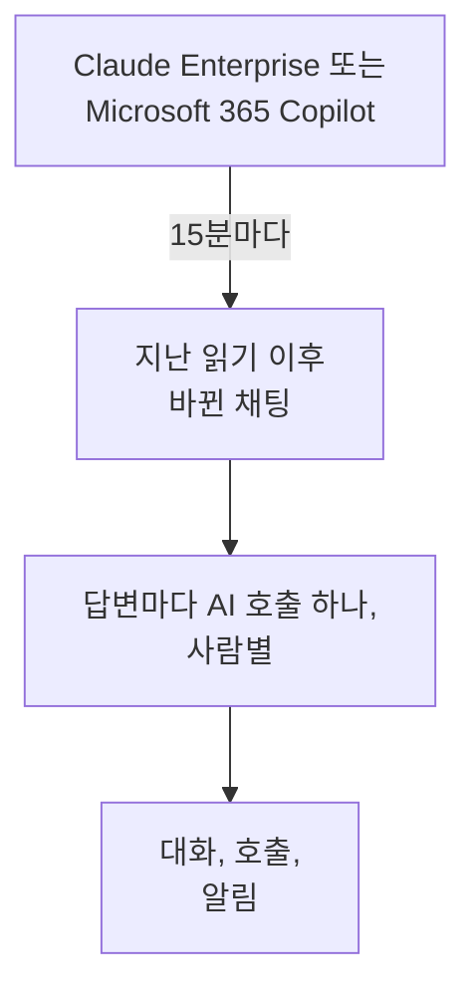

# 회사의 AI 도구

회사가 비용을 내는 AI 도구에 직원들이 무엇을 묻는지, 사람별 대화로 확인하세요. Claude Enterprise 또는 Microsoft 365 Copilot을 읽기만 할 수 있는 자격 증명으로 연결하면, OneUptime이 15분마다 새 채팅을 **대화**로 가져옵니다. 따로 정하지 않는 한 프로젝트 소유자와 관리자만 읽을 수 있습니다.

:::cards
- [먼저 직원들에게 알리기](#먼저-직원들에게-알리기): 채팅은 직원들 자신의 말입니다.
- [도구 연결하기](#도구-연결하기): 자격 증명을 붙여 넣고, 읽을 수 있는 사람을 고르고, 테스트한 뒤 연결합니다.
- [개인정보 보호](#개인정보-보호): 대화를 읽을 수 있는 사람과 작성 내용의 보관 여부.
- [다른 AI 도구](#다른-ai-도구): ChatGPT Enterprise, Gemini, Open WebUI, LibreChat, 코딩 어시스턴트.
:::

## 먼저 직원들에게 알리기

> [!IMPORTANT]
> 이것은 직원들 자신의 말입니다. 도구를 연결하기 전에 그 도구와의 채팅이 보관된다는 사실과 누가 읽을 수 있는지를 직원들에게 알리고, 사내 정책과 현지 법률이 요구하는 사항을 법무팀이나 인사팀과 확인하세요.

## 작동 방식

OneUptime은 15분마다 지난 읽기 이후 바뀐 채팅을 도구에 요청합니다. 각 답변은 질문한 사람의 AI 호출 하나가 되며, 이전 답변 이후의 질문이 함께 담깁니다. 각 채팅은 대화 하나가 됩니다.

채팅은 앱의 AI 호출과 같은 방식으로 들어오므로, 스크럽 규칙, 드롭 필터, 보존 기간, AI 알림이 그대로 적용됩니다. 이 도구들은 좌석 단위로 요금을 내므로, 이 호출에는 토큰도 비용도 없습니다. 한 시간 동안 답이 없는 질문은 단독으로 들어오므로, AI가 끝내 답하지 않은 채팅도 표시됩니다.

## 시작하기 전에

- Project Owner 또는 Project Admin 역할. 이 역할만 도구를 연결, 변경, 제거할 수 있습니다.
- 자격 증명을 만들 도구 관리자. 누가 필요한지는 아래 도구별 섹션에서 설명합니다.
- 직원들에 대한 안내, 그리고 법무팀이나 인사팀의 답변.

## 도구 연결하기

:::steps
### 연결 화면 열기

**제품 → AI / LLM → 연결**을 엽니다. **회사의 AI 도구**에서 도구 타일을 클릭합니다.

### 자격 증명 붙여 넣기

**자격 증명**에서 도구가 요구하는 항목을 입력합니다. 비밀 값은 암호화되어 저장되며 다시 표시되지 않습니다.

### 읽을 수 있는 사람 고르기

**개인 정보**에서 [개인정보 보호](#개인정보-보호)의 설명대로 **대화를 읽을 수 있는 사람**와 **작성된 내용 보관**을 설정합니다.

### 테스트하기

**테스트**에서 **연결 테스트**을 클릭합니다. OneUptime은 최근 7일의 채팅 수만 세며, 누군가 쓴 내용은 읽거나 표시하거나 보관하지 않습니다.

### 연결하기

**연결**을 클릭합니다. 첫 읽기는 1분 안에 시작되며 최근 7일을 가져옵니다.
:::

## Claude Enterprise

OneUptime은 Compliance API를 통해 조직의 모든 claude.ai 채팅을 읽습니다. 누가 질문했는지, Claude에게 무엇을 물었는지, Claude가 어떻게 답했는지, 어떤 모델을 썼는지입니다. 새 메시지가 생긴 채팅은 다시 읽히며, 이미 가져온 답변은 식별되어 건너뜁니다.

:::steps
### Compliance API 켜기

조직의 기본 소유자가 claude.ai에서 Organization settings, API를 열고 Compliance API를 켭니다.

### 컴플라이언스 액세스 키 만들기

같은 곳에서 `read:compliance_user_data` 범위의 키를 만듭니다. 키는 `sk-ant-api01-`으로 시작합니다.

### Claude Enterprise 연결하기

키를 **컴플라이언스 액세스 키**에 붙여 넣습니다.
:::

## Microsoft 365 Copilot

OneUptime은 Microsoft Graph에서 각 사람의 Copilot 상호 작용 기록을 읽습니다. Teams, Outlook, Word, Excel, PowerPoint, Loop, Copilot Chat에서 Copilot에게 무엇을 물었는지, 어떤 답을 받았는지, 어느 앱이었는지입니다. 프롬프트와 그 답변은 AI 호출 하나가 되고, Copilot 세션은 대화 하나가 됩니다. 큰 테넌트는 나누어 읽으며, 지난 읽기가 멈춘 곳부터 이어 갑니다.

:::steps
### 앱 등록하기

Microsoft Entra ID에서 앱을 등록하고 클라이언트 비밀을 만듭니다.

### 권한 부여하기

앱에 Microsoft Graph의 애플리케이션 권한 `AiEnterpriseInteraction.Read.All`과 `User.Read.All`을 부여하고 관리자 동의를 제공합니다.

### Copilot 연결하기

**디렉터리(테넌트) ID**, **애플리케이션(클라이언트) ID**, **클라이언트 시크릿**을 입력합니다. 일부 사람만 읽으려면 **추가 필드**의 **이 그룹의 사람만**에 그룹의 개체 ID를 넣고, 앱에 `GroupMember.Read.All`도 부여합니다. Azure Government라면 같은 곳에서 **클라우드**를 바꿉니다.
:::

## 개인정보 보호

| 설정 | 동작 |
| --- | --- |
| **대화를 읽을 수 있는 사람** | **프로젝트 소유자 및 관리자**(기본값): 프로젝트의 다른 사람은 이 대화도, 대화를 이루는 AI 호출도 OneUptime 어디에서도 보지 못합니다. **AI 호출을 읽을 수 있는 모든 사람**: 프로젝트의 트레이스를 읽을 수 있는 모든 사람. |
| **작성된 내용 보관** | 켜짐(기본값): 질문과 답변을 보관합니다. 꺼짐: 누가, 언제, 어떤 모델로, 어느 앱에서 물었는지는 보관하지만 작성 내용은 보관하지 않습니다. |

읽을 수 있는 사람의 변경은 1분 안에 적용됩니다. **작성된 내용 보관**을 끄면 그 뒤에 읽는 채팅에 적용되며, 그 전에 보관한 내용은 보존 기간이 끝날 때까지 남습니다.

내용은 보관하되 이메일 주소나 카드 번호 같은 일부를 가리려면 **트레이스 → 설정**의 **스크럽 규칙**를 사용하세요. 저장하기 전에 적용됩니다. 대화는 연결의 서비스가 트레이스를 보관하는 동안 보관됩니다. [데이터 보존](/docs/telemetry/data-retention)을 참고하세요. 연결을 제거하면 읽기가 멈추며, 이미 읽은 내용은 같은 사람만 읽을 수 있는 상태로 보존 기간이 끝날 때까지 남습니다.

## 다른 AI 도구

다음 도구에는 OneUptime이 사람들의 채팅을 읽을 수 있는 API가 없거나, 다른 방법이 필요합니다.

### ChatGPT Enterprise

OpenAI는 요청이 있을 때만 워크스페이스에 Compliance API를 열어 주고 기록에 무엇이 담기는지 공개하지 않으므로, OneUptime은 아직 ChatGPT Enterprise 채팅을 읽을 수 없습니다. OpenAI 조직을 [공급자 계정](/docs/telemetry/ai-provider-accounts#openai)으로 연결하면 API 사용량과 비용이 표시되지만 ChatGPT는 포함되지 않습니다.

### Google Workspace용 Gemini

Google은 사람들의 Gemini 채팅을 읽는 API를 제공하지 않습니다. Google Vault가 eDiscovery를 위해 보관합니다.

### 코딩 어시스턴트

Claude Code, Codex, Gemini CLI, GitHub Copilot, Cursor는 자체 OpenTelemetry를 보냅니다. [AI 코딩 어시스턴트](/docs/telemetry/ai-coding-assistants)를 참고하세요.

### Open WebUI와 LibreChat

자체 호스팅 채팅 앱은 직접 지정한 API를 통해 모델을 호출합니다. 모델 앞에 LiteLLM 프록시를 두고 [AI 게이트웨이](/docs/telemetry/ai-gateways#litellm-proxy)에서 설명하는 대로 그 트레이스를 OneUptime으로 보내면, 각 채팅의 프롬프트와 답변이 AI 호출로 들어옵니다. 사람마다 가상 키를 주면 누가 질문했는지 알 수 있고, 모두가 함께 쓰는 키로는 아무도 알 수 없습니다. Open WebUI 자체의 OpenTelemetry 내보내기는 채팅이 아니라 웹 요청과 데이터베이스 호출을 추적합니다.

## 문제 해결

:::details 테스트에서 채팅을 찾지 못합니다
최근 7일 동안 아무도 도구를 쓰지 않았거나, 자격 증명이 다른 조직이나 테넌트의 것입니다. Copilot이라면 **이 그룹의 사람만**의 그룹이 의도한 그룹인지 확인하세요.
:::

:::details 자격 증명은 유효하지만 연결에 필요한 데이터를 읽을 수 없습니다
Copilot이라면 앱의 Graph 권한에 관리자 동의를 제공하고, 그룹을 지정할 때는 `GroupMember.Read.All`도 부여하세요. Claude Enterprise라면 `read:compliance_user_data` 범위로 키를 만드세요.
:::

:::details 대화를 볼 수 없는 사람이 있습니다
**대화를 읽을 수 있는 사람**가 **프로젝트 소유자 및 관리자**로 되어 있습니다. 소유자나 관리자가 연결 행의 **편집**으로 바꿀 수 있습니다.
:::

:::details 대화에 질문한 사람은 보이지만 내용이 없습니다
읽을 때 **작성된 내용 보관**이 꺼져 있었습니다. 켜면 그 뒤에 읽는 채팅에 적용됩니다.
:::

## 다음 단계

:::cards
- [AI / LLM 옵저버빌리티](/docs/telemetry/ai-llm-observability): 대화를 읽고 다시 재생하며, 답변이 잘못되면 알림을 받습니다.
- [AI 공급자 계정](/docs/telemetry/ai-provider-accounts): OpenAI, Anthropic, Azure, Bedrock, Vertex AI 계정의 사용량과 비용.
- [AI 코딩 어시스턴트](/docs/telemetry/ai-coding-assistants): 코딩 도구에 대한 엔지니어별 지출.
- [데이터 보존](/docs/telemetry/data-retention): 대화를 보관하는 기간.
:::
