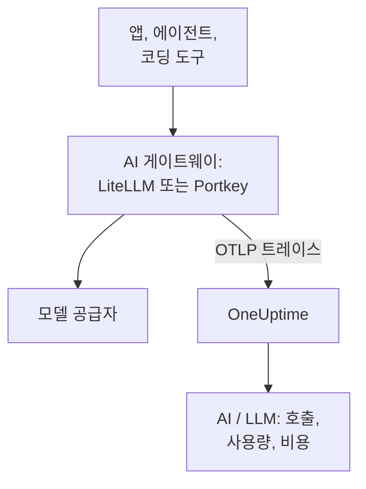

# AI 게이트웨이(LiteLLM, Portkey)

AI 게이트웨이는 앱과 모델 공급자 사이에 있어서, 모든 모델 호출이 게이트웨이를 거칩니다. 게이트웨이의 OpenTelemetry를 OneUptime으로 한 번 보내면, 그 뒤의 모든 호출이 모델, 토큰, 비용, 그리고 끄지 않는 한 프롬프트와 답변과 함께 [AI / LLM](/docs/telemetry/ai-llm-observability) 에 도착합니다. 앱마다 계측할 필요가 없습니다.

:::cards
- [LiteLLM Proxy](#litellm-proxy): 변수 세 개로 설정하는 기본 제공 내보내기.
- [누가 무엇을 썼는지](#직원별-가상-키-하나): 직원별 LiteLLM 가상 키 하나로 각 사람을 식별합니다.
- [Portkey](#portkey): 자체 호스팅 게이트웨이에서는 기본 제공 내보내기, 그 밖에서는 앱을 계측합니다.
- [호출이 도착하는지 확인하기](#호출이-도착하는지-확인하기): 무엇이 보여야 하는지, 보이지 않으면 무엇을 할지.
:::

## 작동 방식



| | LiteLLM Proxy | Portkey(자체 호스팅 또는 Enterprise) | Portkey(오픈 소스 또는 호스팅형) |
| --- | --- | --- | --- |
| OneUptime으로 내보내기 | 기본 제공 | 기본 제공, 실험적 | 없음: 대신 앱을 계측 |
| 설정할 엔드포인트 | `https://oneuptime.com/otlp/v1/traces` | `https://oneuptime.com/otlp` | 앱 자체의 익스포터 |
| 각 사람을 식별 | 예, 직원별 가상 키로 | 아니요 | 앱이 보내는 것만 |
| 프롬프트와 답변 | 끄지 않는 한 전송 | 항상 전송 | 계측에 따라 다름 |

## 시작하기 전에

- 수집 키: **프로젝트 설정 → 텔레메트리 및 APM → 수집 키** 를 열고 **수집 키 생성** 을 클릭합니다.
- OTLP 기본 URL: `https://oneuptime.com/otlp`, OneUptime을 직접 호스팅한다면 `https://YOUR-ONEUPTIME-HOST/otlp`. OneUptime은 HTTP를 통한 OTLP를 protobuf와 JSON 모두로 받습니다.
- 키는 모든 내보내기 요청의 `x-oneuptime-token` 헤더에 담겨 전달됩니다.

## LiteLLM Proxy

LiteLLM의 OpenTelemetry 콜백은 오픈 소스 프록시에 포함되어 있으며, 공식 Docker 이미지(`ghcr.io/berriai/litellm`)에는 필요한 패키지가 들어 있습니다.

:::steps
### otel 콜백 켜기

프록시의 `config.yaml` 에서 콜백에 `otel` 을 추가합니다.

```yaml title="config.yaml"
model_list:
  - model_name: gpt-4o
    litellm_params:
      model: openai/gpt-4o
      api_key: os.environ/OPENAI_API_KEY

litellm_settings:
  callbacks: ["otel"]
```

### 익스포터를 OneUptime으로 향하게 하기

프록시에 변수 세 개를 설정합니다.

```bash
export OTEL_EXPORTER="otlp_http"
export OTEL_ENDPOINT="https://oneuptime.com/otlp/v1/traces"
export OTEL_HEADERS="x-oneuptime-token=YOUR_INGESTION_TOKEN"
```

### 프록시 시작하기

:::tabs
@tab Docker
```bash
docker run \
  -v $(pwd)/config.yaml:/app/config.yaml \
  -e OPENAI_API_KEY="sk-..." \
  -e OTEL_EXPORTER="otlp_http" \
  -e OTEL_ENDPOINT="https://oneuptime.com/otlp/v1/traces" \
  -e OTEL_HEADERS="x-oneuptime-token=YOUR_INGESTION_TOKEN" \
  -e OTEL_SERVICE_NAME="litellm-gateway" \
  -p 4000:4000 \
  ghcr.io/berriai/litellm:main-stable \
  --config /app/config.yaml
```
@tab pip
```bash
pip install 'litellm[proxy]' opentelemetry-api opentelemetry-sdk opentelemetry-exporter-otlp
litellm --config config.yaml
```
:::

`litellm[proxy]` 만으로는 OpenTelemetry 패키지가 설치되지 않으므로 함께 설치하세요.

### 요청 하나 보내 보기

프록시를 한 번 호출한 뒤 [호출이 도착하는지 확인하기](#호출이-도착하는지-확인하기) 에 설명된 대로 AI / LLM을 확인합니다.
:::

| 변수 | 값 | 참고 |
| --- | --- | --- |
| `OTEL_EXPORTER` | `otlp_http` | `OTEL_EXPORTER_OTLP_PROTOCOL` 로도 읽음 |
| `OTEL_ENDPOINT` | `https://oneuptime.com/otlp/v1/traces` | `/v1/traces` 까지의 전체 경로는 모든 LiteLLM 버전에서 동작함. `OTEL_EXPORTER_OTLP_ENDPOINT` 로도 읽음 |
| `OTEL_HEADERS` | `x-oneuptime-token=YOUR_INGESTION_TOKEN` | 쉼표로 구분한 `key=value` 쌍. `OTEL_EXPORTER_OTLP_HEADERS` 로도 읽음 |
| `OTEL_SERVICE_NAME` | 게이트웨이 이름 | 호출이 표시되는 서비스. 아무것도 설정하지 않으면 `litellm` |

### LiteLLM이 보내는 것

각 호출에는 `gen_ai.system`, `gen_ai.request.model`, `gen_ai.response.model`, `gen_ai.usage.input_tokens`, `gen_ai.usage.output_tokens`, 호출의 매개변수, 프롬프트와 답변이 담깁니다. OneUptime이 [호출을 읽는](/docs/telemetry/ai-llm-observability) 데 필요한 모든 것입니다.

LiteLLM 1.81부터 이 속성들은 요청의 `Received Proxy Server Request` 스팬에 담기며, 별도의 `litellm_request` 스팬은 더 이상 없습니다. 한 요청이 모델을 여러 번 호출하면 각 호출이 거기서 이전 호출의 속성을 덮어쓰므로, 호출마다 `litellm_request` 스팬을 받으려면 `USE_OTEL_LITELLM_REQUEST_SPAN=true` 를 설정하세요.

LiteLLM은 프록시에 설정한 사용자 지정 요금을 포함해 각 호출의 가격을 직접 매기고, 그 가격을 `gen_ai.cost.total_cost` 로 보고합니다. OneUptime은 자체 추정보다 보고된 가격을 우선하며, 가격을 설정하지 않은 사용자 지정 모델처럼 LiteLLM이 호출 가격을 매기지 못한 경우에만 [토큰으로 추정](/docs/telemetry/ai-llm-observability) 합니다.

### 직원별 가상 키 하나

각 사람에게 자신만의 LiteLLM 가상 키를 주면, 그 사람이 하는 모든 호출이 누구의 것인지와 함께 도착합니다. LiteLLM은 키 소유자의 ID, 이메일, 팀을 스팬에 기록하고, OneUptime은 이를 직원과 팀으로 읽으므로, **사용량** 탭은 각자의 컴퓨터에서 아무것도 설정하지 않아도 사람별 지출 순위를 보여 줍니다.

가상 키에는 프록시의 데이터베이스와 마스터 키(`DATABASE_URL` 과 `LITELLM_MASTER_KEY`)가 필요합니다. 이메일로 사용자를 만든 다음, 그 사용자의 키를 만듭니다.

```bash
curl -X POST "http://localhost:4000/user/new" \
  -H "Authorization: Bearer YOUR_MASTER_KEY" \
  -H "Content-Type: application/json" \
  -d '{"user_email": "alice@example.com"}'

curl -X POST "http://localhost:4000/key/generate" \
  -H "Authorization: Bearer YOUR_MASTER_KEY" \
  -H "Content-Type: application/json" \
  -d '{"user_id": "USER_ID_FROM_THE_FIRST_CALL", "team_id": "platform"}'
```

| LiteLLM의 스팬 속성 | OneUptime이 읽는 의미 |
| --- | --- |
| `metadata.user_api_key_user_id` | 직원의 ID |
| `metadata.user_api_key_user_email` | 직원의 이메일 |
| `metadata.user_api_key_team_id` | 팀 |
| `metadata.user_api_key_end_user_id` | 직원으로 읽지 않음: 앱이 자기 고객을 위해 보내는 `user` 임 |

LiteLLM의 OpenTelemetry v2 모드에서는 같은 값이 `litellm.` 접두사(`litellm.metadata.user_api_key_user_email` 등)와 함께 도착하며, OneUptime은 이것도 읽습니다.

### 프롬프트 보내지 않기

`otel` 콜백은 기본적으로 프롬프트와 답변 전체를 보냅니다. 보내지 않으려면 다음 중 하나를 사용하세요.

:::tabs
@tab 모든 콜백
```yaml title="config.yaml"
litellm_settings:
  callbacks: ["otel"]
  turn_off_message_logging: true
```
@tab OTel 콜백만
```yaml title="config.yaml"
litellm_settings:
  callbacks: ["otel"]

callback_settings:
  otel:
    message_logging: False
```
@tab 환경 변수
```bash
export OTEL_INSTRUMENTATION_GENAI_CAPTURE_MESSAGE_CONTENT="NO_CONTENT"
```
:::

`callback_settings` 는 최상위 키이며, `litellm_settings` 아래의 키가 아닙니다. 프롬프트는 남기되 일부를 가리려면 대신 **트레이스 → 설정** 의 스크럽 규칙을 사용하세요.

:::details LiteLLM의 OpenTelemetry v2 모드
최신 LiteLLM 버전에는 선택형 OpenTelemetry v2 모드(`LITELLM_OTEL_V2=true`, `config.yaml` 변경 없음)가 있습니다. 요청마다 트레이스 하나를 보내며, HTTP 처리, 인증, 가드레일, 모델 호출을 `chat gpt-4o` 같은 이름의 GenAI 스팬으로 담습니다. v2 모드에서는 프롬프트가 기본적으로 꺼져 있으며, `OTEL_INSTRUMENTATION_GENAI_CAPTURE_MESSAGE_CONTENT` 로 켭니다. 비용은 `litellm.cost.total` 로 도착하며, OneUptime은 이것도 읽습니다. 두 모드 중 하나만 사용하고, 둘 다 쓰지는 마세요.
:::

## Portkey

Portkey가 무엇을 보낼 수 있는지는 어떻게 운영하는지에 달려 있습니다.

| 배포 | OneUptime으로 내보내기 |
| --- | --- |
| 자체 호스팅 또는 Enterprise 게이트웨이 | 기본 제공(실험적): 아래 변수를 설정 |
| 오픈 소스 게이트웨이(`portkey-ai/gateway`) | 없음: 게이트웨이를 호출하는 앱을 계측 |
| 호스팅형 게이트웨이(portkey.ai) | 게이트웨이에서는 없음: 게이트웨이를 호출하는 앱을 계측 |

Portkey에는 자체 OpenTelemetry 엔드포인트(`api.portkey.ai/v1/otel`)도 있습니다. 이것은 Portkey로 트레이스를 받아들이는 것으로, 이 페이지와는 반대 방향입니다.

### 자체 호스팅 및 Enterprise 게이트웨이

게이트웨이 컨테이너에 다음 변수를 설정합니다.

```yaml title="docker-compose.yml"
services:
  portkey-gateway:
    environment:
      EXPERIMENTAL_GEN_AI_OTEL_TRACES_ENABLED: "true"
      EXPERIMENTAL_GEN_AI_OTEL_EXPORTER_OTLP_ENDPOINT: "https://oneuptime.com/otlp"
      EXPERIMENTAL_GEN_AI_OTEL_EXPORTER_OTLP_HEADERS: "x-oneuptime-token=YOUR_INGESTION_TOKEN"
```

- OTLP 기본 URL을 지정하세요. `/v1/traces` 는 Portkey가 직접 붙입니다.
- 헤더는 쉼표로 구분한 `key=value` 쌍입니다. `EXPERIMENTAL_GEN_AI_OTEL_RESOURCE_ATTRIBUTES` 는 같은 방식으로 리소스 속성을 추가합니다. 예를 들면 `deployment.environment=production` 입니다.
- Portkey는 HTTP를 통한 OTLP를 JSON으로만 보내며, OneUptime은 중간에 컬렉터 없이 이를 받습니다.
- 각 호출은 `{operation} {model}`, 예를 들어 `chat gpt-4o` 라는 이름의 스팬이 되며, 서비스 `portkey` 아래에서 `gen_ai.provider.name`, 요청한 모델과 실제로 응답한 모델, 토큰 수, `gen_ai.conversation.id`, 그리고 `gen_ai.input.messages` 와 `gen_ai.output.messages` 의 메시지를 담습니다.
- 프롬프트와 답변 전체가 항상 포함됩니다. 필요한 부분은 **트레이스 → 설정** 의 스크럽 규칙으로 가리세요.
- 각 호출은 응답 후 따로 전송되며, 일괄 처리도 재시도도 없습니다. 실패한 내보내기는 사라집니다. 감사 로그가 아니라 옵저버빌리티로 다루세요.
- `x-portkey-trace-id` 가 유효한 트레이스 ID(16진수 32자)라면 Portkey가 이를 재사용하므로, 게이트웨이의 스팬이 여러분 앱의 트레이스에 연결됩니다.

Portkey는 이 내보내기를 실험적 기능으로 표시합니다. 변수가 아무 효과도 없다면, Portkey의 최신 문서를 게이트웨이 버전과 대조해 보세요.

### 오픈 소스 및 호스팅형 게이트웨이

오픈 소스 게이트웨이에는 익스포터가 없고, 호스팅형 게이트웨이에서는 변수를 설정할 수 없습니다. 대신 Portkey를 호출하는 앱을 계측하세요. Portkey는 OpenAI API를 사용하므로, [AI / LLM 옵저버빌리티](/docs/telemetry/ai-llm-observability) 의 GenAI 계측(OpenLLMetry, OpenInference, OpenLIT)은 기본 URL이 Portkey를 가리켜도 SDK의 호출을 트레이스합니다.

```python
from traceloop.sdk import Traceloop
from openai import OpenAI

Traceloop.init(
    app_name="my-ai-agent",
    api_endpoint="https://oneuptime.com/otlp",
    headers={"x-oneuptime-token": "YOUR_INGESTION_TOKEN"},
)

client = OpenAI(
    base_url="https://api.portkey.ai/v1",   # or your gateway's URL
    default_headers={"x-portkey-api-key": "PORTKEY_API_KEY"},
)
# Calls through Portkey are now traced to OneUptime.
```

이 스팬들은 앱이 한 그대로의 호출을 나타냅니다. 요청한 모델, 기다린 시간, 돌려받은 토큰입니다. 대체 경로, 재시도, 캐시 적중처럼 게이트웨이가 도중에 결정한 것은 Portkey 안에 남습니다. 그것을 OneUptime에서 보려면 자체 호스팅 게이트웨이의 내보내기를 사용하세요.

## 호출이 도착하는지 확인하기

:::steps
1. 게이트웨이를 통해 요청을 보내고 몇 초 기다립니다.
2. **제품 → AI / LLM → 호출** 을 엽니다. 호출이 공급자, 모델, 토큰과 함께 목록에 표시됩니다.
3. 호출을 클릭해 트레이스를 열고, 스팬의 **LLM** 탭을 엽니다. 모델, 토큰, 매개변수, 그리고 끄지 않았다면 프롬프트와 답변이 보입니다.
4. **사용량** 을 엽니다. 호출이 게이트웨이가 보고했거나 OneUptime이 추정한 비용과 함께 합계에 포함됩니다.
:::

## 문제 해결

:::details LiteLLM에서 아무것도 도착하지 않음
잠시 `OTEL_EXPORTER="console"` 을 설정하세요. 프록시 출력에 스팬이 나타나면 LiteLLM은 트레이스하고 있는 것이고, 문제는 엔드포인트나 키에 있습니다. `DEBUG_OTEL="true"` 는 익스포터가 무엇을 하는지 보여 줍니다.
:::

:::details 키가 거부됨
OneUptime은 키가 없거나, 알 수 없거나, 만료된 경우 `401` 을, 비활성화된 키나 브라우저 키에는 `422` 를 반환합니다. **프로젝트 설정 → 텔레메트리 및 APM → 수집 키** 에서 서버 키를 만들고 `x-oneuptime-token` 으로 보내세요.
:::

:::details 엔드포인트가 잘못됨
LiteLLM에는 전체 경로 `https://oneuptime.com/otlp/v1/traces` 를 지정합니다. Portkey에는 기본 URL `https://oneuptime.com/otlp` 를 지정하며, `/v1/traces` 는 Portkey가 직접 붙입니다.
:::

:::details 스팬은 도착하지만 AI / LLM에 표시되지 않음
**트레이스** 를 게이트웨이의 서비스(`litellm`, `portkey` 또는 설정한 `OTEL_SERVICE_NAME`)로 필터링해 원시 스팬을 확인하세요. 스팬은 `gen_ai.*` 속성을 담고 있을 때만 모델 호출로 집계됩니다. 콜백이 `otel` 인지, 호출이 모델로 갔는지 확인하세요.
:::

:::details 지출이 미지정으로 표시됨
호출이 사람을 식별하지 않습니다. [직원별 가상 키 하나](#직원별-가상-키-하나) 처럼 직원마다 자신만의 가상 키를 주세요. 앱이 보내는 `user` 필드는 직원이 아니라 앱의 고객을 가리키며, 직원으로 읽히지 않습니다.
:::

:::details 여러 호출 중 마지막 것만 보임
LiteLLM 1.81부터 한 요청 안의 모델 호출은 스팬 하나를 공유합니다. 호출마다 스팬을 받으려면 `USE_OTEL_LITELLM_REQUEST_SPAN=true` 를 설정하세요.
:::

## 다음 단계

:::cards
- [AI / LLM 옵저버빌리티](/docs/telemetry/ai-llm-observability): 이 호출들의 대화, 알림, 사용량, 일일 비용 예산.
- [AI 코딩 어시스턴트](/docs/telemetry/ai-coding-assistants): 텔레메트리를 직접 보내지 않는 도구 앞에 게이트웨이를 둡니다.
- [AI 에이전트 서킷 브레이커](/docs/telemetry/ai-agent-circuit-breaker): 알림이 발생하면 폭주하는 에이전트를 멈춥니다.
- [트레이스 모니터](/docs/monitor/traces-monitor): 루프 안에서 호출되는 도구처럼 스팬 패턴에 대해 알림을 받습니다.
:::
