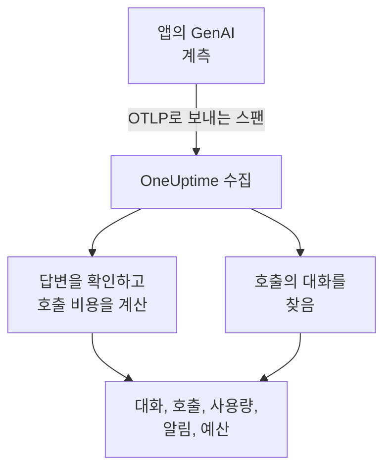
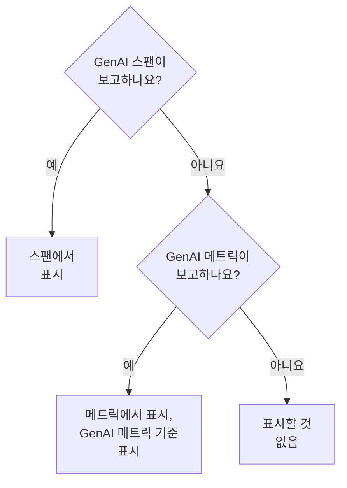

# AI / LLM 옵저버빌리티

AI가 나눈 모든 대화를 읽고, 일어난 그대로 다시 재생하고, AI가 잘못 답할 때 알림을 받으세요. OneUptime은 이 모든 것을 표준 OpenTelemetry로 만듭니다. 앱이 **GenAI 시맨틱 규칙**(`gen_ai.*`)에 따른 스팬을 보내면, 독점 SDK 없이 대화, 알림, 사용량, 비용을 얻을 수 있습니다.

:::cards
- [설정하기](#다섯-단계로-설정하기): 첫 스팬부터 플래그가 지정된 답변까지 다섯 단계.
- [대화 다시 재생하기](#대화-읽기와-다시-재생하기): 사람이 본 그대로, 일어난 속도로 채팅을 읽습니다.
- [알림 받기](#ai가-잘못-답할-때-알림-받기): 실패, 거부, 잘림, 플래그 지정, 느린 답변을 위한 기본 제공 알림.
- [지출 지켜보기](#누가-무엇에-지출하는지-보기): 사람, 팀, 모델, 앱별 비용과 일일 예산.
:::

## 작동 방식

앱의 GenAI 계측은 모델에 대한 각 호출을 OpenTelemetry 스팬으로 내보냅니다. 스팬이 도착하면 OneUptime은 `gen_ai.*` 속성을 읽고, 답변에 문제가 있는지 확인하고, 호출 비용을 계산한 뒤, 해당 대화에 분류합니다.



**관측 가능성** 아래의 **제품 → AI / LLM** 을 엽니다. 이 제품에는 일곱 개의 탭이 있습니다.

| 탭 | 표시 내용 |
| --- | --- |
| **대화** | AI가 나눈 모든 대화. 주의가 필요한 대화가 먼저 표시됩니다. 목록 위에는 대화 수, AI 답변 수, 주의가 필요한 수, 비용, 일반적인 답변 시간이 표시됩니다. |
| **호출** | 모든 모델, 임베딩, 에이전트, 도구 호출. 서비스, 공급자, 모델, 작업, 사람, 팀, 대화로 필터링하고, 호출을 클릭하면 트레이스 뷰어에서 열립니다. |
| **사용량** | 기간별 호출, 토큰, 비용을 직원, 팀, 모델, 공급자, 앱별로 순위를 매깁니다. |
| **알림** | AI가 잘못 답할 때를 위한 기본 제공 알림과 AI / LLM 모니터. |
| **예산** | 알림을 설정할 수 있는 메트릭으로 게시되는 일일 비용 한도. |
| **가격** | 기본 제공 가격표에 없는 모델에 대한 사용자 지정 가격. |
| **설정** | 아래의 다섯 단계와 프로젝트의 엔드포인트. |

트레이스 뷰어에서 각 AI 호출의 스팬에는 **LLM** 탭도 있으며, 공급자, 모델, 토큰, 비용, 요청 매개변수, 프롬프트와 답변을 보여 줍니다.

## 시작하기 전에

- 텔레메트리 수집 키를 만들 수 있는 OneUptime 프로젝트.
- 모델을 호출하는 앱과, 그 언어용 GenAI 계측. **OpenLLMetry**(Traceloop), **OpenInference**(Arize), **Vercel AI SDK**, 또는 OpenAI, Anthropic, Gemini용 OpenTelemetry 계측입니다.

> [!TIP]
> LiteLLM이나 Portkey 같은 게이트웨이를 거치는 모델 트래픽은 각 앱 대신 게이트웨이에서 내보낼 수 있습니다. [AI 게이트웨이](/docs/telemetry/ai-gateways)를 참조하세요. 엔지니어가 사용하는 코딩 어시스턴트는 [AI 코딩 어시스턴트](/docs/telemetry/ai-coding-assistants)를 참조하세요.

## 다섯 단계로 설정하기

호출을 보려면 첫 단계만으로 충분합니다. 그 뒤의 각 단계는 더 많은 것을 보여 줍니다.

:::steps
### AI 호출 보내기

**프로젝트 설정 → 텔레메트리 및 APM → 수집 키** 에서 수집 키를 만듭니다([OpenTelemetry 빠른 시작](/docs/telemetry/open-telemetry#수집-키-만들기)에서 과정을 안내합니다). 그런 다음 계측이 OneUptime을 향하도록 합니다.

:::tabs
@tab Python
```bash
pip install traceloop-sdk opentelemetry-exporter-otlp
```

```python
from traceloop.sdk import Traceloop

Traceloop.init(
    app_name="my-ai-agent",
    api_endpoint="https://oneuptime.com/otlp",
    headers={"x-oneuptime-token": "YOUR_INGESTION_TOKEN"},
)
# Your OpenAI, Anthropic and LangChain calls are now traced.
```
@tab Node.js
```bash
npm install @traceloop/node-server-sdk
```

```typescript
import * as traceloop from "@traceloop/node-server-sdk";

traceloop.initialize({
  appName: "my-ai-agent",
  baseUrl: "https://oneuptime.com/otlp",
  headers: { "x-oneuptime-token": "YOUR_INGESTION_TOKEN" },
});
```
@tab OpenTelemetry SDK
```bash
export OTEL_EXPORTER_OTLP_ENDPOINT="https://oneuptime.com/otlp"
export OTEL_EXPORTER_OTLP_HEADERS="x-oneuptime-token=YOUR_INGESTION_TOKEN"
export OTEL_EXPORTER_OTLP_PROTOCOL="http/protobuf"
export OTEL_SERVICE_NAME="my-ai-agent"
```
:::

OneUptime을 직접 호스팅하나요? `https://oneuptime.com/otlp` 대신 `https://YOUR-ONEUPTIME-HOST/otlp`를 사용하세요. 모델을 한 번 호출하면 그 호출이 **호출** 에 나타납니다.

### 오간 내용 기록하기

대화에는 계측이 기록한 경우에만 사람들이 물은 내용과 AI가 답한 내용이 표시됩니다. OpenLLMetry는 `TRACELOOP_TRACE_CONTENT=false`를 설정하지 않는 한 프롬프트와 답변을 기록합니다. OpenTelemetry 계측은 요청할 때만 기록합니다.

```bash
export OTEL_INSTRUMENTATION_GENAI_CAPTURE_MESSAGE_CONTENT=true
```

최신 OpenTelemetry 계측은 `true` 대신 `span_only`, `event_only`, `span_and_event`를 받습니다. 기록된 내용이 없어도 대화에는 타이밍, 비용, 문제가 표시됩니다. 프롬프트에는 민감한 데이터가 들어 있을 수 있습니다. 저장 전에 마스킹하는 방법은 [개인정보 보호와 마스킹](#개인정보-보호와-마스킹)에서 설명합니다.

### 호출을 대화로 묶기

채팅 앱은 한 차례마다 모델을 한 번 호출합니다. 모든 AI 호출에서 `gen_ai.conversation.id`(또는 `session.id`)를 채팅의 ID로 설정하면, 호출과 트레이스가 몇 개이든 각 채팅이 하나의 대화로 표시됩니다. OpenLLMetry에서는 요청마다 한 번 설정합니다.

```python
from traceloop.sdk import Traceloop

Traceloop.set_association_properties({
    "session_id": chat.id,
    "user_email": user.email,
})
```

Vercel AI SDK에서는 채팅의 ID를 `experimental_telemetry: { metadata: { sessionId } }`로 전달합니다. 대화 ID가 없는 호출도 한 번에 한 요청(한 트레이스)씩 표시됩니다.

### 누가 물었는지 알려 주기

모든 AI 호출에 `user.id` 또는 `user.email`을 설정합니다(위의 연결 속성은 이메일을 설정합니다). 그러면 각 대화에 상대가 표시되고, 목록을 사람으로 검색할 수 있으며, **사용량** 탭에서 지출이 직원별로 순위가 매겨집니다. OneUptime이 읽는 모든 신원 키는 [직원 및 팀 귀속](/docs/telemetry/ai-coding-assistants#직원-및-팀-귀속)에 나와 있습니다.

### 잘못된 답변에 플래그 지정하기

OneUptime은 도착하는 모든 답변을 확인하고 무엇이 잘못되었는지 표시합니다.

| 문제 | 의미 | 판단 근거 |
| --- | --- | --- |
| 실패 | 호출이 오류로 끝나 답변이 오지 않음 | 스팬 상태 Error, `error.type`, 또는 종료 이유 `error` |
| 거부 | AI가 거절했거나 안전 필터가 답변을 차단함 | 거부 또는 안전 관련 종료 이유(`content_filter`, `refusal`, `SAFETY` 등), 답변 안의 거부, 또는 영어로 된 정형화된 거부 문구로 시작하는 답변 |
| 잘림 | 답변이 토큰 한도에서 멈춤 | 종료 이유 `length`, `max_tokens`, `MAX_TOKENS` |
| 비어 있음 | 텍스트도 도구 호출도 없음 | 아무것도 없는 기록된 내용, 또는 출력 토큰 0 |
| 플래그 지정됨 | 앱이 보낸 평가가 답변이 나쁘다고 판단함 | `gen_ai.evaluation.result` 이벤트 |

처음 네 가지는 아무것도 하지 않아도 됩니다. 가드레일, 평가, 또는 싫어요 버튼이 거부한 답변에 플래그를 지정하려면, 스팬이 열려 있는 동안 답변의 스팬에 `gen_ai.evaluation.result` 이벤트를 추가하고 `gen_ai.evaluation.score.label`을 `fail`로 설정합니다.

```python
from opentelemetry import trace

trace.get_current_span().add_event(
    "gen_ai.evaluation.result",
    {
        "gen_ai.evaluation.name": "relevance",
        "gen_ai.evaluation.score.label": "fail",
        "gen_ai.evaluation.explanation": "The answer is about another product.",
    },
)
```

`incorrect`, `wrong`, `unhelpful`, `toxic`, `unsafe`, `hallucination` 같은 레이블도 실패로 셉니다. OneUptime은 대화를 판단하기 위해 다른 AI에 보내지 않습니다. 모든 확인은 호출 자체가 가진 정보만 읽습니다.
:::

## 대화 읽기와 다시 재생하기

대화는 채팅 앱이 기록을 보여 주는 것처럼 통째로 열립니다. 사람이 한 말은 오른쪽에, AI의 답변은 왼쪽에 모델, 시간, 토큰, 비용과 함께 표시되고, 그 사이에 도구 호출이 있으며, 잘못된 부분은 일어난 자리에 표시됩니다. 답변 아래의 **세부 정보** 는 멈춘 이유, 평가, 트레이스에 있는 해당 호출로 가는 링크를 보여 줍니다.

아래쪽 막대는 그 사람이 겪은 그대로 대화를 다시 재생합니다.

| 컨트롤 | 동작 |
| --- | --- |
| **다시 재생** | 첫 메시지부터 실제로 일어난 속도로 대화를 재생합니다. 답변이 오는 동안 "AI가 답변하는 중…"이 시간을 셉니다. 아무 메시지의 시간을 클릭하면 거기서부터 재생합니다. |
| **대기 건너뛰기** | 기본으로 켜져 있으며, 3초가 넘는 침묵을 줄입니다. |
| `1x` | 속도를 바꿉니다. 1x, 2x, 4x, 8x 중에서 고릅니다. |
| **K**, **J** 또는 **←**, **L** 또는 **→** | 재생 또는 일시 정지, 이전 메시지로 이동, 다음 메시지로 이동. |

재생이 멈춘 메시지는 페이지 주소에 남으므로(`?step=`), 공유한 링크는 그 순간에서 열립니다.

## AI가 잘못 답할 때 알림 받기

**알림** 탭에는 대부분의 AI 앱에 필요한 알림이 나열되어 있습니다. 하나를 고르면 내용이 채워진 **모니터 생성** 이 열리고, 저장하기 전에 무엇이든 바꿀 수 있습니다.

| 알림 | 알려 주는 시점 | 심각도 |
| --- | --- | --- |
| 답변이 잘못됨 | 15분 동안의 답변 중 5% 넘게 실패, 거부, 잘림, 비어 있음, 플래그 지정됨일 때 | Warning |
| AI 호출이 실패함 | 5분 동안의 모델 호출 중 10% 넘게 오류로 끝날 때 | Critical |
| AI가 답변을 거부함 | 30분 동안의 답변 중 5% 넘게 거부일 때 | Warning |
| 답변이 잘림 | 30분 동안 답변 3개 이상이 토큰 한도에서 멈출 때 | Warning |
| 답변에 플래그가 지정됨 | 평가가 답변을 나쁘다고 표시할 때 | Warning |
| 답변이 느림 | 15분 동안의 답변 중 10% 넘게 30초보다 오래 걸릴 때 | Warning |
| AI가 답변을 멈춤 | AI가 30분 동안 아무 답변도 하지 않을 때 | Critical |

답변 비율에 대한 알림은 나쁜 답변이 3개 이상이 될 때까지도 기다리므로, 두 개 중 한 개가 나쁘다고 해서 누군가를 호출하지는 않습니다. Critical 알림에는 프로젝트에서 가장 심각한 알림 심각도가, Warning 알림에는 그다음 심각도가 지정됩니다. 새 프로젝트에서는 High와 Low입니다.

각 알림은 **AI / LLM** 모니터입니다. 설정에서는 무엇을 나쁜 답변으로 볼지( **다음의 경우 답변을 나쁜 답변으로 셉니다** , **또는 다음보다 오래 걸림(초)** ), 각 확인이 얼마나 이전까지 볼지( **기간** , 기본값 15분), 어떤 **앱** 을 감시할지, 그리고 **추가 필드** 아래에서 어떤 **모델** 을 감시할지 정합니다. **미리 보기** 는 모니터가 지금 무엇을 세는지 보여 줍니다. 조건은 세 숫자, 즉 **나쁜 AI 답변 (%)** , **나쁜 AI 답변** , **AI 답변** 을 비교합니다.

기본 제공 알림은 스스로 해결되는 알림을 발생시키고, 답변이 나쁜 동안 모니터를 **Degraded** 로 표시합니다. 인시던트는 채워져 있지만 꺼져 있습니다. 누군가를 호출하려면 켜세요.

## 누가 무엇에 지출하는지 보기

**사용량** 탭은 기간(다른 기간을 고르지 않으면 지난 7일)의 호출, 토큰, 비용과, 다섯 가지 분류( **직원** , **팀** , **모델** , **공급자** , **애플리케이션 / 서비스** ) 중 하나에 따른 상위 25개 표를 보여 줍니다. 아무도 지목하지 않는 호출은 **미지정** 으로 집계되며, 버려지지 않습니다.

사람과 팀은 호출의 신원 속성에서 가져옵니다. [직원 및 팀 귀속](/docs/telemetry/ai-coding-assistants#직원-및-팀-귀속)을 참조하세요.

### 스팬이 먼저, 메트릭은 보충

GenAI 스팬은 한 호출의 모델, 토큰, 비용을 담고 있으므로, 스팬이 있는 곳에서는 모든 것을 답해 줍니다. 대부분의 코딩 어시스턴트처럼, 어떤 도구는 토큰과 비용 메트릭을 게시하지만 GenAI 스팬은 보내지 않습니다. OneUptime은 스팬이 아무것도 보고하지 않은 수치에 대해서만 이 메트릭을 읽으며, 둘을 합산하지 않습니다. 많은 계측이 같은 호출에 대해 둘 다 보내므로, 합산하면 모든 달러가 두 번 계산됩니다.



| 위치 | 메트릭으로 대체되는 것 | 조건 |
| --- | --- | --- |
| 입력 및 출력 토큰 | 두 합계 모두 | 스팬의 토큰 합계가 둘 다 0 |
| 비용(USD) | 비용. Codex의 마이크로 USD 비용은 USD로 환산 | 스팬의 비용 합계가 0 |
| LLM 호출 | 없음. 스팬만 | — |
| **직원** , **팀** , **모델** 표 | 비용만. 호출과 토큰 셀은 `—` 표시 | 그 표에서 스팬 행을 찾지 못함 |
| **공급자** , **애플리케이션 / 서비스** 표 | 없음. 스팬만 | — |
| 대화 | 없음. 대화는 스팬으로 만들어짐 | — |

메트릭에서 가져온 수치에는 **GenAI 메트릭 기준** 이라고 표시됩니다. **호출** 에 해당하는 행이 없기 때문입니다. 따라서 GenAI 스팬이 수치를 보고하는 순간, 메트릭만 보내는 도구의 몫은 표시되지 않습니다. 그런 도구의 지출을 따로 보려면, GenAI 스팬이 들어오지 않는 전용 프로젝트로 보내세요.

## 호출 비용

계측이 보고한 비용(`gen_ai.usage.cost`)은 0이라도 그대로 사용됩니다. 보고된 비용이 없으면, OneUptime은 스팬이 도착할 때 토큰 수와, OpenAI, Anthropic, Google Gemini, Mistral, DeepSeek, xAI, Cohere, Amazon Nova, Meta Llama의 일반적인 모델에 대한 기본 제공 가격표로 비용을 추정합니다. 가격은 응답한 모델을 먼저, 그다음 요청한 모델을 기준으로 정합니다.

모델은 가장 긴 이름 접두사로 맞추므로, `gpt-4o-2024-08-06`와 `us.anthropic.claude-sonnet-4-5-20250929-v1:0`처럼 날짜나 공급업체 표시가 붙은 ID도 해당 제품군의 가격을 찾습니다. 목록에 없는 모델은 새 릴리스라도 추측하지 않으며, 가격을 정할 때까지 비용은 0으로 남습니다. 추정에는 정가를 사용하며, 캐시나 배치 할인은 반영하지 않습니다.

모델 가격을 직접 정하려면(협상된 요율, 파인튜닝한 모델, 직접 호스팅하는 모델 등), **가격** 탭의 **사용자 지정 LLM 가격** 에서 추가합니다. **모델 접두사** , **입력 가격(100만 토큰당 USD)** , **출력 가격(100만 토큰당 USD)** 을 입력합니다. 사용자 지정 가격과 기본 제공 목록을 통틀어 가장 길게 일치하는 접두사가 우선하며, 길이가 같으면 사용자 지정 가격이 우선합니다. 가격은 저장하고 약 1분 뒤에 도착하는 호출부터 적용되며, 이미 저장된 호출의 비용은 바뀌지 않습니다.

## 일일 비용 예산

예산은 UTC 기준 하루의 지출을 USD로 추적합니다. OneUptime은 15분마다 그날의 AI 지출을 합산하고(스팬에서, 또는 어떤 스팬도 지출을 보고하지 않으면 GenAI 비용 메트릭에서), 예산에 표시하고, 두 메트릭을 게시합니다.

| 메트릭 | 의미 |
| --- | --- |
| `oneuptime.llm.budget.spend.usd` | 지금까지의 그날 지출(USD) |
| `oneuptime.llm.budget.percent.used` | 일일 한도 대비 지출 비율 |

둘 다 `oneuptime.llm.budget.id`와 `oneuptime.llm.budget.name`, 그리고 예산에 범위가 있으면 그 범위를 담고 있습니다.

:::steps
### 예산 만들기

**예산** 탭에서 **LLM Cost Budget 만들기** 를 클릭합니다. 이름과 **일일 예산(USD)** 을 지정하고, 프로젝트 전체가 대상이면 범위를 비워 두거나 **서비스(선택 사항)** , **LLM 공급자(선택 사항)** , **LLM 모델(선택 사항)** 중 하나를 고릅니다. 여러 예산이 서로 다른 범위를 감시할 수 있습니다.

### 알림 설정하기

`oneuptime.llm.budget.percent.used`에 대해 [메트릭 모니터](/docs/monitor/metrics-monitor)를 만들고 `oneuptime.llm.budget.id`로 필터링합니다(예산 이름을 바꾸면 이름이 바뀌기 때문입니다). 경고를 발생시키는 조건 `>= 80`과 심각한 알림을 발생시키는 조건 `>= 100`을 추가합니다.

### 기간 넓히기

모니터의 롤링 기간을 30분으로 설정합니다. 예산은 15분마다 점 하나를 게시하므로, 기본값인 1분 기간으로는 두 점 사이에서 아무것도 찾지 못합니다.
:::

예산 알림으로 폭주하는 에이전트를 멈추는 워크플로를 실행할 수도 있습니다. [AI 에이전트 서킷 브레이커](/docs/telemetry/ai-agent-circuit-breaker)를 참조하세요.

## 대시보드와 메트릭 알림

`gen_ai.client.token.usage`와 `gen_ai.client.operation.duration` 같은 GenAI 메트릭은 일반 OpenTelemetry 메트릭으로 들어옵니다. [대시보드](/docs/dashboards/index)에 차트로 그리거나, [메트릭 모니터](/docs/monitor/metrics-monitor)로 알림을 설정하세요. 예를 들어 모델별로 묶은 `gen_ai.client.operation.duration`의 p95가 임계값을 넘을 때입니다.

## 개인정보 보호와 마스킹

AI 호출은 트레이스 스팬으로 저장되므로, 트레이스의 **스크럽 규칙** 과 **드롭 필터** 가 적용됩니다. 저장 전에 속성을 마스킹하거나 스팬을 버릴 수 있습니다. 둘 다 **트레이스 → 설정** 에 있습니다. 직원 이메일 열은 읽어 온 속성과 함께 스크럽되므로, 이메일을 마스킹하는 규칙이 이 열에도 적용됩니다.

대화는 트레이스와 같은 권한으로 읽습니다. 프로젝트의 트레이스를 읽을 수 있는 사람만 대화를 읽을 수 있습니다.

## OneUptime이 읽는 속성

OneUptime은 OpenTelemetry GenAI 규칙과 함께 OpenLLMetry, OpenInference, Vercel AI SDK, LiteLLM이 쓰는 표기도 읽으므로, 일반적인 라이브러리는 그대로 작동합니다. 각 값에 대해 스팬이 가진 첫 번째 키가 우선합니다.

| 값 | 키(시도하는 순서) |
| --- | --- |
| 공급자 | `gen_ai.system`, `gen_ai.provider.name`, `llm.system`, `llm.provider` |
| 작업 | `gen_ai.operation.name`, `llm.request.type`, `openinference.span.kind` |
| 요청한 모델 | `gen_ai.request.model`, `llm.model_name`, `llm.request.model` |
| 응답한 모델 | `gen_ai.response.model`, `llm.response.model` |
| 입력 토큰 | `gen_ai.usage.input_tokens`, `gen_ai.usage.prompt_tokens`, `llm.token_count.prompt`, `llm.usage.prompt_tokens` |
| 출력 토큰 | `gen_ai.usage.output_tokens`, `gen_ai.usage.completion_tokens`, `llm.token_count.completion`, `llm.usage.completion_tokens` |
| 총 토큰 | `gen_ai.usage.total_tokens`, `llm.token_count.total`, `llm.usage.total_tokens` |
| 비용(USD) | `gen_ai.usage.cost`, `gen_ai.usage.cost_usd`, `gen_ai.usage.total_cost`, `llm.usage.total_cost`, `gen_ai.cost.total_cost`, `litellm.cost.total` |
| 대화 | `gen_ai.conversation.id`, `session.id`, `langfuse.session.id`, `traceloop.association.properties.session_id`, `ai.telemetry.metadata.sessionId` |
| 에이전트 | `gen_ai.agent.name`, `agent.name` |
| 도구 | `gen_ai.tool.name`, `tool.name`, `ai.toolCall.name` |
| 종료 이유 | `gen_ai.response.finish_reasons`, `gen_ai.response.finish_reason`, `llm.response.finish_reason`, `ai.response.finishReason` |
| 오류 | `error.type` |

이 값 중 하나를 가지고 있거나, `gen_ai.`, `llm.`, `traceloop.`로 시작하는 속성을 가진 스팬은 AI 호출로 셉니다. 합계가 보고되지 않으면 총 토큰은 입력과 출력의 합입니다. `gen_ai.usage.total_tokens`와 `gen_ai.usage.cost` 키는 규칙에 포함되지 않으며, 규칙은 둘 다 정의하지 않습니다. 일반적인 계측이 보내기 때문에 OneUptime이 읽습니다.

신원 키(누가 호출했는지와 그 팀)는 [직원 및 팀 귀속](/docs/telemetry/ai-coding-assistants#직원-및-팀-귀속)에 나와 있습니다.

### 프롬프트와 답변을 읽어 오는 위치

대화 보기는 호출의 메시지를 다음 순서로 읽습니다.

- `gen_ai.client.inference.operation.details` 이벤트.
- `gen_ai.input.messages`, `gen_ai.output.messages`, `gen_ai.system_instructions` 속성.
- 역할별 이전 이벤트: `gen_ai.system.message`, `gen_ai.user.message`, `gen_ai.assistant.message`, `gen_ai.tool.message`, `gen_ai.choice`.
- 인덱스가 붙은 속성: OpenLLMetry의 `gen_ai.prompt.N.content`와 `gen_ai.completion.N.content`, OpenInference의 `llm.input_messages.N.message.content`와 `llm.output_messages.N.message.content`.
- `gen_ai.prompt`, `gen_ai.completion`, `ai.prompt.messages`, `ai.response.text`, `input.value`, `output.value` 안의 메시지 배열.

## 문제 해결

:::details 호출은 들어오지만 대화에 텍스트가 표시되지 않음
계측이 내용을 기록하지 않고 있습니다. [오간 내용 기록하기](#오간-내용-기록하기)에 나온 대로 켜세요. 그 전에 만들어진 호출은 텍스트 없이 남습니다.
:::

:::details 채팅의 호출이 각각 별개의 대화로 표시됨
호출에 대화 ID가 없습니다. [호출을 대화로 묶기](#호출을-대화로-묶기)에 나온 대로 채팅의 모든 호출에 `gen_ai.conversation.id` 또는 `session.id`를 설정하세요.
:::

:::details 호출에 토큰은 표시되지만 비용이 $0
모델이 기본 제공 가격표에 없거나, 스팬이 모델을 지목하지 않습니다. **가격** 탭에서 모델의 가격을 추가하세요. 그 뒤에 도착하는 호출에는 가격이 매겨집니다.
:::

:::details 사용량 탭에 GenAI 메트릭 기준이라고 나오고 호출과 토큰이 `—`로 표시됨
수치가 코딩 어시스턴트처럼 메트릭은 보내고 GenAI 스팬은 보내지 않는 도구에서 왔습니다. 메트릭은 비용을 담지만 호출별 세부 정보는 없으므로, 그 셀은 비어 있습니다. [스팬이 먼저, 메트릭은 보충](#스팬이-먼저-메트릭은-보충)을 참조하세요.
:::

:::details 예산 모니터가 두 상태 사이를 오감
모니터의 롤링 기간이 15분보다 짧아서 가끔 점을 찾지 못합니다. 30분으로 설정하세요.
:::

## 다음 단계

:::cards
- [AI 코딩 어시스턴트](/docs/telemetry/ai-coding-assistants): Claude Code, Cursor, Codex, Gemini CLI, Copilot의 엔지니어별 지출.
- [AI 게이트웨이](/docs/telemetry/ai-gateways): LiteLLM 또는 Portkey 게이트웨이 하나로 모든 앱의 모델 호출을 트레이스합니다.
- [AI 에이전트 서킷 브레이커](/docs/telemetry/ai-agent-circuit-breaker): 예산 알림이 발생하면 폭주하는 에이전트를 멈춥니다.
- [OpenTelemetry](/docs/telemetry/open-telemetry): 모든 신호의 엔드포인트, 수집 키, 한도.
:::
