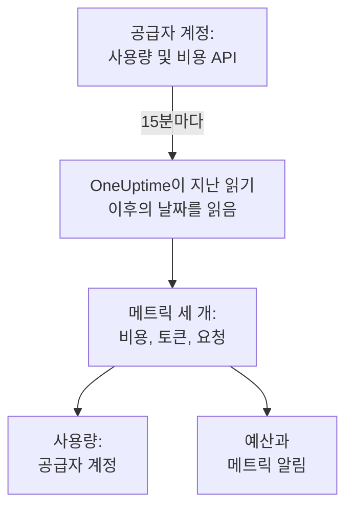

# AI 공급자 계정

앱을 바꾸지 않고도 AI 공급자 계정이 무엇을 얼마나 사용했고 비용이 얼마였는지 확인하세요. OpenAI, Anthropic, Azure OpenAI 및 Microsoft Foundry, Amazon Bedrock, Google Vertex AI 계정을 읽기만 할 수 있는 자격 증명으로 연결하면, OneUptime이 15분마다 그 사용량을 **사용량**, **예산**, 그리고 알림을 걸 수 있는 메트릭으로 읽어 옵니다.

:::cards
- [계정 연결하기](#계정-연결하기): 공급자를 고르고, 자격 증명을 붙여 넣고, 테스트한 뒤 연결합니다.
- [공급자별로 얻는 것](#공급자별로-얻는-것): 비용, 토큰, 요청과 공급자별 그룹 기준.
- [사용량 보기](#사용량-보기): 모델, 사람, 프로젝트 또는 리소스, API 키, 연결별로 봅니다.
- [예산과 알림](#예산과-알림): 청구 금액에 대한 일일 예산과 메트릭 알림.
:::

## 작동 방식

OneUptime은 15분마다 연결된 각 계정에 UTC 일 단위 사용량을 요청하고, 이를 연결 전용 서비스의 메트릭 세 개로 저장합니다. 각 읽기는 지난 읽기 이후의 날짜를 가져오고, 오늘을 포함한 최근 3일을 다시 읽습니다. 공급자가 오늘 사용량을 계속 더하고 방금 지난 날짜를 수정하기 때문입니다.

계정의 사용량은 그 계정에 하루 단위로 청구된 내역입니다. 대화, 프롬프트, 답변은 들어 있지 않습니다. 그런 내용이 필요하면 [AI / LLM 옵저버빌리티](/docs/telemetry/ai-llm-observability)에서 설명하는 대로 앱의 AI 호출을 보내세요. 두 데이터는 따로 보관되므로 아무것도 두 번 집계되지 않습니다.

## 시작하기 전에

- Project Owner 또는 Project Admin 역할. 이 역할만 계정을 연결, 변경, 제거할 수 있으며, 프로젝트의 텔레메트리를 읽는 사람은 모두 연결과 사용량을 볼 수 있습니다.
- 계정을 관리하는 사람이 만든 계정의 자격 증명. 어떤 자격 증명을 어디서 만드는지는 아래 공급자별 섹션에서 설명합니다.
- 설치할 것은 없습니다. OneUptime이 자체 서버에서 공급자의 API를 호출합니다.

## 계정 연결하기

:::steps
### 연결 화면 열기

**제품 → AI / LLM → 연결**을 엽니다. **AI 공급자 계정**에서 공급자 타일을 클릭합니다.

### 자격 증명 붙여 넣기

**자격 증명**에서 공급자가 요구하는 항목을 입력합니다. 비밀 값은 암호화되어 저장되며, 대시보드에서도 API로도 다시 표시되지 않습니다. **이름**과 대부분의 사람이 바꾸지 않는 설정은 **추가 필드**에 있습니다.

### 테스트하기

**테스트**에서 **연결 테스트**을 클릭합니다. OneUptime이 최근 7일의 사용량을 읽고 찾은 내용(비용, 토큰, 요청, 모델, 사람, 키, 프로젝트)을 보여 줍니다. 연결하기 전에는 아무것도 저장되지 않습니다.

### 연결하기

**연결**을 클릭합니다. 첫 읽기는 1분 안에 시작되며 최근 30일을 가져옵니다.
:::

연결된 계정은 타일 아래에 **상태**, **마지막 읽기**와 함께 나열됩니다. **지금 읽기**는 즉시 읽고, **테스트**는 저장된 설정을 다시 확인하고, **끄기**는 읽기를 멈추고 이미 읽은 데이터를 유지하며, **편집**은 설정을 바꿉니다. 비밀 값을 비워 두면 저장된 값이 유지됩니다. **View error**는 읽기가 실패한 이유를 비밀 값을 뺀 채로 보여 줍니다.

## 공급자별로 얻는 것

| 공급자 | 비용 | 그룹 기준 | 자격 증명 |
| --- | --- | --- | --- |
| OpenAI | OpenAI가 보고한 값 | 프로젝트, API 키, 사람, 모델 | 관리자 키 |
| Anthropic | Anthropic이 보고한 값 | 워크스페이스, API 키, 사람, 모델 | 관리자 키 |
| Azure OpenAI 및 Microsoft Foundry | 토큰으로 추정 | 리소스와 모델 | Monitoring Reader 역할이 있는 앱 |
| Amazon Bedrock | 토큰으로 추정 | 리전과 모델 | CloudWatch를 읽는 액세스 키 |
| Google Vertex AI | 토큰으로 추정 | 리전과 모델 | Monitoring Viewer 역할이 있는 서비스 계정 |

Anthropic을 제외한 모든 공급자는 요청 수도 셉니다. Anthropic의 사용량 보고서에는 요청 수가 없습니다. 추정 비용은 [호출 한 번의 비용](/docs/telemetry/ai-llm-observability#호출-비용)의 가격표와 **가격**에서 정한 자체 가격을 사용하며, 추정치로 표시됩니다. 가격표에 없는 모델은 그곳에서 가격을 정할 때까지 비용이 없습니다.

이 자격 증명들은 어느 것도 모델을 호출할 수 없습니다. 각각 사용량, 비용 또는 메트릭만 읽습니다.

## OpenAI

OneUptime은 관리자 키로 OpenAI 조직을 읽습니다. 일, 모델, 프로젝트, API 키, 사람별 completions 및 embeddings 사용량과, 프로젝트와 항목별 일일 비용입니다. 비용 항목은 해당 모델을 쓴 키와 사람에게 나뉘므로 사람의 행에도 비용이 붙습니다. OpenAI의 ID는 프로젝트 이름, 키 이름, 사람의 이메일로 바뀝니다.

:::steps
### OpenAI 관리자 키 만들기

OpenAI 대시보드에서 Settings, Organization, Admin keys를 열고 키를 만듭니다. 조직 소유자만 만들 수 있습니다. 키는 `sk-admin-`으로 시작합니다.

### OpenAI 연결하기

키를 **관리자 키**에 붙여 넣습니다.
:::

## Anthropic

OneUptime은 관리자 키로 Claude API 조직을 읽습니다. 일, 모델, 워크스페이스, API 키, 사람별 메시지 사용량 보고서와, 워크스페이스와 항목별 비용 보고서이며 같은 방식으로 나뉩니다. 조직의 키나 Console 로그인으로 사용한 Claude Code도 이 보고서에 들어 있으며, 사용한 사람이나 키 아래에 표시됩니다.

:::steps
### Anthropic 관리자 키 만들기

Claude Console에서 Settings, Admin keys를 열고 키를 만듭니다. 조직 관리자만 만들 수 있습니다. 키는 `sk-ant-admin01-`으로 시작합니다.

### Anthropic 연결하기

키를 **관리자 키**에 붙여 넣습니다.
:::

## Azure OpenAI 및 Microsoft Foundry

OneUptime은 구독에 있는 모든 Azure OpenAI 및 Foundry 리소스를 Azure Monitor에서 읽습니다. 일, 리소스, 모델별 토큰과 요청입니다. Azure Monitor는 돈이 아니라 토큰을 세고 사람도 키도 알려 주지 않으므로, 비용은 OneUptime의 추정치이며 사람과 키는 비어 있습니다.

:::steps
### 앱 등록하기

Microsoft Entra ID에서 앱을 등록하고 클라이언트 비밀을 만듭니다.

### 메트릭을 읽게 하기

구독에서 앱에 Monitoring Reader 역할을 부여합니다.

### Azure 연결하기

**디렉터리(테넌트) ID**, **애플리케이션(클라이언트) ID**, **구독 ID**, **클라이언트 시크릿**을 입력합니다. Azure Government라면 **추가 필드**에서 **클라우드**를 바꿉니다.
:::

## Amazon Bedrock

OneUptime은 지정한 각 리전의 CloudWatch 메트릭 `AWS/Bedrock`을 읽습니다. 일과 모델별 입력, 출력, 캐시 토큰과 호출 수입니다. CloudWatch는 돈이 아니라 토큰을 세고 사람도 키도 알려 주지 않습니다. 비용은 OneUptime의 추정치이며, 각 리전은 프로젝트로 표시됩니다.

:::steps
### 액세스 키 만들기

`cloudwatch:GetMetricData`와 `cloudwatch:ListMetrics`를 허용하는 정책이 있는 IAM 사용자나 역할을 만들고, 그 액세스 키를 만듭니다.

### Bedrock 연결하기

**액세스 키 ID**, **비밀 액세스 키**, **리전**를 쉼표로 구분해 입력합니다. 바꾸지 않으면 `us-east-1`입니다.
:::

## Google Vertex AI

OneUptime은 Vertex AI가 자체 모델(Gemini와 Claude 같은 파트너 모델)에 대해 게시하는 Cloud Monitoring 메트릭을 읽습니다. 일, 리전, 모델별 입력 및 출력 토큰과 호출 수입니다. Cloud Monitoring은 돈이 아니라 토큰을 세고 사람도 키도 알려 주지 않습니다. 비용은 OneUptime의 추정치입니다.

:::steps
### 서비스 계정 만들기

프로젝트에서 Monitoring Viewer 역할이 있는 서비스 계정을 만들고, 그 JSON 키를 만듭니다.

### Vertex AI 연결하기

**프로젝트 ID**를 입력하고, 키 파일 전체를 **서비스 계정 키(JSON)** 필드에 붙여 넣습니다.
:::

## 사용량 보기

**사용량**를 열고 **공급자 계정**를 선택합니다. 기간 동안 계정이 보고한 비용, 토큰, 요청이 **모델**, **사용자**, **공급자**, **프로젝트 또는 리소스**, **API 키**, **연결** 중 하나를 기준으로 순위가 매겨져 표시됩니다. 공급자는 하루 단위로 보고하므로, 기간은 첫날의 UTC 자정부터 시작합니다.

**공급자 계정**와 **내 AI 호출**는 절대 합산되지 않습니다. 연결된 계정의 키로 앱이 한 호출은 양쪽에 모두 들어 있으므로, 합산하면 두 번 집계됩니다.

## 예산과 알림

예산은 둘 중 하나만 셉니다. **예산**에서 예산을 만들고 **지출 집계 기준**을 **공급자 계정**로 설정합니다. 이 예산은 연결된 계정에 UTC 하루 동안 청구된 금액을 세며, **LLM 공급자(선택 사항)** 및 **LLM 모델(선택 사항)** 값을 설정하면 그것으로 범위를 좁힙니다. 공급자는 하루 사용량을 몇 분에서 몇 시간 늦게 보고하므로, 몇 분 안에 알림을 받으려면 대신 **내 AI 호출**에 예산을 거세요.

각 계정의 사용량은 메트릭 세 개로 저장되며, [대시보드](/docs/dashboards/index)에 차트로 그리거나 [메트릭 모니터](/docs/monitor/metrics-monitor)로 알림을 걸 수 있습니다.

| 메트릭 | 내용 |
| --- | --- |
| `oneuptime.llm.provider.cost` | 하루의 비용(USD) |
| `oneuptime.llm.provider.tokens` | 하루의 토큰 수. `gen_ai.token.type`별: `input`(캐시된 토큰 포함), `output`, `cache_read`, `cache_write` |
| `oneuptime.llm.provider.requests` | 하루의 요청 수 |

각 포인트에는 해당 UTC 날짜의 시작 시각이 찍힙니다. 포인트에는 `oneuptime.llm.connection.id`와 `oneuptime.llm.connection.name`, 그리고 공급자가 알려 주는 `gen_ai.provider.name`, `gen_ai.request.model`, `user.email`, `oneuptime.llm.provider.project`, `oneuptime.llm.provider.api_key`가 붙습니다. 추정 비용에는 `oneuptime.llm.cost.estimated`가 붙습니다.

## 읽기 일정

| 읽기 | 시점 |
| --- | --- |
| 첫 읽기 | 연결 직후, 30일 전까지 |
| 이후 읽기 | 15분마다 |
| 키나 권한이 거부된 뒤 | 60분 뒤 |
| 그 밖의 실패 뒤 | 15분 뒤 |
| 꺼짐 | 다시 켤 때까지 없음 |

텔레메트리 기능이 없는 요금제는 아무것도 읽지 않습니다. 연결을 제거하면 읽기가 멈추고, 이미 읽은 데이터는 서비스의 보존 기간에 따라 삭제될 때까지 남습니다.

## OneUptime에 자체 게이트웨이가 없는 이유

OneUptime은 계정을 읽을 뿐, 앱과 공급자 사이에 끼어들지 않습니다. 프록시를 두면 공급자 키를 맡아야 하고, 앱의 모든 모델 호출에 경유 단계가 하나 더 생깁니다. 모델 트래픽이 이미 LiteLLM, Portkey, OpenRouter를 거친다면 [AI 게이트웨이](/docs/telemetry/ai-gateways)에서 설명하는 대로 게이트웨이의 트레이스를 OneUptime으로 보내고, 청구 금액을 위해 계정을 연결하세요.

## 문제 해결

:::details 테스트에서 키나 비밀 값이 거부되었다고 나옵니다
전체를 복사했는지, 취소되지 않았는지, 이 공급자가 요구하는 종류인지(프로젝트 키나 API 키가 아닌 OpenAI 또는 Anthropic 관리자 키인지) 확인하세요.
:::

:::details 자격 증명은 유효하지만 연결에 필요한 데이터를 읽을 수 없습니다
이 페이지에서 공급자별로 안내하는 역할을 부여하세요. Azure 구독에는 Monitoring Reader, AWS에는 CloudWatch 작업 두 개, Google Cloud 프로젝트에는 Monitoring Viewer입니다.
:::

:::details 테스트는 통과했지만 오늘 사용량이 보이지 않습니다
공급자는 하루 사용량을 몇 분에서 몇 시간 뒤에 보고하고, 하루이틀 동안 수정합니다. 다음 읽기에서 가져옵니다.
:::

:::details 비용이 청구서와 다릅니다
보고된 비용은 세금, 크레딧, 할인 전의 공급자 금액입니다. 추정 비용은 토큰을 정가로, 또는 **가격**에서 정한 자체 가격으로 계산한 값입니다.
:::

## 다음 단계

:::cards
- [AI / LLM 옵저버빌리티](/docs/telemetry/ai-llm-observability): 자체 앱 AI 호출의 대화, 알림, 비용.
- [회사의 AI 도구](/docs/telemetry/ai-company-tools): 직원들이 Claude Enterprise와 Microsoft 365 Copilot에 묻는 내용.
- [AI 게이트웨이](/docs/telemetry/ai-gateways): LiteLLM, Portkey, OpenRouter를 거치는 모든 모델 호출을 추적합니다.
- [메트릭 모니터](/docs/monitor/metrics-monitor): 공급자 메트릭에 알림을 겁니다.
:::
