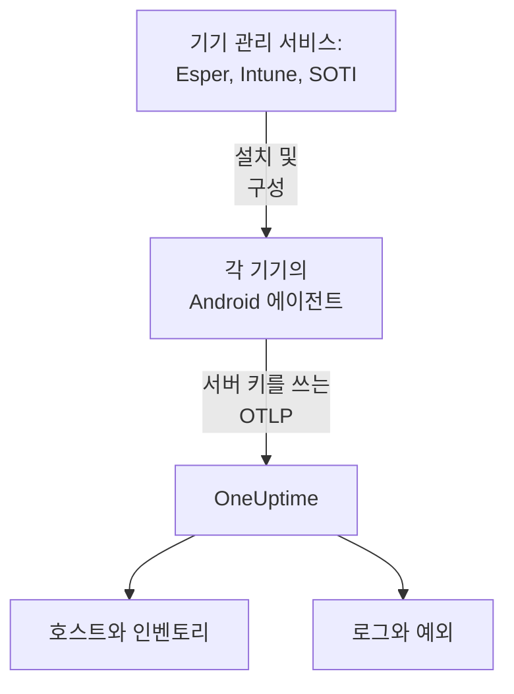

# Android 에이전트

OneUptime Android 에이전트는 주문용 키오스크, POS 단말기, 핸드헬드 단말기, 사이니지 플레이어처럼 조직이 소유한 Android 기기를 OneUptime에 보고합니다. 메모리, 저장 공간, 네트워크, 배터리, 온도, 재시작, 설치된 앱, 그리고 기기에서 실행되는 앱의 크래시와 로그를 보고합니다. 기기 관리 서비스가 전체 플릿에 한 번에 설치하고 구성합니다. 각 기기는 서버, Windows 머신과 나란히 **호스트**에는 호스트로, **인벤토리**에는 항목 하나로 나타납니다.

:::cards
- [사용 시점](#에이전트-또는-앱-계측): 에이전트는 기기를 보고, 앱 계측은 앱을 봅니다.
- [Esper로 배포하기](#esper로-배포하기): APK를 업로드하고, 설정을 배포하고, 한 번 실행합니다.
- [설정](#설정): 관리형 구성의 모든 키.
- [다른 앱의 로그 읽기](#다른-앱의-로그-읽기): adb나 기기 관리 서비스로 READ_LOGS를 한 번 부여합니다.
- [로그 세션](#로그-세션): 기기 앞에 있는 사람이 허용한, 일정 시간 동안의 모든 앱 로그.
:::

## 작동 방식

에이전트는 포그라운드 서비스로 실행되는 작은 앱입니다. 1분마다 기기의 상태를 읽고, 기기의 재시작, 설치된 앱, 로그와 함께 **서버** 수집 키로 OTLP를 통해 OneUptime에 보냅니다. 기기가 부팅되면 스스로 시작하고, 네트워크가 끊긴 동안에는 수집한 데이터를 기기에 보관했다가 네트워크가 돌아오면 보냅니다. 절전 상태인 기기를 깨워 두는 일은 없으며, 보내는 데이터는 압축합니다.



## 에이전트 또는 앱 계측

| | 앱에 넣은 [OpenTelemetry Android](/docs/rum/android-setup) | Android 에이전트 |
| --- | --- | --- |
| 보는 대상 | 앱: 크래시, ANR, 화면, 세션, 요청, 워크플로 | 기기: 메모리, 저장 공간, 네트워크, 배터리, 재시작, 설치된 앱, 모든 앱의 크래시와 ANR |
| 나타나는 곳 | **실제 사용자 모니터링**, **트레이스**, **예외** | **호스트**, **인벤토리**, **로그**, **예외** |
| 설치 방법 | 앱 코드에 넣습니다 | 기기 관리 서비스를 통해 앱으로 설치합니다 |

직접 소유한 기기에서는 둘 다 쓰고, 양쪽에서 기기에 같은 이름을 지정하세요. 에이전트의 `device_name` 설정과 앱이 설정하는 `host.name`입니다. 그러면 기기는 **인벤토리**에서 항목 하나가 되고, 앱의 텔레메트리와 기기의 텔레메트리가 함께 모입니다.

## 시작하기 전에

- Android 7.0 이상을 실행하고, Android 관리형 구성을 지원하는 기기 관리 서비스로 관리되는 기기. Esper, Microsoft Intune, Workspace ONE, SOTI 및 그 밖의 Android Enterprise 기기 관리 서비스가 여기에 해당합니다. 기기가 한 대뿐이라면 adb로 충분합니다.
- **프로젝트 설정 → 텔레메트리 및 APM → 수집 키**에서 **수집 키 생성**으로 만든 **서버** 수집 키.
- 에이전트: 모든 [OneUptime 릴리스](https://github.com/OneUptime/oneuptime/releases/latest)에 첨부된 `oneuptime-android-agent.apk`.
- 기기에서 OneUptime URL로 나가는 HTTPS. 모든 요청에 수집 키가 담기므로, 에이전트는 `https://`가 아닌 URL을 거부합니다.

## Esper로 배포하기

:::steps
### APK 업로드하기

Esper 콘솔에서 `oneuptime-android-agent.apk`를 **App Library**에 업로드하고, 모니터링할 기기의 블루프린트(blueprint)에 추가합니다.

### 설정 배포하기

블루프린트에서 에이전트의 **Managed Configuration**을 열고 설정을 붙여 넣습니다. Esper Agent 8.00.0764 이상이면 Esper가 각 기기에서 자리 표시자를 채웁니다.

```json title="Managed configuration"
{
  "oneuptime_url": "https://oneuptime.com",
  "oneuptime_token": "YOUR_TELEMETRY_INGESTION_TOKEN",
  "device_name": "${esper.deviceName}",
  "device_serial": "${esper.serialNumber}",
  "device_type": "kiosk",
  "labels": "region=emea"
}
```

OneUptime을 직접 호스팅한다면 `oneuptime_url`에 자신의 URL을 넣으세요. 그런 다음 기기에 Converge를 실행해 새 설정을 읽게 하세요.

### 한 번 실행하기

Android는 새로 설치된 앱을 한 번 열기 전까지는 부팅할 때 시작하지 않습니다. 블루프린트의 Multi-App mode에서 에이전트의 **Launch on Start**를 켜거나, 각 기기에서 에이전트를 한 번 여세요. 그 뒤로는 기기가 부팅될 때마다, 그리고 업데이트될 때마다 스스로 시작합니다.

### OneUptime에서 기기 찾기

1분 안에 각 기기가 `device_name`의 이름으로 **호스트**와 **인벤토리**에 나타납니다. 기기에 표시되는 에이전트 자체의 화면에서 보고 중인지, 보고하지 못한다면 무엇이 막고 있는지 알 수 있습니다.
:::

다른 기기 관리 서비스도 같은 방식으로 작동합니다. APK를 기간 업무(LOB) 앱이나 사내 앱으로 추가하고, 앱 구성에 같은 키를 설정한 다음, 각 기기에서 한 번 여세요.

## 설정

에이전트는 관리형 구성에서 다음 키를 읽습니다. 관리형 구성이 없는 기기는 대신 에이전트 자체의 화면에서 URL, 수집 키, 기기 이름을 입력해 설정할 수 있습니다. 그곳에 입력한 키는 Android Keystore로 암호화되어 저장됩니다.

| 키 | 설정하는 내용 | 기본값 |
| --- | --- | --- |
| `oneuptime_url` | OneUptime URL | `https://oneuptime.com` |
| `oneuptime_token` | **서버** 수집 키 | 없음. 키가 없으면 에이전트는 아무것도 보내지 않습니다 |
| `device_name` | **호스트**와 **인벤토리**에서 쓰는 기기 이름으로, 그곳에서 기기를 식별하는 값입니다 | 기기 모델과 Android ID의 앞부분 |
| `device_serial` | 일련 번호. Android 10부터 Android는 앱에 일련 번호를 제공하지 않습니다 | 없음 |
| `device_type` | 키오스크, POS 단말기, 핸드헬드 단말기 같은 기기의 종류 | `Android device` |
| `device_location` | 매장 번호 같은 기기의 위치 | 없음 |
| `labels` | 호스트의 레이블. 쉼표로 구분한 `name=value` 쌍으로 지정합니다 | 없음 |
| `collection_interval_seconds` | 보고 주기. 30초에서 600초 사이 | `60` |
| `logcat_enabled` | Logcat에서 읽은 내용을 보낼지 여부 | `true` |
| `logcat_min_level` | Android 12 이하에서 보내는 Logcat 줄의 최소 수준: `verbose`, `debug`, `info`, `warn`, `error`, `fatal` 중 하나 | `warn` |
| `installed_apps_enabled` | 설치된 앱을 보낼지 여부 | `true` |

기기 관리 서비스가 채우지 않은 자리 표시자(예: 그대로 전송된 `${esper.deviceName}`)는 무시되며, 에이전트 화면에 그 사실이 표시됩니다. 기기가 보고를 시작한 뒤에는 `device_name`을 바꾸지 마세요. 이름이 바뀌면 새 호스트가 됩니다.

에이전트의 화면과 알림, 그리고 기기 관리 서비스가 이 키들에 표시하는 제목과 설명은 OneUptime 대시보드가 지원하는 모든 언어로, 기기의 언어에 맞춰 표시됩니다.

## 다른 앱의 로그 읽기

Android에서 앱이 다른 앱의 로그를 읽으려면 READ_LOGS 권한이 필요하며, 이 권한은 adb만 부여할 수 있습니다. 앱 자신도, 기기 정책도 부여할 수 없습니다. 각 기기에서 한 번 부여하면 재시작과 업데이트를 거쳐도 계속 부여된 상태로 남습니다.

```bash
adb shell pm grant com.oneuptime.androidagent android.permission.READ_LOGS
```

Esper에서는 이 명령을 **Secure Remote ADB**로 실행합니다. 기기의 ADB 액세스를 켜고, `espercli secureadb connect -d DEVICE_ID`로 연결한 다음, 명령을 실행하세요. 권한이 부여되면 Android가 에이전트를 재시작하고, 에이전트는 곧바로 읽기 시작합니다.

그 뒤 에이전트가 읽는 내용은 Android 버전에 따라 다릅니다.

- Android 13 이상: 모든 앱의 크래시와 ANR. Android는 다른 앱의 로그 줄을 화면에 떠 있는 앱에만, 그것도 기기 앞에 있는 사람이 허용한 뒤에만 보여 주므로, 백그라운드에서 실행되는 에이전트는 이를 읽을 수 없습니다. 일정 시간 동안 이를 받으려면 [로그 세션](#로그-세션)을 요청하세요.
- Android 12 이하: 모든 앱의 크래시와 ANR, 그리고 `logcat_min_level` 이상인 모든 앱의 로그 줄.

READ_LOGS가 없어도 에이전트는 나머지를 모두 보고하며, 권한을 부여하는 방법이 에이전트 화면과 기기의 로그에 표시됩니다.

### 크래시 스택 추적 및 재부팅 이유

Android는 모든 앱 크래시, 네이티브 크래시, ANR의 전체 보고서와 재부팅마다의 이유를 DropBox에 보관합니다. 에이전트는 READ_LOGS와 사용 정보 접근 권한이 있고, Android 15 이상에서는 READ_DROPBOX_DATA도 있으면 모든 앱에 대해 이를 읽습니다. READ_LOGS처럼 adb로 한 번 부여하세요.

```bash
adb shell pm grant com.oneuptime.androidagent android.permission.READ_DROPBOX_DATA
adb shell appops set com.oneuptime.androidagent GET_USAGE_STATS allow
```

첫 번째 명령은 Android 15 이상용입니다. 사용 정보 접근은 기기의 **설정 → 사용 정보 접근**에서도 켤 수 있습니다. 기기 정책으로는 이 권한들을 부여할 수 없으며, 아직 실행해야 할 명령은 에이전트 화면에 나열됩니다. 이 권한들이 있으면 **예외**의 각 크래시에는 전체 스택 추적이, 네이티브 크래시에는 시그널과 크래시가 난 라이브러리가, ANR에는 메인 스레드의 스택이, **로그**의 재시작에는 Android가 밝힌 그 이유가 담깁니다. 에이전트가 읽은 내용에 있는 카드 번호, 이메일 주소, 토큰, 비밀번호는 보내기 전에 `[card number]`, `[email]`, `[token]`, `[redacted]`로 바뀝니다.

### CPU 사용량

Android 8 이상은 기기의 CPU 사용량을 앱에 공개하지 않습니다. 기기 소유자 앱만 이를 읽을 수 있고, 그것도 하드웨어가 CPU 사용량을 보고하는 기기에서만 가능합니다. 에이전트는 기기 소유자일 때 이를 읽으며, 기기 소유자는 계정이 없고 다른 기기 소유자도 없는 기기에서 adb로 설정합니다.

```bash
adb shell dpm set-device-owner com.oneuptime.androidagent/.admin.AgentDeviceAdminReceiver
```

기기 관리 서비스가 이미 소유자인 기기에는 두 번째 소유자를 둘 수 없으므로 CPU 사용량을 읽을 수 없으며, 에이전트 화면에 그 사실이 표시됩니다. 이때 CPU 사용량은 호스트 목록에 표시되지 않고, 그 기기에는 **High CPU Utilization** 템플릿이 제공되지 않습니다.

## 로그 세션

로그 세션은 문제를 해결할 수 있도록 일정 시간 동안 기기에 있는 모든 앱의 로그를 보냅니다. Android 13 이상에서는 다른 앱의 로그 줄을 읽는 유일한 방법입니다. Android는 다른 앱의 로그 줄을 화면에 떠 있는 앱에만, 그것도 기기 앞에 있는 사람이 허용한 뒤에만 보여 주기 때문입니다.

:::steps
### 요청하기

**호스트**에서 기기를 연 다음 **로그**를 열고, **로그 세션**에서 **로그 세션 요청**을 클릭하세요. 기기가 로그를 보낼 시간을 15분에서 4시간 사이에서 고르고, 보낼 최저 수준을 **정보**, **디버그**, **상세** 중에서 고르세요.

### 기기에서 허용하기

1분 안에 기기에 누군가 로그를 요청했다는 알림이 그 사람의 이름과 함께 표시됩니다. 기기 앞에 있는 사람이 에이전트를 열고 **허용**을 탭합니다. Android 13 이상에서는 이어서 Android가 모든 기기 로그에 액세스하도록 허용할지 묻고, 이것도 허용합니다.

### 로그 줄 읽기

세션은 **수집 중**으로 표시되고, 모든 앱의 로그 줄이 기기의 로그로 들어옵니다. **로그 줄 표시**를 클릭하면 세션의 로그 줄만 따로 볼 수 있습니다. 세션은 시간이 다 되거나, 누군가 기기에서 중지하거나 OneUptime에서 취소하면 끝납니다.
:::

세션에는 READ_LOGS와 `logcat_enabled`가 필요하며, 없으면 **사용 불가**로 표시됩니다. 한 기기에서는 한 번에 세션 하나만 실행됩니다. 1시간 안에 아무도 허용하지 않은 요청은 만료되며, 실행 중에 기기가 다시 시작된 세션은 그때 끝납니다. Android의 권한은 에이전트 프로세스와 함께 끝나기 때문입니다. 세션을 요청하려면 호스트 편집 권한이 필요하며, 누가 언제 요청했는지는 호스트의 **감사 로그**에 남습니다.

## 보고하는 내용

| 항목 | OneUptime에서 나타나는 곳 |
| --- | --- |
| 메모리, 저장 공간, 네트워크, 가동 시간 | **호스트**의 기기 페이지. 서버의 수집기가 보내는 것과 같은 메트릭이므로 호스트 경고 템플릿이 그대로 작동합니다 |
| 배터리 충전량과 온도, 외부 전원 연결 여부 | 메트릭 `hw.battery.charge`, `hw.temperature`, `android.battery.plugged` |
| 발열 상태 | 메트릭 `android.thermal.status`, `android.thermal.headroom` |
| CPU 사용량 | 메트릭 `system.cpu.utilization`: Android 7에서, 그리고 에이전트가 [기기 소유자](#cpu-사용량)인 Android 8 이상에서 |
| 재시작 | **로그**(`@event.name:device.boot`로 검색): 기기가 켜져 있던 시간, 정상 종료 여부, 꺼져 있던 시간, 재부팅한 이유, 재시작 반복 |
| 설치된 앱 | **로그**(`@event.name:android.package.inventory`로 검색): 하루 한 번의 전체 목록과, 설치, 업데이트, 제거 하나하나 |
| 모든 앱의 크래시와 ANR | **예외**(처리되지 않은 예외로, 앱 이름으로, 에이전트가 [DropBox](#크래시-스택-추적-및-재부팅-이유)를 읽으면 스택과 함께) |
| 제조사, 모델, 일련 번호, OS 버전, 보안 패치 수준, 펌웨어 | **인벤토리**의 기기 항목 |

**호스트**에서 기기의 OS는 Android 마크와 함께 Android로 표시됩니다.

최근 1시간 동안의 부팅 횟수는 메트릭 `android.boot.recent_count`이며, 재시작을 반복하는 기기는 부팅할 때마다 경고 수준의 로그를 남깁니다. **호스트**에서 Android 기기에는 전용 경고 템플릿이 제공됩니다. Device Unplugged, Low Battery, Device Overheating, Restart Loop, Storage Nearly Full과 함께 Host Stopped Reporting, Host Restarted, High Memory Utilization이 제공되고, CPU 사용량을 보고하면 High CPU Utilization도 제공됩니다. 각 경고의 첫 디버그 명령은 adb 명령입니다. [호스트 모니터](/docs/monitor/host-monitor#android-기기)를 참고하세요.

## 문제 해결

:::details 기기가 호스트에 나타나지 않음
기기에서 에이전트를 여세요. 수집 키 없음, 쓸 수 없는 URL, 실패한 업로드와 그 이유처럼 무엇이 빠졌는지 화면에 표시됩니다. 설치한 뒤 에이전트를 한 번도 열지 않은 기기에서는 에이전트가 시작되지 않았습니다. 한 번 열거나 **Launch on Start**를 켜세요.
:::

:::details 에이전트에 OneUptime이 수집 키를 거부했다고 표시됨
켜져 있고 만료되지 않은 **서버** 키를 쓰세요. **브라우저** 키는 기기에서 거부됩니다.
:::

:::details 다른 앱의 로그가 없음
[다른 앱의 로그 읽기](#다른-앱의-로그-읽기)에서 설명한 대로 READ_LOGS를 부여하세요. Android 13 이상에서는 [로그 세션](#로그-세션)이 실행 중이 아니면 다른 앱의 크래시와 ANR만 읽습니다.
:::

:::details 로그 세션이 승인 대기 중에서 바뀌지 않음
기기에서 아직 아무도 허용하지 않았습니다. 누군가 기기에서 에이전트를 열고 **허용**을 탭해야 하며, Android 13 이상에서는 에이전트가 화면에 떠 있는 동안 Android의 확인 창에서도 허용해야 합니다. Android의 확인 창에서 거부된 세션은 **거부됨**으로 표시됩니다. 새 세션을 요청하세요.
:::

:::details 두 기기가 호스트 하나로 나타남
두 기기의 `device_name`이 같습니다. `${esper.deviceName}`이나 `${esper.serialNumber}`처럼 기기마다 다른 자리 표시자를 쓰세요.
:::

## 다음 단계

:::cards
- [Android 설정](/docs/rum/android-setup): OpenTelemetry Android로 자체 앱을 계측합니다.
- [호스트](/docs/telemetry/hosts): 호스트의 페이지, 측정값, 경고.
- [호스트 모니터](/docs/monitor/host-monitor): 기기가 보고를 멈추거나 저장 공간이 부족해지면 경고를 받습니다.
- [예외](/docs/telemetry/exceptions): 기기가 보고하는 크래시와 ANR을 분류합니다.
:::
