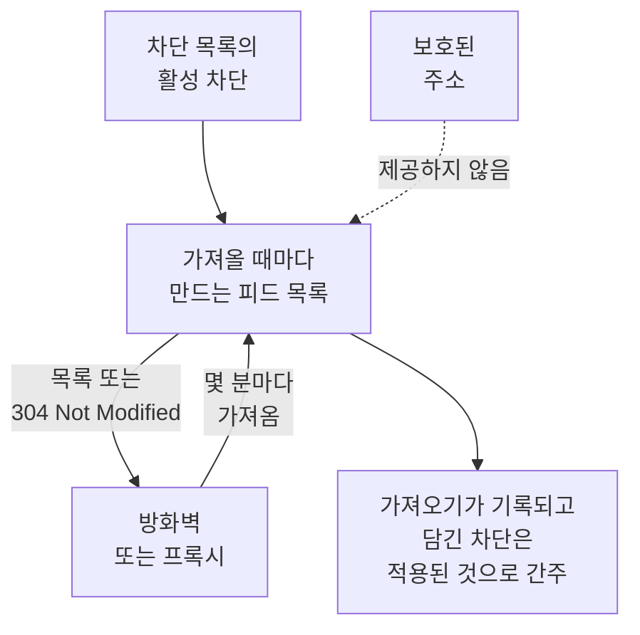

# 방화벽과 프록시를 위한 차단 목록 피드

차단 목록 피드는 방화벽이나 프록시가 몇 분마다 프로젝트의 [차단 목록](/docs/telemetry/security-cases#차단-목록)을 읽어 가는 비밀 URL입니다. Palo Alto Networks, FortiGate, Check Point, Cisco Secure Firewall, OPNsense, pfSense는 이를 외부 목록으로 읽고, OneUptime에서 복사한 명령은 nftables, ipset, nginx, HAProxy 또는 Windows 방화벽으로 이를 적용합니다. 방화벽이 OneUptime에 접속하므로, OneUptime은 여러분의 네트워크로 들어가는 경로나 방화벽 비밀번호가 필요하지 않습니다.

:::cards
- [피드 만들기](#피드-만들기): 방화벽을 고르고, 시크릿을 복사하고, 그 단계를 따릅니다.
- [방화벽 설정하기](#방화벽-설정하기): 방화벽과 프록시별 단계와 가져오기 주기.
- [차단이 적용되는 시점](#차단이-적용되는-시점): 방화벽이 그 차단이 담긴 목록을 가져간 뒤에만.
- [시크릿 교체 또는 취소](#시크릿-교체-또는-취소): 하루가 겹치는 새 시크릿, 또는 즉시 모든 시크릿 중지.
:::

## 작동 방식



가져올 때마다 그 순간 활성 상태인 차단으로 목록을 만듭니다. 만료되거나 해제된 차단은 다음 가져오기부터 빠지고, 보호된 주소는 차단된 뒤에 보호되었더라도 절대 목록에 들어가지 않습니다. 차단은 방화벽이 그 차단이 담긴 목록을 가져간 뒤에만 피드에서 적용된 것으로 간주됩니다.

## 시작하기 전에

- `https` URL에서 주소 목록을 읽을 수 있는 방화벽이나 프록시, 또는 root나 관리자로 명령을 실행할 수 있는 Linux 또는 Windows 호스트.
- 방화벽에서 HTTPS로 OneUptime에 나가는 경로: `https://oneuptime.com` 또는 직접 운영하는 OneUptime 서버의 주소.
- 피드를 만들 수 있는 역할: 프로젝트 소유자, 프로젝트 관리자, 보안 관리자. 보안 구성원과 보안 뷰어는 피드와 그 가져오기 기록을 읽을 수 있습니다. [역할](/docs/permissions/reference#역할)을 참고하세요.

## 피드 만들기

:::steps
### 차단 목록 피드 열기

**제품 → 보안 이벤트 → 플레이북 → 차단 목록 피드** 를 엽니다.

### 새 피드 만들기

**차단 목록 피드 만들기** 를 클릭하고 피드를 읽을 **방화벽** 을 고릅니다. **이름** 은 차단이 적용되는 곳에서 차단 목록이 이 피드를 부르는 이름이며, 비워 두면 “FortiGate feed”처럼 방화벽 이름을 따릅니다. **추가 필드** 아래의 **제공 대상** 에서 IPv4 및 IPv6, IPv4만, IPv6만 중 하나를 고르고, **허용된 소스 주소** 로 피드를 읽을 수 있는 대상을 제한합니다.

### 시크릿 복사하기

피드 페이지가 열리면서 시크릿이 한 번만 표시됩니다. OneUptime은 그 해시만 보관합니다. 시크릿을 복사한 다음 **완료** 를 클릭하세요. 페이지를 떠나기 전까지는 페이지의 단계에 시크릿이 채워져 있습니다.

### 방화벽 단계 따르기

**방화벽 설정** 에는 붙여 넣을 URL, 방화벽이 시크릿을 보내는 방법, 그리고 방화벽 콘솔에서 따를 단계가 채워진 채로 표시됩니다. 그곳에서 다른 방화벽을 고르면 그 방화벽의 단계가 표시됩니다. 방화벽이 처음 가져가면 피드의 상태가 **읽는 중** 이 되고, **가져오기 기록** 에 그 가져오기가 표시됩니다.
:::

## 피드가 제공하는 것

| 파일 | 대상 | 내용 |
| --- | --- | --- |
| `blocklist.txt` | Palo Alto Networks, pfSense, ipset, HAProxy, Windows 방화벽, 그 밖의 모든 방화벽 | 한 줄에 주소나 범위 하나. |
| `blocklist.txt?comments=1` | `#` 로 시작하는 줄을 건너뛰는 FortiGate, Check Point, Cisco Secure Firewall, OPNsense | 각 주소나 범위 앞에 차단 이유를 적은 줄. |
| `nftables.nft` | nftables | `inet oneuptime` 테이블의 `blocklist_v4` 와 `blocklist_v6` 세트를 비우고 다시 채우는 `nft -f` 용 파일. |
| `nginx.conf` | nginx | 주소나 범위마다 `deny` 한 줄. |
| 파일 이름 뒤에 `.md5` 를 붙인 것(예: `blocklist.txt.md5`) | Cisco Secure Firewall | 파일의 MD5. 방화벽은 목록이 바뀌었을 때만 내려받습니다. |

피드의 URL은 `https://oneuptime.com/api/blocklist-feed/<feed ID>/<file>` 이며, 피드 페이지에는 여러분의 방화벽에 맞게 채워진 URL이 표시됩니다. `?comments=1` 을 붙이면 목록은 다음과 같습니다.

```text
# OneUptime case CASE-42 until 2026-11-21 10:42 UTC
203.0.113.7
# OneUptime blocklist until lifted
198.51.100.0/24
```

피드는 작업이 **차단** 인 활성 차단을 제공합니다. 방화벽은 챌린지를 할 수 없으므로 챌린지는 절대 제공하지 않으며, IPv4만 또는 IPv6만 제공하는 피드는 다른 쪽 주소를 빼고 제공합니다. nftables는 한 세트에 겹치는 항목을 거부하므로, nftables 파일은 목록의 다른 범위에 이미 포함된 주소를 뺍니다.

차단된 것이 없으면 `blocklist.txt` 에는 주소 하나, `192.0.2.1` (IPv6만 제공하는 피드는 `2001:db8::1`)이 들어 있습니다. 이는 문서용으로 예약된 주소로, 인터넷에서 이 주소로부터 오는 트래픽은 없습니다. Palo Alto Networks와 Cisco는 빈 목록을 받으면 마지막으로 읽은 목록을 유지하므로, 빈 목록은 해제한 차단을 계속 막게 됩니다.

모든 응답에는 `ETag` 가 있습니다. 방화벽이 이를 `If-None-Match` 로 돌려보내면 목록이 바뀌지 않은 동안에는 `304 Not Modified` 를 받으며, OneUptime이 제공하는 명령도 그렇게 합니다.

## 방화벽이 시크릿을 보내는 방법

| 방법 | 방화벽이 보내는 것 | 사용하는 곳 |
| --- | --- | --- |
| 기본 인증 | `oneuptime` 같은 임의의 사용자 이름과, 비밀번호로 시크릿 | Palo Alto Networks(HTTPS에서만), FortiGate, Check Point |
| Bearer 토큰 | `Authorization: Bearer <secret>` | nftables, ipset, nginx, HAProxy, Windows 방화벽용 명령 |
| URL에 포함된 시크릿 | `https://oneuptime.com/api/blocklist-feed/<feed ID>/<secret>/blocklist.txt` | 시크릿을 보내는 방법을 문서화하지 않은 Cisco Secure Firewall, OPNsense, pfSense |

시크릿이 없거나 틀린 요청은 `401 Unauthorized` 를 받습니다. 틀린 시크릿이 들어간 URL은 존재하지 않는 주소와 마찬가지로 `404 Not Found` 를 받습니다. OneUptime의 웹 서버는 피드 URL을 액세스 로그에 기록하지 않으므로, URL에 든 시크릿이 그곳에 남지 않습니다.

## 피드를 읽을 수 있는 대상 제한하기

**추가 필드** 아래의 **허용된 소스 주소** 에는 `203.0.113.7` 이나 `198.51.100.0/24` 같은 주소와 범위를 한 줄에 하나씩, 최대 50개까지 넣을 수 있습니다. 그 밖의 주소에서 온 요청은 올바른 시크릿을 보내더라도 `403 Forbidden` 을 받습니다. 비워 두면 시크릿을 가진 모든 주소가 피드를 읽을 수 있습니다.

한 주소는 한 피드를 1분에 60번, 모든 피드를 합쳐 1분에 600번 가져올 수 있습니다. 이를 넘으면 `Retry-After` 헤더와 함께 `429 Too Many Requests` 를 받습니다.

## 차단이 적용되는 시점

차단은 그 차단이 만들어진 뒤 방화벽이 그 차단이 담긴 목록을 가져가면 피드에서 적용된 것으로 간주되며, 그런 가져오기마다 10분 동안 유지됩니다. `304 Not Modified` 응답은 같은 목록을 가져간 것으로 칩니다. 그러면 **차단 목록** 의 **적용 위치** 에 있는 피드 칩이 녹색이 되고, 툴팁에 방화벽이 차단 생성 후 얼마 만에 가져갔는지가 표시됩니다. 예: “방화벽이 이 차단을 생성 3분 후 FortiGate feed에서 가져왔습니다. 마지막으로 가져온 시각: 2분 전.”

10분 동안 가져오기가 없으면 칩은 방화벽이 그 이후로 피드를 가져오지 않았다고 표시합니다. 방화벽은 여전히 그 주소를 막고 있을 수 있지만 OneUptime은 이를 알 수 없습니다. 그러니 방화벽이 5분마다 또는 더 자주 피드를 가져오도록 하세요. OPNsense처럼 덜 자주 가져오는 방화벽도 가져오기 사이에 계속 차단하며, OneUptime은 가져온 뒤 10분 동안만 그곳에서 차단이 적용된 것으로 표시합니다.

만료되거나 해제된 차단은 다음 가져오기부터 빠지며, 그 칩은 방화벽이 그 차단이 빠진 목록을 가져가기를 기다립니다. OneUptime이 어떤 주소가 보호되는지 읽을 수 없으면, 보호된 주소가 들어 있을지 모르는 목록 대신 `Retry-After: 60` 과 함께 `503 Service Unavailable` 로 응답하며, 방화벽은 가지고 있던 목록을 유지합니다.

## 방화벽이 읽기를 중단하면

OneUptime은 각 피드를 얼마나 자주 가져가는지 학습합니다. 피드를 평소 간격의 세 배 동안, 그리고 최소 10분 동안 가져가지 않으면 피드의 상태가 **읽기 중단됨** 이 되고, **차단 목록** 이 목록 위에 그 피드를 표시하며, 프로젝트 소유자에게 이메일이 한 번 갑니다: “Your firewall stopped reading the blocklist feed _피드 이름_”. 방화벽이 피드를 두 번 가져가기 전까지 OneUptime은 5분마다, OPNsense는 1시간마다, pfSense는 하루마다 가져오기를 기대합니다.

다음 가져오기가 있으면 표시가 사라지고, 나중에 다시 중단되면 이메일이 다시 갑니다. 시크릿이 취소된 피드는 중단된 것으로 보지 않습니다.

## 시크릿 교체 또는 취소

피드 페이지의 **시크릿 교체** 는 새 시크릿을 만들고 한 번만 표시합니다. 대체된 시크릿은 24시간 동안 계속 작동하므로 그동안 모든 방화벽에 새 시크릿을 설정할 수 있습니다. **가져오기 기록** 은 이전 시크릿을 보낸 가져오기를 **이전 시크릿** 으로 표시합니다. 그 24시간 안에 다시 교체하면 가장 오래된 시크릿은 즉시 작동을 멈춥니다.

**시크릿 취소** 는 시크릿과 그 이전 시크릿을 즉시 중지합니다. 시크릿이 유출되었을 때 사용하세요. 그 뒤로 피드는 누구에게도 응답하지 않으며, 방화벽은 **시크릿 교체** 로 새 시크릿을 만들 때까지 가지고 있던 목록을 새로 고치지 못한 채 유지합니다. 피드를 삭제하면 피드와 시크릿, 가져오기 기록이 모두 사라집니다.

## 방화벽 설정하기

피드 페이지는 고른 방화벽에 맞춰 이 단계를 보여 주며, URL과 사용자 이름, 그리고 시크릿을 만든 직후에는 시크릿까지 채워 줍니다.

| 방화벽 | 파일 | 시크릿 | 가져오기 주기 | 최대 용량 |
| --- | --- | --- | --- | --- |
| Palo Alto Networks | `blocklist.txt` | 기본 인증 | 5분(제공하는 가장 짧은 주기) | 사용자 지정 목록 30개, 주소 합계 50,000개(PA-3200, PA-5200, PA-7000 시리즈는 150,000개) |
| FortiGate | `blocklist.txt?comments=1` | 기본 인증 | 5분(1~43,200분, 기본값 5분) | 모든 위협 피드를 합쳐 주소 300,000개 |
| Check Point | `blocklist.txt?comments=1`, IPv4 | 기본 인증 | 5분(기본값 1시간) | 피드당 주소 50,000개 |
| Cisco Secure Firewall | `blocklist.txt?comments=1` 과 그 MD5 | URL에 포함 | 5분(기본값 2시간) | |
| OPNsense | `blocklist.txt?comments=1` | URL에 포함 | 1시간(제공하는 가장 짧은 주기) | |
| pfSense | `blocklist.txt` | URL에 포함 | 1일(제공하는 가장 짧은 주기) | |
| nftables, ipset, nginx, HAProxy, Windows 방화벽 | 각자의 파일 | Bearer 토큰 | 1분 | |

### Palo Alto Networks

1. 웹 인터페이스에서 **Objects → External Dynamic Lists** 로 이동해 **Add** 를 클릭합니다.
2. **Type** 을 **IP List** 로, **Source** 를 피드의 URL `https://oneuptime.com/api/blocklist-feed/<feed ID>/blocklist.txt` 로 설정합니다.
3. **Client Authentication** 을 켜고 **Username** 에 `oneuptime`, **Password** 에 피드의 시크릿을 입력합니다.
4. **Check for updates** 를 **Every Five Minutes** 로 설정하고 **OK** 를 클릭한 뒤 commit합니다.
5. **Policies → Security** 에서 이 목록을 **Source Address** 로, 작업을 **Deny** 로 하는 규칙을 추가하고 commit합니다.

Palo Alto Networks는 사용자 이름과 비밀번호를 HTTPS로만 보냅니다. 주석은 주소 뒤에 있을 때만 읽고 별도의 줄은 읽지 않으므로, 이 방화벽의 피드는 일반 목록입니다. [Configure the Firewall to Access an External Dynamic List](https://docs.paloaltonetworks.com/pan-os/11-1/pan-os-admin/policy/use-an-external-dynamic-list-in-policy/configure-the-firewall-to-access-an-external-dynamic-list)를 참고하세요.

### FortiGate

1. **Security Fabric → External Connectors** 로 이동해 **Create New** 를 클릭하고 **Threat Feeds** 아래의 **IP Address** 를 선택합니다.
2. **URL of external resource** 를 피드의 URL `https://oneuptime.com/api/blocklist-feed/<feed ID>/blocklist.txt?comments=1` 로 설정합니다.
3. **HTTP basic authentication** 을 켜고 **Username** 에 `oneuptime`, **Password** 에 피드의 시크릿을 입력합니다.
4. **Refresh Rate** 를 5분으로 설정하고 **OK** 를 클릭합니다.
5. **Policy & Objects → Firewall Policy** 에서 피드를 정책의 **Source** 로 사용하고 **Action** 을 **DENY** 로 설정합니다.

[Configuring a threat feed](https://docs.fortinet.com/document/fortigate/7.6.0/administration-guide/379433/configuring-a-threat-feed)를 참고하세요.

### Check Point

1. SmartConsole에서 **Object Explorer** 를 열고 **New → More → Network Object → Network Feed** 를 선택합니다.
2. **Feed URL** 을 피드의 URL `https://oneuptime.com/api/blocklist-feed/<feed ID>/blocklist.txt?comments=1` 로, **Format** 을 **Flat list** 로, **Data type** 을 **IP Address** 로 설정합니다.
3. **Advanced Settings** 아래 **Authentication** 에 **Username** `oneuptime` 과 비밀번호로 피드의 시크릿을 입력합니다.
4. **Check feed interval** 을 5분으로 설정하고 **Test Feed** 를 클릭한 다음 **OK** 를 클릭합니다.
5. 작업이 **Drop** 인 Access Control 규칙의 **Source** 로 피드를 사용하고 정책을 설치합니다.

Check Point의 네트워크 피드는 IPv4 주소를 기준으로 문서화되어 있으므로, Check Point용으로 만든 피드는 IPv4만 제공합니다. [Network Feed](https://sc1.checkpoint.com/documents/R82/WebAdminGuides/EN/CP_R82_SecurityManagement_AdminGuide/Content/Topics-SECMG/Network_Feed.htm)를 참고하세요.

### Cisco Secure Firewall

1. 관리 센터에서 **Objects → Security Intelligence** 를 선택하고 **Add Network Lists and Feeds** 를 클릭합니다.
2. **Type** 을 **Feed** 로, **Feed URL** 을 피드의 URL `https://oneuptime.com/api/blocklist-feed/<feed ID>/<secret>/blocklist.txt?comments=1` 로, **MD5 URL** 을 같은 URL의 `blocklist.txt` 뒤에 `.md5` 를 붙인 것으로 설정합니다.
3. **Update Frequency** 를 5분으로 설정하고 저장합니다.
4. 액세스 제어 정책에서 **Security Intelligence → Networks** 를 열고 피드를 **Block List** 에 추가한 다음 저장하고 배포합니다.

Cisco는 업데이트 주기가 30분 이하이면 MD5 URL이 필요하며, 관리 대상 장치는 30분마다 관리 센터에서 업데이트를 받으므로 차단은 피드를 가져온 뒤 최대 30분 안에 장치에 전달됩니다. [Creating Security Intelligence feeds](https://docs.manage.security.cisco.com/cdfmc/t_creating_security_intelligence_feeds.html)를 참고하세요.

### OPNsense

1. **Firewall → Aliases** 로 이동해 **URL Table (IPs)** 유형의 별칭을 추가합니다.
2. **Content** 를 피드의 URL `https://oneuptime.com/api/blocklist-feed/<feed ID>/<secret>/blocklist.txt?comments=1` 로, **Refresh Frequency** 를 0일 1시간으로 설정합니다.
3. 저장하고 **Apply** 를 누른 다음, **Firewall → Rules** 에서 **Source** 가 이 별칭인 트래픽을 차단하는 규칙을 추가합니다.

OPNsense는 URL 테이블을 최대 1시간에 한 번 가져오므로, OneUptime은 가져온 뒤 10분 동안만 그 차단을 확인합니다. 그 사이에도 OPNsense는 계속 차단합니다. [Aliases](https://docs.opnsense.org/manual/aliases.html)를 참고하세요.

### pfSense

1. **Firewall → Aliases** 로 이동해 **Add** 를 클릭하고 **URL Table (IPs)** 를 선택합니다.
2. 피드의 URL `https://oneuptime.com/api/blocklist-feed/<feed ID>/<secret>/blocklist.txt` 를 입력하고 1일마다 새로 고치도록 설정합니다.
3. **Save** 와 **Apply Changes** 를 누른 다음, **Firewall → Rules** 에서 이 별칭을 **Source** 로, 작업을 **Block** 으로 하는 규칙을 추가합니다.

> [!WARNING]
> pfSense는 URL 테이블을 최대 하루에 한 번 가져오므로, 진행 중인 공격을 차단하기에는 너무 느립니다. 몇 분마다 가져오는 방화벽과 함께 장기 차단용으로 사용하세요.

[Alias Types](https://docs.netgate.com/pfsense/en/latest/firewall/aliases-types.html)를 참고하세요.

### nftables

피드 페이지에 표시된 명령을 root로 한 번 실행하세요. 이 명령은 `blocklist_v4` 와 `blocklist_v6` 두 세트가 있는 `inet oneuptime` 테이블, 그 세트에 든 주소에서 오는 트래픽을 버리는 `input` 및 `forward` 체인의 규칙, 그리고 시크릿을 root만 읽을 수 있는 `/etc/oneuptime-blocklist` 에 보관하는 스크립트 `/usr/local/sbin/oneuptime-blocklist` 를 만듭니다.

```bash
# Run once, as root.
install -d -m 700 /etc/oneuptime-blocklist /var/lib/oneuptime-blocklist
printf 'Authorization: Bearer %s\n' 'YOUR_FEED_SECRET' > /etc/oneuptime-blocklist/auth
chmod 600 /etc/oneuptime-blocklist/auth
cat > /usr/local/sbin/oneuptime-blocklist <<'SCRIPT'
#!/bin/sh
# Loads the OneUptime blocklist into nftables when it changed.
set -eu
URL='https://oneuptime.com/api/blocklist-feed/<feed ID>/nftables.nft'
STATE=/var/lib/oneuptime-blocklist
if ! nft list table inet oneuptime >/dev/null 2>&1; then
  rm -f "$STATE/etag"
  nft -f - <<'NFT'
table inet oneuptime {
  set blocklist_v4 { type ipv4_addr; flags interval; auto-merge; }
  set blocklist_v6 { type ipv6_addr; flags interval; auto-merge; }
  chain input {
    type filter hook input priority filter; policy accept;
    ip saddr @blocklist_v4 drop
    ip6 saddr @blocklist_v6 drop
  }
  chain forward {
    type filter hook forward priority filter; policy accept;
    ip saddr @blocklist_v4 drop
    ip6 saddr @blocklist_v6 drop
  }
}
NFT
fi
TMP=$(mktemp)
trap 'rm -f "$TMP" "$TMP.h"' EXIT
ETAG=$(cat "$STATE/etag" 2>/dev/null || true)
CODE=$(curl --silent --show-error --max-time 60 --header @/etc/oneuptime-blocklist/auth \
  ${ETAG:+--header "If-None-Match: $ETAG"} \
  --dump-header "$TMP.h" --output "$TMP" --write-out '%{http_code}' "$URL")
[ "$CODE" = 304 ] && exit 0
[ "$CODE" = 200 ] || { echo "oneuptime-blocklist: the feed answered $CODE" >&2; exit 1; }
nft -f "$TMP"
sed -n 's/^[Ee][Tt][Aa][Gg]:[[:space:]]*//p' "$TMP.h" | tr -d '\r' > "$STATE/etag"
SCRIPT
chmod 700 /usr/local/sbin/oneuptime-blocklist
echo '* * * * * root flock -n /run/oneuptime-blocklist.lock /usr/local/sbin/oneuptime-blocklist' > /etc/cron.d/oneuptime-blocklist
/usr/local/sbin/oneuptime-blocklist
```

스크립트는 `/etc/cron.d/oneuptime-blocklist` 에서 매분 실행됩니다. 목록이 바뀌었을 때만 하나의 트랜잭션으로 `nftables.nft` 를 로드하므로, 세트가 반쯤 채워진 상태가 되는 일은 없습니다. [Sets](https://wiki.nftables.org/wiki-nftables/index.php/Sets)를 참고하세요.

### ipset과 iptables

피드 페이지에 표시된 명령을 root로 한 번 실행하세요. 이 명령은 `oneuptime_v4` 와 `oneuptime_v6` 두 세트, 그리고 그 세트에 든 주소에서 오는 트래픽을 버리는 iptables 및 ip6tables의 `raw` 테이블 `PREROUTING` 체인 규칙을 만듭니다.

스크립트는 cron에서 매분 실행됩니다. 목록이 바뀌면 새 세트 두 개를 채운 뒤 교체하므로, 규칙이 반쯤 채워진 세트를 보는 일은 없습니다. [ipset](https://ipset.netfilter.org/ipset.man.html)을 참고하세요.

### nginx

보호할 각 사이트의 `server` 블록에 include 줄을 추가한 다음, 피드 페이지에 표시된 명령을 root로 한 번 실행하세요.

```nginx
server {
    include /etc/nginx/oneuptime-blocklist.conf;
}
```

```bash
# Run once, as root.
install -d -m 700 /etc/oneuptime-blocklist /var/lib/oneuptime-blocklist
printf 'Authorization: Bearer %s\n' 'YOUR_FEED_SECRET' > /etc/oneuptime-blocklist/auth
chmod 600 /etc/oneuptime-blocklist/auth
touch /etc/nginx/oneuptime-blocklist.conf
cat > /usr/local/sbin/oneuptime-blocklist <<'SCRIPT'
#!/bin/sh
# Writes the OneUptime blocklist for nginx when it changed, and reloads nginx.
set -eu
URL='https://oneuptime.com/api/blocklist-feed/<feed ID>/nginx.conf'
STATE=/var/lib/oneuptime-blocklist
TMP=$(mktemp)
trap 'rm -f "$TMP" "$TMP.h"' EXIT
ETAG=$(cat "$STATE/etag" 2>/dev/null || true)
CODE=$(curl --silent --show-error --max-time 60 --header @/etc/oneuptime-blocklist/auth \
  ${ETAG:+--header "If-None-Match: $ETAG"} \
  --dump-header "$TMP.h" --output "$TMP" --write-out '%{http_code}' "$URL")
[ "$CODE" = 304 ] && exit 0
[ "$CODE" = 200 ] || { echo "oneuptime-blocklist: the feed answered $CODE" >&2; exit 1; }
cp /etc/nginx/oneuptime-blocklist.conf "$STATE/last.conf"
cp "$TMP" /etc/nginx/oneuptime-blocklist.conf
if nginx -t -q; then nginx -s reload; else cp "$STATE/last.conf" /etc/nginx/oneuptime-blocklist.conf; exit 1; fi
sed -n 's/^[Ee][Tt][Aa][Gg]:[[:space:]]*//p' "$TMP.h" | tr -d '\r' > "$STATE/etag"
SCRIPT
chmod 700 /usr/local/sbin/oneuptime-blocklist
echo '* * * * * root flock -n /run/oneuptime-blocklist.lock /usr/local/sbin/oneuptime-blocklist' > /etc/cron.d/oneuptime-blocklist
/usr/local/sbin/oneuptime-blocklist

# Then add this line to the server block of the site to protect, and reload nginx:
#   include /etc/nginx/oneuptime-blocklist.conf;
```

스크립트는 cron에서 매분 실행됩니다. 목록이 바뀌면 `/etc/nginx/oneuptime-blocklist.conf` 를 쓰고, `nginx -t` 로 설정을 검사한 뒤 nginx를 다시 로드하며, 검사에 실패하면 이전 파일로 되돌립니다.

로드 밸런서나 CDN 뒤에서는 realip 모듈을 설정하지 않으면 nginx가 방문자가 아닌 로드 밸런서의 주소를 봅니다. `set_real_ip_from` 을 로드 밸런서의 주소로, `real_ip_header` 를 로드 밸런서가 보내는 헤더로 설정하거나, 로드 밸런서에서 차단하세요. [ngx_http_access_module](https://nginx.org/en/docs/http/ngx_http_access_module.html)을 참고하세요.

### HAProxy

root로 목록 파일을 만들고 `haproxy.cfg` 에 두 줄을 추가한 다음, HAProxy를 한 번 다시 로드하세요. Runtime API는 HAProxy가 이미 읽고 있는 목록만 업데이트합니다.

```text
global
    stats socket /run/haproxy/admin.sock mode 660 level admin

frontend www
    http-request deny if { src -n -f /etc/haproxy/oneuptime-blocklist.lst }
```

그런 다음 피드 페이지에 표시된 나머지 명령을 실행하세요. 스크립트는 cron에서 매분 실행되며, 목록이 바뀌면 `/etc/haproxy/oneuptime-blocklist.lst` 를 쓰고 Runtime API를 통해 다시 로드 없이 HAProxy를 업데이트합니다. [The Runtime API](https://docs.haproxy.org/3.4/management.html#9.3)를 참고하세요.

### Windows 방화벽

관리자 권한 PowerShell에서 피드 페이지에 표시된 명령을 한 번 실행하세요. 이 명령은 스크립트와 시크릿을 SYSTEM과 Administrators만 읽을 수 있는 `C:\ProgramData\OneUptime\Blocklist` 에 저장하고, 스크립트를 SYSTEM으로 매분 실행하는 예약 작업 “OneUptime Blocklist”를 등록합니다.

스크립트는 목록의 모든 주소를 차단하는 인바운드 규칙을 규칙당 1,000개씩 유지합니다: “OneUptime blocklist 0”, “OneUptime blocklist 1” 등. [Set-NetFirewallRule](https://learn.microsoft.com/en-us/powershell/module/netsecurity/set-netfirewallrule)을 참고하세요.

### 기타 방화벽

1. 방화벽이나 프록시가 피드의 URL `https://oneuptime.com/api/blocklist-feed/<feed ID>/blocklist.txt` 를 가리키도록 설정합니다. 한 줄에 주소나 범위가 하나씩 있습니다.
2. 피드의 시크릿을 임의의 사용자 이름과 함께 기본 인증의 비밀번호로 보내거나 Bearer 토큰으로 보냅니다.
3. 목록을 5분마다 또는 더 자주 가져오도록 설정합니다. 차단은 가져올 때마다 10분 동안 그곳에서 적용된 것으로 간주됩니다.

### Kubernetes

클러스터 앞단의 엣지나 클라우드 WAF를 **보안 연결** 또는 **클라우드 연결** 에서 차단 목록의 적용 대상으로 연결해 차단하거나, 클러스터 앞에 직접 운영하는 프록시에서 nginx 또는 HAProxy 명령으로 차단하세요. 커뮤니티 Ingress NGINX 컨트롤러는 지원이 종료되었고 그 저장소는 2026년 3월에 보관 처리되었으므로, OneUptime은 그 어노테이션을 문서화하지 않습니다. [Ingress NGINX Retirement](https://kubernetes.io/blog/2025/11/11/ingress-nginx-retirement/)를 참고하세요.

## 제한

| 항목 | 제한 |
| --- | --- |
| 피드의 항목 수 | 20,000개 |
| 허용된 소스 주소 | 주소와 범위 50개 |
| 한 주소에서 한 피드를 가져오는 횟수 | 1분에 60번 |
| 한 주소에서 모든 피드를 가져오는 횟수 | 1분에 600번 |
| 대체된 시크릿이 계속 작동하는 기간 | 24시간 |
| 가져온 뒤 차단이 적용된 것으로 간주되는 기간 | 10분 |
| 가져오기 기록 보관 기간 | 30일 |

## 문제 해결

:::details 방화벽이 401 Unauthorized를 받습니다
방화벽이 보내는 시크릿이 피드의 시크릿이 아닙니다. 비밀번호나 Bearer 토큰에 앞뒤로 다른 문자 없이 시크릿 전체가 들어 있는지 확인하세요. 24시간보다 전에 대체된 시크릿은 더 이상 작동하지 않습니다. **시크릿 교체** 로 새 시크릿을 만드세요.
:::

:::details 방화벽이 404 Not Found를 받습니다
URL이 존재하지 않는 피드나 피드가 제공하지 않는 파일을 가리키거나, URL에 틀린 시크릿이 들어 있습니다. 피드 페이지에서 URL을 다시 복사하세요.
:::

:::details 방화벽이 403 Forbidden을 받습니다
피드의 **허용된 소스 주소** 에 방화벽이 가져갈 때 쓰는 주소가 없습니다. **가져오기 기록** 에 각 가져오기가 어느 주소에서 왔는지 표시됩니다.
:::

:::details 차단 칩이 방화벽이 피드를 가져가기를 기다린다고 표시합니다
차단이 만들어진 뒤로 피드를 가져간 방화벽이 없습니다. 피드 페이지의 **가져오기 기록** 을 확인하세요. 5분마다 가져가는 방화벽은 5분 안에 차단을 적용합니다.
:::

## 다음 단계

:::cards
- [보안 케이스와 플레이북](/docs/telemetry/security-cases): 케이스에서 직접, 또는 플레이북으로 주소를 차단합니다.
- [위협 인텔리전스](/docs/telemetry/threat-intelligence): 알려진 악성 주소를 OneUptime으로 가져옵니다.
- [보안 이벤트](/docs/telemetry/security-events): 차단할 만한 주소를 찾습니다.
:::
