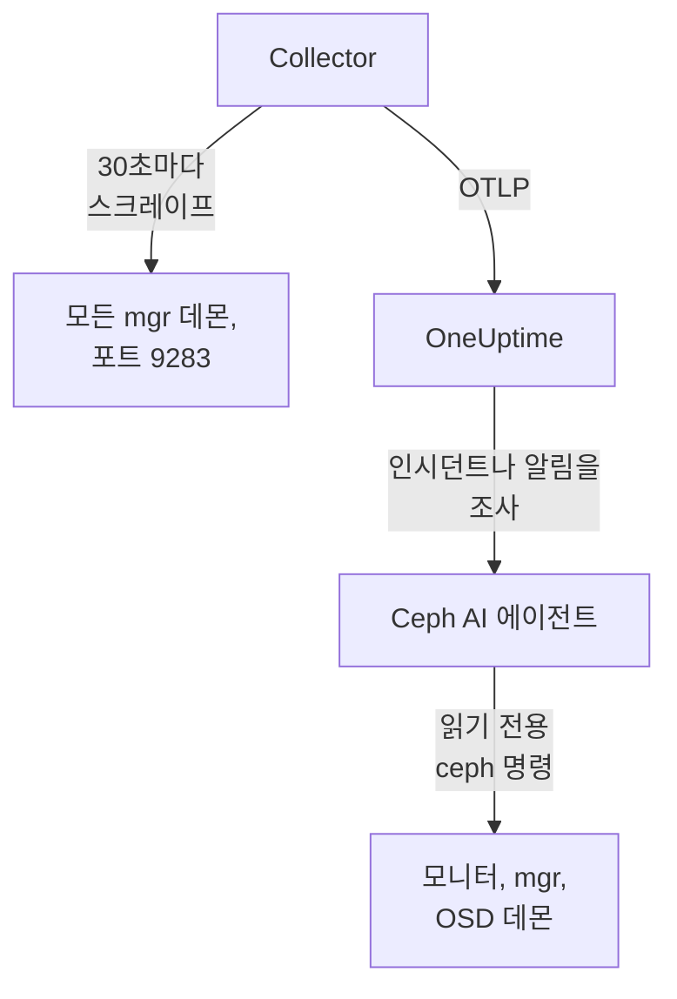

# Ceph 에이전트

OneUptime Ceph 에이전트는 Ceph 클러스터의 상태, 모니터 쿼럼, OSD, 풀, 배치 그룹을 모니터링합니다. 모든 mgr 데몬에서 Ceph mgr의 `prometheus` 모듈을 스크레이프하고, 모든 메트릭에 클러스터 이름을 붙여 OneUptime으로 보냅니다. OneUptime에서는 클러스터가 OSD, 풀, 데몬과 함께 표시됩니다. 들어오는 데이터에 대해서는 [Ceph 모니터](/docs/monitor/ceph-monitor)가 알림을 보냅니다.

:::cards
- [에이전트 설치](#에이전트-설치): mgr 모듈을 켠 다음 설치 스크립트나 Docker Compose를 사용합니다.
- [에이전트가 수집하는 항목](#에이전트가-수집하는-것): Ceph 페이지, 메트릭, 알림 템플릿의 바탕이 되는 시리즈.
- [AI 에이전트](#ai-에이전트): OneUptime AI가 조사하는 동안 클러스터를 읽게 합니다.
- [문제 해결](#문제-해결): 진단 스크립트와 일반적인 문제.
:::

## 작동 방식

에이전트는 한 머신에서 Docker Compose로 실행하는 컨테이너 두 개입니다. OpenTelemetry Collector가 모든 mgr 데몬에서 mgr의 `prometheus` 모듈을 30초마다 스크레이프합니다. 메트릭으로 응답하는 것은 활성 mgr뿐이므로, 대기 mgr로 페일오버되어도 아무것도 바꾸지 않고 메트릭이 계속 들어옵니다. 옆에서 실행되는 Ceph AI 에이전트 덕분에 OneUptime AI는 인시던트나 알림을 조사하는 동안 읽기 전용 `ceph` 명령을 실행할 수 있습니다.



클러스터는 첫 데이터와 함께, 에이전트가 모든 메트릭에 `ceph.cluster.name`으로 붙이는 이름으로 스스로 등록됩니다.

## 시작하기 전에

- Docker Compose v2 플러그인이 있는 Docker Engine 20.10 이상. 포트 9283으로 Ceph mgr 데몬에 연결할 수 있는 머신에 있어야 합니다.
- `ceph` CLI가 관리자 권한으로 동작하는 Ceph 관리 노드의 셸.
- 수집 키. **프로젝트 설정 → 텔레메트리 및 APM → 수집 키**에서 만들고 값을 복사합니다.
- 그 머신에서 OneUptime URL로 나가는 HTTPS.

## 에이전트 설치

:::steps
### mgr prometheus 모듈 켜기

Ceph 관리 노드에서:

```bash
ceph mgr module enable prometheus
```

이제 모든 mgr 데몬이 포트 `9283`의 `/metrics`에서 Prometheus 메트릭을 제공합니다. 메트릭을 반환하는 것은 활성 mgr뿐입니다. 대기 mgr은 빈 응답을 보내거나, `mgr/prometheus/standby_behaviour`가 `error`로 설정되어 있으면 HTTP 오류를 보냅니다. 그래서 에이전트는 모든 mgr을 스크레이프합니다. 목록을 확인하세요:

```bash
ceph mgr stat                    # active mgr
ceph orch ps --daemon-type mgr   # all mgrs (cephadm clusters)
```

### 에이전트 설치 및 시작

:::tabs
@tab install.sh
에이전트를 실행할 머신에서 설치 스크립트를 내려받아 실행하세요:

```bash
curl -sSL https://raw.githubusercontent.com/OneUptime/oneuptime/master/agents/CephAgent/install.sh -o install.sh
bash install.sh
```

스크립트는 OneUptime URL, 수집 키, 클러스터 이름, mgr 엔드포인트, 그리고 [AI 에이전트](#ai-에이전트)가 수정을 적용해도 되는지를 묻습니다. `ceph`가 관리자 권한으로 동작하는 곳에서는 AI 에이전트 전용 Ceph 클라이언트를 만들어 주겠다고도 제안합니다. `/opt/oneuptime-ceph-agent`에 설치하고, `0600` 권한의 `.env` 파일을 쓰고, Docker Compose로 에이전트를 시작합니다. 스크립트를 다시 실행하면 다시 묻는 대신 그 `.env`의 내용을 모두 재사용하며, 이것이 [에이전트를 업그레이드](#에이전트-업그레이드)하는 방법입니다.
@tab Docker Compose
[CephAgent 디렉터리](https://github.com/OneUptime/oneuptime/tree/master/agents/CephAgent)에서 `docker-compose.yml`과 `otel-collector-config.yaml`을 새 폴더로 내려받으세요:

```bash
mkdir oneuptime-ceph-agent && cd oneuptime-ceph-agent
curl -fsSLO https://raw.githubusercontent.com/OneUptime/oneuptime/master/agents/CephAgent/docker-compose.yml
curl -fsSLO https://raw.githubusercontent.com/OneUptime/oneuptime/master/agents/CephAgent/otel-collector-config.yaml
```

그 옆에 `.env` 파일을 만드세요:

```bash title=".env"
ONEUPTIME_URL=YOUR_ONEUPTIME_URL
ONEUPTIME_TELEMETRY_INGESTION_KEY=YOUR_TELEMETRY_INGESTION_TOKEN
CEPH_CLUSTER_NAME=my-ceph-cluster
CEPH_MGR_ENDPOINTS=[ceph-mon-1:9283,ceph-mon-2:9283,ceph-mon-3:9283]
```

활성 mgr과 대기 mgr을 모두 포함해 모든 mgr 데몬을 쉼표로 구분하고 대괄호로 감싸 나열하세요. 대괄호가 있어야 Collector가 값을 스크레이프 대상 목록으로 읽습니다. 에이전트를 시작하세요:

```bash
docker compose up -d
```

AI 에이전트의 컨테이너도 시작되며, 전용 Ceph 클라이언트를 기다립니다. [AI 에이전트](#ai-에이전트)를 참고하세요.
:::

### 에이전트가 실행 중인지 확인

```bash
docker compose ps
docker logs -f oneuptime-ceph-agent
```

`docker compose ps`에는 Collector(`oneuptime-ceph-agent`)와 AI 에이전트(`oneuptime-ceph-ai-agent`)가 표시됩니다. Collector가 시작되면 로그에 다음 줄이 보여야 합니다:

```text
Everything is ready. Begin running and processing data.
```

### OneUptime에서 클러스터 찾기

**제품 → 인프라 → Ceph → 모든 클러스터**를 여세요. 1분 정도 지나면 클러스터가 `CEPH_CLUSTER_NAME` 이름으로 OSD, 풀, 데몬과 함께 나타납니다.
:::

## 환경 변수

설치 스크립트는 이 값들을 `/opt/oneuptime-ceph-agent/.env`에 씁니다. Docker Compose 설치는 `docker-compose.yml` 옆의 `.env`에서 읽습니다. 값을 바꾼 뒤에는 그 폴더에서 `docker compose up -d`를 실행하세요.

| 변수 | 필수 | 설명 |
| --- | --- | --- |
| `ONEUPTIME_URL` | 예 | OneUptime URL(예: `https://oneuptime.com` 또는 자체 호스팅 인스턴스). 인스턴스가 HTTP 전용이면 `http://`와 해당 포트를 사용하세요. |
| `ONEUPTIME_TELEMETRY_INGESTION_KEY` | 예 | **프로젝트 설정 → 텔레메트리 및 APM → 수집 키**의 수집 키. |
| `CEPH_CLUSTER_NAME` | 예 | OneUptime에서의 클러스터 이름으로, 모든 메트릭에 `ceph.cluster.name` 리소스 속성으로 붙습니다. 바꾸지 마세요. 나중에 바꾸면 별도의 클러스터가 등록됩니다. 기본값은 `ceph`입니다. |
| `CEPH_MGR_ENDPOINTS` | 예 | 모든 mgr 데몬을 대괄호로 감싼 쉼표 구분 `host:port` 목록으로 지정합니다. 예: `[ceph-mon-1:9283,ceph-mon-2:9283,ceph-mon-3:9283]`. 대괄호는 설치 스크립트가 붙여 줍니다. |

AI 에이전트 자체의 설정은 [AI 에이전트](#ai-에이전트)에 있습니다.

## 에이전트의 스크레이프 방식

- **모든 mgr을 30초마다.** mgr `prometheus` 모듈은 각 스크레이프 결과를 `mgr/prometheus/scrape_interval`(기본값 15초) 동안 캐시합니다. 그보다 자주 스크레이프하지 마세요. 캐시를 다시 읽을 뿐입니다.
- **`honor_labels: true`.** Ceph가 내보내는 레이블(`ceph_daemon`, `pool_id`, 데몬별 인스턴스 레이블)은 그대로 유지됩니다. 이 설정이 없으면 `instance` 레이블이 스크레이프 대상마다 다시 쓰이고 활성 mgr이 바뀔 때마다 달라져 모든 시리즈가 끊깁니다.

## 에이전트가 수집하는 것

에이전트는 mgr `prometheus` 모듈이 내보내는 모든 것을 보냅니다. OneUptime의 Ceph 페이지, 메트릭 카탈로그, 알림 템플릿은 다음 시리즈를 바탕으로 합니다:

| 범주 | 메트릭 |
| --- | --- |
| 클러스터 상태 | `ceph_health_status`(0 = OK, 1 = WARN, 2 = ERR), `ceph_health_detail`(활성 상태 점검마다 하나의 시리즈, `name`과 `severity` 레이블 포함, Quincy부터; 상태 점검 알림 템플릿과 개요의 **Active Health Checks**의 바탕), `ceph_healthcheck_slow_ops`, `ceph_daemon_health_metrics`(데몬별, `type`으로 구분), `ceph_mon_quorum_status`, `ceph_mon_metadata`, `ceph_cluster_total_bytes`, `ceph_cluster_total_used_bytes` |
| OSD | `ceph_osd_up`, `ceph_osd_in`, `ceph_osd_apply_latency_ms`, `ceph_osd_commit_latency_ms`, `ceph_osd_stat_bytes`, `ceph_osd_stat_bytes_used`, `ceph_osd_numpg`, `ceph_osd_metadata`, OSD별로 `ceph_daemon` 레이블(예: `osd.3`)로 구분 |
| 풀 | `ceph_pool_stored`, `ceph_pool_max_avail`, `ceph_pool_objects`, `ceph_pool_rd`, `ceph_pool_wr`, `ceph_pool_rd_bytes`, `ceph_pool_wr_bytes`, `ceph_pool_metadata`. 데이터 시리즈에는 `pool_id` 레이블만 있고, 풀 이름은 `ceph_pool_metadata`에 있습니다. |
| 배치 그룹 | `ceph_pg_total`, `ceph_pg_active`, `ceph_pg_clean`, `ceph_pg_degraded`, `ceph_pg_undersized`(모두 풀별, `pool_id`로 구분), `ceph_num_objects_degraded`, `ceph_num_objects_misplaced` |
| 데몬 | `ceph_mgr_metadata`, `ceph_mds_metadata`, `ceph_rgw_metadata`. 위의 모니터 및 OSD 메타데이터에 더해집니다. 각각 데몬 이름을 나타내고 `ceph_version` 레이블에 버전을 담습니다. **Daemons** 페이지에 목록이 표시됩니다. |

### 더 많은 스크레이프 대상

mgr 모듈은 클러스터의 상태와 용량을 다룹니다. 더 자세히 보려면 `scrape_configs` 아래에 작업을 더 추가하세요(`otel-collector-config.yaml`에서):

- **`ceph-exporter`(Reef 18.2 이상).** cephadm은 클러스터의 모든 호스트에서 `ceph-exporter` 데몬을 실행하며, 이 데몬은 포트 `9926`에서 데몬별 성능 카운터를 제공합니다. 호스트마다 대상을 하나씩 추가하세요.
- **`node_exporter`.** 각 Ceph 호스트의 CPU, 메모리, 디스크, 네트워크 메트릭을 위한 흔한 동반자로, 기본 포트는 `9100`입니다.

둘 다 함께 제공되는 `resource` 프로세서에서 `ceph.cluster.name` 리소스 속성을 받으므로, OneUptime의 같은 클러스터로 들어갑니다.

## 선택 사항 — Ceph 클러스터 로그 보내기

에이전트는 `/var/log/ceph/ceph.log`를 따라가며 OneUptime으로 보낼 수 있고, 그러면 클러스터의 **Cluster Log** 페이지가 채워집니다. 에이전트가 클러스터 로그가 있는 호스트(기본적으로 모니터 호스트)에서 실행되어야 하므로 기본값은 꺼짐입니다.

:::steps
### 리시버 켜기

`otel-collector-config.yaml`에서 `filelog` 리시버와 `logs` 파이프라인의 주석을 해제하세요.

### 로그 디렉터리 마운트

`docker-compose.yml`에서 디렉터리를 Collector에 마운트하는 볼륨의 주석을 해제하세요:

```yaml
- /var/log/ceph:/var/log/ceph:ro
```

### 에이전트 다시 시작

```bash
docker compose up -d
```
:::

줄은 기록되는 대로 전송됩니다. OneUptime은 표시할 때 `ceph.log` 형식(시간, 데몬, `INF`/`WRN`/`ERR` 수준, 메시지)을 읽고, `resource` 프로세서가 `ceph.cluster.name`을 붙이므로 로그가 이 클러스터로 들어갑니다.

## 프로젝트 레이블로 클러스터에 태그 붙이기

`oneuptime.label.`로 시작하는 리소스 속성은 클러스터의 프로젝트 레이블이 됩니다. `oneuptime.label.<dimension>=<value>`는 레이블 `<dimension>:<value>`입니다. `otel-collector-config.yaml`의 `resource` 프로세서에 `ceph.cluster.name`과 나란히 속성을 추가하세요:

```yaml
processors:
  resource:
    attributes:
      # ...existing attributes...
      - key: oneuptime.label.team
        value: storage
        action: upsert
      - key: oneuptime.label.env
        value: production
        action: upsert
```

Collector는 시작할 때만 구성을 읽습니다. `docker compose restart oneuptime-ceph-agent`를 실행하세요. 그러면 클러스터에 `team:storage`와 `env:production` 레이블이 표시됩니다. 레이블은 대소문자를 구분하지 않고 비교되므로 기존 `Production` 레이블은 중복되지 않고 재사용되며, 에이전트는 누군가 OneUptime에서 추가한 레이블을 절대 제거하지 않습니다.

## systemd 서비스로 실행

머신과 함께 에이전트를 시작하고 실패하면 다시 시작하려면 systemd 유닛을 설치하세요. 설치 스크립트가 에이전트를 두는 `/opt/oneuptime-ceph-agent`에 에이전트가 있다고 가정합니다:

```bash
sudo curl -fsSL https://raw.githubusercontent.com/OneUptime/oneuptime/master/agents/CephAgent/systemd/oneuptime-ceph-agent.service -o /etc/systemd/system/oneuptime-ceph-agent.service
sudo systemctl daemon-reload
sudo systemctl enable --now oneuptime-ceph-agent
```

## 에이전트 업그레이드

에이전트는 파일이 고정한 Collector 버전을 **에이전트 버전**으로 보고합니다. 그것이 이 OneUptime 릴리스가 고정한 버전보다 오래되었으면 클러스터의 **개요**에서 그 옆에 경고 표시가 나타납니다. 표시를 선택하면 이 명령들이 보입니다. 파일이 버전을 보고하기 전에 설치된 에이전트는 이 방법으로 업그레이드할 때까지 버전이 표시되지 않습니다.

Collector 이미지는 `docker-compose.yml`에 고정되어 있고 구성은 그 옆의 파일이므로, 가져오기만으로는 에이전트가 새 버전이 되지 않습니다. `install.sh`를 다시 실행하세요. 기존 `.env`의 모든 값을 재사용하고(아무것도 다시 묻지 않음), `docker-compose.yml`과 `otel-collector-config.yaml`을 새로 고치며(편집한 파일은 `<file>.bak.<timestamp>`로 보관), 이미지를 가져와 에이전트를 다시 만들므로 Collector가 새 구성을 읽습니다. AI 에이전트의 `ceph/` 폴더는 그대로 남습니다.

```bash
curl -sSL https://raw.githubusercontent.com/OneUptime/oneuptime/master/agents/CephAgent/install.sh -o install.sh
bash install.sh
```

대신 Docker Compose로 설치했나요? 에이전트의 폴더에서 두 파일을 다시 내려받고(파일에 가한 변경이 있으면 다시 적용), 이미지를 가져와 에이전트를 다시 만드세요:

```bash
curl -fsSLO https://raw.githubusercontent.com/OneUptime/oneuptime/master/agents/CephAgent/docker-compose.yml
curl -fsSLO https://raw.githubusercontent.com/OneUptime/oneuptime/master/agents/CephAgent/otel-collector-config.yaml
docker compose pull
docker compose up -d --force-recreate
```

## 에이전트 제거

```bash
cd /opt/oneuptime-ceph-agent
docker compose down
```

AI 에이전트의 Ceph 클라이언트를 만들었다면 관리 노드에서 `ceph auth del client.oneuptime-ai`로 제거하세요.

## AI 에이전트

에이전트의 `docker-compose.yml`은 **Ceph AI 에이전트**(`oneuptime-ceph-ai-agent`, 이미지 `oneuptime/resource-ai-agent:release`)도 실행합니다. OneUptime AI가 이 클러스터의 인시던트나 알림을 조사하는 동안 이를 통해 읽기 전용 `ceph` 명령(`ceph health detail`, `ceph osd tree`, `ceph pg dump_stuck`, `ceph crash ls`)을 실행하고, 허용한 경우에만 OSD를 다시 in으로 표시하거나 `noout`을 해제하는 등의 수정을 적용합니다. Collector와 마찬가지로 `CEPH_CLUSTER_NAME`이라는 이름의 클러스터로 등록되며, OneUptime에서 클러스터의 **AI → AI 에이전트** 페이지에 표시됩니다.

- **AI 조사는 기본적으로 켜져 있습니다.** 에이전트가 연결되면 OneUptime AI가 에이전트로 이 클러스터의 인시던트와 알림을 조사하며, 클러스터의 **개요**에 에이전트 상태가 표시됩니다. 중지하려면 에이전트가 실행되는 곳에서 `ONEUPTIME_AI_INVESTIGATION=false`를 설정하거나(AI 에이전트 페이지의 **AI가 할 수 있는 작업** 아래 **변경**에서 방법을 볼 수 있습니다) 에이전트를 빼세요.
- **전용 Ceph 클라이언트가 넘을 수 없는 한계입니다.** `client.oneuptime-ai`로 연결하며, 클러스터의 최소 `ceph.conf`와 그 클라이언트의 키링을 `docker-compose.yml` 옆의 `ceph/` 폴더에 둡니다(`/etc/ceph`에 읽기 전용으로 마운트). 읽기 caps만 있으면 실행하는 어떤 것도 클러스터를 바꿀 수 없습니다. 새로 설치할 때 `install.sh`가 클라이언트를 만들어 주겠다고 제안하며, 다시 실행할 때는 절대 만들지 않습니다. admin 키링은 절대 그 폴더에 두지 마세요.
- `ONEUPTIME_AI_ALLOW_WRITES=true`를 설정하고 클라이언트에 수정에 필요한 caps를 주지 않는 한 **읽기 전용**입니다(필요한 caps는 에이전트의 README에 있습니다). `ONEUPTIME_AI_WRITE_TARGETS`(예: `osd.*,cluster`)는 수정이 건드릴 수 있는 범위를 제한합니다. 같은 `.env`의 `ONEUPTIME_AI_FIXES`는 수정이 실행되는 방식을 정합니다. `ask-for-approval`(사람이 하나씩 승인), `automatic`, `bypass-approval` 중 하나이며, AI 에이전트 페이지에 읽기 전용으로 표시됩니다([에이전트가 설정하는 AI가 할 수 있는 작업](/docs/ai/infrastructure-ai-agents#what-ai-may-do-set-by-the-agent)).
- 모니터(TCP 3300과 6789), mgr 및 OSD 데몬(TCP 6800–7300)으로 나가는 연결을 맺고, UID 1000으로 capabilities 없이 실행되며, `auth`, `config-key`, `tell`이나 데이터를 삭제하는 어떤 것도 실행하지 않습니다. OneUptime AI를 사용하지 않는다면 `docker-compose.yml`에서 `oneuptime-ceph-ai-agent` 서비스를 삭제하세요.

클라이언트를 직접 만들려면 Ceph 관리 노드의 에이전트 폴더에서 다음을 실행하세요(에이전트의 머신이 다른 머신이라면 두 파일을 그 머신의 `ceph/` 폴더로 복사하세요):

```bash
mkdir -p ceph
ceph config generate-minimal-conf > ceph/ceph.conf
ceph auth get-or-create client.oneuptime-ai mon 'allow r' mgr 'allow r' osd 'allow r' -o ceph/ceph.client.oneuptime-ai.keyring
sudo chown 1000:1000 ceph/ceph.client.oneuptime-ai.keyring
sudo chmod 600 ceph/ceph.client.oneuptime-ai.keyring
docker compose up -d
```

실행할 수 있는 명령, 수정이 동작하는 방식, 문제 해결 방법: [Infrastructure AI Agents](/docs/ai/infrastructure-ai-agents#ceph-clusters).

## 문제 해결

:::details 먼저 진단 스크립트 실행
에이전트에는 전체 체인을 확인하는 스크립트 [`troubleshoot.sh`](https://github.com/OneUptime/oneuptime/blob/master/agents/CephAgent/troubleshoot.sh)가 함께 제공됩니다. 컨테이너 런타임, 구성한 모든 mgr 엔드포인트, 모든 메트릭에 붙은 클러스터 이름, 토큰 형식, Collector 자체 메트릭, 그리고 OneUptime이 수집 키를 받아들이는지를 확인합니다. `ceph_health_status`를 반환하는 엔드포인트가 없거나 하나만 구성되어 있으면 경고하는데, 메트릭을 제공하는 것은 활성 mgr뿐이기 때문입니다. 키 확인이 가장 중요합니다. OneUptime은 잘못된 키를 `401`로 거부하며(비활성화된 키나 브라우저 키는 `422`), Collector는 둘 다 영구적인 오류로 취급합니다. 배치를 버리고 `Exporting failed` 오류를 하나 기록할 뿐이므로, 컨테이너가 정상인 동안에는 놓치기 쉽습니다. 스크립트는 에이전트의 네트워크 안에서 `GET <url>/otlp/v1/validate`를 요청해 `200`(유효) 또는 `401`(무효)을 직접 받으며, 이전 서버에서는 `POST /fluentd/v1/logs`로 대체합니다.

```bash
curl -sSL https://raw.githubusercontent.com/OneUptime/oneuptime/master/agents/CephAgent/troubleshoot.sh -o troubleshoot.sh
bash troubleshoot.sh    # add -d <dir> if you installed outside /opt/oneuptime-ceph-agent
```

마지막에 가장 가능성 높은 원인을 알려 주는 판정을 출력합니다.
:::

:::details OneUptime에 클러스터가 나타나지 않음
1. Collector의 로그를 확인하세요: `docker logs oneuptime-ceph-agent`. 내보낼 때의 `401`은 수집 키가 잘못되었다는 뜻이고, 연결 거부는 `ONEUPTIME_URL`이 잘못되었다는 뜻입니다.
2. mgr이 메트릭을 제공하는지 확인하세요: `curl http://ACTIVE_MGR_HOST:9283/metrics | head`를 실행하면 `ceph_*` 줄이 출력되어야 합니다. 그렇지 않으면 `ceph mgr module enable prometheus`로 모듈을 켜세요.
3. `CEPH_MGR_ENDPOINTS`가 대괄호로 감싸져 있는지 확인하세요. 대괄호가 없으면 Collector는 쉼표로 구분된 목록 전체를 대상 하나로 읽는데, 그런 대상은 존재하지 않습니다.
:::

:::details 클러스터가 연결 끊김으로 표시됨
OneUptime이 15분 동안 클러스터에서 아무것도 받지 못하면 클러스터는 연결 끊김 상태가 됩니다. OneUptime은 5분마다 확인하며, OneUptime 자체가 데이터를 받지 못한 시간은 계산하지 않습니다. Collector가 실행 중인지(`docker compose ps`), 로그에 내보내기 오류가 없는지, 머신이 여전히 OneUptime URL에 연결되는지 확인하세요. 다음 데이터가 들어오면 클러스터는 다시 연결됨 상태가 됩니다.
:::

:::details mgr 페일오버 후 메트릭이 멈춤
이전에 활성이던 mgr만 스크레이프하고 있을 가능성이 큽니다. `CEPH_MGR_ENDPOINTS`에 모든 mgr 데몬을 나열하세요. 대기 mgr을 스크레이프하는 비용은 거의 없으며, 대기 mgr은 빈 응답을 보냅니다.
:::

:::details Collector 로그에 대기 mgr의 스크레이프 오류가 나타남
클러스터에서 `mgr/prometheus/standby_behaviour`가 `error`로 설정되어 있으면 예상되는 일입니다. 이때 대기 mgr은 HTTP 500으로 응답합니다. 활성 mgr의 스크레이프는 여전히 성공하므로 이 오류는 잡음입니다. 없애려면 동작을 `default`로 되돌리세요.
:::

:::details 메트릭이 잘못된 클러스터에 들어감
OneUptime은 Ceph 클러스터를 `ceph.cluster.name`으로 등록하며, 에이전트는 이 값을 `CEPH_CLUSTER_NAME`에서 가져옵니다. 첫 데이터 이후에 바꾸면 첫 클러스터의 이름이 바뀌는 대신 두 번째 클러스터가 만들어집니다.
:::

## 다음 단계

:::cards
- [Ceph 모니터](/docs/monitor/ceph-monitor): 상태, OSD, 배치 그룹, 용량, 크래시, 느린 작업에 대해 알림을 보냅니다.
- [Proxmox 에이전트](/docs/telemetry/proxmox): Proxmox VE 아래에서 Ceph를 실행하나요? 클러스터도 모니터링하세요.
- [Infrastructure AI Agents](/docs/ai/infrastructure-ai-agents): Ceph AI 에이전트가 실행할 수 있는 명령과 수정이 동작하는 방식.
- [호스트 OpenTelemetry 수집기](/docs/telemetry/host-otel-collector): 각 Ceph 호스트를 운영체제 관점에서 봅니다.
:::
