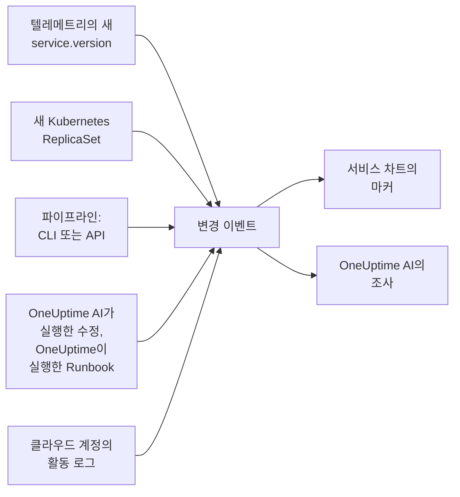

# 배포 및 변경 사항

OneUptime은 프로젝트에서 무엇이 바뀌었는지 기록합니다. 배포, Kubernetes 롤아웃, 구성 변경, 연결된 클라우드 계정의 변경, 그리고 OneUptime이 직접 실행한 수정입니다. 각 변경은 해당 서비스나 클라우드 리소스의 차트에 마커로 표시되고, OneUptime AI는 인시던트를 조사할 때 이 변경들을 읽습니다. 그래서 "10:02 배포 직후에 시작되었다"는 사실을 마지막이 아니라 가장 먼저 알게 됩니다.

:::cards
- [OneUptime이 자동으로 기록하는 것](#oneuptime이-자동으로-기록하는-것): 텔레메트리에서 알아낸 배포와 롤아웃, 클라우드 계정의 변경, 그리고 자체 수정.
- [파이프라인에서 배포 기록하기](#파이프라인에서-배포-기록하기): CLI, GitHub Actions, API.
- [OneUptime AI가 변경을 사용하는 방법](#oneuptime-ai가-변경을-사용하는-방법): 모든 조사의 의심 대상.
- [참조](#참조): 필드, 속성, 한도.
:::

## 작동 방식



## OneUptime이 자동으로 기록하는 것

이 변경들은 따로 아무것도 보내지 않아도 기록됩니다. OneUptime은 이미 받고 있는 텔레메트리와 자신이 직접 한 일에서 이를 기록합니다.

| 변경 | 기록되는 때 | 소스 |
| --- | --- | --- |
| 배포 | 서비스가 해당 환경에서 이전에 보고한 적 없는 `service.version`을 보고하기 시작할 때 | `service-version` |
| 롤아웃 | Kubernetes Deployment의 파드가 이전에 실행한 적 없는 ReplicaSet을 실행하기 시작할 때: 새 이미지, 바뀐 환경 변수나 구성 참조, 또는 재시작 | `kubernetes` |
| OneUptime AI가 실행한 수정 | AI 에이전트가 무언가를 바꾸는 명령(예: `kubectl rollout restart`)의 결과를 보고할 때 | `oneuptime-ai` |
| Runbook | OneUptime이 실행한 Runbook이 시작된 뒤 완료되거나, 실패하거나, 취소될 때 | `runbook` |
| 클라우드 변경 | 연결된 클라우드 계정의 활동 로그가 변경을 기록할 때: AWS CloudTrail, Azure 활동 로그 또는 Google Cloud의 Admin Activity 감사 로그 | `cloud` |
| 공급자 이벤트 | 클라우드 공급자가 계정에 대한 상태 이벤트를 게시할 때: AWS Health, Azure Service Health 또는 Resource Health, 또는 Google Cloud Service Health | `cloud-health` |

- **서비스가 처음 보고하는 버전은 배포가 아니라 기준선입니다.** 몇 달 동안 실행된 서비스가 OneUptime이 그 텔레메트리를 받기 시작한 순간에 배포되는 것은 아닙니다.
- **최근 30일 안에 보고된 적 있는 버전으로의 롤백은 기록되지 않습니다.** 그 버전은 새것이 아니기 때문입니다. OneUptime AI가 실행한 롤백은 수정으로 기록됩니다.
- **한 시간에 새 버전이나 ReplicaSet이 6개를 넘으면, 그 시간이 끝날 때까지 더는 기록되지 않습니다.** 그렇지 않으면 빌드 타임스탬프처럼 파드마다 바뀌는 "버전"이 파드마다 배포를 기록하게 됩니다.

배포는 `service.version`을 보고하는 서비스에 대해서만 기록됩니다. OpenTelemetry SDK나 수집기의 리소스 속성에서 환경, 커밋과 함께 설정하세요:

```bash
OTEL_RESOURCE_ATTRIBUTES="service.version=2.3.1,deployment.environment.name=production,vcs.ref.head.revision=$GIT_SHA"
```

롤아웃에는 [Kubernetes 에이전트](/docs/telemetry/kubernetes-agent)가 필요합니다. 에이전트는 각 파드의 텔레메트리에 해당 Deployment와 ReplicaSet을 표시합니다.

클라우드 변경과 공급자 이벤트에는 [연결된 클라우드 계정](/docs/telemetry/cloud-accounts)이 필요합니다. 각각은 OneUptime이 그 리소스를 나열하고 있으면 이름이 나온 클라우드 리소스에 연결되고, 그 리소스의 차트에 그려집니다. 유형은 작업에서 정해집니다. 작업 이름이 그렇게 말하면 `deployment`, `scaling` 또는 `rollback`, 그 밖에는 `config-change`, 상태 이벤트는 `provider-event`입니다. 어떤 리소스로도 필터링되지 않은 차트에는 클라우드 계정의 활동 로그가 나오지 않으므로, 바쁜 계정이 배포를 밀어내지 않습니다. 공급자의 상태 이벤트는 그대로 표시됩니다.

## 파이프라인에서 배포 기록하기

파이프라인은 배포나 그 밖의 모든 변경(구성 변경, 마이그레이션, 기능 플래그)을 일어나는 즉시 기록할 수 있습니다. 쓰기에는 프로젝트의 텔레메트리 수집 키를 사용합니다. 애플리케이션이 텔레메트리를 보낼 때 쓰는 것과 같은 종류의 키입니다. **프로젝트 설정 → 텔레메트리 및 APM → 수집 키** 에서 만드세요.

한 서비스에 고정된 키는 모든 변경을 그 서비스 아래에 기록합니다.

:::tabs
@tab CLI
```bash
oneuptime deploy \
  --service checkout \
  --service-version 2.3.1 \
  --commit "$GIT_SHA" \
  --environment production \
  --url https://oneuptime.com \
  --ingestion-key "$ONEUPTIME_TELEMETRY_INGESTION_KEY"
```
@tab GitHub Actions
```yaml title=".github/workflows/deploy.yml"
- name: Record the deploy in OneUptime
  env:
    ONEUPTIME_URL: https://oneuptime.com
    ONEUPTIME_TELEMETRY_INGESTION_KEY: ${{ secrets.ONEUPTIME_TELEMETRY_INGESTION_KEY }}
  run: |
    npx -y @oneuptime/cli deploy \
      --service checkout \
      --service-version "${{ github.ref_name }}" \
      --commit "${{ github.sha }}" \
      --repository "${{ github.server_url }}/${{ github.repository }}" \
      --environment production
```
@tab API
```bash
curl -X POST https://oneuptime.com/telemetry/change-events/v1/ingest \
  -H "Content-Type: application/json" \
  -H "x-oneuptime-token: $ONEUPTIME_TELEMETRY_INGESTION_KEY" \
  -d '{"events": [{"serviceName": "checkout", "version": "2.3.1", "commit": "1a2b3c4", "environment": "production"}]}'
```
:::

자체 호스팅 OneUptime에서는 `https://oneuptime.com` 대신 자신의 주소를 사용하세요. API는 저장한 이벤트 수와 건너뛴 이벤트 수로 응답합니다:

```json
{ "ingested": 1, "skipped": 0 }
```

CLI의 모든 옵션은 [`oneuptime deploy`](/docs/cli/command-reference#oneuptime-deploy)를 참조하세요.

## OneUptime AI가 변경을 사용하는 방법

인시던트나 경고에 대한 모든 [AI 조사](/docs/ai/ai-sre)는 그 전 2시간 동안 기록된 변경과 그 후 10분 동안 기록된 변경에서 시작합니다. 후자는 롤아웃이 끝난 뒤에 배포를 기록하는 파이프라인을 위한 것입니다. 인시던트가 연결된 서비스, 클러스터, 호스트, 클라우드 리소스의 변경이 먼저 옵니다.

OneUptime은 서비스를 지정한 변경 중 최대 4개에 대해 변경 전후 30분 동안의 서비스 텔레메트리를 읽고, 변경 직후 서비스가 눈에 띄게 나빠졌으면 그 변경을 **의심 대상**으로 표시합니다:

| 신호 | 의심 대상이 되는 조건 |
| --- | --- |
| 실패한 스팬 | 오류율이 두 배 이상이 되고 한 퍼센트포인트 이상 올랐으며, 실패한 스팬이 10개 이상 |
| 지연 시간 | p99가 원래 값의 절반 이상만큼, 그리고 100 ms 이상 늘어남 |
| 예외 | 분당 개수가 세 배 이상이고 10개 이상 |
| 새 예외 | 변경으로 배포된 버전에서 변경 10분 전부터 30분 후 사이에 처음 나타난 예외 유형이 3번 이상 발생 |

OneUptime은 변경 제목에 적힌 내용이 아니라 이 수치로 어떤 변경이 의심 대상인지 판단합니다. 조사는 의심 대상을 먼저 확인하고, 그것이 인시던트의 원인인지, 그리고 롤백이 가장 빠르고 안전한 수정인지 알려 줍니다.

의심 대상이 [AI 수정](/docs/ai/ai-sre#수정-작동-방식)이 켜진 클러스터의 Kubernetes 롤아웃이라면, OneUptime AI는 OneUptime이 기록된 변경으로부터 만든 `kubectl rollout undo`로 먼저 그 롤아웃을 롤백합니다. 코드를 내보내는 배포는 커밋을 통해 롤백됩니다. 조사가 문제를 일으킨 커밋이나 풀 리퀘스트를 짚어 주므로, [수정 풀 리퀘스트](/docs/ai/ai-sre#자동-코드-수정)가 정확히 그것만 되돌릴 수 있습니다.

OneUptime은 누군가 호출되든 아니든 모든 배포를 스스로도 확인합니다. 배포 후 30분이 지나면 그 30분을 배포 전 30분과 같은 임계값으로 비교하고, 서비스가 나빠졌다면 [AI 인사이트](/docs/ai/ai-sre#인사이트-선제적-감지)가 그 서비스의 배포를 알려 줍니다.

OneUptime AI가 연 수정 풀 리퀘스트도 같은 방식으로 확인됩니다. 기록된 배포에 그 커밋이 포함되면 OneUptime은 그 배포에서 수정의 목적, 즉 예외, 수정이 빠르게 만든 작업, 인시던트나 알림 뒤의 모니터, 수정이 추가하는 텔레메트리를 지켜보고, 수정이 효과가 있었는지 알려 줍니다([자동 코드 수정](/docs/ai/ai-sre#자동-코드-수정) 참조). 배포된 수정은 서비스 자체의 텔레메트리가 그 버전을 보고할 때만 배포 버전으로 읽고, 그렇지 않으면 오래된 인스턴스가 멈춘 뒤인 배포 10분 후부터 읽습니다.

조사와 [AI에게 질문](/docs/ai/ask-ai)에서 `recent_changes`는 원하는 기간의 변경을 나열하고, `get_change_details`는 배포에 무엇이 담겼는지 보여 줍니다. 서비스의 이전 배포 이후의 커밋, 그 작성자, 풀 리퀘스트, 그리고 변경된 파일입니다. 이를 위해서는 변경에 커밋이 있어야 하고, 그 저장소가 코드에서 [GitHub App](/docs/ai/github-app)이나 GitLab, Forgejo, Gitea 연결로 연결되어 있어야 합니다([저장소 연결하기](/docs/ai/ai-agent#저장소-연결하기) 참조).

## 참조

### 필드

| 필드 | 설명 |
| --- | --- |
| `title` | 무엇이 바뀌었는지(예: `Deploy 2.3.1`). `version`을 보내는 배포는 생략할 수 있음 |
| `eventType` | 변경 종류: `deployment`(기본값), `config-change`, `scaling`, `rollback`, `feature-flag` 또는 직접 정한 종류 |
| `serviceName` | 변경이 속한 서비스. 없으면 프로젝트 전체의 변경 |
| `time` | 발생 시각. ISO 8601 또는 에포크 초나 밀리초. 기본값은 도착한 시각 |
| `description` | 변경의 세부 정보 |
| `version` | 배포된 버전 |
| `previousVersion` | 대체된 버전 |
| `commit` | 배포된 커밋(`commitSha` 또는 `sha`도 가능) |
| `repository` | 커밋의 저장소(`repositoryUrl`도 가능) |
| `branch` | 배포된 브랜치 |
| `pullRequest` | 배포된 풀 리퀘스트 |
| `environment` | 배포 대상 환경 |
| `attributes` | 최대 50개의 추가 속성. 텍스트, 숫자 또는 불리언 |

최상위 필드는 OpenTelemetry 이름의 속성으로 저장됩니다. `version`은 `service.version`, `commit`은 `vcs.ref.head.revision`, `repository`는 `vcs.repository.url.full`, `branch`는 `vcs.ref.head.name`, `pullRequest`는 `vcs.change.id`, `environment`는 `deployment.environment.name`입니다. 이 이름 중 하나로 보낸 속성은 해당 필드보다 우선합니다.

이름이 `oneuptime.`으로 시작하는 속성은 OneUptime 자체의 것이므로 파이프라인이 보낸 내용에서 제거됩니다. 파이프라인이 기록한 모든 변경은 `oneuptime.change.source`에 그 사실이 표시되며, 그 값은 `api`입니다.

클라우드 계정에서 읽은 변경은 OpenTelemetry 이름 `cloud.provider`, `cloud.account.id`, `cloud.region`, `cloud.resource_id`로 계정과 리소스를 나타내고, 작업은 `oneuptime.cloud.operation`, 실행한 사람은 `oneuptime.cloud.actor`, 실패 여부는 `oneuptime.change.status`, 클라우드 계정은 `oneuptime.cloud_account.id`에 담습니다.

### 한도

| 한도 | 값 |
| --- | --- |
| 요청 하나의 이벤트 | 100 |
| 제목 | 500자 |
| 설명 | 5,000자 |
| 속성 | 50 |
| 시간 | 366일보다 더 이전이거나 60분보다 더 이후인 시간은 이벤트가 도착한 시각으로 바뀝니다 |

## 다음 단계

:::cards
- [AI SRE](/docs/ai/ai-sre): 조사가 무엇을 읽는지, 찾은 문제를 어떻게 수정하는지.
- [명령 참조](/docs/cli/command-reference): CLI의 모든 명령.
- [OpenTelemetry](/docs/telemetry/open-telemetry): 서비스의 텔레메트리를 버전과 함께 보냅니다.
- [클라우드 계정 연결](/docs/telemetry/cloud-accounts): AWS, Azure, Google Cloud 계정의 변경과 상태 이벤트.
:::
