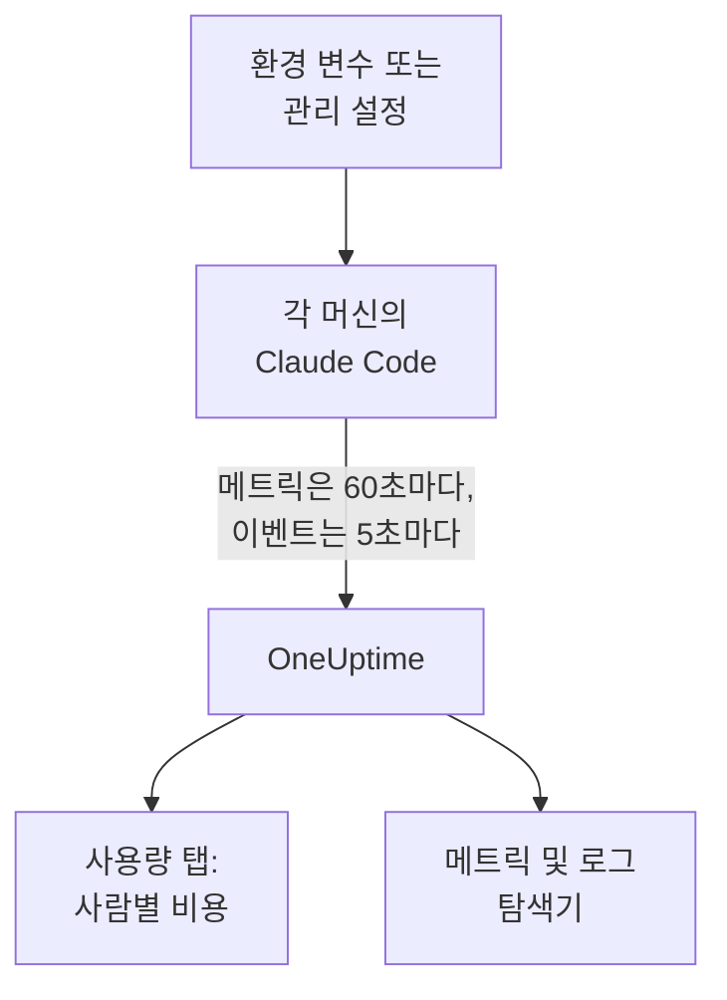

# Claude Code

Claude Code는 OpenTelemetry 메트릭과 이벤트를 직접 내보내 OneUptime으로 바로 보냅니다. 중간에 Collector도 게이트웨이도 필요 없습니다. 환경 변수 몇 개로, 또는 전체 머신이라면 관리 설정 파일 하나로 켜면 개발자별 비용, 토큰, 세션, 커밋, 수락된 편집을 볼 수 있습니다.

:::cards
- [머신 한 대 설정하기](#머신-한-대-설정하기): 환경 변수 여섯 개와 재시작.
- [전체 머신에 배포하기](#전체-머신에-배포하기): 모든 머신에 관리 설정 파일 하나.
- [지출을 사람에게 귀속하기](#사용량을-사람과-팀에-귀속하기): 누가 로그인했는지, 그리고 신원을 직접 설정해야 하는 경우.
- [문제 해결](#문제-해결): 아무것도 도착하지 않을 때 확인할 사항.
:::

## 작동 방식



Claude Code가 보내는 것:

- **비용과 토큰**: `claude_code.cost.usage`(USD)와 `claude_code.token.usage`. 모델별, 메인 에이전트 또는 서브에이전트별, 그리고 호출한 에이전트, 스킬, 플러그인, MCP 서버별로 보냅니다.
- **활동**: 세션, 커밋, 풀 리퀘스트, 추가 및 삭제된 코드 줄, 활성 시간.
- **편집 결정**: `claude_code.code_edit_tool.decision`은 수락 및 거부된 편집을 세므로, 수락률은 언어별, 도구별로 `accept / (accept + reject)`입니다.
- **이벤트**: 프롬프트, 도구 결과, API 요청과 오류, 권한 모드 변경, MCP 서버 연결을 OTLP 로그 레코드로 보냅니다.

개발자가 Claude 계정으로 로그인하면 모든 메트릭 데이터 포인트와 이벤트에 `user.email`이 붙으며, OneUptime은 비용과 토큰이 있는 메트릭에서 이를 직원으로 읽습니다.

## 시작하기 전에

1. **프로젝트 설정 → 텔레메트리 및 APM → 수집 키** 에서 텔레메트리 수집 키를 만듭니다.
2. OTLP 엔드포인트는 `https://oneuptime.com/otlp`이며, OneUptime을 직접 호스팅한다면 `https://YOUR-ONEUPTIME-HOST/otlp`입니다.
3. 전체 머신에 키 하나를 사용하세요. 키는 모든 개발자 머신에 놓이므로, 데이터 전송만 할 수 있는 공유 자격 증명으로 취급하고 다른 자격 증명처럼 교체하세요.

## 머신 한 대 설정하기

:::steps
### 변수 내보내기

셸 프로필(`.zshrc` 또는 `.bashrc`)에 추가하거나, Claude Code를 시작하는 터미널에서 내보냅니다.

```bash
export CLAUDE_CODE_ENABLE_TELEMETRY=1
export OTEL_METRICS_EXPORTER=otlp
export OTEL_LOGS_EXPORTER=otlp
export OTEL_EXPORTER_OTLP_PROTOCOL=http/protobuf
export OTEL_EXPORTER_OTLP_ENDPOINT="https://oneuptime.com/otlp"
export OTEL_EXPORTER_OTLP_HEADERS="x-oneuptime-token=YOUR_INGESTION_TOKEN"
```

| 변수 | 역할 |
| --- | --- |
| `CLAUDE_CODE_ENABLE_TELEMETRY` | 메인 스위치. 이것이 없으면 아무것도 내보내지 않습니다. |
| `OTEL_METRICS_EXPORTER`, `OTEL_LOGS_EXPORTER` | `otlp`는 OneUptime으로 보냅니다. `otlp,console`은 보내는 내용도 출력하므로 설정하는 동안 편리합니다. |
| `OTEL_EXPORTER_OTLP_PROTOCOL` | `http/protobuf`. `http/json`과 `grpc`도 작동합니다. |
| `OTEL_EXPORTER_OTLP_ENDPOINT` | 기본 URL. Claude Code가 `/v1/metrics`와 `/v1/logs`를 직접 덧붙입니다. |
| `OTEL_EXPORTER_OTLP_HEADERS` | 쉼표로 구분한 `key=value` 쌍. 여기서는 수집 키입니다. |

### Claude Code 재시작하기

변수는 Claude Code가 시작할 때 읽습니다. 메트릭은 60초마다, 이벤트는 5초마다 보내므로, 확인하기 전에 Claude Code를 1분 정도 사용하세요.

### 데이터가 도착하는지 확인하기

**메트릭** 을 열고 `claude_code.token.usage`를 찾은 다음, **제품 → AI / LLM** 을 열고 **사용량** 으로 이동합니다. 내 이메일 아래에 비용이 **GenAI 메트릭 기준** 으로 표시됩니다.
:::

메트릭과 이벤트를 서로 다른 곳으로 보내려면, 대신 `OTEL_EXPORTER_OTLP_METRICS_ENDPOINT`와 `OTEL_EXPORTER_OTLP_LOGS_ENDPOINT`를 전체 경로(`https://oneuptime.com/otlp/v1/metrics`, `https://oneuptime.com/otlp/v1/logs`)로 설정하세요.

## 전체 머신에 배포하기

조직에서는 같은 변수를 관리 설정 파일로 배포합니다. 형식은 `settings.json`과 같고, 변수는 `env` 블록에 넣습니다.

```json title="managed-settings.json"
{
  "env": {
    "CLAUDE_CODE_ENABLE_TELEMETRY": "1",
    "OTEL_METRICS_EXPORTER": "otlp",
    "OTEL_LOGS_EXPORTER": "otlp",
    "OTEL_EXPORTER_OTLP_PROTOCOL": "http/protobuf",
    "OTEL_EXPORTER_OTLP_ENDPOINT": "https://oneuptime.com/otlp",
    "OTEL_EXPORTER_OTLP_HEADERS": "x-oneuptime-token=YOUR_INGESTION_TOKEN",
    "OTEL_RESOURCE_ATTRIBUTES": "team.id=platform,cost_center=eng-123"
  }
}
```

:::steps
### Claude Code가 읽는 위치에 파일 두기

| 플랫폼 | 경로 |
| --- | --- |
| macOS | `/Library/Application Support/ClaudeCode/managed-settings.json` |
| Linux와 WSL | `/etc/claude-code/managed-settings.json` |
| Windows | `C:\Program Files\ClaudeCode\managed-settings.json` |

Claude Code는 더 이상 예전 Windows 경로 `C:\ProgramData\ClaudeCode\managed-settings.json`을 읽지 않습니다. 이미 관리 설정 파일을 배포하고 있다면, 대신 그 옆에 `managed-settings.d/10-telemetry.json` 같은 드롭인을 추가하세요. Claude Code는 먼저 `managed-settings.json`을 병합한 다음, `managed-settings.d/`의 모든 `*.json` 파일을 알파벳 순서로 병합합니다.

### 머신 한 대 확인하기

Claude Code에서 `/status`를 실행합니다. `Setting sources` 줄에 `Enterprise managed settings (file)`, 드롭인이라면 `(drop-ins)` 또는 `(file + drop-ins)`가 표시되어야 합니다. 괄호 안에 다른 소스가 보이면 우선순위가 더 높은 소스가 이겼고, 내 파일은 사용되지 않은 것입니다.

### 전체 머신이 들어오는지 지켜보기

**사용량** 탭에서는 새 설정으로 Claude Code를 사용한 개발자가 한 사람씩 행으로 나타납니다.
:::

같은 JSON은 claude.ai 관리 콘솔의 서버 관리 설정(시작할 때와 매시간 가져옴), `com.anthropic.claudecode` 도메인의 macOS 구성 프로필, 또는 Windows의 `HKLM\SOFTWARE\Policies\ClaudeCode` 아래 `Settings` 값으로도 배포할 수 있습니다.

:::details 어떤 관리 소스가 이기는지, 텔레메트리 변수는 어떻게 조합되는지
기본적으로 Claude Code는 정책 키를 하나라도 설정한 소스 중 우선순위가 가장 높은 소스를 사용하고, 나머지는 무시합니다. 순서는 서버 관리 설정, MDM 또는 OS 정책, 관리 설정 파일, 사용자별 `HKCU` 레지스트리 값입니다. 예외는 `env` 블록으로, 버전 2.1.223부터는 관리 소스 전체에 걸쳐 변수 단위로 병합됩니다.

텔레메트리 변수는 그렇지 않습니다. `OTEL_EXPORTER_OTLP_*` 변수, `OTEL_LOG_*` 콘텐츠 스위치, `OTEL_LOGS_EXPORTER`, 베타 트레이싱 변수는 이 중 하나라도 설정한 소스 중 우선순위가 가장 높은 소스에서 함께 가져오므로, 한 소스의 엔드포인트가 다른 소스의 자격 증명과 짝지어지는 일은 없습니다. 우선순위가 더 높은 소스가 이 중 하나라도 설정하면, 텔레메트리 드롭인은 아무 영향도 주지 않습니다.

서버 관리 설정에는 단계가 하나 더 필요합니다. 비어 있지 않은 `OTEL_EXPORTER_OTLP_ENDPOINT`는 각 개발자가 대화형 세션에서 보안 승인 대화 상자를 수락한 뒤에만 적용되며, 익스포터 설정의 변경은 다음 실행 때 반영됩니다. 파일과 MDM 정책에는 대화 상자가 없습니다.
:::

:::details 모든 머신을 편집하지 않고 수집 키 교체하기
고정 헤더 대신 설정에 `"otelHeadersHelper": "/path/to/generate-otel-headers.sh"`를 지정하세요. 스크립트는 `{"x-oneuptime-token":"..."}` 같은 헤더의 평면 JSON 객체를 출력합니다. Claude Code는 시작할 때 이를 실행하고, 이후 `CLAUDE_CODE_OTEL_HEADERS_HELPER_DEBOUNCE_MS`밀리초(기본값 `1740000`, 29분)마다 다시 실행합니다. 실패는 `/status`에 표시됩니다.
:::

## 사용량을 사람과 팀에 귀속하기

**직원은 `user.email`입니다.** 개발자가 Claude 계정으로 로그인하면 Claude Code가 이를 보내며, 끄는 변수는 없습니다. OneUptime은 설정 없이 모든 비용 및 토큰 데이터 포인트에서 이를 읽습니다.

**다른 로그인 방식은 이메일을 보내지 않습니다.** API 키를 쓰거나 Amazon Bedrock, Google Cloud, Microsoft Foundry의 Claude를 쓰면 세션에 Claude 계정이 없으므로, Claude Code는 `user.id`와 `session.id`만 보냅니다. 머신마다 관리 설정이나 실행 래퍼에서 신원을 직접 설정하세요.

```bash
export OTEL_RESOURCE_ATTRIBUTES="user.email=jdoe@example.com,team.id=platform"
```

**`user.id`는 사람이 아닙니다.** Claude Code가 처음 실행될 때 `~/.claude.json`에 쓰는 임의의 ID로, 설치마다 하나이며 파일을 지우면 새로 생깁니다. 이메일이 없으면 설치마다 별도의 행으로 표시됩니다. 예외가 하나 있습니다. Claude 앱 게이트웨이에 로그인한 세션은 로그인한 신원(`user.id`는 ID 공급자의 주체, `user.email`은 이메일)을 보내며, 직접 설정한 `user.*` 키는 무시합니다.

**팀과 비용 센터** 는 `OTEL_RESOURCE_ATTRIBUTES`에서 가져옵니다. OneUptime은 `team.id`, `team`, `cost_center`, `department`를 읽습니다. 값에는 공백을 쓸 수 없고 따옴표로도 감쌀 수 없으므로, `team=Platform_Engineering`처럼 쓰거나 `team=Platform%20Engineering`처럼 퍼센트 인코딩을 사용하세요. Claude Code는 이 키를 모든 데이터 포인트에 복사하며(`OTEL_METRICS_INCLUDE_RESOURCE_ATTRIBUTES`, 기본값 켜짐), OneUptime은 어느 쪽에서든 읽습니다. 직접 설정한 키가 Claude Code가 직접 설정하는 키를 덮어쓰지는 않습니다.

## OneUptime에 표시되는 것

**제품 → AI / LLM → 사용량** 에서 `claude_code.cost.usage`는 **직원** , **팀** , **모델** 표를, `claude_code.token.usage`는 토큰 합계를 채웁니다. 무엇이 보이는지는 두 가지 규칙으로 정해집니다.

- **메트릭은 스팬을 보충할 뿐, 스팬에 더해지지 않습니다.** 같은 프로젝트가 자체 앱에서 비용이 있는 GenAI 스팬을 받으면 Claude Code의 지출은 표시되지 않습니다. Claude Code는 전용 프로젝트로 보내세요. [스팬이 먼저, 메트릭은 보충](/docs/telemetry/ai-llm-observability#스팬이-먼저-메트릭은-보충)을 참조하세요.
- **메트릭에서 온 행은 비용만 가집니다.** 호출과 토큰 셀은 `—`를 표시하고, **공급자** 와 **애플리케이션 / 서비스** 표는 비어 있습니다. 메트릭은 공급자를 지목하지 않고, 어떤 OneUptime 서비스에도 속하지 않기 때문입니다.

개발자별 수락률, 코드 줄 수, 커밋, 풀 리퀘스트, `query_source`별 지출 같은 그 밖의 모든 것은 아래 메트릭으로 [대시보드](/docs/dashboards/index)에 차트를 그리고, [메트릭 모니터](/docs/monitor/metrics-monitor)로 알림을 설정합니다.

## 메트릭

모든 메트릭은 카운터이며, 자체 속성과 함께 표준 속성을 가집니다.

| 메트릭 | 단위 | 자체 속성 |
| --- | --- | --- |
| `claude_code.session.count` | 없음 | `start_type`: `fresh`, `resume`, `continue`, `agents_view` |
| `claude_code.lines_of_code.count` | 없음 | `type`: `added`, `removed`; `model` |
| `claude_code.commit.count` | 없음 | 없음 |
| `claude_code.pull_request.count` | 없음 | 없음 |
| `claude_code.cost.usage` | USD | `model`; `query_source`: `main`, `subagent`, `auxiliary`; `speed`: `fast`, `normal`; `effort`; `agent.name`, `skill.name`, `plugin.name`, `marketplace.name`, `mcp_server.name`, `mcp_tool.name` |
| `claude_code.token.usage` | 토큰 | `type`: `input`, `output`, `cacheRead`, `cacheCreation`; 그리고 `claude_code.cost.usage`와 같은 속성 |
| `claude_code.code_edit_tool.decision` | 없음 | `tool_name`: `Edit`, `Write`, `NotebookEdit`; `decision`: `accept`, `reject`; `source`; `language` |
| `claude_code.active_time.total` | 초 | `type`: `user`(키보드 앞), `cli`(도구와 모델 응답) |

표준 속성은 `session.id`, `app.version`, `app.entrypoint`, `organization.id`, `user.account_uuid`, `user.account_id`, `user.id`, `user.email`, `terminal.type`과 `OTEL_RESOURCE_ATTRIBUTES`입니다. 일부는 끌 수 있습니다. [메트릭 양 줄이기](#메트릭-양-줄이기)를 참조하세요.

- 캐시 토큰 종류는 카멜 표기법으로 `cacheRead`와 `cacheCreation`입니다. OneUptime의 토큰 합계는 `input`과 `output`만 셉니다.
- 비용과 토큰 메트릭에서 자체 에이전트와 MCP 서버, 서드파티 플러그인과 스킬의 이름은 `OTEL_LOG_TOOL_DETAILS=1`을 설정하지 않으면(Claude Code 2.1.273 이상) `custom` 또는 `third-party`로 표시됩니다.

## 이벤트

이벤트는 OTLP 로그 레코드로 들어오며, 각각 `event.name`, `event.timestamp`, `event.sequence`를 가집니다. 가장 많이 쓰게 될 이벤트는 다음과 같습니다.

| 이벤트 | 기록하는 내용 |
| --- | --- |
| `claude_code.user_prompt` | 프롬프트. 길이와 명령. 텍스트는 켠 경우에만 |
| `claude_code.api_request` | 모델 요청. `model`, `cost_usd`, `cost_usd_micros`, `duration_ms`, `input_tokens`, `output_tokens`, 캐시 토큰 |
| `claude_code.api_error` | 재시도 후에도 실패한 요청. `model`, `error`, `status_code`, `attempt` |
| `claude_code.tool_result` | 도구 실행. `tool_name`, `success`, `duration_ms`, 실행을 허용한 결정 |
| `claude_code.tool_decision` | 도구가 허용되었는지와 무엇이 결정했는지 |
| `claude_code.mcp_server_connection` | MCP 서버의 연결 또는 실패 |

Claude Code는 거부, 권한 모드 변경, 플러그인, 훅, 스킬 이벤트 등 훨씬 많은 이벤트를 보냅니다. 전체 목록은 Anthropic의 [모니터링 참조 문서](https://code.claude.com/docs/en/monitoring-usage)에 있습니다. `cost_usd_micros`에서 비용은 USD의 백만분의 일 단위 정수이므로, 반올림 오차 없이 합산됩니다.

## 메트릭 양 줄이기

Claude Code는 기본적으로 모든 데이터 포인트에 `session.id`를 붙이며, 세션마다 새 시계열이 생깁니다. 전체 머신에서는 이 속성 하나가 메트릭 양을 키우지만, 비용 보고에는 필요하지 않습니다.

```bash
export OTEL_METRICS_INCLUDE_SESSION_ID=false
```

| 변수 | 기본값 | 추가하는 것 |
| --- | --- | --- |
| `OTEL_METRICS_INCLUDE_SESSION_ID` | `true` | `session.id`. 세션마다 새 값 |
| `OTEL_METRICS_INCLUDE_VERSION` | `false` | `app.version` |
| `OTEL_METRICS_INCLUDE_ACCOUNT_UUID` | `true` | `user.account_uuid`와 `user.account_id` |
| `OTEL_METRICS_INCLUDE_ENTRYPOINT` | `false` | `app.entrypoint` |
| `OTEL_METRICS_INCLUDE_RESOURCE_ATTRIBUTES` | `true` | `OTEL_RESOURCE_ATTRIBUTES`의 키 |
| `OTEL_METRICS_INCLUDE_REPOSITORY` | `false` | 저장소의 `vcs.*` 속성 |

`user.email`, `user.id`, `organization.id`, `terminal.type`에는 스위치가 없습니다. 가장 많은 양을 보내는 신호는 이벤트로, 활동 중인 개발자마다 5초마다 보냅니다(`OTEL_LOGS_EXPORT_INTERVAL`, 밀리초 단위). 값을 키우면 더 큰 배치를 더 드물게 보냅니다. 비용과 사용량만 필요하다면, 그것은 모두 메트릭에 있으므로 `OTEL_LOGS_EXPORTER=none`을 설정하세요.

## 프롬프트와 도구 내용은 기본적으로 꺼져 있습니다

Claude Code는 각각을 켜지 않는 한 프롬프트, 답변, 도구 인수, 도구 출력을 내보내지 않습니다.

| 변수 | 기본값 | `1`로 켜지는 것 |
| --- | --- | --- |
| `OTEL_LOG_USER_PROMPTS` | 꺼짐 | 프롬프트 텍스트 |
| `OTEL_LOG_ASSISTANT_RESPONSES` | 꺼짐 | 답변 텍스트. 설정하지 않으면 `OTEL_LOG_USER_PROMPTS`를 따름 |
| `OTEL_LOG_TOOL_DETAILS` | 꺼짐 | 도구 매개변수, Bash 명령, 에이전트, 플러그인, 스킬, MCP 서버의 실제 이름 |
| `OTEL_LOG_TOOL_CONTENT` | 꺼짐 | 도구 입력과 출력. 트레이스 스팬에서만 |
| `OTEL_LOG_RAW_API_BODIES` | 꺼짐 | API 요청과 응답의 전체 본문(`file:<dir>`은 대신 디스크에 씀) |

꺼 두기를 권장합니다. 메트릭과 마스킹된 이벤트만으로도 누가 어떤 모델에 얼마를 썼고 수락률이 얼마인지 알 수 있습니다. 내용을 수집하면 프롬프트, 소스 코드, 도구 출력이 저장소와는 다른 접근 제어를 가진 텔레메트리 저장소로 옮겨집니다. 조사를 위해 켠다면 `CLAUDE_CODE_OTEL_CONTENT_MAX_LENGTH`(기본값 `61440`)로 레코드당 전송량을 제한할 수 있고, **트레이스 → 설정** 에 있는 트레이스의 **스크럽 규칙** 과 **드롭 필터** 로 저장 전에 마스킹하거나 버릴 수 있습니다.

## 메트릭은 델타로 들어옵니다

Claude Code는 기본적으로 델타 메트릭을 보냅니다. 각 데이터 포인트는 누적 합계가 아니라 마지막 내보내기 이후의 증가분입니다. 차트를 그리거나 알림을 설정할 때는 기간 동안의 데이터 포인트를 합산하고, 누적 카운터처럼 rate나 카운터 리셋 함수를 적용하지 마세요. 숫자가 틀어져도 이상해 보이지 않습니다.

```bash
export OTEL_EXPORTER_OTLP_METRICS_TEMPORALITY_PREFERENCE=cumulative
```

`cumulative`는 조직의 모든 익스포터가 사용할 때만 고정하고, 한 조직 안에서 두 가지를 섞지 마세요.

## 트레이스(베타)

Claude Code에는 각 상호 작용을 스팬 트리로 그리는 베타 트레이스 익스포터도 있습니다. `claude_code.interaction` 아래에 `claude_code.llm_request`와 `claude_code.tool`이 있습니다.

```bash
export CLAUDE_CODE_ENHANCED_TELEMETRY_BETA=1
export OTEL_TRACES_EXPORTER=otlp
```

> [!WARNING]
> 트레이스 베타는 지출을 파악하는 프로젝트에 넣지 마세요. 베타의 모델 스팬은 `gen_ai.system`과 `gen_ai.request.model`을 가지므로 OneUptime이 **호출** 에 표시하지만, 토큰이 `gen_ai.usage.*` 키가 아니라 `input_tokens`와 `output_tokens`에 있어서 토큰도 비용도 없이 들어옵니다. 이 스팬이 생기면 **직원** , **팀** , **모델** 표에는 메트릭의 지출 대신 이 스팬의 $0 행이 표시됩니다.

Agent SDK 세션과 비대화형 `-p` 세션에서 Claude Code는 들어오는 `TRACEPARENT`를 이어받으므로, 스팬이 호출한 쪽의 트레이스에 합류합니다. 대화형 세션은 이를 무시합니다. 모델에 `traceparent` 헤더를 보내는 것은 `ANTHROPIC_BASE_URL`이 설정되지 않았거나 Anthropic API일 때뿐입니다. 자체 프록시 뒤에서는 `CLAUDE_CODE_PROPAGATE_TRACEPARENT=1`을 설정하세요.

## 문제 해결

:::details 아무것도 도착하지 않음
먼저 `CLAUDE_CODE_ENABLE_TELEMETRY=1`을 확인하세요. 이것이 없으면 다른 변수는 아무 일도 하지 않습니다. 그런 다음 익스포터에 `console`을 추가하고(`OTEL_METRICS_EXPORTER=otlp,console`) 터미널을 지켜보세요. 데이터 포인트가 출력되면 Claude Code는 정상이고, 문제는 엔드포인트, 키, 또는 네트워크입니다.
:::

:::details 관리 설정 파일이 무시되는 것 같음
`/status`를 실행하고 `Setting sources` 줄을 읽으세요. 관리 소스가 없다면 파일 경로가 틀렸거나, 올바른 JSON이 아니거나, 개발자 계정이 읽을 수 없는 것입니다. 다른 소스가 보인다면 그 소스가 이겼고, 내 파일은 사용되지 않은 것입니다. 서버 관리 설정은 개발자가 대화형 세션에서 승인 대화 상자를 수락할 때까지도 기다립니다.
:::

:::details 지출이 미지정으로, 또는 설치마다 한 행으로 표시됨
그 개발자들은 Claude 계정으로 로그인하지 않았습니다. API 키, Amazon Bedrock, Google Cloud, Microsoft Foundry를 사용합니다. [사용량을 사람과 팀에 귀속하기](#사용량을-사람과-팀에-귀속하기)에 나온 대로 그들의 `OTEL_RESOURCE_ATTRIBUTES`에 `user.email`을 설정하세요.
:::

:::details 팀이나 비용 센터가 없음
`OTEL_RESOURCE_ATTRIBUTES`가 머신에 설정되어 있고, 공백이 없으며, Claude Code가 직접 설정하는 키를 재사용하지 않는지 확인하세요. Claude Code의 값이 우선합니다.
:::

:::details 숫자가 너무 작거나 너무 커 보임
Claude Code는 델타를 보냅니다. [메트릭은 델타로 들어옵니다](#메트릭은-델타로-들어옵니다)에서 설명한 대로 기간 동안의 데이터 포인트를 합산하세요. 그리고 메트릭은 60초마다 보내므로 1분을 꼬박 기다리세요.
:::

:::details 키가 거부됨
OneUptime은 잘못된 `x-oneuptime-token`을 거부합니다. **프로젝트 설정 → 텔레메트리 및 APM → 수집 키** 에서 키를 다시 복사하고, 헤더가 `=` 앞뒤에 공백 없이 `x-oneuptime-token=YOUR_INGESTION_TOKEN`인지 확인하세요.
:::

## 다음 단계

:::cards
- [AI 코딩 어시스턴트](/docs/telemetry/ai-coding-assistants): 모든 코딩 어시스턴트에서 지출이 귀속되는 방식.
- [AI / LLM 옵저버빌리티](/docs/telemetry/ai-llm-observability): 자체 AI 호출의 대화, 알림, 비용, 예산.
- [메트릭 모니터](/docs/monitor/metrics-monitor): 개발자별 지출이나 토큰에 알림을 설정합니다.
:::
