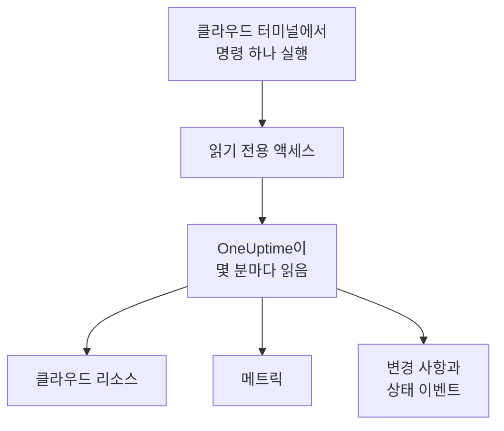

# 클라우드 계정 연결

대시보드에서 AWS 계정, Azure 구독 또는 Google Cloud 프로젝트를 연결하면 OneUptime이 그 안의 모든 리소스를 나열하고, 주요 메트릭을 읽고, 리소스에서 무엇이 바뀌었는지와 클라우드 공급자가 리소스 상태에 대해 무엇을 알리는지 기록합니다. 클라우드의 브라우저 터미널에서 명령 하나를 실행하고 출력 내용을 붙여 넣기만 하면 됩니다. 실행할 컬렉터도, 설치할 것도 없습니다.

:::cards
- [Amazon Web Services](#amazon-web-services): OneUptime이 로그인하는 IAM 역할 또는 액세스 키.
- [Microsoft Azure](#microsoft-azure): Monitoring Reader 역할이 있는 앱.
- [Google Cloud](#google-cloud): 읽기 전용 역할 네 개가 있는 서비스 계정.
- [OneUptime이 읽는 것](#oneuptime이-읽는-것): 리소스, 메트릭, 변경 사항, 상태 이벤트를 얼마나 자주 읽으며 비용이 얼마인지.
:::

## 작동 방식



- **액세스는 읽기만 할 수 있습니다.** 명령이 만드는 액세스는 리소스와 그 설정, 메트릭, 변경 사항, 공급자의 상태 이벤트만 읽고 그 외에는 아무것도 할 수 없습니다. AWS에서는 아래에 나열된 작업, Azure에서는 **Monitoring Reader** 역할, Google Cloud에서는 뷰어 역할 네 개입니다. 데이터나 비밀은 절대 읽지 않습니다. 삭제하면 OneUptime의 액세스가 끊깁니다.
- **OneUptime은 일정에 따라 읽습니다.** 연결할 때 다른 간격을 고르지 않으면 Azure와 Google Cloud는 5분마다, AWS는 10분마다 읽습니다. 각 읽기는 지난 읽기 이후 바뀐 내용도 기록하며, 30분마다 모든 리소스를 다시 나열합니다.
- **리소스마다 고유한 페이지가 있습니다.** 리소스는 **클라우드 → 모든 리소스**에 주요 메트릭, 소유자, 레이블과 함께 표시됩니다. 나열된 리소스의 페이지에는 **연결된 리소스**(실행되는 곳, 트래픽을 보내는 곳), 엔드포인트, 태그, 설정, 그리고 **인시던트**, **알림**, **변경 사항**도 표시됩니다.
- **계정마다 고유한 페이지가 있습니다.** 계정은 **클라우드 → 계정**에 유형과 리전별 리소스, **변경 사항**, 그리고 리소스가 어떻게 이어지는지 보여 주는 **토폴로지**와 함께 표시됩니다.
- **OneUptime AI가 바뀐 내용을 읽습니다.** 클라우드 리소스에 연결된 인시던트나 알림을 조사할 때는 먼저 그 리소스의 변경 사항을 읽고, 시작할 때 계정의 활동 로그를 다시 읽습니다.

## 시작하기 전에

- **프로젝트 소유자 또는 관리자.** 이들만 클라우드 계정을 연결, 테스트, 편집할 수 있습니다.
- **클라우드의 터미널** (AWS CloudShell, Azure Cloud Shell 또는 Google Cloud Shell). IAM 역할이나 사용자, 앱 등록 또는 서비스 계정을 만들 수 있는 사람으로 로그인되어 있어야 합니다.

## Amazon Web Services

:::steps
### AWS 양식 열기

**클라우드 → 연결**로 이동한 다음 **Amazon Web Services**를 선택합니다.

### AWS CloudShell에서 명령 실행

OneUptime이 로그인하는 방법을 선택합니다. 권장하는 방법은 **IAM 역할**입니다. 비밀 정보가 저장되지 않으며 역할은 언제든지 삭제할 수 있습니다. 양식에는 프로젝트에 맞게 작성된 명령이 표시됩니다. 이 명령은 프로젝트의 외부 ID로 OneUptime의 AWS 계정을 신뢰하는 역할을 만들고, 역할의 ARN을 출력합니다.

**읽을 대상**에서 이 계정 또는 AWS Organization의 모든 계정을 선택합니다. 조직용 명령은 조직의 관리 계정에서 실행합니다. 이 명령은 모든 계정에 같은 역할을 두는 StackSet을 추가하고(지금 있는 계정과 나중에 들어오는 계정 모두), 관리 계정의 역할이 계정을 나열할 수 있게 합니다. 연결 하나로 계정을 최대 50개까지 읽습니다.

역할을 사용할 수 없으면 **액세스 키**를 사용합니다. 액세스 키는 자기 계정만 읽습니다. 다음 명령은 같은 권한을 가진 사용자를 만들고 그 키를 출력합니다.

```bash
aws iam create-user --user-name OneUptimeReadOnly > /dev/null 2>&1 || true
aws iam put-user-policy --user-name OneUptimeReadOnly --policy-name OneUptimeReadOnly --policy-document '{"Version":"2012-10-17","Statement":[{"Effect":"Allow","Action":["cloudwatch:GetMetricData","cloudwatch:ListMetrics","tag:GetResources","iam:ListAccountAliases","cloudformation:ListResources","ec2:DescribeInstances","ec2:DescribeVolumes","ec2:DescribeVpcs","ec2:DescribeNatGateways","autoscaling:DescribeAutoScalingGroups","elasticloadbalancing:DescribeLoadBalancers","elasticloadbalancing:DescribeLoadBalancerAttributes","elasticloadbalancing:DescribeTargetGroups","elasticloadbalancing:DescribeTargetGroupAttributes","elasticloadbalancing:DescribeTargetHealth","elasticloadbalancing:DescribeTags","ecs:ListClusters","ecs:DescribeClusters","ecs:ListServices","ecs:DescribeServices","lambda:ListFunctions","rds:DescribeDBInstances","rds:DescribeDBClusters","elasticache:DescribeReplicationGroups","sqs:ListQueues","sqs:GetQueueAttributes","sns:ListTopics","sns:GetTopicAttributes","sns:ListSubscriptionsByTopic","dynamodb:ListTables","dynamodb:DescribeTable","kinesis:ListStreams","kinesis:DescribeStreamSummary","states:ListStateMachines","states:DescribeStateMachine","cloudfront:ListDistributions","elasticfilesystem:DescribeFileSystems","es:ListDomainNames","es:DescribeDomains","apprunner:ListServices","apprunner:DescribeService","cloudtrail:LookupEvents","health:DescribeEvents","health:DescribeEventDetails"],"Resource":"*"},{"Effect":"Allow","Action":["apigateway:GET"],"Resource":["arn:aws:apigateway:*::/restapis","arn:aws:apigateway:*::/restapis/*","arn:aws:apigateway:*::/apis","arn:aws:apigateway:*::/apis/*"]}]}'
aws iam create-access-key --user-name OneUptimeReadOnly
```

### AWS 명령의 출력 내용 붙여 넣기

명령이 출력한 내용을 모두 **명령 출력 내용**에 붙여 넣습니다. OneUptime이 역할의 ARN 또는 액세스 키 ID와 그 비밀을 찾아냅니다.

### AWS 테스트 및 연결

이 단계가 열리면 OneUptime이 연결을 테스트합니다. 로그인하고, 찾은 리소스를 세고, 읽는 데 드는 비용을 알려 줍니다. 저장하려면 **연결**을 선택합니다.
:::

이 역할과 사용자는 다음 작업만 할 수 있습니다.

| OneUptime의 용도 | 작업 |
| --- | --- |
| 메트릭을 보고하는 리소스를 찾고, 그 메트릭을 읽음 | `cloudwatch:GetMetricData`, `cloudwatch:ListMetrics` |
| 각 리소스의 이름을 정하고 태그를 읽음 | `tag:GetResources`, `iam:ListAccountAliases` |
| Cloud Control을 통해 모든 리소스와 그 구성을 나열함 | `cloudformation:ListResources`, `ec2:DescribeInstances`, `ec2:DescribeVolumes`, `ec2:DescribeVpcs`, `ec2:DescribeNatGateways`, `autoscaling:DescribeAutoScalingGroups`, `elasticloadbalancing:DescribeLoadBalancers`, `elasticloadbalancing:DescribeLoadBalancerAttributes`, `elasticloadbalancing:DescribeTargetGroups`, `elasticloadbalancing:DescribeTargetGroupAttributes`, `elasticloadbalancing:DescribeTargetHealth`, `elasticloadbalancing:DescribeTags`, `ecs:ListClusters`, `ecs:DescribeClusters`, `ecs:ListServices`, `ecs:DescribeServices`, `lambda:ListFunctions`, `rds:DescribeDBInstances`, `rds:DescribeDBClusters`, `elasticache:DescribeReplicationGroups`, `sqs:ListQueues`, `sqs:GetQueueAttributes`, `sns:ListTopics`, `sns:GetTopicAttributes`, `sns:ListSubscriptionsByTopic`, `dynamodb:ListTables`, `dynamodb:DescribeTable`, `kinesis:ListStreams`, `kinesis:DescribeStreamSummary`, `states:ListStateMachines`, `states:DescribeStateMachine`, `cloudfront:ListDistributions`, `elasticfilesystem:DescribeFileSystems`, `es:ListDomainNames`, `es:DescribeDomains`, `apprunner:ListServices`, `apprunner:DescribeService`, `apigateway:GET` |
| 바뀐 내용을 읽음: 계정의 관리 이벤트 | `cloudtrail:LookupEvents` |
| 계정에 대한 AWS 자체 상태 이벤트를 읽음 | `health:DescribeEvents`, `health:DescribeEventDetails` |
| 관리 계정에서 조직의 계정을 나열함 | `organizations:ListAccounts` |

`apigateway:GET`은 API 자체의 정의에만 허용되고 키에는 허용되지 않으며, 조직의 계정은 관리 계정의 역할만 나열할 수 있습니다. AWS Health는 Business, Enterprise On-Ramp 또는 Enterprise 지원 플랜을 사용하는 계정에만 응답합니다. 지원 플랜이 없으면 OneUptime은 하루 뒤에 다시 묻습니다.

> [!NOTE]
> 자체 호스팅 OneUptime에서 **IAM 역할** 방식을 쓰려면 OneUptime 자체의 AWS ID가 필요합니다. `CLOUD_CONNECT_AWS_ACCESS_KEY_ID`와 `CLOUD_CONNECT_AWS_SECRET_ACCESS_KEY`에 `sts:AssumeRole`을 호출할 수 있는 IAM 사용자의 키를 설정하세요. 설정하지 않으면 양식은 **액세스 키**를 제공합니다.

## Microsoft Azure

:::steps
### Azure 양식 열기

**클라우드 → 연결**로 이동한 다음 **Microsoft Azure**를 선택합니다.

### Azure Cloud Shell에서 명령 실행

이 명령은 현재 구독에 **Monitoring Reader** 역할이 있는 앱을 만들고, 비밀이 만료되는 날짜와 함께 앱의 세부 정보를 출력합니다.

```bash
SCOPE="/subscriptions/$(az account show --query id --output tsv)"
OUT=$(az ad sp create-for-rbac --name OneUptimeReadOnly --role "Monitoring Reader" --scopes "$SCOPE")
APP=$(echo "$OUT" | jq -r .appId)
END=$(az ad app credential list --id "$APP" --query "max([].endDateTime)" --output tsv)
echo "$OUT" | jq --arg end "$END" '. + {endDateTime: $end}'
```

**읽을 대상**에서 대신 테넌트의 모든 구독을 선택하면 역할이 테넌트의 루트 관리 그룹에 부여됩니다.

```bash
SCOPE="/providers/Microsoft.Management/managementGroups/$(az account show --query tenantId --output tsv)"
OUT=$(az ad sp create-for-rbac --name OneUptimeReadOnly --role "Monitoring Reader" --scopes "$SCOPE")
APP=$(echo "$OUT" | jq -r .appId)
END=$(az ad app credential list --id "$APP" --query "max([].endDateTime)" --output tsv)
echo "$OUT" | jq --arg end "$END" '. + {endDateTime: $end}'
```

### Azure 명령의 출력 내용 붙여 넣기

명령이 출력한 내용을 모두 **명령 출력 내용**에 붙여 넣습니다. OneUptime이 `tenant`, `appId`, `password`와 만료 날짜를 찾아냅니다.

### Azure 테스트 및 연결

이 단계가 열리면 OneUptime이 연결을 테스트합니다. 저장하려면 **연결**을 선택합니다.
:::

같은 앱으로 더 많은 구독을 읽으려면 각 구독에서 앱에 역할을 부여합니다.

```bash
az role assignment create --assignee <APP_ID> --role "Monitoring Reader" --scope /subscriptions/<SUBSCRIPTION_ID>
```

**구독**에 몇 개를 지정하지 않으면 OneUptime은 앱이 읽을 수 있는 모든 구독을 최대 50개까지 읽습니다. 앱의 비밀은 만료 날짜에 작동을 멈추며, 30일 전부터 읽을 때마다 이를 경고합니다. 새 비밀을 주려면 명령을 다시 실행하고 출력 내용을 붙여 넣으세요.

## Google Cloud

:::steps
### Google Cloud 양식 열기

**클라우드 → 연결**로 이동한 다음 **Google Cloud**를 선택합니다.

### Google Cloud Shell에서 명령 실행

모니터링할 프로젝트에서 실행합니다. 이 명령은 OneUptime이 읽는 API를 켜고, **Monitoring Viewer**, **Cloud Asset Viewer**, **Logs Viewer**, **Service Health Viewer** 역할이 있는 서비스 계정을 만든 다음 그 키를 출력합니다.

```bash
PROJECT_ID=$(gcloud config get-value project)
gcloud services enable monitoring.googleapis.com cloudasset.googleapis.com logging.googleapis.com cloudresourcemanager.googleapis.com servicehealth.googleapis.com
gcloud iam service-accounts create oneuptime-read-only --display-name "OneUptime (read only)" > /dev/null 2>&1 || true
gcloud projects add-iam-policy-binding "$PROJECT_ID" --member "serviceAccount:oneuptime-read-only@$PROJECT_ID.iam.gserviceaccount.com" --role roles/monitoring.viewer --condition=None > /dev/null
gcloud projects add-iam-policy-binding "$PROJECT_ID" --member "serviceAccount:oneuptime-read-only@$PROJECT_ID.iam.gserviceaccount.com" --role roles/cloudasset.viewer --condition=None > /dev/null
gcloud projects add-iam-policy-binding "$PROJECT_ID" --member "serviceAccount:oneuptime-read-only@$PROJECT_ID.iam.gserviceaccount.com" --role roles/logging.viewer --condition=None > /dev/null
gcloud projects add-iam-policy-binding "$PROJECT_ID" --member "serviceAccount:oneuptime-read-only@$PROJECT_ID.iam.gserviceaccount.com" --role roles/servicehealth.viewer --condition=None > /dev/null
gcloud iam service-accounts keys create oneuptime-key.json --iam-account "oneuptime-read-only@$PROJECT_ID.iam.gserviceaccount.com"
cat oneuptime-key.json && rm oneuptime-key.json
```

**읽을 대상**에서 대신 조직의 모든 프로젝트를 선택하면 역할이 프로젝트의 조직에 부여됩니다.

```bash
PROJECT_ID=$(gcloud config get-value project)
ORG_ID=$(gcloud projects get-ancestors "$PROJECT_ID" --format="value(id)" | tail -1)
gcloud services enable monitoring.googleapis.com cloudasset.googleapis.com logging.googleapis.com cloudresourcemanager.googleapis.com servicehealth.googleapis.com
gcloud iam service-accounts create oneuptime-read-only --display-name "OneUptime (read only)" > /dev/null 2>&1 || true
gcloud organizations add-iam-policy-binding "$ORG_ID" --member "serviceAccount:oneuptime-read-only@$PROJECT_ID.iam.gserviceaccount.com" --role roles/monitoring.viewer --condition=None > /dev/null
gcloud organizations add-iam-policy-binding "$ORG_ID" --member "serviceAccount:oneuptime-read-only@$PROJECT_ID.iam.gserviceaccount.com" --role roles/cloudasset.viewer --condition=None > /dev/null
gcloud organizations add-iam-policy-binding "$ORG_ID" --member "serviceAccount:oneuptime-read-only@$PROJECT_ID.iam.gserviceaccount.com" --role roles/logging.viewer --condition=None > /dev/null
gcloud organizations add-iam-policy-binding "$ORG_ID" --member "serviceAccount:oneuptime-read-only@$PROJECT_ID.iam.gserviceaccount.com" --role roles/servicehealth.viewer --condition=None > /dev/null
gcloud iam service-accounts keys create oneuptime-key.json --iam-account "oneuptime-read-only@$PROJECT_ID.iam.gserviceaccount.com"
cat oneuptime-key.json && rm oneuptime-key.json
```

### 키 붙여 넣기

명령이 출력한 내용을 모두 붙여 넣습니다. OneUptime은 키 자체의 프로젝트를 읽고 키를 암호화해 저장합니다.

### Google Cloud 테스트 및 연결

이 단계가 열리면 OneUptime이 연결을 테스트합니다. 저장하려면 **연결**을 선택합니다.
:::

같은 서비스 계정으로 더 많은 프로젝트를 읽으려면 각 프로젝트에서 역할 네 개를 부여하고 **프로젝트**에 지정합니다.

```bash
for ROLE in roles/monitoring.viewer roles/cloudasset.viewer roles/logging.viewer roles/servicehealth.viewer; do gcloud projects add-iam-policy-binding <PROJECT_ID> --member "serviceAccount:oneuptime-read-only@<KEY_PROJECT_ID>.iam.gserviceaccount.com" --role "$ROLE"; done
```

**프로젝트**에 몇 개를 지정하지 않으면 조직 연결은 조직의 프로젝트를 최대 50개까지 읽습니다.

## OneUptime이 읽는 것

| | AWS | Azure | Google Cloud |
| --- | --- | --- | --- |
| 리소스 | 사용하는 모든 리전에서 OneUptime이 아는 유형의 모든 리소스(Cloud Control에서) | 구독의 모든 리소스(Resource Graph에서) | 프로젝트의 모든 리소스(Cloud Asset Inventory에서) |
| 메트릭 | 각 서비스의 주요 메트릭(예: 인스턴스의 CPU, 네트워크, 상태 검사) | 리소스당 최대 8개의 주요 메트릭 | 각 리소스 유형의 주요 메트릭 |
| 변경 사항 | CloudTrail 관리 이벤트 | 활동 로그의 관리 이벤트 | Admin Activity 감사 로그 |
| 상태 이벤트 | AWS Health | Service Health 및 Resource Health | Service Health |
| 읽기 간격 | 10분 | 5분 | 5분 |
| 삭제된 리소스 | 전체 목록에 더 이상 없으면 보관 처리 | 전체 목록에 더 이상 없으면 보관 처리 | 전체 목록에 더 이상 없으면 보관 처리 |

각 읽기는 이전 읽기가 멈춘 곳에서 이어지므로 각 데이터 포인트와 각 변경 사항은 한 번만 기록됩니다. 새 연결의 첫 읽기는 일 분 안에 시작되며 메트릭은 한 시간, 변경 사항은 2시간 전까지 거슬러 올라가고, 중단된 뒤의 읽기는 최대 6시간까지 거슬러 올라갑니다. 메트릭만 보고하고 어떤 목록에도 없는 리소스는 메트릭 없이 7일이 지나면 보관 처리됩니다.

OneUptime의 호출은 클라우드 요금으로 클라우드 계정에 청구됩니다. 세 클라우드 모두에서 리소스 나열과 변경 사항 및 상태 이벤트 읽기는 무료이며, 메트릭 읽기에는 비용이 듭니다. 테스트는 찾은 항목의 비용을 추정하며, 덜 자주 읽을수록 비용이 줄어듭니다. **추가 필드**에서 **메트릭 읽기 간격**을 변경하세요.

| 클라우드 | 가격 |
| --- | --- |
| AWS | CloudWatch `GetMetricData`: 메트릭 1,000개당 $0.01이며, 리소스의 주요 메트릭 하나는 읽기마다 메트릭 하나입니다 |
| Azure | 구독마다 매월 처음 1,000,000회의 메트릭 읽기는 무료이며, 그 이후에는 1,000회당 $0.01 |
| Google Cloud | 매월 처음 1,000,000개의 시계열 읽기는 무료이며, 그 이후에는 백만 개당 $0.50 |

## OneUptime에서 보는 것

- **계정 페이지.** **클라우드 → 계정**에서 계정의 개요는 리소스를 유형과 리전별로 세고, 연결이 마지막으로 읽은 시각을 알려 줍니다. **리소스**는 리소스를 나열하고, **변경 사항**은 계정에서 바뀐 내용을 최신순으로 나열하며, **토폴로지**는 리전, 그 안의 네트워크, 각각에서 실행되는 것을 연결된 리소스의 열린 인시던트 및 알림과 함께 그립니다.
- **리소스의 변경 사항.** 변경 사항은 바뀐 리소스와 그 계정에 연결된 변경 이벤트로 저장되며, 리소스의 메트릭 차트에 인시던트 및 알림과 함께 마커로 그려집니다. 어떤 리소스로도 필터링되지 않은 차트에는 클라우드 계정의 활동 로그가 나오지 않으므로, 바쁜 계정이 배포를 밀어내지 않습니다. 공급자의 상태 이벤트는 그대로 표시됩니다.
- **인시던트와 알림.** 모니터, 인시던트 또는 알림의 연결된 리소스에서 클라우드 리소스를 연결하면 그 인시던트와 알림이 리소스 페이지에 나열됩니다. 호스트가 직접 또는 DNS를 통해 리소스의 엔드포인트로 이어지는 웹사이트, API, SSL, ping 또는 포트 모니터는 **연결된 리소스** 카드의 **추천 클라우드 리소스**에 그 리소스를 표시합니다. 연결하려면 **리소스 연결**을 선택합니다.

## 문제 해결

:::details 테스트에서 키 또는 비밀이 수락되지 않았다고 표시됨
명령이 출력한 내용을 모두 복사해 다시 붙여 넣으세요. 방금 만든 키는 작동하기까지 잠시 걸릴 수 있습니다. 만료된 Azure 비밀도 거부됩니다. 명령을 다시 실행하세요.
:::

:::details 테스트에서 로그인은 되지만 읽을 수 없음
명령을 다시 실행하세요. OneUptime에 필요한 역할이 부여됩니다. AWS에서는 양식이 이 프로젝트에 대해 보여 주는 명령을 실행하세요. 다른 프로젝트용으로 만든 역할은 그 프로젝트의 외부 ID를 신뢰하며, 이 프로젝트의 외부 ID는 신뢰하지 않습니다.
:::

:::details Google Cloud에서 명령이 키를 만들 수 없음
조직 정책 `iam.disableServiceAccountKeyCreation`이 서비스 계정 키를 금지할 수 있습니다. 조직 관리자에게 이 프로젝트에 대한 예외를 요청하거나, [자체 컬렉터로 메트릭을 보내세요](/docs/telemetry/cloud-resources).
:::

:::details 리소스가 표시되지 않음
첫 읽기는 메트릭을 보고하는지와 관계없이 계정의 모든 리소스를 나열합니다. 연결이 작동하지 않으면 **클라우드 → 연결**의 **View error**에서 마지막 읽기가 실패한 이유를 확인할 수 있습니다.
:::

:::details 조직의 일부 계정이 없음
연결 하나는 계정, 구독 또는 프로젝트를 최대 50개까지 읽으며, 더 있으면 읽을 때마다 그렇다고 알립니다. 나머지는 별도의 연결로 연결하세요.
:::

## 다음 단계

:::cards
- [클라우드 리소스](/docs/telemetry/cloud-resources): 대신 자체 OpenTelemetry Collector를 실행하거나 CloudWatch 메트릭을 스트리밍합니다.
- [배포 및 변경 사항](/docs/telemetry/change-events): OneUptime이 기록하는 모든 변경 사항과 OneUptime AI가 이를 읽는 방식.
- [메트릭 모니터](/docs/monitor/metrics-monitor): 리소스의 메트릭으로 알림을 받습니다.
:::
