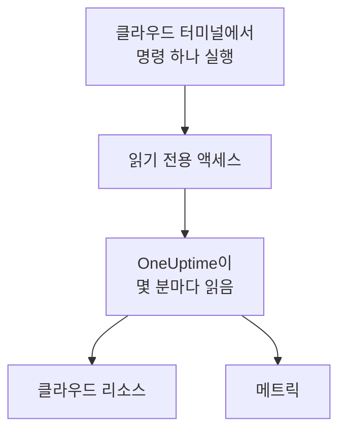

# 클라우드 계정 연결

대시보드에서 AWS 계정, Azure 구독 또는 Google Cloud 프로젝트를 연결하면 OneUptime이 해당 리소스를 나열하고 주요 메트릭을 일정에 따라 읽습니다. 클라우드의 브라우저 터미널에서 명령 하나를 실행하고 출력 내용을 붙여 넣기만 하면 됩니다. 실행할 컬렉터도, 설치할 것도 없습니다.

:::cards
- [Amazon Web Services](#amazon-web-services): OneUptime이 로그인하는 IAM 역할 또는 액세스 키.
- [Microsoft Azure](#microsoft-azure): Monitoring Reader 역할이 있는 앱.
- [Google Cloud](#google-cloud): Monitoring Viewer 역할이 있는 서비스 계정.
- [OneUptime이 읽는 것](#oneuptime이-읽는-것): 어떤 리소스와 메트릭을, 얼마나 자주 읽으며, 비용이 얼마인지.
:::

## 작동 방식



- **액세스는 읽기만 할 수 있습니다.** 명령이 만드는 액세스는 메트릭만 읽고 그 외에는 아무것도 할 수 없습니다. AWS에서는 세 가지 읽기 작업, Azure에서는 **Monitoring Reader** 역할, Google Cloud에서는 **Monitoring Viewer** 역할입니다. 삭제하면 OneUptime의 액세스가 끊깁니다.
- **OneUptime은 일정에 따라 읽습니다.** 연결할 때 다른 간격을 고르지 않으면 Azure와 Google Cloud는 5분마다, AWS는 10분마다 읽습니다.
- **리소스마다 고유한 페이지가 있습니다.** 리소스는 **클라우드 → 모든 리소스**에 주요 메트릭, 소유자, 레이블과 함께 표시됩니다. 컬렉터가 보고하는 리소스와 같습니다.

## 시작하기 전에

- **프로젝트 소유자 또는 관리자.** 이들만 클라우드 계정을 연결, 테스트, 편집할 수 있습니다.
- **클라우드의 터미널** (AWS CloudShell, Azure Cloud Shell 또는 Google Cloud Shell). IAM 역할이나 사용자, 앱 등록 또는 서비스 계정을 만들 수 있는 사람으로 로그인되어 있어야 합니다.

## Amazon Web Services

:::steps
### AWS 양식 열기

**클라우드 → 연결**로 이동한 다음 **Amazon Web Services**를 선택합니다.

### AWS CloudShell에서 명령 실행

OneUptime이 로그인하는 방법을 선택합니다. 권장하는 방법은 **IAM 역할**입니다. 비밀 정보가 저장되지 않으며 역할은 언제든지 삭제할 수 있습니다. 양식에는 프로젝트에 맞게 작성된 명령이 표시됩니다. 이 명령은 프로젝트의 외부 ID로 OneUptime의 AWS 계정을 신뢰하는 역할을 만들고, 역할의 ARN을 출력합니다. 역할을 사용할 수 없으면 **액세스 키**를 사용합니다. 다음 명령은 같은 권한을 가진 사용자를 만들고 그 키를 출력합니다.

```bash
aws iam create-user --user-name OneUptimeReadOnly > /dev/null 2>&1 || true
aws iam put-user-policy --user-name OneUptimeReadOnly --policy-name OneUptimeReadOnly --policy-document '{"Version":"2012-10-17","Statement":[{"Effect":"Allow","Action":["cloudwatch:GetMetricData","cloudwatch:ListMetrics","tag:GetResources"],"Resource":"*"}]}'
aws iam create-access-key --user-name OneUptimeReadOnly
```

### AWS 명령의 출력 붙여 넣기

명령이 출력한 내용을 모두 **명령 출력 내용**에 붙여 넣습니다. OneUptime이 역할의 ARN, 또는 액세스 키 ID와 그 비밀을 골라냅니다.

### AWS 테스트 후 연결

이 단계를 열면 OneUptime이 연결을 테스트합니다. 로그인하고, 찾은 리소스를 세고, 이를 읽는 데 드는 비용을 알려 줍니다. 저장하려면 **연결**을 선택합니다.
:::

이 역할과 사용자는 다음 세 가지만 할 수 있습니다.

| 작업 | OneUptime의 용도 |
| --- | --- |
| `cloudwatch:ListMetrics` | 각 리전에서 메트릭을 보고하는 리소스 찾기 |
| `cloudwatch:GetMetricData` | 리소스의 주요 메트릭 읽기 |
| `tag:GetResources` | 각 리소스의 이름을 `Name` 태그로 표시 |

> [!NOTE]
> 자체 호스팅 OneUptime에서 **IAM 역할** 방식을 쓰려면 OneUptime 자체의 AWS ID가 필요합니다. `CLOUD_CONNECT_AWS_ACCESS_KEY_ID`와 `CLOUD_CONNECT_AWS_SECRET_ACCESS_KEY`에 `sts:AssumeRole`을 호출할 수 있는 IAM 사용자의 키를 설정하세요. 설정하지 않으면 양식은 **액세스 키**를 제공합니다.

## Microsoft Azure

:::steps
### Azure 양식 열기

**클라우드 → 연결**로 이동한 다음 **Microsoft Azure**를 선택합니다.

### Azure Cloud Shell에서 명령 실행

이 명령은 현재 구독에 **Monitoring Reader** 역할이 있는 앱을 만들고 세부 정보를 출력합니다.

```bash
az ad sp create-for-rbac --name OneUptimeReadOnly --role "Monitoring Reader" --scopes "/subscriptions/$(az account show --query id --output tsv)"
```

### Azure 명령의 출력 붙여 넣기

명령이 출력한 내용을 모두 **명령 출력 내용**에 붙여 넣습니다. OneUptime이 `tenant`, `appId`, `password`를 골라냅니다.

### Azure 테스트 후 연결

이 단계를 열면 OneUptime이 연결을 테스트합니다. 저장하려면 **연결**을 선택합니다.
:::

같은 앱으로 다른 구독도 읽으려면 각 구독에서 앱에 역할을 부여합니다.

```bash
az role assignment create --assignee <APP_ID> --role "Monitoring Reader" --scope /subscriptions/<SUBSCRIPTION_ID>
```

**구독**에 일부를 지정하지 않으면 OneUptime은 앱이 읽을 수 있는 모든 구독을 읽습니다.

## Google Cloud

:::steps
### Google Cloud 양식 열기

**클라우드 → 연결**로 이동한 다음 **Google Cloud**를 선택합니다.

### Google Cloud Shell에서 명령 실행

모니터링할 프로젝트에서 실행합니다. Cloud Monitoring API를 켜고, **Monitoring Viewer** 역할이 있는 서비스 계정을 만든 다음 그 키를 출력합니다.

```bash
PROJECT_ID=$(gcloud config get-value project)
gcloud services enable monitoring.googleapis.com
gcloud iam service-accounts create oneuptime-read-only --display-name "OneUptime (read only)"
gcloud projects add-iam-policy-binding "$PROJECT_ID" --member "serviceAccount:oneuptime-read-only@$PROJECT_ID.iam.gserviceaccount.com" --role roles/monitoring.viewer --condition=None > /dev/null
gcloud iam service-accounts keys create oneuptime-key.json --iam-account "oneuptime-read-only@$PROJECT_ID.iam.gserviceaccount.com"
cat oneuptime-key.json && rm oneuptime-key.json
```

### 키 붙여 넣기

명령이 출력한 내용을 모두 붙여 넣습니다. OneUptime은 키 자체의 프로젝트를 읽고, 키를 암호화하여 저장합니다.

### Google Cloud 테스트 후 연결

이 단계를 열면 OneUptime이 연결을 테스트합니다. 저장하려면 **연결**을 선택합니다.
:::

같은 서비스 계정으로 다른 프로젝트도 읽으려면 각 프로젝트에서 역할을 부여하고 **프로젝트**에 지정합니다.

```bash
gcloud projects add-iam-policy-binding <PROJECT_ID> --member "serviceAccount:oneuptime-read-only@<KEY_PROJECT_ID>.iam.gserviceaccount.com" --role roles/monitoring.viewer
```

## OneUptime이 읽는 것

| | AWS | Azure | Google Cloud |
| --- | --- | --- | --- |
| 리소스 | 사용하는 모든 리전에서 CloudWatch로 메트릭을 보고하는 리소스 | 구독의 모든 리소스 | Cloud Monitoring으로 메트릭을 보고하는 리소스 |
| 메트릭 | 각 서비스의 주요 메트릭(예: 인스턴스의 CPU, 네트워크, 상태 검사) | 리소스당 최대 8개의 주요 메트릭 | 각 리소스 유형의 주요 메트릭 |
| 읽기 간격 | 10분 | 5분 | 5분 |
| 삭제된 리소스 | 메트릭이 7일 동안 없으면 보관 처리 | 다음 읽기에서 보관 처리 | 메트릭이 7일 동안 없으면 보관 처리 |

각 읽기는 이전 읽기가 멈춘 곳에서 이어지므로 각 데이터 포인트는 한 번만 기록됩니다. 새 연결의 첫 읽기는 곧바로 시작되어 지난 한 시간 분량을 읽고, 중단된 뒤의 읽기는 최대 6시간까지 거슬러 올라갑니다.

OneUptime의 호출은 클라우드 요금으로 클라우드 계정에 청구됩니다. 테스트는 찾은 항목의 비용을 추정하며, 덜 자주 읽을수록 비용이 줄어듭니다. **추가 필드**에서 **메트릭 읽기 간격**을 변경하세요.

| 클라우드 | 가격 |
| --- | --- |
| AWS | CloudWatch `GetMetricData`: 메트릭 1,000개당 $0.01이며, 리소스의 주요 메트릭 하나는 읽기마다 메트릭 하나입니다 |
| Azure | 구독마다 매월 처음 1,000,000회의 메트릭 읽기는 무료이며, 그 이후에는 1,000회당 $0.01 |
| Google Cloud | 매월 처음 1,000,000개의 시계열 읽기는 무료이며, 그 이후에는 백만 개당 $0.50 |

## 문제 해결

:::details 테스트에서 키 또는 비밀이 수락되지 않았다고 표시됨
명령이 출력한 내용을 모두 복사해 다시 붙여 넣으세요. 방금 만든 키는 작동하기까지 잠시 걸릴 수 있습니다.
:::

:::details 테스트에서 로그인은 되지만 읽을 수 없음
명령을 다시 실행하세요. OneUptime에 필요한 역할이 부여됩니다. AWS에서는 양식이 이 프로젝트에 대해 보여 주는 명령을 실행하세요. 다른 프로젝트용으로 만든 역할은 그 프로젝트의 외부 ID를 신뢰하며, 이 프로젝트의 외부 ID는 신뢰하지 않습니다.
:::

:::details Google Cloud에서 명령이 키를 만들 수 없음
조직 정책 `iam.disableServiceAccountKeyCreation`이 서비스 계정 키를 금지할 수 있습니다. 조직 관리자에게 이 프로젝트에 대한 예외를 요청하거나, [자체 컬렉터로 메트릭을 보내세요](/docs/telemetry/cloud-resources).
:::

:::details 리소스가 표시되지 않음
AWS와 Google Cloud에서는 리소스가 메트릭을 보고하면 표시됩니다. 연결이 작동하지 않으면 **클라우드 → 연결**의 **View error**에서 마지막 읽기가 실패한 이유를 확인할 수 있습니다.
:::

## 다음 단계

:::cards
- [클라우드 리소스](/docs/telemetry/cloud-resources): 대신 자체 OpenTelemetry Collector를 실행하거나 CloudWatch 메트릭을 스트리밍합니다.
- [메트릭 모니터](/docs/monitor/metrics-monitor): 리소스의 메트릭으로 알림을 받습니다.
:::
