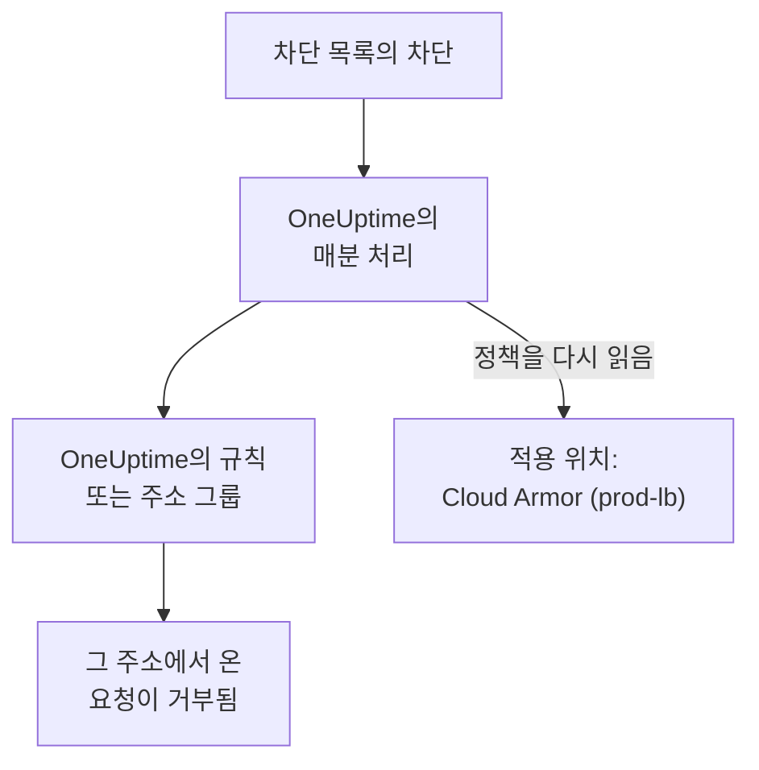

# Cloud Armor에서 주소 차단

프로젝트의 차단 목록은 로드 밸런서의 Google Cloud Armor 보안 정책에서 적용될 수 있습니다. 이미 있는 Google Cloud 연결에서 이 기능을 켜고 보안 정책을 고르면, 차단 목록이 차단하는 모든 주소가 그곳에서 차단됩니다. 차단한 주체가 사람이든, 플레이북이든, OneUptime AI든 마찬가지입니다.

:::cards
- [켜기](#켜기): Google Cloud 연결의 설정 하나와, 설정에 필요한 역할입니다.
- [OneUptime이 만드는 것](#oneuptime이-만드는-것): 각 정책에 두는 자체 규칙, 또는 Cloud Armor Enterprise에서의 주소 그룹입니다.
- [대조되는 주소](#대조되는-주소): 연결한 주소, 또는 프록시 뒤에 있는 사용자 IP입니다.
:::

## 작동 방식

OneUptime은 선택한 각 보안 정책에 자체 규칙을 두고, 차단 목록이 차단하는 주소를 그 안에 넣습니다. 매분 바뀐 부분을 규칙 하나씩 바꾼 다음 정책을 다시 읽습니다. **차단 목록** 페이지에서 차단의 **적용 위치**는 정책이 차단을 보유할 때에만 Cloud Armor (prod-lb)를 표시합니다. 그 전까지는 적용되지 않은 상태입니다.

## 시작하기 전에

- OneUptime에 연결된 Google Cloud 프로젝트([클라우드 계정 연결](/docs/telemetry/cloud-accounts#google-cloud) 참고).
- 차단 목록이 적용되는 위치를 바꿀 수 있는 역할: **프로젝트 소유자**, **프로젝트 관리자** 또는 **보안 관리자**.
- Cloud Shell에서 명령 하나를 실행할 수 있도록, Google Cloud 프로젝트에서 역할을 만들고 부여할 수 있는 사람.

## 켜기

:::steps
### 연결 열기
**클라우드 → 연결**을 열고 Google Cloud 연결을 편집합니다.

### 설정 켜기
**추가 필드**에서 **Cloud Armor에서 주소 차단**을 **켜짐**으로 설정하고 저장합니다. 이제 양식에 표시되는 설정 명령은 다른 역할을 부여하는 곳에 아래 역할도 부여합니다. 이미 있는 연결은 명령을 다시 실행할 필요가 없습니다. **WAF 추가** 대화 상자가 정책의 프로젝트에서 역할을 부여하는 줄을 보여 줍니다.

### 보안 정책 추가하기
**보안 이벤트 → 플레이북 → 차단 목록**을 엽니다. **클라우드 WAF**에서 **WAF 추가**를 클릭하고 보안 정책을 고릅니다. OneUptime은 아무것도 쓰지 않고, 연결이 그 정책에 쓸 수 있는지 Google Cloud에 묻습니다.

### 역할이 없으면 부여하기
권한이 없으면 대화 상자에 정책의 프로젝트에서 권한을 부여하는 줄이 표시됩니다. Cloud Shell에서 실행하고 **다시 확인**을 클릭한 다음 정책을 추가합니다. OneUptime이 정책을 설정하면 **상태**에 **적용 중**이 표시됩니다.
:::

보안 정책은 연결의 인벤토리에서 가져옵니다. OneUptime이 아직 읽지 않은 정책은 다음 읽기 후에 나열됩니다. 정책이 차단 목록을 적용하는 동안에는 그 연결의 설정을 끌 수 없고 연결을 삭제할 수도 없습니다. 먼저 정책을 제거해 OneUptime이 규칙을 빼도록 하세요.

## OneUptime이 만드는 것

정책이 차단 목록을 담는 방식은 정책을 추가할 때 OneUptime이 정합니다.

| 항목 | 이름 | 위치 |
| --- | --- | --- |
| 403으로 거부하는 규칙. 각각 주소 또는 범위를 최대 10개까지 담음 | 설명이 `OneUptime blocklist <project> #1`, `#2`, ...로 시작 | 선택한 각 정책 안. 최대 20개. |
| 주소 그룹 두 개, IPv4와 IPv6 | `oneuptime-<project>-block-ipv4`, `oneuptime-<project>-block-ipv6` | 전역. 정책의 프로젝트 안. Cloud Armor Enterprise에서만. |
| 두 그룹 중 하나에 있는 것을 403으로 거부하는 규칙 하나 | 설명이 `OneUptime blocklist <project>, address groups`로 시작 | 선택한 각 전역 백엔드 정책 안. Cloud Armor Enterprise에서. |

`<project>`는 프로젝트 외부 ID의 처음 여덟 글자이므로, 같은 정책을 고른 두 OneUptime 프로젝트가 서로의 규칙에 쓰는 일은 없습니다. Cloud Armor는 규칙을 우선순위로만 구분하므로, OneUptime은 설명으로 자체 규칙을 알아봅니다.

- **규칙.** Cloud Armor는 규칙 하나에 주소 또는 범위를 10개까지 담으므로, 정책은 OneUptime의 규칙 20개에 차단을 최대 200개까지 담습니다. 들어가지 않는 차단은 해당 행에 그렇게 표시됩니다.
- **주소 그룹.** Cloud Armor Enterprise를 쓰는 프로젝트의 전역 백엔드 정책은 대신 주소 그룹 두 개에 차단 목록을 담습니다. IPv4 범위 10,000개와 IPv6 범위 2,000개입니다. 프로젝트의 이러한 정책은 모두 그룹을 공유하며, 각 정책의 규칙 하나가 그룹에 있는 것을 거부합니다. 그룹은 프로젝트 주소 그룹 할당량 중 16,000단위를 사용합니다.

OneUptime은 Cloud Armor의 규칙 메서드로 자체 규칙을 하나씩 추가, 변경, 제거합니다. 정책을 통째로 쓰지 않으며, 사용자의 규칙도 쓰지 않습니다. 단일 주소는 `/32` 또는 `/128`로 기록됩니다.

## 정책에서 규칙의 위치

OneUptime은 자체 규칙을 요청을 통과시키는 첫 번째 규칙보다 앞의 빈 우선순위에, 가장 낮은 번호부터 둡니다. 그래서 사용자의 어떤 규칙도 차단된 주소를 통과시키지 않습니다. 요청을 통과시키는 규칙이란 허용, 스로틀링, 속도 기반 차단, 공정 공유를 하는 규칙입니다. 거부하는 사용자의 규칙은 그보다 앞에 있어도 됩니다. OneUptime은 사용자의 규칙 번호를 바꾸거나 규칙을 변경하거나 제거하지 않습니다. 첫 번째 그런 규칙보다 앞에 빈 우선순위가 없으면 정책에 **빈 우선순위 없음**이 표시되고, 하나를 비우면 OneUptime이 규칙을 추가합니다.

## 대조되는 주소

| 보안 정책 | 클라이언트 주소 | 고를 때 |
| --- | --- | --- |
| 백엔드 | **로드 밸런서에 연결한 주소(origin.ip)** | 기본값입니다. |
| 백엔드 | 정책 요청 헤더의 사용자 IP(origin.user_ip) | 다른 프록시나 CDN 뒤에 있는 로드 밸런서의 경우. |
| 에지 | 로드 밸런서에 연결한 주소(origin.ip) | 유일한 선택지입니다. 에지 정책은 다른 주소를 읽지 않습니다. |

`origin.user_ip`는 정책의 사용자 IP 요청 헤더(`userIpRequestHeaders`)에 있는 주소로, 로드 밸런서 앞의 프록시나 CDN이 씁니다. 헤더가 설정되지 않았거나 헤더에 유효한 주소가 없으면 `origin.ip`입니다. 로드 밸런서에 직접 도달하는 클라이언트는 이 헤더를 스스로 쓸 수 있으므로, 그런 프록시가 헤더를 쓰는 경우에만 고르세요. 이 선택은 **WAF 추가** 대화 상자의 **추가 필드**에 있으며, 나중에 정책 행의 **클라이언트 주소**로 바꿀 수 있습니다.

패스스루 네트워크 로드 밸런서용 네트워크 에지 보안 정책은 고를 수 없으며, **WAF 추가** 대화 상자가 그 이유를 알려 줍니다. 그 규칙은 요청이 아닌 패킷과 일치하기 때문입니다.

Cloud Armor에서 OneUptime의 규칙은 거부만 합니다. 주소에 챌린지를 요청하는 차단은 Cloud Armor에서 적용되지 않으며, 그렇게 표시됩니다. 자동 대응 정책의 챌린지는 그곳에서 같은 기간 동안의 차단으로 적용됩니다.

## 규칙이 수동으로 변경된 경우

누군가 OneUptime의 규칙 중 하나를 미리 보기 모드로 설정하거나 변경하거나 삭제하면, 또는 주소 그룹 중 하나를 삭제하면, OneUptime은 그 상태 그대로 둡니다. 정책에 **수동으로 변경됨**이 표시되고, 거기에 있던 차단은 누군가 정책 행에서 **되돌리기**를 클릭할 때까지 이유와 함께 적용되지 않습니다. '되돌리기'는 OneUptime이 쓰는 방식대로 규칙을 다시 쓰며, 원래 우선순위가 비어 있으면 그 우선순위에 두고, 삭제된 주소 그룹을 다시 만듭니다.

OneUptime은 정책이 백엔드 서비스에 연결되어 있는지 확인하지 않습니다. 어떤 백엔드 서비스에도 연결되지 않은 정책은 아무것도 차단하지 않습니다.

## Terraform에서 정책 관리

`rule` 블록이 있는 `google_compute_security_policy`는 정책의 모든 규칙을 소유하므로, 다음 plan에서 OneUptime의 규칙이 제거됩니다. 다른 규칙을 건드리지 않는 `google_compute_security_policy_rule` 리소스로 규칙을 관리하거나, 정책의 `lifecycle` 블록에 `ignore_changes = [rule]`를 추가하세요.

## 권한

설정 명령은 연결의 다른 역할을 부여하는 곳에 사용자 지정 역할 `oneuptimeCloudArmorBlocklist`를 추가하고, 연결의 서비스 계정에 부여합니다. **WAF 추가** 대화 상자에 표시되는 줄은 같은 역할을 정책의 프로젝트에 추가합니다. 주소 그룹이 아닌 규칙에 차단 목록을 담는 정책에는 정책 자체의 권한만 필요합니다.

| 권한 | 이유 |
| --- | --- |
| `compute.securityPolicies.get`, `compute.securityPolicies.update` | 전역 정책을 읽고 그 안의 OneUptime 규칙을 바꿉니다. |
| `compute.regionSecurityPolicies.get`, `compute.regionSecurityPolicies.update` | 리전 정책을 읽고 그 안의 OneUptime 규칙을 바꿉니다. |
| `compute.globalOperations.get`, `compute.regionOperations.get` | 변경이 끝날 때까지 기다립니다. |
| `compute.projects.get` | 프로젝트에 Cloud Armor Enterprise가 있는지 읽습니다. |
| `networksecurity.addressGroups.get`, `networksecurity.addressGroups.list`, `networksecurity.addressGroups.create`, `networksecurity.addressGroups.update`, `networksecurity.addressGroups.delete`, `networksecurity.addressGroups.use` | OneUptime의 주소 그룹을 유지하고, 그 규칙에서 주소 그룹을 참조합니다. Cloud Armor Enterprise에서만. |
| `networksecurity.operations.get` | 주소 그룹의 변경이 끝날 때까지 기다립니다. |

이 역할은 정책을 삭제할 수 없으며, OneUptime은 그 밖의 것을 쓰지 않습니다. 설정 명령은 Compute Engine API와 Network Security API도 켭니다.

## 제거

:::steps
### 보안 정책 제거
**보안 이벤트 → 플레이북 → 차단 목록**에서 정책 행의 **제거**를 클릭합니다. OneUptime은 정책에서 자체 규칙을 빼고, 프로젝트의 다른 정책이 주소 그룹을 더 이상 사용하지 않으면 주소 그룹을 삭제합니다.

### 설정 끄기
연결을 편집해 **Cloud Armor에서 주소 차단**을 **꺼짐**으로 설정하고 저장합니다. 이 설정은 연결의 어떤 정책도 차단 목록을 적용하지 않게 되면 끌 수 있습니다.
:::

OneUptime이 더 이상 정책에 쓸 수 없다면 **WAF 제거** 대화 상자에서 **OneUptime에서만 제거**를 선택합니다. OneUptime은 정책을 차단 목록에서 제거하고, 남긴 규칙과 주소 그룹의 이름을 알려 줍니다. 이들은 Google Cloud에서 삭제할 때까지 담고 있는 주소를 계속 차단합니다.

## 문제 해결

:::details 적용 안 됨
정책의 상태에는 Google Cloud가 응답한 내용과 해야 할 일이 표시됩니다. 거부된 경우에는 없는 권한이 표시됩니다. **WAF 추가**가 이 정책에 대해 보여 주는 줄을 실행한 다음 **다시 확인**을 클릭하세요. 할당량 때문에 거부된 경우에는 그 할당량이 표시됩니다. Google Cloud에 할당량 증가를 요청하거나 더 이상 쓰지 않는 규칙을 삭제하세요.
:::

:::details 빈 우선순위 없음
요청을 통과시키는 첫 번째 규칙보다 앞의 우선순위가 모두 사용 중입니다. 그 규칙의 번호를 더 크게 한 다음 **다시 확인**을 클릭하세요.
:::

:::details 정책이 목록에 없음
OneUptime은 설정이 켜진 연결의 보안 정책을, 읽고 난 뒤에 나열합니다. 그 이후에 추가된 정책은 연결을 다음에 읽은 후 나타납니다.
:::

## 다음 단계

:::cards
- [보안 케이스 및 플레이북](/docs/telemetry/security-cases): 케이스에서 주소를 차단하고, 그 단계가 확인되는 것을 봅니다.
- [클라우드 계정 연결](/docs/telemetry/cloud-accounts): 이 설정이 속한 연결입니다.
:::
