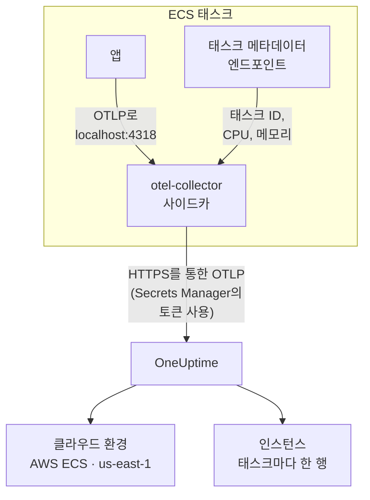

# AWS ECS / Fargate

Amazon ECS 태스크의 트레이스, 로그, 메트릭을 OneUptime으로 보냅니다. Fargate와 EC2 시작 유형 모두에서 동작합니다. `cloud.platform=aws_ecs`를 보고하는 모든 태스크는 서비스를 하나 실행하든 쉰 개 실행하든 AWS 계정과 리전마다 하나의 **Cloud Environment**(예: _AWS ECS · us-east-1 · 123456789012_)에 들어갑니다.

:::cards
- [작동 방식](#작동-방식): ECS 감지기와 사이드카 Collector가 하는 일.
- [설정](#설정): 토큰을 저장하고, 태스크 정의에 설정을 추가하고, 배포한 뒤 확인합니다.
- [전체 태스크 정의](#전체-태스크-정의): 등록할 수 있는 완전한 Fargate 태스크 정의.
- [문제 해결](#문제-해결): PENDING에 멈춘 태스크, 거부된 내보내기, 비어 있는 인스턴스나 타일.
:::

## 작동 방식



- **ECS 감지기가 환경의 이름을 정합니다.** SDK나 Collector에 있는 OpenTelemetry ECS 리소스 감지기가 ECS가 모든 컨테이너에 제공하는 태스크 메타데이터 엔드포인트를 읽고, 태스크가 보내는 모든 데이터에 계정, 리전, 태스크를 붙입니다. 하드코딩하는 것은 없습니다.
- **태스크가 각 인스턴스의 이름이 됩니다.** 환경의 **인스턴스** 탭에는 실행 중인 태스크가 태스크 ID별로 CPU, 메모리와 함께 나열됩니다.
- **사이드카 Collector가 CPU와 메모리를 더합니다.** Collector의 `awsecscontainermetrics` 수신기가 같은 엔드포인트에서 각 태스크의 CPU와 메모리를 읽고, 토큰은 Collector가 보관하므로 애플리케이션은 토큰을 볼 수 없습니다.

ECS 감지기는 다음 리소스 속성을 설정합니다:

| 속성 | ECS 감지기가 설정하는 값 | 용도 |
| ------------------------------------------------------------------ | ----------------------- | --------------------------------------------------------------------------------------------------------- |
| `cloud.platform` | `aws_ecs` | 텔레메트리를 **클라우드 환경**으로 분류합니다. 값이 정확히 일치해야 합니다 |
| `cloud.account.id` | `123456789012` | 환경 키의 일부 |
| `cloud.region` | `us-east-1` | 환경 키의 일부 |
| `aws.ecs.task.arn` | 태스크 ARN | 끝부분의 태스크 ID로 실행 중인 태스크 하나를 **인스턴스**에 표시합니다 |
| `aws.ecs.task.id` | 태스크 ID | 위와 같음. 최신 감지기는 둘 다 설정합니다 |
| `aws.ecs.cluster.arn`, `aws.ecs.task.family`, `aws.ecs.launchtype` | 클러스터와 태스크 | 검색할 수 있도록 모든 스팬, 로그, 메트릭에 남습니다. 환경에는 포함되지 않습니다 |

환경 키는 `aws_ecs|123456789012|us-east-1`입니다. SDK가 `service.instance.id`도 설정하더라도 인스턴스 이름에는 태스크 ID가 쓰입니다. 사이드카의 컨테이너 메트릭에는 태스크 ID만 있으므로, 태스크 ID를 키로 써야 태스크의 스팬과 CPU, 메모리가 한 행에 모입니다. 전체 규칙은 [클라우드 환경](/docs/telemetry/cloud-environments)을 참고하세요.

## 시작하기 전에

- **수집 키.** **프로젝트 설정 → 텔레메트리 및 APM → 수집 키**에서 **서버** 키를 만들고 토큰을 복사합니다.
- **수정할 수 있는 ECS 클러스터와 태스크 정의**, 그리고 해당 계정으로 구성한 AWS CLI.
- **OpenTelemetry SDK로 계측한 애플리케이션**(OTLP를 내보내는 것이면 언어는 무관합니다).

## 텔레메트리가 태스크를 떠나는 방식 선택하기

| | Sidecar collector | SDK direct |
| ----------------------- | ---------------------------------------------- | ----------------------------------------------- |
| 추가 컨테이너 | 모든 태스크의 `otel-collector` | 없음 |
| 태스크별 CPU와 메모리 | 있음(`awsecscontainermetrics` 수신기에서) | 없음 |
| 토큰 보관 | Collector | 애플리케이션 |
| 시크릿에 담는 값 | 토큰만 | 헤더 전체 `x-oneuptime-token=...` |

대부분의 팀은 사이드카 Collector를 씁니다. ECS를 전혀 모르는 라이브러리의 텔레메트리에도 `cloud.*` 속성을 붙여 주기 때문입니다. 서비스가 하나뿐이라면 SDK direct가 가장 간단합니다. 아래의 각 단계에는 두 방식의 탭이 있습니다. 하나를 고르면 모든 단계가 그 방식을 따릅니다.

## 설정

:::steps
### Secrets Manager에 토큰 저장하기

> [!IMPORTANT]
> 토큰은 시크릿입니다. AWS Secrets Manager에 보관하고, 태스크 정의에서는 `secrets`와 `valueFrom`으로 참조하세요. 일반 `environment` 항목에 넣은 토큰은 태스크 정의를 읽을 수 있는 누구에게나 보이며, `describe-task-definition` 출력과 CloudFormation diff에도 매번 나타납니다.

:::tabs
@tab Sidecar collector
```bash
aws secretsmanager create-secret \
  --name oneuptime/ingestion-token \
  --region us-east-1 \
  --secret-string "YOUR_TELEMETRY_INGESTION_TOKEN"
```

Collector 구성이 헤더 이름을 붙이므로 이 시크릿에는 토큰만 담습니다.
@tab SDK direct
```bash
aws secretsmanager create-secret \
  --name oneuptime/ingestion-token \
  --region us-east-1 \
  --secret-string "x-oneuptime-token=YOUR_TELEMETRY_INGESTION_TOKEN"
```

ECS는 시크릿 값을 그대로 변수에 넣는데, `OTEL_EXPORTER_OTLP_HEADERS`에는 `name=value` 쌍 전체가 필요합니다. 그래서 이 시크릿에는 헤더 전체를 담습니다.
:::

명령이 출력하는 ARN을 적어 두세요. ARN은 `oneuptime/ingestion-token-AbCdEf`처럼 임의의 접미사로 끝나며, 이 ARN을 태스크 정의에 붙여 넣습니다.

### 태스크가 시크릿을 읽도록 허용하기

태스크 실행 역할(코드가 실행되는 역할이 아니라 ECS가 태스크를 시작할 때 쓰는 역할)이 시크릿을 읽을 수 있어야 합니다. 다음 정책을 `ecsTaskExecutionRole`에 연결하세요:

```json title="secret-access-policy.json"
{
  "Version": "2012-10-17",
  "Statement": [
    {
      "Effect": "Allow",
      "Action": ["secretsmanager:GetSecretValue"],
      "Resource": "arn:aws:secretsmanager:us-east-1:123456789012:secret:oneuptime/ingestion-token-*"
    }
  ]
}
```

고객 관리형 KMS 키로 시크릿을 암호화했다면, 역할에 그 키에 대한 `kms:Decrypt`도 필요합니다. 둘 중 하나라도 없으면 태스크가 시작되지 않고 `ResourceInitializationError: unable to pull secrets`로 중지됩니다.

### 태스크 정의에 설정 추가하기

:::tabs
@tab Sidecar collector
1. **AWS Console → Amazon Elastic Container Service → Task definitions** → 패밀리 선택 → **Create new revision**.
2. **Container - 1**(애플리케이션)에서 **Environment variables**를 펼치고 아래의 애플리케이션 변수를 추가합니다.
3. **+ Add container**: 이름 `otel-collector`, 이미지 `otel/opentelemetry-collector-contrib:latest`(동작을 확인한 뒤 버전을 고정하세요), **Essential container: No**. **Docker configuration → Command**에 `--config=env:OTEL_COLLECTOR_CONFIG`를 입력합니다.
4. Collector 컨테이너에 **Value type: ValueFrom**과 시크릿 ARN으로 환경 변수 `ONEUPTIME_TOKEN`을 추가하고, **Value type: Value**와 아래의 Collector 구성으로 `OTEL_COLLECTOR_CONFIG`를 추가합니다.
5. 애플리케이션 컨테이너의 **Startup dependency ordering**에서 조건 **Start**로 `otel-collector`를 추가합니다. 그러면 포트 4318에서 무언가가 수신 대기하기 전에 애플리케이션이 시작되지 않습니다.
6. **Task execution role**이 정책을 연결한 역할인지 확인합니다.

애플리케이션 변수. `awsvpc` 네트워크 모드(Fargate에서는 항상 이 모드)에서는 태스크의 컨테이너가 하나의 네트워크를 공유하므로 `localhost`가 곧 사이드카입니다:

```bash
OTEL_SERVICE_NAME=checkout-api
OTEL_EXPORTER_OTLP_ENDPOINT=http://localhost:4318
OTEL_EXPORTER_OTLP_PROTOCOL=http/protobuf
```

Collector 구성. Collector는 구성 전체를 `OTEL_COLLECTOR_CONFIG` 변수에서 읽으므로 이미지에 넣을 파일이 없고, ECS가 환경에 넣어 준 시크릿에서 `${env:ONEUPTIME_TOKEN}`을 채웁니다:

```yaml title="OTEL_COLLECTOR_CONFIG"
receivers:
  otlp:
    protocols:
      http:
        endpoint: 0.0.0.0:4318
      grpc:
        endpoint: 0.0.0.0:4317
  # Per-task and per-container CPU / memory from the ECS task metadata
  # endpoint. This is what fills the CPU and memory tiles in OneUptime.
  awsecscontainermetrics:
    collection_interval: 20s
processors:
  # Stamps cloud.provider, cloud.platform=aws_ecs, cloud.account.id,
  # cloud.region and aws.ecs.task.arn on every span, log and metric.
  resourcedetection:
    detectors: [env, ecs]
    timeout: 5s
  batch: {}
exporters:
  otlphttp/oneuptime:
    endpoint: https://oneuptime.com/otlp
    headers:
      x-oneuptime-token: ${env:ONEUPTIME_TOKEN}
service:
  pipelines:
    traces:
      receivers: [otlp]
      processors: [resourcedetection, batch]
      exporters: [otlphttp/oneuptime]
    metrics:
      receivers: [otlp, awsecscontainermetrics]
      processors: [resourcedetection, batch]
      exporters: [otlphttp/oneuptime]
    logs:
      receivers: [otlp]
      processors: [resourcedetection, batch]
      exporters: [otlphttp/oneuptime]
```

`ecs` 감지기와 `awsecscontainermetrics` 수신기 모두 IAM 권한이 필요 없습니다. 둘 다 ECS가 모든 컨테이너에 `ECS_CONTAINER_METADATA_URI_V4`로 알려 주는 메타데이터 엔드포인트를 읽습니다.
@tab SDK direct
1. **AWS Console → Amazon Elastic Container Service → Task definitions** → 패밀리 선택 → **Create new revision**.
2. **Container - 1**(애플리케이션)에서 **Environment variables**를 펼치고 아래 변수를 추가합니다. `OTEL_EXPORTER_OTLP_HEADERS`는 **Value type: ValueFrom**으로, 값에는 시크릿 ARN을 넣어 추가합니다.
3. 아래 표에서 사용하는 언어의 ECS 리소스 감지기를 켜는 설정을 추가합니다.
4. **Task execution role**이 정책을 연결한 역할인지 확인합니다.

```bash
OTEL_SERVICE_NAME=checkout-api
OTEL_EXPORTER_OTLP_ENDPOINT=https://oneuptime.com/otlp
OTEL_EXPORTER_OTLP_PROTOCOL=http/protobuf
# Injected from Secrets Manager (secrets / valueFrom), not typed here.
OTEL_EXPORTER_OTLP_HEADERS=x-oneuptime-token=YOUR_TELEMETRY_INGESTION_TOKEN
```

| 언어 | ECS 감지기 켜기 |
| -------- | --------------------------------------------------------------------------------------------------------------- |
| Node.js | `OTEL_NODE_RESOURCE_DETECTORS=env,host,os,aws` (auto-instrumentations-node) |
| Python | `pip install opentelemetry-sdk-extension-aws` 후 `OTEL_EXPERIMENTAL_RESOURCE_DETECTORS=aws_ecs` |
| Java | `-Dotel.resource.providers.aws.enabled=true`(에이전트는 이 공급자가 꺼진 상태로 제공됩니다) |
| Go | `import "go.opentelemetry.io/contrib/detectors/aws/ecs"` 후 `ecs.NewResourceDetector()`를 `resource.New`에 전달 |
| .NET | `OpenTelemetry.Resources.AWS` 패키지: `.ConfigureResource(r => r.AddAWSECSDetector())` |

태스크 정의 파일에서는 시크릿을 `"secrets": [{ "name": "OTEL_EXPORTER_OTLP_HEADERS", "valueFrom": "<secret ARN>" }]`로 씁니다.
:::

OneUptime을 자체 호스팅한다면 엔드포인트로 `https://YOUR-ONEUPTIME-HOST/otlp`를 사용하세요.

### 새 개정 배포하기

**Create**를 클릭한 다음 **Clusters → your cluster → Services → select the service → Update → Task definition revision: latest → Deploy**를 진행합니다. CLI에서는 다음과 같습니다:

```bash
aws ecs update-service \
  --cluster production \
  --service checkout-api \
  --task-definition checkout-api
```

### 연결 확인하기

토큰부터 확인하세요. 가장 간단한 확인이며, 이것이 통과하지 않으면 그다음 단계는 하나도 동작하지 않습니다.

```bash
curl -i https://oneuptime.com/otlp/v1/validate \
  -H "x-oneuptime-token: YOUR_TELEMETRY_INGESTION_TOKEN"
```

`200`과 `"valid": true`는 토큰이 받아들여졌다는 뜻입니다. `401`은 토큰을 알 수 없거나, 취소되었거나, 비활성화되었거나, 만료되었다는 뜻입니다. 태스크 자체가 OneUptime에 닿을 수 있는지 확인하려면 ECS Exec으로 태스크 안에서 같은 명령을 실행하세요:

```bash
aws ecs execute-command --cluster production --task <task id> \
  --container app --interactive --command "sh"
```

Collector의 CloudWatch 로그 스트림(`otel/otel-collector/...`)에 `Everything is ready`가 보이고 `401`이나 `connection refused` 줄이 없어야 합니다. 첫 스팬, 로그 또는 메트릭이 도착하고 1분 안에 환경이 **클라우드 → All Environments**에 _AWS ECS · us-east-1 · 123456789012_ 라는 이름으로 나타납니다.
:::

## 전체 태스크 정의

`aws ecs register-task-definition --cli-input-json file://task-definition.json`으로 등록하는 파일 형태의 사이드카 구성입니다. 계정 ID, 리전, 이미지, 시크릿 ARN을 바꿔 쓰세요:

```json title="task-definition.json"
{
  "family": "checkout-api",
  "requiresCompatibilities": ["FARGATE"],
  "networkMode": "awsvpc",
  "cpu": "512",
  "memory": "1024",
  "executionRoleArn": "arn:aws:iam::123456789012:role/ecsTaskExecutionRole",
  "taskRoleArn": "arn:aws:iam::123456789012:role/checkout-api-task-role",
  "containerDefinitions": [
    {
      "name": "app",
      "image": "123456789012.dkr.ecr.us-east-1.amazonaws.com/checkout-api:1.4.2",
      "essential": true,
      "portMappings": [{ "containerPort": 8080, "protocol": "tcp" }],
      "environment": [
        { "name": "OTEL_SERVICE_NAME", "value": "checkout-api" },
        {
          "name": "OTEL_EXPORTER_OTLP_ENDPOINT",
          "value": "http://localhost:4318"
        },
        { "name": "OTEL_EXPORTER_OTLP_PROTOCOL", "value": "http/protobuf" }
      ],
      "dependsOn": [
        { "containerName": "otel-collector", "condition": "START" }
      ],
      "logConfiguration": {
        "logDriver": "awslogs",
        "options": {
          "awslogs-group": "/ecs/checkout-api",
          "awslogs-region": "us-east-1",
          "awslogs-stream-prefix": "app"
        }
      }
    },
    {
      "name": "otel-collector",
      "image": "otel/opentelemetry-collector-contrib:latest",
      "essential": false,
      "command": ["--config=env:OTEL_COLLECTOR_CONFIG"],
      "secrets": [
        {
          "name": "ONEUPTIME_TOKEN",
          "valueFrom": "arn:aws:secretsmanager:us-east-1:123456789012:secret:oneuptime/ingestion-token-AbCdEf"
        }
      ],
      "environment": [
        {
          "name": "OTEL_COLLECTOR_CONFIG",
          "value": "receivers:\n  otlp:\n    protocols:\n      http:\n        endpoint: 0.0.0.0:4318\n      grpc:\n        endpoint: 0.0.0.0:4317\n  awsecscontainermetrics:\n    collection_interval: 20s\nprocessors:\n  resourcedetection:\n    detectors: [env, ecs]\n    timeout: 5s\n  batch: {}\nexporters:\n  otlphttp/oneuptime:\n    endpoint: https://oneuptime.com/otlp\n    headers:\n      x-oneuptime-token: ${env:ONEUPTIME_TOKEN}\nservice:\n  pipelines:\n    traces:\n      receivers: [otlp]\n      processors: [resourcedetection, batch]\n      exporters: [otlphttp/oneuptime]\n    metrics:\n      receivers: [otlp, awsecscontainermetrics]\n      processors: [resourcedetection, batch]\n      exporters: [otlphttp/oneuptime]\n    logs:\n      receivers: [otlp]\n      processors: [resourcedetection, batch]\n      exporters: [otlphttp/oneuptime]\n"
        }
      ],
      "logConfiguration": {
        "logDriver": "awslogs",
        "options": {
          "awslogs-group": "/ecs/checkout-api",
          "awslogs-region": "us-east-1",
          "awslogs-stream-prefix": "otel"
        }
      }
    }
  ]
}
```

`OTEL_COLLECTOR_CONFIG` 값은 Collector 구성을 하나의 JSON 문자열로 만든 것입니다. 직접 이스케이프하는 대신 YAML을 `collector.yaml`에 두고 `jq`에 맡기세요:

```bash
jq --rawfile cfg collector.yaml \
  '.containerDefinitions[1].environment[0].value = $cfg' \
  task-definition.json > task-definition.rendered.json
aws ecs register-task-definition --cli-input-json file://task-definition.rendered.json
```

## 네트워킹

태스크는 VPC 밖의 두 곳에 닿아야 합니다. 시작하려면 Secrets Manager에, 내보내려면 OneUptime에 닿아야 합니다.

- **프라이빗 서브넷의 Fargate 태스크**에는 인터넷으로 가는 경로가 필요합니다. 서브넷 라우팅 테이블의 NAT 게이트웨이나, `assignPublicIp=ENABLED`를 쓰는 퍼블릭 서브넷입니다. 둘 다 없는 태스크는 Collector가 무언가를 보내기도 전에 시크릿을 가져오다가 `PENDING`에 멈춥니다.
- **보안 그룹의 아웃바운드 규칙**은 OneUptime 호스트(`oneuptime.com` 또는 자체 호스트와 그 수신 포트)로 가는 TCP 443을 허용해야 합니다. 기본 보안 그룹은 모든 아웃바운드를 허용하지만, 제한된 보안 그룹은 그렇지 않은 경우가 많습니다. 텔레메트리에는 인바운드 규칙이 필요 없습니다.
- **VPC 인터페이스 엔드포인트**를 `com.amazonaws.us-east-1.secretsmanager`(그리고 이미지를 가져올 `ecr.api`, `ecr.dkr`, S3)에 두면 AWS 호출이 NAT 경로를 거치지 않습니다. OneUptime 자체로 가는 인터넷 경로는 여전히 필요합니다.

```bash
aws ecs update-service \
  --cluster production \
  --service checkout-api \
  --task-definition checkout-api \
  --network-configuration "awsvpcConfiguration={subnets=[subnet-0abc1234],securityGroups=[sg-0def5678],assignPublicIp=ENABLED}"
```

## 얻을 수 있는 것

- **개요**: 트레이스에서 계산한 요청, 오류율, p95 지연 시간, **CPU**와 **메모리** 타일, **CPU 기준 상위 인스턴스**. 타일은 `awsecscontainermetrics` 수신기의 `ecs.task.cpu.utilized`와 `ecs.task.memory.utilized`, 또는 태스크의 식별자를 가진 `container.cpu.utilization`과 `container.memory.usage` 메트릭으로 채워집니다. SDK direct는 둘 다 보내지 않습니다.
- **인스턴스**: 실행 중인 태스크마다 한 행이며, 이름은 태스크 ID(`aws.ecs.task.arn`의 끝부분)입니다. 최신 CPU, 메모리, 마지막으로 확인된 시각이 표시됩니다. 보고가 끊긴 태스크는 **Stale**이 됩니다.
- **로그**, **트레이스**, **메트릭**: 이 계정과 리전에서 `cloud.platform=aws_ecs`를 가진 모든 데이터.
- **서비스**: 같은 태스크를 `service.name`별로 나눈 것.

## 문제 해결

발생하는 순서대로 정리한 ECS 장애입니다:

:::details 태스크가 "unable to pull secrets"와 함께 PENDING에 멈춤
전체 오류는 `ResourceInitializationError: unable to pull secrets`입니다. 태스크 실행 역할에 시크릿에 대한 `secretsmanager:GetSecretValue`(또는 그 키에 대한 `kms:Decrypt`)가 없거나, 태스크에서 Secrets Manager로 가는 경로가 없습니다(NAT 게이트웨이도 VPC 엔드포인트도 없음). [네트워킹](#네트워킹)을 참고하세요.
:::

:::details Collector 로그에 401이 남음
시크릿에 잘못된 값이 들어 있습니다. 사이드카 Collector라면 토큰만, SDK direct라면 헤더 전체 `x-oneuptime-token=...`여야 합니다. 토큰 자체는 [연결 확인하기](#연결-확인하기)의 명령으로 확인하세요.
:::

:::details 환경은 나타나지만 인스턴스가 비어 있음
텔레메트리에 태스크 식별자가 없습니다. `ecs` 감지기가 실행되는지 확인하세요. 리소스에 `aws.ecs.task.arn`, `aws.ecs.task.id` 또는 `service.instance.id`가 있어야 합니다.
:::

:::details 인스턴스는 채워지지만 CPU와 메모리 타일이 비어 있음
`awsecscontainermetrics` 수신기가 `metrics` 파이프라인에 없거나, 그 파이프라인이 `resourcedetection` 프로세서를 건너뛰어서 컨테이너 메트릭이 `cloud.platform` 없이 도착합니다. SDK direct는 이 타일을 채우지 않습니다.
:::

환경이 전혀 나타나지 않거나, **호스트** 또는 **서버리스 함수**에 나타나거나, **연결 끊김**으로 표시되거나, 둘로 나뉘는 경우는 [클라우드 문제 해결](/docs/telemetry/cloud-troubleshooting)에서 다룹니다.

## 다음 단계

:::cards
- [클라우드 환경](/docs/telemetry/cloud-environments): 환경과 인스턴스를 식별하는 방법.
- [클라우드 문제 해결](/docs/telemetry/cloud-troubleshooting): 모든 플랫폼에 공통인 장애.
- [클라우드 리소스(IaaS 및 PaaS)](/docs/telemetry/cloud-resources): CloudWatch에서 가져오는 로드 밸런서, RDS 데이터베이스, 버킷.
- [OpenTelemetry](/docs/telemetry/open-telemetry): 애플리케이션 계측과 엔드포인트 및 한도.
:::
