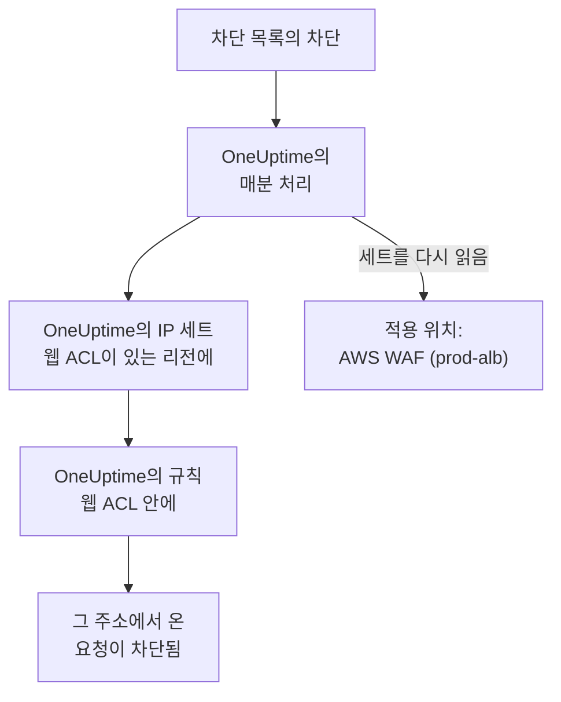

# AWS WAF에서 주소 차단

프로젝트의 차단 목록은 CloudFront 배포, 로드 밸런서, API Gateway 앞에 있는 AWS WAF 웹 ACL에서 적용될 수 있습니다. 이미 있는 AWS 클라우드 연결에서 이 기능을 켜고 웹 ACL을 고르면, 차단 목록이 차단하는 모든 주소가 그곳에서 차단됩니다. 차단한 주체가 사람이든, 플레이북이든, OneUptime AI든 마찬가지입니다.

:::cards
- [켜기](#켜기): AWS 연결의 설정 하나를 바꾸고, 설정 명령을 다시 실행합니다.
- [OneUptime이 만드는 것](#oneuptime이-만드는-것): 리전마다 IP 세트 네 개, 웹 ACL마다 규칙 두 개입니다.
- [코드로 웹 ACL 관리](#코드로-웹-acl-관리): Terraform이나 CloudFormation에서 규칙을 직접 추가합니다.
:::

## 작동 방식

OneUptime은 선택한 웹 ACL이 있는 각 리전에 자체 IP 세트를 두고, 각 웹 ACL에는 그 세트에 있는 주소를 차단하는 규칙을 둡니다. 매분 각 세트를 차단 목록의 내용으로 한 번씩 쓴 다음 세트를 다시 읽습니다. **차단 목록** 페이지에서 차단의 **적용 위치**는 AWS WAF가 차단을 보유하고 웹 ACL의 규칙이 그 세트를 차단할 때에만 AWS WAF (prod-alb)를 표시합니다. 그 전까지는 적용되지 않은 상태입니다.

## 시작하기 전에

- OneUptime에 연결된 AWS 계정([클라우드 계정 연결](/docs/telemetry/cloud-accounts#amazon-web-services) 참고).
- 차단 목록이 적용되는 위치를 바꿀 수 있는 역할: **프로젝트 소유자**, **프로젝트 관리자** 또는 **보안 관리자**.
- AWS 계정에서 연결의 설정 명령을 다시 실행할 수 있는 사람.

## 켜기

:::steps
### 연결 열기
**클라우드 → 연결**을 열고 AWS 연결을 편집합니다.

### 규칙을 추가할 주체 고르기
**추가 필드**에서 **AWS WAF에서 주소 차단**을 **켜짐, OneUptime이 규칙 추가**로 설정합니다. 웹 ACL을 Terraform이나 CloudFormation으로 관리한다면 **켜짐, 코드에서 직접 규칙 추가**로 설정합니다.

### 설정 명령 다시 실행하기
이제 양식에 표시되는 명령은 IP 세트 권한을 부여하고, OneUptime이 규칙을 추가하는 경우에는 그 규칙의 권한도 부여합니다. AWS CloudShell에서 실행한 다음 연결을 저장합니다.

### 웹 ACL 추가하기
**보안 이벤트 → 플레이북 → 차단 목록**을 엽니다. **클라우드 WAF**에서 **웹 ACL 추가**를 클릭하고, 웹 ACL과 클라이언트 주소를 읽을 위치를 고른 다음 추가합니다. OneUptime이 바로 설정하며, 규칙이 세트를 차단하면 **상태**에 **적용 중**이 표시됩니다.
:::

웹 ACL은 연결의 인벤토리에서 가져옵니다. OneUptime이 아직 읽지 않은 웹 ACL은 다음 읽기 후에 나열됩니다. 웹 ACL이 차단 목록을 적용하는 동안에는 그 연결의 설정을 끄거나, OneUptime이 규칙을 추가하는 방식에서 코드로 추가하는 방식으로 바꿀 수 없으며, 연결을 삭제할 수도 없습니다. 먼저 웹 ACL을 제거해 OneUptime이 규칙을 빼도록 하세요.

## OneUptime이 만드는 것

| 항목 | 이름 | 위치 |
| --- | --- | --- |
| IP 세트 네 개: 차단용과 챌린지용, 각각 IPv4와 IPv6 | `oneuptime-<project>-block-ipv4`, `oneuptime-<project>-block-ipv6`, `oneuptime-<project>-challenge-ipv4`, `oneuptime-<project>-challenge-ipv6` | 선택한 웹 ACL이 있는 각 리전. CloudFront의 웹 ACL은 글로벌이며, 그 세트는 `us-east-1`에 있습니다. |
| 규칙 두 개: 하나는 차단, 하나는 챌린지 | `OneUptime-Blocklist-<project>`, `OneUptime-Challenge-<project>` | OneUptime이 규칙을 추가하는 경우, 선택한 각 웹 ACL 안. |

`<project>`는 프로젝트 외부 ID의 처음 여덟 글자이므로, 한 계정에 있는 두 OneUptime 프로젝트가 서로의 세트에 쓰는 일은 없습니다. 같은 리전의 웹 ACL은 세트를 공유합니다. 단일 주소는 `/32` 또는 `/128`로 기록됩니다. AWS WAF는 세트 하나에 주소 10,000개, 리전 하나에 IP 세트 100개를 보관하며(AWS가 한도를 올려 준 경우는 예외), 들어가지 않는 차단은 해당 행에 그렇게 표시됩니다.

## 웹 ACL에서 규칙의 위치

OneUptime은 두 규칙을 첫 번째 규칙보다 번호가 작은 빈 우선순위에 두므로, 이 규칙들은 직접 작성한 규칙보다 먼저 실행됩니다. 웹 ACL에 규칙이 없으면 우선순위 0과 1을 사용합니다. OneUptime은 사용자의 규칙 번호를 바꾸거나 규칙을 변경하거나 제거하지 않습니다. 첫 번째 규칙보다 작은 번호의 우선순위가 두 개 비어 있지 않으면 웹 ACL에 **빈 우선순위 없음**이 표시되고, 두 개를 비우면 OneUptime이 규칙을 추가합니다.

각 규칙은 IPv4 또는 IPv6 세트 중 하나에 클라이언트 주소가 들어 있으면 일치합니다. AWS WAF는 웹 ACL을 통째로 업데이트하므로, OneUptime은 웹 ACL을 읽고 규칙을 추가한 다음 웹 ACL의 잠금 토큰과 함께 다시 쓰며, 그 사이에 다른 누군가가 썼다면 다시 읽습니다.

## 전달된 주소

다른 프록시나 CDN 뒤에 있는 웹 ACL에는 클라이언트가 아니라 프록시의 주소가 보입니다. 클라이언트 주소를 읽을 위치는 **클라이언트 주소**에서 고릅니다.

| 클라이언트 주소 | 규칙이 읽는 것 |
| --- | --- |
| **요청의 원본 주소** | 요청이 온 주소. 기본값입니다. |
| `X-Forwarded-For` 헤더의 마지막 주소 | 마지막 프록시가 덧붙인 주소. 그 앞의 주소는 요청이 스스로 주장한 주소입니다. |
| `CF-Connecting-IP` 헤더 | Cloudflare가 쓰는 단 하나의 주소. |
| `True-Client-IP` 헤더 | Akamai 또는 Cloudflare Enterprise가 쓰는 단 하나의 주소. |

헤더가 없는 요청은 일치하지 않습니다. AWS WAF는 프록시의 주소를 차단하는 대신 그 요청을 통과시킵니다.

## 코드로 웹 ACL 관리

**켜짐, 코드에서 직접 규칙 추가**로 설정하면 OneUptime은 IP 세트만 만들고 웹 ACL에는 아무것도 쓰지 않습니다. 웹 ACL의 행에서 **규칙 보기**를 클릭하면 두 규칙을 Terraform(`aws_wafv2_web_acl`의 `rule` 블록)과 CloudFormation으로, 각 세트의 ARN과 웹 ACL이 읽는 헤더와 함께 보여 줍니다. 이를 코드의 다른 규칙보다 앞에 추가하고 적용하세요.

규칙이 추가될 때까지 웹 ACL에는 **규칙 추가 대기 중**이 표시되며, 그 차단은 적용되지 않습니다. OneUptime은 처리할 때마다 웹 ACL을 읽으며, 각 세트를 차단하는 규칙을 찾은 첫 처리부터 규칙 이름이 무엇이든 차단이 적용됩니다.

## 권한

설정 명령은 역할에 인라인 정책 `OneUptimeWafBlocklist`를 추가합니다. 액세스 키를 쓰는 경우에는 IAM이 사용자 자체 정책의 수를 제한하므로, 정책을 그룹 `OneUptimeWafBlocklist-<project>`에 붙이고 사용자를 그 그룹에 넣습니다.

| 작업 | 리소스 | 이유 |
| --- | --- | --- |
| `wafv2:ListIPSets` | 모두 | 리전에서 OneUptime의 IP 세트를 찾습니다. |
| `wafv2:GetIPSet`, `wafv2:CreateIPSet`, `wafv2:UpdateIPSet`, `wafv2:DeleteIPSet` | OneUptime의 IP 세트만(`oneuptime-<project>-*`) | 세트를 유지하고, 리전의 마지막 웹 ACL을 제거하면 세트를 삭제합니다. |
| `wafv2:GetSampledRequests` | 웹 ACL | 규칙이 거부한 요청을 읽습니다. 케이스의 차단 단계를 확인하는 근거가 됩니다. |
| `wafv2:UpdateWebACL` | 웹 ACL과, 웹 ACL이 참조하는 IP 세트, 정규식 패턴 세트, 규칙 그룹 | OneUptime의 규칙을 추가합니다. **켜짐, OneUptime이 규칙 추가**일 때만 필요합니다. |

웹 ACL 읽기(`wafv2:GetWebACL`)는 이미 연결의 읽기 전용 정책에 들어 있습니다.

## 제거

:::steps
### 웹 ACL 제거
**보안 이벤트 → 플레이북 → 차단 목록**에서 웹 ACL의 행에 있는 **제거**를 클릭합니다. OneUptime은 웹 ACL에서 자체 규칙을 빼고, 리전의 다른 웹 ACL이 IP 세트를 더 이상 사용하지 않으면 IP 세트를 비운 뒤 삭제합니다.

### 설정 끄기
연결을 편집해 **AWS WAF에서 주소 차단**을 **꺼짐**으로 설정하고 저장합니다. 이 설정은 연결의 어떤 웹 ACL도 차단 목록을 적용하지 않게 되면 끌 수 있습니다.
:::

OneUptime이 더 이상 웹 ACL에 쓸 수 없다면 **웹 ACL 제거** 대화 상자에서 **OneUptime에서만 제거**를 선택합니다. OneUptime은 웹 ACL을 차단 목록에서 제거하고, AWS WAF에 남긴 규칙과 IP 세트의 이름을 알려 줍니다. 이들은 그곳에서 삭제할 때까지 담고 있는 주소를 계속 차단합니다. 사용자의 규칙이 아직 참조하는 세트도 남습니다. OneUptime은 그 세트를 비우고 이름을 알려 줍니다.

## 문제 해결

:::details 적용 안 됨
웹 ACL의 상태에는 AWS가 응답한 내용과 해야 할 일이 표시됩니다. 거부된 경우에는 그 작업과 작업을 허용하는 설정이 표시됩니다. 그 설정을 켜거나 **켜짐, OneUptime이 규칙 추가**를 고른 다음, 연결의 설정 명령을 다시 실행하고 **다시 확인**을 클릭하세요.
:::

:::details 빈 우선순위 없음
첫 번째 규칙의 우선순위가 0 또는 1이어서, 그보다 작은 번호의 우선순위가 두 개 비어 있지 않습니다. 규칙의 우선순위를 모두 두 칸씩 뒤로 옮긴 다음 **다시 확인**을 클릭하세요.
:::

:::details 웹 ACL이 목록에 없음
OneUptime은 설정이 켜진 연결의 웹 ACL을, 읽고 난 뒤에 나열합니다. 메트릭으로만 확인된 웹 ACL은 연결의 설정 명령을 다시 실행해야 하며, 그러면 OneUptime이 이를 읽을 수 있습니다.
:::

## 다음 단계

:::cards
- [보안 케이스 및 플레이북](/docs/telemetry/security-cases): 케이스에서 주소를 차단하고, 그 단계가 확인되는 것을 봅니다.
- [클라우드 계정 연결](/docs/telemetry/cloud-accounts): 이 설정이 속한 연결입니다.
:::
