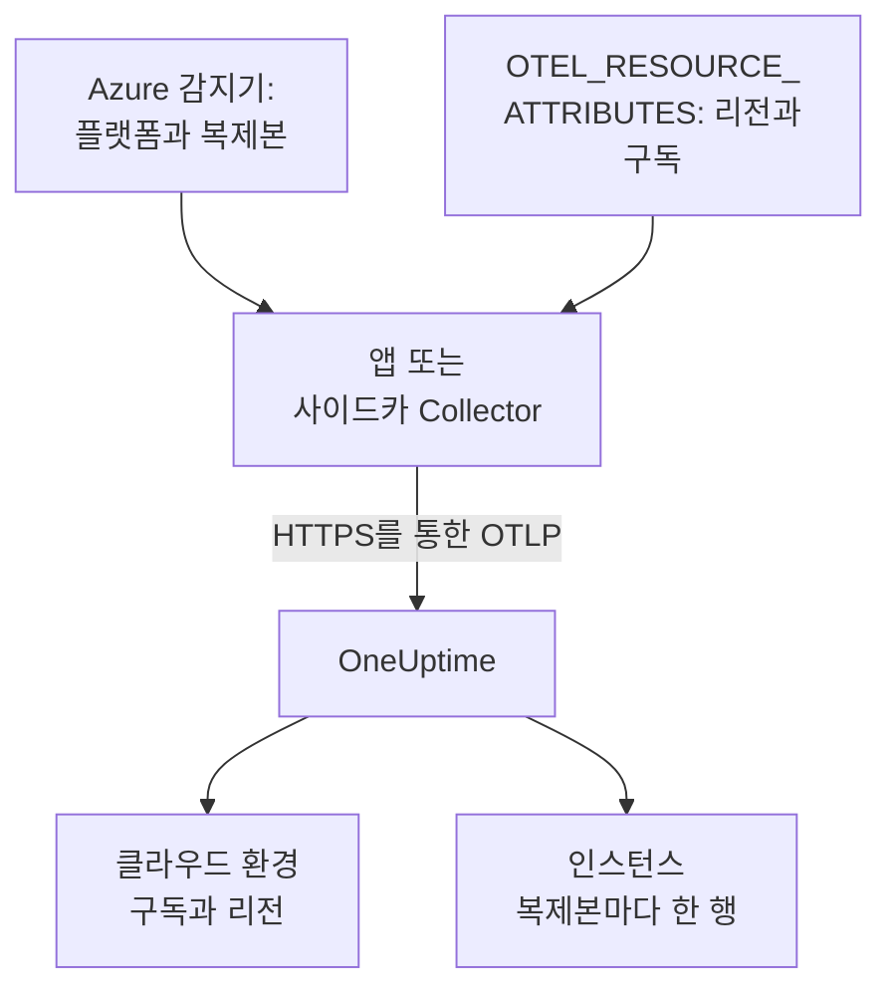

# Azure Container Apps

Azure Container Apps의 트레이스, 로그, 메트릭을 OneUptime으로 보냅니다. `cloud.platform=azure_container_apps`를 보고하는 모든 복제본은 Azure 구독과 리전마다 하나의 **Cloud Environment**(예: _Azure Container Apps · eastus · 00000000-0000-0000-0000-000000000000_)에 들어가며, 실행 중인 복제본은 **인스턴스**에 나열됩니다.

:::cards
- [작동 방식](#작동-방식): 감지기가 설정하는 것과 직접 설정하는 두 가지 속성.
- [설정](#설정): 토큰을 저장하고, Azure CLI나 포털로 앱을 구성한 뒤 확인합니다.
- [환경의 관리형 OpenTelemetry 에이전트 사용하기](#환경의-관리형-opentelemetry-에이전트-사용하기): 사이드카 없이 환경의 모든 앱 데이터를 전달합니다.
- [문제 해결](#문제-해결): 거부된 내보내기, 나타나지 않는 환경, 비어 있는 인스턴스.
:::

## 작동 방식



Container Apps에는 리소스 감지기가 있습니다. Collector의 `azurecontainerapps` 감지기, 그리고 Node.js(`@opentelemetry/resource-detector-azure`)와 .NET(`OpenTelemetry.Resources.Azure`)용 감지기입니다. 이들은 `CONTAINER_APP_NAME`과 `CONTAINER_APP_REPLICA_NAME`을 읽고 `cloud.provider`, `cloud.platform`, `service.name`, 복제본 ID를 설정합니다. 어느 것도 리전이나 구독을 모르므로 `cloud.region`과 `cloud.account.id`는 `OTEL_RESOURCE_ATTRIBUTES`에서 직접 설정합니다.

| 속성 | 값 | 용도 |
| --------------------------------- | ------------------------------------------------------------------------- | ------------------------------------------------------------ |
| `cloud.provider` | `azure` | 개요에 표시됩니다 |
| `cloud.platform` | `azure_container_apps` | 텔레메트리를 **클라우드 환경**으로 분류합니다 |
| `cloud.region` | 환경의 리전(예: `eastus`). 직접 설정합니다 | 환경 키의 일부 |
| `cloud.account.id` | 구독 ID. 직접 설정합니다 | 환경 키의 일부 |
| `azure.container_app.instance.id` | 복제본 이름. 감지기가 `CONTAINER_APP_REPLICA_NAME`에서 설정합니다 | 실행 중인 복제본 하나의 이름이 되어 **인스턴스**에 각각 한 행으로 표시됩니다 |
| `service.instance.id` | 복제본 이름(직접 설정하는 경우) | 어느 감지기도 복제본 ID를 설정하지 않았을 때 사용됩니다 |

- **점으로 구분된 표기도 동작합니다.** Node.js와 .NET 감지기는 플랫폼을 점이 들어간 `azure.container_apps`로 씁니다. OneUptime은 받을 때 이를 `azure_container_apps`로 바꾸므로 두 표기 모두 같은 환경에 들어갑니다.
- **호스트 이름이 곧 복제본 이름입니다.** `host` 감지기만 실행하는 SDK는 복제본 이름을 `host.name`으로 보고하며, 더 구체적인 값이 없으면 OneUptime이 이것으로 인스턴스 이름을 정합니다.

환경 키는 `azure_container_apps|<subscription id>|eastus`입니다.

## 시작하기 전에

- **수집 키.** **프로젝트 설정 → 텔레메트리 및 APM → 수집 키**에서 **서버** 키를 만들고 토큰을 복사합니다.
- **`containerapp` 확장이 설치된 Azure CLI**(`az extension add --name containerapp --upgrade`)로 구독에 로그인한 상태, 또는 Azure 포털.
- **OpenTelemetry SDK로 계측한 애플리케이션**(OTLP를 내보내는 것).

## 텔레메트리가 앱을 떠나는 방식 선택하기

| | SDK direct | Sidecar collector |
| ------------------ | ------------------------------------------- | ------------------------------------------------------------ |
| 추가 컨테이너 | 없음 | 앱 안의 `otel-collector`. 복제본의 CPU와 메모리를 함께 씁니다 |
| 속성을 설정하는 주체 | SDK와 앱의 `OTEL_RESOURCE_ATTRIBUTES` | Collector(통과하는 모든 데이터에 대해) |
| 시크릿 | `oneuptime-otlp-headers`, 헤더 전체 | `oneuptime-token`, 토큰만 |

세 번째 방법인 환경의 관리형 OpenTelemetry 에이전트를 쓰면 사이드카 없이 환경의 모든 앱 데이터를 전달할 수 있습니다. [환경의 관리형 OpenTelemetry 에이전트 사용하기](#환경의-관리형-opentelemetry-에이전트-사용하기)를 참고하세요. 아래의 각 단계에는 SDK direct와 사이드카 Collector 탭이 있습니다. 하나를 고르면 모든 단계가 그 방식을 따릅니다.

## 설정

:::steps
### Container Apps 시크릿으로 토큰 저장하기

> [!IMPORTANT]
> 토큰은 시크릿입니다. Container Apps 시크릿으로 저장하고 환경 변수에서는 `secretref:`로 참조하세요. 한 번 설정된 시크릿은 `az containerapp show`나 포털에 표시되지 않지만, 일반 환경 변수는 표시됩니다.

:::tabs
@tab SDK direct
```bash
az containerapp secret set \
  --name checkout-api \
  --resource-group my-rg \
  --secrets oneuptime-otlp-headers="x-oneuptime-token=YOUR_TELEMETRY_INGESTION_TOKEN"
```

SDK의 `OTEL_EXPORTER_OTLP_HEADERS`에는 `name=value` 헤더 전체가 필요하므로 시크릿에 이것을 담습니다.
@tab Sidecar collector
```bash
az containerapp secret set \
  --name checkout-api \
  --resource-group my-rg \
  --secrets oneuptime-token=YOUR_TELEMETRY_INGESTION_TOKEN
```

Collector가 헤더 이름을 직접 붙이므로 시크릿에는 토큰만 담습니다.
:::

포털에서는 **Azure portal → Container Apps → your app → Settings → Secrets → + Add**로 이동합니다. 키를 입력하고 유형 **Container Apps secret**을 고른 다음, 값을 붙여 넣고 **Add**를 클릭합니다.

시크릿을 Key Vault에 보관한다면 값을 복사하는 대신 시크릿을 참조하세요. 앱의 관리 ID에는 자격 증명 모음에 대한 **Key Vault Secrets User** 역할이 필요합니다:

```bash
az containerapp secret set \
  --name checkout-api --resource-group my-rg \
  --secrets "oneuptime-token=keyvaultref:https://my-vault.vault.azure.net/secrets/oneuptime-token,identityref:system"
```

### 컨테이너 앱 구성하기

:::tabs
@tab SDK direct
애플리케이션 컨테이너에 익스포터와, 어느 감지기도 모르는 속성을 설정합니다. 리전과 구독 ID는 자신의 값으로 바꾸세요:

```bash
az containerapp update \
  --name checkout-api \
  --resource-group my-rg \
  --set-env-vars \
    OTEL_SERVICE_NAME=checkout-api \
    OTEL_EXPORTER_OTLP_ENDPOINT=https://oneuptime.com/otlp \
    OTEL_EXPORTER_OTLP_PROTOCOL=http/protobuf \
    OTEL_EXPORTER_OTLP_HEADERS=secretref:oneuptime-otlp-headers \
    "OTEL_RESOURCE_ATTRIBUTES=cloud.provider=azure,cloud.platform=azure_container_apps,cloud.region=eastus,cloud.account.id=00000000-0000-0000-0000-000000000000"
```

복제본 식별자를 얻으려면 SDK의 Azure 감지기를 켭니다. Node.js에서는 `OTEL_NODE_RESOURCE_DETECTORS=env,host,os,azure`, .NET에서는 `OpenTelemetry.Resources.Azure`와 `.ConfigureResource(r => r.AddAzureContainerAppsDetector())`입니다. 이 감지기가 `CONTAINER_APP_REPLICA_NAME`에서 `azure.container_app.instance.id`를 설정합니다.

Container Apps는 환경 변수 안에 다른 환경 변수를 넣을 수 없으므로, 다른 언어에서는 `service.instance.id`를 `OTEL_RESOURCE_ATTRIBUTES`에 넣을 수 없습니다. 호스트 감지기를 켜거나(그 `host.name`이 복제본 이름입니다) 코드에서 설정하세요:

```js title="tracing.js"
// Node.js: the file you load with --require before the app starts
const { NodeSDK } = require("@opentelemetry/sdk-node");
const { resourceFromAttributes } = require("@opentelemetry/resources");

const sdk = new NodeSDK({
  resource: resourceFromAttributes({
    "service.instance.id": process.env.CONTAINER_APP_REPLICA_NAME,
  }),
});
sdk.start();
```

```python title="tracing.py"
# Python: before the tracer provider is created
import os
from opentelemetry.sdk.resources import Resource

resource = Resource.create({"service.instance.id": os.environ.get("CONTAINER_APP_REPLICA_NAME", "")})
```

어떤 감지기를 쓰든 `cloud.region`과 `cloud.account.id`는 `OTEL_RESOURCE_ATTRIBUTES`에 남겨 두세요. Container Apps 감지기 중 어느 것도 이 값을 설정하지 않으며, 환경 키에는 이 값이 필요합니다.

포털에서는 다음과 같이 합니다:

1. **Application → Containers → Edit and deploy**를 열고, **Container** 탭에서 컨테이너를 선택한 다음 **Edit**를 클릭합니다.
2. **Environment variables**에서 위의 각 변수를 원본 **Manual entry**로 추가하고, `OTEL_EXPORTER_OTLP_HEADERS`는 원본 **Reference a secret**으로 `oneuptime-otlp-headers`를 가리키게 추가합니다.
3. **Save**를 클릭합니다.
@tab Sidecar collector
사이드카는 같은 복제본에서 실행되므로 같은 `CONTAINER_APP_NAME`과 `CONTAINER_APP_REPLICA_NAME`을 봅니다. 사이드카의 `azurecontainerapps` 감지기가 이를 `cloud.provider`, `cloud.platform`, `service.name`, `azure.container_app.instance.id`로 바꾸고, `env` 감지기는 Collector 자신의 환경에 있는 `OTEL_RESOURCE_ATTRIBUTES`에서 `cloud.region`과 `cloud.account.id`를 읽습니다. 애플리케이션은 `http://localhost:4318`로 내보내기만 합니다.

앱 정의를 내보내고, `template.containers`에 Collector를 추가한 다음 적용합니다:

```bash
az containerapp show --name checkout-api --resource-group my-rg -o yaml > checkout-api.yaml
# edit checkout-api.yaml as below
az containerapp update --name checkout-api --resource-group my-rg --yaml checkout-api.yaml
```

```yaml title="checkout-api.yaml"
properties:
  configuration:
    secrets:
      - name: oneuptime-token
        value: YOUR_TELEMETRY_INGESTION_TOKEN
  template:
    containers:
      - name: app
        image: myregistry.azurecr.io/checkout-api:1.4.2
        env:
          - name: OTEL_SERVICE_NAME
            value: checkout-api
          - name: OTEL_EXPORTER_OTLP_ENDPOINT
            value: http://localhost:4318
          - name: OTEL_EXPORTER_OTLP_PROTOCOL
            value: http/protobuf
        resources:
          cpu: 0.5
          memory: 1Gi
      - name: otel-collector
        image: otel/opentelemetry-collector-contrib:latest
        args:
          - --config=env:OTEL_COLLECTOR_CONFIG
        env:
          - name: ONEUPTIME_TOKEN
            secretRef: oneuptime-token
          # Read by the resourcedetection processor's env detector.
          - name: OTEL_RESOURCE_ATTRIBUTES
            value: cloud.provider=azure,cloud.platform=azure_container_apps,cloud.region=eastus,cloud.account.id=00000000-0000-0000-0000-000000000000
          - name: OTEL_COLLECTOR_CONFIG
            value: |
              receivers:
                otlp:
                  protocols:
                    http:
                      endpoint: 0.0.0.0:4318
                    grpc:
                      endpoint: 0.0.0.0:4317
              processors:
                # env: cloud.region + cloud.account.id from OTEL_RESOURCE_ATTRIBUTES.
                # azurecontainerapps: cloud.provider, cloud.platform, service.name
                # and azure.container_app.instance.id from the CONTAINER_APP_*
                # variables. override: false keeps the service.name the
                # application set instead of the Container App's name.
                resourcedetection:
                  detectors: [env, azurecontainerapps]
                  timeout: 2s
                  override: false
                batch: {}
              exporters:
                otlphttp/oneuptime:
                  endpoint: https://oneuptime.com/otlp
                  headers:
                    x-oneuptime-token: ${env:ONEUPTIME_TOKEN}
              service:
                pipelines:
                  traces:
                    receivers: [otlp]
                    processors: [resourcedetection, batch]
                    exporters: [otlphttp/oneuptime]
                  metrics:
                    receivers: [otlp]
                    processors: [resourcedetection, batch]
                    exporters: [otlphttp/oneuptime]
                  logs:
                    receivers: [otlp]
                    processors: [resourcedetection, batch]
                    exporters: [otlphttp/oneuptime]
        resources:
          cpu: 0.25
          memory: 0.5Gi
```

`az containerapp show`는 시크릿 값을 내보내지 않으므로 `secrets` 항목을 직접 다시 넣거나, 첫 단계에서 시크릿을 설정했다면 빼 두세요. 업데이트해도 기존 시크릿은 유지됩니다. Container Apps는 복제본 안 모든 컨테이너의 CPU와 메모리를 합산하므로, 사이드카의 `resources`도 앱의 할당량에 포함됩니다.

포털에서는 다음과 같이 합니다:

1. **Application → Containers → Edit and deploy**를 엽니다. **Container** 탭에서 **+ Add**로 이름 `otel-collector`, 이미지 `otel/opentelemetry-collector-contrib:latest`, **Arguments override** `--config=env:OTEL_COLLECTOR_CONFIG`인 컨테이너를 추가합니다.
2. 그 환경 변수를 추가합니다: `ONEUPTIME_TOKEN`(**Reference a secret**: `oneuptime-token`), `OTEL_RESOURCE_ATTRIBUTES`와 `OTEL_COLLECTOR_CONFIG`(**Manual entry**, 위의 값).
3. **Save**를 클릭합니다.
:::

OneUptime을 자체 호스팅한다면 엔드포인트로 `https://YOUR-ONEUPTIME-HOST/otlp`를 사용하세요.

### 새 개정 배포하기

`az containerapp update`는 그 자체로 새 개정을 배포합니다. 포털에서는 **Create**를 클릭합니다. 여러 개정이 활성 상태라면 **Revisions and replicas**에서 트래픽을 새 개정으로 옮기세요.

### 연결 확인하기

```bash
curl -i https://oneuptime.com/otlp/v1/validate \
  -H "x-oneuptime-token: YOUR_TELEMETRY_INGESTION_TOKEN"
```

`200`과 `"valid": true`는 토큰이 받아들여졌다는 뜻입니다. `401`은 토큰을 알 수 없거나, 취소되었거나, 비활성화되었거나, 만료되었다는 뜻입니다. 그런 다음 Collector의 출력을 확인합니다:

```bash
az containerapp logs show --name checkout-api --resource-group my-rg \
  --container otel-collector --follow
```

`Everything is ready`가 있고 `401`이나 `connection refused`가 없는지 확인하세요. 첫 스팬, 로그 또는 메트릭이 도착하고 1분 안에 환경이 **클라우드 → All Environments**에 _Azure Container Apps · eastus · 00000000-0000-0000-0000-000000000000_ 라는 이름으로 나타납니다.
:::

## 환경의 관리형 OpenTelemetry 에이전트 사용하기

Container Apps 환경은 Azure의 관리형 OpenTelemetry 에이전트를 실행할 수 있습니다. 이 에이전트는 환경의 모든 앱에서 OTLP를 받아 사용자가 구성한 엔드포인트로 전달하므로, 앱마다 사이드카를 둘 필요가 없습니다. 에이전트는 **OTLP/gRPC로만** 내보내므로 HTTP 경로 `/otlp`를 쓸 수 없습니다. 대신 OneUptime이 TLS를 통해 OTLP/gRPC를 받는 OneUptime 호스트의 포트 443을 가리키게 하세요:

```bash
az containerapp env telemetry otlp add \
  --name my-aca-env \
  --resource-group my-rg \
  --otlp-name oneuptime \
  --endpoint oneuptime.com:443 \
  --insecure false \
  --headers "x-oneuptime-token=YOUR_TELEMETRY_INGESTION_TOKEN" \
  --enable-open-telemetry-traces true \
  --enable-open-telemetry-logs true \
  --enable-open-telemetry-metrics true
```

- **자체 호스팅:** `YOUR-ONEUPTIME-HOST:443`을 사용하세요. 자체 호스팅 OneUptime은 TLS를 통해서만 OTLP/gRPC를 받습니다. [gRPC를 통한 OTLP](/docs/telemetry/open-telemetry#grpc를-통한-otlp)를 참고하세요.
- **속성은 여전히 앱이 설정합니다.** 에이전트는 모든 앱에 자체 `OTEL_EXPORTER_OTLP_ENDPOINT`와 `OTEL_EXPORTER_OTLP_PROTOCOL=grpc`를 넣으므로, 앱에서는 이 두 가지를 빼고 `OTEL_SERVICE_NAME`과 `OTEL_RESOURCE_ATTRIBUTES`를 유지하세요. 에이전트는 앱이 보낸 것을 그대로 전달하므로 `cloud.*`와 복제본 ID는 여전히 각 앱에서 옵니다.
- **내 `OTEL_RESOURCE_ATTRIBUTES`가 우선합니다.** 에이전트도 `OTEL_RESOURCE_ATTRIBUTES`를 설정하지만, 앱에서 설정한 값이 이를 대체합니다. 내 값에 컨테이너 앱 이름과 복제본 ID를 넣거나, 코드에서 설정하세요.

## 네트워킹

- **아웃바운드 트래픽은 기본적으로 열려 있습니다.** 환경의 수신이 외부든 내부든, 복제본은 아무 구성 없이 `oneuptime.com:443`에 닿습니다.
- **사용자 지정 VNet은 예외입니다.** `0.0.0.0/0`을 방화벽이나 NAT 게이트웨이로 보내는 사용자 정의 경로가 있는 VNet이거나, 서브넷에 네트워크 보안 그룹이 있다면, 방화벽이나 NSG에서 OneUptime 호스트(또는 자체 호스트의 포트)로 가는 TCP 443을 허용하세요.
- **VNet 안의 자체 호스팅 OneUptime**은 환경의 서브넷에서 이름을 확인하고 라우팅할 수 있어야 합니다.
- **텔레메트리에는 Azure 역할이 필요 없습니다.** Key Vault 참조를 쓸 때만 앱의 관리 ID에 자격 증명 모음에 대한 **Key Vault Secrets User**가 필요합니다.

## 얻을 수 있는 것

- **개요**: 트레이스에서 계산한 요청, 오류율, p95 지연 시간. Container Apps는 복제본의 리소스 사용량을 사이드카에 보여 주지 않으므로, 복제본 식별자를 가진 `container.cpu.utilization`과 `container.memory.usage` 메트릭을 보낼 때만 **CPU**와 **메모리** 타일이 채워집니다. 대부분의 팀은 이를 Azure Monitor에 맡깁니다.
- **인스턴스**: 복제본마다 한 행. 이름은 감지기의 `azure.container_app.instance.id`, 직접 설정했다면 `service.instance.id`, 호스트 감지기만 실행되었다면 `host.name`에서 가져옵니다.
- 환경으로 필터링된 **로그**, **트레이스**, **메트릭**, 그리고 **서비스**의 서비스별 보기.

## 문제 해결

:::details 아무것도 나타나지 않고 Collector 로그에 401이 남음
시크릿에 잘못된 값이 들어 있습니다. `oneuptime-token`은 토큰만, `oneuptime-otlp-headers`는 헤더 전체 `x-oneuptime-token=...`여야 합니다.
:::

:::details 앱은 서비스에 있지만 환경이 없음
`OTEL_RESOURCE_ATTRIBUTES`가 없거나 `cloud.platform`이 정확히 `azure_container_apps`가 아닙니다. 앱에 무엇이 있는지는 `az containerapp show ... --query properties.template.containers[].env`로 확인하세요.
:::

:::details 환경은 있지만 인스턴스가 비어 있음
리소스에 `service.instance.id`, `azure.container_app.instance.id`, `host.name` 중 어느 것도 없습니다. Collector에 `azurecontainerapps` 감지기를 추가하거나, SDK의 Azure 감지기나 호스트 감지기를 켜거나, 코드에서 `service.instance.id`를 설정하세요.
:::

:::details 구독 하나에 환경이 두 개
한 앱은 `cloud.region`(또는 `cloud.account.id`)을 설정하고 다른 앱은 설정하지 않았거나, 리전을 다르게 쓴 앱이 있습니다(`eastus`와 `East US`). 값은 글자 하나하나까지 같아야 합니다.
:::

나머지는 모두 [클라우드 문제 해결](/docs/telemetry/cloud-troubleshooting)에서 다룹니다.

## 다음 단계

:::cards
- [클라우드 환경](/docs/telemetry/cloud-environments): 환경과 인스턴스를 식별하는 방법.
- [기타 클라우드 플랫폼](/docs/telemetry/cloud-other-platforms): Azure App Service와 Azure Container Instances.
- [클라우드 문제 해결](/docs/telemetry/cloud-troubleshooting): 모든 플랫폼에 공통인 장애.
- [클라우드 리소스(IaaS 및 PaaS)](/docs/telemetry/cloud-resources): Azure Monitor에서 가져오는 구독의 모든 리소스.
:::
