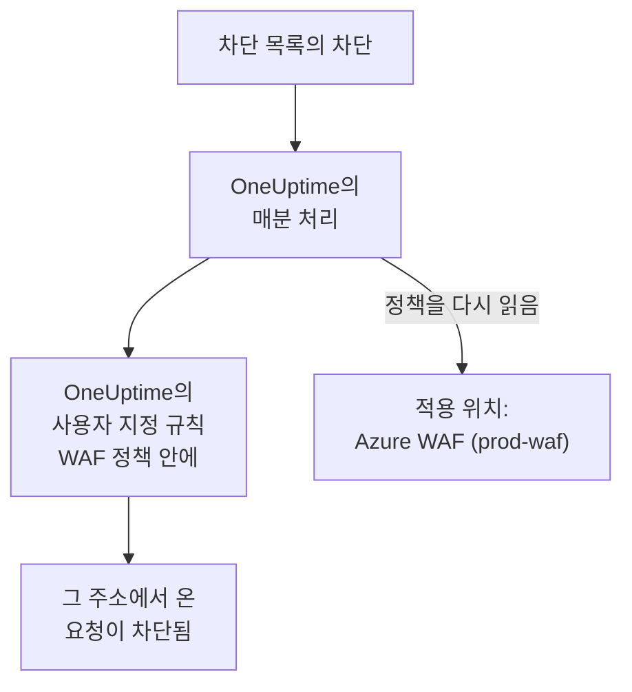

# Azure WAF에서 주소 차단

프로젝트의 차단 목록은 Application Gateway와 Front Door의 Azure WAF 정책에서 적용될 수 있습니다. 이미 있는 Azure 클라우드 연결에서 이 기능을 켜고 WAF 정책을 고르면, 차단 목록이 차단하는 모든 주소가 그곳에서 차단됩니다. 차단한 주체가 사람이든, 플레이북이든, OneUptime AI든 마찬가지입니다.

:::cards
- [켜기](#켜기): Azure 연결의 설정 하나와, 설정에 필요한 역할입니다.
- [OneUptime이 만드는 것](#oneuptime이-만드는-것): 선택한 각 정책에 두는 자체 사용자 지정 규칙입니다.
- [대조되는 주소](#대조되는-주소): 연결한 주소, 또는 프록시 뒤에 있는 원래 클라이언트입니다.
:::

## 작동 방식

OneUptime은 선택한 각 WAF 정책에 자체 사용자 지정 규칙을 두고, 차단 목록이 차단하는 주소를 그 안에 넣습니다. 매분 차단 목록의 내용으로 정책을 한 번 쓴 다음 정책을 다시 읽습니다. **차단 목록** 페이지에서 차단의 **적용 위치**는 정책이 차단을 보유하고 Azure가 변경을 적용했을 때에만 Azure WAF (prod-waf)를 표시합니다. 그 전까지는 적용되지 않은 상태입니다.

## 시작하기 전에

- OneUptime에 연결된 Azure 구독([클라우드 계정 연결](/docs/telemetry/cloud-accounts#microsoft-azure) 참고).
- 차단 목록이 적용되는 위치를 바꿀 수 있는 역할: **프로젝트 소유자**, **프로젝트 관리자** 또는 **보안 관리자**.
- Azure Cloud Shell에서 명령 하나를 실행할 수 있도록, Azure 구독에서 역할을 할당할 수 있는 사람.

## 켜기

:::steps
### 연결 열기
**클라우드 → 연결**을 열고 Azure 연결을 편집합니다.

### 설정 켜기
**추가 필드**에서 **Azure WAF에서 주소 차단**을 **켜짐**으로 설정하고 저장합니다. 이제 양식에 표시되는 설정 명령은 아래 역할을 구독 전체에 부여합니다. 이미 있는 연결은 명령을 다시 실행할 필요가 없습니다. **WAF 추가** 대화 상자가 정책 하나에만 역할을 부여하는 줄을 보여 줍니다.

### WAF 정책 추가하기
**보안 이벤트 → 플레이북 → 차단 목록**을 엽니다. **클라우드 WAF**에서 **WAF 추가**를 클릭하고 WAF 정책을 고릅니다. OneUptime은 아무것도 쓰지 않고, 연결이 그 정책에 쓸 수 있는지 Azure에 묻습니다.

### 역할이 없으면 부여하기
권한이 없으면 대화 상자에 그 정책에만 권한을 부여하는 줄이 표시됩니다. Azure Cloud Shell에서 실행하고 **다시 확인**을 클릭한 다음 정책을 추가합니다. OneUptime이 정책을 읽으면 **상태**에 **적용 중**이 표시됩니다.
:::

WAF 정책은 연결의 인벤토리에서 가져옵니다. OneUptime이 아직 읽지 않은 정책은 다음 읽기 후에 나열됩니다. 정책이 차단 목록을 적용하는 동안에는 그 연결의 설정을 끌 수 없고 연결을 삭제할 수도 없습니다. 먼저 정책을 제거해 OneUptime이 규칙을 빼도록 하세요.

## OneUptime이 만드는 것

| 항목 | 이름 | 위치 |
| --- | --- | --- |
| 사용자 지정 규칙. 각각 IP 일치 조건 하나와 Block 동작을 가짐 | `OneUptime<project>Block1`, `OneUptime<project>Block2`, ... | 선택한 각 WAF 정책 안. 최대 10개. |

`<project>`는 프로젝트 외부 ID의 처음 여덟 글자이므로, 같은 정책을 고른 두 OneUptime 프로젝트가 서로의 규칙에 쓰는 일은 없습니다. 규칙 하나에는 Application Gateway에서 주소 또는 범위 540개, CRS 3.2 또는 Default Rule Set에서는 600개, Front Door에서는 600개가 들어갑니다. 규칙 열 개로 정책 하나에 차단 5,400개 또는 6,000개가 들어가며, 들어가지 않는 차단은 해당 행에 그렇게 표시됩니다.

OneUptime은 정책에서 자체 규칙만 바꿉니다. Azure는 WAF 정책을 통째로만 쓰므로, OneUptime은 정책을 ETag와 함께 읽고 자체 규칙을 바꾼 다음 ETag를 `If-Match`에 넣어 다시 씁니다. 다른 모든 규칙, 설정, 관리형 규칙 집합은 읽은 그대로 기록됩니다. 그 사이에 다른 누군가가 정책을 썼다면 Azure가 쓰기를 거부하고, OneUptime은 정책을 다시 읽어 그 사람이 쓴 내용 위에 변경을 적용합니다.

## 정책에서 규칙의 위치

OneUptime은 자체 규칙을 트래픽을 허용하는 첫 번째 규칙보다 앞의 빈 우선순위에, 가장 낮은 번호부터 둡니다. 그래서 사용자의 어떤 규칙도 차단된 주소를 통과시키지 않습니다. 차단하거나 기록하는 사용자의 규칙은 그보다 앞에 있어도 됩니다. OneUptime은 사용자의 규칙 번호를 바꾸거나 규칙을 변경하거나 제거하지 않습니다. 첫 번째 Allow 규칙보다 앞에 빈 우선순위가 없으면 정책에 **빈 우선순위 없음**이 표시되고, 하나를 비우면 OneUptime이 규칙을 추가합니다.

## 대조되는 주소

| WAF 정책 | 클라이언트 주소 | 고를 때 |
| --- | --- | --- |
| Front Door | **Front Door에 연결한 주소(SocketAddr)** | 기본값입니다. |
| Front Door | X-Forwarded-For의 원래 클라이언트(RemoteAddr) | 다른 프록시나 CDN 뒤에 있는 Front Door의 경우. |
| Application Gateway | 게이트웨이에 연결한 주소(RemoteAddr) | 유일한 선택지입니다. 그 IP 일치는 다른 주소를 읽지 않습니다. |

Front Door는 `RemoteAddr`를 `X-Forwarded-For` 헤더에서 가져오는데, 이 헤더는 Front Door에 직접 연결하는 클라이언트가 스스로 쓸 수 있습니다. Front Door 앞의 다른 프록시나 CDN이 이 헤더를 쓰는 경우에만 고르세요. 이 선택은 **WAF 추가** 대화 상자의 **추가 필드**에 있으며, 나중에 정책 행의 **클라이언트 주소**로 바꿀 수 있습니다.

Application Gateway의 IP 일치는 IPv4 주소만 읽으므로, IPv6 차단은 그곳에서 적용되지 않으며 해당 행에 이유가 표시됩니다.

Azure WAF에서 OneUptime의 규칙은 차단만 합니다. 주소에 챌린지를 요청하는 차단은 Azure WAF에서 적용되지 않으며, 그렇게 표시됩니다. 자동 대응 정책의 챌린지는 그곳에서 같은 기간 동안의 차단으로 적용됩니다.

## 변경에 걸리는 시간

Application Gateway는 Azure가 변경을 쓰는 즉시 적용합니다. Front Door는 변경을 받아들인 뒤 몇 분에 걸쳐 에지로 퍼뜨립니다. 이때 정책에 **반영 중**이 표시되며, 새 차단의 **적용 위치**는 Azure가 프로비저닝 완료를 보고할 때까지 정책을 기다립니다. 그때부터 차단이 적용됩니다.

## 규칙이 수동으로 변경된 경우

누군가 Azure에서 OneUptime의 규칙 중 하나를 끄거나 변경하거나 삭제하면, OneUptime은 그 상태 그대로 둡니다. 정책에 **수동으로 변경됨**이 표시되고, 그 규칙에 있던 차단은 누군가 정책 행에서 **되돌리기**를 클릭할 때까지 이유와 함께 적용되지 않습니다. '되돌리기'는 OneUptime이 쓰는 방식대로 규칙을 다시 쓰며, 원래 우선순위가 비어 있으면 그 우선순위에 둡니다.

아무것도 차단하지 않는 정책도 그렇게 표시되며, 그 차단은 적용되지 않습니다.

- 꺼져 있는 정책.
- **Detection** 모드인 정책. OneUptime의 규칙과 일치하는 것을 기록만 합니다.
- 애플리케이션 게이트웨이, 리스너, 경로 규칙, Front Door 도메인 중 어디에도 연결되지 않은 정책.

## Terraform에서 정책 관리

Terraform도 WAF 정책을 통째로 쓰므로, 다음 plan에서 OneUptime의 규칙이 제거됩니다. OneUptime이 규칙을 유지하게 하려면 `azurerm_web_application_firewall_policy`의 `lifecycle` 블록에 `ignore_changes = [custom_rules]`를, `azurerm_cdn_frontdoor_firewall_policy`라면 `ignore_changes = [custom_rule]`를 추가하고, 사용자 지정 규칙은 그 정책의 코드에 두지 마세요.

## 권한

설정 명령은 사용자 지정 역할 `OneUptime WAF Blocklist`를 추가하고, 구독에서 연결의 앱에 할당합니다. **WAF 추가** 대화 상자에 표시되는 줄은 같은 역할을 정책 하나에만 할당합니다.

| 작업 | 이유 |
| --- | --- |
| `Microsoft.Network/ApplicationGatewayWebApplicationFirewallPolicies/read`, `Microsoft.Network/ApplicationGatewayWebApplicationFirewallPolicies/write` | Application Gateway WAF 정책을 읽고 그 안에 OneUptime의 규칙을 씁니다. |
| `Microsoft.Network/FrontDoorWebApplicationFirewallPolicies/read`, `Microsoft.Network/FrontDoorWebApplicationFirewallPolicies/write` | Front Door WAF 정책을 읽고 그 안에 OneUptime의 규칙을 씁니다. |

이 역할은 정책을 삭제할 수 없으며, OneUptime은 그 밖의 것을 쓰지 않습니다.

## 제거

:::steps
### WAF 정책 제거
**보안 이벤트 → 플레이북 → 차단 목록**에서 정책 행의 **제거**를 클릭합니다. OneUptime은 정책에서 자체 규칙을 빼고, 그 밖에는 아무것도 바꾸지 않습니다.

### 설정 끄기
연결을 편집해 **Azure WAF에서 주소 차단**을 **꺼짐**으로 설정하고 저장합니다. 이 설정은 연결의 어떤 정책도 차단 목록을 적용하지 않게 되면 끌 수 있습니다.
:::

OneUptime이 더 이상 정책에 쓸 수 없다면 **WAF 제거** 대화 상자에서 **OneUptime에서만 제거**를 선택합니다. OneUptime은 정책을 차단 목록에서 제거하고, 정책에 남긴 규칙의 이름을 알려 줍니다. 이 규칙들은 Azure에서 삭제할 때까지 담고 있는 주소를 계속 차단합니다.

## 문제 해결

:::details 적용 안 됨
정책의 상태에는 Azure가 응답한 내용과 해야 할 일이 표시됩니다. 거부된 경우에는 없는 권한이 표시됩니다. **WAF 추가**가 이 정책에 대해 보여 주는 줄을 실행한 다음 **다시 확인**을 클릭하세요.
:::

:::details 빈 우선순위 없음
트래픽을 허용하는 첫 번째 규칙이 우선순위 1에 있거나, 그 앞의 우선순위가 모두 사용 중입니다. 그 규칙의 우선순위 번호를 더 크게 한 다음 **다시 확인**을 클릭하세요.
:::

:::details 정책이 목록에 없음
OneUptime은 설정이 켜진 연결의 WAF 정책을, 읽고 난 뒤에 나열합니다. 그 이후에 추가된 정책은 연결을 다음에 읽은 후 나타납니다.
:::

## 다음 단계

:::cards
- [보안 케이스 및 플레이북](/docs/telemetry/security-cases): 케이스에서 주소를 차단하고, 그 단계가 확인되는 것을 봅니다.
- [클라우드 계정 연결](/docs/telemetry/cloud-accounts): 이 설정이 속한 연결입니다.
:::
