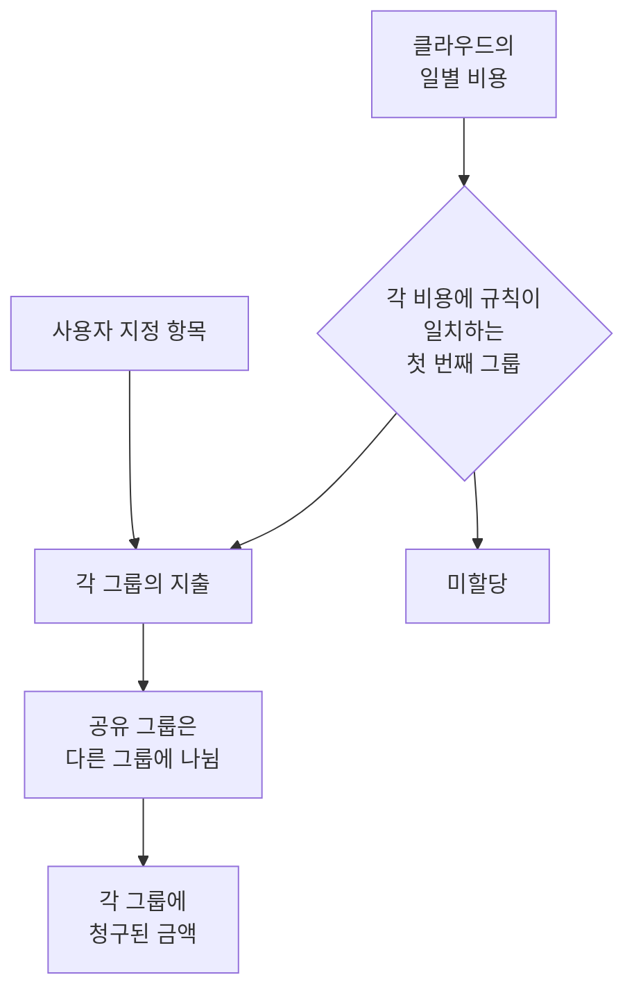

# 클라우드 비용 배분

비용 그룹은 매달 클라우드 청구서의 첫 질문, 누가 썼는가에 답합니다. "팀별"이나 "비용 센터별" 같은 **비용 보기**는 연결된 계정의 지출을 규칙에 따라 **비용 그룹**으로 분류하며, 어떤 것도 중복 집계하지 않습니다. 어떤 규칙에도 일치하지 않는 지출은 미할당 지출로 그대로 드러나고, 공유 비용은 그룹 간에 나뉩니다. **클라우드 → 지출 → 비용 그룹**에서 찾을 수 있습니다.

:::cards
- [보기 만들기](#보기-만들기): 이미 설정한 소유자를 바탕으로 팀별, 태그별 또는 직접 만드는 그룹으로.
- [그룹 규칙 작성](#그룹-규칙-작성): 계정, 서비스, 태그, 소유자 팀, 레이블 등.
- [미할당 지출](#미할당-지출): 어떤 규칙에도 일치하지 않는 지출과, 이를 분류하는 한 번의 클릭.
- [공유 비용](#공유-비용): 지원 플랜이나 공유 클러스터를 그룹 간에 나눕니다.
:::

## 작동 방식



- **처음 일치하는 그룹이 비용을 가져갑니다.** 보기의 그룹에는 순서가 있으며, 각 비용은 규칙이 일치하는 첫 번째 그룹에 들어가므로 중복 집계되지 않습니다. 그룹과 미할당 지출을 합하면 항상 기간 합계가 됩니다.
- **규칙은 비용에 담긴 모든 정보를 읽습니다.** 계정, 클라우드, 서비스, 지역, 리소스와 그 태그, 그리고 OneUptime이 리소스에 대해 아는 정보, 즉 소유자 팀, 레이블, App Platforms 환경과 앱입니다.
- **모든 것은 볼 때 계산됩니다.** 비용별로 저장되는 것은 없습니다. 규칙을 바꾸면 OneUptime이 보관하는 모든 달이 최대 400일 전까지 다시 분류되며, 기다릴 필요가 없습니다.
- **여러 보기가 같은 지출을 분류할 수 있습니다.** "팀별"과 "비용 센터별"은 각자의 방식으로 전체 지출을 분류합니다.

## 시작하기 전에

- **읽히는 비용.** [클라우드 계정을 연결](/docs/telemetry/cloud-accounts)하고 [비용을 읽게](/docs/telemetry/cloud-costs) 하세요.
- **원한다면 태그나 소유자.** 태그 규칙에는 해당 태그가 붙은 비용이 필요합니다. AWS에서는 [리소스별 비용](/docs/telemetry/cloud-costs#리소스별-비용)을 켜세요. 소유자 팀은 직접 또는 [소유자 규칙](/docs/configuration/label-and-owner-rules)으로 설정한 각 리소스의 소유자에서 나옵니다.

## 보기 만들기

**클라우드 → 지출 → 비용 그룹**을 엽니다. 아직 보기가 없는 프로젝트에는 세 가지 시작 방법이 제공됩니다.

| 시작 | 만들어지는 것 |
| --- | --- |
| **팀별, 소유자 기준** | 클라우드 리소스를 소유한 팀마다 하나의 그룹으로, 해당 팀에 연결됩니다. |
| **태그별** | 비용에 붙은 태그의 값마다 하나의 그룹. 예: `team` 또는 `cost-center`. |
| **직접 만드는 그룹** | 빈 보기. 각 그룹의 규칙을 직접 작성합니다. |

태그별 또는 소유자 팀별 보기의 그룹은 저장할 때 OneUptime이 만들고, 이후 새 태그 값과 소유자가 나타날 때마다 매시간 만듭니다. 이 그룹의 이름을 바꾸거나, 팀에 연결하거나, 공유할 수 있습니다. 규칙은 OneUptime이 관리합니다. 빠진 그룹을 지금 만들려면 보기를 열고 **지금 그룹 만들기**를 누르세요.

## 그룹 규칙 작성

보기를 연 다음 **그룹**에서 **비용 그룹 만들기**를 선택합니다. 그룹의 규칙 중 **하나라도** 일치하면 비용은 그 그룹의 것이 되고, 규칙은 조건이 **모두** 일치할 때 일치합니다. 조건은 비용에 담긴 정보 하나를 선택하거나 입력한 값과 비교합니다.

| 필드 | 읽는 내용 |
| --- | --- |
| **태그** | 태그 키로 지정한 태그의 값. **설정됨**과 **설정되지 않음**은 비용에 그 태그가 있는지 확인합니다. |
| **계정** | 비용이 청구되는 연결된 계정. |
| **소유자 팀** | OneUptime에서 리소스를 소유한 팀. |
| **서비스** | 클라우드 청구에서 부르는 서비스 이름. |
| **레이블** | OneUptime에서 리소스 또는 그 계정에 붙은 레이블. |
| **지역** | 지역. 전역 서비스라면 값을 비워 두세요. |
| **클라우드** | AWS, Azure 또는 Google Cloud. |
| **리소스** | 클라우드에서 부르는 리소스 이름. |
| **App Platforms 환경** 및 **앱** | **클라우드 → 지출 → 비용**이 집계하는 방식으로 환경이나 앱에 청구된 금액. |
| **Kubernetes 네임스페이스** 및 **Kubernetes 클러스터** | 공유 그룹을 네임스페이스로 나눌 때의 클러스터 네임스페이스. [Kubernetes 클러스터](#kubernetes-클러스터)를 참고하세요. |

텍스트는 대소문자를 구분하지 않고 비교합니다. `Payments`와 `payments`는 같은 팀입니다. 태그 키는 클라우드가 보관하는 표기 그대로 비교합니다.

예를 들어 규칙이 세 개인 **결제** 그룹은 `team: payments` 태그가 붙은 비용, **또는** payments 계정에 청구된 비용, **또는** 결제 팀이 소유한 비용을 가져갑니다.

### 그룹 순서

**그룹**에서 그룹을 드래그하여 순서를 바꿉니다. 앞선 그룹이 이미 규칙을 모두 포함하는 그룹은 비용을 가져갈 수 없으며, 해당 행에 모든 비용을 가져가는 그룹이 표시됩니다. 앞선 그룹이 가져가는 비용에도 규칙이 일치하는 그룹에는 그중 얼마를 받는지 표시됩니다.

### 소유자 팀이 여럿인 리소스

두 팀이 소유한 리소스는 팀 간에 균등하게 나뉩니다. 각 팀의 절반은 따로 규칙을 거칩니다. 태그나 계정처럼 소유자를 묻지 않는 규칙은 여전히 비용 전체를 가져갑니다. 팀에 그룹이 없는 절반은 미할당으로 남습니다.

## 미할당 지출

보기 페이지에는 아직 어떤 규칙에도 일치하지 않는 지출이, 그것을 이루는 서비스, 계정, 태그 값, 소유자 팀으로 비싼 순서대로 표시됩니다. 그중 하나 옆의 **그룹에 추가**를 누르면 그에 대한 규칙을 그룹이나 새 그룹에 추가할 수 있습니다. 해당 비용은 지난달을 포함해 즉시 그룹으로 옮겨집니다.

## 공유 비용

지원 플랜, 공유 클러스터, 네트워크 허브는 모두의 것입니다. 이를 별도의 그룹으로 만든 다음, **추가 필드**에서 **공유됨**을 켜고 그 비용을 보기의 다른 그룹에 어떻게 나눌지 선택하세요.

| 분배 | 방법 |
| --- | --- |
| **지출 비율로 나누기** | 각 그룹이 그달 다른 그룹들의 클라우드 지출에서 차지하는 비율만큼 가져갑니다. 지출이 없던 달은 균등하게 나뉩니다. |
| **균등하게 나누기** | 각 그룹에 같은 금액. |
| **고정 비율로 나누기** | 그룹마다 설정한 비율(합계 100). |
| **Kubernetes 네임스페이스로 나누기** | 그달 클러스터의 각 네임스페이스 비용. 아래를 참고하세요. |

공유 그룹의 비용은 각 달의 비율로 하루 단위로 나뉘므로, 한 달은 일 단위로 읽든 월 단위로 읽든 같은 숫자가 됩니다. 미할당 지출은 분배를 받지 않습니다.

### Kubernetes 클러스터

클러스터의 노드는 클라우드가 청구하고, 각 네임스페이스의 사용량은 클러스터 자체의 비용 엔진이 알려 줍니다. 공유 클러스터 안의 워크로드를 각 팀에 청구하려면 다음과 같이 하세요.

1. 클러스터 노드에 규칙이 일치하는 그룹을 만듭니다. 예: **태그** `eks:cluster-name` **다음 중 하나임** `prod`.
2. **공유됨**을 켜고 **Kubernetes 네임스페이스로 나누기**를 선택한 다음 **Kubernetes 클러스터**를 고릅니다.
3. 팀 그룹에 네임스페이스의 레이블(태그로 취급됨)을 읽는 규칙을 줍니다. 예: **태그** `team` **다음 중 하나임** `payments`, 또는 **Kubernetes 네임스페이스** **시작하는 값** `payments-`.

매달 노드 비용은 클러스터 [비용 엔진](/docs/telemetry/kubernetes-cost)에서 각 네임스페이스가 쓴 비용에 따라 나뉘고, 각 네임스페이스의 몫은 규칙이 일치하는 첫 번째 그룹으로 갑니다. 유휴 용량과 어떤 그룹에도 들어가지 않는 네임스페이스는 클러스터 그룹에 남습니다. 클러스터 자체가 산정한 비용은 청구액에 더해지지 않으므로 중복 집계되지 않습니다.

## 사용자 지정 항목

**클라우드 → 지출 → 비용 그룹**의 **사용자 지정 항목**에서 클라우드 청구서에 없는 청구나 크레딧을 추가하세요. 지원 계약 분담분, 기업 할인, 내부 마크업, 플랫폼 수수료 등입니다.

- **한 번 또는 매월.** 월별 항목은 매월의 날짜에 나누어 배분되므로, 한 달의 일부에는 그만큼만 계산됩니다.
- **계정 또는 그룹에.** 계정에 추가한 항목은 계정의 비용처럼 각 보기의 규칙을 거칩니다. 그룹에 추가한 항목은 그 그룹으로 바로 갑니다.
- **항상 따로.** 모든 숫자에서 항목은 클라우드가 청구한 금액과 따로 표시되므로, 클라우드 자체의 숫자는 여전히 콘솔과 일치합니다.

## 각 그룹의 지출 보기

- **클라우드 → 지출 → 비용**: **비용이 쓰이는 곳**에서 **비용 그룹**과 보기를 선택합니다. 각 그룹의 지출을 이전 기간과 비교해 보여 줍니다.
- **보기 페이지**: 공유 비용을 포함해 각 그룹에 청구된 금액, 어떤 규칙에도 일치하지 않는 지출, 그리고 월별 차지백을 위한 **CSV 다운로드**.
- **그룹 페이지**: 일별 지출, 가장 많이 청구된 서비스, 리소스, 계정, 그리고 규칙. 그 그룹의 지출만 보여 주므로 그룹을 **팀**에 연결하고 팀에 페이지를 보내세요. 클라우드 지출을 읽을 수 있는 사람이면 누구나 열 수 있습니다.

## API, CLI 및 MCP

보기, 그룹, 항목은 API 리소스(`cloud-cost-view`, `cloud-cost-group`, `cloud-cost-line-item`)이며, 다른 리소스처럼 CLI 명령과 MCP 도구가 있습니다. 그룹의 규칙은 JSON입니다.

```json
[
  { "conditions": [{ "field": "tag", "key": "team", "operator": "is", "values": ["payments"] }] },
  { "conditions": [{ "field": "ownerTeam", "operator": "is", "values": ["<team ID>"] }] }
]
```

보기가 분류한 결과를 `startDate`부터 `endDate`까지 UTC 일 단위로 읽으려면:

```bash
curl -X POST "https://oneuptime.com/api/cloud-cost-view/<view ID>/allocation" \
  -H "apikey: <API key>" -H "tenantid: <project ID>" -H "Content-Type: application/json" \
  -d '{"startDate": "2026-11-01", "endDate": "2026-11-30", "currency": "USD"}'
```

응답에는 각 그룹의 `total`과 그 구성(`cloud`, `lineItems`, `sharedIn`, `sharedOut`), 일별 또는 월별 숫자, 이전 기간, 미할당 지출의 구성이 들어 있습니다. `POST /cloud-cost-group/<group ID>/spend`는 한 그룹에 대해 응답합니다.

## 제한

- 보기에는 그룹이 최대 500개까지 들어갑니다. 태그별 보기는 비용이 가장 큰 값 500개에 대해 그룹을 만듭니다.
- 그룹의 규칙은 최대 25개, 규칙의 조건은 최대 20개, 조건의 값은 최대 200개입니다.
- 비용은 400일 동안 보관되므로 보기는 최대 400일을 읽습니다.

## 문제 해결

:::details 그룹에 아무것도 들어가지 않음
규칙이 아직 어떤 비용에도 일치하지 않거나, 규칙이 일치하는 비용을 앞선 그룹이 모두 가져가고 있을 수 있습니다. 그러면 **그룹**의 해당 행에 그 그룹이 표시됩니다. 이 그룹을 그 위로 드래그하거나 앞선 그룹의 규칙 범위를 좁히세요.
:::

:::details 비용이 잘못된 그룹에 들어감
비용은 규칙이 일치하는 첫 번째 그룹에 들어갑니다. 비용이 속해야 할 그룹을 그 비용을 가져가는 그룹 위로 드래그하거나, 그 그룹의 규칙 범위를 좁히세요.
:::

:::details 태그 규칙이 아무것과도 일치하지 않음
비용은 읽힐 때의 태그를 유지합니다. Google Cloud 청구 내보내기의 레이블, 그것이 없으면 청구 대상 리소스의 태그이며, AWS에서는 [리소스별 비용](/docs/telemetry/cloud-costs#리소스별-비용)이 필요합니다. 태그 키는 표기 그대로 비교합니다.
:::

:::details 태그별 또는 소유자 팀별 보기에 그룹이 빠짐
OneUptime은 빠진 그룹을 매시간 만듭니다. 지난 400일 비용의 태그 값마다, 또는 클라우드 리소스를 소유한 팀마다 하나씩, 최대 500개까지입니다. 바로 만들려면 보기 페이지에서 **지금 그룹 만들기**를 누르세요.
:::

:::details 숫자에서 계정이 빠짐
보기의 숫자는 대부분의 계정이 청구되는 통화로 표시됩니다. 다른 통화로 청구되는 계정은 제외되며, 다른 통화의 항목도 마찬가지입니다.
:::

## 다음 단계

:::cards
- [클라우드 비용과 절감](/docs/telemetry/cloud-costs): 연결된 계정의 비용과 지출을 줄이는 방법.
- [레이블 및 소유자 규칙](/docs/configuration/label-and-owner-rules): 규칙이 읽을 소유자 팀과 레이블을 리소스에 지정합니다.
- [Kubernetes 비용 옵저버빌리티](/docs/telemetry/kubernetes-cost): Kubernetes 워크로드별 비용.
:::
