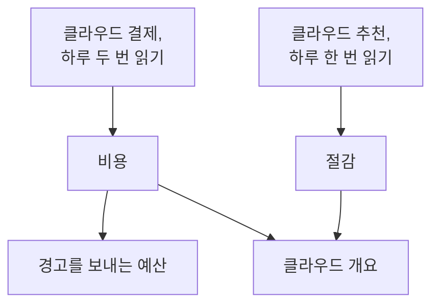

# 클라우드 비용과 절감

연결된 클라우드 계정은 그 비용과 비용을 줄이는 방법도 알려 줍니다. OneUptime은 클라우드 자체 결제에서 매일의 비용을, 클라우드 자체 추천 서비스에서 추천을 읽어 **클라우드 → 지출 → 비용**과 **클라우드 → 지출 → 절감**에 표시하고, Savings Plans, 예약, 약정 사용 할인을 **클라우드 → 지출 → 약정**에 나열하며, 한 달 비용이 예산을 넘기 전에 **클라우드 → 지출 → 예산**에서 경고를 보냅니다.

:::cards
- [Amazon Web Services](#amazon-web-services): Cost Explorer와 Cost Optimization Hub. 각각 한 번만 켭니다.
- [Microsoft Azure](#microsoft-azure): Cost Management와 Azure Advisor. 역할이 하나 더 필요합니다.
- [Google Cloud](#google-cloud): BigQuery로의 결제 내보내기와 Recommender.
- [청구 비용, 상각 비용, 순비용](#청구-비용-상각-비용-순비용): 모든 비용을 세 가지 방식으로 보관해, 약정과 크레딧이 돈이 실제로 쓰인 곳에 반영됩니다.
- [약정과 갱신](#약정과-갱신): 모든 약정, 약정이 끝나기 전이나 덜 쓰이는 동안의 경고, 그리고 무엇을 갱신하거나 구매할지.
- [예산](#예산): 한 달 지출이 예산의 일정 비율을 넘으면 보내는 경고.
:::

## 작동 방식



- **비용은 클라우드 자체 결제에서 가져옵니다.** AWS Cost Explorer, Azure Cost Management, Google Cloud의 BigQuery 결제 내보내기에서 계정의 청구 통화로 읽으며, 각각을 청구 비용, 상각 비용, 순비용으로 보관합니다. [청구 비용, 상각 비용, 순비용](#청구-비용-상각-비용-순비용)을 참조하세요. 각 금액은 하루치이며, 클라우드가 청구하는 대로 UTC 날짜 기준입니다.
- **클라우드는 마지막 하루 이틀을 늦게 보고합니다.** 각 읽기는 지난 한 주를 다시 읽고, 매달 첫 며칠에는 지난달 전체를 다시 읽으므로, 클라우드가 하루를 마감하면서 그날의 비용이 확정됩니다. 연결의 첫 읽기는 지지난달 초까지 거슬러 올라갑니다.
- **이번 달 예상은 지난 한 주의 속도를 따릅니다.** 이번 달 지금까지의 비용에, 남은 날마다 지난 온전한 이레의 평균을 더한 값입니다.
- **절감은 클라우드 자체 추천 서비스에서 가져옵니다.** AWS Cost Optimization Hub, Azure Advisor, Google Cloud의 Recommender가 더 작은 크기, 쓰이지 않는 리소스, 이득이 되는 약정을 각각 매달 절감할 금액과 함께 알려 줍니다. 클라우드 콘솔에서 실행하거나 무시한 추천은 다음 읽기에서 사라집니다.

## 시작하기 전에

- **연결된 계정.** 현재 설정 명령으로 [클라우드 계정 연결](/docs/telemetry/cloud-accounts)을 진행합니다. 이 명령으로 연결이 비용과 추천을 읽을 수 있습니다. 이전에 만든 연결은 명령을 다시 실행할 때까지 둘 다 읽지 않습니다.

## Amazon Web Services

연결은 비용을 `ce:GetCostAndUsage`로, 약정을 `ce:GetSavingsPlansCoverage`, `ce:GetSavingsPlansUtilization`, `ce:GetSavingsPlansUtilizationDetails`, `ce:GetReservationCoverage`, `ce:GetReservationUtilization`로, 구매한 Savings Plans를 `savingsplans:DescribeSavingsPlans`로, 추천을 `cost-optimization-hub:ListRecommendations`와 `cost-optimization-hub:GetRecommendation`으로 읽습니다. 설정 명령은 Cost Explorer의 읽기를 `ce:GetCostAndUsage*`, `ce:GetSavingsPlans*`, `ce:GetReservation*`의 세 가지 계열로 부여하며, 모두 읽기 전용입니다. 액세스 키 사용자의 정책이 IAM이 허용하는 2,048자 안에 들어가도록 하기 위해서입니다. Cost Explorer와 Cost Optimization Hub는 먼저 계정에서 켜야 합니다.

:::steps
### Cost Explorer 켜기

AWS Billing and Cost Management 콘솔에서 Cost Explorer를 한 번 엽니다. AWS는 하루 안에 계정의 비용을 준비합니다. 모든 멤버 계정의 비용을 읽으려면 조직의 관리 계정을 연결합니다.

### Cost Optimization Hub 참여하기

같은 콘솔에서 Cost Optimization Hub를 열고 참여합니다. 조직이라면 관리 계정에서, 이 계정만이라면 이 계정에서 진행합니다. 추천은 하루 안에 도착합니다.
:::

Cost Explorer는 요청당 $0.01를 청구합니다. 비용 읽기 한 번에 요청을 두 번 또는 그보다 조금 더 보내고(청구 비용과 상각 비용에 한 번, 순비용에 한 번), 약정은 커버리지와 사용률에 하루 네 번, 각 약정 자체에 하루 여섯 번에서 열두 번 더 요청해 읽습니다. Savings Plans API와 Cost Optimization Hub는 무료입니다.

### 리소스별 비용

리소스 수준 데이터를 켜면 Cost Explorer는 지난 14일 동안 각 리소스의 비용도 알려 줍니다. AWS Billing and Cost Management 콘솔에서 Cost Management 기본 설정을 열고 일별 단위로 리소스 수준 데이터를 켜세요. 조직이라면 관리 계정에서 켭니다. AWS는 48시간 안에 데이터를 준비합니다.

그런 다음 **클라우드 → 연결**에서 연결을 편집하고 **추가 필드**에서 **리소스별 비용**을 켜세요. 연결은 하루에 한 번 `ce:GetCostAndUsageWithResources`로 읽습니다. 처음에는 14일 치를, 그 뒤로는 최근 사흘 치를 다시 읽으며 매번 요청을 몇 번 보냅니다. 읽은 내용은 Cost Explorer가 잊은 뒤에도 계정의 비용과 함께 남습니다. 이전에 만든 연결은 설정 명령을 다시 실행해 이 작업을 추가해야 합니다.

## Microsoft Azure

앱은 **Cost Management Reader** 역할로 비용을 읽습니다. 범위는 **Monitoring Reader**와 같으며, 설정 명령이 두 역할을 모두 부여합니다. Azure Advisor의 추천은 **Monitoring Reader**로 읽으므로 켤 것이 없습니다. 이전에 만든 앱에 역할을 부여하려면 다음을 실행합니다.

```bash
az role assignment create --assignee <APP_ID> --role "Cost Management Reader" --scope /subscriptions/<SUBSCRIPTION_ID>
```

Cost Management는 구독마다 각 비용의 대상 리소스와 함께 응답하며, 읽기는 무료입니다. 어떤 구독에 대해 응답하지 못하면 계정의 **비용**에 이유가 표시됩니다.

Cost Management는 테넌트의 비용을 읽는 속도를 읽는 모든 사람에게 똑같이 제한합니다. 각 쿼리는 읽는 데이터의 달마다 쿼리 처리 단위(QPU)를 소비하며, 테넌트에는 10초마다 12 QPU, 분당 60, 시간당 600이 있습니다. OneUptime은 테넌트의 구독을 각 한도의 삼분의 이 안에서 차례로 읽고, Cost Management가 쿼리를 거절하면 요청한 만큼 기다리며, 다음 읽기에서 멈춘 곳부터 이어 읽습니다. 아직 읽지 않은 구독에는 **대기열에 있음**과 읽을 시각이 표시되고, 이미 금액이 있는 구독은 그동안에도 금액을 유지합니다. 구독의 상각 비용은 읽을 때마다, 실제 비용은 하루에 한 번 읽으므로, 구독의 첫 읽기는 Cost Management에 두 번 쿼리하고 쿼리 단위를 두 배로 씁니다. 큰 테넌트는 첫 금액이 나오기까지 읽기가 몇 번 더 걸립니다.

테넌트의 예약과 절약 플랜은 **Reservations Reader**와 **Savings plan Reader**로 읽습니다. Azure는 이 역할을 테넌트 자체 범위에서 부여하며, 그곳에서는 권한이 상승된 전역 관리자만 부여할 수 있습니다. 설정 명령은 부여를 시도하고, 할 수 없으면 그렇다고 표시합니다. 나중에 부여하려면 권한이 상승된 전역 관리자로 다음을 실행합니다.

```bash
az role assignment create --assignee <APP_ID> --role "Reservations Reader" --scope /providers/Microsoft.Capacity
az role assignment create --assignee <APP_ID> --role "Savings plan Reader" --scope /providers/Microsoft.BillingBenefits
```

이 역할이 없어도 비용과 추천은 이전처럼 읽히며, **클라우드 → 지출 → 약정**에 부여할 역할이 표시됩니다.

## Google Cloud

Google Cloud에는 프로젝트 비용을 알려 주는 API가 없습니다. OneUptime은 결제 계정의 BigQuery 내보내기에서 비용을 읽습니다.

:::steps
### 결제를 BigQuery로 내보내기

Google Cloud 콘솔에서 Billing, 이어서 Billing export를 열고, 세부 사용 비용 내보내기를 BigQuery 데이터 세트로 켭니다. Google은 켠 날부터 몇 시간 늦게 기록합니다.

### 서비스 계정이 읽도록 허용하기

연결의 서비스 계정에 내보내기 데이터 세트에 대한 **BigQuery Data Viewer**를 부여합니다. 설정 명령이 이미 **BigQuery Job User**를 부여했으므로 쿼리는 자체 프로젝트에서 실행됩니다.

### 내보내기 테이블 지정하기

**클라우드 → 연결**에서 연결을 편집하고, **추가 필드**의 **결제 내보내기 테이블**을 테이블의 전체 이름으로 설정합니다: `<PROJECT_ID>.<DATASET>.gcp_billing_export_resource_v1_<BILLING_ACCOUNT_ID>`.
:::

세부 내보내기에는 각 비용의 대상 리소스가 들어 있고, 표준 내보내기에는 서비스와 리전만 있습니다. 쿼리는 BigQuery 요금입니다. 매월 처음 1 TiB는 무료이며 그 이후에는 TiB당 $6.25이고, 내보내기 한 달 분량은 몇 메가바이트에서 몇 기가바이트입니다. Recommender의 머신 유형 및 유휴 리소스 추천은 설정 명령이 부여하는 **Compute Recommender Viewer**로 읽으며 무료입니다. Compute Engine 약정은 설정 명령이 이미 부여하는 **Cloud Asset Viewer**로 Cloud Asset Inventory에서 나열합니다. 더 부여할 것은 없습니다.

## 청구 비용, 상각 비용, 순비용

모든 비용은 세 가지 방식으로 보관되며, **클라우드 → 지출 → 비용**, 계정의 **비용**, 클라우드 개요, 예산은 선택한 기준으로 표시합니다.

- **청구 비용**은 클라우드가 청구한 날의 각 요금으로, 크레딧과 환불 전 금액입니다. 선결제한 Savings Plan이나 예약은 구매한 날 한 번의 큰 요금이 되고, 그것이 충당하는 사용량은 나머지 기간 내내 무료로 보입니다.
- **상각 비용**은 각 약정의 요금을 그 약정이 충당하는 날과 리소스에 나누어, 돈이 쓰인 곳에 반영합니다. 이것도 크레딧과 환불 전 금액입니다. 다른 기준을 고르지 않으면 페이지에 이것이 표시됩니다.
- **순비용**은 상각 비용에서 크레딧, 환불, 할인을 뺀 금액으로, 청구서의 합계입니다.

| | 청구 비용 | 상각 비용 | 순비용 |
|---|---|---|---|
| AWS | Cost Explorer의 비혼합 비용(unblended) | Cost Explorer의 상각 비용 | Cost Explorer의 순상각 비용(크레딧과 환불 포함) |
| Azure | Cost Management의 실제 비용 | Cost Management의 상각 비용 | 상각 비용: Azure는 크레딧을 청구 계정에서 차감하며, 구독의 연결은 이를 읽지 않습니다 |
| Google Cloud | 내보내기의 비용 | 비용에서 약정 사용 할인과 구독의 크레딧을 뺀 금액 | 비용에서 모든 크레딧을 뺀 금액 |

금액 위의 선택기는 페이지의 기준을 바꾸며, OneUptime은 이 프로젝트에서의 선택을 브라우저에 기억합니다. 페이지가 열릴 때의 기준이자 예산이 지켜보는 프로젝트 자체의 기준은 **클라우드 → 설정 → 비용 설정**에 있습니다. 예산은 자체 기준을 지켜볼 수도 있습니다. 예산을 편집해 **비용 기준**을 설정하세요.

세 가지가 보관되기 전에 읽은 비용은 모든 기준에서 청구 금액을 표시합니다. 각 연결은 첫 읽기만큼 거슬러 올라가 비용을 한 번 다시 읽어 각 기준을 채웁니다.

## 지출을 줄이는 방법

**클라우드 → 지출 → 절감**은 절감액이 큰 순서로 모든 추천을 나열합니다. 무엇을 할지, 어떤 리소스인지, 무엇이 바뀌는지, 매달 얼마를 절감하는지 보여 줍니다. 위의 띠에는 전체 합계와 종류별 합계가 표시됩니다: 더 작은 크기, 쓰이지 않는 리소스, 약정. OneUptime에 해당 리소스가 있으면 추천은 리소스 페이지로 연결됩니다.

### OneUptime 자체 측정값으로 하는 크기 적정화

추천 서비스가 켜져 있지 않거나, 리소스 유형을 다루지 않거나, 리소스가 너무 새로워서 어떤 추천 서비스도 다루지 않는 리소스는 연결이 지난 14일 동안 측정한 CPU와 메모리 값으로 OneUptime이 크기를 판단합니다. 대상은 AWS의 EC2 인스턴스, RDS 데이터베이스, ElastiCache 클러스터, Azure의 가상 머신, PostgreSQL 및 MySQL 유연한 서버, App Service 플랜, Google Cloud의 Compute Engine VM과 Cloud SQL 인스턴스입니다:

- **과다 프로비저닝**은 절반 크기, 또는 그 절반 크기로도 여유가 있을 때입니다. 더 작은 크기에서 CPU의 95번째 백분위수가 60% 이하, 가장 높은 CPU 측정값이 100% 이하, 메모리를 읽는 경우 메모리 최고치가 70% 이하가 되는 경우입니다.
- **과소 프로비저닝**은 CPU의 95번째 백분위수가 85% 이상이거나 메모리 최고치가 90% 이상일 때입니다: 두 배 큰 크기를 권합니다.

리소스는 측정값이 6일 치 쌓이면 크기가 판단됩니다. 리소스 페이지에는 비용 옆에 **크기 적정화**가 표시되고, 과다 프로비저닝된 리소스는 OneUptime을 출처로 **클라우드 → 지출 → 절감**에 표시됩니다. 변경으로 절감되는 금액은 지난 30일 동안 리소스에 든 비용 중 그 변경의 몫이므로, 클라우드가 리소스를 이름으로 청구하면 알 수 있습니다: Azure와 Google Cloud의 상세 내보내기는 이름으로 청구하며, AWS도 리소스별 비용을 켜면 그렇게 합니다. EC2 인스턴스는 CloudWatch 에이전트가 있을 때만, Compute Engine VM은 Ops Agent가 있을 때만 메모리를 보고하며, 없으면 CPU만으로 크기가 판단됩니다. t3, B 시리즈, e2-micro 같은 버스트 가능 크기는 판단하지 않습니다.

### 약정

**클라우드 → 지출 → 절감**과 계정의 **비용**에는 지난 30일 지출 중 각 계정의 약정이 지불한 비율과 그중 사용된 비율이 종류마다 한 줄씩 표시됩니다.

- AWS: Savings Plans와 예약 인스턴스를 Cost Explorer에서 읽습니다. 조직의 관리 계정은 조직의 모든 계정에 대해 읽습니다.
- Azure: 절약 플랜과 예약을 Cost Management에서 상각 비용으로 읽습니다.
- Google Cloud: 약정 사용 할인을 결제 내보내기에서 읽습니다. 내보내기는 약정 중 사용되지 않은 금액을 알려 주지 않으므로 사용률은 표시되지 않습니다.

약정이 없는 계정에는 온디맨드 요금으로 실행되어 약정이 있었다면 더 싸게 지불했을 금액이 표시됩니다. 종류별 수치는 각 클라우드의 수치이며 종류끼리 더하지 않습니다. 예약과 Savings Plan이 같은 머신의 지출을 모두 자기 대상으로 셀 수 있기 때문입니다. 개별 약정은 **클라우드 → 지출 → 약정**에 나열됩니다. [약정과 갱신](#약정과-갱신)을 참조하세요.

## 약정과 갱신

**클라우드 → 지출 → 약정**에는 연결이 읽을 수 있는 모든 Savings Plan, 예약, 약정 사용 할인이 나열되므로, 모르는 사이에 끝나는 약정이 없습니다.

- 맨 위의 **활성 약정**은 활성 약정과 90일 안에 끝나는 약정의 수를, **사용률**은 지난 30일 동안 사용된 비율과 쓰이지 않고 남은 금액을, **커버리지**는 약정이 지출의 얼마를 충당하는지를 보여 줍니다.
- **곧 종료**에는 90일 안에 끝나고 자동으로 갱신되지 않는 약정이 각각의 갱신 계획과 함께 나열됩니다. 할인을 유지하려면 무엇을 구매해야 하는지(사용된 만큼의 시간당 약정 또는 인스턴스), 월별 비용과 절감액, 본전을 찾는 시점, 그리고 지금과 종료 후에 지출의 얼마가 충당되는지입니다. **콘솔에서 갱신**은 클라우드에서 그 약정을 갱신하는 페이지를 엽니다.
- **모든 약정**은 전체 목록입니다. 각 약정이 무엇이고 무엇을 충당하는지, 그 계정, 종료일, 기간과 결제 옵션, 지난 30일 동안 사용된 비율, 그리고 지불한 사용량과 절감액을 보여 줍니다.
- **구매 계획**은 클라우드의 추천 서비스가 구매를 권하는 것으로, 각각 월별 비용과 절감액, 본전을 찾는 시점, 커버리지가 어떻게 바뀌는지가 표시됩니다. **콘솔에서 구매**는 그것을 구매하는 페이지를 엽니다.
- 그 아래에는 각 계정의 약정이 종류별로 그 계정의 **비용**과 같이 표시되며, 약정이 언제 경고를 보내는지는 **경고 변경**에서 바꿀 수 있습니다.

OneUptime은 계획만 세울 뿐, 약정을 구매하거나 갱신하거나 반환하지 않습니다. 구매는 클라우드 콘솔에서 합니다.

| | 약정을 가져오는 곳 | 각 약정에 대해 알 수 있는 것 |
|---|---|---|
| AWS | Cost Explorer의 Savings Plans와 예약 인스턴스(각각의 사용률 포함), 그리고 구매한 플랜(시작 대기 중인 플랜 포함)을 위한 Savings Plans API | 종료일, 기간, 결제 옵션, 시간당 약정 또는 인스턴스, 요금, 지난 30일과 7일의 사용률 |
| Azure | 테넌트의 예약과 절약 플랜 | 종료일, 기간, 청구 플랜, 자동 갱신 여부, 지난 30일과 7일의 사용률 |
| Google Cloud | Cloud Asset Inventory의 Compute Engine 약정 | 종료일, 플랜, 리소스, 자동 갱신 여부. Google Cloud는 약정이 얼마나 사용되는지 밝히지 않습니다 |

AWS에서는 조직의 관리 계정이 모든 계정의 약정을 나열합니다. Google Cloud가 프로젝트가 아닌 결제 계정에 두는 지출 기반 약정 사용 할인은 아직 나열되지 않습니다.

### 약정 경고

약정은 경고를 생성하며, 다른 경고처럼 온콜 정책으로 호출합니다. **클라우드 → 설정 → 비용 설정**의 **약정 경고**에서 언제 경고할지 정합니다.

- **약정 종료 전 경고**: 처음에는 종료 90일, 30일, 7일 전입니다. 약정이 도달한 날 중 가장 가까운 날에 경고가 하나 생성되고, 더 가까운 날의 경고가 이전 경고를 대신합니다. 자동으로 갱신되는 약정이나, 종료 시 시작할 갱신이 대기열에 있는 약정은 경고를 생성하지 않습니다.
- **사용률이 이보다 낮으면 경고**: 처음에는 80%이며, 약정이 일주일 동안 실행된 뒤 지난 7일의 사용률에 적용됩니다. 사용률이 돌아오면 경고가 해결됩니다.
- **커버리지가 이보다 낮으면 경고**: 처음에는 60%이며, 계정의 한 종류의 약정이 충당할 수 있는 지출에 대한 비율로, 더 많이 충당한 뒤에 적용됩니다. 커버리지가 돌아오면 해결됩니다. 비워 두면 커버리지로는 경고가 생성되지 않습니다.

**약정 경고**를 끄면 모든 경고가 꺼지며, **경고 심각도**, **온콜 정책**, **소유자**는 경고가 얼마나 심각한지, 누구를 호출할지, 누구의 것인지를 정합니다. 각 경고는 약정이 무엇을 충당하고 무엇을 지불했는지 보여 주고 갱신 계획으로 연결됩니다. 약정이 끝나거나 갱신되거나 더 이상 나열되지 않으면 경고는 스스로 해결됩니다.

## 예산

:::steps
### 예산 만들기

**클라우드 → 지출 → 예산**에서 예산을 만듭니다: **월 금액**, 대상 **계정**(모든 계정이 대상이면 비워 둠), 셀 **비용 기준**(프로젝트의 기준이면 비워 둠).

### 경고 시점 선택하기

**경고 기준**에는 경고를 보낼 예산 비율을 퍼센트로 지정합니다. 처음에는 80과 100입니다. **초과가 예상될 때 경고**를 켜면 지난 한 주의 속도로는 이번 달이 예산을 넘을 때도 한 달에 한 번 경고를 보냅니다. **평소와 다른 날에 경고**를 켜면 평소보다 훨씬 많은 비용이 든 날의 다음 날에도 경고를 보냅니다: [평소와 다른 날](#평소와-다른-날)을 참고하세요. **경고 심각도**와 **온콜 정책**으로 경고의 심각도와 호출할 대상을 정합니다.
:::

예산은 비용을 읽을 때마다, 그리고 한 시간마다 확인됩니다. 이번 달 지출이 임계값을 넘으면 그 임계값에 대한 경고가 하나 생성되며, 한 번의 읽기로 여러 임계값을 넘으면 가장 높은 임계값의 경고가 생성됩니다. 새 달이 되면 지난달의 경고는 해결됩니다. 예산은 예산 통화로 청구되는 계정만, 예산의 기준으로 셉니다. 상각 비용 예산은 선결제로 구매한 약정으로 발동하지 않지만, 청구 비용 예산은 구매한 날 그 약정을 셉니다.

AI 에이전트는 [MCP 서버](/docs/ai/mcp-server)를 통해, 스크립트는 CLI의 `oneuptime cloud-budget` 명령으로 예산을 만들고 바꿀 수 있습니다: [리소스 작업](/docs/cli/resource-operations)을 참고하세요.

### 평소와 다른 날

읽을 때마다 계정의 최근 14일 각각을 그 전 14일과 비교합니다. 서비스 비용이 평소 하루의 두 배 이상이거나 계정 전체 비용이 평소 하루의 한 배 반 이상인 날이 평소와 다른 날입니다. 어느 쪽이든 계정 통화로 평소보다 10 이상, 그리고 계정의 평소 하루의 5% 이상 많아야 하므로, 몇 센트는 결코 급증으로 치지 않습니다. 하루의 평소 값은 그 전 14일의 중앙값이라 한 번의 급증으로는 거의 움직이지 않으며, 계정은 일주일 치 비용이 쌓인 뒤에야 판단합니다.

**클라우드 → 지출 → 비용**은 평소와 다른 날을 일별 지출의 막대 위에 표시하고 그 아래에 나열합니다. 모든 계정을 볼 때는 각 표시가 해당 계정의 **비용**을 엽니다. 계정을 포함하는 예산은 계정과 날짜마다 다음 날 경고를 하나 보내며, 비용이 오른 서비스를 모두 알려 줍니다. 며칠 동안 이어지는 급증은 시작된 날 알리고, 일주일보다 오래된 날은 알리지 않습니다. 이 경고가 생기기 전에 만든 예산은 편집해서 켜기 전까지 이 경고를 보내지 않습니다.

## 비용이 쓰이는 곳

**클라우드 → 지출 → 비용**은 기간의 지출을 서비스, 리전, 계정 또는 리소스별로 나누고, 세 가지 방법으로 더 나눕니다.

- 앱 플랫폼 환경별: 각 환경의 계정과 리전에 있는 플랫폼 서비스(예: Amazon ECS, Cloud Run)와, AWS가 붙이는 태그로 찾은 Elastic Beanstalk 환경의 리소스입니다.
- 앱별: 플랫폼이 앱 이름으로 청구하는 금액(예: Cloud Run 서비스, Container App)입니다. Amazon ECS는 작업을, App Service는 플랜을 청구하므로 해당 앱의 비용은 환경의 비용으로 남습니다.
- 태그별: 고른 태그의 값마다 나눕니다. 비용에는 읽은 시점의 태그가 남습니다. Google Cloud 결제 내보내기의 라벨이며, 없으면 청구된 리소스의 태그이고, AWS에서는 리소스별 비용이 필요합니다.

목록 아래에는 나머지가 얼마였는지 표시됩니다. 어떤 환경에도 속하지 않는 금액, 환경 전체에 청구된 금액, 또는 태그가 없는 금액입니다. 태그를 보관하기 전에 읽은 비용은 첫 읽기만큼 거슬러 올라가 한 번 다시 읽어 태그를 채웁니다.

## OneUptime에서 보는 것

- **클라우드 개요.** **클라우드 → 개요**에는 이번 달 지출과 지난달 같은 날까지의 지출 비교, 비용이 큰 서비스, 효과가 큰 지출 절감 방법이 주의가 필요한 항목 옆에 표시됩니다.
- **매일의 지출.** **클라우드 → 지출 → 비용**은 지난 30일의 각 날을 그리고 평소보다 훨씬 많은 비용이 든 날을 표시하며, 그 날들을 나열하고, 기간을 서비스, 리전, 계정, 리소스, 앱 플랫폼 환경, 앱 또는 태그별로 청구 비용, 상각 비용, 순비용 중 하나로 나눕니다. 비용을 읽지 못한 계정은 아래에 이유와 함께 나열됩니다.
- **각 약정.** **클라우드 → 지출 → 약정**은 각 약정의 종료일과 사용률, 곧 끝나는 약정은 무엇을 갱신할지, 그리고 무엇을 구매할지를 나열합니다.
- **계정의 비용.** 계정의 **비용**에는 그 계정에 대해서만 같은 내용이 약정과 지출을 줄이는 방법과 함께 표시됩니다.
- **리소스의 비용.** 클라우드가 리소스를 이름으로 청구하는 경우, 리소스 페이지에는 이번 달과 지난 30일의 비용이 지출을 줄이는 방법, 크기 적정화와 함께 표시됩니다.

## 문제 해결

:::details 계정에 권한 필요가 표시됩니다
연결이 아직 계정의 비용을 읽을 수 없습니다. **클라우드 → 연결**에서 설정 명령을 다시 실행하세요. 비용 읽기에 필요한 것이 추가됩니다. Google Cloud에서는 서비스 계정에 내보내기 데이터 세트에 대한 **BigQuery Data Viewer**도 부여하세요.
:::

:::details 계정에 설정되지 않음이 표시됩니다
클라우드에 아직 줄 비용이 없습니다. AWS에서는 Cost Explorer를 켜고, Google Cloud에서는 내보내기 테이블을 **결제 내보내기 테이블**에 지정합니다. 첫 금액은 다음 읽기와 함께 12시간 안에 도착합니다.
:::

:::details 계정에 대기열에 있음이 표시됩니다
비용이 차례를 기다리고 있습니다. Azure Cost Management가 테넌트의 비용을 읽는 속도를 제한하기 때문입니다. 계정에는 읽을 시각이 표시되며, 그 이후 연결의 첫 읽기에서 읽습니다. 할 일은 없습니다. 이미 금액이 있는 계정은 그동안에도 금액을 유지합니다.
:::

:::details 리소스별 비용에 설정되지 않음이 표시됩니다
계정에서 리소스 수준 데이터가 켜져 있지 않습니다. AWS Billing and Cost Management 콘솔의 Cost Management 기본 설정에서 일별 단위로 켜세요. 조직의 구성원이라면 관리 계정에서 켭니다. AWS는 48시간 안에 데이터를 준비하고, 다음 날 읽기에서 가져옵니다.
:::

:::details 약정에 권한 필요가 표시됩니다
연결이 아직 계정의 Savings Plans와 예약을 읽을 수 없습니다. **클라우드 → 연결**에서 설정 명령을 다시 실행하세요. 읽는 데 쓰는 작업이 추가됩니다. Azure에서는 권한이 상승된 전역 관리자가 **Reservations Reader**와 **Savings plan Reader**를 부여합니다. [Microsoft Azure](#microsoft-azure)를 참조하세요.
:::

:::details 상각 비용과 순비용이 청구 비용과 같게 표시됨
세 가지가 보관되기 전에 읽은 비용은 연결의 다음 비용 읽기 전까지 모든 기준에서 청구 금액을 표시하며, 다음 읽기는 첫 읽기만큼 거슬러 올라가 다시 읽습니다. Azure에서는 순비용이 항상 상각 비용입니다.
:::

:::details 약정이 끝났는데 경고가 오지 않음
자동으로 갱신되는 약정이나, 종료 시 시작할 갱신이 대기열에 있는 약정은 경고를 생성하지 않으며, **클라우드 → 설정 → 비용 설정**에서 약정 경고를 끈 프로젝트의 약정도 마찬가지입니다. 경고를 생성하려면 프로젝트에 경고 심각도도 있어야 합니다.
:::

:::details 금액에서 계정이 빠집니다
금액은 대부분의 계정이 청구되는 통화로 표시됩니다. 다른 통화로 청구되는 계정은 그 통화와 함께 아래에 나열되며, 예산은 예산 자체의 통화로 청구되는 계정만 셉니다.
:::

:::details 이번 달 금액이 클라우드 콘솔보다 낮습니다
클라우드는 마지막 하루 이틀을 늦게 보고하며, 청구 비용과 상각 비용 금액은 크레딧과 환불 전 금액입니다. 다음 읽기에서 따라잡습니다. 클라우드 콘솔이 보여 주는 기준과 비교하세요. AWS는 비혼합 비용, 즉 청구 비용으로 열립니다.
:::

## 다음 단계

:::cards
- [클라우드 비용 배분](/docs/telemetry/cloud-cost-allocation): 지출을 팀, 제품, 비용 센터별로 나눕니다.
- [클라우드 계정 연결](/docs/telemetry/cloud-accounts): 다른 계정을 연결하거나 명령을 다시 실행합니다.
- [클라우드 리소스](/docs/telemetry/cloud-resources): 각 리소스의 메트릭을 직접 운영하는 컬렉터에서.
- [Kubernetes 비용 관측성](/docs/telemetry/kubernetes-cost): Kubernetes 워크로드별 비용.
:::
