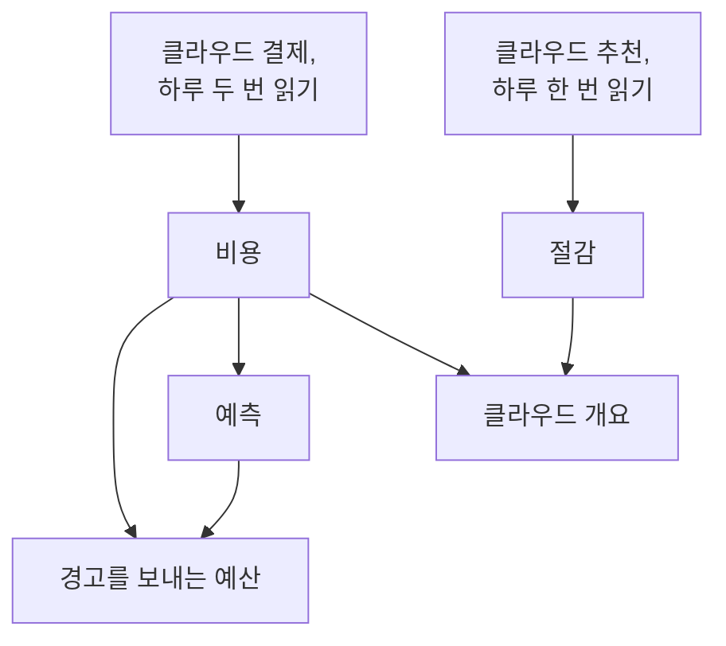

# 클라우드 비용과 절감

연결된 클라우드 계정은 그 비용과 비용을 줄이는 방법도 알려 줍니다. OneUptime은 클라우드 자체 결제에서 매일의 비용을, 클라우드 자체 추천 서비스에서 추천을 읽어 **클라우드 → 지출 → 비용**과 **클라우드 → 지출 → 절감**에 표시하고, Savings Plans, 예약, 약정 사용 할인을 **클라우드 → 지출 → 약정**에 나열하며, 한 달, 분기 또는 한 해의 비용이 예산을 넘기 전에 **클라우드 → 지출 → 예산**에서 알리고, **클라우드 → 지출 → 예측**에서 앞으로의 달을 예측합니다. 허용하면 소유자가 승인한 절감을 실행하고, 프로덕션이 아닌 리소스를 근무 시간 외에 중지하며, 각 변경을 청구서로 확인합니다.

:::cards
- [Amazon Web Services](#amazon-web-services): Cost Explorer와 Cost Optimization Hub. 각각 한 번만 켭니다.
- [Microsoft Azure](#microsoft-azure): Cost Management와 Azure Advisor. 역할이 하나 더 필요합니다.
- [Google Cloud](#google-cloud): BigQuery로의 결제 내보내기와 Recommender.
- [청구 비용, 상각 비용, 순비용](#청구-비용-상각-비용-순비용): 모든 비용을 세 가지 방식으로 보관해, 약정과 크레딧이 돈이 실제로 쓰인 곳에 반영됩니다.
- [약정과 갱신](#약정과-갱신): 모든 약정, 약정이 끝나기 전이나 덜 쓰이는 동안의 경고, 그리고 무엇을 갱신하거나 구매할지.
- [절감 실행](#절감-실행): 소유자의 승인을 받아 절감을 적용하고, 되돌릴 수도 있습니다.
- [근무 시간 외 스케줄](#근무-시간-외-스케줄): 프로덕션이 아닌 리소스를 밤과 주말에 중지합니다.
- [절감 AI 규칙](#절감-ai-규칙): 소유자에게 제안하거나, 한도 안에서 변경합니다.
- [예산](#예산): 어떤 계정, 비용 그룹 또는 서비스에 대해서든 한 달, 분기 또는 한 해의 예산.
- [예측](#예측): 앞으로 12개월의 비용이 얼마로 예상되는지와 그 확실성.
- [필수 태그](#필수-태그): 필수로 지정한 태그가 있는 지출의 비율과 태그가 없는 새 리소스.
:::

## 작동 방식



- **비용은 클라우드 자체 결제에서 가져옵니다.** AWS Cost Explorer, Azure Cost Management, Google Cloud의 BigQuery 결제 내보내기에서 계정의 청구 통화로 읽으며, 각각을 청구 비용, 상각 비용, 순비용으로 보관합니다. [청구 비용, 상각 비용, 순비용](#청구-비용-상각-비용-순비용)을 참조하세요. 각 금액은 하루치이며, 클라우드가 청구하는 대로 UTC 날짜 기준입니다.
- **클라우드는 마지막 하루 이틀을 늦게 보고합니다.** 각 읽기는 지난 한 주를 다시 읽고, 매달 첫 며칠에는 지난달 전체를 다시 읽으므로, 클라우드가 하루를 마감하면서 그날의 비용이 확정됩니다. 연결의 첫 읽기는 지지난달 초까지 거슬러 올라갑니다.
- **이번 달 예상은 지난 한 주의 속도를 따릅니다.** 이번 달 지금까지의 비용에, 남은 날마다 지난 온전한 이레의 평균을 더한 값입니다.
- **절감은 클라우드 자체 추천 서비스에서 가져옵니다.** AWS Cost Optimization Hub, Azure Advisor, Google Cloud의 Recommender가 더 작은 크기, 쓰이지 않는 리소스, 이득이 되는 약정을 각각 매달 절감할 금액과 함께 알려 줍니다. 클라우드 콘솔에서 실행하거나 무시한 추천은 다음 읽기에서 사라집니다.

## 시작하기 전에

- **연결된 계정.** 현재 설정 명령으로 [클라우드 계정 연결](/docs/telemetry/cloud-accounts)을 진행합니다. 이 명령으로 연결이 비용과 추천을 읽을 수 있습니다. 이전에 만든 연결은 명령을 다시 실행할 때까지 둘 다 읽지 않습니다.

## Amazon Web Services

연결은 비용을 `ce:GetCostAndUsage`로, 약정을 `ce:GetSavingsPlansCoverage`, `ce:GetSavingsPlansUtilization`, `ce:GetSavingsPlansUtilizationDetails`, `ce:GetReservationCoverage`, `ce:GetReservationUtilization`로, 구매한 Savings Plans를 `savingsplans:DescribeSavingsPlans`로, 추천을 `cost-optimization-hub:ListRecommendations`와 `cost-optimization-hub:GetRecommendation`으로 읽습니다. 설정 명령은 Cost Explorer의 읽기를 `ce:GetCostAndUsage*`, `ce:GetSavingsPlans*`, `ce:GetReservation*`의 세 가지 계열로 부여하며, 모두 읽기 전용입니다. 액세스 키 사용자의 정책이 IAM이 허용하는 2,048자 안에 들어가도록 하기 위해서입니다. Cost Explorer와 Cost Optimization Hub는 먼저 계정에서 켜야 합니다.

:::steps
### Cost Explorer 켜기

AWS Billing and Cost Management 콘솔에서 Cost Explorer를 한 번 엽니다. AWS는 하루 안에 계정의 비용을 준비합니다. 모든 멤버 계정의 비용을 읽으려면 조직의 관리 계정을 연결합니다.

### Cost Optimization Hub 참여하기

같은 콘솔에서 Cost Optimization Hub를 열고 참여합니다. 조직이라면 관리 계정에서, 이 계정만이라면 이 계정에서 진행합니다. 추천은 하루 안에 도착합니다.
:::

Cost Explorer는 요청당 $0.01를 청구합니다. 비용 읽기 한 번에 요청을 두 번 또는 그보다 조금 더 보내고(청구 비용과 상각 비용에 한 번, 순비용에 한 번), 약정은 커버리지와 사용률에 하루 네 번, 각 약정 자체에 하루 여섯 번에서 열두 번 더 요청해 읽습니다. Savings Plans API와 Cost Optimization Hub는 무료입니다.

### 리소스별 비용

리소스 수준 데이터를 켜면 Cost Explorer는 지난 14일 동안 각 리소스의 비용도 알려 줍니다. AWS Billing and Cost Management 콘솔에서 Cost Management 기본 설정을 열고 일별 단위로 리소스 수준 데이터를 켜세요. 조직이라면 관리 계정에서 켭니다. AWS는 48시간 안에 데이터를 준비합니다.

그런 다음 **클라우드 → 연결**에서 연결을 편집하고 **추가 필드**에서 **리소스별 비용**을 켜세요. 연결은 하루에 한 번 `ce:GetCostAndUsageWithResources`로 읽습니다. 처음에는 14일 치를, 그 뒤로는 최근 사흘 치를 다시 읽으며 매번 요청을 몇 번 보냅니다. 읽은 내용은 Cost Explorer가 잊은 뒤에도 계정의 비용과 함께 남습니다. 이전에 만든 연결은 설정 명령을 다시 실행해 이 작업을 추가해야 합니다.

## Microsoft Azure

앱은 **Cost Management Reader** 역할로 비용을 읽습니다. 범위는 **Monitoring Reader**와 같으며, 설정 명령이 두 역할을 모두 부여합니다. Azure Advisor의 추천은 **Monitoring Reader**로 읽으므로 켤 것이 없습니다. 이전에 만든 앱에 역할을 부여하려면 다음을 실행합니다.

```bash
az role assignment create --assignee <APP_ID> --role "Cost Management Reader" --scope /subscriptions/<SUBSCRIPTION_ID>
```

Cost Management는 구독마다 각 비용의 대상 리소스와 함께 응답하며, 읽기는 무료입니다. 어떤 구독에 대해 응답하지 못하면 계정의 **비용**에 이유가 표시됩니다.

Cost Management는 테넌트의 비용을 읽는 속도를 읽는 모든 사람에게 똑같이 제한합니다. 각 쿼리는 읽는 데이터의 달마다 쿼리 처리 단위(QPU)를 소비하며, 테넌트에는 10초마다 12 QPU, 분당 60, 시간당 600이 있습니다. OneUptime은 테넌트의 구독을 각 한도의 삼분의 이 안에서 차례로 읽고, Cost Management가 쿼리를 거절하면 요청한 만큼 기다리며, 다음 읽기에서 멈춘 곳부터 이어 읽습니다. 아직 읽지 않은 구독에는 **대기열에 있음**과 읽을 시각이 표시되고, 이미 금액이 있는 구독은 그동안에도 금액을 유지합니다. 구독의 상각 비용은 읽을 때마다, 실제 비용은 하루에 한 번 읽으므로, 구독의 첫 읽기는 Cost Management에 두 번 쿼리하고 쿼리 단위를 두 배로 씁니다. 큰 테넌트는 첫 금액이 나오기까지 읽기가 몇 번 더 걸립니다.

테넌트의 예약과 절약 플랜은 **Reservations Reader**와 **Savings plan Reader**로 읽습니다. Azure는 이 역할을 테넌트 자체 범위에서 부여하며, 그곳에서는 권한이 상승된 전역 관리자만 부여할 수 있습니다. 설정 명령은 부여를 시도하고, 할 수 없으면 그렇다고 표시합니다. 나중에 부여하려면 권한이 상승된 전역 관리자로 다음을 실행합니다.

```bash
az role assignment create --assignee <APP_ID> --role "Reservations Reader" --scope /providers/Microsoft.Capacity
az role assignment create --assignee <APP_ID> --role "Savings plan Reader" --scope /providers/Microsoft.BillingBenefits
```

이 역할이 없어도 비용과 추천은 이전처럼 읽히며, **클라우드 → 지출 → 약정**에 부여할 역할이 표시됩니다.

## Google Cloud

Google Cloud에는 프로젝트 비용을 알려 주는 API가 없습니다. OneUptime은 결제 계정의 BigQuery 내보내기에서 비용을 읽습니다.

:::steps
### 결제를 BigQuery로 내보내기

Google Cloud 콘솔에서 Billing, 이어서 Billing export를 열고, 세부 사용 비용 내보내기를 BigQuery 데이터 세트로 켭니다. Google은 켠 날부터 몇 시간 늦게 기록합니다.

### 서비스 계정이 읽도록 허용하기

연결의 서비스 계정에 내보내기 데이터 세트에 대한 **BigQuery Data Viewer**를 부여합니다. 설정 명령이 이미 **BigQuery Job User**를 부여했으므로 쿼리는 자체 프로젝트에서 실행됩니다.

### 내보내기 테이블 지정하기

**클라우드 → 연결**에서 연결을 편집하고, **추가 필드**의 **결제 내보내기 테이블**을 테이블의 전체 이름으로 설정합니다: `<PROJECT_ID>.<DATASET>.gcp_billing_export_resource_v1_<BILLING_ACCOUNT_ID>`.
:::

세부 내보내기에는 각 비용의 대상 리소스가 들어 있고, 표준 내보내기에는 서비스와 리전만 있습니다. 쿼리는 BigQuery 요금입니다. 매월 처음 1 TiB는 무료이며 그 이후에는 TiB당 $6.25이고, 내보내기 한 달 분량은 몇 메가바이트에서 몇 기가바이트입니다. Recommender의 머신 유형 및 유휴 리소스 추천은 설정 명령이 부여하는 **Compute Recommender Viewer**로 읽으며 무료입니다. Compute Engine 약정은 설정 명령이 이미 부여하는 **Cloud Asset Viewer**로 Cloud Asset Inventory에서 나열합니다. 더 부여할 것은 없습니다.

## 청구 비용, 상각 비용, 순비용

모든 비용은 세 가지 방식으로 보관되며, **클라우드 → 지출 → 비용**, 계정의 **비용**, 클라우드 개요, 예산은 선택한 기준으로 표시합니다.

- **청구 비용**은 클라우드가 청구한 날의 각 요금으로, 크레딧과 환불 전 금액입니다. 선결제한 Savings Plan이나 예약은 구매한 날 한 번의 큰 요금이 되고, 그것이 충당하는 사용량은 나머지 기간 내내 무료로 보입니다.
- **상각 비용**은 각 약정의 요금을 그 약정이 충당하는 날과 리소스에 나누어, 돈이 쓰인 곳에 반영합니다. 이것도 크레딧과 환불 전 금액입니다. 다른 기준을 고르지 않으면 페이지에 이것이 표시됩니다.
- **순비용**은 상각 비용에서 크레딧, 환불, 할인을 뺀 금액으로, 청구서의 합계입니다.

| | 청구 비용 | 상각 비용 | 순비용 |
|---|---|---|---|
| AWS | Cost Explorer의 비혼합 비용(unblended) | Cost Explorer의 상각 비용 | Cost Explorer의 순상각 비용(크레딧과 환불 포함) |
| Azure | Cost Management의 실제 비용 | Cost Management의 상각 비용 | 상각 비용: Azure는 크레딧을 청구 계정에서 차감하며, 구독의 연결은 이를 읽지 않습니다 |
| Google Cloud | 내보내기의 비용 | 비용에서 약정 사용 할인과 구독의 크레딧을 뺀 금액 | 비용에서 모든 크레딧을 뺀 금액 |

금액 위의 선택기는 페이지의 기준을 바꾸며, OneUptime은 이 프로젝트에서의 선택을 브라우저에 기억합니다. 페이지가 열릴 때의 기준이자 예산이 지켜보는 프로젝트 자체의 기준은 **클라우드 → 설정 → 비용 설정**에 있습니다. 예산은 자체 기준을 지켜볼 수도 있습니다. 예산을 편집해 **비용 기준**을 설정하세요.

세 가지가 보관되기 전에 읽은 비용은 모든 기준에서 청구 금액을 표시합니다. 각 연결은 첫 읽기만큼 거슬러 올라가 비용을 한 번 다시 읽어 각 기준을 채웁니다.

## 지출을 줄이는 방법

**클라우드 → 지출 → 절감**은 절감액이 큰 순서로 모든 추천을 나열합니다. 무엇을 할지, 어떤 리소스인지, 무엇이 바뀌는지, 매달 얼마를 절감하는지 보여 줍니다. 위의 띠에는 전체 합계와 종류별 합계가 표시됩니다: 더 작은 크기, 쓰이지 않는 리소스, 약정. OneUptime에 해당 리소스가 있으면 추천은 리소스 페이지로 연결되며, OneUptime이 실행할 수 있는 추천에는 **적용**이 있습니다: [절감 실행](#절감-실행)을 참고하세요.

### OneUptime 자체 측정값으로 하는 크기 적정화

추천 서비스가 켜져 있지 않거나, 리소스 유형을 다루지 않거나, 리소스가 너무 새로워서 어떤 추천 서비스도 다루지 않는 리소스는 연결이 지난 14일 동안 측정한 CPU와 메모리 값으로 OneUptime이 크기를 판단합니다. 대상은 AWS의 EC2 인스턴스, RDS 데이터베이스, ElastiCache 클러스터, Azure의 가상 머신, PostgreSQL 및 MySQL 유연한 서버, App Service 플랜, Google Cloud의 Compute Engine VM과 Cloud SQL 인스턴스입니다:

- **과다 프로비저닝**은 절반 크기, 또는 그 절반 크기로도 여유가 있을 때입니다. 더 작은 크기에서 CPU의 95번째 백분위수가 60% 이하, 가장 높은 CPU 측정값이 100% 이하, 메모리를 읽는 경우 메모리 최고치가 70% 이하가 되는 경우입니다.
- **과소 프로비저닝**은 CPU의 95번째 백분위수가 85% 이상이거나 메모리 최고치가 90% 이상일 때입니다: 두 배 큰 크기를 권합니다.

리소스는 측정값이 6일 치 쌓이면 크기가 판단됩니다. 리소스 페이지에는 비용 옆에 **크기 적정화**가 표시되고, 과다 프로비저닝된 리소스는 OneUptime을 출처로 **클라우드 → 지출 → 절감**에 표시됩니다. 변경으로 절감되는 금액은 지난 30일 동안 리소스에 든 비용 중 그 변경의 몫이므로, 클라우드가 리소스를 이름으로 청구하면 알 수 있습니다: Azure와 Google Cloud의 상세 내보내기는 이름으로 청구하며, AWS도 리소스별 비용을 켜면 그렇게 합니다. t3, B 시리즈, e2-micro 같은 버스트 가능 크기는 판단하지 않습니다.

클라우드는 VM 안에 자체 에이전트가 있을 때만 VM의 메모리를 읽습니다. EC2 인스턴스에는 CloudWatch 에이전트, Compute Engine VM에는 Ops Agent가 필요하며, Azure VM에는 그런 에이전트가 없고 사용 중인 메모리가 아니라 남은 메모리를 보고합니다. [OneUptime 호스트 컬렉터](/docs/telemetry/hosts)가 실행되는 VM은 대신 호스트 컬렉터가 읽는 메모리로 크기가 판단됩니다:

- **VM과 호스트는 같은 머신**으로 보는 경우는 공급자, 계정, 리전, 인스턴스 ID가 모두 일치할 때입니다: EC2 인스턴스 ID, Compute Engine VM의 숫자 ID, Azure VM의 `vmId`를 비교합니다. 호스트 이름만으로는 일치로 보지 않으며, 복제한 머신처럼 두 호스트가 같은 VM을 주장하면 어느 쪽에도 연결하지 않습니다. VM 페이지에는 호스트가, 호스트 페이지에는 VM이 표시되고 서로 링크됩니다.
- **메모리는 캐시와 버퍼를 뺀 호스트의 사용 중 메모리**며, 호스트 페이지의 차트와 같은 값을 같은 14일 동안 사용합니다. 파일 캐시가 많아도 머신이 가득 찬 것으로 읽지 않습니다. 호스트에도 6일 치 측정값이 필요합니다.
- **둘 다 메모리를 읽는 경우**, 예를 들어 Ops Agent와 호스트 컬렉터가 모두 있는 Compute Engine VM은 측정값이 더 많은 쪽을 사용합니다. CPU는 항상 클라우드의 측정값입니다.

VM의 **크기 적정화**에는 메모리를 어디서 읽었는지 표시되며, **클라우드 → 지출 → 절감**의 해당 줄에도 표시됩니다. CPU만으로 크기를 판단한 VM은 그렇게 표시하고 호스트 컬렉터 설치 링크를 보여 줍니다. 호스트 컬렉터는 [호스트 가이드의 구성](/docs/telemetry/host-otel-collector)에 있는 `resourcedetection/cloud` 단계로 클라우드 식별 정보를 붙입니다. OneUptime 기본 구성을 쓰는 호스트는 OneUptime의 다음 릴리스에서 이 단계를 받으며, 직접 만든 구성을 쓰는 호스트는 이 단계를 추가해야 합니다. Kubernetes 노드는 그 위에서 실행되는 것의 요청을 판단하는 [Kubernetes 비용 관측성](/docs/telemetry/kubernetes-cost)에 맡깁니다.

### 약정

**클라우드 → 지출 → 절감**과 계정의 **비용**에는 지난 30일 지출 중 각 계정의 약정이 지불한 비율과 그중 사용된 비율이 종류마다 한 줄씩 표시됩니다.

- AWS: Savings Plans와 예약 인스턴스를 Cost Explorer에서 읽습니다. 조직의 관리 계정은 조직의 모든 계정에 대해 읽습니다.
- Azure: 절약 플랜과 예약을 Cost Management에서 상각 비용으로 읽습니다.
- Google Cloud: 약정 사용 할인을 결제 내보내기에서 읽습니다. 내보내기는 약정 중 사용되지 않은 금액을 알려 주지 않으므로 사용률은 표시되지 않습니다.

약정이 없는 계정에는 온디맨드 요금으로 실행되어 약정이 있었다면 더 싸게 지불했을 금액이 표시됩니다. 종류별 수치는 각 클라우드의 수치이며 종류끼리 더하지 않습니다. 예약과 Savings Plan이 같은 머신의 지출을 모두 자기 대상으로 셀 수 있기 때문입니다. 개별 약정은 **클라우드 → 지출 → 약정**에 나열됩니다. [약정과 갱신](#약정과-갱신)을 참조하세요.

## 약정과 갱신

**클라우드 → 지출 → 약정**에는 연결이 읽을 수 있는 모든 Savings Plan, 예약, 약정 사용 할인이 나열되므로, 모르는 사이에 끝나는 약정이 없습니다.

- 맨 위의 **활성 약정**은 활성 약정과 90일 안에 끝나는 약정의 수를, **사용률**은 지난 30일 동안 사용된 비율과 쓰이지 않고 남은 금액을, **커버리지**는 약정이 지출의 얼마를 충당하는지를 보여 줍니다.
- **곧 종료**에는 90일 안에 끝나고 자동으로 갱신되지 않는 약정이 각각의 갱신 계획과 함께 나열됩니다. 할인을 유지하려면 무엇을 구매해야 하는지(사용된 만큼의 시간당 약정 또는 인스턴스), 월별 비용과 절감액, 본전을 찾는 시점, 그리고 지금과 종료 후에 지출의 얼마가 충당되는지입니다. **콘솔에서 갱신**은 클라우드에서 그 약정을 갱신하는 페이지를 엽니다.
- **모든 약정**은 전체 목록입니다. 각 약정이 무엇이고 무엇을 충당하는지, 그 계정, 종료일, 기간과 결제 옵션, 지난 30일 동안 사용된 비율, 그리고 지불한 사용량과 절감액을 보여 줍니다.
- **구매 계획**은 클라우드의 추천 서비스가 구매를 권하는 것으로, 각각 월별 비용과 절감액, 본전을 찾는 시점, 커버리지가 어떻게 바뀌는지가 표시됩니다. **콘솔에서 구매**는 그것을 구매하는 페이지를 엽니다.
- 그 아래에는 각 계정의 약정이 종류별로 그 계정의 **비용**과 같이 표시되며, 약정이 언제 경고를 보내는지는 **경고 변경**에서 바꿀 수 있습니다.

OneUptime은 계획만 세울 뿐, 약정을 구매하거나 갱신하거나 반환하지 않습니다. 구매는 클라우드 콘솔에서 합니다.

| | 약정을 가져오는 곳 | 각 약정에 대해 알 수 있는 것 |
|---|---|---|
| AWS | Cost Explorer의 Savings Plans와 예약 인스턴스(각각의 사용률 포함), 그리고 구매한 플랜(시작 대기 중인 플랜 포함)을 위한 Savings Plans API | 종료일, 기간, 결제 옵션, 시간당 약정 또는 인스턴스, 요금, 지난 30일과 7일의 사용률 |
| Azure | 테넌트의 예약과 절약 플랜 | 종료일, 기간, 청구 플랜, 자동 갱신 여부, 지난 30일과 7일의 사용률 |
| Google Cloud | Cloud Asset Inventory의 Compute Engine 약정 | 종료일, 플랜, 리소스, 자동 갱신 여부. Google Cloud는 약정이 얼마나 사용되는지 밝히지 않습니다 |

AWS에서는 조직의 관리 계정이 모든 계정의 약정을 나열합니다. Google Cloud가 프로젝트가 아닌 결제 계정에 두는 지출 기반 약정 사용 할인은 아직 나열되지 않습니다.

### 약정 경고

약정은 경고를 생성하며, 다른 경고처럼 온콜 정책으로 호출합니다. **클라우드 → 설정 → 비용 설정**의 **약정 경고**에서 언제 경고할지 정합니다.

- **약정 종료 전 경고**: 처음에는 종료 90일, 30일, 7일 전입니다. 약정이 도달한 날 중 가장 가까운 날에 경고가 하나 생성되고, 더 가까운 날의 경고가 이전 경고를 대신합니다. 자동으로 갱신되는 약정이나, 종료 시 시작할 갱신이 대기열에 있는 약정은 경고를 생성하지 않습니다.
- **사용률이 이보다 낮으면 경고**: 처음에는 80%이며, 약정이 일주일 동안 실행된 뒤 지난 7일의 사용률에 적용됩니다. 사용률이 돌아오면 경고가 해결됩니다.
- **커버리지가 이보다 낮으면 경고**: 처음에는 60%이며, 계정의 한 종류의 약정이 충당할 수 있는 지출에 대한 비율로, 더 많이 충당한 뒤에 적용됩니다. 커버리지가 돌아오면 해결됩니다. 비워 두면 커버리지로는 경고가 생성되지 않습니다.

**약정 경고**를 끄면 모든 경고가 꺼지며, **경고 심각도**, **온콜 정책**, **소유자**는 경고가 얼마나 심각한지, 누구를 호출할지, 누구의 것인지를 정합니다. 각 경고는 약정이 무엇을 충당하고 무엇을 지불했는지 보여 주고 갱신 계획으로 연결됩니다. 약정이 끝나거나 갱신되거나 더 이상 나열되지 않으면 경고는 스스로 해결됩니다.

## 절감 실행

계정의 클라우드 연결에서 **절감 작업** 설정이 허용하면 OneUptime은 그 연결을 통해 절감을 실행합니다: 각 선택지가 무엇을 허용하는지는 [절감 작업](/docs/telemetry/cloud-accounts#절감-작업)에서 설명합니다. 한 단계로 끝나는 변경만 실행합니다: 유휴 인스턴스나 데이터베이스 중지, gp2 볼륨의 gp3 변경, 연결되지 않은 디스크, 오래된 스냅샷, 사용하지 않는 이미지의 삭제, 사용하지 않는 주소 해제, 그리고 허용한 경우 인스턴스나 데이터베이스의 권장 크기 조정입니다. 약정은 구매하지 않습니다: **콘솔에서 구매**가 이를 위한 클라우드 페이지를 엽니다.

:::steps
### 적용 선택

**클라우드 → 지출 → 절감**에서 절감의 **적용**을 선택합니다. 대화 상자에 무엇이 바뀌는지, 매달 얼마를 절감하는지, 되돌리는 방법 또는 되돌릴 수 없다는 점, 그리고 누가 승인하는지가 표시됩니다.

### 소유자가 승인

리소스의 소유자로 지정된 사람, 또는 리소스를 소유한 팀의 구성원으로서 리소스를 편집할 수도 있는 사람이 변경을 승인합니다. 소유자가 없는 리소스는 프로젝트 소유자나 프로젝트 관리자가 승인합니다. 직접 승인할 수 있다면 **적용**이 바로 본인으로서 실행합니다. 그렇지 않으면 소유자가 **승인**을 고르거나 사유와 함께 **숨기기**를 고를 때까지 **승인 대기 중**에서 기다립니다.

### OneUptime이 실행

변경은 연결을 통해 이루어지며, 승인한 사람과 함께 리소스와 계정의 타임라인에 기록됩니다. 삭제하는 디스크는 **먼저 최종 스냅샷 만들기**를 끄지 않는 한 먼저 최종 스냅샷을 만듭니다.
:::

모든 변경에는 되돌리는 방법이 표시됩니다: **실행한 변경**의 **실행 취소**는 중지한 인스턴스를 다시 시작하거나, 볼륨이나 크기를 되돌리거나, 삭제한 디스크를 최종 스냅샷에서 다시 만듭니다. 스냅샷, 이미지, 해제한 주소처럼 영구히 삭제되는 것은 되돌릴 수 없으며, 대화 상자가 적용 전에 이를 알려 줍니다. 프로젝트가 **위험이 큰 수정에 두 번의 승인 필요**로 두 번의 승인을 요구하면, 되돌릴 수 없는 변경에는 두 사람이 필요합니다.

Terraform이나 CloudFormation 등으로 코드로 관리된다고 태그가 알려 주는 리소스는 대신 코드에서 변경합니다: 대화 상자가 이를 선언한 리포지토리에 **풀 리퀘스트 열기**를 제공하므로 다음 apply가 절감을 되돌리지 않습니다.

### 청구서로 입증

**이번 달 절감액**은 클라우드 청구서에 나타난 것만 셉니다. 변경 후 3일이 청구서에서 확정되면 리소스의 일일 비용을 변경 전 한 주와 비교합니다: 비용이 약속한 금액의 사분의 일 이상 줄었으면 **청구서에서 확인됨**, 그렇지 않으면 **청구서에서 확인되지 않음**, 클라우드가 리소스를 이름으로 청구하지 않으면 **측정할 수 없음**입니다. **청구서 확인 중**은 아직 그 날짜를 기다리는 변경을 셉니다.

## 근무 시간 외 스케줄

**클라우드 → 지출 → 스케줄**에서 스케줄은 프로덕션이 아닌 인스턴스와 데이터베이스를 근무 시간 외에 중지하고 다시 시작합니다:

:::steps
### 리소스 선택

대상을 고르는 클라우드 태그를 지정합니다(예: `Schedule` = `office-hours`). 한 계정 또는 모든 계정에서 지정할 수 있습니다.

### 실행 시간 지정

근무일, 시작 시각과 중지 시각(24시간제), 시간대를 선택합니다.
:::

근무 시간이 끝나면 스케줄은 계정의 연결을 통해, 태그로 선택되고 프로덕션이 아닌 것으로 알려진 실행 중인 리소스를 모두 중지하고, 근무 시간이 시작되면 자신이 중지한 것만 다시 시작합니다: 누군가 직접 중지한 리소스는 중지된 상태로 남습니다. **리소스 보기**는 스케줄이 지금 선택하는 것과 일부를 계속 실행하는 이유를 보여 줍니다. AWS의 EC2 인스턴스와 RDS 데이터베이스, Azure의 가상 머신, Google Cloud의 Compute Engine 인스턴스를 중지합니다. AWS는 한 주 동안 중지된 데이터베이스를 스스로 다시 시작합니다.

스케줄은 프로덕션을 절대 중지하지 않으며, 환경을 알려 주는 것이 없는 리소스도 중지하지 않습니다. 리소스가 프로덕션이 아닌 것으로 알려지는 경우는 다음과 같습니다:

- 태그가 그렇게 알려 줄 때: `environment`, `env`, `stage`, `tier`, `deployment.environment` 같은 키와 `dev`, `test`, `qa`, `staging`, `sandbox` 같은 값;
- 계정의 **설정**에서 **환경**이 **비프로덕션**으로 표시되어 있을 때;
- 또는 레이블이 그렇게 알려 줄 때(예: `Staging`, `env: dev`).

프로덕션이 우선합니다: `prod`, `production`, `live`를 나타내는 태그나 **프로덕션**으로 표시된 계정은 다른 무엇이 알려 주든 리소스를 계속 실행합니다. 리소스 이름은 이 판단에 쓰지 않습니다. 스케줄을 끄면 더 이상 아무것도 중지하지 않고, 중지했던 것은 근무 시간이 시작될 때 시작합니다. 스케줄을 삭제하면 중지했던 것을 바로 시작합니다.

## 절감 AI 규칙

**AI 활성화**가 켜져 있으면 OneUptime AI는 계정의 절감을 읽을 때마다 실행할 수 있는 절감을 리소스 소유자에게 제안하고, 소유자는 **승인 대기 중**에서 승인하거나 거절합니다. **클라우드 → 설정 → 절감 AI 규칙**에서 규칙은 일치하는 절감을 OneUptime AI가 어떻게 처리할지를 변경 종류, 리소스의 환경, 클라우드별로 정합니다: **꺼짐**, **소유자에게 제안**, 또는 월 한도까지 **묻지 않고 실행**. 규칙이 없으면 모든 절감을 제안하고 실행하지 않습니다. 규칙이 있으면 규칙과 일치하는 것만 처리하며, 일치하는 규칙 중에서는 가장 신중한 규칙이 우선합니다.

규칙이 묻지 않고 실행하는 것은 프로덕션이 아닌 것으로 알려진 리소스, 되돌릴 수 있는 변경, 일치하는 규칙 중 가장 작은 한도 이내로 제한되며, 프로젝트마다 한 시간에 최대 10번입니다: 나머지는 모두 제안됩니다. 묻지 않고 실행한 변경은 실행한 규칙과 함께 타임라인에 기록되며, 소유자가 되돌릴 수 있습니다. 거절되거나 되돌려진 절감은 30일 동안 다시 제안되지 않습니다.

## 예산

:::steps
### 예산 만들기

**클라우드 → 지출 → 예산**에서 예산을 만들고 **적용 대상**을 고릅니다: 모든 계정, 하나의 **계정**, 규칙으로 지출을 분류하는 **비용 그룹**, 또는 비용 그룹 규칙과 같은 방식으로 작성한 **필터**가 지정하는 서비스, 리전, 태그입니다. 프로젝트의 기준으로 계산하려면 **비용 기준**을 비워 둡니다.

### 쓸 수 있는 비용 정하기

**기간**은 한 달, 분기 또는 한 해이며, **금액**은 한 기간에 쓸 수 있는 비용입니다. 분기와 연도는 **연도의 첫 달**에 시작합니다: 사월부터라면 한 해는 사월부터 다음 해 삼월까지입니다. 한 해의 **예산 계획**은 금액을 달마다 균등하게 나누거나, **월별 계획**에서 달마다 금액을 따로 정할 수 있습니다. 그러면 각 달이 자기 몫과 비교되므로, 한가한 달이 바쁜 달의 지출 때문에 경고받는 일이 없습니다.

### 경고 시점 선택하기

**경고 기준**에는 조치할 예산 비율을 퍼센트로 지정합니다: 처음에는 80과 100입니다. **초과가 예상될 때 경고**는 기간이 예산보다 많이 들 것으로 예상될 때도 기간마다 한 번 경고합니다. **평소와 다른 날에 경고**는 평소보다 훨씬 많이 든 날의 다음 날에도 경고합니다: [평소와 다른 날](#평소와-다른-날)을 참고하세요. **경고 심각도**는 경고가 얼마나 심각한지 정합니다.

### 알림 대상 고르기

**알림**의 사람과 팀은 지출이 100% 미만의 비율을 넘으면 이메일과 채팅으로 알림을 받으며, 경고는 없으므로 예산 안의 지출로는 아무도 호출되지 않습니다. **비용 그룹의 팀에 알림**은 비용 그룹이 속한 팀에도 알립니다. 100%부터는 경고가 생성되고 그 사람들이 경고의 소유자가 되며, **온콜 정책**이 호출됩니다. 알릴 사람이 없는 예산은 모든 비율에서 경고를 만듭니다.
:::

예산은 비용을 읽을 때마다, 그리고 매시간 확인됩니다. 기간의 지출이 어떤 비율을 넘으면 알릴 사람에게 알리거나, 100%부터는 경고를 만듭니다. 한 번의 읽기에서 여러 비율을 한꺼번에 넘으면 가장 높은 비율에 대해 하나만 만들며, 새 기간이 시작되면 이전 기간의 경고는 해결됩니다. 달마다 나눈 한 해는 한 달씩, 그 달의 몫과 비교해 확인합니다. 예산은 예산 통화로 청구되는 계정만, 예산의 기준으로 계산합니다: 상각 예산은 선불로 구매한 약정으로는 발동하지 않지만, 청구 예산은 구매한 날 그 금액을 계산합니다.

기간이 예산을 넘을 것으로 예상되는 때는 지금까지의 비용, 지난 한 주 전체의 속도로 본 이번 달의 남은 기간, 그리고 분기나 한 해의 이후 달을 [예측](#예측)으로 본 값을 합한 금액이 예산보다 클 때입니다.

각 예산의 행에는 대상, 기간, 지금까지의 기간이 표시됩니다: 달마다 나눈 한 해라면 이번 달과 그 몫, 옆에 한 해가 표시됩니다. 예산 페이지에는 기간을 월별로 각 달의 몫과 나란히, 이번 달을 일별로, 비용이 가장 많이 든 항목, 알림 대상이 표시됩니다. 연간 예산의 페이지에서는 예측을 계획으로 저장할 수 있습니다.

AI 에이전트는 [MCP 서버](/docs/ai/mcp-server)를 통해, 스크립트는 CLI의 `oneuptime cloud-budget` 명령으로 예산을 만들고 바꿀 수 있습니다: [리소스 작업](/docs/cli/resource-operations)을 참고하세요.

### 평소와 다른 날

읽을 때마다 계정의 최근 14일 각각을 그 전 14일과 비교합니다. 서비스 비용이 평소 하루의 두 배 이상이거나 계정 전체 비용이 평소 하루의 한 배 반 이상인 날이 평소와 다른 날입니다. 어느 쪽이든 계정 통화로 평소보다 10 이상, 그리고 계정의 평소 하루의 5% 이상 많아야 하므로, 몇 센트는 결코 급증으로 치지 않습니다. 하루의 평소 값은 그 전 14일의 중앙값이라 한 번의 급증으로는 거의 움직이지 않으며, 계정은 일주일 치 비용이 쌓인 뒤에야 판단합니다.

**클라우드 → 지출 → 비용**은 일별 지출의 막대 위에 평소와 다른 날을 표시하고 그 아래에 나열합니다. 모든 계정에서는 각 표시가 해당 계정의 **비용**을 엽니다. 모든 계정 또는 한 계정의 월간 예산은 계정과 날마다 경고를 하나씩 다음 날 만들며, 높게 나온 서비스를 모두 적습니다. 그 밖의 예산은 대상을 같은 방식으로 자기 평소의 하루와 비교합니다. 여러 날 이어지는 급증은 시작된 날에 보고되고, 일주일보다 오래된 날은 보고되지 않습니다. 이 경고가 생기기 전에 만든 예산은 편집해서 켜기 전까지 경고를 만들지 않습니다.

## 예측

**클라우드 → 지출 → 예측**은 전체, 계정, 비용 그룹 또는 서비스에 대해, 선택한 비용 기준으로 앞으로 12개월의 각 달 지출이 얼마로 예상되는지 보여 줍니다. 또한 OneUptime이 보관하는 한 해 남짓한 전체 달의 비용으로 각 예측을 어떻게 만드는지 알려 줍니다:

- **이번 달**은 지금까지의 비용에, 남은 각 날을 지난 7일 전체의 평균으로 더한 값으로, 예산이 예상하는 방식과 같습니다.
- **전체 3개월 미만**이면 그 속도를 앞으로의 각 달에 그대로 이어 가며, 예상 범위는 없습니다: 추세와 일시적인 튐을 구별하기에는 읽은 데이터가 너무 적습니다.
- **전체 3개월부터**는 각 달의 평균 하루를 지나는 추세를 구합니다: 두 달씩 짝지은 기울기의 중앙값이므로, 튀는 한 달은 추세를 거의 움직이지 못합니다.
- **전체 12개월부터**는 각 달력 월이 지난해 추세보다 얼마나 높거나 낮았는지도 기억하므로, 12월의 최고치는 다음 12월에도 예측됩니다.

앞으로의 각 달에는 예상 범위가 있으며, 10번 중 8번은 그 안에 들어야 합니다. 범위는 지난 달들이 추세에서 벗어난 정도로 정해지며, 양쪽으로 5%보다 좁아지지 않습니다. 달이 멀수록, 그리고 예측의 바탕이 된 달이 적을수록 넓어집니다. 전체 12개월부터는 한 해에 각 달력 월이 한 번씩만 있으므로 모든 범위가 더 넓습니다. 예측은 약속이 아닙니다: 새 서비스, 마이그레이션, 가격 변경은 지난 어떤 달에도 없던 방식으로 앞으로의 달을 움직입니다.

**시뮬레이션**은 선택한 달부터 앞으로의 각 달을 입력한 비율만큼 늘리거나 줄입니다. 예를 들어 1월부터 20%입니다. **예산 계획으로 저장**은 앞으로 열두 달을 연간 예산의 계획으로 만들며, 새 예산이든 기존 예산이든 각 달은 예측된 몫에 맞춰집니다.

## API의 예산과 예측

예산은 API 리소스(`cloud-budget`)이며, 다른 리소스처럼 CLI 명령과 MCP 도구가 있습니다. 예산의 `scope`는 `allAccounts`, `account`(`cloudAccountId` 포함), `costGroup`(`cloudCostGroupId` 포함) 또는 `filter`(`filterRules` 포함, 비용 그룹 규칙과 같은 방식)입니다. `period`는 `month`, `quarter` 또는 `year`이며, `fiscalYearStartMonth`(1부터 12)에서 시작합니다. 한 해의 `planSplit`은 `none`, `equal` 또는 `byMonth`이며, 열두 달은 회계연도 순서로 `monthlyPlan`에 담깁니다.

페이지처럼 예산의 기간을 월별로, 이번 달의 일별 값과 비용이 가장 많이 든 항목을 읽으려면:

```bash
curl -X POST "https://oneuptime.com/api/cloud-budget/<budget ID>/spend" \
  -H "apikey: <API key>" -H "tenantid: <project ID>"
```

1부터 24개월 앞까지 범위를 예측하려면(시뮬레이션은 선택 사항):

```bash
curl -X POST "https://oneuptime.com/api/cloud-budget/forecast" \
  -H "apikey: <API key>" -H "tenantid: <project ID>" -H "Content-Type: application/json" \
  -d '{"scope": "costGroup", "cloudCostGroupId": "<group ID>", "monthsAhead": 12, "growth": {"percent": 20, "fromMonth": "2027-01"}}'
```

응답의 `forecast`에는 `method`(`pace`, `trend` 또는 `trendAndSeason`), 예측의 바탕이 된 달, 각 달의 `amount`, 앞으로의 달의 `low`와 `high`가 있습니다. 그 기준으로 예측하려면 `basis`를 `billed`, `amortized` 또는 `net`으로 보냅니다. 보내지 않으면 프로젝트의 기준으로 예측하며, 응답의 `basis`가 어느 것인지 알려 줍니다. 예산의 지출은 예산 자체의 기준을 따릅니다.

## 비용이 쓰이는 곳

**클라우드 → 지출 → 비용**은 기간의 지출을 서비스, 리전, 계정 또는 리소스별로 나누고, 세 가지 방법으로 더 나눕니다.

- 앱 플랫폼 환경별: 각 환경의 계정과 리전에 있는 플랫폼 서비스(예: Amazon ECS, Cloud Run)와, AWS가 붙이는 태그로 찾은 Elastic Beanstalk 환경의 리소스입니다.
- 앱별: 플랫폼이 앱 이름으로 청구하는 금액(예: Cloud Run 서비스, Container App)입니다. Amazon ECS는 작업을, App Service는 플랜을 청구하므로 해당 앱의 비용은 환경의 비용으로 남습니다.
- 태그별: 고른 태그의 값마다 나눕니다. 비용에는 읽은 시점의 태그가 남습니다. Google Cloud 결제 내보내기의 라벨이며, 없으면 청구된 리소스의 태그이고, AWS에서는 리소스별 비용이 필요합니다.

목록 아래에는 나머지가 얼마였는지 표시됩니다. 어떤 환경에도 속하지 않는 금액, 환경 전체에 청구된 금액, 또는 태그가 없는 금액입니다. 태그를 보관하기 전에 읽은 비용은 첫 읽기만큼 거슬러 올라가 한 번 다시 읽어 태그를 채웁니다.

## 필수 태그

지출은 붙어 있는 태그만큼만 제대로 배분됩니다. **클라우드 → 지출 → 태그**에서 모든 리소스에 있어야 하는 태그(`team`, `env`, `cost-center` 등)를 지정하면, 그 태그가 있는 지출과 리소스의 비율, 태그가 없는 리소스, 태그 없이 새 리소스를 만든 사람을 볼 수 있습니다.

:::steps
### 태그를 필수로 지정하기

**태그 필수 지정**을 선택하고 **태그 키**를 입력합니다. **허용 값**에는 가질 수 있는 값을 쉼표로 구분해 나열하거나, 비워 두어 모든 값을 허용합니다. 한 계정에서만 필수로 하려면 **계정**을 선택합니다. **추가 필드**의 **설명**은 이메일에서 태그의 용도를 알려 줍니다.

### 적용률 읽기

페이지는 지난 30일 지출과 리소스 중 모든 필수 태그가 있는 비율로 시작합니다. 그 아래에 태그가 없는 리소스가 비용이 큰 순서로 나오고, 이어서 태그별 비율, 지난 12주 추세, 계정별 비율이 나옵니다.

### 없는 태그 붙이기

태그가 없는 리소스마다 OneUptime이 제안하는 값과 클라우드에서 그 값을 설정하는 명령이 표시됩니다. 코드로 선언한 리소스에는 선언한 코드가 표시됩니다: 태그를 그 코드에 추가하세요. 그렇지 않으면 다음 배포에서 다시 제거됩니다.
:::

- **키는 대소문자를 구분하지 않습니다.** `Team`, `team`, `TEAM`은 하나의 키이며, 어느 표기든 허용된 값이 있으면 리소스에 그 태그가 있는 것으로 봅니다. 값도 대소문자를 구분하지 않으며, 빈 값은 값이 없는 것으로 봅니다.
- **허용 값은 패턴이 될 수 있습니다.** `*`는 임의의 문자들, `?`는 한 문자를 뜻하므로 `prod-*`는 `prod-eu`와 `prod-us`에 일치합니다. 패턴은 정규식이 아닙니다.
- **계정 자체의 태그.** 한 계정에서 필수로 지정한 태그는 그 계정에서 같은 키의 프로젝트 태그를 대신하며, 계정은 자체 키를 필수로 지정할 수도 있습니다. 계정의 **태그**에는 둘 다 표시됩니다.
- **클라우드에서는 아무것도 바꾸지 않습니다.** OneUptime은 태그가 없다는 이유로 리소스를 중지하거나 태그를 붙이지 않습니다. 사람에게 알리고 값을 제안합니다.

### 적용률

- **태그가 있는 지출**은 지난 30일 비용 중 모든 필수 태그가 있는 비율이며, 각 비용을 읽을 때의 태그를 기준으로 합니다. 페이지를 열 때마다 계산하므로 오늘 필수로 지정한 태그도 지난 30일에 대해 측정됩니다. AWS 비용에는 [리소스별 비용](#리소스별-비용)을 켠 뒤에야 태그가 붙습니다: 그전까지 AWS 계정의 지출은 0%가 아니라 **측정되지 않음**으로 표시됩니다.
- **태그가 있는 리소스**는 연결이 나열하는 리소스 중 현재 태그 기준으로 모든 필수 태그가 있는 비율입니다.
- **시간에 따른 적용률**은 지난 12주의 각 주를 보여 줍니다: 지출은 비용에서, 리소스는 OneUptime이 매일 세는 수에서 구합니다.

### 새 리소스

계정의 첫 전체 목록 이후에 연결이 나열한 리소스가 새 리소스입니다. 연결은 30분마다 목록을 만들므로 새 리소스는 생성된 후 1시간 안에 발견됩니다. 필수 태그가 없는 리소스는 한 번 알립니다:

- **알림 대상.** 계정의 변경 로그가 이메일 주소로 프로젝트 구성원을 가리키는 경우 그 생성자, 그리고 소유자 규칙과 팀에 따른 리소스 소유자입니다. 둘 다 알릴 수 없으면 프로젝트 소유자에게 알립니다. 모두 클라우드 리소스를 읽을 수 있어야 합니다.
- **빈도.** 한 시간에 한 번 이메일로 각 사람에게 새로운 항목을 모두 알립니다. **추가 설정**에서 **리소스마다 이메일 1통**은 하나씩 보내고, **경고 발생**은 계정마다 경고도 발생시키며, 심각도와 온콜 정책은 **경고를 보낼 곳**에서 정합니다.
- **태그가 붙으면.** 이메일을 보내기 전에 태그가 붙은 리소스는 이메일에서 빠지며, **새 리소스** 목록은 태그가 붙는 대로 각 리소스를 **태그 있음**으로 표시합니다.

### 제안 값

OneUptime은 태그가 허용하는 값일 때만 값을 제안합니다:

- **팀을 나타내는 키**(`team`, `owner`, `squad` 등): 리소스를 소유한 팀.
- **환경을 나타내는 키**(`env`, `environment`, `stage` 등): 그 리소스로 실행되는 앱의 App Platforms 환경, 또는 VM이면 그 호스트가 보고하는 배포 환경.
- **모든 키**: 같은 CloudFormation 스택, 같은 Azure 리소스 그룹, 또는 `web-1`과 `web-2`처럼 번호 앞 이름이 같은 이웃 리소스 대부분이 가진 값. 적어도 두 개가 일치해야 합니다.
- **값을 하나만 허용하는 태그**: 그 값.

명령은 클라우드 자체 셸에서 한 단계로 태그를 설정합니다: AWS에서는 `aws resourcegroupstaggingapi tag-resources`, Azure에서는 `az tag update --operation Merge`, Google Cloud에서는 Compute Engine VM과 디스크, Cloud Storage 버킷, Cloud SQL 인스턴스에 `gcloud ... add-labels` 또는 `--update-labels`를 씁니다.

## 보고서와 내보내기

### 비용 보고서

**클라우드 → 지출 → 보고서**는 클라우드 비용을 일정에 따라 이메일과 Slack 또는 Microsoft Teams 채널로 보내므로, 숫자가 필요한 사람은 OneUptime을 열지 않고도 받아 볼 수 있습니다. 보고서에는 다음 설정이 있습니다.

- **적용 대상**: 모든 계정, 하나의 계정, 비용 그룹, 또는 모든 그룹을 포함한 비용 보기.
- **기간**: 지난주(월요일부터 일요일까지), 지난달, 또는 이번 달 지금까지. 각각 이전 기간과 비교합니다. 지난주는 그 전 주와, 지난달은 그 전 달과, 이번 달 지금까지는 지난달 같은 날까지와 비교합니다.
- **비용 기준**: 청구 비용, 상각 비용, 순비용 중 하나. 비워 두면 비용 페이지가 열릴 때와 같은 프로젝트의 기준을 씁니다. 보고서에는 어떤 기준인지 항상 표시됩니다.
- **일정**: 매주 또는 매월, 시간대에 맞춘 요일이나 날짜와 시각에, Slack 및 Microsoft Teams 요약과 같은 규칙으로 보냅니다. 새 주간 보고서는 다음 월요일 사용자 시간대의 09:00에, 월간 보고서는 1일에 발송되며, 이후 보고서는 일 년 내내 그 날짜와 시각을 유지합니다.

이메일에는 기간의 비용과 이전 기간과의 비교, 그 기간이 반영되는 예산(각각 이번 달 지금까지의 금액을 예산 자체의 기준으로), 가장 많이 오른 서비스와 가장 많이 내린 서비스, 비용 보기의 그룹과 어떤 그룹에도 속하지 않는 지출, 평소와 다른 날, 아직 실행하지 않은 가장 큰 절감, 그리고 약정이 지출의 얼마를 충당하는지가 담깁니다. 숫자는 CSV로 첨부됩니다. **비용 열기**는 보고서와 정확히 같은 날짜, 기준, 보기로 **비용**을 열므로 보고서의 숫자와 페이지의 숫자가 같습니다. 다른 통화로 청구되는 계정은 숫자에서 빠지며, 보고서가 그 계정을 알려 줍니다.

Slack 또는 Microsoft Teams 채널에는 짧은 메시지가 갑니다. 합계와 그 변화, 예산, 보고서 목록의 첫 줄들, 그리고 **비용 열기**입니다.

### 보고서를 받는 사람

- 프로젝트의 사용자와 팀은 알림 설정을 통해 이메일로 받으며, 각 사용자는 알림 설정에서 클라우드 비용 보고서를 끌 수 있습니다. 각 사용자는 자신이 읽을 수 있는 숫자를 받습니다. 라벨로 접근이 제한된 사용자는 자신의 계정만 받고, 더 이상 프로젝트의 클라우드 비용을 읽을 수 없는 사용자는 제외됩니다.
- 프로젝트 밖의 **이메일 주소**(예: 회계 담당자의 주소)와 Slack 및 Microsoft Teams 채널에는 클라우드 관리자, 프로젝트 관리자 또는 프로젝트 소유자 권한이 필요합니다. OneUptime은 누가 그것을 읽는지 알 수 없기 때문입니다. 이들은 자신을 추가한 사람이 읽을 수 있는 대로 보고서를 받으며, 그 사람이 권한을 잃으면 더 이상 받지 않습니다. API 키로는 이들을 설정할 수 없습니다.
- 다른 클라우드 레코드를 만들 수 있는 사람, 즉 클라우드 구성원 이상은 보고서를 만들고, 바꾸고, 삭제할 수 있습니다. 클라우드 뷰어는 보고서를 읽을 수 있습니다.

보고서는 최대 200명, 25개 주소, 종류별 10개 채널로 갑니다. **마지막 발송**은 마지막으로 발송된 시각과, 누구를 왜 제외했는지를 보여 줍니다.

### 팀별 섹션

비용 보기의 보고서는 **각 그룹의 팀에 해당 섹션 보내기**로 각 그룹에 그 그룹만의 섹션을 보낼 수 있습니다. 그룹에 지정된 팀의 구성원은 자기 그룹의 지출과 이전 기간의 비교, 그 안에서 가장 많이 오르고 내린 서비스, 그 그룹의 평소와 다른 날을 받습니다. 공유 그룹에는 자체 섹션이 없습니다. 그 비용은 나뉘어 들어가는 그룹들에 포함됩니다. 보고서 자체의 사용자, 팀, 주소는 모든 그룹을 받습니다. 두 그룹의 팀에 속한 사람은 두 섹션을 모두 받습니다. 이렇게 설정한 비용 보기의 월간 보고서 하나가 그달의 쇼백입니다.

### 미리 보기와 나에게 사본 보내기

**미리 보기**는 보고서가 지금 어떤 내용인지를 내가 읽을 수 있는 대로, 이메일과 같은 배치로 보여 주며, 마지막 발송에서 누가 왜 제외되었는지도 보여 줍니다. **나에게 사본 보내기**는 보고서를 지금 이메일로 보내 줍니다.

### CSV 다운로드

**CSV 다운로드**는 카드에 표시된 내용을 저장합니다. **비용**의 **비용이 쓰이는 곳**(어떤 세부 내역이든, 이전 기간과의 비교든), 일별 지출, **절감**의 추천, 그리고 비용 그룹 페이지입니다. 파일 이름에는 담긴 내용, 나눈 기준, 보기와 계정, 비용 기준, 날짜가 나타납니다(예: `cloud-costs-by-service-amortized-2026-11-01-to-2026-11-30.csv`). 숫자는 서식 없는 숫자이며, 스프레드시트가 수식으로 읽을 텍스트는 아포스트로피로 시작합니다.

### FOCUS

**비용**의 **FOCUS 내보내기**는 기간의 모든 비용을 FOCUS 1.2 파일로 내려받습니다. FOCUS 1.2는 재무 도구가 읽는 FinOps Open Cost and Usage Specification 버전 1.2입니다. 한 파일에는 최대 93일과 계정이 청구되는 모든 통화가 담기며, 각 행은 그 행의 통화로 표시됩니다.

파일에는 FOCUS 1.2가 필수로 정한 모든 열과, OneUptime이 데이터를 가진 조건부 열인 `RegionId`, `RegionName`, `ResourceId`, `ResourceName`, `SubAccountId`, `SubAccountName`, `Tags`가 있습니다. OneUptime이 보관하는 비용 항목마다 한 행이 있으며, 날짜, 계정, 서비스, 리전, 그리고 클라우드가 이름을 알려 주는 경우 리소스로 이루어집니다.

- `BilledCost`는 클라우드가 청구한 금액이고, `EffectiveCost`는 약정을 그 약정이 충당하는 대상에 나누었을 때의 비용입니다.
- 클라우드가 차감한 금액, 즉 크레딧, 환불, 할인은 `ChargeCategory`가 `Credit`인 별도의 행입니다. 파일의 `EffectiveCost`를 모두 더하면 순비용입니다.
- `ChargeCategory`는 AWS가 Tax 서비스로 청구하는 비용에서는 `Tax`, 나머지에서는 `Usage`입니다.
- `BillingAccountId`는 연결이 청구서를 읽어 오는 계정으로, AWS 조직의 관리 계정, Google Cloud 결제 계정, 또는 Azure 구독입니다(Azure 청구 계정은 읽지 않으므로). `SubAccountId`는 AWS 계정, Azure 구독 또는 Google Cloud 프로젝트입니다.
- 날짜는 UTC 기준의 하루 단위이며, 요금 기간과 청구 기간의 끝은 포함하지 않습니다. 청구 기간은 달력상의 한 달입니다.

FOCUS 1.2가 요구하지만 OneUptime이 읽지 않는 것은 비워 두거나 사양이 허용하는 방식으로 채웁니다. 비용은 사용 유형이 아니라 날짜, 서비스, 리전, 리소스별로 읽으므로 `PricingQuantity`와 `PricingUnit`은 비어 있습니다. 단가를 모를 때 FOCUS가 요구하는 대로 `ListCost`와 `ContractedCost`는 `BilledCost`와 같습니다. 예약의 선결제 요금 같은 구매는 그것을 구매한 대상 서비스의 사용입니다. SKU, 약정 할인, 용량 예약, 청구서 열은 없습니다. FOCUS 1.3과 1.4는 열을 추가하지만, 1.2를 읽는 쪽은 그 열 없이도 됩니다.

### API와 CLI에서

API는 비용 행만이 아니라 세부 내역을 답하므로, 재무 시스템이 그달의 차지백을 가져갈 수 있습니다.

- `POST /api/cloud-cost/breakdown`에 `by`(`service`, `region`, `account`, `resource`, `environment`, `app`, `tagKey`와 함께 `tag`, 또는 `cloudCostViewId`와 함께 `group`), `period`(`this-month`, `last-month`, `last-week`, `last-30-days`) 또는 `startDate`와 `endDate`, 그리고 필요하면 `cloudAccountIds`, `currency`, `basis`, `compareWithPrevious`를 보냅니다. 기간의 합계와 각 몫을 이전 기간과 나란히 답하며, `"format": "csv"`를 보내면 **CSV 다운로드**가 주는 CSV를 답합니다.
- `POST /api/cloud-cost/export`에 `period`, 또는 `startDate`와 `endDate`를 보내면 FOCUS 파일을 답합니다.

둘 다 키가 비용을 읽을 수 있는 대로 읽습니다. [CLI](/docs/cli/command-reference)에서는 다음과 같습니다.

```bash
oneuptime cloud-cost breakdown --by group --view <view-id> --period last-month
oneuptime cloud-cost export --period last-month --file focus.csv
```

### 대시보드에서

**클라우드 비용** 위젯은 지출의 합계, 세부 내역 또는 추세를 그 지출을 쓰는 서비스 옆에 놓습니다. [대시보드 위젯](/docs/dashboards/widgets#클라우드-지출)을 참고하세요.

## OneUptime에서 보는 것

- **클라우드 개요.** **클라우드 → 개요**에는 이번 달 지출과 지난달 같은 날까지의 지출 비교, 비용이 큰 서비스, 효과가 큰 지출 절감 방법이 주의가 필요한 항목 옆에 표시됩니다.
- **매일의 지출.** **클라우드 → 지출 → 비용**은 지난 30일의 각 날을 그리고 평소보다 훨씬 많은 비용이 든 날을 표시하며, 그 날들을 나열하고, 기간을 서비스, 리전, 계정, 리소스, 앱 플랫폼 환경, 앱 또는 태그별로 청구 비용, 상각 비용, 순비용 중 하나로 나눕니다. 비용을 읽지 못한 계정은 아래에 이유와 함께 나열됩니다.
- **각 약정.** **클라우드 → 지출 → 약정**은 각 약정의 종료일과 사용률, 곧 끝나는 약정은 무엇을 갱신할지, 그리고 무엇을 구매할지를 나열합니다.
- **보고서.** **클라우드 → 지출 → 보고서**는 예약된 각 보고서를 그 대상, 다음 발송 시점, 마지막 발송 결과와 함께 나열합니다.
- **계정의 비용.** 계정의 **비용**에는 그 계정에 대해서만 같은 내용이 약정과 지출을 줄이는 방법과 함께 표시됩니다.
- **필수 태그.** **클라우드 → 지출 → 태그**에는 필수 태그가 있는 지출과 리소스의 비율이 표시되고, 계정의 **태그**에는 그 계정만의 같은 내용이 표시됩니다.
- **리소스의 비용.** 클라우드가 리소스를 이름으로 청구하는 경우, 리소스 페이지에는 이번 달과 지난 30일의 비용이 지출을 줄이는 방법, 크기 적정화와 함께 표시됩니다.
- **모든 예산.** **클라우드 → 지출 → 예산**은 각 예산을 대상, 기간, 지금까지의 기간과 함께 나열하며, 각각 예산 페이지를 엽니다.
- **앞으로의 달.** **클라우드 → 지출 → 예측**은 예측의 바탕이 된 달, 이번 달 예상, 앞으로 12개월을 만드는 방법과 함께 그립니다.
- **절감한 금액.** **클라우드 → 지출 → 절감**은 실행한 변경이 이번 달에 절감한 금액(청구서 기준), 승인을 기다리는 변경과 실행한 변경, 스케줄이 리소스를 중지한 시간으로 시작합니다.

## 문제 해결

:::details 계정에 권한 필요가 표시됩니다
연결이 아직 계정의 비용을 읽을 수 없습니다. **클라우드 → 연결**에서 설정 명령을 다시 실행하세요. 비용 읽기에 필요한 것이 추가됩니다. Google Cloud에서는 서비스 계정에 내보내기 데이터 세트에 대한 **BigQuery Data Viewer**도 부여하세요.
:::

:::details 계정에 설정되지 않음이 표시됩니다
클라우드에 아직 줄 비용이 없습니다. AWS에서는 Cost Explorer를 켜고, Google Cloud에서는 내보내기 테이블을 **결제 내보내기 테이블**에 지정합니다. 첫 금액은 다음 읽기와 함께 12시간 안에 도착합니다.
:::

:::details 계정에 대기열에 있음이 표시됩니다
비용이 차례를 기다리고 있습니다. Azure Cost Management가 테넌트의 비용을 읽는 속도를 제한하기 때문입니다. 계정에는 읽을 시각이 표시되며, 그 이후 연결의 첫 읽기에서 읽습니다. 할 일은 없습니다. 이미 금액이 있는 계정은 그동안에도 금액을 유지합니다.
:::

:::details 리소스별 비용에 설정되지 않음이 표시됩니다
계정에서 리소스 수준 데이터가 켜져 있지 않습니다. AWS Billing and Cost Management 콘솔의 Cost Management 기본 설정에서 일별 단위로 켜세요. 조직의 구성원이라면 관리 계정에서 켭니다. AWS는 48시간 안에 데이터를 준비하고, 다음 날 읽기에서 가져옵니다.
:::

:::details 약정에 권한 필요가 표시됩니다
연결이 아직 계정의 Savings Plans와 예약을 읽을 수 없습니다. **클라우드 → 연결**에서 설정 명령을 다시 실행하세요. 읽는 데 쓰는 작업이 추가됩니다. Azure에서는 권한이 상승된 전역 관리자가 **Reservations Reader**와 **Savings plan Reader**를 부여합니다. [Microsoft Azure](#microsoft-azure)를 참조하세요.
:::

:::details 상각 비용과 순비용이 청구 비용과 같게 표시됨
세 가지가 보관되기 전에 읽은 비용은 연결의 다음 비용 읽기 전까지 모든 기준에서 청구 금액을 표시하며, 다음 읽기는 첫 읽기만큼 거슬러 올라가 다시 읽습니다. Azure에서는 순비용이 항상 상각 비용입니다.
:::

:::details 약정이 끝났는데 경고가 오지 않음
자동으로 갱신되는 약정이나, 종료 시 시작할 갱신이 대기열에 있는 약정은 경고를 생성하지 않으며, **클라우드 → 설정 → 비용 설정**에서 약정 경고를 끈 프로젝트의 약정도 마찬가지입니다. 경고를 생성하려면 프로젝트에 경고 심각도도 있어야 합니다.
:::

:::details 금액에서 계정이 빠집니다
금액은 대부분의 계정이 청구되는 통화로 표시됩니다. 다른 통화로 청구되는 계정은 그 통화와 함께 아래에 나열되며, 예산은 예산 자체의 통화로 청구되는 계정만 셉니다.
:::

:::details 절감에 적용이 없습니다
OneUptime은 한 단계로 끝나는 변경만 실행합니다: 약정이나 여러 가지를 바꾸는 추천은 클라우드 콘솔에서 합니다. 계정의 연결이 허용하지 않으면 적용을 눌렀을 때 여기에서 실행할 수 없는 이유를 알려 주는 대화 상자가 열립니다: 연결의 **절감 작업**을 켜고 설정 명령을 다시 실행하세요.
:::

:::details 스케줄이 리소스를 계속 실행합니다
**리소스 보기**가 이유를 알려 줍니다: 프로덕션이거나, 프로덕션이 아니라고 알려 주는 것이 없거나, 계정의 연결이 절감 작업을 허용하지 않기 때문입니다. `environment` = `dev` 같은 태그를 지정하거나 계정을 **비프로덕션**으로 표시하세요.
:::

:::details 예측에 예상 범위가 없음
전체 3개월 미만의 비용으로 만들어졌으므로, 앞으로의 각 달은 지난 한 주 전체의 속도를 이어 가며 범위는 표시되지 않습니다. 셋째 전체 달을 읽으면 범위가 나타납니다. 연결의 첫 읽기는 지지난달의 시작까지 거슬러 올라갑니다.
:::

:::details 예산 소식은 받았지만 경고가 오지 않음
100% 미만에서는 알릴 사람이나 팀을 지정한 예산이 그들에게 알리고 경고는 만들지 않으므로, 아무도 호출되지 않습니다. 100%부터는 경고를 만들고 온콜 정책이 호출됩니다. 알릴 사람이 없는 예산은 모든 비율에서 경고를 만듭니다.
:::

:::details 이번 달 금액이 클라우드 콘솔보다 낮습니다
클라우드는 마지막 하루 이틀을 늦게 보고하며, 청구 비용과 상각 비용 금액은 크레딧과 환불 전 금액입니다. 다음 읽기에서 따라잡습니다. 클라우드 콘솔이 보여 주는 기준과 비교하세요. AWS는 비혼합 비용, 즉 청구 비용으로 열립니다.
:::

## 다음 단계

:::cards
- [클라우드 비용 배분](/docs/telemetry/cloud-cost-allocation): 지출을 팀, 제품, 비용 센터별로 나눕니다.
- [클라우드 계정 연결](/docs/telemetry/cloud-accounts): 다른 계정을 연결하거나 명령을 다시 실행합니다.
- [클라우드 리소스](/docs/telemetry/cloud-resources): 각 리소스의 메트릭을 직접 운영하는 컬렉터에서.
- [Kubernetes 비용 관측성](/docs/telemetry/kubernetes-cost): Kubernetes 워크로드별 비용.
:::
