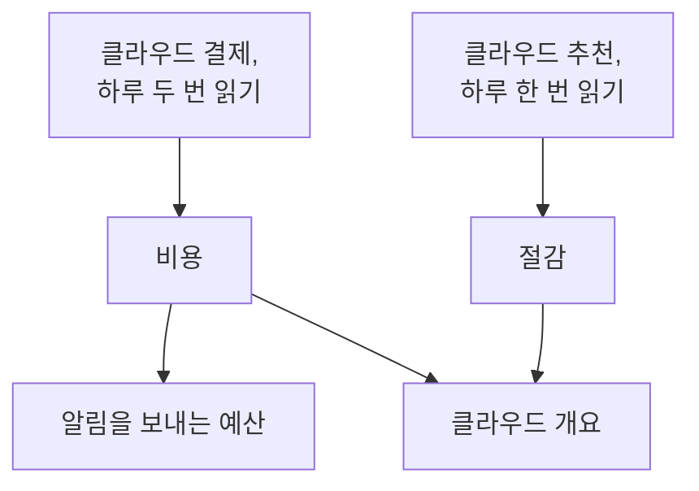

# 클라우드 비용과 절감

연결된 클라우드 계정은 그 비용과 비용을 줄이는 방법도 알려 줍니다. OneUptime은 클라우드 자체 결제에서 매일의 비용을, 클라우드 자체 추천 서비스에서 추천을 읽어 **클라우드 → 지출 → 비용**과 **클라우드 → 지출 → 절감**에 표시하고, 한 달 비용이 예산을 넘기 전에 **클라우드 → 지출 → 예산**에서 알림을 보냅니다.

:::cards
- [Amazon Web Services](#amazon-web-services): Cost Explorer와 Cost Optimization Hub. 각각 한 번만 켭니다.
- [Microsoft Azure](#microsoft-azure): Cost Management와 Azure Advisor. 역할이 하나 더 필요합니다.
- [Google Cloud](#google-cloud): BigQuery로의 결제 내보내기와 Recommender.
- [예산](#예산): 한 달 지출이 예산의 일정 비율을 넘으면 보내는 알림.
:::

## 작동 방식



- **비용은 클라우드 자체 결제에서 가져옵니다.** AWS Cost Explorer, Azure Cost Management, Google Cloud의 BigQuery 결제 내보내기에서 크레딧과 환불 전 금액을 계정의 청구 통화로 읽습니다. 각 금액은 하루치이며, 클라우드가 청구하는 대로 UTC 날짜 기준입니다.
- **클라우드는 마지막 하루 이틀을 늦게 보고합니다.** 각 읽기는 지난 한 주를 다시 읽고, 매달 첫 며칠에는 지난달 전체를 다시 읽으므로, 클라우드가 하루를 마감하면서 그날의 비용이 확정됩니다. 연결의 첫 읽기는 지지난달 초까지 거슬러 올라갑니다.
- **이번 달 예상은 지난 한 주의 속도를 따릅니다.** 이번 달 지금까지의 비용에, 남은 날마다 지난 온전한 이레의 평균을 더한 값입니다.
- **절감은 클라우드 자체 추천 서비스에서 가져옵니다.** AWS Cost Optimization Hub, Azure Advisor, Google Cloud의 Recommender가 더 작은 크기, 쓰이지 않는 리소스, 이득이 되는 약정을 각각 매달 절감할 금액과 함께 알려 줍니다. 클라우드 콘솔에서 실행하거나 무시한 추천은 다음 읽기에서 사라집니다.

## 시작하기 전에

- **연결된 계정.** 현재 설정 명령으로 [클라우드 계정 연결](/docs/telemetry/cloud-accounts)을 진행합니다. 이 명령으로 연결이 비용과 추천을 읽을 수 있습니다. 이전에 만든 연결은 명령을 다시 실행할 때까지 둘 다 읽지 않습니다.

## Amazon Web Services

연결은 비용을 `ce:GetCostAndUsage`로, 추천을 `cost-optimization-hub:ListRecommendations`로 읽습니다. 둘 다 먼저 계정에서 켜야 하는 것이 있습니다.

:::steps
### Cost Explorer 켜기

AWS Billing and Cost Management 콘솔에서 Cost Explorer를 한 번 엽니다. AWS는 하루 안에 계정의 비용을 준비합니다. 모든 멤버 계정의 비용을 읽으려면 조직의 관리 계정을 연결합니다.

### Cost Optimization Hub 참여하기

같은 콘솔에서 Cost Optimization Hub를 열고 참여합니다. 조직이라면 관리 계정에서, 이 계정만이라면 이 계정에서 진행합니다. 추천은 하루 안에 도착합니다.
:::

Cost Explorer는 요청당 $0.01를 청구하며, 비용 읽기 한 번에 요청을 몇 번 보냅니다. Cost Optimization Hub는 무료입니다.

## Microsoft Azure

앱은 **Cost Management Reader** 역할로 비용을 읽습니다. 범위는 **Monitoring Reader**와 같으며, 설정 명령이 두 역할을 모두 부여합니다. Azure Advisor의 추천은 **Monitoring Reader**로 읽으므로 켤 것이 없습니다. 이전에 만든 앱에 역할을 부여하려면 다음을 실행합니다.

```bash
az role assignment create --assignee <APP_ID> --role "Cost Management Reader" --scope /subscriptions/<SUBSCRIPTION_ID>
```

Cost Management는 구독마다 각 비용의 대상 리소스와 함께 응답하며, 읽기는 무료입니다. 어떤 구독에 대해 응답하지 못하면 계정의 **비용**에 이유가 표시됩니다.

## Google Cloud

Google Cloud에는 프로젝트 비용을 알려 주는 API가 없습니다. OneUptime은 결제 계정의 BigQuery 내보내기에서 비용을 읽습니다.

:::steps
### 결제를 BigQuery로 내보내기

Google Cloud 콘솔에서 Billing, 이어서 Billing export를 열고, 세부 사용 비용 내보내기를 BigQuery 데이터 세트로 켭니다. Google은 켠 날부터 몇 시간 늦게 기록합니다.

### 서비스 계정이 읽도록 허용하기

연결의 서비스 계정에 내보내기 데이터 세트에 대한 **BigQuery Data Viewer**를 부여합니다. 설정 명령이 이미 **BigQuery Job User**를 부여했으므로 쿼리는 자체 프로젝트에서 실행됩니다.

### 내보내기 테이블 지정하기

**클라우드 → 연결**에서 연결을 편집하고, **추가 필드**의 **결제 내보내기 테이블**을 테이블의 전체 이름으로 설정합니다: `<PROJECT_ID>.<DATASET>.gcp_billing_export_resource_v1_<BILLING_ACCOUNT_ID>`.
:::

세부 내보내기에는 각 비용의 대상 리소스가 들어 있고, 표준 내보내기에는 서비스와 리전만 있습니다. 쿼리는 BigQuery 요금입니다. 매월 처음 1 TiB는 무료이며 그 이후에는 TiB당 $6.25이고, 내보내기 한 달 분량은 몇 메가바이트에서 몇 기가바이트입니다. Recommender의 머신 유형 및 유휴 리소스 추천은 설정 명령이 부여하는 **Compute Recommender Viewer**로 읽으며 무료입니다.

## 지출을 줄이는 방법

**클라우드 → 지출 → 절감**은 절감액이 큰 순서로 모든 추천을 나열합니다. 무엇을 할지, 어떤 리소스인지, 무엇이 바뀌는지, 매달 얼마를 절감하는지 보여 줍니다. 위의 띠에는 전체 합계와 종류별 합계가 표시됩니다: 더 작은 크기, 쓰이지 않는 리소스, 약정. OneUptime에 해당 리소스가 있으면 추천은 리소스 페이지로 연결됩니다.

## 예산

:::steps
### 예산 만들기

**클라우드 → 지출 → 예산**에서 예산을 만듭니다: **월 금액**과 대상 **계정**(모든 계정이 대상이면 비워 둠).

### 알림 시점 선택하기

**알림 기준**에는 알림을 보낼 예산 비율을 퍼센트로 지정합니다. 처음에는 80과 100입니다. **초과가 예상될 때 알림**을 켜면 지난 한 주의 속도로는 이번 달이 예산을 넘을 때도 한 달에 한 번 알림을 보냅니다. **알림 심각도**와 **온콜 정책**으로 알림의 심각도와 호출할 대상을 정합니다.
:::

예산은 비용을 읽을 때마다, 그리고 한 시간마다 확인됩니다. 이번 달 지출이 임계값을 넘으면 그 임계값에 대한 알림이 하나 생성되며, 한 번의 읽기로 여러 임계값을 넘으면 가장 높은 임계값의 알림이 생성됩니다. 새 달이 되면 지난달의 알림은 해결됩니다. 예산은 예산 통화로 청구되는 계정만 셉니다.

## OneUptime에서 보는 것

- **클라우드 개요.** **클라우드 → 개요**에는 이번 달 지출과 지난달 같은 날까지의 지출 비교, 비용이 큰 서비스, 효과가 큰 지출 절감 방법이 주의가 필요한 항목 옆에 표시됩니다.
- **매일의 지출.** **클라우드 → 지출 → 비용**은 지난 30일의 각 날을 그리고, 기간을 서비스, 리전, 계정 또는 리소스별로 나눕니다. 비용을 읽지 못한 계정은 아래에 이유와 함께 나열됩니다.
- **계정의 비용.** 계정의 **비용**에는 그 계정에 대해서만 같은 내용이 지출을 줄이는 방법과 함께 표시됩니다.
- **리소스의 비용.** 클라우드가 리소스를 이름으로 청구하는 경우, 리소스 페이지에는 이번 달과 지난 30일의 비용이 지출을 줄이는 방법과 함께 표시됩니다.

## 문제 해결

:::details 계정에 권한 필요가 표시됩니다
연결이 아직 계정의 비용을 읽을 수 없습니다. **클라우드 → 연결**에서 설정 명령을 다시 실행하세요. 비용 읽기에 필요한 것이 추가됩니다. Google Cloud에서는 서비스 계정에 내보내기 데이터 세트에 대한 **BigQuery Data Viewer**도 부여하세요.
:::

:::details 계정에 설정되지 않음이 표시됩니다
클라우드에 아직 줄 비용이 없습니다. AWS에서는 Cost Explorer를 켜고, Google Cloud에서는 내보내기 테이블을 **결제 내보내기 테이블**에 지정합니다. 첫 금액은 다음 읽기와 함께 12시간 안에 도착합니다.
:::

:::details 금액에서 계정이 빠집니다
금액은 대부분의 계정이 청구되는 통화로 표시됩니다. 다른 통화로 청구되는 계정은 그 통화와 함께 아래에 나열되며, 예산은 예산 자체의 통화로 청구되는 계정만 셉니다.
:::

:::details 이번 달 금액이 클라우드 콘솔보다 낮습니다
클라우드는 마지막 하루 이틀을 늦게 보고하며, 금액은 크레딧과 환불 전 금액입니다. 다음 읽기에서 따라잡습니다.
:::

## 다음 단계

:::cards
- [클라우드 계정 연결](/docs/telemetry/cloud-accounts): 다른 계정을 연결하거나 명령을 다시 실행합니다.
- [클라우드 리소스](/docs/telemetry/cloud-resources): 각 리소스의 메트릭을 직접 운영하는 컬렉터에서.
- [Kubernetes 비용 관측성](/docs/telemetry/kubernetes-cost): Kubernetes 워크로드별 비용.
:::
