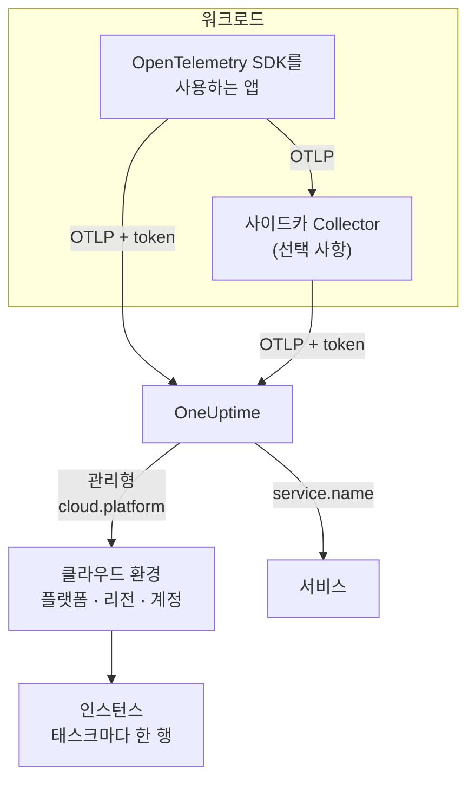

# 클라우드 환경

**Cloud Environment**는 관리형 클라우드 플랫폼에서 컨테이너가 실행되는 곳입니다. ECS 클러스터의 계정과 리전, Cloud Run 프로젝트와 리전, Container Apps 구독과 리전이 여기에 해당합니다. 올바른 리소스 속성을 가진 텔레메트리가 처음 도착하면 OneUptime이 환경을 만들고, 그곳에서 실행되는 모든 워크로드를 하나로 묶습니다. 직접 등록할 것은 없습니다.

:::cards
- [AWS ECS / Fargate](/docs/telemetry/cloud-aws-ecs): Fargate 또는 EC2의 태스크와 태스크별 CPU 및 메모리.
- [Google Cloud Run](/docs/telemetry/cloud-gcp-cloud-run): 서버리스 함수로도 표시되는 서비스와 작업.
- [Azure Container Apps](/docs/telemetry/cloud-azure-container-apps): 리전과 구독을 직접 설정하는 복제본.
- [기타 클라우드 플랫폼](/docs/telemetry/cloud-other-platforms): Elastic Beanstalk, App Runner, App Engine, App Service, Container Instances.
:::

## 작동 방식



- **리소스 감지기가 워크로드가 실행되는 위치를 알려 줍니다.** SDK나 Collector에 있는 OpenTelemetry 리소스 감지기가 플랫폼의 메타데이터를 읽고, 워크로드가 보내는 모든 데이터에 `cloud.platform`, `cloud.account.id`, `cloud.region`을 설정합니다. 감지기가 없는 곳에서는 직접 설정합니다.
- **환경은 모든 것을 묶습니다.** 플랫폼, 계정, 리전이 같은 워크로드는 모두 하나의 환경에 들어갑니다. 서비스는 **서비스**에서 각자 자기 행을 유지합니다.
- **실행 중인 각 태스크가 인스턴스입니다.** 환경의 **인스턴스** 탭에는 실행 중인 태스크, 인스턴스, 복제본이 나열되며, 플랫폼이 제공할 수 있으면 실시간 CPU와 메모리도 표시됩니다.

## 시작하기 전에

- **수집 키.** **프로젝트 설정 → 텔레메트리 및 APM → 수집 키**에서 **서버** 키를 만들고 토큰을 복사합니다. [수집 키 만들기](/docs/telemetry/open-telemetry#수집-키-만들기)를 참고하세요. 토큰은 시크릿입니다. 해당 클라우드의 시크릿 저장소 어디에 보관하는지는 각 플랫폼 페이지에서 안내합니다.
- **애플리케이션의 OpenTelemetry.** OTLP를 내보내는 OpenTelemetry SDK, 또는 애플리케이션 옆에서 실행되는 OpenTelemetry Collector.

## 지원되는 플랫폼

| 플랫폼 | `cloud.platform` | `cloud.*`를 채우는 주체 | 인스턴스 식별자 | 가이드 |
| ------------------------- | --------------------------- | ---------------------- | --------------------------------- | ------------------------------------------------------------------ |
| AWS ECS / Fargate | `aws_ecs` | 리소스 감지기 | `aws.ecs.task.arn` | [AWS ECS / Fargate](/docs/telemetry/cloud-aws-ecs) |
| AWS Elastic Beanstalk | `aws_elastic_beanstalk` | 리소스 감지기 | `host.id` | [기타 클라우드 플랫폼](/docs/telemetry/cloud-other-platforms) |
| AWS App Runner | `aws_app_runner` | 직접 설정 | `host.name` | [기타 클라우드 플랫폼](/docs/telemetry/cloud-other-platforms) |
| Google Cloud Run | `gcp_cloud_run` | 리소스 감지기 | `faas.instance` | [Google Cloud Run](/docs/telemetry/cloud-gcp-cloud-run) |
| Google App Engine | `gcp_app_engine` | 리소스 감지기 | `faas.instance` | [기타 클라우드 플랫폼](/docs/telemetry/cloud-other-platforms) |
| Azure Container Apps | `azure_container_apps` | 리소스 감지기 | `azure.container_app.instance.id` | [Azure Container Apps](/docs/telemetry/cloud-azure-container-apps) |
| Azure Container Instances | `azure_container_instances` | 직접 설정 | `host.name` | [기타 클라우드 플랫폼](/docs/telemetry/cloud-other-platforms) |
| Azure App Service | `azure_app_service` | 리소스 감지기 | `host.id` | [기타 클라우드 플랫폼](/docs/telemetry/cloud-other-platforms) |

- **리소스 감지기:** SDK 또는 Collector의 `resourcedetection` 프로세서에 있는 OpenTelemetry 리소스 감지기가 `cloud.*` 속성을 대신 설정합니다.
- **직접 설정:** 감지기가 없으므로 `OTEL_RESOURCE_ATTRIBUTES`에 속성을 넣습니다. 정확한 줄은 해당 플랫폼 페이지에 있습니다.
- **Azure 감지기는 아는 것이 적습니다.** Container Apps 감지기는 리전도 구독도 모르고, App Service 감지기는 구독을 모릅니다. 빠진 값은 직접 설정하세요.
- **점으로 구분된 Azure 표기도 동작합니다.** Node.js와 .NET용 Azure 감지기는 `azure.container_apps`와 `azure.app_service`로 씁니다. OneUptime은 이를 받을 때 위의 밑줄 값으로 바꿉니다.

## OneUptime이 환경을 식별하는 방법

환경은 세 가지 리소스 속성의 조합마다 하나씩 존재합니다:

| 속성 | 필수 | 설명 |
| ------------------ | -------- | ------------------------------------------------------------------------------------------- |
| `cloud.platform` | 예 | [지원되는 플랫폼](#지원되는-플랫폼)의 값 중 하나 |
| `cloud.account.id` | 아니요 | AWS 계정 ID, Google Cloud 프로젝트 ID 또는 Azure 구독 ID |
| `cloud.region` | 아니요 | 리전(예: `us-east-1`, `us-central1`, `eastus`) |

OneUptime은 세 값을 `|`로 이어 **환경 키**를 만들고, 같은 값으로 환경 이름을 붙입니다(예: _AWS ECS · us-east-1 · 123456789012_):

```text title="Environment keys"
aws_ecs|123456789012|us-east-1
gcp_cloud_run|my-project|us-central1
azure_container_apps|00000000-0000-0000-0000-000000000000|eastus
```

> [!IMPORTANT]
> 빠진 부분은 키에 빈 세그먼트로 남습니다: `aws_ecs||us-east-1`. 따라서 `cloud.account.id`를 생략한 워크로드는 이를 설정한 워크로드와 다른 환경에 들어갑니다. 환경이 하나일 줄 알았는데 두 개로 보이는 가장 흔한 이유입니다.

### 인스턴스 식별자

환경 안에서 실행 중인 각 태스크, 인스턴스, 복제본은 **인스턴스**에 한 행씩 표시됩니다. 이름은 텔레메트리에 있는 다음 리소스 속성 중 처음 찾은 것에서 가져옵니다:

1. `aws.ecs.task.id`
2. `aws.ecs.task.arn`(태스크 ID로 줄임)
3. `faas.instance`
4. `azure.container_app.instance.id`
5. `service.instance.id`
6. `container.id`
7. `host.id`
8. `host.name`

플랫폼 자체의 식별자를 의도적으로 먼저 사용합니다. 사이드카 Collector와 애플리케이션의 SDK가 모두 볼 수 있고, 재시작해도 유지되기 때문입니다. SDK는 보통 프로세스마다 새 `service.instance.id`를 만들어 냅니다(Node.js SDK는 기본적으로 그렇게 합니다). 그래서 이것을 먼저 키로 쓰면 ECS 태스크 하나가 두 행으로 나뉩니다. `service.instance.id`는 플랫폼이 자체 식별자를 설정하지 않을 때 사용됩니다. [지원되는 플랫폼](#지원되는-플랫폼)의 **인스턴스 식별자** 열에는 각 플랫폼의 일반적인 구성에서 쓰는 속성이 나와 있습니다.

### 직접 만드는 환경

직접 만들 일은 거의 없습니다. 수집 과정에서 환경이 자동으로 만들어지기 때문입니다. 텔레메트리보다 먼저 환경을 만들려면 **클라우드 → All Environments**를 열고 **클라우드 리소스 만들기**를 클릭합니다. **클라우드 플랫폼**을 고른 다음, **클라우드 계정 ID**와 **클라우드 리전**을 텔레메트리가 보고하는 값과 정확히 같게 입력합니다. OneUptime은 이 세 값으로 키 `platform|account|region`을 만들고, 수집 과정에서는 키만으로 환경을 찾습니다. 환경 이름은 수집 과정에서 붙이는 것과 같게 붙습니다. 다른 이름을 표시하려면 **추가 필드**를 열고 **표시 이름**을 입력하세요.

## 클라우드 환경이 아닌 것

| 실행 위치 | 표시되는 곳 | 이유 |
| ------------------------------------------------------------------------------------------------- | ------------------------ | ---------------------------------------------------------------------------------------------------- |
| EC2, Compute Engine, Azure VM (`aws_ec2`, `gcp_compute_engine`, `azure_vm`) | **호스트** | 가상 머신은 호스트입니다. [호스트 OpenTelemetry 수집기](/docs/telemetry/host-otel-collector)를 참고하세요 |
| EKS, GKE, AKS, 자체 관리형 Kubernetes | **Kubernetes** | `k8s.*` 속성으로 라우팅됩니다. [Kubernetes 에이전트](/docs/telemetry/kubernetes-agent)를 참고하세요 |
| Lambda, Cloud Functions, Azure Functions (`aws_lambda`, `gcp_cloud_functions`, `azure_functions`) | **서버리스 함수** | `faas.name`으로, 또는 FaaS `cloud.platform`이 있으면 `service.name`으로 라우팅됩니다. [서버리스 함수](/docs/telemetry/serverless-functions)를 참고하세요 |
| 로드 밸런서, 버킷, 관리형 데이터베이스 및 기타 IaaS·PaaS 리소스 | **Cloud Resources** | Azure Monitor, CloudWatch, Cloud Monitoring이 게시하는 메트릭에서 발견됩니다. [클라우드 리소스](/docs/telemetry/cloud-resources)를 참고하세요 |

> [!NOTE]
> Cloud Run과 App Engine은 의도적으로 두 곳에 표시됩니다. 이들의 감지기는 관리형 `cloud.platform`과 `faas.name`을 모두 설정하므로, 각 서비스는 그 자체로 **서버리스 함수**이기도 하고, **Cloud Environment**는 그 프로젝트와 리전의 모든 서비스를 묶습니다. 같은 텔레메트리가 두 곳 모두에 기록됩니다.

## 워크로드 연결하기

각 플랫폼 페이지에는 해당 클라우드의 명령과 콘솔 화면으로 이 단계가 설명되어 있습니다. 개요는 다음과 같습니다:

:::steps
### 텔레메트리에 클라우드 속성 붙이기

:::tabs
@tab Sidecar collector
태스크, 인스턴스, 복제본 안의 두 번째 컨테이너입니다. 애플리케이션은 `localhost:4318`로 내보내고, Collector의 `resourcedetection` 프로세서가 지나가는 모든 데이터에 `cloud.*`를 붙입니다. 토큰은 Collector가 보관하며, ECS에서는 태스크별 CPU와 메모리도 보냅니다:

```yaml title="collector.yaml"
processors:
  resourcedetection:
    detectors: [env, ecs] # [env, gcp] on Cloud Run and App Engine; [env, azurecontainerapps] on Container Apps
    timeout: 5s
```
@tab SDK direct
애플리케이션의 SDK가 OneUptime으로 직접 내보냅니다. Node.js의 `OTEL_NODE_RESOURCE_DETECTORS=env,host,os,aws`처럼 SDK에서 플랫폼의 리소스 감지기를 켭니다. 언어별 설정은 각 플랫폼 페이지에 나와 있습니다. 추가 컨테이너가 없으므로 컨테이너 CPU와 메모리도 없습니다.
:::

### OneUptime으로 OTLP 내보내기

:::tabs
@tab Sidecar collector
```yaml title="collector.yaml"
exporters:
  otlphttp/oneuptime:
    endpoint: https://oneuptime.com/otlp
    headers:
      x-oneuptime-token: ${env:ONEUPTIME_TOKEN}

service:
  pipelines:
    traces:
      receivers: [otlp]
      processors: [resourcedetection, batch]
      exporters: [otlphttp/oneuptime]
    metrics:
      receivers: [otlp]
      processors: [resourcedetection, batch]
      exporters: [otlphttp/oneuptime]
    logs:
      receivers: [otlp]
      processors: [resourcedetection, batch]
      exporters: [otlphttp/oneuptime]
```

Collector는 `${env:ONEUPTIME_TOKEN}`을 환경 변수에서 채웁니다. 이 환경 변수는 플랫폼이 시크릿 저장소(Secrets Manager, Secret Manager 또는 Container Apps 시크릿)에서 채웁니다.
@tab SDK direct
```bash
OTEL_EXPORTER_OTLP_ENDPOINT="https://oneuptime.com/otlp"
OTEL_EXPORTER_OTLP_HEADERS="x-oneuptime-token=YOUR_TELEMETRY_INGESTION_TOKEN"
```
:::

OneUptime을 자체 호스팅한다면 `https://YOUR-ONEUPTIME-HOST/otlp`를 사용하세요.

### 연결 확인하기

```bash
curl -i https://oneuptime.com/otlp/v1/validate \
  -H "x-oneuptime-token: YOUR_TELEMETRY_INGESTION_TOKEN"
```

`200`과 `"valid": true`는 토큰이 받아들여졌다는 뜻입니다. `401`은 토큰을 알 수 없거나, 취소되었거나, 비활성화되었거나, 만료되었다는 뜻이며, 응답의 `message`가 그중 무엇인지 알려 줍니다. 첫 스팬, 로그 또는 메트릭이 도착하고 1분 안에 환경이 **클라우드 → All Environments**에 나타납니다.
:::

> [!TIP]
> 같은 단계가 토큰이 채워진 상태로 대시보드에도 있습니다. 첫 환경이 도착하기 전에는 **클라우드 → All Environments**에, 그 뒤에는 각 환경의 **문서** 탭에 있습니다.

## 얻을 수 있는 것

환경의 **개요**에는 다음이 표시됩니다:

- 트레이스에서 계산한 **요청**, **오류율**, **p95 latency**와, 선택한 기간의 요청, 오류, 메모리 차트.
- 실행 중인 인스턴스 전체의 **CPU**와 **메모리**, 그리고 **CPU 기준 상위 인스턴스** 목록. 이 값들은 인스턴스 식별자를 가진 `container.cpu.utilization`과 `container.memory.usage` 메트릭에서 나옵니다. ECS에서는 `awsecscontainermetrics` 수신기의 `ecs.task.cpu.utilized`와 `ecs.task.memory.utilized`에서 나옵니다.
- **인스턴스**: 지난 15분 동안 보고한 인스턴스 수. **인스턴스** 탭에는 인스턴스마다 한 행이 있습니다.
- 환경으로 필터링된 **로그**, **트레이스**, **메트릭** 탭.

텔레메트리가 15분 동안 끊긴 환경은 **연결 끊김**으로 표시되고, 다음 스팬, 로그 또는 메트릭이 오면 **연결됨**으로 돌아옵니다. OneUptime 자체가 중단되었거나 밀린 데이터를 따라잡던 시간은 15분에 포함되지 않습니다.

### 레이블과 소유자

- **텔레메트리에서:** `oneuptime.label.team=payments` 같은 리소스 속성은 환경에 레이블 `team:payments`를 추가합니다.
- **규칙에서:** **클라우드 → 설정 → 레이블 규칙**과 **소유자 규칙**이 조건에 맞는 환경에 레이블과 소유자를 추가합니다. [레이블 및 소유자 규칙](/docs/configuration/label-and-owner-rules)을 참고하세요.

## 문제 해결

[클라우드 문제 해결](/docs/telemetry/cloud-troubleshooting)에서는 모든 장애를 발생 순서대로 다룹니다. 환경이 전혀 나타나지 않거나, **호스트** 또는 **서버리스 함수**에만 나타나거나, 인스턴스나 CPU와 메모리가 없거나, **연결 끊김**으로 표시되거나, 둘로 나뉘거나, 직접 만들었는데 일치하지 않는 경우입니다.

## 다음 단계

:::cards
- [AWS ECS / Fargate](/docs/telemetry/cloud-aws-ecs): 가장 흔한 구성과 완전한 태스크 정의.
- [클라우드 문제 해결](/docs/telemetry/cloud-troubleshooting): 환경이 없거나 잘못되었을 때 확인할 것.
- [클라우드 리소스(IaaS 및 PaaS)](/docs/telemetry/cloud-resources): 클라우드 자체 모니터링에서 가져오는 로드 밸런서, 버킷, 관리형 데이터베이스.
- [서버리스 함수](/docs/telemetry/serverless-functions): Lambda, Cloud Functions, Azure Functions.
:::
