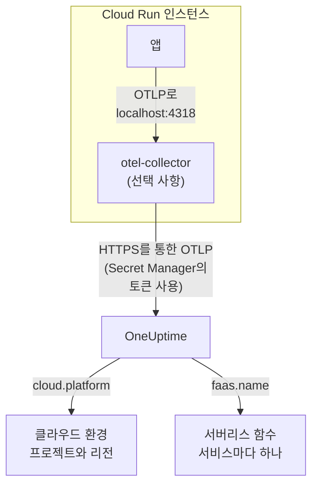

# Google Cloud Run

Cloud Run 서비스와 작업의 트레이스, 로그, 메트릭을 OneUptime으로 보냅니다. `cloud.platform=gcp_cloud_run`을 보고하는 모든 것은 Google Cloud 프로젝트와 리전마다 하나의 **Cloud Environment**(예: _GCP Cloud Run · us-central1 · my-project_)에 들어가며, 각 서비스는 **서버리스 함수**에도 나타납니다.

:::cards
- [작동 방식](#작동-방식): GCP 감지기가 설정하는 것과 서비스가 두 곳에 나타나는 이유.
- [설정](#설정): 토큰을 저장하고, 서비스를 구성하고, 배포한 뒤 확인합니다.
- [사이드카가 있는 서비스 YAML](#사이드카가-있는-서비스-yaml): Collector가 포함된 완전한 Cloud Run 서비스.
- [문제 해결](#문제-해결): 시크릿 오류, 사이드카 시작 순서, 나타나지 않는 환경.
:::

## 작동 방식



OpenTelemetry GCP 리소스 감지기는 메타데이터 서버와 환경 변수 `K_SERVICE`, `K_REVISION`을 읽고 다음을 설정합니다:

| 속성 | Cloud Run에서의 값 | 용도 |
| ------------------ | ------------------------------ | ----------------------------------------------------------------------------------------- |
| `cloud.platform` | `gcp_cloud_run` | 텔레메트리를 **클라우드 환경**으로 분류합니다 |
| `cloud.account.id` | 프로젝트 ID | 환경 키의 일부 |
| `cloud.region` | `us-central1` | 환경 키의 일부 |
| `faas.name` | 서비스 이름(`K_SERVICE`) | 서비스를 **서버리스 함수**에도 나열합니다 |
| `faas.version` | 개정(`K_REVISION`) | 서비스의 서버리스 함수 개요에 표시됩니다. 환경에서는 쓰지 않습니다 |
| `faas.instance` | 인스턴스 ID | 실행 중인 인스턴스 하나의 이름이 되어 **인스턴스**에 각각 한 행으로 표시됩니다 |

> [!NOTE]
> Cloud Run은 의도적으로 두 곳에 나타납니다. 감지기가 `faas.name`을 설정하므로 각 서비스는 자체 호출 수, 오류율, 실행 시간을 가진 **서버리스 함수**이기도 합니다. **Cloud Environment**는 그 프로젝트와 리전의 모든 서비스를 묶은 것입니다. 두 번 저장되는 것은 없으며, 같은 텔레메트리가 두 곳 모두에 기록됩니다.

환경 키는 `gcp_cloud_run|my-project|us-central1`입니다.

## 시작하기 전에

- **수집 키.** **프로젝트 설정 → 텔레메트리 및 APM → 수집 키**에서 **서버** 키를 만들고 토큰을 복사합니다.
- **`gcloud`**: 프로젝트에 로그인되어 있고 Secret Manager API가 켜져 있어야 합니다. `gcloud services enable secretmanager.googleapis.com`.
- **OpenTelemetry SDK로 계측한 애플리케이션**(OTLP를 내보내는 것).

## 텔레메트리가 서비스를 떠나는 방식 선택하기

| | SDK direct | Sidecar collector |
| --------------- | ---------------------------------------------------- | ---------------------------------------------------------------------- |
| 추가 컨테이너 | 없음 | 서비스 안의 `otel-collector` |
| 적합한 경우 | 서비스 하나, 그리고 Cloud Run 작업 | 한 프로젝트의 여러 서비스, 또는 감지기를 실행할 수 없는 SDK |
| 토큰 보관 | 애플리케이션 | Collector |
| 시크릿 | `oneuptime-otlp-headers`, 헤더 전체 | `oneuptime-ingestion-token`, 토큰만 |

작업은 끝날 때까지 실행되므로 사이드카를 계속 살려 둘 이유가 없습니다. SDK direct를 쓰세요. 아래의 각 단계에는 두 방식의 탭이 있습니다. 하나를 고르면 모든 단계가 그 방식을 따릅니다.

## 설정

:::steps
### Secret Manager에 토큰 저장하기

> [!IMPORTANT]
> 토큰은 시크릿입니다. Secret Manager에 넣고, 서비스에서는 시크릿 기반 환경 변수로 참조하세요. 일반 환경 변수는 콘솔과 `gcloud run services describe`에서 프로젝트의 모든 뷰어에게 보입니다.

:::tabs
@tab SDK direct
```bash
printf '%s' "x-oneuptime-token=YOUR_TELEMETRY_INGESTION_TOKEN" | gcloud secrets create oneuptime-otlp-headers \
  --data-file=- \
  --replication-policy=automatic

gcloud secrets add-iam-policy-binding oneuptime-otlp-headers \
  --member="serviceAccount:checkout-api@my-project.iam.gserviceaccount.com" \
  --role="roles/secretmanager.secretAccessor"
```

Cloud Run은 시크릿 값을 그대로 변수에 넣는데, `OTEL_EXPORTER_OTLP_HEADERS`에는 `name=value` 쌍 전체가 필요합니다. 그래서 이 시크릿에는 헤더 전체를 담습니다.
@tab Sidecar collector
```bash
printf '%s' "YOUR_TELEMETRY_INGESTION_TOKEN" | gcloud secrets create oneuptime-ingestion-token \
  --data-file=- \
  --replication-policy=automatic

gcloud secrets add-iam-policy-binding oneuptime-ingestion-token \
  --member="serviceAccount:checkout-api@my-project.iam.gserviceaccount.com" \
  --role="roles/secretmanager.secretAccessor"
```

Collector 구성이 헤더 이름을 붙이므로 이 시크릿에는 토큰만 담습니다.
:::

`--member`에는 자신의 사용자가 아니라 서비스의 런타임 서비스 계정을 넣으세요. `roles/secretmanager.secretAccessor`가 없으면 개정 배포가 `Permission denied on secret`으로 실패합니다. 서비스가 아직 기본 Compute 서비스 계정으로 실행 중이라면 그 계정에 역할을 부여하고, 서비스 전용 계정을 두는 것도 고려하세요. 기본 계정은 프로젝트의 모든 것이 함께 씁니다.

### 서비스 구성하기

:::tabs
@tab SDK direct
1. **Google Cloud console → Cloud Run → click the service → Edit & deploy new revision**.
2. **Containers** 탭에서 컨테이너를 열고 **Variables & Secrets**로 이동합니다. 아래 변수를 추가합니다.
3. **Reference a secret**를 클릭하고 `oneuptime-otlp-headers`와 버전 `latest`를 고른 다음, 환경 변수 `OTEL_EXPORTER_OTLP_HEADERS`로 노출합니다.
4. **Security** 탭에서 **Service account**가 `roles/secretmanager.secretAccessor`를 부여한 계정인지 확인합니다.

```bash
OTEL_SERVICE_NAME=checkout-api
OTEL_EXPORTER_OTLP_ENDPOINT=https://oneuptime.com/otlp
OTEL_EXPORTER_OTLP_PROTOCOL=http/protobuf
# Secret-backed (Variables & Secrets → Reference a secret), not typed here.
OTEL_EXPORTER_OTLP_HEADERS=x-oneuptime-token=YOUR_TELEMETRY_INGESTION_TOKEN
```

그런 다음 사용하는 언어의 GCP 리소스 감지기를 켭니다:

| 언어 | GCP 감지기 켜기 |
| -------- | ------------------------------------------------------------------------------------------------------------------- |
| Node.js | `OTEL_NODE_RESOURCE_DETECTORS=env,host,os,gcp` (auto-instrumentations-node) |
| Python | `pip install opentelemetry-resourcedetector-gcp` 후 `OTEL_EXPERIMENTAL_RESOURCE_DETECTORS=gcp_resource_detector` |
| Java | `-Dotel.resource.providers.gcp.enabled=true` |
| Go | `import "go.opentelemetry.io/contrib/detectors/gcp"` 후 `gcp.NewDetector()`를 `resource.New`에 전달 |
| .NET | `OpenTelemetry.Resources.Gcp` 패키지: `.ConfigureResource(r => r.AddGcpDetector())` |

또는 CLI에서 모두 설정합니다:

```bash
gcloud run services update checkout-api --region us-central1 \
  --set-env-vars "^@^OTEL_SERVICE_NAME=checkout-api@OTEL_EXPORTER_OTLP_ENDPOINT=https://oneuptime.com/otlp@OTEL_EXPORTER_OTLP_PROTOCOL=http/protobuf@OTEL_NODE_RESOURCE_DETECTORS=env,host,os,gcp" \
  --set-secrets "OTEL_EXPORTER_OTLP_HEADERS=oneuptime-otlp-headers:latest"
```

접두사 `^@^`를 붙이면 `gcloud`가 그 플래그의 목록을 `,` 대신 `@`로 나눕니다. 붙이지 않으면 `gcloud`가 `OTEL_NODE_RESOURCE_DETECTORS=env,host,os,gcp`를 쉼표마다 나누어 `Bad syntax for dict arg [host]`로 실패합니다.
@tab Sidecar collector
1. **Google Cloud console → Cloud Run → click the service → Edit & deploy new revision**.
2. **Containers** 탭에서 컨테이너를 열고 **Variables & Secrets**로 이동합니다. 아래의 애플리케이션 변수를 추가합니다.
3. **+ Add container**를 클릭합니다. 컨테이너 이미지 URL을 `otel/opentelemetry-collector-contrib:latest`로 설정하고, **Container command and arguments**에서 인수 `--config=env:OTEL_COLLECTOR_CONFIG`를 추가합니다.
4. 새 컨테이너의 **Variables & Secrets** 탭에서 **Reference a secret**로 `oneuptime-ingestion-token`을 환경 변수 `ONEUPTIME_TOKEN`으로 노출합니다. [사이드카가 있는 서비스 YAML](#사이드카가-있는-서비스-yaml)의 Collector 구성을 값으로 하는 변수 `OTEL_COLLECTOR_CONFIG`도 추가합니다.
5. Collector의 **Settings** 탭에서 **Startup probe**(HTTP, 경로 `/`, 포트 `13133`)를 추가하고, **Container start-up order**에서 내 컨테이너가 `otel-collector`에 의존하도록 설정합니다.
6. **Security** 탭에서 **Service account**가 `roles/secretmanager.secretAccessor`를 부여한 계정인지 확인합니다.

한 Cloud Run 인스턴스의 컨테이너는 `localhost`를 공유하므로 애플리케이션은 그곳의 사이드카로 내보냅니다:

```bash
OTEL_SERVICE_NAME=checkout-api
OTEL_EXPORTER_OTLP_ENDPOINT=http://localhost:4318
OTEL_EXPORTER_OTLP_PROTOCOL=http/protobuf
```

CLI에서는 아래 서비스 YAML이 사이드카이며, `gcloud run services replace service.yaml --region us-central1`로 배포합니다.
:::

OneUptime을 자체 호스팅한다면 엔드포인트로 `https://YOUR-ONEUPTIME-HOST/otlp`를 사용하세요.

### 새 개정 배포하기

콘솔에서 **Deploy**를 클릭합니다. Cloud Run은 그 설정으로 새 개정을 시작하고, 준비되면 트래픽을 보냅니다. `gcloud` 명령은 그 자체로 새 개정을 배포합니다.

### 연결 확인하기

```bash
curl -i https://oneuptime.com/otlp/v1/validate \
  -H "x-oneuptime-token: YOUR_TELEMETRY_INGESTION_TOKEN"
```

`200`과 `"valid": true`는 토큰이 받아들여졌다는 뜻입니다. `401`은 토큰을 알 수 없거나, 취소되었거나, 비활성화되었거나, 만료되었다는 뜻입니다. 그런 다음 서비스에 요청을 하나 보내고, Cloud Logging에서 Collector 로그(`otel-collector` 컨테이너로 필터링)에 `401`, `connection refused`, `context deadline exceeded`가 있는지 확인합니다. 1분 안에 환경이 **클라우드 → All Environments**에 _GCP Cloud Run · us-central1 · my-project_ 라는 이름으로 나타나고, 서비스는 **서버리스 함수**에 나타납니다.
:::

## 사이드카가 있는 서비스 YAML

Collector는 구성 전체를 `OTEL_COLLECTOR_CONFIG`(`--config=env:OTEL_COLLECTOR_CONFIG`)에서 읽고, 토큰은 `${env:ONEUPTIME_TOKEN}`을 통해 시크릿에서 읽습니다. `run.googleapis.com/container-dependencies` 주석 때문에 Cloud Run은 Collector를 먼저 시작하고, 그 시작 프로브를 기다린 뒤 애플리케이션을 시작합니다:

```yaml title="service.yaml"
apiVersion: serving.knative.dev/v1
kind: Service
metadata:
  name: checkout-api
spec:
  template:
    metadata:
      annotations:
        # "app" depends on "otel-collector": the collector starts first and
        # must pass its startup probe before the app container is started.
        run.googleapis.com/container-dependencies: '{"app":["otel-collector"]}'
    spec:
      serviceAccountName: checkout-api@my-project.iam.gserviceaccount.com
      containers:
        - name: app
          image: us-central1-docker.pkg.dev/my-project/apps/checkout-api:1.4.2
          ports:
            - containerPort: 8080
          env:
            - name: OTEL_SERVICE_NAME
              value: checkout-api
            - name: OTEL_EXPORTER_OTLP_ENDPOINT
              value: http://localhost:4318
            - name: OTEL_EXPORTER_OTLP_PROTOCOL
              value: http/protobuf
        - name: otel-collector
          image: otel/opentelemetry-collector-contrib:latest
          args:
            - --config=env:OTEL_COLLECTOR_CONFIG
          env:
            - name: ONEUPTIME_TOKEN
              valueFrom:
                secretKeyRef:
                  name: oneuptime-ingestion-token
                  key: latest
            - name: OTEL_COLLECTOR_CONFIG
              value: |
                receivers:
                  otlp:
                    protocols:
                      http:
                        endpoint: 0.0.0.0:4318
                      grpc:
                        endpoint: 0.0.0.0:4317
                processors:
                  # Stamps cloud.provider, cloud.platform=gcp_cloud_run,
                  # cloud.account.id, cloud.region and faas.* on everything.
                  resourcedetection:
                    detectors: [env, gcp]
                    timeout: 5s
                  batch: {}
                exporters:
                  otlphttp/oneuptime:
                    endpoint: https://oneuptime.com/otlp
                    headers:
                      x-oneuptime-token: ${env:ONEUPTIME_TOKEN}
                extensions:
                  health_check:
                    endpoint: 0.0.0.0:13133
                service:
                  extensions: [health_check]
                  pipelines:
                    traces:
                      receivers: [otlp]
                      processors: [resourcedetection, batch]
                      exporters: [otlphttp/oneuptime]
                    metrics:
                      receivers: [otlp]
                      processors: [resourcedetection, batch]
                      exporters: [otlphttp/oneuptime]
                    logs:
                      receivers: [otlp]
                      processors: [resourcedetection, batch]
                      exporters: [otlphttp/oneuptime]
          startupProbe:
            httpGet:
              path: /
              port: 13133
            periodSeconds: 2
            failureThreshold: 15
          resources:
            limits:
              cpu: 500m
              memory: 256Mi
```

배포합니다:

```bash
gcloud run services replace service.yaml --region us-central1
```

요청을 받는 컨테이너(`app`)만 `ports`를 선언합니다. 사이드카는 선언하면 안 됩니다.

## 네트워킹

- **기본적으로** Cloud Run 서비스는 인터넷에 바로 닿으므로, `oneuptime.com`으로 내보내는 데 더 필요한 것이 없습니다.
- **VPC egress: All traffic**(`--vpc-egress all-traffic`, Direct VPC egress 또는 Serverless VPC Access 커넥터 사용)에서는 아웃바운드 트래픽이 VPC를 거치므로, OneUptime 호스트에 닿으려면 VPC에 Cloud NAT(또는 프록시로 가는 경로)가 필요합니다. 기본값인 `private-ranges-only`에서는 사설 주소만 VPC를 거치고 OneUptime에는 바로 닿습니다.
- VPC의 **방화벽 이그레스 규칙**은 OneUptime 호스트로 가는 TCP 443을 허용해야 합니다.
- **VPC 안의 자체 호스팅 OneUptime**은 반대의 경우입니다. 트래픽이 VPC를 거치게 해서(`private-ranges-only` 또는 `all-traffic`) `https://YOUR-ONEUPTIME-HOST/otlp`가 그곳에서 확인되게 하세요.

## 얻을 수 있는 것

- **개요**: 트레이스에서 계산한 요청, 오류율, p95 지연 시간.
- **인스턴스**: Cloud Run 인스턴스마다 한 행이며, 이름은 `faas.instance`입니다. Cloud Run은 컨테이너의 리소스 사용량을 사이드카에 보여 주지 않으므로, 같은 `faas.instance`를 가진 `container.cpu.utilization`과 `container.memory.usage` 메트릭을 직접 보내지 않는 한 **CPU**와 **메모리** 타일은 비어 있습니다. 여기서는 요청 타일을 보고, 인스턴스 CPU와 메모리는 Cloud Monitoring에 맡기세요.
- 환경으로 필터링된 **로그**, **트레이스**, **메트릭**.
- 같은 서비스가 **서버리스 함수**(`faas.name` 기준)와 **서비스**(`service.name` 기준)에도 나타납니다.

## 문제 해결

:::details 개정이 "Permission denied on secret"으로 실패함
런타임 서비스 계정에 시크릿에 대한 `roles/secretmanager.secretAccessor`가 없거나, 바인딩이 서비스가 참조하는 시크릿이 아닌 다른 시크릿에 걸려 있습니다. 런타임 서비스 계정을 `--member`로 하여 `gcloud secrets add-iam-policy-binding` 명령을 다시 실행하세요.
:::

:::details Cloud Run이 container-dependencies를 거부함
주석이 존재하지 않는 컨테이너를 가리키거나, Collector에 시작 프로브가 없어 Cloud Run이 언제 준비되었는지 알 수 없습니다.
:::

:::details 서비스는 서버리스 함수에 있지만 환경이 없음
텔레메트리에 `cloud.platform`이 없습니다. SDK에서 GCP 감지기가 켜져 있지 않거나, Collector의 `detectors` 목록에 `gcp`가 빠져 있습니다.
:::

:::details 환경은 있지만 인스턴스가 비어 있음
텔레메트리에 `faas.instance`도 `service.instance.id`도 없습니다. 원인은 같습니다. 감지기가 실행되지 않습니다.
:::

환경이 전혀 나타나지 않거나, **연결 끊김**으로 표시되거나, 둘로 나뉘는 경우는 [클라우드 문제 해결](/docs/telemetry/cloud-troubleshooting)에서 다룹니다.

## 다음 단계

:::cards
- [클라우드 환경](/docs/telemetry/cloud-environments): 환경과 인스턴스를 식별하는 방법.
- [서버리스 함수](/docs/telemetry/serverless-functions): Cloud Run 서비스 하나하나를 서비스별로 보는 보기.
- [클라우드 문제 해결](/docs/telemetry/cloud-troubleshooting): 모든 플랫폼에 공통인 장애.
- [클라우드 리소스(IaaS 및 PaaS)](/docs/telemetry/cloud-resources): Cloud Monitoring에서 가져오는 Cloud SQL, 로드 밸런서, 버킷.
:::
